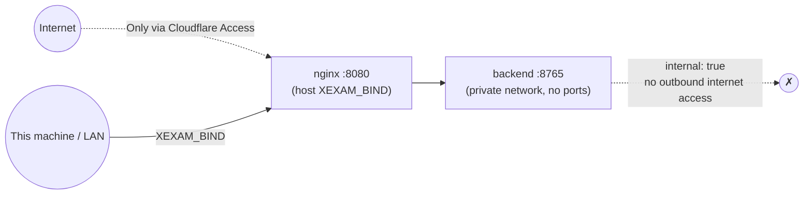

**English** | [日本語](security.ja.md) | [简体中文](security.zh-CN.md)

# Security

> Scope: a self-hosted program for **personal** use, with no user system and no login. Security rests on three things: the **backend is not exposed**, the **Host/Origin guard**, and **authentication in front of it, such as Cloudflare Access**.
> Audit basis: [audit/security.md](audit/security.md). Tests: `backend/tests/` (run against the committed legacy snapshot: 172 golden responses, parser fixtures, id vectors) and `tests/integration/nginx_check.py`. During the migration, a batch of 340 malicious-request probes was also used to compare the legacy and new versions item by item (0 unexplained differences; 51 recorded as intentional hardening). That probe set was removed together with the old Python code.

## 1. Threat model

| Who | What they can do | Our defense |
|---|---|---|
| Another machine on the same network | Connect straight to the port | Binds to `127.0.0.1` only by default; to open it up you must set `XEXAM_BIND` yourself; **the program itself has no login**, so once it is opened up, anyone who can connect can modify the question bank |
| A malicious web page (in your browser) | Make the browser send a write request to `localhost:8765` (CSRF) | Write requests check that the `Origin` hostname matches `Host` or is on the allow-list; JSON endpoints require `Content-Type: application/json` (a cross-site form cannot send it) |
| DNS rebinding | Make a malicious domain resolve to 127.0.0.1 in order to read your data | The `Host` allow-list is checked; GET requests are checked too |
| A malicious / corrupt .xlsx | Zip bombs, XML entity expansion, malformed structures that bring the service down | See §3 |
| Forged headers along the proxy chain | `X-Forwarded-Host` and the like | The backend **reads only the real `Host` header**; Nginx clears all forwarding headers |
| Supply chain | Vulnerabilities in dependencies | Dependencies are locked (`Cargo.lock`, `package-lock.json`); the images contain no extraneous content beyond the package manager; see §6 |

**Out of scope**: multi-user isolation, login, audit logs, encrypted storage. To reach the app from the internet, put Cloudflare Access (or something similar) in front of it.

## 2. Network

- The backend **never publishes a port**. In `docker-compose.yml`, `backend` has no `ports:` and its network is `internal: true`; `tests/integration/stack_check.py` asserts that the backend cannot be reached from the host.
- `XEXAM_BIND` must be written as `IP:port`. A bare port number (such as `8766`) means binding to all network interfaces, which is a common mistake, so the documentation warns about it repeatedly.
- On Linux, the host firewall (ufw / firewalld) **cannot block** ports published by Docker; to restrict who can connect, add rules to the `DOCKER-USER` chain, or set `XEXAM_BIND` to a specific LAN IP.

## 3. Upload (.xlsx)

The steps run in order. A failure at any step returns 400/413 with a fixed message (in Chinese), and **nothing is written to the database**:

1. Request body size: counted as a stream, **20 MiB**, in real bytes, without trusting `Content-Length`; Nginx adds a further `client_max_body_size 20m` in front (it returns JSON with the same message text).
2. Judged by **content**: the `PK` magic number, ZIP structure, and the presence of a workbook. Legacy `.xls` files, empty files and files with a renamed extension each get their own message.
3. ZIP: entries ≤ 10,000; **duplicate entry names are rejected** (to avoid "what is checked is one thing, what is read is another"); the total decompressed size has a cap; reads are bounded with `take(limit)`, because the declared size cannot be trusted.
4. XML: **any DOCTYPE / entity declaration is rejected outright**, whatever the extension and whatever the encoding (UTF-16 is rejected too); depth ≤ 64, nodes ≤ 1 million (100 × 10,000).
5. Parsing: there is a cooperative deadline (30 seconds by default). The parser looks at the clock after every batch of rows / XML events and **stops by itself** when time is up, so after a timeout it does not keep holding on to CPU and memory. At most 2 parses run at the same time (`PARSE_CONCURRENCY`); the rest queue, and the time spent queueing counts toward the time limit.
   There is also a memory cap: when many cells reference the same shared string it is stored only once (no deep copy), and the total bytes referenced by all A/B/C cells do not exceed 64 MB; an XML element may have at most 256 attributes.
6. The preview goes into the **single pending-confirmation slot** in memory and expires after 30 minutes; the confirmation code is 128 bits of randomness, single-use, and compared in constant time; a wrong confirmation code does not consume what is in the slot.
7. Confirmation writes everything in **one transaction**; if the file contains no usable questions, the import is rejected (to prevent emptying the question bank).

The legacy version scanned only the ASCII bytes of lowercase `.xml` / `.rels`, so UTF-16 or a different extension could get around it. This is what the new version hardens (recorded in the table of differences in [api.md](api.md)).

## 4. Host and Origin

| Check | Applies to | Rule |
|---|---|---|
| Host | All requests | Must be on the allow-list: `localhost`, `127.0.0.1`, `::1` by default; `XEXAM_ALLOWED_HOSTS` adds more; `XEXAM_ALLOW_ANY_HOST=1` turns the check off |
| Origin | Write requests | Absent → allowed (command-line tools are not cross-site requests); present → the **hostname** must match the hostname of `Host`, or be in `XEXAM_ALLOWED_ORIGINS` / the allow-list |

Key points:

- **Only the hostname is compared**, not the scheme or the port: when the app is reached through an HTTPS domain, the Origin is `https://example.com` and the Host is `example.com`, so nothing is blocked by mistake.
- The guard reads the real `Host` header. It does **not** read `X-Forwarded-Host` / `Forwarded`, since that would hand the guard over to the client. Nginx forwards with `proxy_set_header Host $http_host` unchanged and clears the other forwarding headers.
- When a request is rejected, the response states what your Host / Origin was and which value to add to which option; there is also a line in the log.
- Use `XEXAM_ALLOW_ANY_HOST=1` only when **authentication is already in place in front of the app**; it does not turn off the Origin check.

## 5. HTTP layer

| Item | Setting |
|---|---|
| Response headers | All backend responses: `Cache-Control: no-store`, `X-Content-Type-Options: nosniff`. `index.html` additionally has `X-Frame-Options: DENY`, `Referrer-Policy: no-referrer`, `Permissions-Policy` (camera / microphone / geolocation all off) and a strict CSP. `/assets/` (scripts / styles) and the error JSON that Nginx generates itself carry only `X-Content-Type-Options` (plus the cache headers for assets), because once nginx's `add_header` is written in a location, the headers from the level above are no longer inherited; these are not pages that can be embedded or executed |
| CSP | `default-src 'self'; img-src 'self' data:; style-src 'self'; script-src 'self'; base-uri 'none'; form-action 'self'; frame-ancestors 'none'`: no inline scripts or styles |
| HSTS | **Not set**: TLS terminates at Cloudflare, and the origin server speaks HTTP |
| CORS | No CORS headers are sent (same origin) |
| Methods | `GET` / `HEAD` / `POST`; for other methods Nginx answers 403 directly (`limit_except`), so they never reach the backend; the backend itself answers them with 405 + `Allow` |
| Rate limiting | Nginx: `/api/` 10 requests/second (burst 30); `/api/upload` 1 request/second (burst 5); over the limit → 429 |
| Timeouts | Header 15 seconds, body 30 seconds (against slow attacks); upstream connect 5 seconds, read 90 seconds |
| Hidden files | `/.xxx` is always 404; no directory listing |
| `Server` header | The backend does not send it; Nginx has `server_tokens off` |

## 6. Containers

- Both containers run as **non-root** (backend uid 10001), with `cap_drop: ALL`, `no-new-privileges` and a `read_only` root filesystem; only `/tmp` (tmpfs) and the backend's `/data` (named volume) are writable.
- **No secrets in the images**: no `.env`, no database, no real question bank (excluded by `.dockerignore`).
- The backend image is a single statically linked (musl) executable plus tzdata, with no toolchain other than a shell.
- `docker compose down -v` deletes the data volume. The documentation explicitly warns against adding `-v`.

## 7. Logs and privacy

- Logs do not record confirmation codes, the contents of uploaded files, or question contents.
- Rejected requests are logged with the Host / Origin and the reason, for troubleshooting.
- The question bank is the user's own Excel file and is **not in the repository** (`.gitignore` excludes `*.xlsx` and similar files; the only exception is the fictional test fixtures in `tests/baseline/fixtures/`).

## 8. Known limitations (stated honestly)

- **No login.** An open port means anyone who can connect can see and modify the question bank.
- **The server trusts `correct`**, and does not check whether an id is in the question bank either (same as the legacy version): scoring happens in the browser, so cheating on your own score only fools yourself.
- **A single pending-confirmation slot**: concurrent uploads replace each other (single-user use; no session concept is introduced).
- The Cloudflare path has only been **simulated locally**: the browser-level simulation (a real Chrome plus an HTTPS reverse proxy) was done for the legacy Python version; for the new stack only header-level checks were done (the Host / Origin guard still applies after passing through Nginx). It has not been tested with real Cloudflare.
- iPhone Safari has not been tested on a real device; the build target is iOS 15.4+.
- The arm64 build of the new images: CI has **built and started** it under QEMU (`/api/info` reports `aarch64`), but it has not been run on real ARM hardware. The aarch64 backend binary does not include the linker workaround for Cortex-A53 erratum #843419 (see [deployment.md](deployment.md)).

## 9. Reporting vulnerabilities

This is a private repository for a personal project; if you find a problem, please contact the owner directly.
