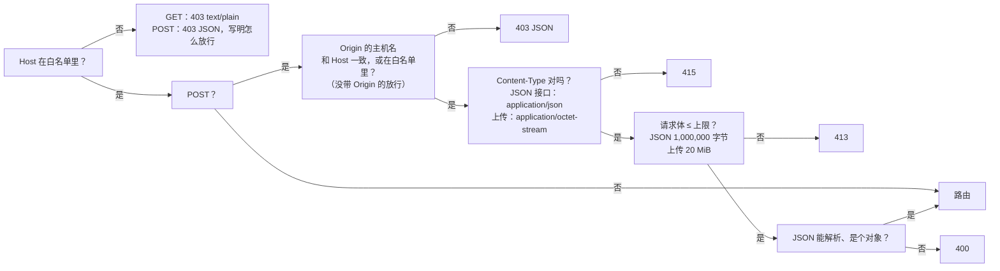

[English](../en/api.md) | [日本語](../ja/api.md) | **简体中文**

# API 说明

> 机器可读的版本是 [openapi.yaml](../en/openapi.yaml)。本文是给人读的：每个接口做什么、守卫怎么拦、哪里和旧的 Python 版不一样。
> 本文描述的是**真实行为**：旧版的每一种情况都抓成了黄金响应（`tests/baseline/golden/`，172 份），新的 Rust 后端对它们逐项比较。

## 1. 总览

浏览器只通过这组 REST 接口和后端通信。前端不访问数据库，也没有判断导入能不能做的逻辑。

| 方法 | 路径 | 作用 | 写库？ |
|---|---|---|---|
| GET | `/api/info` | 版本、CPU 架构、能否关闭程序、题数 | 否 |
| GET | `/api/bank` | 所有题库的题（只含上架的题） | 否 |
| GET | `/api/banks` | 题库列表（每个导入的工作簿是一个题库），含各自的工作表和数量 *(v0.5)* | 否 |
| GET | `/api/progress` | 学习记录 | 否 |
| GET | `/api/imports` | 最近 12 次导入记录 | 否 |
| GET | `/api/records` | 保留下来的所有考试记录，最新的在前 *(v0.5)* | 否 |
| GET | `/api/record?id=<int>` | 一条考试记录及其逐题明细 *(v0.5)* | 否 |
| GET | `/api/settings` | 界面设置 *(v0.5)* | 否 |
| POST | `/api/upload` | 上传 .xlsx，得到**预览**和一次性确认码；可选请求头 `X-Bank-Target` *(v0.5)* | **否**（只暂存在内存里） |
| POST | `/api/import/confirm` | 确认导入 | **是**（一个事务） |
| POST | `/api/import/cancel` | 取消待确认的导入 | 否 |
| POST | `/api/banks/delete` | 删除一个题库（可以连同学习数据一起删） *(v0.5)* | 是 |
| POST | `/api/attempt` | 记录一场考试的成绩（可以附带作答内容） | 是 |
| POST | `/api/records/delete` | 删除一条考试记录，或者全部删除 *(v0.5)* | 是 |
| POST | `/api/reset` | 清空学习记录 | 是 |
| POST | `/api/settings` | 修改界面设置 *(v0.5)* | 是 |
| POST | `/api/settings/reset` | 恢复默认的界面设置 *(v0.5)* | 是 |
| POST | `/api/shutdown` | 关闭程序（只有本机运行时可用，Docker 里恒 403） | 否 |

`HEAD` 与对应的 `GET` 一样，只是没有正文。v0.5 新增的接口和其他接口经过完全相同的守卫（第 3 节）。

## 2. 所有响应的共同点

- `Cache-Control: no-store`、`X-Content-Type-Options: nosniff`。
- JSON 是 UTF-8，日文和中文不转义成 `\uXXXX`；分隔符是 `", "` 和 `": "`（冒号后有空格）；键的顺序固定。**这是约定的一部分**：冒烟测试会 `grep '"bankCount": 0'`。
- 错误是 `{"error": "<可以直接显示给用户的中文原因>"}`。后端不会把异常名、文件路径、SQLite 报错放进响应；细节只进日志。

## 3. 守卫（每个请求都先经过这里）

顺序是固定的，所以同一个坏请求总是得到同一个答案：



- **Host**：默认只接受 `localhost`、`127.0.0.1`、`::1`。用别的地址或域名访问时，把它写进环境变量 `XEXAM_ALLOWED_HOSTS`（逗号、空格或分号分隔）。`XEXAM_ALLOW_ANY_HOST=1` 表示不检查 Host（只在前面已经有身份验证，比如 Cloudflare Access 时用）。
- **Origin**（只查写请求）：只比较**主机名**（不比协议和端口），所以经 HTTPS 域名访问也不会被误拦。没带 `Origin` 的请求放行（命令行工具不是浏览器里的跨站请求）。代理把 Host 改写成源站地址时，把公网域名写进 `XEXAM_ALLOWED_ORIGINS`。
- 后端**只读真实的 `Host` 头**，从不读 `X-Forwarded-*`。Nginx 也不转发它们。
- 被拒绝的请求会在日志里留一行，并且响应里写明「你的 Host 是什么、该把哪个值加进哪个选项」。

## 4. 接口细节

### `GET /api/info`
```json
{"version": "0.6", "arch": "x86_64", "canShutdown": false, "bankCount": 5}
```
`bankCount` 是上架的题数。版本号来自 `VERSION` 文件。

### `GET /api/bank`
`file` / `mtime` 是最近一次导入（不管导入到哪个题库）的文件名和时间；`questions` 只含上架的题，包括所有题库的题，按题库 id 从小到大分组，每个题库内按该题库自己的顺序；`sheets` 里每个工作表名有可用题数和已下架题数（不同题库里同名的工作表合在一起算；每个题库各自的数字见 `GET /api/banks`）。题目的字段见 [openapi.yaml](../en/openapi.yaml) 的 `Question`。
从 v0.5 起，每道题的最后多一个键 `"bank": <题库 id>`（在 `row` 之后）；其他都没有变。
四列格式的题（A 英语、B 中文、C 日语、D 答案）多两个键 `english`（A 列原文）和 `en`（按日语结构拆开的英语），夹在 `zh` 和 `explanation` 之间；没有英语的题（包括所有三列格式的题）**不出现**这两个键，所以旧文件的输出与以前逐字节相同。`zh` / `en` 的热点题多一个 `choices`：每个小项用本语言写的选项。`stem`、`options`、`items`、`answer` 永远来自 C 列的日语。

### `GET /api/banks` *(v0.5)*
一个题库就是一个导入的工作簿。按 `id` 排序：

```json
{"banks": [{"id": 1, "name": "Kitchen basics", "filename": "Kitchen basics.xlsx", "legacy": true, "createdAt": "2026-11-10 14:00", "updatedAt": "2026-11-10 15:00", "total": 5, "inactive": 0, "sheets": [{"name": "Cooking", "usable": 3, "inactive": 0}, {"name": "Safety", "usable": 2, "inactive": 0}], "studied": 4, "records": 3}]}
```

- `name` 是创建题库时去掉 `.xlsx` 的文件名（如果已经有题库叫这个名字，会在后面加上 ` (2)`、` (3)`……）；更新题库会改 `filename` 和 `updatedAt`，但从不改 `name`。
- `legacy`：存放 v0.5 之前数据的题库（下文称 legacy 题库），也是不带 `X-Bank-Target` 的上传的目标。它的题目 id 就是 [database.md](database.md) 第 4.1 节里的普通题目 id；其他题库都用按题库区分的 id，所以同一个工作簿可以导入成两个互不相干的题库。
- `total` = 上架的题数，`inactive` = 已下架的题数；`sheets` 按题库里题目的顺序排列，题全部下架的工作表也会列出来（`usable` 为 0）。
- `studied` = 这个题库里有统计数据的题有几道（不管是否上架）；`records` = 有几条考试记录用到了这个题库。

### `GET /api/progress`
`questions` 是每道题的累计统计（答过几次、对几次、错几次、当前连续答对几次）；`history` 是最近 60 场（v0.5 没有变，虽然数据库现在保留 500 场，见 `GET /api/records`）；`masterStreak` 是错题连续答对几次后移出错题本（2）。

### `POST /api/upload`
请求体是 .xlsx 的原始字节。服务端：

1. 只看**内容**判断是不是 .xlsx（魔数 + ZIP 结构 + 有工作簿 + 没有 DOCTYPE / 实体声明 + 解压后大小有上限）。空文件、旧版 `.xls`、损坏的文件、改了扩展名的文件，各有自己的中文说明。
2. 解析，生成预览，把解析结果放进内存里**唯一的待确认槽位**（再次上传会替换它），30 分钟有效。
3. **不写数据库。**

返回预览（`added / updated / unchanged / restored / removed / skipped / usable`、每个工作表的明细、读不出来的行和原因）和一次性确认码 `token`。

**目标题库** *(v0.5)*：可选请求头 `X-Bank-Target` 指定文件导入到哪个题库。预览在任何情况下都是同样的键，只针对目标题库计算。

| `X-Bank-Target` | 含义 |
|---|---|
| 不带 | 和 v0.4 完全一样，针对 legacy 题库（还不存在时，在确认时创建） |
| `new`（忽略前后空格，不区分大小写） | 确认时新建一个题库；预览里每道可用的题都算作 `added` |
| 题库 id，`^[0-9]{1,18}$`（忽略前后空格） | 更新（替换）这个题库；id 不存在 → **404** `这个题库不存在（可能已被删除），请刷新页面后再试。` |
| 其他任何值 | **400** `上传目标不对，请刷新页面后再试。` |

这个请求头在守卫和大小上限之后、解析文件之前读取。被拒绝的上传不会动待确认槽位。

### `POST /api/import/confirm`
请求体 `{"token": "…"}`。

- 确认码是 128 位随机数（22 个字符），**只能用一次**；错的确认码不会消耗待确认的内容；过期的取不出来；非 ASCII 的确认码按「无效」处理（409）。
- 导入在**一个事务**里完成：要么全部成功，要么题库没有任何改动。
- 这份文件里一道可用的题都没有 → 400，不导入（防止把题库清空）。

导入规则（文件被当成**目标题库的完整内容**）：新出现的题新增；改过的题更新；这个题库里有而文件里找不到的题**下架**（学习记录保留）；下架的题再出现会自动恢复。其他题库永远不会被改动。

响应：`{"result": <和预览同样的结构，去掉 filename / token>, "bank": <GET /api/bank>}`。只有上传时带了 `X-Bank-Target`，后面才多第三个键 `"bankId": <新建 / 更新的题库 id>`（这样 v0.4 的响应仍然逐字节相同）。如果目标题库在预览之后被删掉了 → **404** `这个题库不存在（可能已被删除），请刷新页面后再试。`，什么都不写，确认码也已用掉。

### `POST /api/banks/delete` *(v0.5)*
请求体：`{"id": <int>, "withRecords": <bool，默认 false>}`。在一个事务里删除这个题库的题（上架的和已下架的）、它的导入历史和题库本身。带 `withRecords: true` 时还会删除这个题库的学习数据：这些题的统计（错题本）、它们在考试里的逐题明细，以及所有出题来自这个题库、并且不来自任何仍然存在的题库的考试记录（通常就是只用了这个题库的考试；如果一场考试还用了之前已经删除的题库，也会一起删掉，而不是留下一条空记录）。不带时，考试记录和统计都保留；它们的明细里这些题显示为已删除。
如果待确认的上传以这个题库为目标（上传时指定了这个 id，或者这是 legacy 题库而上传没带 `X-Bank-Target`），它会被丢弃。

响应：`{"banks": [...], "bank": <GET /api/bank>, "progress": <GET /api/progress>}`。`id` 缺失或不是整数（布尔值不算整数），或者带了 `withRecords` 但不是布尔值 → **400** `请求的格式不对。`；id 不存在 → **404** `这个题库不存在（可能已被删除），请刷新页面后再试。`。

### `POST /api/import/cancel`
丢弃待确认的内容，不需要确认码。

### `POST /api/attempt`
请求体 `{"results": [{"id": "…", "correct": true, "answer": ["B"]}], "sheets": ["…"], "mode": "all", "seconds": 123}`。

清洗规则：`results` 必须是列表，最多 2000 项；`mode` 不是 `all / weak / retry` 时按 `all`；`seconds` 夹在 0 到 604800，异常值按 0。**服务端信任 `correct`，也不检查 id 是否在题库里**——判分发生在浏览器里（见 [security.md](security.md)）。

*(v0.5)* 每个结果可以带一个可选的 `answer`，只为了以后回顾这场考试而保存：一个 JSON 数组，最多 64 个元素，每个元素是最多 8 个字符的字符串、0–999 的整数或 `null`（`["C"]`、`["A", "D"]`、`[0, 1, null]`）。其他任何内容都按「没有作答」保存，这条结果本身仍然被接受。服务端为每条保留下来的结果存一行明细，另外存一份这些题所属题库的快照，并保留最新的 **500** 场考试（更早的连同明细一起删除）。响应没有变。

`percent` 用**四舍六入五成双**（Python 的 `round`）：8 题答对 1 题是 12，不是 13。

### `GET /api/records` *(v0.5)*
`{"records": [RecordSummary, …], "retention": 500}`，最新的在前，其中 RecordSummary 是

```json
{"id": 7, "at": "2026-11-10 15:10", "banks": [{"id": 1, "name": "Kitchen basics", "deleted": false}], "sheets": ["Cooking"], "mode": "all", "total": 5, "correct": 4, "percent": 80, "seconds": 130, "answered": 5, "detail": true}
```

`banks` 是保存考试时记下的快照；题库还在时显示它现在的名字（题库删掉后为 `deleted: true`）。`detail` 表示有没有逐题明细（v0.5 之前保存的考试没有）；`answered` 是有作答的明细行数，没有明细时为 `null`。

### `GET /api/record?id=<int>` *(v0.5)*
`{"record": RecordSummary, "items": [{"seq": 0, "questionId": "…", "answer": ["C"], "correct": true, "question": {…}}]}`。`answer` 是保存下来的数组或 `null`；`question` 是和 `GET /api/bank` 里完全一样的题，末尾多一个 `"active": <bool>`（已下架的题也包括在内），题已经不存在时为 `null`。
`id` 必须恰好是一个查询参数，由 1–18 个 ASCII 数字组成（百分号编码会先解码），否则 → **400** `请求的格式不对。`；id 不存在 → **404** `这条考试记录不存在（可能已被删除），请刷新页面后再试。`。

### `POST /api/records/delete` *(v0.5)*
请求体二选一：`{"id": <int>}`（删除这条考试记录及其明细；每道题的统计，也就是错题本，**不会**改变），或者 `{"all": true, "withStats": <bool，默认 false>}`（删除所有考试记录及其明细；`withStats: true` 时还会清空统计，等同于 `POST /api/reset`）。
响应：`{"records": [...], "retention": 500, "progress": <GET /api/progress>}`。其他任何请求体（既没有 `id` 也没有 `all`、两个都有、`all` 不是 `true`、`withStats` 和 `id` 一起出现、类型不对）→ **400** `请求的格式不对。`；id 不存在 → **404** `这条考试记录不存在（可能已被删除），请刷新页面后再试。`。

### `POST /api/reset`
清空成绩历史（连同逐题明细）和每题统计；题库不动。

### `GET /api/settings` / `POST /api/settings` / `POST /api/settings/reset` *(v0.5)*
设置存在数据库里（容器重启和更新、清除浏览器缓存、换浏览器之后都还在）：

```json
{"theme": "system", "uiLang": "en", "autoAdvance": false, "questionLang": "ja"}
```

| 键 | 取值 | 默认值 |
|---|---|---|
| `theme` | `system` · `light` · `dark` | `system` |
| `uiLang` | `en` · `zh` · `ja` | `en` |
| `autoAdvance` | `true` · `false` | `false` |
| `questionLang` | `ja` · `zh` · `en` | `ja` |

`GET` 返回默认值和已保存的值合并后的结果（保存的值无效时忽略）。`POST /api/settings` 接受这些键的任意子集，返回完整的设置；不认识的键会被忽略；认识的键取值无效 → **400** `设置的值不对。`，什么都不写。`POST /api/settings/reset`（请求体 `{}` 或为空）把 `theme`、`uiLang`、`autoAdvance` 恢复为默认值，保留 `questionLang`，返回完整的设置。

### v0.5 新增的错误文案
和后端的所有文案一样，它们是中文的，而且固定不变（由前端翻译）：

| 文案 | 什么时候 |
|---|---|
| `这个题库不存在（可能已被删除），请刷新页面后再试。` | 404：题库 id 不存在（`X-Bank-Target`、确认导入、`/api/banks/delete`） |
| `这条考试记录不存在（可能已被删除），请刷新页面后再试。` | 404：考试记录不存在（`/api/record`、`/api/records/delete`） |
| `上传目标不对，请刷新页面后再试。` | 400：`X-Bank-Target` 的格式不对 |
| `请求的格式不对。` | 400：v0.5 接口的请求体 / 查询参数格式不对 |
| `设置的值不对。` | 400：设置的值无效 |

### `POST /api/shutdown`
只有带 `--allow-shutdown` 启动（Windows 上双击 `start.bat`）时可用。Docker 里恒 403，用 `docker compose stop`。

## 5. 与旧版的差异

下面是新的 Rust 后端与旧的 Python v0.2 **有意不同**的地方。每一条都登记在 `tests/baseline/golden/allowed_differences_rust.json` 和 `allowed_probe_differences_rust.json` 里，没有登记的差异会让测试失败。

| 差异 | 旧版 | 新版 | 原因 |
|---|---|---|---|
| 不支持的方法（PUT / DELETE / OPTIONS…） | 501 + 标准库的 HTML 页 | 405 + `Allow: GET, HEAD, POST` | 标准行为 |
| 静态文件 | 后端自己提供 | 后端不提供（404），由 Nginx 提供 | 前后端分离 |
| 畸形 `Content-Length`（非数字、负数、重复） | 按 0 处理或 413 | 400，关闭连接 | HTTP 层在进处理器前就拒绝；浏览器和 Nginx 不会发出这种请求 |
| `Content-Type: Application/JSON`（大小写） | 415 | 接受 | MIME 类型不区分大小写 |
| `Content-Type: text/plain;application/json` | 接受 | 415 | 必须真的是 `application/json`（Python 版 v0.2 也已经这样改了） |
| 分块上传 | 当作空文件（400） | 流式计数，超 20 MiB 回 413 | 不信任 `Content-Length` |
| DOCTYPE / 实体声明 | 只扫小写 `.xml` / `.rels` 的 ASCII 字节；UTF-16、`.dat`、`.XML` 能绕过并被展开 | 任何扩展名、任何编码都拒绝，XML 解析层也拒绝任何 DOCTYPE | 安全加固 |
| 重复的 ZIP 条目名 | 用最后一份 | 拒绝（损坏） | 避免检查和读取看到不同内容 |
| ZIP 条目数 | 不限 | 最多 10,000 | 资源上限 |
| XML 节点数 / 深度 | 不限 | 100 万（100 × 10,000）/ 64 层 | 资源上限 |
| 错误文案里的库异常文本 | 带 Python / expat 的原文 | 固定中文，前缀不变 | 不泄露内部细节 |
| `Server` 响应头 | `Xexam/<版本> Python/<版本>` | 没有 | 不泄露版本 |
| `//api/info`（双斜杠） | 被标准库折叠成 200 | 404 | 前端不会发出这种路径 |
| 超大请求头（70,000 字节） | 431 | 由 Nginx 先拒绝 | Nginx 的头缓冲上限 |
| `seconds` 是字符串时 | `int()` 接受任何 Unicode 数字（全角 `７７`、阿拉伯-印度数字），超长数字串另有 4300 位限制 | 只认 ASCII 数字，其余按 0 | 页面只会发出数字；两者都不影响学习记录的含义 |
| 不带 `--data` / `XEXAM_DATA` 直接运行 | 数据目录是程序目录下的 `data` | 数据目录是**当前工作目录**下的 `data` | 只影响不用 Docker 的本机运行；请显式指定 `--data` |
| 子命令写在选项后面（`--data /d import x.xlsx`） | 不适用（旧版是 `--import`） | 子命令必须是第一个参数，否则被当成 `serve`（旧写法 `--import x.xlsx` 仍可用） | 参数解析更简单 |

### v0.5 的变化（相对 v0.4）

旧客户端发来的请求都照常可用，得到的答案也一样，只有下面几处例外：

| 变化 | v0.4 | v0.5 |
|---|---|---|
| `GET /api/bank` 里的题（以及确认导入 / 删除题库的响应里的 `bank`） | … `"row": 3}` | … `"row": 3, "bank": 1}` |
| 数据库里保留的考试记录 | 60 | 500（`/api/progress` 仍然返回 60） |
| 数据库结构 | v1 | v2，第一次启动时自动迁移（见 [database.md](database.md)） |

## 6. 调用示例

```bash
# 看版本和题数
curl -s http://localhost:8765/api/info

# 上传（只得到预览，不写库）
curl -s -X POST http://localhost:8765/api/upload \
  -H 'Content-Type: application/octet-stream' -H 'X-Filename: demo.xlsx' \
  --data-binary @tests/baseline/fixtures/demo.xlsx

# 确认导入（把上一步返回的 token 填进来）
curl -s -X POST http://localhost:8765/api/import/confirm \
  -H 'Content-Type: application/json' -d '{"token": "…"}'

# 把同一个文件导入成一个新的、独立的题库（然后像上面那样确认；响应最后多一个 "bankId"）
curl -s -X POST http://localhost:8765/api/upload \
  -H 'Content-Type: application/octet-stream' -H 'X-Filename: demo.xlsx' -H 'X-Bank-Target: new' \
  --data-binary @tests/baseline/fixtures/demo.xlsx

# 列出题库，然后删除 2 号题库，连同它的学习数据
curl -s http://localhost:8765/api/banks
curl -s -X POST http://localhost:8765/api/banks/delete \
  -H 'Content-Type: application/json' -d '{"id": 2, "withRecords": true}'

# 把界面切换成深色模式和日语
curl -s -X POST http://localhost:8765/api/settings \
  -H 'Content-Type: application/json' -d '{"theme": "dark", "uiLang": "ja"}'
```

> 经 Nginx 访问时，`curl` 默认带的 `Host: localhost:8765` 在白名单里。用别的域名访问前，先设置 `XEXAM_ALLOWED_HOSTS`。

## 登录和用户（v0.6）

除了 `GET /api/info`、`GET /api/auth/state` 和 `POST /api/auth/login`，所有路由都要先登录（Cookie `xexam_session`）。没有有效会话时回答 **401** `请先登录。`；账户还需要设置新密码时，除了 `GET /api/auth/state`、`POST /api/auth/password` 和 `POST /api/auth/logout`，其他路由都回答 **403** `请先设置新密码。`；管理员路由对其他用户回答 **403** `只有管理员可以进行这个操作。`。错误的格式仍是 `{"error": "<信息>"}`。

| 路由 | 请求体 | 回答 |
|---|---|---|
| `GET /api/auth/state` | | `{"user": {"id", "username", "role", "mustChangePassword"} \| null}`；未登录时，如果还有启用的管理员在用默认密码，会多一个 `"defaultAdmin": true`；登录后多一个 `"library"`（导入或删除题库时会变） |
| `POST /api/auth/login` | `{"username", "password"}` | `{"user": {...}}`，加上会话 Cookie（`HttpOnly; SameSite=Strict; Path=/; Max-Age=2592000`，只有 Origin 是 `https://` 或设了 `XEXAM_COOKIE_SECURE=1` 时才加 `Secure`）和表示"登录过的浏览器"的 Cookie `xexam_device`（`Path=/api/auth`）。密码错或账户已停用：401 `用户名或密码不对。`。被锁定：**429** `登录失败次数太多，请稍后再试。`，带 `"retryAfter": <秒数>` 和 `Retry-After` 头 |
| `POST /api/auth/logout` | `{}` | `{"ok": true}` 和一个过期的 Cookie |
| `POST /api/auth/password` | `{"current"?, "password"}` | `{"user": {...}}`；除非账户需要设置新密码，否则必须带 `current`；这个账户的其他会话会被登出 |
| `GET /api/users`（管理员） | | `{"users": [{"id", "username", "role", "disabled", "createdAt", "lastLoginAt", "mustChangePassword", "records", "lock"}]}`；`lock` 是 `null` 或 `{"until", "retryAfter", "round", "triesLeft"}` |
| `POST /api/users/create`（管理员） | `{"username", "password", "role"}` | `{"users": [...]}`；新用户第一次登录时要设置自己的密码 |
| `POST /api/users/update`（管理员） | `{"id", "username"?, "role"?, "disabled"?}` | `{"users": [...]}` |
| `POST /api/users/password`（管理员） | `{"id", "password"}` | `{"users": [...]}`；登出这个用户、要求他设置新密码，并解除他的登录锁定 |
| `POST /api/users/delete`（管理员） | `{"id"}` | `{"users": [...]}`；同时删除他的会话、考试、错题本和设置 |
| `POST /api/users/unlock`（管理员） | `{"id"}` | `{"users": [...]}`；解除这个用户的登录锁定（回到 5 次机会） |

规则：用户名 1–40 个字符（字母、数字和 `. _ - @`，不区分大小写、不能重复），密码 8–128 个字符。不能停用、降级或删除自己（409 `不能对自己的账户做这个操作。`），最后一个启用的管理员也不能被移除（409 `至少要保留一个启用的管理员。`）。学习记录、进度、错题本和设置相关的路由只处理当前登录用户自己的数据。
