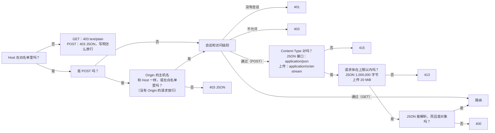

[English](../en/api.md) | [日本語](../ja/api.md) | **简体中文**

# API 说明

> 机器可读的版本是 [openapi.yaml](../en/openapi.yaml)（英文）。本文是给人读的：每个接口做什么、谁能调用、守卫怎么拦请求、哪里和旧的 Python 版不一样。
> 本文描述的是**真实行为**：旧版的每一种情况都抓成了黄金响应（`tests/baseline/golden/`，172 份），新的 Rust 后端对它们逐项比较。

## 1. 总览

浏览器只通过这组 REST 接口和后端通信。前端不访问数据库，也没有判断导入能不能做、用户能看到什么的逻辑：这两件事都由后端根据登录的用户来决定。

每个路由都有一个访问级别（`backend/src/api/auth.rs` 里的路由表 `ROUTES`）：

| 访问级别 | 谁能调用 |
|---|---|
| **公开** | 任何人，不用登录 |
| **登录** | 任何登录的用户 |
| **可管理题库** | 管理员，以及有 **可管理题库** 权限的普通用户 *(v0.7)* |
| **管理员** | 只有管理员 |

| 方法 | 路径 | 访问级别 | 作用 | 写库？ |
|---|---|---|---|---|
| GET | `/api/info` | 公开 | 版本、CPU 架构、能否关闭程序 | 否 |
| GET | `/api/auth/state` | 公开 | 谁登录着，以及题库印记 *(v0.6)* | 否 |
| POST | `/api/auth/login` | 公开 | 登录 *(v0.6)* | 是（新会话） |
| POST | `/api/auth/logout` | 登录 | 退出登录 *(v0.6)* | 是（删除会话） |
| POST | `/api/auth/password` | 登录 | 修改自己的密码 *(v0.6)* | 是 |
| GET | `/api/bank` | 登录 | 用户能看到的所有题库的题目（只含上架的题） | 否 |
| GET | `/api/banks` | 登录 | 用户能看到的题库，带工作表和数量 *(v0.5)* | 否 |
| GET | `/api/progress` | 登录 | 用户的学习记录 | 否 |
| GET | `/api/records` | 登录 | 用户保留的全部学习记录，最新的在前 *(v0.5)* | 否 |
| GET | `/api/record?id=<int>` | 登录 | 一条学习记录和每道题的详情 *(v0.5)* | 否 |
| GET | `/api/settings` | 登录 | 用户的界面设置 *(v0.5)* | 否 |
| POST | `/api/attempt` | 登录 | 记录一场考试或一次练习的结果 | 是 |
| POST | `/api/records/delete` | 登录 | 删除自己的一条学习记录，或全部 *(v0.5)* | 是 |
| POST | `/api/reset` | 登录 | 清空自己的学习记录 | 是 |
| POST | `/api/settings` | 登录 | 修改自己的界面设置 *(v0.5)* | 是 |
| POST | `/api/settings/reset` | 登录 | 把自己的界面设置恢复默认 *(v0.5)* | 是 |
| GET | `/api/imports` | 可管理题库 | 最近 12 条导入记录（可管理题库的用户：只有自己题库的） | 否 |
| POST | `/api/upload` | 可管理题库 | 上传 .xlsx，得到**预览**和一次性确认码；可选请求头 `X-Bank-Target` *(v0.5)* | **否**（只暂存在内存里） |
| POST | `/api/import/confirm` | 可管理题库 | 确认导入 | **是**（一个事务） |
| POST | `/api/import/cancel` | 可管理题库 | 取消自己待确认的导入 | 否 |
| POST | `/api/banks/delete` | 可管理题库 | 删除题库（可以连同学习数据） *(v0.5)* | 是 |
| GET | `/api/users` | 管理员 | 所有账户，带权限和登录锁定 *(v0.6)* | 否 |
| POST | `/api/users/create` | 管理员 | 添加用户 *(v0.6)* | 是 |
| POST | `/api/users/update` | 管理员 | 改名、改角色、停用或启用用户、设置他的题库和权限 *(v0.6)* | 是 |
| POST | `/api/users/password` | 管理员 | 给别的用户一个新的初始密码 *(v0.6)* | 是 |
| POST | `/api/users/delete` | 管理员 | 删除用户和他的学习数据 *(v0.6)* | 是 |
| POST | `/api/users/unlock` | 管理员 | 解除用户的登录锁定 *(v0.6)* | 否（只在内存里） |
| GET | `/api/logs` | 管理员 | 系统日志最近的几行 *(v0.7)* | 否 |
| POST | `/api/shutdown` | 管理员 | 关闭程序（只在本机运行时可用；Docker 里一律 403） | 否 |

`HEAD` 的行为和对应的 `GET` 一样，只是没有正文。所有接口都经过完全相同的守卫（第 3 节）。

## 2. 所有响应的共同点

- `Cache-Control: no-store` 和 `X-Content-Type-Options: nosniff`，没有 `Server` 头。
- JSON 是 UTF-8，日文和中文不转义成 `\uXXXX`。分隔符是 `", "` 和 `": "`（冒号后面有一个空格），键的顺序固定（就是本文和 [openapi.yaml](../en/openapi.yaml) 里的顺序）。**这是约定的一部分**：黄金测试（`backend/tests/api_golden.rs`）把 JSON 和旧版的响应逐字节比较。
- 错误的形式是 `{"error": "<原因>"}`。原因是一句可以直接给用户看的中文（前端会把它翻译成界面语言）；第 4 节列出了每一条及其英文意思。只有请求层的底层回答保留旧版简短的英文：`bad content type`（415）、`too large`（413）、`bad json`（400）、`not found`（404）和 `method not allowed`（405）。登录锁定时的 429 回答多一个键 `retryAfter`。
- 后端从不在响应里放异常名、文件路径或 SQLite 的错误信息；细节只写进日志。

## 3. 守卫（每个请求都先经过这里）

顺序是固定的，所以同一个坏请求总是得到同样的回答：



- **Host**：默认只接受 `localhost`、`127.0.0.1` 和 `::1`。要用别的地址或域名访问，把它写进环境变量 `XEXAM_ALLOWED_HOSTS`（用逗号、空格或分号分隔）。`XEXAM_ALLOW_ANY_HOST=1` 关掉 Host 检查（只在程序前面已经有身份验证时用，例如 Cloudflare Access）。
- **Origin**（只检查写请求）：只比较**主机名**（不比较协议和端口），所以通过 HTTPS 域名访问不会被误拦。没有 `Origin` 头的请求放行（命令行工具不是浏览器发出的跨站请求）。代理把 Host 改写成源站地址时，把公网域名写进 `XEXAM_ALLOWED_ORIGINS`。
- 后端**只读真实的 `Host` 头**，从不读 `X-Forwarded-*`。Nginx 也不转发它们。
- 其他方法（PUT、DELETE、OPTIONS 等）也先经过 Host 检查（403 JSON），然后得到 **405** 和 `Allow: GET, HEAD, POST`。
- 被拒绝的请求，回答里会写明你发来的 Host 或 Origin 是什么，应该把哪个值加进哪个选项。**日志** *(v0.7)*：安静了一分钟之后的第一次拒绝单独记一行（`rejected GET /api/bank: Host "…" is not in the allowed list`）；之后的拒绝最多每分钟汇总一次（`rejected N request(s) by the Host / Origin check since the last report; the last one: …`），即使后面再没有请求也会写出来。日志文字始终是英语；403 的回答正文仍是中文。任何能连到服务器的人不用登录就能引起这种拒绝，如果每次都记一行，就可能把系统日志（`GET /api/logs`）里的其他内容全部挤掉。

### 会话和访问级别 *(v0.6)*

会话检查紧接在 Host（POST 还有 Origin）检查之后进行，**在读取请求体的任何部分之前**：

| 情况 | 回答 |
|---|---|
| **公开**路由 | 放行。`GET /api/auth/state` 有会话时会读取它；其他公开路由根本不看会话 |
| 没有有效的会话（没有 `xexam_session` Cookie、未知或过期的会话，或者账户已被停用） | **401** `请先登录。` |
| 账户需要设置新密码 | 除了公开路由（`GET /api/info`、`GET /api/auth/state`、`POST /api/auth/login`）以及 `POST /api/auth/password` 和 `POST /api/auth/logout`，其他路由都回 **403** `请先设置新密码。` |
| 普通用户调用**管理员**路由 | **403** `只有管理员可以进行这个操作。` |
| 没有这个权限的普通用户调用**可管理题库**路由 *(v0.7)* | **403** `你没有管理题库的权限，请联系管理员。` |

- 不在路由表里的路径也需要会话：没有会话得到 401，有会话得到 404（GET：`text/plain` 的 `not found`；POST：经过 Content-Type、大小和 JSON 检查之后得到 `{"error": "not found"}`）。
- 会话只从 `xexam_session` Cookie 读取。角色和 **可管理题库** 权限在每个请求里都随会话从数据库读出，所以管理员做的修改在这个用户的下一个请求就生效。
- 会话有效期 30 天，并且会顺延：一个请求最多每小时刷新一次会话，并重新发送 Cookie。只有在知道协议的请求上才刷新：设了 `XEXAM_COOKIE_SECURE=1`，或者请求带有 `Origin` 头（浏览器的每个 POST 都带）。这样刷新时就不会把通过 HTTPS 发出的 Cookie 的 `Secure` 弄丢。
- 记录、错题本、进度和设置始终属于登录的用户：用户 id 来自会话，从不来自请求。别的用户的记录，回答和不存在的记录完全一样。

### 每个用户能看到和管理什么 *(v0.7)*

- **管理员**能看到并管理所有题库。
- **普通用户**正好能看到管理员为他选的那些题库（`GET /api/users` 里的 `banks`，一个 id 列表，可以是空的）。有了 `newBanks`（**包括以后导入的题库**），以后新建的每个题库在新建时都会加进这个列表；它从不添加已有的题库。有 **可管理题库** 权限的普通用户还能看到自己导入的题库（只在拥有这个权限时：没有权限时，只有自己的题库也在所选之列才能看到）。
- **可管理题库的用户**可以导入新题库（他就是所有者），只能更新或删除自己的题库。更新或删除管理员或其他用户的题库，回答 **403** `这个题库不是你上传的，只能更新或删除你自己上传的题库。`；这个检查在写入的事务里进行，所以什么都不会写入。

对于不能看到所有题库的用户，每个路由都遵循同样的规则：

| 路由 | 他得到的是 |
|---|---|
| `GET /api/bank` | 只有他的题库的题目和工作表；`file` / `mtime` 是他的题库里最近一次导入的 |
| `GET /api/banks` | 只有他的题库；`studied` 和 `records` 只数他自己的学习数据 |
| `GET /api/progress` | `questions` 只包含他的题库里的题的统计（错题本和错题复习都跟着它）；`history` 不变 |
| `POST /api/attempt` | 他看不到的题库里的题，和已删除的题完全一样处理：不计入，并出现在 `notCounted` 里 |
| `GET /api/records` | 他的每条记录都作为历史保留，带着保存时的题库名 |
| `GET /api/record` | 他看不到的题库里的题是 `"question": null`，和已删除的题一样（不发送题目文字） |
| `GET /api/auth/state` | `library` 只跟随他的题库和他的权限 |
| `GET /api/info` | 对所有人都一样：只有版本、架构和 `canShutdown`（这个路由是公开的，供容器的健康检查用） |

## 4. 接口细节

### `GET /api/info`
```json
{"version": "0.7.5", "arch": "x86_64", "canShutdown": false}
```
公开。版本号是 `VERSION` 文件里的 `CODE_VERSION`（或 `XEXAM_VERSION`）；`arch` 是服务器的 CPU 架构；只有程序带着 `--allow-shutdown` 启动时，`canShutdown` 才是 `true`。*(v0.7.5)* 键 `bankCount`（整个题库里上架的题数）去掉了：这个路由是公开的，登录后的页面根据 `GET /api/bank` 和 `GET /api/banks` 自己数它们能看到的题。这个路由仍然会读取数据库，所以数据库读不出来时它回答 500，容器的健康检查（问的就是这个路由）会报告后端不健康。

### `GET /api/auth/state` *(v0.6)*
公开。没有登录时（没有 Cookie，或会话已经无效）：

```json
{"user": null, "defaultAdmin": "admin"}
```

`defaultAdmin` 是一个还在用默认密码 `admin` 的已启用管理员的用户名（id 最小的那个），没有就是 `null`。登录页用它告诉所有者第一次怎么登录，写的是这个账户真正的名字（它可能被改过名）。修改或重置那个密码，或者停用、降级、删除这个账户，它就消失了。

已经登录时（账户需要设置新密码时也一样）：

```json
{"user": {"id": 1, "username": "admin", "role": "admin", "mustChangePassword": false, "canManageBanks": true}, "library": "3f0c9a7d5e21b4c88a9d0e6f17b2c453"}
```

- `role` 是 `admin` 或 `user`。`canManageBanks` *(v0.7)* 对所有管理员都是 `true`，对有 **可管理题库** 权限的普通用户也是 `true`。
- `library` 是用户能看到的题库的一个不透明印记：32 位十六进制数字，是一个摘要，不公开构成它的任何数字。只要其中某个题库被导入、替换或删除（也包括别的进程里的 `import` 命令），它就会变；*(v0.7)* 用户能看到或管理的题库变了（管理员分配了题库或改了权限，某个题库换了所有者），它也会变。打开着的页面会比较它，变了就重新读取题库。对于只能看到部分题库的用户，印记只由这些题库构成：它既不透露、也不跟随他看不到的题库的大小、题数或更新时间。

### `POST /api/auth/login` *(v0.6)*
公开。请求体：`{"username": "…", "password": "…"}`（都必须是字符串，否则 **400** `请求的格式不对。`）。用户名去掉首尾空格，比较时不区分大小写。

- **200** `{"user": {…}}`（和 `GET /api/auth/state` 里的对象一样），带两个 Cookie：
  - `xexam_session=<43 个字符>; HttpOnly; SameSite=Strict; Path=/; Max-Age=2592000`（30 天）。每次登录都得到一个新的随机令牌；数据库里只存它的 SHA-256。一个用户最多有 20 个会话；超过时，新的登录会结束最先到期的那些。
  - `xexam_device=<43 个字符>; HttpOnly; SameSite=Strict; Path=/api/auth; Max-Age=34560000`（400 天）：标记这个账户以前登录过的浏览器。它是账户当前密码哈希的带密钥哈希，所以换了密码它就作废；服务器上不为它存任何东西。
  - 只有请求的 `Origin` 是 `https://…` 或设了 `XEXAM_COOKIE_SECURE=1` 时，两者才加 `Secure`，所以在局域网里用纯 HTTP 也能登录。
- **401** `用户名或密码不对。`：密码错误、用户名不存在、账户已停用，都是这个回答，而且花的工夫一样，所以回答从不透露某个用户名是否存在。
- **429** `{"error": "登录失败次数太多，请稍后再试。", "retryAfter": <秒>}`，带 `Retry-After` 头，在登录被锁定期间返回。锁定期间每次尝试都得到 429，即使密码是对的；429 的回答不算失败次数。

锁定按轮次逐级加长：15 分钟内失败 5 次，登录锁 1 分钟；之后每一轮允许失败 3 次，锁定时间依次是 5 分钟、15 分钟、30 分钟、1 小时，然后是 1 天。这个状态属于账户（按用户 id，所以改名后还在）；没有账户的名字也按同样的轮次处理。带着这个账户的 `xexam_device` Cookie 的浏览器上的尝试，和其他所有浏览器分开计数，所以猜用户名的人锁不住主人以前用过的浏览器。登录成功、管理员重置密码或点 **解锁**、重启后端，或者安静 24 小时，都会让这个账户从头开始。细节和原因见 [security.md](security.md)。

### `POST /api/auth/logout` *(v0.6)*
登录（需要设置新密码时也可以）。请求体 `{}` 或空。删除这个会话，回答 `{"ok": true}`，并带一个过期的 Cookie（`xexam_session=; HttpOnly; SameSite=Strict; Path=/; Max-Age=0`）。

### `POST /api/auth/password` *(v0.6)*
登录（需要设置新密码时也可以）。请求体：`{"current": "…", "password": "…"}`。除非账户需要设置新密码（这时会话本身就证明了身份），否则必须有 `current`。

- **200** `{"user": {…}}`，其中 `mustChangePassword: false`。这个账户的所有会话都结束，包括这一个：这个浏览器得到一个**新的** `xexam_session` Cookie（以及新密码对应的 `xexam_device` Cookie），所以这个账户的其他浏览器都会退出登录，复制走的 Cookie 也失效。
- **400** `请求的格式不对。`：缺少 `password`（或必需的 `current`），或者不是字符串；`密码需要 8–128 个字符。`；`新密码不能和原来的一样。`。
- **403** `当前密码不对。`。当前密码输错，和登录失败计在同样的登录计数里，所以锁定（**429**，同上）在这里也适用。
- **401** `请先登录。`：账户在请求进行期间被停用或删除，或者它的密码在别处被修改或重置（什么都不写入）。

### `GET /api/users` *(v0.6)*
管理员。所有账户，按 id 排序：

```json
{"users": [{"id": 2, "username": "cook", "role": "user", "disabled": false, "createdAt": "2026-11-10 14:00", "lastLoginAt": "2026-11-10 15:02", "mustChangePassword": false, "records": 12, "banks": [1, 3], "newBanks": true, "canManageBanks": true, "ownedBanks": [3], "lock": null}]}
```

- `createdAt` / `lastLoginAt` 是本地时间 `YYYY-MM-DD HH:MM`；第一次登录之前 `lastLoginAt` 是 `null`。
- `records` 是这个用户的学习记录条数（考试和练习）。
- `banks` *(v0.7)*：这个用户能看到的题库的 id，升序（只含还存在的题库；`[]` = 一个都没有）。它总是一个列表：`"all"` 只是写入时的简写（见下文）。
- `newBanks` *(v0.7)*：**包括以后导入的题库**。`true`：从现在起新建的每个题库（任何人作为新题库导入，或者命令行 `import`）都会在同一个事务里加进 `banks`。它从不添加已有的题库。
- `canManageBanks` *(v0.7)* 是保存着的 **可管理题库** 权限。`banks`、`newBanks` 和 `canManageBanks` 在改角色时都会保留，但只在账户是普通用户时才起作用：管理员能看到并管理所有题库。
- `ownedBanks` *(v0.7)*：这个用户作为新题库导入的题库（他是所有者）的 id，升序。
- `lock`：账户在内存里的登录状态。还在第一轮、没有被锁定时是 `null`；否则：

```json
{"until": "2026-11-10 15:20:07", "retryAfter": 298, "round": 2, "triesLeft": 0, "knownBrowser": false, "otherUntil": null, "otherRetryAfter": 0}
```

| 键 | 含义 |
|---|---|
| `until` | 当前锁定结束的本地时间 `YYYY-MM-DD HH:MM:SS`；没有锁定时是 `null` |
| `retryAfter` | 到那时还有几秒；没有锁定时是 `0` |
| `round` | 锁定期间：以这次锁定结束的那一轮（1 = 第一次，锁 1 分钟）。否则：正在进行的那一轮（2 或更大） |
| `triesLeft` | 正在进行的那一轮里，下次锁定之前还能失败几次（锁定期间是 `0`） |
| `knownBrowser` | `true`：显示的状态统计的是这个用户以前登录过的浏览器上的登录；`false`：其他所有浏览器上的。两者都在计数时，显示限制得更厉害的那一个 |
| `otherUntil` / `otherRetryAfter` | 只有另一类浏览器同时也被锁定、账户在所有浏览器上都被锁定时才有值：那第二个锁定的结束时间和秒数（否则是 `null` / `0`） |

### `POST /api/users/create` *(v0.6)*
管理员。请求体：`{"username": "…", "password": "…", "role": "admin" | "user", "banks": "all" | [<题库 id>, …], "newBanks": <bool>, "canManageBanks": <bool>}`。*(v0.7)* `banks` 默认是 `[]`（管理员选好之前，新用户看不到任何题库），`newBanks` 默认是 `false`，`canManageBanks` 默认是 `false`。`"banks": "all"` 是一种简写：现在存在的所有题库，并且在没有给出 `newBanks` 时同时设置 `newBanks: true`。重复的 id 会被忽略。新账户是启用的，第一次登录时必须设置新密码。回答：和 `GET /api/users` 一样的 `{"users": [...]}`。

用户名 1–40 个字符（ASCII 字母、数字和 `. _ - @`，去掉首尾空格），不区分大小写地唯一；密码 8–128 个字符。

| 回答 | 什么时候 |
|---|---|
| **400** `用户名不对：1–40 个字符，只能用字母、数字和 . _ - @。` | 缺少 `username`、不是字符串，或不符合规则 |
| **400** `密码需要 8–128 个字符。` | `password` 太短或太长 |
| **400** `请求的格式不对。` | 缺少 `password` 或不是字符串；缺少 `role` 或不是 `admin` / `user`；`banks` 既不是 `"all"` 也不是整数列表；`newBanks` 或 `canManageBanks` 不是布尔值 |
| **400** `选择的题库中有不存在的（可能已被删除），请刷新页面后再试。` *(v0.7)* | `banks` 里有一个 id 不是现存的题库（或者不是正整数）；什么都不创建 |
| **409** `这个用户名已经有人用了。` | 另一个账户用了这个名字（不区分大小写） |

### `POST /api/users/update` *(v0.6)*
管理员。请求体：`{"id": <int>, "username"?, "role"?, "disabled"?, "banks"?, "newBanks"?, "canManageBanks"?}`；没写的键保持不变。回答：`{"users": [...]}`。

- 停用账户或改角色会结束它的会话。改名、改 `banks`、`newBanks` 或 `canManageBanks` 不会结束会话；修改从这个用户的下一个请求开始生效。
- `banks` 替换所选的题库（一个 id 列表，`[]` = 一个都没有；或者 `"all"`，现在存在的所有题库，在没有给出 `newBanks` 时还会设置 `newBanks: true`）。只给 `newBanks` 时只改这个标记：取消它不会拿走这个用户已有的题库。
- **400**：和创建时一样（`username`、`role`、`banks`、`newBanks`、`canManageBanks`；`disabled` 不是布尔值 → `请求的格式不对。`；缺少 `id` 或不是整数（布尔值不算） → `请求的格式不对。`）。
- **404** `这个用户不存在（可能已被删除），请刷新页面后再试。`。
- **409** `不能对自己的账户做这个操作。`：停用自己或改自己的角色时；`至少要保留一个启用的管理员。`：修改后就没有启用的管理员时；`这个用户名已经有人用了。`。

所有检查都和写入在同一个事务里，所以两个请求不可能同时通过检查。

### `POST /api/users/password` *(v0.6)*
管理员。请求体：`{"id": <int>, "password": "…"}`。给另一个用户一个新的初始密码：他下次登录时必须设置新密码，他的会话都结束，他的 `xexam_device` Cookie 不再匹配，他的登录锁定也被清除。自己的密码要用 `POST /api/auth/password` 修改（在这里会得到 **409** `不能对自己的账户做这个操作。`）。其他错误：400（密码规则、请求体格式不对）、404（用户不存在）。

### `POST /api/users/delete` *(v0.6)*
管理员。请求体：`{"id": <int>}`。删除账户及其会话、学习记录（含详情）、答错统计、设置和所选的题库。*(v0.7)* 这个用户拥有的题库不会被删除：它们转到删除这个用户的管理员名下。删除自己或最后一个启用的管理员得到 **409**；id 不存在得到 **404**。

### `POST /api/users/unlock` *(v0.6)*
管理员。请求体：`{"id": <int>}`。把账户在所有浏览器上的登录状态全部清除（回到第 1 轮，5 次机会），不管是正在锁定，还是只是已经过了第 1 轮。它按用户 id 处理，所以改名后也有效，对自己的账户也有效。id 不存在得到 **404**。回答：`{"users": [...]}`。

### `GET /api/bank`
登录。`file` / `mtime` 是最近一次导入（用户能看到的题库）的文件名和时间；`questions` 只包含上架的题，来自用户能看到的所有题库，按题库 id（升序）分组，每个题库内按它自己的顺序；`sheets` 里每个工作表名带可用题数和已下架题数（不同题库里同名的工作表合在一起计数；每个题库各自的数字见 `GET /api/banks`）。题目的各个字段见 [openapi.yaml](../en/openapi.yaml) 里的 `Question`。
从 v0.5 起，每道题最后多一个键 `"bank": <题库 id>`（在 `row` 之后）。

一道题的键的顺序是 `kind, tag, stem, options, items, answer, translation, zh, [english, en,] [lang, ja,] explanation, mnemonic, note, [explain,] id, sheet, row, bank`。方括号里的键只在有它们的格式里出现，所以旧文件的输出和以前逐字节相同。从 v0.7 起只能导入六列格式，旧格式的题在每次启动时都会被下架，所以 `GET /api/bank` 里通常只有六列格式的题；旧的形式仍会出现在 `GET /api/record` 里，用于以前记录中已下架的题：

- **三列格式**（A 题目，B 中文，C 答案）：一个都没有。
- **四列格式**（A 英语，B 中文，C 日语，D 答案）：`english`（A 列的原文）和 `en`（按日语的结构拆开的英语）。`stem`、`options`、`items` 和 `answer` 来自 C 列的日语。
- **六列格式** *(v0.7)*（A 英语、B 中文、C 日语题目；D 英语、E 中文、F 日语答案和解析）：以英语为准，所以 `stem`、`options`、`items` 和 `answer` 是英语的，`"lang": "en"` 表明这一点；`zh`（B 列）和 `ja`（C 列）是按英语的结构拆开的另外两种语言（对不上时是 `null` 或没有）；`explain` 存每种语言的解析、记忆口诀和答案备注：`{"en": {"explanation", "mnemonic", "note"}, "zh": {…}, "ja": {…}}`，三样都没有的语言不出现。`explanation` / `mnemonic` / `note` 为旧客户端保留（有中文就用中文，否则用日语，再否则用英语）。热点题的 `tag` 是 `HOTSPOT`（旧格式里是 `ホットスポット`）。

`zh` / `en` / `ja` 里的热点题多一个键 `choices`：每个小项的选项，用这种语言写。

### `GET /api/banks` *(v0.5)*
登录。一个题库就是一份导入的工作簿。用户能看到的题库，按 `id` 排序：

```json
{"banks": [{"id": 1, "name": "Kitchen basics", "filename": "Kitchen basics.xlsx", "legacy": true, "createdAt": "2026-11-10 14:00", "updatedAt": "2026-11-10 15:00", "total": 5, "inactive": 0, "sheets": [{"name": "Cooking", "usable": 3, "inactive": 0}, {"name": "Safety", "usable": 2, "inactive": 0}], "studied": 4, "records": 3, "ownerId": 1, "owner": "admin", "manageable": true}]}
```

- `name` 是新建题库时去掉 `.xlsx` 的文件名（已经有题库叫这个名字时，加上 ` (2)`、` (3)` ……）；更新题库会改 `filename` 和 `updatedAt`，从不改 `name`。
- `legacy`：存放 v0.5 之前数据的那个题库，也是不带 `X-Bank-Target` 的上传的目标。它的题目 id 是 [database.md](database.md) 第 4.1 节里的普通题目 id；其他题库都用限定在本题库内的 id，所以同一份工作簿可以导入成两个独立的题库。
- `total` = 上架的题，`inactive` = 已下架的题；`sheets` 按题库里题目的顺序排列，也列出题全都下架了的工作表（`usable` 为 0）。
- `studied` = 这个题库有统计的题有几道（上架或下架都算）；`records` = 有几条学习记录用到了这个题库。对管理员来说它们数的是所有用户的数据（也就是连同学习数据删除时会删掉的内容）；对其他人 *(v0.7)* 只数他自己的。
- `ownerId` / `owner` *(v0.7)*：把这个题库作为新题库导入的用户的 id 和用户名（v0.7 之前的题库属于第一个管理员）。只有管理员能得到这两项；其他用户只有在自己的题库上才得到 `ownerId`（否则是 `null`），`owner` 总是 `null`，所以题库列表从不透露别的账户。
- `manageable` *(v0.7)*：这个用户能不能更新和删除这个题库（管理员：总是能；可管理题库的用户：自己的题库；其他人：从不）。

### `GET /api/progress`
登录。`questions` 是用户每道题的累计统计（答过几次、答对几次、答错几次、当前连续答对几次），只限于他能看到的题库；`history` 是他最近 60 条学习记录（数据库保留 500 条，见 `GET /api/records`），每条最后是 `kind` *(v0.7)*；`masterStreak` 是连续答对几次后移出错题本（2）。

```json
{"version": 1, "questions": {"1a2b3c4d5e6f": {"attempts": 3, "correct": 2, "wrong": 1, "streak": 2, "last": true, "at": "2026-11-10 15:10"}}, "history": [{"at": "2026-11-10 15:10", "sheets": ["Cooking"], "mode": "all", "total": 5, "correct": 4, "percent": 80, "seconds": 130, "kind": "exam"}], "masterStreak": 2}
```

### `GET /api/imports`
可管理题库。`{"imports": [{"id", "at", "filename", "added", "updated", "removed", "restored", "skipped", "total"}, …]}`，最新的 12 条在前。管理员得到所有导入；可管理题库的用户 *(v0.7)* 只得到导入到自己题库的那些。

### `POST /api/upload`
可管理题库。请求体是 .xlsx 文件的原始字节；可选请求头 `X-Filename` 带百分号编码的文件名。服务端：

1. 只凭**内容**判断是不是 .xlsx（魔数 + ZIP 结构 + 有工作簿 + 没有 DOCTYPE / 实体声明 + 解压后大小有上限）。空文件、旧的 `.xls`、损坏的文件、改了扩展名的文件，各有自己的中文说明。
2. 解析它。*(v0.7)* 解析器读出任何一道旧的三列或四列格式的题时，这次上传以 **400** `只能导入六列格式（A–C 列：英文、中文、日文题目；D–F 列：英文、中文、日文答案）。这个文件是旧的三列或四列格式，请改成六列格式后再导入。` 被拒绝，新建题库和更新题库都一样；什么都不暂存，待确认槽位也不受影响。日志里会记一行带文件名的英语日志。
3. 生成预览，把解析结果放进内存里**上传者自己的待确认槽位**（再上传一次就替换它；别人的槽位永远不碰），30 分钟内有效。
4. **不写数据库。**

返回预览（`added / updated / unchanged / restored / removed / skipped / usable`、每个工作表的详情，以及读不出来的行和原因）和一次性确认码 `token`：

```json
{"sheets": [{"name": "Cooking", "total": 3, "usable": 3, "skipped": [], "added": 3, "updated": 0, "removed": 0, "restored": 0, "skippedMore": 0, "skippedCount": 0}], "added": 3, "updated": 0, "unchanged": 0, "restored": 0, "removed": 0, "skipped": 0, "usable": 3, "removed_samples": [], "removed_stats": 0, "filename": "Kitchen basics.xlsx", "token": "…"}
```

每个工作表最多列出 30 个读不出来的行（`skipped`，每个是 `{"row", "reason"}`）；`skippedMore` 是还有几个，`skippedCount` 是一共几个。

**提醒** *(v0.7)*：中文（E 列）或日文（F 列）答案和英文答案（D 列）不一致的行仍然会导入，用的是英文答案，并作为提醒列出来。只有这时才会出现这些键，所以没有提醒的预览和以前版本的键完全一样：有提醒的工作表多一个 `warnings`（最多 30 个 `{"row", "reason"}`，紧接在 `restored` 之后），并在最后多 `warningsMore` 和 `warningsCount`；整个预览在 `removed_stats` 之后多一个提醒总数 `warnings`。原因是 `E 列的中文答案和 D 列的英文答案不一致（已按英文答案导入）`，F 列的日文答案也是同样的写法。

**目标题库** *(v0.5)*：可选请求头 `X-Bank-Target` 说明文件导入到哪个题库。不管哪种情况，预览的键都一样；它只和目标题库比较。

| `X-Bank-Target` | 意思 |
|---|---|
| 没有 | 和 v0.4 完全一样，对旧题库（legacy）导入（确认时如果还不存在就新建） |
| `new`（忽略首尾空格和大小写） | 确认时新建一个题库，所有者是上传者；预览里每道可用的题都算 `added` |
| 题库 id，`^[0-9]{1,18}$`（忽略首尾空格） | 更新（替换）那个题库；id 不存在 → **404** `这个题库不存在（可能已被删除），请刷新页面后再试。` |
| 其他任何值 | **400** `上传目标不对，请刷新页面后再试。` |

这个请求头在守卫和大小限制之后、解析文件之前读取。可管理题库的用户只能更新自己的题库 *(v0.7)*：别人的现存题库（对不带这个请求头的上传来说，也包括旧题库） → 在解析文件之前就回答 **403** `这个题库不是你上传的，只能更新或删除你自己上传的题库。`。被拒绝的上传不碰待确认槽位。

**内存额度** *(v0.7)*：每个管理员和可管理题库的用户都有一个槽位，而一份接近解析器上限的工作簿解析后会占用超过 100 MB，所以所有暂存的预览共用一个 128 MiB 的额度（按内容估算）。暂存新的上传时，先丢掉过期的预览，总量仍超过额度时，再丢掉别的用户最早的预览。最新的上传总会保留。预览被丢掉的用户在确认时得到 **409**，和过了 30 分钟一样。

其他回答：**413** `文件太大了（最大 20 MB）。…`；**400** 加上文件被拒绝的原因（不是 .xlsx、已损坏、解压后太大、解析时间太长、旧格式等）。

### `POST /api/import/confirm`
可管理题库。请求体是 `{"token": "…"}`。

- 确认码是一个 128 位的随机数（22 个字符），**只能用一次**。它只能确认调用者自己待确认的上传：错误的确认码、别的用户的确认码或含非 ASCII 字符的确认码都当作「无效」，不会消耗待确认的内容；过期（或被丢掉）的预览无法找回。这些情况一律 → **409** `这次上传的预览已经过期或已被处理，请重新上传。`。
- 导入在**一个事务**里完成：要么全部成功，要么题库保持不变（**500** `写入数据库失败，题库没有任何改动。`）。
- 这份文件里一道可用的题都没有 → **400** `这份文件里没有读到任何可用的题，没有导入。`。
- *(v0.7)* 暂存的工作簿里有旧的三列或四列格式的题时，这里也会在写入任何东西之前拒绝它（**400**，提示和上传时一样）。

导入规则（文件被当成**目标题库的完整内容**）：第一次出现的题新增；改过的题更新；这个题库里有、文件里找不到的题**下架**（学习记录保留）；下架的题再次出现时自动恢复。其他题库永远不碰。

响应：`{"result": <和预览一样的结构，但没有 filename / token>, "bank": <GET /api/bank，按用户看到的>}`。只有上传时带了 `X-Bank-Target`，后面才多第三个键：`"bankId": <新建 / 更新的题库 id>`（这样 v0.4 的响应保持逐字节相同）。目标题库在预览之后被删除 → **404** `这个题库不存在（可能已被删除），请刷新页面后再试。`；它现在属于别人了（被删除用户的题库转给了管理员） → **403** `这个题库不是你上传的，只能更新或删除你自己上传的题库。`。这两种情况都什么都不写入，确认码也用掉了。

### `POST /api/import/cancel`
可管理题库。丢掉调用者自己待确认的上传（别的用户的上传保留）。不需要确认码。回答：`{"ok": true}`。

### `POST /api/banks/delete` *(v0.5)*
可管理题库。请求体：`{"id": <int>, "withRecords": <bool，默认 false>}`。在一个事务里删除这个题库的题目（上架的和已下架的）、导入记录、用户对它的访问权以及题库本身。`withRecords: true` 时还删除这个题库的学习数据：这些题的统计（错题本）、它们每道题的详情，以及所有用到这个题库、又没有用到任何现存题库的学习记录（通常就是只用了这个题库的记录；还用了一个早先已删除的题库的记录也会删掉，而不是留下一条空记录）。不带它时，学习记录和统计都保留；它们的详情里这些题显示为已删除。

- 管理员可以删除任何题库，`withRecords` 删除的是**所有**用户的学习数据。
- 可管理题库的用户 *(v0.7)* 只能删除自己的题库（否则 **403** `这个题库不是你上传的，只能更新或删除你自己上传的题库。`，什么都不写入），`withRecords` 只删除**他自己**的学习数据；其他用户的记录保留，里面的题显示为已删除。

所有用户中以这个题库为目标的待确认上传（针对这个 id 的上传，或者这个题库是旧题库时不带 `X-Bank-Target` 的上传）都会被丢掉。

响应：`{"banks": [...], "bank": <GET /api/bank>, "progress": <GET /api/progress>}`，三者都是调用者看到的样子。缺少 `id` 或不是整数（布尔值不算整数），或有 `withRecords` 但不是布尔值 → **400** `请求的格式不对。`；id 不存在 → **404** `这个题库不存在（可能已被删除），请刷新页面后再试。`。

### `POST /api/attempt`
登录。请求体是 `{"results": [{"id": "…", "correct": true, "answer": ["B"]}], "sheets": ["…"], "mode": "all", "seconds": 123, "kind": "exam"}`。

清洗规则：`results` 必须是列表（否则 **400** `成绩的格式不对`），只读前 2000 项；每一项要有字符串 `id`（截到 64 个字符）和布尔值 `correct`，其他项丢掉；一项都不剩时 → **400** `没有成绩可保存`。`sheets` 最多保留 50 个字符串（每个截到 80 个字符）；`mode` 不是 `all / weak / retry` 时按 `all` 处理；`seconds` 限制在 0 到 604800 之间，异常值按 0 处理。**服务端信任 `correct`**；判分在浏览器里进行（见 [security.md](security.md)）。

*(v0.7)* `kind` 是 `"exam"`（默认值，没有或为 `null` 时也是它）或 `"practice"`；其他值 → **400** `成绩的格式不对`。两种都以同样的方式更新统计（错题本），也都计入同样的 500 条保留记录；区别只在页面怎么显示它们。

*(v0.5)* 每个结果可以带一个可选的 `answer`，只为以后能回顾这条记录而保存：一个最多 64 个元素的 JSON 数组，每个元素是最多 8 个字符的字符串、0–999 的整数或 `null`（`["C"]`、`["A", "D"]`、`[0, 1, null]`）。其他形式都按「没有答案」保存；结果本身仍然接受。服务端为每个计入的结果保存一行详情，外加题目所在题库的快照，并只保留这个用户最新的 **500** 条记录（更早的连同详情一起删除）。

**只计入还存在的题** *(v0.7)*。题目已经不在了（考试期间它的题库被删除，或 id 是编造的），或者属于用户不能看到的题库，这样的结果不计入统计、详情、`total` / `correct` / `percent` 和题库快照。已下架的题（后来的导入里没有它）仍然存在，照常计入。然后：

- 有一部分结果没计入：用其余的结果保存记录，`sheets` 只列出计入的题所在的工作表（按发来的顺序），回答最后多一个 `"notCounted": [<没计入的 id>]`。
- 一个都不剩：什么都不保存，**409** `这场考试的题目已经被删除，成绩没有保存。`。

回答是这个用户的 `GET /api/progress`（有结果没计入时再加上 `notCounted`；`GET /api/progress` 本身从来没有它）。

`percent` 用**四舍六入五成双**（Python 的 `round`）：8 题对 1 题是 12，不是 13。

### `GET /api/records` *(v0.5)*
登录。`{"records": [RecordSummary, …], "retention": 500}`，这个用户的记录，最新的在前。RecordSummary 是：

```json
{"id": 7, "at": "2026-11-10 15:10", "banks": [{"id": 1, "name": "Kitchen basics", "deleted": false}], "sheets": ["Cooking"], "mode": "all", "total": 5, "correct": 4, "percent": 80, "seconds": 130, "answered": 5, "detail": true, "kind": "exam"}
```

`banks` 是保存记录时的快照，题库还在时显示它现在的名字（题库没了就是 `deleted: true`）。`detail` 表示有没有每道题的详情（v0.5 之前保存的考试没有）；`answered` 是有答案的详情行数，没有详情时是 `null`。`kind` *(v0.7)* 是 `exam` 或 `practice`（v0.7 之前的记录都是考试）。

### `GET /api/record?id=<int>` *(v0.5)*
登录。`{"record": RecordSummary, "items": [{"seq": 0, "questionId": "…", "answer": ["C"], "correct": true, "question": {…}}]}`。`answer` 是保存的数组或 `null`；`question` 和 `GET /api/bank` 里的题完全一样，最后再加一个 `"active": <bool>`（包括已下架的题）；题目已经不存在，或者 *(v0.7)* 属于用户不能看到的题库时是 `null`（不发送它的文字）。
`id` 必须正好是一个查询参数，1–18 位 ASCII 数字（会解码百分号编码），否则 → **400** `请求的格式不对。`；id 不存在，或是别的用户的记录 → **404** `这条考试记录不存在（可能已被删除），请刷新页面后再试。`。

### `POST /api/records/delete` *(v0.5)*
登录。请求体二选一：`{"id": <int>}`（删除这条记录和它的详情；每道题的统计，也就是错题本，**不**变）或 `{"all": true, "withStats": <bool，默认 false>}`（删除这个用户的所有记录和详情；`withStats: true` 时还清空他的统计，等于 `POST /api/reset`）。只会删除调用者自己的记录。
响应：`{"records": [...], "retention": 500, "progress": <GET /api/progress>}`。其他任何请求体（既没有 `id` 也没有 `all`、两者都有、`all` 不是 `true`、`withStats` 和 `id` 一起出现、类型不对） → **400** `请求的格式不对。`；id 不存在 → **404** `这条考试记录不存在（可能已被删除），请刷新页面后再试。`。

### `POST /api/reset`
登录。清空调用者的学习记录（含每道题的详情）和每道题的统计；题库和其他用户都不受影响。回答：他（现在已经空了的）`GET /api/progress`。

### `GET /api/settings` / `POST /api/settings` / `POST /api/settings/reset` *(v0.5)*
登录。设置按用户保存在数据库里（重启和更新容器、清除浏览器缓存、换浏览器之后都还在）：

```json
{"theme": "system", "uiLang": "en", "autoAdvance": false, "questionLang": "ja"}
```

| 键 | 取值 | 默认 |
|---|---|---|
| `theme` | `system` · `light` · `dark` | `system` |
| `uiLang` | `en` · `zh` · `ja` | `en` |
| `autoAdvance` | `true` · `false` | `false` |
| `questionLang` | `ja` · `zh` · `en` | `ja` |

`GET` 返回默认值合并上保存的值（保存的值无效时忽略它）。`POST /api/settings` 接受这些键的任意子集，返回完整的设置；未知的键忽略；已知的键取值无效 → **400** `设置的值不对。`，什么都不写入。`POST /api/settings/reset`（请求体 `{}` 或空）把 `theme`、`uiLang` 和 `autoAdvance` 恢复成默认值，保留 `questionLang`，返回完整的设置。

### `GET /api/logs` *(v0.7)*
管理员。**系统日志** 页面显示的日志：后端启动以来记录的最近 2000 行，只保存在内存里（重启后又是空的；什么都不写进数据库）。它们就是 `docker compose logs backend` 显示的那些行（经过同样的 `XEXAM_LOG` 过滤），再加上启动和关闭时的状态行。日志行用用户名指代用户（`user "admin" updated user "alex"`），从不用 id，也从不写没有账户的、输入的名字；日志行从不包含密码、令牌、Cookie 的值或题目文字。

查询参数，两个都可选：

- `after=<seq>`：只返回这个序号之后的行（1–19 位 ASCII 数字）。
- `boot=<id>`：客户端上次读到的回答里的 `boot`（1–64 个 `A-Z a-z 0-9 _ -` 字符）。

```json
{"lines": [{"seq": 41, "time": "2026-11-10 15:10:02", "level": "info", "target": "xexam_backend::api::auth", "message": "user \"admin\" signed in"}], "last": 41, "dropped": false, "boot": "Xq3v9T0bLm2k"}
```

- `lines`：最早的在前。`seq` 每行加一，每个后端进程都从 1 开始；`time` 是带秒的本地时间；`level` 是 `error`、`warn`、`info`、`debug` 或 `trace`；`target` 是记录它的模块；`message` 是文字加上它的字段（超过 4000 个字符会截断）。
- `last`：最新一行的序号（还没记录任何东西时是 0），也就是下一次轮询的 `after`。
- `dropped`：比 `after` 新的行（没有 `after` 时：从第 1 行起）在能返回之前就已经被挤出缓冲区时是 `true`。
- `boot`：这个后端进程的随机 id，也就是下一次轮询的 `boot`。
- 没有 `after` 时返回保留着的所有行。重启后序号从 1 重新开始，所以比 `last` 大的 `after`，或者不是这个进程的 id 的 `boot`，都按没有 `after` 处理：返回保留着的所有行。
- `after` 或 `boot` 格式不对、为空或出现两次 → **400** `请求的格式不对。`。其他参数忽略。

任何人不用登录就能引起的日志行（被拒绝的请求、失败的登录、没有账户的用户名被锁定）最多每分钟汇总一次（第 3 节），所以它们挤不掉其他日志。

### `POST /api/shutdown`
管理员。只有用 `--allow-shutdown` 启动时才可用（Windows 上双击 `start.bat`）；否则 **403** `在 Docker 里请用 docker compose stop 停止容器。`。在 Docker 里一律 403；在那里请用 `docker compose stop`。

### 错误提示
和后端的其他提示一样，它们是中文，而且是固定的（前端会翻译）。每个路由都可能给出的那些见第 3 节；上传和解析器的提示（文件为什么被拒绝、某一行为什么读不出来）连同翻译都在 `frontend/src/i18n/server-messages.ts` 里。

| 状态码 | 提示 | 英文意思 | 什么时候 |
|---|---|---|---|
| 400 | `请求的格式不对。` | The request is not in the expected format. | v0.5 及以后的接口，请求体或查询参数格式不对 |
| 400 | `上传目标不对，请刷新页面后再试。` | The upload target is not valid. Reload the page and try again. | `X-Bank-Target` 格式不对 |
| 400 | `设置的值不对。` | A setting has an invalid value. | `POST /api/settings` |
| 400 | `成绩的格式不对` | The exam result is not in the expected format. | `POST /api/attempt`：`results` 不是列表，或 `kind` 不对 |
| 400 | `没有成绩可保存` | There is no result to save. | `POST /api/attempt`：没有有效的结果 |
| 400 | `用户名不对：1–40 个字符，只能用字母、数字和 . _ - @。` | The username is not valid: it needs 1–40 characters, using only letters, digits and . _ - @. | 用户：创建、修改 |
| 400 | `密码需要 8–128 个字符。` | The password needs 8 to 128 characters. | 密码相关的路由、创建用户 |
| 400 | `新密码不能和原来的一样。` | The new password must be different from the old one. | `POST /api/auth/password` |
| 400 | `选择的题库中有不存在的（可能已被删除），请刷新页面后再试。` | One of the chosen question banks does not exist (it may have been deleted). Refresh the page and try again. | 用户：创建、修改 *(v0.7)* |
| 400 | `这份文件里没有读到任何可用的题，没有导入。` | No usable questions were found in this file, so nothing was imported. | 确认导入 |
| 400 | `只能导入六列格式（A–C 列：英文、中文、日文题目；D–F 列：英文、中文、日文答案）。这个文件是旧的三列或四列格式，请改成六列格式后再导入。` | Only the six-column layout can be imported (columns A–C: the question in English, Chinese and Japanese; columns D–F: the answer in English, Chinese and Japanese). This file uses the old three- or four-column layout. Rewrite it in the six-column layout and import it again. | 上传、确认导入 *(v0.7)* |
| 401 | `请先登录。` | Please sign in first. | 没有有效的会话 |
| 401 | `用户名或密码不对。` | The username or password is not correct. | 登录 |
| 403 | `请先设置新密码。` | Please choose a new password first. | 账户需要设置新密码 |
| 403 | `只有管理员可以进行这个操作。` | Only an administrator can do this. | 管理员路由 |
| 403 | `你没有管理题库的权限，请联系管理员。` | You do not have permission to manage question banks. Ask an administrator. | 可管理题库的路由 *(v0.7)* |
| 403 | `这个题库不是你上传的，只能更新或删除你自己上传的题库。` | You did not upload this question bank. You can only update or delete question banks you uploaded yourself. | 上传、确认导入、删除题库 *(v0.7)* |
| 403 | `当前密码不对。` | The current password is not correct. | `POST /api/auth/password` |
| 404 | `这个题库不存在（可能已被删除），请刷新页面后再试。` | This question bank does not exist (it may have been deleted). Reload the page and try again. | `X-Bank-Target`、确认导入、删除题库 |
| 404 | `这条考试记录不存在（可能已被删除），请刷新页面后再试。` | This exam record does not exist (it may have been deleted). Reload the page and try again. | `/api/record`、`/api/records/delete` |
| 404 | `这个用户不存在（可能已被删除），请刷新页面后再试。` | This user does not exist (it may have been deleted). Reload the page and try again. | 用户相关的路由 |
| 409 | `这次上传的预览已经过期或已被处理，请重新上传。` | The preview of this upload has expired or has already been handled. Please upload the file again. | 确认导入 |
| 409 | `这场考试的题目已经被删除，成绩没有保存。` | The questions of this exam have been deleted, so the result was not saved. | `POST /api/attempt` *(v0.7)* |
| 409 | `这个用户名已经有人用了。` | This username is already taken. | 用户：创建、修改 |
| 409 | `不能对自己的账户做这个操作。` | You cannot do this to your own account. | 用户：修改、密码、删除 |
| 409 | `至少要保留一个启用的管理员。` | At least one enabled administrator must remain. | 用户：修改、删除 |
| 429 | `登录失败次数太多，请稍后再试。` | Too many failed attempts. Please try again later. | 登录、修改密码（带 `retryAfter`） |
| 500 | `写入数据库失败，题库没有任何改动。` | Writing to the database failed. The question bank was not changed. | 确认导入 |
| 500 | `服务器内部出错，请稍后再试。` | An internal server error occurred. Please try again later. | 任何路由 |

## 5. 与旧版的差异

下面是新的 Rust 后端与旧的 Python v0.2 **有意不同**的地方。每一条都登记在 `tests/baseline/golden/allowed_differences_rust.json` 和 `allowed_probe_differences_rust.json` 里，没有登记的差异会让测试失败。

| 差异 | 旧版 | 新版 | 原因 |
|---|---|---|---|
| 不支持的方法（PUT / DELETE / OPTIONS…） | 501 + 标准库的 HTML 页 | 405 + `Allow: GET, HEAD, POST` | 标准行为 |
| 静态文件 | 后端自己提供 | 后端不提供（404），由 Nginx 提供 | 前后端分离 |
| 畸形 `Content-Length`（非数字、负数、重复） | 按 0 处理或 413 | 400，关闭连接 | HTTP 层在进处理器前就拒绝；浏览器和 Nginx 不会发出这种请求 |
| `Content-Type: Application/JSON`（大小写） | 415 | 接受 | MIME 类型不区分大小写 |
| `Content-Type: text/plain;application/json` | 接受 | 415 | 必须真的是 `application/json`（Python 版 v0.2 也已经这样改了） |
| 分块上传 | 当作空文件（400） | 流式计数，超 20 MiB 回 413 | 不信任 `Content-Length` |
| DOCTYPE / 实体声明 | 只扫小写 `.xml` / `.rels` 的 ASCII 字节；UTF-16、`.dat`、`.XML` 能绕过并被展开 | 任何扩展名、任何编码都拒绝，XML 解析层也拒绝任何 DOCTYPE | 安全加固 |
| 重复的 ZIP 条目名 | 用最后一份 | 拒绝（损坏） | 避免检查和读取看到不同内容 |
| ZIP 条目数 | 不限 | 最多 10,000 | 资源上限 |
| XML 节点数 / 深度 | 不限 | 100 万（100 × 10,000）/ 64 层 | 资源上限 |
| 错误提示里的库异常文本 | 带 Python / expat 的原文 | 固定中文，前缀不变 | 不泄露内部细节 |
| `Server` 响应头 | `Xexam/<版本> Python/<版本>` | 没有 | 不泄露版本 |
| `//api/info`（双斜杠） | 被标准库折叠成 200 | 404 | 前端不会发出这种路径 |
| 超大请求头（70,000 字节） | 431 | 由 Nginx 先拒绝 | Nginx 的头缓冲上限 |
| `seconds` 是字符串时 | `int()` 接受任何 Unicode 数字（全角 `７７`、阿拉伯-印度数字），超长数字串另有 4300 位限制 | 只认 ASCII 数字，其余按 0 | 页面只会发出数字；两者都不影响学习记录的含义 |
| 不带 `--data` / `XEXAM_DATA` 直接运行 | 数据目录是程序目录下的 `data` | 数据目录是**当前工作目录**下的 `data` | 只影响不用 Docker 的本机运行；请显式指定 `--data` |
| 子命令写在选项后面（`--data /d import x.xlsx`） | 不适用（旧版是 `--import`） | 子命令必须是第一个参数，否则被当成 `serve`（旧写法 `--import x.xlsx` 仍可用） | 参数解析更简单 |

从 v0.6 起，黄金测试以默认管理员的身份登录后运行（测试辅助代码会建立会话），所以它们比较的请求和响应仍然和有登录之前一样。从 v0.7 起，它们还带着一个只用于测试的设置运行，让 API 能暂存旧版的三列格式导入（`OldLayouts::AllowForTests`，API 状态的一个字段，只有测试代码会设置；没有任何环境变量、参数或设置能打开它，正式运行时总是拒绝这些格式）。从 v0.7.5 起，`GET /api/info` 的抓取在比较时不看 `bankCount`，这是新的回答唯一省掉的键。

### v0.5 的变化（相对 v0.4）

旧客户端发来的请求都照常可用，得到的答案也一样，只有下面几处例外：

| 变化 | v0.4 | v0.5 |
|---|---|---|
| `GET /api/bank` 里的题（以及确认导入 / 删除题库的响应里的 `bank`） | … `"row": 3}` | … `"row": 3, "bank": 1}` |
| 数据库里保留的考试记录 | 60 | 500（`/api/progress` 仍然返回 60） |
| 数据库结构 | v1 | v2，第一次启动时自动迁移（见 [database.md](database.md)） |

### v0.6 的变化（相对 v0.5）

| 变化 | v0.5 | v0.6 |
|---|---|---|
| 除 `GET /api/info`、`GET /api/auth/state` 和 `POST /api/auth/login` 以外的所有路由 | 通过 Host / Origin 守卫的人都能用 | 需要已登录的会话（否则 401）；见第 3 节 |
| 学习记录、统计、设置 | 大家共用一套 | 每个用户一套 |
| 题库管理、`POST /api/shutdown` | 任何人 | 只有管理员 |
| 新路由 | | `/api/auth/*` 和 `/api/users*` |
| 数据库结构 | v2 | v3（用户和会话） |

### v0.7 的变化（相对 v0.6）

| 变化 | v0.6 | v0.7 |
|---|---|---|
| 上传、确认、取消、导入记录、删除题库 | 只有管理员 | **可管理题库**路由：管理员，以及有这个权限的用户（只管理自己的题库） |
| 普通用户能看到什么 | 所有题库 | 所有题库，或管理员选的题库（可管理题库的用户再加上自己的）；每个路由都这样（第 3 节） |
| 待确认的上传 | 整个服务器只有一份 | 每个上传者一份，共用 128 MiB 的内存额度 |
| `GET /api/auth/state` | `user` 里没有 `canManageBanks`；`defaultAdmin` 是布尔值；`library` 是能看懂的计数 | `user.canManageBanks`；`defaultAdmin` 是用户名或 `null`；`library` 是不透明的 32 位十六进制摘要 |
| `GET /api/users` | | `banks`、`newBanks`、`canManageBanks`、`ownedBanks`；`lock` 多了 `knownBrowser`、`otherUntil`、`otherRetryAfter` |
| `POST /api/users/create`、`POST /api/users/update` | | `banks`（`"all"` 或 id 列表）、`newBanks`、`canManageBanks` |
| `GET /api/banks` | | `ownerId`、`owner`、`manageable` |
| `POST /api/attempt` | 每个结果都计入 | `kind`；只计入还存在、能看到的题（`notCounted`，一个都不剩时 409） |
| `GET /api/records`、`GET /api/record`、`GET /api/progress` 的 history | | 最后一个键是 `kind` |
| 上传、确认导入 | 三列和四列格式 | 只有六列格式；旧格式 → 400 |
| 上传预览 | | `warnings` |
| 新路由 | | `GET /api/logs` |
| 数据库结构 | v3 | v4（题库权限、题库所有者、记录类型），见 [database.md](database.md) |

### v0.7.5 的变化（相对 v0.7）

| 变化 | v0.7 | v0.7.5 |
|---|---|---|
| `GET /api/info` | `{"version", "arch", "canShutdown", "bankCount"}` | `{"version", "arch", "canShutdown"}`：`bankCount` 去掉了 |
| `/api/` 的 Nginx 限流 | 每秒 10 个请求，突发 30 | 每秒 30 个请求，突发 120（按客户端地址；上传不变） |

## 6. 调用示例

```bash
# 看版本和架构（公开）
curl -s http://localhost:8765/api/info

# 登录，把会话 Cookie 存进一个文件（用你自己的用户名和密码）
curl -s -c cookies.txt -X POST http://localhost:8765/api/auth/login \
  -H 'Content-Type: application/json' -d '{"username": "admin", "password": "…"}'

# 我是谁？
curl -s -b cookies.txt http://localhost:8765/api/auth/state

# 把一份六列格式的工作簿上传为新题库（只得到预览，不写库）
curl -s -b cookies.txt -X POST http://localhost:8765/api/upload \
  -H 'Content-Type: application/octet-stream' -H 'X-Filename: my-bank.xlsx' -H 'X-Bank-Target: new' \
  --data-binary @my-bank.xlsx

# 确认导入（把上一步返回的 token 填进来；响应最后有 "bankId"）
curl -s -b cookies.txt -X POST http://localhost:8765/api/import/confirm \
  -H 'Content-Type: application/json' -d '{"token": "…"}'

# 用工作簿的新版本更新 1 号题库（然后像上面那样确认）
curl -s -b cookies.txt -X POST http://localhost:8765/api/upload \
  -H 'Content-Type: application/octet-stream' -H 'X-Filename: my-bank.xlsx' -H 'X-Bank-Target: 1' \
  --data-binary @my-bank.xlsx

# 列出题库，然后删除 2 号题库，连同它的学习数据
curl -s -b cookies.txt http://localhost:8765/api/banks
curl -s -b cookies.txt -X POST http://localhost:8765/api/banks/delete \
  -H 'Content-Type: application/json' -d '{"id": 2, "withRecords": true}'

# 添加一个能看到 1 号题库和以后导入的每个题库的可管理题库的用户（他第一次登录时必须设置新密码）
curl -s -b cookies.txt -X POST http://localhost:8765/api/users/create \
  -H 'Content-Type: application/json' \
  -d '{"username": "cook", "password": "initial-pass-1", "role": "user", "banks": [1], "newBanks": true, "canManageBanks": true}'

# 把界面切换成深色模式和日语
curl -s -b cookies.txt -X POST http://localhost:8765/api/settings \
  -H 'Content-Type: application/json' -d '{"theme": "dark", "uiLang": "ja"}'

# 读系统日志，然后只读你看到的最后一行之后的内容
curl -s -b cookies.txt http://localhost:8765/api/logs
curl -s -b cookies.txt 'http://localhost:8765/api/logs?after=41&boot=Xq3v9T0bLm2k'
```

> 经 Nginx 访问时，`curl` 默认带的 `Host: localhost:8765` 在白名单里。用别的域名访问前，先设置 `XEXAM_ALLOWED_HOSTS`。`curl` 不发送 `Origin`，所以 Origin 检查会放行；`cookies.txt` 里是一个有效的会话，请妥善保管，用完删掉。
