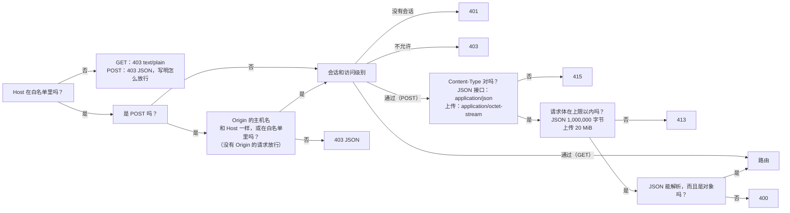

[English](../en/api.md) | [日本語](../ja/api.md) | **简体中文**

# API 说明

> 机器可读的版本是 [openapi.yaml](../en/openapi.yaml)（英文）。本文是给人读的：每个接口做什么、谁能调用、守卫怎么拦请求、哪里和旧的 Python 版不一样。从 v0.8 起，本文也包括由单独的 ai-service 容器响应的 AI 路由 `/api/ai/*`（第 5 节），以及后端和 ai-service 之间的内部路由（第 6 节）。从 v0.9 起，本文还包括 AI+ 功能的学习路由（`/api/ai/study/*` 和 `/api/ai/summary/*`：练习中、结果页上和学习记录里的提示、解释和总结，第 5.5 节）、把一条记录和它的场次联系起来的两个成绩字段，以及另外三个让 ai-service 读取一道题或一条记录的内部路由。
> 本文描述的是**真实行为**：旧版的每一种情况都抓成了黄金响应（`tests/baseline/golden/`，172 份），新的 Rust 后端对它们逐项比较。

## 1. 总览

浏览器只通过这组 REST 接口和后端通信。前端不访问数据库，也没有判断导入能不能做、用户能看到什么的逻辑：这两件事都由后端根据登录的用户来决定。

每个路由都有一个访问级别（`backend/src/api/auth.rs` 里的路由表 `ROUTES`）：

| 访问级别 | 谁能调用 |
|---|---|
| **公开** | 任何人，不用登录 |
| **登录** | 任何登录的用户 |
| **可管理题库** | 管理员，以及有 **可管理题库** 权限的普通用户 *(v0.7)* |
| **管理员** | 只有管理员 |

| 方法 | 路径 | 访问级别 | 作用 | 写库？ |
|---|---|---|---|---|
| GET | `/api/info` | 公开 | 版本、CPU 架构、能否关闭程序 | 否 |
| GET | `/api/auth/state` | 公开 | 谁登录着，以及题库印记 *(v0.6)* | 否 |
| POST | `/api/auth/login` | 公开 | 登录 *(v0.6)* | 是（新会话） |
| POST | `/api/auth/logout` | 登录 | 退出登录 *(v0.6)* | 是（删除会话） |
| POST | `/api/auth/password` | 登录 | 修改自己的密码 *(v0.6)* | 是 |
| GET | `/api/bank` | 登录 | 用户能看到的所有题库的题目（只含上架的题） | 否 |
| GET | `/api/banks` | 登录 | 用户能看到的题库，带工作表和数量 *(v0.5)* | 否 |
| GET | `/api/progress` | 登录 | 用户的学习记录 | 否 |
| GET | `/api/records` | 登录 | 用户保留的全部学习记录，最新的在前 *(v0.5)* | 否 |
| GET | `/api/record?id=<int>` | 登录 | 一条学习记录和每道题的详情 *(v0.5)* | 否 |
| GET | `/api/settings` | 登录 | 用户的界面设置 *(v0.5)* | 否 |
| POST | `/api/attempt` | 登录 | 记录一场考试或一次练习的结果 | 是 |
| POST | `/api/records/delete` | 登录 | 删除自己的一条学习记录，或全部 *(v0.5)* | 是 |
| POST | `/api/reset` | 登录 | 清空自己的学习记录 | 是 |
| POST | `/api/settings` | 登录 | 修改自己的界面设置 *(v0.5)* | 是 |
| POST | `/api/settings/reset` | 登录 | 把自己的界面设置恢复默认 *(v0.5)* | 是 |
| GET | `/api/imports` | 可管理题库 | 最近 12 条导入记录（可管理题库的用户：只有自己题库的） | 否 |
| POST | `/api/upload` | 可管理题库 | 上传 .xlsx，得到**预览**和一次性确认码；可选请求头 `X-Bank-Target` *(v0.5)* | **否**（只暂存在内存里） |
| POST | `/api/import/confirm` | 可管理题库 | 确认导入 | **是**（一个事务） |
| POST | `/api/import/cancel` | 可管理题库 | 取消自己待确认的导入 | 否 |
| POST | `/api/banks/delete` | 可管理题库 | 删除题库（可以连同学习数据） *(v0.5)* | 是 |
| GET | `/api/users` | 管理员 | 所有账户，带权限和登录锁定 *(v0.6)* | 否 |
| POST | `/api/users/create` | 管理员 | 添加用户 *(v0.6)* | 是 |
| POST | `/api/users/update` | 管理员 | 改名、改角色、停用或启用用户、设置他的题库和权限 *(v0.6)* | 是 |
| POST | `/api/users/password` | 管理员 | 给别的用户一个新的初始密码 *(v0.6)* | 是 |
| POST | `/api/users/delete` | 管理员 | 删除用户和他的学习数据 *(v0.6)* | 是 |
| POST | `/api/users/unlock` | 管理员 | 解除用户的登录锁定 *(v0.6)* | 否（只在内存里） |
| GET | `/api/logs` | 管理员 | 系统日志最近的几行 *(v0.7)* | 否 |
| POST | `/api/shutdown` | 管理员 | 关闭程序（只在本机运行时可用；Docker 里一律 403） | 否 |

`HEAD` 的行为和对应的 `GET` 一样，只是没有正文。所有接口都经过完全相同的守卫（第 3 节）。

*(v0.8)* `/api/ai/` 下面的一切（AI 对话、记忆、AI 设置）都由 ai-service 响应，在那之前 Nginx 先让后端检查这个请求：见第 5 节。它的回答是带固定 `code` 的 JSON，`send` 和 `retry` 的回答是 server-sent events 流。`/internal/*` 经过 Nginx 访问不到（第 6 节）。

*(v0.9)* `/api/ai/` 下面还有四个路由，为练习中、结果页上和学习记录里的 AI+ 功能服务（第 5.5 节）。`POST /api/attempt` 接受两个可选的键，说明一条记录属于哪一场练习或考试，并在回答里给出新记录的 id；`GET /api/record` 会再把它们返回。主数据库现在是**结构 6**，AI 数据库是**结构 3**；两者的升级都会先写一份备份（第 7 节，「v0.9 的变化」）。

## 2. 所有响应的共同点

- `Cache-Control: no-store` 和 `X-Content-Type-Options: nosniff`，没有 `Server` 头。
- JSON 是 UTF-8，日文和中文不转义成 `\uXXXX`。分隔符是 `", "` 和 `": "`（冒号后面有一个空格），键的顺序固定（就是本文和 [openapi.yaml](../en/openapi.yaml) 里的顺序）。**这是约定的一部分**：黄金测试（`backend/tests/api_golden.rs`）把 JSON 和旧版的响应逐字节比较。
- 错误的形式是 `{"error": "<原因>"}`。原因是一句可以直接给用户看的中文（前端会把它翻译成界面语言）；第 4 节列出了每一条及其英文意思。只有请求层的底层回答保留旧版简短的英文：`bad content type`（415）、`too large`（413）、`bad json`（400）、`not found`（404）和 `method not allowed`（405）。登录锁定时的 429 回答多一个键 `retryAfter`。
- 后端从不在响应里放异常名、文件路径或 SQLite 的错误信息；细节只写进日志。

## 3. 守卫（每个请求都先经过这里）

顺序是固定的，所以同一个坏请求总是得到同样的回答：



- **Host**：默认只接受 `localhost`、`127.0.0.1` 和 `::1`。要用别的地址或域名访问，把它写进环境变量 `XEXAM_ALLOWED_HOSTS`（用逗号、空格或分号分隔）。`XEXAM_ALLOW_ANY_HOST=1` 关掉 Host 检查（只在程序前面已经有身份验证时用，例如 Cloudflare Access）。
- **Origin**（只检查写请求）：只比较**主机名**（不比较协议和端口），所以通过 HTTPS 域名访问不会被误拦。没有 `Origin` 头的请求放行（命令行工具不是浏览器发出的跨站请求）。代理把 Host 改写成源站地址时，把公网域名写进 `XEXAM_ALLOWED_ORIGINS`。
- 后端**只读真实的 `Host` 头**，从不读 `X-Forwarded-*`。Nginx 也不转发它们。
- 其他方法（PUT、DELETE、OPTIONS 等）也先经过 Host 检查（403 JSON），然后得到 **405** 和 `Allow: GET, HEAD, POST`。
- 被拒绝的请求，回答里会写明你发来的 Host 或 Origin 是什么，应该把哪个值加进哪个选项。**日志** *(v0.7)*：安静了一分钟之后的第一次拒绝单独记一行（`rejected GET /api/bank: Host "…" is not in the allowed list`）；之后的拒绝最多每分钟汇总一次（`rejected N request(s) by the Host / Origin check since the last report; the last one: …`），即使后面再没有请求也会写出来。日志文字始终是英语；403 的回答正文仍是中文。任何能连到服务器的人不用登录就能引起这种拒绝，如果每次都记一行，就可能把系统日志（`GET /api/logs`）里的其他内容全部挤掉。

### 会话和访问级别 *(v0.6)*

会话检查紧接在 Host（POST 还有 Origin）检查之后进行，**在读取请求体的任何部分之前**：

| 情况 | 回答 |
|---|---|
| **公开**路由 | 放行。`GET /api/auth/state` 有会话时会读取它；其他公开路由根本不看会话 |
| 没有有效的会话（没有 `xexam_session` Cookie、未知或过期的会话，或者账户已被停用） | **401** `请先登录。` |
| 账户需要设置新密码 | 除了公开路由（`GET /api/info`、`GET /api/auth/state`、`POST /api/auth/login`）以及 `POST /api/auth/password` 和 `POST /api/auth/logout`，其他路由都回 **403** `请先设置新密码。` |
| 普通用户调用**管理员**路由 | **403** `只有管理员可以进行这个操作。` |
| 没有这个权限的普通用户调用**可管理题库**路由 *(v0.7)* | **403** `你没有管理题库的权限，请联系管理员。` |

- 不在路由表里的路径也需要会话：没有会话得到 401，有会话得到 404（GET：`text/plain` 的 `not found`；POST：经过 Content-Type、大小和 JSON 检查之后得到 `{"error": "not found"}`）。
- 会话只从 `xexam_session` Cookie 读取。角色和 **可管理题库** 权限在每个请求里都随会话从数据库读出，所以管理员做的修改在这个用户的下一个请求就生效。
- 会话有效期 30 天，并且会顺延：一个请求最多每小时刷新一次会话，并重新发送 Cookie。只有在知道协议的请求上才刷新：设了 `XEXAM_COOKIE_SECURE=1`，或者请求带有 `Origin` 头（浏览器的每个 POST 都带）。这样刷新时就不会把通过 HTTPS 发出的 Cookie 的 `Secure` 弄丢。
- 记录、错题本、进度和设置始终属于登录的用户：用户 id 来自会话，从不来自请求。别的用户的记录，回答和不存在的记录完全一样。

### 每个用户能看到和管理什么 *(v0.7)*

- **管理员**能看到并管理所有题库。
- **普通用户**正好能看到管理员为他选的那些题库（`GET /api/users` 里的 `banks`，一个 id 列表，可以是空的）。有了 `newBanks`（**包括以后导入的题库**），以后新建的每个题库在新建时都会加进这个列表；它从不添加已有的题库。有 **可管理题库** 权限的普通用户还能看到自己导入的题库（只在拥有这个权限时：没有权限时，只有自己的题库也在所选之列才能看到）。
- **可管理题库的用户**可以导入新题库（他就是所有者），只能更新或删除自己的题库。更新或删除管理员或其他用户的题库，回答 **403** `这个题库不是你上传的，只能更新或删除你自己上传的题库。`；这个检查在写入的事务里进行，所以什么都不会写入。

对于不能看到所有题库的用户，每个路由都遵循同样的规则：

| 路由 | 他得到的是 |
|---|---|
| `GET /api/bank` | 只有他的题库的题目和工作表；`file` / `mtime` 是他的题库里最近一次导入的 |
| `GET /api/banks` | 只有他的题库；`studied` 和 `records` 只数他自己的学习数据 |
| `GET /api/progress` | `questions` 只包含他的题库里的题的统计（错题本和错题复习都跟着它）；`history` 不变 |
| `POST /api/attempt` | 他看不到的题库里的题，和已删除的题完全一样处理：不计入，并出现在 `notCounted` 里 |
| `GET /api/records` | 他的每条记录都作为历史保留，带着保存时的题库名 |
| `GET /api/record` | 他看不到的题库里的题是 `"question": null`，和已删除的题一样（不发送题目文字） |
| `GET /api/auth/state` | `library` 只跟随他的题库和他的权限 |
| `GET /api/info` | 对所有人都一样：只有版本、架构和 `canShutdown`（这个路由是公开的，供容器的健康检查用） |

## 4. 接口细节

### `GET /api/info`
```json
{"version": "0.9", "arch": "x86_64", "canShutdown": false}
```
公开。版本号是 `VERSION` 文件里的 `CODE_VERSION`（或 `XEXAM_VERSION`）；`arch` 是服务器的 CPU 架构；只有程序带着 `--allow-shutdown` 启动时，`canShutdown` 才是 `true`。*(v0.7.5)* 键 `bankCount`（整个题库里上架的题数）去掉了：这个路由是公开的，登录后的页面根据 `GET /api/bank` 和 `GET /api/banks` 自己数它们能看到的题。这个路由仍然会读取数据库，所以数据库读不出来时它回答 500，容器的健康检查（问的就是这个路由）会报告后端不健康。

### `GET /api/auth/state` *(v0.6)*
公开。没有登录时（没有 Cookie，或会话已经无效）：

```json
{"user": null, "defaultAdmin": "admin"}
```

`defaultAdmin` 是一个还在用默认密码 `admin` 的已启用管理员的用户名（id 最小的那个），没有就是 `null`。登录页用它告诉所有者第一次怎么登录，写的是这个账户真正的名字（它可能被改过名）。修改或重置那个密码，或者停用、降级、删除这个账户，它就消失了。

已经登录时（账户需要设置新密码时也一样）：

```json
{"user": {"id": 1, "username": "admin", "role": "admin", "mustChangePassword": false, "canManageBanks": true, "aiAllowed": true}, "library": "3f0c9a7d5e21b4c88a9d0e6f17b2c453", "aiAvailable": true, "aiService": {"connected": true, "stopped": false, "lastSeen": 1789900000, "version": "0.9", "enabled": true, "link": true}}
```

- `role` 是 `admin` 或 `user`。`canManageBanks` *(v0.7)* 对所有管理员都是 `true`，对有 **可管理题库** 权限的普通用户也是 `true`。`aiAllowed` *(v0.8)* 对所有管理员都是 `true`，对开通了 **AI+** 的普通用户也是 `true`；AI 到底开没开，看 `GET /api/ai/status`。登录和修改密码的回答里也是同样的 `user` 对象。
- `library` 是用户能看到的题库的一个不透明印记：32 位十六进制数字，是一个摘要，不公开构成它的任何数字。只要其中某个题库被导入、替换或删除（也包括别的进程里的 `import` 命令），它就会变；*(v0.7)* 用户能看到或管理的题库变了（管理员分配了题库或改了权限，某个题库换了所有者），它也会变。打开着的页面会比较它，变了就重新读取题库。对于只能看到部分题库的用户，印记只由这些题库构成：它既不透露、也不跟随他看不到的题库的大小、题数或更新时间。

- `aiAvailable` *(v0.8，第二轮)* 在 AI+ 可用时是 `true`：ai-service 不到 60 秒前向后端报告过（并且没有说它正在停止），**并且** AI 设置里它的 **AI+ 功能** 开关是开着的。对所有登录的用户都一样。用户管理页面用它决定要不要显示 AI+ 开关，后端用它拒绝这些开关（下面的 `POST /api/users/update` 和 `create`）。
- `aiService` *(v0.8，第二轮)* 只出现在**管理员**的回答里（普通用户的回答里没有这个键）。它是后端从 ai-service 最近一次报告里知道的情况（后端从不调用 ai-service；ai-service 每 25 秒报告一次，变化后立刻报告，停止时再报告一次：第 6 节，`POST /internal/ai/heartbeat`）。报告只保存在内存里，所以后端重启后，在下一次报告到达之前（25 秒之内）`lastSeen` 是 `null`。

| 键 | 含义 |
|---|---|
| `connected` | `true`：有一份不到 60 秒的报告，并且它不是停止报告 |
| `stopped` | `true`：最近一次报告说 ai-service 正在关闭（不管它有多旧） |
| `lastSeen` | 后端启动以来最近一次被接受的报告的 Unix 秒数；没有就是 `null` |
| `version` | 最近一次报告里的版本，或者 `null` |
| `enabled` | 最近一次报告里的 AI+ 功能开关，仅在 `connected` 时；没有连接时是 `false` |
| `link` | `true`：后端加载了内部令牌（AI 链接是开着的） |

### `POST /api/auth/login` *(v0.6)*
公开。请求体：`{"username": "…", "password": "…"}`（都必须是字符串，否则 **400** `请求的格式不对。`）。用户名去掉首尾空格，比较时不区分大小写。

- **200** `{"user": {…}}`（和 `GET /api/auth/state` 里的对象一样），带两个 Cookie：
  - `xexam_session=<43 个字符>; HttpOnly; SameSite=Strict; Path=/; Max-Age=2592000`（30 天）。每次登录都得到一个新的随机令牌；数据库里只存它的 SHA-256。一个用户最多有 20 个会话；超过时，新的登录会结束最先到期的那些。
  - `xexam_device=<43 个字符>; HttpOnly; SameSite=Strict; Path=/api/auth; Max-Age=34560000`（400 天）：标记这个账户以前登录过的浏览器。它是账户当前密码哈希的带密钥哈希，所以换了密码它就作废；服务器上不为它存任何东西。
  - 只有请求的 `Origin` 是 `https://…` 或设了 `XEXAM_COOKIE_SECURE=1` 时，两者才加 `Secure`，所以在局域网里用纯 HTTP 也能登录。
- **401** `用户名或密码不对。`：密码错误、用户名不存在、账户已停用，都是这个回答，而且花的工夫一样，所以回答从不透露某个用户名是否存在。
- **429** `{"error": "登录失败次数太多，请稍后再试。", "retryAfter": <秒>}`，带 `Retry-After` 头，在登录被锁定期间返回。锁定期间每次尝试都得到 429，即使密码是对的；429 的回答不算失败次数。

锁定按轮次逐级加长：15 分钟内失败 5 次，登录锁 1 分钟；之后每一轮允许失败 3 次，锁定时间依次是 5 分钟、15 分钟、30 分钟、1 小时，然后是 1 天。这个状态属于账户（按用户 id，所以改名后还在）；没有账户的名字也按同样的轮次处理。带着这个账户的 `xexam_device` Cookie 的浏览器上的尝试，和其他所有浏览器分开计数，所以猜用户名的人锁不住主人以前用过的浏览器。登录成功、管理员重置密码或点 **解锁**、重启后端，或者安静 24 小时，都会让这个账户从头开始。细节和原因见 [security.md](security.md)。

### `POST /api/auth/logout` *(v0.6)*
登录（需要设置新密码时也可以）。请求体 `{}` 或空。删除这个会话，回答 `{"ok": true}`，并带一个过期的 Cookie（`xexam_session=; HttpOnly; SameSite=Strict; Path=/; Max-Age=0`）。

### `POST /api/auth/password` *(v0.6)*
登录（需要设置新密码时也可以）。请求体：`{"current": "…", "password": "…"}`。除非账户需要设置新密码（这时会话本身就证明了身份），否则必须有 `current`。

- **200** `{"user": {…}}`，其中 `mustChangePassword: false`。这个账户的所有会话都结束，包括这一个：这个浏览器得到一个**新的** `xexam_session` Cookie（以及新密码对应的 `xexam_device` Cookie），所以这个账户的其他浏览器都会退出登录，复制走的 Cookie 也失效。
- **400** `请求的格式不对。`：缺少 `password`（或必需的 `current`），或者不是字符串；`密码需要 8–128 个字符。`；`新密码不能和原来的一样。`。
- **403** `当前密码不对。`。当前密码输错，和登录失败计在同样的登录计数里，所以锁定（**429**，同上）在这里也适用。
- **401** `请先登录。`：账户在请求进行期间被停用或删除，或者它的密码在别处被修改或重置（什么都不写入）。

### `GET /api/users` *(v0.6)*
管理员。所有账户，按 id 排序：

```json
{"users": [{"id": 2, "username": "cook", "role": "user", "disabled": false, "createdAt": "2026-11-10 14:00", "lastLoginAt": "2026-11-10 15:02", "mustChangePassword": false, "records": 12, "banks": [1, 3], "newBanks": true, "canManageBanks": true, "ai": true, "ownedBanks": [3], "lock": null, "aiSuspended": false}], "aiAvailable": true}
```

- `createdAt` / `lastLoginAt` 是本地时间 `YYYY-MM-DD HH:MM`；第一次登录之前 `lastLoginAt` 是 `null`。
- `records` 是这个用户的学习记录条数（考试和练习）。
- `banks` *(v0.7)*：这个用户能看到的题库的 id，升序（只含还存在的题库；`[]` = 一个都没有）。它总是一个列表：`"all"` 只是写入时的简写（见下文）。
- `newBanks` *(v0.7)*：**包括以后导入的题库**。`true`：从现在起新建的每个题库（任何人作为新题库导入，或者命令行 `import`）都会在同一个事务里加进 `banks`。它从不添加已有的题库。
- `canManageBanks` *(v0.7)* 是保存着的 **可管理题库** 权限。`banks`、`newBanks` 和 `canManageBanks` 在改角色时都会保留，但只在账户是普通用户时才起作用：管理员能看到并管理所有题库。
- `ai` *(v0.8)*：保存着的用户的 **AI+ 功能** 开关。它只对普通用户有意义（AI+ 功能开启时管理员始终可以使用），而且只在 AI 设置里开着 AI+ 功能时才有意义。AI+ 不可用时它也保留。
- `aiSuspended` *(v0.8，第二轮)*，在 `lock` 之后：`true` 表示管理员在 AI 设置里暂停了这个用户的 **AI+ 功能**（第 5 节，`suspend`；界面上写作 暂停 / 已暂停，JSON 里仍沿用 `suspended` 这个名字）。它来自 ai-service 最近一次报告，所以后端没有报告时（例如刚重启之后）对所有人都是 `false`，对管理员也始终是 `false`，因为管理员不能被暂停。它和 `ai` 是分开的：暂停不会改变保存着的开关。
- `aiAvailable` *(v0.8，第二轮)*，和 `users` 并列的顶层键：值和 `GET /api/auth/state` 里的一样。**每个返回用户列表的回答**都有它（`create`、`update`、`password`、`delete`、`unlock` 也一样）。
- `ownedBanks` *(v0.7)*：这个用户作为新题库导入的题库（他是所有者）的 id，升序。
- `lock`：账户在内存里的登录状态。还在第一轮、没有被锁定时是 `null`；否则：

```json
{"until": "2026-11-10 15:20:07", "retryAfter": 298, "round": 2, "triesLeft": 0, "knownBrowser": false, "otherUntil": null, "otherRetryAfter": 0}
```

| 键 | 含义 |
|---|---|
| `until` | 当前锁定结束的本地时间 `YYYY-MM-DD HH:MM:SS`；没有锁定时是 `null` |
| `retryAfter` | 到那时还有几秒；没有锁定时是 `0` |
| `round` | 锁定期间：以这次锁定结束的那一轮（1 = 第一次，锁 1 分钟）。否则：正在进行的那一轮（2 或更大） |
| `triesLeft` | 正在进行的那一轮里，下次锁定之前还能失败几次（锁定期间是 `0`） |
| `knownBrowser` | `true`：显示的状态统计的是这个用户以前登录过的浏览器上的登录；`false`：其他所有浏览器上的。两者都在计数时，显示限制得更厉害的那一个 |
| `otherUntil` / `otherRetryAfter` | 只有另一类浏览器同时也被锁定、账户在所有浏览器上都被锁定时才有值：那第二个锁定的结束时间和秒数（否则是 `null` / `0`） |

### `POST /api/users/create` *(v0.6)*
管理员。请求体：`{"username": "…", "password": "…", "role": "admin" | "user", "banks": "all" | [<题库 id>, …], "newBanks": <bool>, "canManageBanks": <bool>, "ai": <bool>}`。*(v0.7)* `banks` 默认是 `[]`（管理员选好之前，新用户看不到任何题库），`newBanks` 默认是 `false`，`canManageBanks` 默认是 `false`；*(v0.8)* `ai`（**AI+**）默认是 `false`。用 `ai: true` 创建用户时，也会记录 `user "<admin>" turned AI+ on for user "<name>"`；*(v0.8，第二轮)* AI+ 不可用时（见上面的 `aiAvailable`）它会被拒绝，回答 **409** `ai.serviceOff`，并且不创建用户。`ai: false` 或者不带 `ai` 照常工作。`"banks": "all"` 是一种简写：现在存在的所有题库，并且在没有给出 `newBanks` 时同时设置 `newBanks: true`。重复的 id 会被忽略。新账户是启用的，第一次登录时必须设置新密码。回答：和 `GET /api/users` 一样的 `{"users": [...]}`。

用户名 1–40 个字符（ASCII 字母、数字和 `. _ - @`，去掉首尾空格），不区分大小写地唯一；密码 8–128 个字符。

| 回答 | 什么时候 |
|---|---|
| **400** `用户名不对：1–40 个字符，只能用字母、数字和 . _ - @。` | 缺少 `username`、不是字符串，或不符合规则 |
| **400** `密码需要 8–128 个字符。` | `password` 太短或太长 |
| **400** `请求的格式不对。` | 缺少 `password` 或不是字符串；缺少 `role` 或不是 `admin` / `user`；`banks` 既不是 `"all"` 也不是整数列表；`newBanks`、`canManageBanks` 或 `ai` 不是布尔值 |
| **400** `选择的题库中有不存在的（可能已被删除），请刷新页面后再试。` *(v0.7)* | `banks` 里有一个 id 不是现存的题库（或者不是正整数）；什么都不创建 |
| **409** `这个用户名已经有人用了。` | 另一个账户用了这个名字（不区分大小写） |
| **409** `{"error": "请先在 AI 设置里开启 AI+ 功能。", "code": "ai.serviceOff"}` *(v0.8，第二轮)* | AI+ 不可用时给了 `ai: true`。它在请求体通过验证之后（格式不对的 `ai` 仍然是 400）、写入任何东西或给密码做哈希之前检查 |

### `POST /api/users/update` *(v0.6)*
管理员。请求体：`{"id": <int>, "username"?, "role"?, "disabled"?, "banks"?, "newBanks"?, "canManageBanks"?, "ai"?}`；没写的键保持不变。回答：`{"users": [...]}`。

- 停用账户或改角色会结束它的会话。改名、改 `banks`、`newBanks`、`canManageBanks` 或 `ai` 不会结束会话；修改从这个用户的下一个请求开始生效。
- `ai` *(v0.8)* 开通或关闭用户的 **AI+ 功能**。它马上对下一个 AI 请求生效（后端检查每个 AI 请求），关闭时，正在为这个用户生成的回答会在大约 2 秒内停止；这个用户的 AI 对话和记忆保留。修改会记录为 `user "<admin>" turned AI+ on for user "<name>"`（或 `off`）。
- *(v0.8，第二轮)* AI+ 不可用时（ai-service 没有连接，或者 AI 设置里 AI+ 功能是关的），**任何带 `ai` 键的请求整个被拒绝**，回答 **409** `{"error": "请先在 AI 设置里开启 AI+ 功能。", "code": "ai.serviceOff"}`：不管是 `true` 还是 `false`，不管和保存的值相不相同，也不管是单独的还是和其他字段一起的。什么都不写入，也不记录日志。不带 `ai` 的请求不受影响。这是后端自己的路由里唯一带 `code` 的错误。所有用户保存着的开关在 AI+ 不可用期间都保留，AI+ 恢复后重新生效。
- `banks` 替换所选的题库（一个 id 列表，`[]` = 一个都没有；或者 `"all"`，现在存在的所有题库，在没有给出 `newBanks` 时还会设置 `newBanks: true`）。只给 `newBanks` 时只改这个标记：取消它不会拿走这个用户已有的题库。
- **400**：和创建时一样（`username`、`role`、`banks`、`newBanks`、`canManageBanks`、`ai`；`disabled` 不是布尔值 → `请求的格式不对。`；缺少 `id` 或不是整数（布尔值不算） → `请求的格式不对。`）。
- **404** `这个用户不存在（可能已被删除），请刷新页面后再试。`。
- **409** `不能对自己的账户做这个操作。`：停用自己或改自己的角色时；`至少要保留一个启用的管理员。`：修改后就没有启用的管理员时；`这个用户名已经有人用了。`。

所有检查都和写入在同一个事务里，所以两个请求不可能同时通过检查。

### `POST /api/users/password` *(v0.6)*
管理员。请求体：`{"id": <int>, "password": "…"}`。给另一个用户一个新的初始密码：他下次登录时必须设置新密码，他的会话都结束，他的 `xexam_device` Cookie 不再匹配，他的登录锁定也被清除。自己的密码要用 `POST /api/auth/password` 修改（在这里会得到 **409** `不能对自己的账户做这个操作。`）。其他错误：400（密码规则、请求体格式不对）、404（用户不存在）。

### `POST /api/users/delete` *(v0.6)*
管理员。请求体：`{"id": <int>}`。删除账户及其会话、学习记录（含详情）、答错统计、设置和所选的题库。*(v0.7)* 这个用户拥有的题库不会被删除：它们转到删除这个用户的管理员名下。*(v0.8)* 这个用户马上就不能再访问 AI 路由；ai-service 会在下一次对账时（10 分钟之内，或者管理员打开 AI 用户列表时）删除他的 AI 对话和记忆。删除自己或最后一个启用的管理员得到 **409**；id 不存在得到 **404**。

### `POST /api/users/unlock` *(v0.6)*
管理员。请求体：`{"id": <int>}`。把账户在所有浏览器上的登录状态全部清除（回到第 1 轮，5 次机会），不管是正在锁定，还是只是已经过了第 1 轮。它按用户 id 处理，所以改名后也有效，对自己的账户也有效。id 不存在得到 **404**。回答：`{"users": [...]}`。

### `GET /api/bank`
登录。`file` / `mtime` 是最近一次导入（用户能看到的题库）的文件名和时间；`questions` 只包含上架的题，来自用户能看到的所有题库，按题库 id（升序）分组，每个题库内按它自己的顺序；`sheets` 里每个工作表名带可用题数和已下架题数（不同题库里同名的工作表合在一起计数；每个题库各自的数字见 `GET /api/banks`）。题目的各个字段见 [openapi.yaml](../en/openapi.yaml) 里的 `Question`。
从 v0.5 起，每道题最后多一个键 `"bank": <题库 id>`（在 `row` 之后）。

一道题的键的顺序是 `kind, tag, stem, options, items, answer, translation, zh, [english, en,] [lang, ja,] explanation, mnemonic, note, [explain,] id, sheet, row, bank`。方括号里的键只在有它们的格式里出现，所以旧文件的输出和以前逐字节相同。从 v0.7 起只能导入六列格式，旧格式的题在每次启动时都会被下架，所以 `GET /api/bank` 里通常只有六列格式的题；旧的形式仍会出现在 `GET /api/record` 里，用于以前记录中已下架的题：

- **三列格式**（A 题目，B 中文，C 答案）：一个都没有。
- **四列格式**（A 英语，B 中文，C 日语，D 答案）：`english`（A 列的原文）和 `en`（按日语的结构拆开的英语）。`stem`、`options`、`items` 和 `answer` 来自 C 列的日语。
- **六列格式** *(v0.7)*（A 英语、B 中文、C 日语题目；D 英语、E 中文、F 日语答案和解析）：以英语为准，所以 `stem`、`options`、`items` 和 `answer` 是英语的，`"lang": "en"` 表明这一点；`zh`（B 列）和 `ja`（C 列）是按英语的结构拆开的另外两种语言（对不上时是 `null` 或没有）；`explain` 存每种语言的解析、记忆口诀和答案备注：`{"en": {"explanation", "mnemonic", "note"}, "zh": {…}, "ja": {…}}`，三样都没有的语言不出现。`explanation` / `mnemonic` / `note` 为旧客户端保留（有中文就用中文，否则用日语，再否则用英语）。热点题的 `tag` 是 `HOTSPOT`（旧格式里是 `ホットスポット`）。

`zh` / `en` / `ja` 里的热点题多一个键 `choices`：每个小项的选项，用这种语言写。

### `GET /api/banks` *(v0.5)*
登录。一个题库就是一份导入的工作簿。用户能看到的题库，按 `id` 排序：

```json
{"banks": [{"id": 1, "name": "Kitchen basics", "filename": "Kitchen basics.xlsx", "legacy": true, "createdAt": "2026-11-10 14:00", "updatedAt": "2026-11-10 15:00", "total": 5, "inactive": 0, "sheets": [{"name": "Cooking", "usable": 3, "inactive": 0}, {"name": "Safety", "usable": 2, "inactive": 0}], "studied": 4, "records": 3, "ownerId": 1, "owner": "admin", "manageable": true}]}
```

- `name` 是新建题库时去掉 `.xlsx` 的文件名（已经有题库叫这个名字时，加上 ` (2)`、` (3)` ……）；更新题库会改 `filename` 和 `updatedAt`，从不改 `name`。
- `legacy`：存放 v0.5 之前数据的那个题库，也是不带 `X-Bank-Target` 的上传的目标。它的题目 id 是 [database.md](database.md) 第 4.1 节里的普通题目 id；其他题库都用限定在本题库内的 id，所以同一份工作簿可以导入成两个独立的题库。
- `total` = 上架的题，`inactive` = 已下架的题；`sheets` 按题库里题目的顺序排列，也列出题全都下架了的工作表（`usable` 为 0）。
- `studied` = 这个题库有统计的题有几道（上架或下架都算）；`records` = 有几条学习记录用到了这个题库。对管理员来说它们数的是所有用户的数据（也就是连同学习数据删除时会删掉的内容）；对其他人 *(v0.7)* 只数他自己的。
- `ownerId` / `owner` *(v0.7)*：把这个题库作为新题库导入的用户的 id 和用户名（v0.7 之前的题库属于第一个管理员）。只有管理员能得到这两项；其他用户只有在自己的题库上才得到 `ownerId`（否则是 `null`），`owner` 总是 `null`，所以题库列表从不透露别的账户。
- `manageable` *(v0.7)*：这个用户能不能更新和删除这个题库（管理员：总是能；可管理题库的用户：自己的题库；其他人：从不）。

### `GET /api/progress`
登录。`questions` 是用户每道题的累计统计（答过几次、答对几次、答错几次、当前连续答对几次），只限于他能看到的题库；`history` 是他最近 60 条学习记录（数据库保留 500 条，见 `GET /api/records`），每条最后是 `kind` *(v0.7)*；`masterStreak` 是连续答对几次后移出错题本（2）。

```json
{"version": 1, "questions": {"1a2b3c4d5e6f": {"attempts": 3, "correct": 2, "wrong": 1, "streak": 2, "last": true, "at": "2026-11-10 15:10"}}, "history": [{"at": "2026-11-10 15:10", "sheets": ["Cooking"], "mode": "all", "total": 5, "correct": 4, "percent": 80, "seconds": 130, "kind": "exam"}], "masterStreak": 2}
```

### `GET /api/imports`
可管理题库。`{"imports": [{"id", "at", "filename", "added", "updated", "removed", "restored", "skipped", "total"}, …]}`，最新的 12 条在前。管理员得到所有导入；可管理题库的用户 *(v0.7)* 只得到导入到自己题库的那些。

### `POST /api/upload`
可管理题库。请求体是 .xlsx 文件的原始字节；可选请求头 `X-Filename` 带百分号编码的文件名。服务端：

1. 只凭**内容**判断是不是 .xlsx（魔数 + ZIP 结构 + 有工作簿 + 没有 DOCTYPE / 实体声明 + 解压后大小有上限）。空文件、旧的 `.xls`、损坏的文件、改了扩展名的文件，各有自己的中文说明。
2. 解析它。*(v0.7)* 解析器读出任何一道旧的三列或四列格式的题时，这次上传以 **400** `只能导入六列格式（A–C 列：英文、中文、日文题目；D–F 列：英文、中文、日文答案）。这个文件是旧的三列或四列格式，请改成六列格式后再导入。` 被拒绝，新建题库和更新题库都一样；什么都不暂存，待确认槽位也不受影响。日志里会记一行带文件名的英语日志。
3. 生成预览，把解析结果放进内存里**上传者自己的待确认槽位**（再上传一次就替换它；别人的槽位永远不碰），30 分钟内有效。
4. **不写数据库。**

返回预览（`added / updated / unchanged / restored / removed / skipped / usable`、每个工作表的详情，以及读不出来的行和原因）和一次性确认码 `token`：

```json
{"sheets": [{"name": "Cooking", "total": 3, "usable": 3, "skipped": [], "added": 3, "updated": 0, "removed": 0, "restored": 0, "skippedMore": 0, "skippedCount": 0}], "added": 3, "updated": 0, "unchanged": 0, "restored": 0, "removed": 0, "skipped": 0, "usable": 3, "removed_samples": [], "removed_stats": 0, "filename": "Kitchen basics.xlsx", "token": "…"}
```

每个工作表最多列出 30 个读不出来的行（`skipped`，每个是 `{"row", "reason"}`）；`skippedMore` 是还有几个，`skippedCount` 是一共几个。

**提醒** *(v0.7)*：中文（E 列）或日文（F 列）答案和英文答案（D 列）不一致的行仍然会导入，用的是英文答案，并作为提醒列出来。只有这时才会出现这些键，所以没有提醒的预览和以前版本的键完全一样：有提醒的工作表多一个 `warnings`（最多 30 个 `{"row", "reason"}`，紧接在 `restored` 之后），并在最后多 `warningsMore` 和 `warningsCount`；整个预览在 `removed_stats` 之后多一个提醒总数 `warnings`。原因是 `E 列的中文答案和 D 列的英文答案不一致（已按英文答案导入）`，F 列的日文答案也是同样的写法。

**目标题库** *(v0.5)*：可选请求头 `X-Bank-Target` 说明文件导入到哪个题库。不管哪种情况，预览的键都一样；它只和目标题库比较。

| `X-Bank-Target` | 意思 |
|---|---|
| 没有 | 和 v0.4 完全一样，对旧题库（legacy）导入（确认时如果还不存在就新建） |
| `new`（忽略首尾空格和大小写） | 确认时新建一个题库，所有者是上传者；预览里每道可用的题都算 `added` |
| 题库 id，`^[0-9]{1,18}$`（忽略首尾空格） | 更新（替换）那个题库；id 不存在 → **404** `这个题库不存在（可能已被删除），请刷新页面后再试。` |
| 其他任何值 | **400** `上传目标不对，请刷新页面后再试。` |

这个请求头在守卫和大小限制之后、解析文件之前读取。可管理题库的用户只能更新自己的题库 *(v0.7)*：别人的现存题库（对不带这个请求头的上传来说，也包括旧题库） → 在解析文件之前就回答 **403** `这个题库不是你上传的，只能更新或删除你自己上传的题库。`。被拒绝的上传不碰待确认槽位。

**内存额度** *(v0.7)*：每个管理员和可管理题库的用户都有一个槽位，而一份接近解析器上限的工作簿解析后会占用超过 100 MB，所以所有暂存的预览共用一个 128 MiB 的额度（按内容估算）。暂存新的上传时，先丢掉过期的预览，总量仍超过额度时，再丢掉别的用户最早的预览。最新的上传总会保留。预览被丢掉的用户在确认时得到 **409**，和过了 30 分钟一样。

其他回答：**413** `文件太大了（最大 20 MB）。…`；**400** 加上文件被拒绝的原因（不是 .xlsx、已损坏、解压后太大、解析时间太长、旧格式等）。

### `POST /api/import/confirm`
可管理题库。请求体是 `{"token": "…"}`。

- 确认码是一个 128 位的随机数（22 个字符），**只能用一次**。它只能确认调用者自己待确认的上传：错误的确认码、别的用户的确认码或含非 ASCII 字符的确认码都当作「无效」，不会消耗待确认的内容；过期（或被丢掉）的预览无法找回。这些情况一律 → **409** `这次上传的预览已经过期或已被处理，请重新上传。`。
- 导入在**一个事务**里完成：要么全部成功，要么题库保持不变（**500** `写入数据库失败，题库没有任何改动。`）。
- 这份文件里一道可用的题都没有 → **400** `这份文件里没有读到任何可用的题，没有导入。`。
- *(v0.7)* 暂存的工作簿里有旧的三列或四列格式的题时，这里也会在写入任何东西之前拒绝它（**400**，提示和上传时一样）。

导入规则（文件被当成**目标题库的完整内容**）：第一次出现的题新增；改过的题更新；这个题库里有、文件里找不到的题**下架**（学习记录保留）；下架的题再次出现时自动恢复。其他题库永远不碰。

响应：`{"result": <和预览一样的结构，但没有 filename / token>, "bank": <GET /api/bank，按用户看到的>}`。只有上传时带了 `X-Bank-Target`，后面才多第三个键：`"bankId": <新建 / 更新的题库 id>`（这样 v0.4 的响应保持逐字节相同）。目标题库在预览之后被删除 → **404** `这个题库不存在（可能已被删除），请刷新页面后再试。`；它现在属于别人了（被删除用户的题库转给了管理员） → **403** `这个题库不是你上传的，只能更新或删除你自己上传的题库。`。这两种情况都什么都不写入，确认码也用掉了。

### `POST /api/import/cancel`
可管理题库。丢掉调用者自己待确认的上传（别的用户的上传保留）。不需要确认码。回答：`{"ok": true}`。

### `POST /api/banks/delete` *(v0.5)*
可管理题库。请求体：`{"id": <int>, "withRecords": <bool，默认 false>}`。在一个事务里删除这个题库的题目（上架的和已下架的）、导入记录、用户对它的访问权以及题库本身。`withRecords: true` 时还删除这个题库的学习数据：这些题的统计（错题本）、它们每道题的详情，以及所有用到这个题库、又没有用到任何现存题库的学习记录（通常就是只用了这个题库的记录；还用了一个早先已删除的题库的记录也会删掉，而不是留下一条空记录）。不带它时，学习记录和统计都保留；它们的详情里这些题显示为已删除。

- 管理员可以删除任何题库，`withRecords` 删除的是**所有**用户的学习数据。
- 可管理题库的用户 *(v0.7)* 只能删除自己的题库（否则 **403** `这个题库不是你上传的，只能更新或删除你自己上传的题库。`，什么都不写入），`withRecords` 只删除**他自己**的学习数据；其他用户的记录保留，里面的题显示为已删除。

所有用户中以这个题库为目标的待确认上传（针对这个 id 的上传，或者这个题库是旧题库时不带 `X-Bank-Target` 的上传）都会被丢掉。

响应：`{"banks": [...], "bank": <GET /api/bank>, "progress": <GET /api/progress>}`，三者都是调用者看到的样子。缺少 `id` 或不是整数（布尔值不算整数），或有 `withRecords` 但不是布尔值 → **400** `请求的格式不对。`；id 不存在 → **404** `这个题库不存在（可能已被删除），请刷新页面后再试。`。

### `POST /api/attempt`
登录。请求体是 `{"results": [{"id": "…", "correct": true, "answer": ["B"]}], "sheets": ["…"], "mode": "all", "seconds": 123, "kind": "exam"}`。

清洗规则：`results` 必须是列表（否则 **400** `成绩的格式不对`），只读前 2000 项；每一项要有字符串 `id`（截到 64 个字符）和布尔值 `correct`，其他项丢掉；一项都不剩时 → **400** `没有成绩可保存`。`sheets` 最多保留 50 个字符串（每个截到 80 个字符）；`mode` 不是 `all / weak / retry` 时按 `all` 处理；`seconds` 限制在 0 到 604800 之间，异常值按 0 处理。**服务端信任 `correct`**；判分在浏览器里进行（见 [security.md](security.md)）。

*(v0.7)* `kind` 是 `"exam"`（默认值，没有或为 `null` 时也是它）或 `"practice"`；其他值 → **400** `成绩的格式不对`。两种都以同样的方式更新统计（错题本），也都计入同样的 500 条保留记录；区别只在页面怎么显示它们。

*(v0.5)* 每个结果可以带一个可选的 `answer`，只为以后能回顾这条记录而保存：一个最多 64 个元素的 JSON 数组，每个元素是最多 8 个字符的字符串、0–999 的整数或 `null`（`["C"]`、`["A", "D"]`、`[0, 1, null]`）。其他形式都按「没有答案」保存；结果本身仍然接受。服务端为每个计入的结果保存一行详情，外加题目所在题库的快照，并只保留这个用户最新的 **500** 条记录（更早的连同详情一起删除）。

*(v0.9)* 请求体还可以带 `"key"` 和 `"startedAt"`，说明这条记录是从哪一场练习或考试保存的，这样 AI+ 功能就能把这一场的回答放在同一个对话里（第 5.5 节）。`key` 是正好 32 个小写十六进制数字的字符串（浏览器为每一场新生成一个）；`startedAt` 是 1 到 4102444800 的整数（Unix 秒，这一场开始的时间）。**两者各自单独判断**：缺少或无效的那一个（长度不对、有大写或非十六进制字符、用字符串发来的数字、小数、`null`、超出范围的值）按 `NULL` 保存，请求从不因此被拒绝，所以旧的客户端照常工作。`key` 不要求唯一，主数据库也从不按它查找记录；v0.9 之前保存的记录，或没有有效 `key` 的记录，没有它。

**只计入还存在的题** *(v0.7)*。题目已经不在了（考试期间它的题库被删除，或 id 是编造的），或者属于用户不能看到的题库，这样的结果不计入统计、详情、`total` / `correct` / `percent` 和题库快照。已下架的题（后来的导入里没有它）仍然存在，照常计入。然后：

- 有一部分结果没计入：用其余的结果保存记录，`sheets` 只列出计入的题所在的工作表（按发来的顺序），回答最后多一个 `"notCounted": [<没计入的 id>]`。
- 一个都不剩：什么都不保存，**409** `这场考试的题目已经被删除，成绩没有保存。`。

回答是这个用户的 `GET /api/progress`（有结果没计入时再加上 `notCounted`；`GET /api/progress` 本身从来没有它）。*(v0.9)* 它以 `"recordId"` 结尾，永远在最后：刚保存的那条记录的 id（就是 `GET /api/records` 列出的 `id`），所以浏览器不用再去猜。

`percent` 用**四舍六入五成双**（Python 的 `round`）：8 题对 1 题是 12，不是 13。

### `GET /api/records` *(v0.5)*
登录。`{"records": [RecordSummary, …], "retention": 500}`，这个用户的记录，最新的在前。RecordSummary 是：

```json
{"id": 7, "at": "2026-11-10 15:10", "banks": [{"id": 1, "name": "Kitchen basics", "deleted": false}], "sheets": ["Cooking"], "mode": "all", "total": 5, "correct": 4, "percent": 80, "seconds": 130, "answered": 5, "detail": true, "kind": "exam"}
```

`banks` 是保存记录时的快照，题库还在时显示它现在的名字（题库没了就是 `deleted: true`）。`detail` 表示有没有每道题的详情（v0.5 之前保存的考试没有）；`answered` 是有答案的详情行数，没有详情时是 `null`。`kind` *(v0.7)* 是 `exam` 或 `practice`（v0.7 之前的记录都是考试）。

### `GET /api/record?id=<int>` *(v0.5)*
登录。`{"record": RecordSummary, "items": [{"seq": 0, "questionId": "…", "answer": ["C"], "correct": true, "question": {…}}]}`。`answer` 是保存的数组或 `null`；`question` 和 `GET /api/bank` 里的题完全一样，最后再加一个 `"active": <bool>`（包括已下架的题）；题目已经不存在，或者 *(v0.7)* 属于用户不能看到的题库时是 `null`（不发送它的文字）。
*(v0.9)* 这个路由的 `record`，而且只有这个路由的（`GET /api/records` 和其他列出记录的回答不变），以 `"sessionKey"`（保存的场次键，或 `null`）和 `"startedAt"`（Unix 秒，或 `null`）结尾：学习记录页面用它们找到这条记录的 AI 对话。
`id` 必须正好是一个查询参数，1–18 位 ASCII 数字（会解码百分号编码），否则 → **400** `请求的格式不对。`；id 不存在，或是别的用户的记录 → **404** `这条考试记录不存在（可能已被删除），请刷新页面后再试。`。

### `POST /api/records/delete` *(v0.5)*
登录。请求体二选一：`{"id": <int>}`（删除这条记录和它的详情；每道题的统计，也就是错题本，**不**变）或 `{"all": true, "withStats": <bool，默认 false>}`（删除这个用户的所有记录和详情；`withStats: true` 时还清空他的统计，等于 `POST /api/reset`）。只会删除调用者自己的记录。
响应：`{"records": [...], "retention": 500, "progress": <GET /api/progress>}`。其他任何请求体（既没有 `id` 也没有 `all`、两者都有、`all` 不是 `true`、`withStats` 和 `id` 一起出现、类型不对） → **400** `请求的格式不对。`；id 不存在 → **404** `这条考试记录不存在（可能已被删除），请刷新页面后再试。`。

### `POST /api/reset`
登录。清空调用者的学习记录（含每道题的详情）和每道题的统计；题库和其他用户都不受影响。回答：他（现在已经空了的）`GET /api/progress`。

### `GET /api/settings` / `POST /api/settings` / `POST /api/settings/reset` *(v0.5)*
登录。设置按用户保存在数据库里（重启和更新容器、清除浏览器缓存、换浏览器之后都还在）：

```json
{"theme": "system", "uiLang": "en", "autoAdvance": false, "questionLang": "ja"}
```

| 键 | 取值 | 默认 |
|---|---|---|
| `theme` | `system` · `light` · `dark` | `system` |
| `uiLang` | `en` · `zh` · `ja` | `en` |
| `autoAdvance` | `true` · `false` | `false` |
| `questionLang` | `ja` · `zh` · `en` | `ja` |

`GET` 返回默认值合并上保存的值（保存的值无效时忽略它）。`POST /api/settings` 接受这些键的任意子集，返回完整的设置；未知的键忽略；已知的键取值无效 → **400** `设置的值不对。`，什么都不写入。`POST /api/settings/reset`（请求体 `{}` 或空）把 `theme`、`uiLang` 和 `autoAdvance` 恢复成默认值，保留 `questionLang`，返回完整的设置。

### `GET /api/logs` *(v0.7)*
管理员。**系统日志** 页面显示的日志：后端启动以来记录的最近 2000 行，只保存在内存里（重启后又是空的；什么都不写进数据库）。它们就是 `docker compose logs backend` 显示的那些行（经过同样的 `XEXAM_LOG` 过滤），再加上启动和关闭时的状态行，*(v0.8)* 再加上 ai-service 发来的行（`target` 是 `xexam_ai_service`，消息以 `AI: ` 开头；它们不在 `docker compose logs backend` 里）。日志行用用户名指代用户（`user "admin" updated user "alex"`），从不用 id，也从不写没有账户的、输入的名字；日志行从不包含密码、令牌、Cookie 的值或题目文字。

查询参数，两个都可选：

- `after=<seq>`：只返回这个序号之后的行（1–19 位 ASCII 数字）。
- `boot=<id>`：客户端上次读到的回答里的 `boot`（1–64 个 `A-Z a-z 0-9 _ -` 字符）。

```json
{"lines": [{"seq": 41, "time": "2026-11-10 15:10:02", "level": "info", "target": "xexam_backend::api::auth", "message": "user \"admin\" signed in"}], "last": 41, "dropped": false, "boot": "Xq3v9T0bLm2k"}
```

- `lines`：最早的在前。`seq` 每行加一，每个后端进程都从 1 开始；`time` 是带秒的本地时间；`level` 是 `error`、`warn`、`info`、`debug` 或 `trace`；`target` 是记录它的模块；`message` 是文字加上它的字段（超过 4000 个字符会截断）。
- `last`：最新一行的序号（还没记录任何东西时是 0），也就是下一次轮询的 `after`。
- `dropped`：比 `after` 新的行（没有 `after` 时：从第 1 行起）在能返回之前就已经被挤出缓冲区时是 `true`。
- `boot`：这个后端进程的随机 id，也就是下一次轮询的 `boot`。
- 没有 `after` 时返回保留着的所有行。重启后序号从 1 重新开始，所以比 `last` 大的 `after`，或者不是这个进程的 id 的 `boot`，都按没有 `after` 处理：返回保留着的所有行。
- `after` 或 `boot` 格式不对、为空或出现两次 → **400** `请求的格式不对。`。其他参数忽略。

任何人不用登录就能引起的日志行（被拒绝的请求、失败的登录、没有账户的用户名被锁定）最多每分钟汇总一次（第 3 节），所以它们挤不掉其他日志。

### `POST /api/shutdown`
管理员。只有用 `--allow-shutdown` 启动时才可用（Windows 上双击 `start.bat`）；否则 **403** `在 Docker 里请用 docker compose stop 停止容器。`。在 Docker 里一律 403；在那里请用 `docker compose stop`。

### 错误提示
和后端的其他提示一样，它们是中文，而且是固定的（前端会翻译）。每个路由都可能给出的那些见第 3 节；上传和解析器的提示（文件为什么被拒绝、某一行为什么读不出来）连同翻译都在 `frontend/src/i18n/server-messages.ts` 里。

| 状态码 | 提示 | 英文意思 | 什么时候 |
|---|---|---|---|
| 400 | `请求的格式不对。` | The request is not in the expected format. | v0.5 及以后的接口，请求体或查询参数格式不对 |
| 400 | `上传目标不对，请刷新页面后再试。` | The upload target is not valid. Reload the page and try again. | `X-Bank-Target` 格式不对 |
| 400 | `设置的值不对。` | A setting has an invalid value. | `POST /api/settings` |
| 400 | `成绩的格式不对` | The exam result is not in the expected format. | `POST /api/attempt`：`results` 不是列表，或 `kind` 不对 |
| 400 | `没有成绩可保存` | There is no result to save. | `POST /api/attempt`：没有有效的结果 |
| 400 | `用户名不对：1–40 个字符，只能用字母、数字和 . _ - @。` | The username is not valid: it needs 1–40 characters, using only letters, digits and . _ - @. | 用户：创建、修改 |
| 400 | `密码需要 8–128 个字符。` | The password needs 8 to 128 characters. | 密码相关的路由、创建用户 |
| 400 | `新密码不能和原来的一样。` | The new password must be different from the old one. | `POST /api/auth/password` |
| 400 | `选择的题库中有不存在的（可能已被删除），请刷新页面后再试。` | One of the chosen question banks does not exist (it may have been deleted). Refresh the page and try again. | 用户：创建、修改 *(v0.7)* |
| 400 | `这份文件里没有读到任何可用的题，没有导入。` | No usable questions were found in this file, so nothing was imported. | 确认导入 |
| 400 | `只能导入六列格式（A–C 列：英文、中文、日文题目；D–F 列：英文、中文、日文答案）。这个文件是旧的三列或四列格式，请改成六列格式后再导入。` | Only the six-column layout can be imported (columns A–C: the question in English, Chinese and Japanese; columns D–F: the answer in English, Chinese and Japanese). This file uses the old three- or four-column layout. Rewrite it in the six-column layout and import it again. | 上传、确认导入 *(v0.7)* |
| 401 | `请先登录。` | Please sign in first. | 没有有效的会话 |
| 401 | `用户名或密码不对。` | The username or password is not correct. | 登录 |
| 403 | `请先设置新密码。` | Please choose a new password first. | 账户需要设置新密码 |
| 403 | `只有管理员可以进行这个操作。` | Only an administrator can do this. | 管理员路由 |
| 403 | `你没有管理题库的权限，请联系管理员。` | You do not have permission to manage question banks. Ask an administrator. | 可管理题库的路由 *(v0.7)* |
| 403 | `这个题库不是你上传的，只能更新或删除你自己上传的题库。` | You did not upload this question bank. You can only update or delete question banks you uploaded yourself. | 上传、确认导入、删除题库 *(v0.7)* |
| 403 | `当前密码不对。` | The current password is not correct. | `POST /api/auth/password` |
| 404 | `这个题库不存在（可能已被删除），请刷新页面后再试。` | This question bank does not exist (it may have been deleted). Reload the page and try again. | `X-Bank-Target`、确认导入、删除题库 |
| 404 | `这条考试记录不存在（可能已被删除），请刷新页面后再试。` | This exam record does not exist (it may have been deleted). Reload the page and try again. | `/api/record`、`/api/records/delete` |
| 404 | `这个用户不存在（可能已被删除），请刷新页面后再试。` | This user does not exist (it may have been deleted). Reload the page and try again. | 用户相关的路由 |
| 409 | `这次上传的预览已经过期或已被处理，请重新上传。` | The preview of this upload has expired or has already been handled. Please upload the file again. | 确认导入 |
| 409 | `这场考试的题目已经被删除，成绩没有保存。` | The questions of this exam have been deleted, so the result was not saved. | `POST /api/attempt` *(v0.7)* |
| 409 | `这个用户名已经有人用了。` | This username is already taken. | 用户：创建、修改 |
| 409 | `不能对自己的账户做这个操作。` | You cannot do this to your own account. | 用户：修改、密码、删除 |
| 409 | `至少要保留一个启用的管理员。` | At least one enabled administrator must remain. | 用户：修改、删除 |
| 409 | `请先在 AI 设置里开启 AI+ 功能。`（带 `"code": "ai.serviceOff"`） | Turn on the AI+ feature in AI settings first. | 用户：带 `ai` 的修改、`ai: true` 的创建，在 AI+ 不可用时 *(v0.8)* |
| 429 | `登录失败次数太多，请稍后再试。` | Too many failed attempts. Please try again later. | 登录、修改密码（带 `retryAfter`） |
| 500 | `写入数据库失败，题库没有任何改动。` | Writing to the database failed. The question bank was not changed. | 确认导入 |
| 500 | `服务器内部出错，请稍后再试。` | An internal server error occurred. Please try again later. | 任何路由 |

## 5. AI 路由（`/api/ai/*`，v0.8）

`/api/ai/` 下面的路由由 ai-service（`ai-service` 容器，镜像 `xexam-ai-service`）响应，而不是后端。Nginx 先把每个这样的请求交给后端的认证步骤（第 6 节），只有后端允许时才转发，而且去掉浏览器的 Cookie，换上后端签名的身份声明（`X-Xexam-Identity`）。所以客户端调用它们的方式和其他路由完全一样：同源，带会话 Cookie；客户端不能自己设置身份（Nginx 总会覆盖这个请求头）。

### 5.1 共同规则

- **方法**：只有 GET 和 POST。其他方法 Nginx 回答 403；ai-service自己回答 405 和 `Allow: GET, POST`。`/api/ai/` 下未知的路径是 404 `ai.notFound`。不支持 `HEAD`。
- **被认证步骤拒绝**（由 Nginx 回答，ai-service根本看不到这个请求）：

  | 状态 | `code` | 什么时候 |
  |---|---|---|
  | 401 | `auth.signin` | 没有有效的会话。`error` 文字是后端的 `请先登录。`。认证步骤只接受正好一个、原样写出的 `xexam_session` Cookie：第二个（不论大小写）、空的、带引号的或带空白的，都和没有会话一样被拒绝 |
  | 403 | `auth.password` | 账户必须先设置新密码（`请先设置新密码。`） |
  | 403 | `auth.guard` | Host 不被允许，或者（GET 以外的方法）Origin 不被允许（和第 3 节同样的守卫） |
  | 503 | `ai.backendDown` | 后端无法回答，或者 AI 连接已关闭（没有内部令牌） |
  | 502 | `ai.unavailable` | ai-service不存在、已停止或没有回应 |
  | 413 | `ai.badRequest` | 请求体超过 256 KiB |
  | 429 | （不是 JSON） | Nginx 的限流：每个地址每秒 30 个请求（突发 120）；`send`、`retry`、`study/ask` 和 `summary/ask` 还按会话每分钟 20 个（突发 10） |

  前端把 `/api/ai/*` 上任何不带 JSON 的 5xx 都当作 `ai.unavailable`。
- **POST** 需要 `Content-Type: application/json`（可以带 `; charset=utf-8`；否则是 415 `ai.badRequest`）；请求体必须是 JSON 对象（空的请求体算作 `{}`），最多 128 KiB（413 `ai.badRequest`）。**路由没有列出的键会被拒绝**（400 `ai.badRequest`），类型不对的值也一样。请求体和查询字符串里的 id 都是正整数。
- **回答**：JSON（`Content-Type: application/json; charset=utf-8`、`Cache-Control: no-store`、`X-Content-Type-Options: nosniff`），**紧凑格式**（`:` 和 `,` 后面没有空格，和后端的回答不同），键的顺序就是这里写的顺序。请解析它，不要逐字节比较。
- **错误**：`{"error": "<中文文字>", "code": "<错误码>"}`；密钥相关的错误还有 `"field": "apiKey" | "gatewayKey"`，说出某个数字的错误（`ai.tooLong`、`ai.messageLimit`、`ai.chatLimit`、`ai.memoryLimit`、`ai.memoryTooLong`）还有 `"limit": <n>`，`ai.limitRange` 还有 `"field": "<键>"`。*(v0.9)* 学习路由（5.5）的 409 `ai.busy` 以 `"running"` 结尾。错误码是固定的；前端按错误码翻译，从不按文字。服务商自己的错误文字从不转发。
- **访问级别**，来自身份声明：

  | 级别 | 谁 | 否则 |
  |---|---|---|
  | **已签名** | 任何已登录的用户 | （被认证步骤拒绝） |
  | **AI 用户** | **AI+ 功能**已开启（开关已打开、当前设置的测试已通过、密钥可读）**并且** ai-service 已连上后端 **并且**这个用户可以使用 AI（管理员，或开通了 AI+）**并且**这个用户没有被暂停（管理员永远不会） | 按这个顺序检查：AI+ 功能关闭时 403 `ai.disabled`；后端已经 60 秒没有接受 ai-service 的报告时 503 `ai.backendDown`（见下）；没有 AI+ 时 403 `ai.notAllowed`；管理员暂停了这个用户时 403 `ai.suspended` |
  | **管理员** | `role = admin`，AI 关闭时也可以 | 403 `ai.adminOnly` |

  读取和删除自己的对话和记忆只需要 **已签名**，所以 AI+ 关闭、被暂停或不可用时仍然可以。写入需要 **AI 用户**。
- **两个状态** *(v0.8，第二轮)*：用户的 **AI+ 功能** 是用户管理里保存着的开关（`ai`）；AI 设置里的 **暂停 / 恢复**（`suspend`、`resume`，见下；JSON 和错误码仍沿用 *suspended* 这个词）是第二个、独立的状态。用户只有在开关开着、没有被暂停、并且 AI+ 可用时才能使用 AI。暂停保存在 ai-service 自己的数据库里；关闭再重新开启这个用户的 AI+ 功能，它仍然在，只有 **恢复** 才会清除它。
- **ai-service 对自己应用 60 秒规则**：它必须向后端报告（第 6 节，`heartbeat`），在它最近一次报告已经 60 秒没有被接受时，`GET /api/ai/status` 回答 `enabled: false`，**AI 用户** 路由回答 503 `ai.backendDown`。**已签名** 和 **管理员** 路由继续工作。
- **范围**：每个用户路由都从身份声明里取用户 id，从不从请求里取，对对话、消息和记忆的每次查询都按它筛选。别的用户的对话或记忆，和不存在的完全一样回答（404 `ai.notFound`）。只有 `/api/ai/admin/*` 读取或删除别的用户的数据，每次这样的查看和清除都会写进系统日志。

### 5.2 路由

| 方法 | 路径 | 访问级别 | 请求体 / 查询 | 200 回答 |
|---|---|---|---|---|
| GET | `/api/ai/status` | 已签名 | | `Status` |
| GET | `/api/ai/chats` | 已签名 | | `{"chats": [ChatSummary]}`，`updatedAt` 最新的在前 |
| GET | `/api/ai/chat` | 已签名 | `?id=<对话 id>` | `{"chat": ChatSummary, "messages": [Message]}` |
| POST | `/api/ai/send` | AI 用户 | `{"chatId": <id> \| null, "text": "…", "lang"?: "en" \| "zh" \| "ja", "free"?: <ignored>}` | **事件流**（5.3） |
| POST | `/api/ai/retry` | AI 用户 | `{"chatId": <id>, "lang"?: "en" \| "zh" \| "ja"}` | **事件流**（5.3） |
| POST | `/api/ai/free` | 管理员 | `{"free": <bool>}` | `{"free": <bool>}`（管理员的自由模式，见下） |
| POST | `/api/ai/stop` | 已签名 | `{}` 或 `{"chatId": <id>}` | `{"ok": true, "stopped": <bool>}` |
| POST | `/api/ai/chats/delete` | 已签名 | `{"id": <id>}` 或 `{"all": true}` | `{"deleted": <n>}` |
| POST | `/api/ai/study/ask` | AI 用户 | `StudyAsk`（5.5）：`kind` 为 `hint` 或 `explain`，加上场次和题目 | **事件流**（5.3、5.5）*(v0.9)* |
| GET | `/api/ai/study/saved` | 已签名 | `?mode=&key=`，或 `&record=&source=&question=&kind=`（5.5） | `StudyAnswer` 的 `Saved` *(v0.9)* |
| POST | `/api/ai/summary/ask` | AI 用户 | `{"recordId": <id>, "lang"?: "en" \| "zh" \| "ja"}` | **事件流**（5.3、5.5）*(v0.9)* |
| GET | `/api/ai/summary/saved` | 已签名 | `?record=<id>&at=<12 位数字>`（5.5） | `SummaryAnswer` 的 `Saved` *(v0.9)* |
| GET | `/api/ai/memories` | 已签名 | | `{"memories": [Memory], "limit": 50, "maxChars": 300}`（当前的上限） |
| POST | `/api/ai/memories/add` | AI 用户 | `{"content": "…", "source"?: "manual" \| "chat"}` | `{"memory": Memory}` |
| POST | `/api/ai/memories/update` | AI 用户 | `{"id": <id>, "content": "…"}` | `{"memory": Memory}` |
| POST | `/api/ai/memories/delete` | 已签名 | `{"id": <id>}` 或 `{"all": true}` | `{"deleted": <n>}` |
| POST | `/api/ai/memories/suggest` | AI 用户 | `{"messageId": <你的某条用户消息的 id>, "lang"?: "en" \| "zh" \| "ja"}` | `{"suggestion": "…"}`（什么都不保存） |
| GET | `/api/ai/admin/settings` | 管理员 | | `Settings` |
| POST | `/api/ai/admin/settings` | 管理员 | `SettingsUpdate` | `Settings` + `"switchedOff": <bool>` |
| POST | `/api/ai/admin/models` | 管理员 | `{}` | `{"models": ["…"], "listed": <bool>}` |
| POST | `/api/ai/admin/verify` | 管理员 | `{}` | `Verify` |
| POST | `/api/ai/admin/enable` | 管理员 | `{"enabled": <bool>}` | `Settings` |
| POST | `/api/ai/admin/suspend` | 管理员 | `{"userId": <id>}` | `{"user": AdminUserRow}`，**记入审计** |
| POST | `/api/ai/admin/resume` | 管理员 | `{"userId": <id>}` | `{"user": AdminUserRow}`，**记入审计** |
| GET | `/api/ai/admin/usage` | 管理员 | `?days=7`（默认）、`30`、`90` 或 `365` | `Usage` |
| GET | `/api/ai/admin/users` | 管理员 | | `{"users": [AdminUserRow]}` |
| GET | `/api/ai/admin/user` | 管理员 | `?id=<用户 id>` | `{"user": AdminUserRow, "chats": [ChatSummary], "memories": [Memory]}`，**记入审计** |
| GET | `/api/ai/admin/chat` | 管理员 | `?user=<用户 id>&id=<对话 id>` | `{"chat": ChatSummary, "messages": [Message]}`，**记入审计**；对话必须属于那个用户（否则 404，不写审计日志） |
| POST | `/api/ai/admin/clear` | 管理员 | `{"userId": <id>, "what": "chat", "chatId": <id>}`，或 `{"userId": <id>, "what": "chats" \| "memories"}` | `{"deleted": <n>}`，**记入审计** |
| GET | `/api/ai/admin/limits` | 管理员 | | `{"limits": {…}, "defaults": {…}, "ranges": {"<键>": [min, max], …}}` |
| POST | `/api/ai/admin/limits` | 管理员 | 七个上限键中的任意几个，整数 | 和 GET 一样 |

ai-service的 `GET /healthz`（`{"ok":true,"version":"0.9","arch":"x86_64"}`，不需要身份）用于它的容器健康检查；Nginx 没有为它设置 location，所以从外面访问不到。

**结构**（键按这个顺序）：

```text
Status        {"enabled": bool,          // AI+ 可用：AI+ 功能已开启（开关已打开、当前设置的测试已通过、
                                         // 密钥可读），并且后端 60 秒内接受过 ai-service 的报告
               "allowed": bool,          // 你现在可以对话：enabled，并且（是管理员或开通了 AI+），并且没有被暂停
               "suspended": bool,        // 管理员暂停了你（对管理员始终是 false）
               "hasData": bool,          // 你至少有一个对话或一条记忆
               "running": {"chatId": n, "messageId": n} | null,   // 你正在生成的回答（最新的那个）
               "retentionDays": n, "memoryLimit": n, "memoryMaxChars": n, "maxMessageChars": n,
               "messageChars": n, "memoryChars": n,               // 当前的安全上限（见下面的 limits）
               "keyProblem": bool,       // 只对管理员：已保存的密钥无法使用（对其他人是 false）
               "configured": bool,       // 只对管理员：已保存模型和需要的密钥（对其他人是 false）
               "freeMode": bool}         // 只对管理员：你的自由模式开着（对其他人是 false），见 POST /api/ai/free
ChatSummary   {"id": n, "title": str, "createdAt": n, "updatedAt": n, "messageCount": n, "running": bool,   // 对话没有模式
               "kind": "chat"|"practice"|"exam"|"summary",   // v0.9：AI 对话，或者一场练习、一场考试、一份记录总结的学习对话
               "recordId": n|null}                          // v0.9：学习对话在主程序里对应的记录（只用于显示），否则为 null
Message       {"id": n, "role": "user"|"assistant", "content": str, "status": "streaming"|"done"|"stopped"|"error",
               "error": code|null, "truncated": bool, "model": str|null, "createdAt": n,
               "free": bool,            // 这条消息是在哪种模式下写的（或回答的）：true = 自由模式
               // v0.9（AI 对话的消息 kind 是 "chat"，其余六个是 null）
               "kind": "chat"|"hint"|"explain"|"summary", "questionId": str|null, "questionNo": n|null,
               "source": "practice"|"result"|null, "lang": "en"|"zh-CN"|"ja"|null,
               "recordId": n|null,     // 对话所属的记录，只在 source 为 "result" 和 kind 为 "summary" 时有
               "sample": StudySample|null}   // 只有总结有
Memory        {"id": n, "content": str, "source": "manual"|"chat", "createdAt": n, "updatedAt": n}
Settings      {"provider": "openai"|"anthropic"|"gateway", "baseUrl": str, "format": "openai"|"anthropic",
               "gatewayAuth": "bearer"|"x-api-key"|"cf-aig-authorization", "model": str, "manualModel": bool,
               "enabled": bool, "verified": bool, "verifiedAt": n|null, "retentionDays": n,
               "keys": {"apiKey": KeyInfo, "gatewayKey": KeyInfo},
               "keyProblem": null|"mismatch"|"invalidEnv"|"invalidFile", "updatedAt": n, "updatedBy": str,   // updatedBy：第一次保存之前是 ""
               "defaults": {"openai": "https://api.openai.com/v1", "anthropic": "https://api.anthropic.com"}}
KeyInfo       {"set": bool, "hint": str, "unreadable": bool}        // hint = "…" + 最后 4 个字符，短于 12 个字符的密钥为 ""
SettingsUpdate{"provider"?, "baseUrl"?, "format"?, "gatewayAuth"?,  // 每个键都可选：不写 = 保持不变
               "apiKey"?: str|null, "gatewayKey"?: str|null,        // 字符串替换密钥，null 删除它
               "model"?: str, "manualModel"?: bool, "retentionDays"?: n}
Verify        {"ok": bool, "code": str|null, "httpStatus": n|null, "latencyMs": n, "model": str,
               "verifiedAt": n|null, "enabled": bool, "switchedOff": bool}
Usage         {"days": n, "from": "YYYY-MM-DD", "to": "YYYY-MM-DD", "unit": "day"|"month",
               "totals": {"calls", "tokensIn", "tokensOut", "errors", "tokensCached"},
               "byUser": [{"userId": n|null, "username": str|null, "calls", "tokensIn", "tokensOut", "errors", "lastAt", "tokensCached"}],
               "byModel": [{"model": str, "calls", "tokensIn", "tokensOut", "errors", "tokensCached"}],
               "byPeriod": [{"period": "YYYY-MM-DD"|"YYYY-MM", "calls", "tokensIn", "tokensOut", "errors", "tokensCached"}],
               "byPurpose": [{"purpose": "chat"|"hint"|"explain"|"summary", "calls", "tokensIn", "tokensOut", "errors", "tokensCached"}]}   // v0.9
AdminUserRow  {"id": n, "username": str, "role": "admin"|"user", "ai": bool, "aiAllowed": bool, "disabled": bool,
               "exists": bool, "suspended": bool,   // suspended：用户被暂停了（对管理员永远不是 true）
               "chats": n, "messages": n, "memories": n, "lastUsedAt": n|null,
               "tokensIn": n, "tokensOut": n}
StudySample   {"used": n, "usable": n, "wrong": n}   // v0.9，总结：发送的答错的题 / 题目仍然存在的答错的题 / 记录里答错的题
StudyAnswer   {"messageId": n, "kind": "hint"|"explain", "questionId": str, "questionNo": n, "source": "practice"|"result",
               "status": "streaming"|"done"|"stopped"|"error", "error": code|null, "truncated": bool, "content": str,
               "lang": "en"|"zh-CN"|"ja", "model": str|null, "createdAt": n, "finishedAt": n|null}   // v0.9
SummaryAnswer {"messageId": n, "recordId": n|null, "status", "error", "truncated", "content", "lang", "model", "createdAt", "finishedAt",
               "sample": StudySample|null}   // v0.9；recordId 之后的键和 StudyAnswer 一样，但没有 kind、question 和 source
Saved         {"chatId": n|null, "latest": StudyAnswer|SummaryAnswer|null, "lastGood": StudyAnswer|SummaryAnswer|null}   // v0.9
RunningInfo   {"chatId": n, "messageId": n, "chatKind": str, "kind": str, "questionId": str|null, "questionNo": n|null,
               "source": str|null, "recordId": n|null}   // v0.9：正在生成的那个回答，在学习路由的 409 ai.busy 里
```

时间都是 Unix 秒。各路由的说明：

- **`lang`** *(v0.8，第二轮)* 在 `send`、`retry` 和 `memories/suggest` 里是设置页面的语言：`"en"`、`"zh"` 或 `"ja"`（`"zh-CN"` 按 `zh` 接受）。学习助手被告知始终用这种语言回答，除非用户在那条消息里要求用另一种；记忆建议也用这种语言写。没有 `lang` 表示英语（ai-service 不知道用户的设置，所以前端总是发送它）。给了这个键但值是别的任何东西（别的字符串、数字、`null`、`""`）是 400 `ai.badRequest`，什么都不保存，也不发给服务商。每个请求使用它自己的 `lang`，所以同一个对话可以在两条消息之间换语言；重试使用重试请求的 `lang`。
- **`send`**：`text` 去掉首尾空白后需要 1 到 `messageChars` 个字符（默认 16 000；为空时 400 `ai.badRequest`，太长时 400 `ai.tooLong`，带 `limit`）。`chatId: null`（或不写这个键）开始一个新对话，标题取文字的开头（最多 60 个字符）；超过 `chatsPerUser` 的新对话是 409 `ai.chatLimit`，会超过 `messagesPerChat` 的对话是 409 `ai.messageLimit`。回答的**模式**不是请求的一部分：它是管理员当时的自由模式（见下一条）。请求体里的 `free` 键仍然接受，但不论值是什么都会被**忽略**（不报错，也没有效果）；对话没有模式，`ChatSummary` 也没有 `free`。发给服务商的历史是这个对话里以前已完成或已停止、带文字的消息，从最新的开始，最多 `max(24000, messageChars + 8000)` 个字符，然后按时间顺序排列，不论每条消息是在哪种模式下写的（见 **提示词和历史**）。
- **自由模式**是**管理员**的状态，不是对话的状态。`POST /api/ai/free` 带 `{"free": true}` 或 `{"free": false}` 把它打开或关闭，回答 `{"free": <bool>}`。请求体必须正好只有布尔值的键 `free`（别的任何情况都是 400 `ai.badRequest`）；这个路由只有管理员可用（其他人 403 `ai.adminOnly`），AI 关闭时也可用；重复调用没有害处。这个状态按用户保存在 ai-service 自己的数据库里（`users.free_mode`），所以重新加载页面、换浏览器和重启之后都还在，`GET /api/ai/status` 用 `freeMode` 报告它（对普通用户始终是 `false`，不管保存的是什么：被降级的管理员照常得到普通回答，再次成为管理员时保存的标记又会生效）。它**开着**时，这位管理员在任何对话（旧的或新的）里的每个 `send` 和 `retry` 都用自由模式回答：系统提示词只有回复语言那一行（没有学习助手的指示、没有日期、没有记忆；记忆甚至不会被读取）。它**关着**时，每条消息都按普通模式回答。改动从**下一条**消息起生效；已经在生成的回答保持它开始时的模式。**每条消息都记录自己的模式**（`Message.free`，以及事件流里的 `start.free`）：一个问题和它的回答用发送这个问题时有效的模式，重试用重试时的模式（并且也记在那个问题上）。自由模式只解除 Xexam 自己的学习助手角色，从不解除服务商自己的安全规则。AI 对话里没有它的开关和分隔线：选择在**设置**里的「AI 对话模式」一节（普通模式 / 自由模式；只有能使用 AI 的管理员看得到它），模式开着时，AI 对话在标题旁边显示一个绿色的「自由模式」标签。
- **提示词和历史。** 普通回答的系统提示词是带今天日期的学习助手文字，然后是用户的记忆（最近更新的在前，只放完整的笔记，最多 4000 个字符），最后是回复语言那一行。固定的部分在前，每个请求不同的部分在后，所以每个请求的开头在请求之间是相同的。当发送的历史里有和当前模式**不同**模式下写的消息时（刚切换之后），语言那一行之后会多**一行简短的模式说明**：`Current mode: normal (Xexam study assistant); earlier turns may be free mode.` 或 `Current mode: free (general assistant, not the study-assistant role); earlier turns may be normal mode.` 没有这样的消息时就没有模式说明，自由模式的提示词只有语言那一行。**旧消息在发送前会被缩短**：历史里最新的 4 条消息完整发送，更早的回答截成前 800 个字符再加 `…(shortened)`，更早的问题截成前 2000 个字符再加 `…`。截断只取决于消息本身和它的新旧，所以同一条消息总是得到同样的文字；历史额度按缩短后的长度计算。保存的消息从不改变。
- **提示词缓存。** 在 **Anthropic** 格式里，系统提示词作为一个文本块发送，带一个 `cache_control`（`ephemeral`）断点，历史的最后一条消息（新问题之前的那条）得到第二个，所以对话能重用它缓存的开头。在 **OpenAI** 格式里什么都不加：自动缓存的服务商自己会缓存。服务商报告的、由它的缓存提供的部分（`cache_read_input_tokens`，或 `prompt_tokens_details.cached_tokens`）随这次调用一起保存，并在 `admin/usage` 里显示为 `tokensCached`；它是 `tokensIn` 的一部分，不是额外加上去的，什么都没报告的服务商计为 0。缓存改变的是服务商收的费用，从不改变回答。
- **`retry`**：对话的最后一条消息必须是一个失败了或被停止的回答，并且在一条用户消息之后；它会在原位置重新生成（同一个消息 id，没有新的用户消息）。否则是 409 `ai.notRetryable`。*(v0.9)* 学习回答（提示、解释或总结：`kind` 不是 `chat` 的消息）永远不能这样重试，即使它失败了或被停止了：409 `ai.notRetryable`。它要通过它自己的路由（5.5）重新提问，那里保留它自己的提示词和回答检查。*(v0.9.1)* 重试发给服务商的请求，以附在最后一个用户回合末尾的带编号备注 `(Regenerate request #N: …)` 结尾：N 在这个回答第一次重试时是 2，下一次是 3，依此类推（只在 ai-service 的内存里计数，所以重启后重新计数）。备注从不保存也不显示。服务商是 Cloudflare AI Gateway 时，请求还带上请求头 `cf-aig-skip-cache: true`，所以网关不会用缓存来回答。再问一次的学习回答也带同样的备注和请求头（5.5）。
- **AI 对话里的学习对话** *(v0.9)*：5.5 的对话对 `chats`、`chat`、`chats/delete` 和管理员的查看来说是普通对话。可以使用 AI 的用户也可以向其中一个 `send`（追问）：那条消息是普通的 `chat` 消息，所以像任何 AI 对话的消息一样回答（带这个对话的历史、记忆和自由模式），它的 `start` 事件里 `chatKind` 是 `practice`、`exam` 或 `summary`。`memories/suggest` 只接受 `chat` 类的消息：学习对话的消息得到 404。
- **每个用户默认同时只有一个正在生成的回答**（`perUserRunning`，最多 4，同一个对话里永远不会有两个）：再来一个 `send`、`retry` 或 `memories/suggest` 得到 409 `ai.busy`。整个服务器同时进行的模型调用超过 `globalRunning` 时：503 `ai.serverBusy`。两者都在保存任何东西之前拒绝。
- **`stop`**：用 `{}` 停止你所有正在生成的回答，用 `{"chatId": …}` 只停止那个对话的；它最多等 5 秒，直到它们保存好。没有正在生成的回答时 `stopped: false`。回答以事件 `stopped` 结束，保留它的文字。*(v0.9)* 提示、解释和总结用同样的方式停止（用它们的学习对话的 `{"chatId"}`，或 `{}`）。
- **`chats/delete`** 先停止对话里正在生成的回答，然后马上把对话连同消息一起删除。不是你的对话的 `{"id": …}`：404。
- **`memories/add`、`memories/update`**：文字里的空白合并成单个空格；1 到 `memoryChars` 个字符（默认 300；400 `ai.memoryTooLong`，带 `limit`）；超过 `memoriesPerUser` 条：409 `ai.memoryLimit`，带 `limit`。`source` 默认是 `manual`。
- **`memories/suggest`** 请模型把你的某条消息（它的前 2000 个字符）整理成一条简短的笔记并返回；它什么都不保存（用 `memories/add` 加 `source: "chat"` 保存）。回答消息，或者别人的消息：404。建议为空：502 `ai.up.protocol`。
- **`admin/settings` POST** 按这个顺序验证：服务商、`baseUrl`（最多 300 个字符的绝对 `http://` 或 `https://` 地址，不带用户名、查询参数或 `#`；400 `ai.badUrl`；Anthropic 格式时去掉末尾的 `/v1`）、格式和认证方式、密钥（1–400 个可打印的 ASCII 字符，不能有空格；400 `ai.badKey`，带 `field`）、**重新输入密钥**（服务商或地址的源改变时，每个已保存的密钥都必须以字符串或 `null` 重新发送；400 `ai.keyReenter`，带 `field`，什么都不保存）、请求头冲突（设置了服务商密钥时，网关认证方式 `bearer` 配 OpenAI 格式，或 `x-api-key` 配 Anthropic 格式；400 `ai.headerClash`）、模型（最多 200 个字符，只能是 `A–Z a–z 0–9 . _ : / @ + -`）、`retentionDays` 1–3650（400 `ai.badRetention`）。需要的密钥由 `models` 和 `verify` 检查，不在这里检查。修改服务商、地址、格式、认证方式、模型或某个密钥，会清除已通过的测试并关闭 AI（原来是开着的时 `switchedOff: true`；每个正在生成的回答以 `ai.disabled` 停止）。只保存 `retentionDays` 不会改变这些，也不会关闭任何东西。全新安装时，`updatedBy` 在第一次保存之前是 `""`，不管那次保存改了什么；AI 设置页面不会把全新安装的出厂值（OpenAI 兼容、默认地址、没有密钥）当作已保存的连接，所以只保存保留期限之后，它的连接标签仍然是「连接未设置」。服务商改成 `gateway` 而没有给出 `format` 时，格式取自地址的最后一段（`…/anthropic` → `anthropic`，否则是 `openai`）。
- **`admin/models`** 用**已保存的**设置列出模型（缺少需要的密钥时 400 `ai.keyMissing`，带 `field`）。OpenAI 格式：`data[].id` 排序后返回；Anthropic 格式：按服务商给的顺序。不提供模型列表的服务商（404、405、501、空的或读不懂的列表）得到 `{"models": [], "listed": false}`：请手动输入模型。密钥、连接、额度或超时的问题得到 502 / 504 和它们的 `ai.up.*` 错误码。结果保留 10 分钟。
- **`admin/verify`** 用已保存的设置和模型发送一个流式请求（先检查 400 `ai.modelMissing` / `ai.keyMissing`、409 `ai.keyProblem`），方式和对话一样，提示词是「Reply with the single word OK.」，消息是「Test」。成功需要一个带文字的回答，或者一个带 Token 数的正常结束。服务商拒绝这个请求（`ai.up.badRequest`）时，它会不带 `stream_options`（OpenAI 格式）或用 `max_tokens` 4096 代替 8192（Anthropic 格式）再试一次，行得通就保留这个设置。失败时回答 200，带 `ok: false`、`ai.up.*` 错误码和服务商的 HTTP 状态：指向设置的错误码（`auth`、`quota`、`notFound`、`badRequest`、`protocol`、`refused`）会清除已通过的测试并关闭 AI；临时的错误码（`rateLimit`、`overloaded`、`server`、`timeout`、`connect`）什么都不改变。每次尝试最多 2 分钟；对这个路由，Nginx 最多等 300 秒。
- **`admin/enable`** `{"enabled": true}` 需要当前设置的测试已通过（409 `ai.notVerified`）并且密钥可读（409 `ai.keyProblem`）；`false` 停止每个正在生成的回答（`ai.disabled`）。这是整个安装的 **AI+ 功能** 开关（AI 设置里用「AI+ 功能已开启」/「AI+ 功能已关闭」标签显示它）。回答之前，ai-service 会把新状态报告给后端，所以 `aiAvailable` 马上跟着变。`settings`（它关闭 AI 时）、`verify`（它关闭 AI 时）、`suspend` 和 `resume` 也一样。
- **`admin/suspend`** 和 **`admin/resume`** *(v0.8，第二轮)* **暂停**和**恢复**一个普通用户的 **AI+ 功能**（AI 设置里显示为按钮 **暂停** / **恢复** 和状态 **已暂停**；路由名、`suspended` 键和错误码 `ai.suspended` 仍沿用旧的词）。请求体：`{"userId": <id>}`，不能有别的键（400 `ai.badRequest`）。回答是 `{"user": AdminUserRow}`，带新的 `suspended`。用户通过后端查找（后端无法回答时 503 `ai.backendDown`；用户不存在时 404 `ai.notFound`）；管理员不能被暂停：409 `ai.adminAlways`。AI+ 功能已关闭的用户也可以通过 API 被暂停（AI 设置页面只列出有这个功能的用户）。**暂停**会马上停止这个用户正在生成的回答或记忆建议（已有的文字保留；流以 `error` 事件 `ai.suspended` 结束），从那以后这个用户的 AI 用户路由回答 403 `ai.suspended`；查看和删除他的对话和记忆仍然可以，用户也仍然保留在列表里，带着他的数据。页面不要求确认。两个路由都可以安全地重复调用：标记和它的审计行在同一个事务里写入，没有任何改变的重复调用回答 200，不产生新的行。**记入审计**：系统日志里的行是 `AI function turned off for user "<name>" by admin "<admin>"`（暂停）和 `AI function turned on for user "<name>" by admin "<admin>"`（恢复），带前缀 `AI: `；这些英文日志行的措辞没有改。这个标记保存在 ai-service 自己的数据库里（schema 2，[database.md](database.md)）；schema 2 文件里缺少的列（来自这个版本更早的构建）会在下次启动时自动添加。
- **`admin/usage`**：7 天和 30 天按天，90 天和 365 天按月；`byPeriod` 列出范围内的每个时段，包括为零的，最早的在前；服务商没有报告的 Token 计为 0。`tokensCached` 是 `tokensIn` 中服务商从它的提示缓存里提供的那一部分（见 **提示词缓存**）；AI 设置的用量标签页把它显示为 **缓存命中** 列。在它出现之前记录的调用计为 0。`byUser` 按调用次数排序；已删除的用户合成一行，`userId: null`。在 `byModel` 里，获取模型列表的调用 `model: ""`。*(v0.9)* `byPurpose` 跟在 `byPeriod` 后面，把同一范围内的**对话调用**（不含获取模型列表的调用）正好分成四行，顺序固定，为零的也保留：`chat`（AI 对话，以及 v0.9 之前记录的每一次调用）、`hint`、`explain`、`summary`；AI 设置的用量标签页把它显示成「按功能」表。
- **`admin/users`** 先和后端对账（删除已删除用户的 AI 数据），然后列出**有 AI+ 功能的用户**：每个管理员和每个开通了 AI+ 的用户（被暂停的也在，带 `suspended: true`），按用户名排序；Token 是全部时间的合计。*(第二轮)* AI+ 功能被关闭的用户不再列出，即使他还有 AI 数据；这些数据保留（他可以查看和删除，保留期限照常适用，`admin/user` 仍然显示它，并记入审计）。所以这里的 `exists` 始终是 `true`（保留这个键是为了让结构不变）。
- **`admin/user`** 也会对账，只有在这个用户在主程序里已经不存在时才回答 404（没有 AI 数据的用户得到空列表）。**查看会记入审计**：`user "<admin>" viewed the AI chats and memories of user "<name>"` 这一行（对 `admin/chat` 是 `… viewed an AI chat of user "<name>" (<n> messages)`）在返回数据之前送到系统日志；后端取不了它时，回答是 503 `ai.backendDown`，不给数据。
- **`admin/clear`**：`what: "chat"` 需要 `chatId`；`chats` 和 `memories` 不能带它（400）。被清除的对话里正在生成的回答会先被停止。审计日志（`cleared one AI chat of user …`、`cleared all <n> AI chats of user …`、`cleared all <n> AI memories of user …`）在删除的同一个事务里写入，并一直投递，直到后端取走。
- **`admin/limits`**：键 `perUserRunning`（1–4，默认 1）、`globalRunning`（1–64，16）、`chatsPerUser`（10–100000，1000）、`messagesPerChat`（20–5000，400）、`memoriesPerUser`（1–1000，50）、`memoryChars`（50–2000，300）、`messageChars`（1000–32000，16000）。POST 接受其中任意几个；超出范围或不是整数的值是 400 `ai.limitRange`，带 `field`，未知的键是 400 `ai.badRequest`，这时什么都不保存。修改马上生效（正在进行的调用从不取消），从不关闭 AI，也从不删除或缩短已有的数据。它会记入日志：`AI limits changed by admin "<name>": chatsPerUser 1000 -> 2000`。*(v0.9)* 学习对话和其他对话一样计算：每一个都占 `chatsPerUser` 中的一个，每次提示、解释或总结在它的对话里增加两条消息，所以默认 `messagesPerChat` 为 400 时，每一场练习或考试允许提问 200 次。

### 5.3 `send` 和 `retry` 的事件流

回答**开始之前**的失败是普通的 JSON 错误（403 `ai.disabled` / `ai.notAllowed` / `ai.suspended` / `ai.adminOnly`、400 `ai.tooLong` / `ai.badRequest`、404 `ai.notFound`、409 `ai.busy` / `ai.messageLimit` / `ai.chatLimit` / `ai.keyProblem` / `ai.notRetryable`、503 `ai.backendDown` / `ai.serverBusy`）。否则回答是 `200`，带 `Content-Type: text/event-stream; charset=utf-8`、`Cache-Control: no-store`、`X-Accel-Buffering: no`，没有 `Content-Length`。你的消息（重试时是重置后的回答）一保存好，流就开始，所以服务商的失败以 `error` 事件送来，而不是 HTTP 错误。

每个事件是 `event: <名字>`、`data: <一行 JSON>` 和一个空行：

| 事件 | `data` | 什么时候 |
|---|---|---|
| `start` | `{"chatId": n, "chatTitle": str, "userMessageId": n, "assistantMessageId": n, "model": str, "newChat": bool, "retry": bool, "free": bool, "chatKind": str}` | 第一个，总是有；`free` 是这条回答所用的模式（管理员当时的自由模式）；*(v0.9)* `chatKind` 是对话的类型（新对话是 `chat`）。学习路由会发送更多的键（5.5） |
| `thinking` | `{}` | *(第二轮)* 最多一次，而且只在第一个 `delta` 之前：模型开始发送它的推理（OpenAI 的 `reasoning_content` / `reasoning`，Anthropic 的 thinking 块；*(v0.9)* 还有 OpenAI 格式的回答一开头的 `<think>…</think>` 块，有些服务器把它当作文字发送）。推理本身从不保存、从不发给浏览器、也从不记入日志 |
| `delta` | `{"text": str}` | 回答的下一段，按顺序 |
| `done` | `{"status": "done", "tokensIn": n\|null, "tokensOut": n\|null, "truncated": bool}` | 回答完成（`truncated`：模型在它的长度上限处停下了） |
| `stopped` | `{"status": "stopped"}` | **停止**，或者 ai-service 正在关闭 |
| `error` | `{"status": "error", "code": str, "error": "<中文文字>"}`；*(v0.9)* 提示被拦下时再加上 `"withdraw": true`（`ai.hintLeak`，5.5） | 服务商失败、失去访问权限（`ai.notAllowed`、`ai.backendDown`）、用户被暂停（`ai.suspended`，文字 `管理员已暂停你的 AI+ 功能。`）、AI+ 功能被关闭（`ai.disabled`，文字 `AI+ 功能暂时不可用。`）、对话被删除（`ai.notFound`）；已经生成的文字保留 |

```text
event: start
data: {"chatId":12,"chatTitle":"怎样安排一周的复习？","userMessageId":41,"assistantMessageId":42,"model":"demo-chat-small","newChat":true,"retry":false,"free":false,"chatKind":"chat"}

event: thinking
data: {}

event: delta
data: {"text":"先从"}

: keep-alive

event: done
data: {"status":"done","tokensIn":38,"tokensOut":112,"truncated":false}
```

- 其间没有发送别的内容时，每 15 秒会有一行注释 `: keep-alive`。`done`、`stopped` 或 `error` 中正好一个结束这个流；然后服务器关闭它。
- **回答不依赖于连接。** 客户端离开后，ai-service会继续生成回答，最多每 2 秒、并在结束时保存它的文字。`GET /api/ai/status`（`running`）和 `GET /api/ai/chat`（`status: "streaming"` 的消息和已经生成的文字，对话里 `running: true`）会显示它；请每 2 秒读取一次对话，直到它结束。因为崩溃而停在 `streaming` 的消息会在下次启动时被标记为 `error`，错误码 `ai.interrupted`。
- 生成期间，ai-service每 2 秒检查一次你的会话；会话结束了，或者 AI+ 被关闭了，流就以 `error` `ai.notAllowed` 结束；管理员暂停了你时，以 `error` `ai.suspended` 结束（马上，不用等到下一次检查）。
- 推理不计入下面 100 000 个字符的上限，但它会重置 120 秒的空闲计时器。`thinking` 只是一个信号，表示模型正在工作；从没见过它的客户端不会损失什么。重新接上的回答（通过 `GET /api/ai/chat` 读取）没有思考状态。
- 对服务商的时间限制：连接 10 秒，第一个字节 120 秒，120 秒没有数据，总共 10 分钟（`ai.up.timeout`）；超过 100 000 个字符的回答会被截断（`ai.up.tooLong`）。

### 5.4 错误码

`error` 文字是 ai-service 的（中文；`ai.serviceOff` 是后端的）；下表的含义是页面上显示的意思。

| 错误码 | HTTP | 含义 |
|---|---|---|
| `ai.unavailable` | 502（Nginx） | ai-service 暂时连不上（没有运行）。界面对普通用户显示「AI 暂时无法使用，请稍后再试或联系管理员。」，只对管理员写出 `ai-service`。 |
| `ai.backendDown` | 503 | AI 暂时无法使用（主服务连不上；也包括：身份无效、AI 连接已关闭；文字 `AI 暂时无法使用，请稍后再试或联系管理员。`，和界面里的 `ai.unavailable` 一样，所以用户从不会知道有这个容器）。*(第二轮)* 后端已经 60 秒没有接受 ai-service 的报告时，ai-service 的 AI 用户路由也回答它。 |
| `ai.serverBusy` | 503 | AI 现在太忙（`globalRunning` 的名额都占满了；文字 `AI 现在太忙，请稍后再试。`）。 |
| `ai.internal` | 500 | AI 内部出错了（文字 `AI 内部出错了，请稍后再试。`）。 |
| `ai.disabled` | 403 | AI+ 功能暂时不可用（已关闭；文字 `AI+ 功能暂时不可用。`）。 |
| `ai.notAllowed` | 403 | 你的账号没有开通 AI+ 功能（文字 `你的账号没有开通 AI+ 功能。`）。 |
| `ai.suspended` | 403 | *(第二轮)* 管理员暂停了你的 AI+ 功能（文字 `管理员已暂停你的 AI+ 功能。`）。也是被暂停中断的、正在生成的回答的错误码。 |
| `ai.adminAlways` | 409 | *(第二轮)* 管理员始终可以使用 AI，不能被暂停（文字 `管理员始终可以使用 AI，不能暂停。`）。 |
| `ai.serviceOff` | 409 | *(第二轮)* 由**后端**产生，不是 ai-service：请先在 AI 设置里开启 AI+ 功能（文字 `请先在 AI 设置里开启 AI+ 功能。`）。见 `POST /api/users/update`。 |
| `ai.adminOnly` | 403 | 只有管理员可以这样做（也包括：非管理员调用 `POST /api/ai/free`）。 |
| `ai.notFound` | 404 | 找不到了（或者不是你的）。 |
| `ai.busy` | 409 | 上一个回答还在生成。*(v0.9)* 在学习路由上，回答最后还有 `"running"`：正在生成的那个回答的 `RunningInfo`（找不到时是 `null`），好让页面说出是哪一个。 |
| `ai.tooLong` | 400 | 消息太长了（`limit`）。 |
| `ai.messageLimit` | 409 | 这个对话已经达到 `messagesPerChat`（`limit`）：请开始一个新对话。 |
| `ai.chatLimit` | 409 | 你已经有 `chatsPerUser` 个对话（`limit`）：请删除一些。 |
| `ai.notRetryable` | 409 | 这个回答不能重试。*(v0.9)* 每个提示、解释和总结也一样；文字不变。 |
| `ai.hintLeak` | （流里） | *(v0.9)* 这个提示会透露答案，已被拦下（文字 `这个提示透露了答案，已被隐藏。请重新生成。`；带 `withdraw: true`）。 |
| `ai.noWrong` | 409 | *(v0.9)* 这条记录没有可总结的答错的题（文字 `这次没有答错的题（未作答的题不计入 AI 总结）。`）。 |
| `ai.noUsable` | 409 | *(v0.9)* 这条记录里每道答错的题，要么已被删除，要么用户已经看不到它（文字 `这些答错的题已经不可用（题库已删除或没有访问权限），无法总结。`）。 |
| `ai.noDetail` | 409 | *(v0.9)* 这条记录没有逐题详情（在 v0.5 之前保存；文字 `这条记录没有逐题记录，无法总结。`）。 |
| `ai.badRequest` | 400 / 405 / 413 / 415 | 请求无效。 |
| `ai.memoryLimit` | 409 | 记忆已满（`limit`）。 |
| `ai.memoryTooLong` | 400 | 一条记忆的字符太多（`limit`）。 |
| `ai.notVerified` | 409 | 请先保存设置并测试成功，再开启 AI。 |
| `ai.keyProblem` | 409 | 已保存的密钥无法解密，请重新输入。 |
| `ai.badUrl` | 400 | 不是完整的 `http://` 或 `https://` 地址（或者带了用户名、查询参数或 `#`）。 |
| `ai.badKey` | 400 | 密钥必须是 1–400 个可见字符，不能有空格（`field`）。 |
| `ai.headerClash` | 400 | 网关密钥和服务商密钥会用到同一个请求头（`field: apiKey`）。 |
| `ai.keyMissing` | 400 | 请先填写这个密钥（`field`）。 |
| `ai.keyReenter` | 400 | 地址或服务商变了：请重新输入这个密钥（`field`）。 |
| `ai.modelMissing` | 400 | 请先选择模型。 |
| `ai.badRetention` | 400 | 保留天数必须在 1 到 3650 之间。 |
| `ai.limitRange` | 400 | 某个上限不是它范围内的整数（`field`）。 |
| `ai.interrupted` | （保存在数据库里） | 服务重启，回答被中断了。 |
| `ai.up.auth` | 502 | AI 服务商拒绝了这个密钥。 |
| `ai.up.quota` | 502 | AI 服务商账号的额度或余额不足。 |
| `ai.up.notFound` | 502 | AI 服务商找不到这个模型或地址。 |
| `ai.up.rateLimit` | 502 | AI 服务商太忙（触发限流）。 |
| `ai.up.overloaded` | 502 | AI 服务商过载。 |
| `ai.up.server` | 502 | AI 服务商内部出错了。 |
| `ai.up.badRequest` | 502 | AI 服务商拒绝了这个请求。 |
| `ai.up.timeout` | 504 | AI 服务商没有及时回应。 |
| `ai.up.connect` | 502 | 连不上 AI 服务商。 |
| `ai.up.protocol` | 502 | 服务商的回应无法读取（也包括重定向，或者没有 `message_stop` 就结束的 Anthropic 流）。 |
| `ai.up.refused` | 502 | AI 拒绝回答。 |
| `ai.up.tooLong` | （流里） | 回答太长，已被截断。 |

服务商的回应怎样映射到 `ai.up.*` 错误码：先看它正文里的错误类型或错误码（也包括在 200 之后、在流里送来的错误，有些网关会这样发；那里的数字错误码按 HTTP 状态读取），否则看 HTTP 状态：401 / 403 是 `auth`；402 是 `quota`；404 是 `notFound`；429 是 `rateLimit`；503 / 529 是 `overloaded`；其他 5xx 是 `server`；其他 4xx 是 `badRequest`；3xx 和读不懂的回应是 `protocol`；没有任何文字的拒绝或内容过滤是 `refused`。在用量统计里，错误码保存时不带 `ai.up.`。

### 5.5 学习路由（v0.9）

这四个路由为练习中、结果页上和学习记录里的 AI+ 功能服务。`study/ask` 和 `summary/ask` 是 **AI 用户** 路由，回答的方式和 `send` 一样（5.3：同样的事件流，同样的 Nginx 开始次数限制，用 `POST /api/ai/stop` 停止）。`study/saved` 和 `summary/saved` 只需要 **已签名**，所以 AI+ 功能已关闭、被暂停或不可用的用户，仍然可以读取之前保存的内容。题目和记录从来不是浏览器给的：ai-service 用调用者自己的会话从后端读取它们（第 6 节），所以用户只能就自己能看到的题库里的题、以及自己的记录提问。无效的请求体会在访问检查之前就被拒绝（400 `ai.badRequest`）。

**学习对话。** 每个回答都保存在它自己类型的对话里。这些对话和别的对话一起列出（`ChatSummary.kind`、`ChatSummary.recordId`）：

| `kind` | 一个对话对应 | 保存的 `title` | `recordId` |
|---|---|---|---|
| `chat` | AI 对话（`send`） | 第一条消息的开头 | `null` |
| `practice` | 每一场练习（它的 `key`） | `YYYY-MM-DD HH:MM`，这一场开始的时间 | 记录；从它的结果页提过问之后才有 |
| `exam` | 每一场考试（它的 `key`） | `YYYY-MM-DD HH:MM`，这一场开始的时间 | 记录 |
| `summary` | 每条记录 | 记录的 `at` | 记录 |

保存的标题只有时间；界面按类型加上本地化的后缀（中文是 `-练习` / `-考试` / `-AI总结`，英文是 `-Practice` / `-Exam` / `-AI summary`，日文是 `-練習` / `-試験` / `-AIまとめ`）。这个时间是这一场开始的时间，按 ai-service 容器的时区计算，取自记录的 `startedAt`，否则取请求的 `startedAt`，再否则原样取记录的 `at`；比现在晚 5 分钟以上或比现在早 400 天以上的开始时间按现在算。`recordId` 只用于显示（恢复备份之后 id 可能被重用）：为一条已保存的记录提问时设置一次，从不用来查找对话。对话是按类型和场次键找到的；同时指明记录**和** `key` 的提问，必须和这条记录保存时的键一致，否则 404 `ai.notFound`。保存时没有场次键的记录（v0.9 之前的每一条）在第一次对它使用 AI 时，得到一个自己的对话，类型是这条记录的类型，标题是记录的时间。

学习对话遵守每个对话都适用的普通规则：AI+ 关闭时用户仍然可以读取和删除它们，它们计入 `chatsPerUser` 和 `messagesPerChat`（`chats/delete`、保留期限、`admin/user`、`admin/chat` 和 `admin/clear` 也把它们当作普通对话），管理员的查看以同样的方式记入审计。学习回答不用记忆、不用对话里更早的消息，也从不用自由模式：提示词就是这个功能的指令，加上正好一条用户消息，`Message.free` 是 `false`。

#### `POST /api/ai/study/ask`

请求体（这些以外的键是 400 `ai.badRequest`；可选的键，`null` 算作没有）：

| 键 | 值 | |
|---|---|---|
| `kind` | `"hint"` 或 `"explain"` | 必需 |
| `mode` | `"practice"` 或 `"exam"` | 必需：这一场的类型 |
| `source` | `"practice"` 或 `"result"` | 必需：在哪里提问（练习页面，或者结果页 / 记录详情） |
| `questionId` | 字符串，`^[0-9A-Za-z_-]{1,64}$` | 必需 |
| `no` | 1 到 100000 的整数 | 必需：用户看到的题号 |
| `qlang` | `"en"`、`"zh"` 或 `"ja"` | 必需：题目显示所用的语言 |
| `key` | 32 个小写十六进制数字 | 场次键（`POST /api/attempt` 的 `key`） |
| `startedAt` | 整数，至少 1 | Unix 秒，这一场开始的时间 |
| `recordId` | 正整数 | 已保存的记录，用于结果页 |
| `lang` | `"en"`、`"zh"`（`"zh-CN"` 也行）或 `"ja"` | 回复的语言；没有 = 后端所知的用户设置语言 |

允许的组合：提示只能用于 `mode` 为 `practice` 并且 `source` 为 `practice`；`source` 为 `practice` 需要 `mode` 为 `practice` 并且没有 `recordId`；`mode` 为 `exam` 需要 `source` 为 `result` 和一个 `recordId`；没有 `recordId` 时 `key` 和 `startedAt` 都需要。

按这个顺序：先验证，然后是 `send` 的访问检查（403 `ai.disabled` / `ai.notAllowed` / `ai.suspended`，503 `ai.backendDown`，409 `ai.keyProblem`）；然后从后端取题目（后端连不上或它的回答读不懂时 503 `ai.backendDown`；后端说会话已经不在、或用户没有 AI+ 功能时 403 `ai.notAllowed`；题目不存在、属于用户不能看到的题库、或不在指明的记录里时 404 `ai.notFound`）；然后是对话；然后是名额：409 `ai.busy`（带 `running`）、409 `ai.chatLimit` / `ai.messageLimit`（`limit`），这些都在保存任何东西之前。之后回答开始流式输出。

模型拿到什么：**提示**拿到不带答案的题目（从不给正确答案、它的解释或它的备注）；**解释**拿到题目、答案、以及保存的解释，在结果页上（`source` 为 `result`）还有用户当时的作答，或者这道题没有作答。题目有 `qlang` 这种语言的翻译时，就用它显示。保存的用户消息是不带任何答案部分的题目文字，截到 4000 个字符。

*(v0.9.1)* **再问一次。** 对话里已经有同一道题、`kind` 和 `source` 都相同的回答时（不论状态：完成、失败、停止或被扣下），这次提问就是重新生成：发给服务商的请求以 `retry`（5.2）那样的带编号备注结尾，N 是 1 加上已有回答的数量；在 Cloudflare AI Gateway 上还带 `cf-aig-skip-cache: true`。`summary/ask` 对它的对话里已有的总结也这样做。第一次提问两样都不带，所以会缓存的网关可能用缓存来回答。备注从不保存也不显示。

流和 5.3 的一样。`start` 事件带更多的键：

```text
event: start
data: {"chatId":12,"chatTitle":"2026-11-12 09:30","userMessageId":41,"assistantMessageId":42,"model":"demo-chat-small","newChat":true,"retry":false,"free":false,"chatKind":"practice","kind":"hint","questionId":"a1b2c3d4e5f6","questionNo":3,"source":"practice","recordId":null,"sample":null,"lang":"en"}
```

只有 `source` 为 `result` 时 `recordId` 才是那条记录（否则是 `null`）；`sample` 始终是 `null`；`lang` 是回复的语言（`en`、`zh-CN` 或 `ja`）。达到 6000 个字符的提示会在那里被截断，以 `done` 和 `truncated: true` 结束。

**提示从不透露答案。** ai-service 在提示生成的同时，对照答案检查它的文字，只有确定没有提到答案的文字才放出去。如果检查发现提示透露了答案，回答就以事件 `error` `ai.hintLeak` 和 `"withdraw": true` 结束：客户端必须删掉它已经显示的这段提示文字。这个提示的任何内容都不保存（消息的状态是 `error`，错误码是 `ai.hintLeak`，`content` 为空），这次调用在用量里算作一次错误，ai-service 每分钟最多向系统日志写一行（`AI hint withheld because it gave the answer away (user "<name>")`，然后是 `<n> more AI hints were withheld since the last report`），这一行从不包含任何文字。再问一次（新的请求，不是 `retry`）会得到新的提示。这个检查是由词表和规则组成的安全网，不是保证。含有 `<think>`、`</think>`、`<thinking>` 或 `</thinking>`（不分大小写；只有 OpenAI 格式的回答最开头的 `<think>…</think>` 片段按推理处理，在检查之前丢掉）的提示也会同样被扣下。解释和总结不检查：它们本来就是要说出答案的。

#### `GET /api/ai/study/saved`

查询参数，用原始值（它们都不需要百分号编码），每个名字最多出现一次，未知的名字被忽略：`mode`（`practice` 或 `exam`）、`key`（32 个小写十六进制数字）或 `record`（正的 id）中正好一个、`source`（`practice` 或 `result`）、`question`（上面那样的题目 id）和 `kind`（`hint` 或 `explain`）。适用和 `ask` 同样的组合（提示只能是 `practice` 加 `practice`；`source` 为 `practice` 需要 `mode` 为 `practice` 和一个 `key`；`mode` 为 `exam` 需要 `source` 为 `result`；`record` 需要 `source` 为 `result`）；其他一律是 400 `ai.badRequest`。

回答：`StudyAnswer` 的 `Saved`。`latest` 是这道题在那个位置上最新的回答，不论状态如何（正在生成时是 `streaming`，带着已经生成的文字；每 2 秒再读一次，直到结束）；`lastGood` 是最新的、`status` 为 `done` 并且有文字的回答，只在 `latest` **不是 `done`** 时才有值（否则是 `null`），所以失败的或被拦下的重试，仍然能显示上一个好的回答。同一道题的练习回答和结果页回答是分开保存的（`source`）。什么都没找到：`{"chatId": null 或对话的 id, "latest": null, "lastGood": null}`。

使用 `record` 时，ai-service 通过这条记录的身份找到对话，这个身份它向后端要（`record-info`，第 6 节），并在内存里最多保留 10 分钟（最多 1000 条记录）；不是这个用户的记录，或者类型不是 `mode` 的记录，得到上面那个空回答；后端不能回答时是 503 `ai.backendDown`。读取不需要 AI+ 功能，所以 AI 关闭时也能得到回答。

#### `POST /api/ai/summary/ask`

请求体 `{"recordId": <正的 id>, "lang"?: "en" | "zh" | "ja"}`，没有别的键。总结看的是用户在这条记录里答错的题：ai-service 向后端要其中**最多 70 道**，随机选取（不重复）并保持记录里的顺序，带着它们的题目和答案部分；题目和答案的文字合计最多 120 000 个字符（更长的文字按公平的份额截短）。没有作答的题不计入。拒绝的情况：403 `ai.notAllowed`（会话已经不在，或没有 AI+），404 `ai.notFound`（不是这个用户的记录），409 `ai.noDetail`（这条记录没有逐题详情），409 `ai.noWrong`（没有作答后答错的题），409 `ai.noUsable`（每道答错的题要么已被删除要么已经看不到），再加上 `send` 的那些错误。对话是这条记录的 `summary` 对话（每条记录一个，标题是记录的 `at`）；再问一次会在里面增加一份新的总结。`start` 事件里 `chatKind` 是 `summary`，`kind` 是 `summary`，`questionId`、`questionNo` 和 `source` 是 `null`，`recordId` 是这条记录，`sample` 是一个 `StudySample`，还有 `lang`。保存的用户消息是机器用的一行 `[AI summary] <at> <kind> <used>/<usable>/<wrong>`；界面显示的是一个标签，而不是它。

`sample`：`used` 是发给模型的答错的题数（最多 70），`usable` 是题目仍然存在并且看得到的答错的题数，`wrong` 是记录里答错的题数。没有全部用上时，界面会告诉用户「基于 `wrong` 道答错的题中的 `used` 道」。

#### `GET /api/ai/summary/saved`

查询参数 `record=<正的 id>&at=<12 位数字>`：`at` 是记录的 `at` 去掉标点（`2026-11-10 15:10` 是 `202611101510`）；其他一律是 400 `ai.badRequest`。回答：`SummaryAnswer` 的 `Saved`，`latest` / `lastGood` 的规则相同。它不调用后端，也不需要 AI+ 功能。对话是按记录 id **和**它的时间找到的，所以一条记录被删除后，被一条 id 相同的新记录取代时，不会被误认成它。

#### 忙碌的回答

正在为这个用户生成一个回答（默认一次一个，`perUserRunning`），或者这个对话里已经有一个：和 `send` 一样是 409 `ai.busy`，现在最后多一个 `"running"`：一个 `RunningInfo`（哪个对话、哪条消息、哪种回答、针对哪道题或哪条记录），找不到时是 `null`。页面用它说出正在生成的是哪个回答，并提供停止它（用它的 `chatId` 调用 `POST /api/ai/stop`）后再提问。ai-service 从不自己停止它。

#### 日志和隐私

题目文字、提示、解释、总结、答案、对话标题、场次键和记录时间，从不写进后端或 ai-service 的日志；Nginx 的访问日志记录的路径不带查询字符串，所以保存类路由的 `key` 和 `at` 不会进入它。如果后端的某个回答读不懂，ai-service 每分钟最多记一行（`AI link: an answer of <path> could not be read`），只让那一个请求以 503 `ai.backendDown` 失败；数据路由的 404 不改变 AI 连接的状态。

## 6. 内部路由（`/internal/*`，v0.8）

这些路由是后端和 ai-service 之间的连接。它们**经过 Nginx 访问不到**（`/internal/` 没有 location，所以从外面来的请求得到 404），这里写出来只是为了说明设计。后端在 Host 守卫之前、不经过会话层就回答它们。

| 方法 | 路径 | 调用者 | 认证 |
|---|---|---|---|
| GET | `/internal/ai/auth` | Nginx 的 `auth_request`（以及 vite 的开发 / 预览服务器） | 浏览器的会话 Cookie |
| POST | `/internal/ai/introspect` | ai-service | `X-Xexam-Internal-Token` |
| POST | `/internal/ai/users` | ai-service | `X-Xexam-Internal-Token` |
| POST | `/internal/ai/log` | ai-service | `X-Xexam-Internal-Token` |
| POST | `/internal/ai/heartbeat` | ai-service *(第二轮)* | `X-Xexam-Internal-Token` |
| POST | `/internal/ai/question` | ai-service *(v0.9)* | `X-Xexam-Internal-Token` |
| POST | `/internal/ai/record` | ai-service *(v0.9)* | `X-Xexam-Internal-Token` |
| POST | `/internal/ai/record-info` | ai-service *(v0.9)* | `X-Xexam-Internal-Token` |

`/internal/` 下的其他任何路径、错误的方法，或者令牌缺失或错误（或者还没有加载令牌）时带令牌的路由，都回答 404 `text/plain` `not found`，和未知路径完全一样，所以不会暴露这些路由；被拒绝的令牌最多大约每分钟记一次日志。带令牌的路由需要 `Content-Type: application/json` 和一个 JSON 对象；它们的回答是后端通常的 JSON。

- **`GET /internal/ai/auth`** 只从 `X-Original-Host`、`X-Original-Origin` 和 `X-Original-Method`（由 Nginx 设置）读取 Host、Origin 和方法，只从正好一个原样的 `xexam_session` Cookie 读取会话。它从不刷新会话。回答：204，带 `X-Xexam-Identity` 和 `Cache-Control: no-store`（允许）；401 `{"error": "请先登录。", "code": "auth.signin"}`，带 `X-Xexam-Deny: signin`；403，带 `X-Xexam-Deny: password`（`auth.password`）或 `guard`（`auth.guard`，守卫自己的提示）；AI 连接已关闭时 503，没有正文；数据库出错时 500。
- `X-Xexam-Identity` 里的**身份声明**：`base64url(payload) + "." + base64url(HMAC-SHA-256(内部令牌, "xexam-identity-v1." + base64url(payload)))`，不带填充。payload 是按这个顺序的紧凑 JSON：`{"v":1,"id":<users.id>,"stamp":"<users.uid>","username":"…","role":"admin"|"user","aiAllowed":<bool>,"sid":"<会话的令牌哈希，64 位十六进制>","exp":<now + 60>}`。ai-service检查签名、`now ≤ exp ≤ now + 120` 和每个字段（未知的字段会被拒绝）；它从不记录这个声明。
- **`POST /internal/ai/introspect`** `{"sid": "<64 位十六进制>", "id": <用户 id>}` → `{"ok": true, "user": {"id", "stamp", "username", "role", "aiAllowed"}}`；会话已经不在、属于另一个用户或者必须修改密码时是 `{"ok": false}`。生成回答期间每 2 秒用一次。不是 64 位小写十六进制数字的 `sid`：400。
- **`POST /internal/ai/users`** `{"ids": [<id>, …], "holders": <bool>}`（两者都可选；最多 10 000 个 id；ai-service每次最多发 3000 个）→ `{"users": [{"id", "stamp", "username", "role", "disabled", "ai", "aiAllowed"}]}`：请求的每个存在的用户，`holders: true` 时再加上每个管理员和每个开通了 AI+ 的用户；不重复，按 id 排序。缺少的 id 表示这个用户已被删除。
- **`POST /internal/ai/log`** `{"lines": [{"level": "INFO" | "WARN" | "ERROR", "message": "…"}]}` → `{"ok": true}`：最多 50 行；超过 2000 个字符的消息会被截断（以 `…` 结尾），去掉控制字符；每一行以目标 `xexam_ai_service` 和前缀 `AI: ` 进入系统日志。有一行无效（别的级别、缺少消息、多于 50 行）就以 400 拒绝整批。请求体最多大约 590 KiB（即使带转义字符，也放得下满满一批）；另外几个带令牌的路由接受 64 KiB。
- **`POST /internal/ai/heartbeat`** *(v0.8，第二轮)* `{"version": "0.9", "enabled": <bool>, "suspended": [<id>, …], "stopping": <bool>}` → `{"ok": true}`。ai-service 对自己状态的报告；后端靠它知道 AI+ 是否可用，也只有靠它才知道 ai-service 的存在（后端从不调用 ai-service）。四个键都是必需的，不允许有别的键。`version` 是版本字符串（`0-9 A-Z a-z . + -`，最多 20 个字符），`enabled` 是 ai-service 使用的 AI+ 功能开关（已开启、当前设置的测试已通过、密钥可读），`suspended` 列出被暂停的用户的 id，最多 3000 个（正整数，重复的忽略），`stopping` 只在 ai-service 关闭时发送的最后一份报告里是 `true`。别的任何情况都是 400，已保存的报告保持原样。一份有效的报告替换上一份。它遵循其他带令牌路由的规则（令牌、`Content-Type: application/json`、最多 64 KiB，令牌、方法或路径错误时 404），无论报告被接受还是无效，都不写日志行。
  - **ai-service 什么时候报告**：启动时（令牌可读之后）、管理员开启或关闭 AI+ 功能、修改会把它关闭的设置、运行会把它关闭的测试、暂停或恢复某个用户之后马上（那个请求的回答会等这份报告）、每 25 秒一次、报告失败后 5 秒，以及关闭时带 `stopping: true` 的最后一次（限时 2 秒）。报告一次只发一份，所以旧状态不可能赶在新状态前面。ai-service 自己的日志会显示这条连接：`AI link: connected to the main service` 每次连接**只写一次**（第一份被接受的报告时，之后只在断开后重新连上时再写），`AI link: lost the main service` 在一个原本连着的连接失败时写一次；中间的其他失败和成功都不写。这两行都在系统日志里，带前缀 `AI: `。
  - **后端怎么处理它**：只在内存里保存最后一份报告。这份报告不到 60 秒、并且不是停止报告时，ai-service 算作**已连接**；已连接并且 `enabled` 时，**AI+ 可用**。后端在 `aiAvailable` 和 `aiService`（`GET /api/auth/state`）里显示这个状态，用 `suspended` 生成 `aiSuspended`（`GET /api/users`），并在 AI+ 不可用时拒绝用户的 AI+ 开关（`ai.serviceOff`）。后端重启后，在下一份报告到达之前（最多 25 秒）没有报告。从外面看，`/internal/ai/heartbeat` 是 404（已登录的用户访问 `/api/internal/ai/heartbeat` 是 404，登录之前是 401）。
- **三个数据路由** *(v0.9)* `question`、`record` 和 `record-info` 让 ai-service 为学习路由（5.5）读取一道题或一条记录。它从不打开主数据库，也从不会看到用户看不到的题。它们遵守其他带令牌路由的规则（令牌、`Content-Type: application/json`、最多 64 KiB 的 JSON 对象、令牌、方法或路径错误时 404 `not found`），而且只读：什么都不写，也不记日志。请求体逐个键检查：未知或缺少的键、类型不对或超出范围的值，都是 400 `请求的格式不对。`。其他每一种回答都是 **HTTP 200**，拒绝也一样，因为 ai-service 会把 `/internal/` 的 404 读作「令牌被拒绝了」。键用 camelCase。
  - **会话绑定**：`sid`（64 个小写十六进制数字）必须是用户 `id` 的一个有效会话，并且这个用户不在等待修改密码，否则是 `{"ok": false, "reason": "session"}`。会话不会被刷新。没有 AI+ 功能的用户（管理员始终有）从 `question` 和 `record` 得到 `{"ok": false, "reason": "notAllowed"}`；`record-info` 只说出调用者自己的记录，从不回答 `notAllowed`，所以 AI 关闭时已保存的回答仍然读得到。题目不存在、题目属于用户不能看到的题库、记录不是这个用户的、记录是另一种类型、或记录里没有那道题：它们都是同一个回答，`{"ok": false, "reason": "notFound"}`。
  - **`POST /internal/ai/question`** `{"sid", "id", "questionId": "<^[0-9A-Za-z_-]{1,64}$>", "qlang": "en"|"zh"|"ja", "elang": "en"|"zh"|"ja", "record"?: {"id": <n>, "kind": "practice"|"exam"} | null}` → `{"ok": true, "uiLang": "en"|"zh"|"ja", "question": StudyQuestion, "solution": Solution, "item": {"seq": n, "answer": [str|n|null] | null, "correct": bool} | null, "record": {"id", "at", "kind", "key": str|null, "startedAt": n|null} | null}`。只有发送了 `record` 时才会填 `item` 和 `record`（这道题在记录里出现两次时取最小的 `seq`；没有作答时 `answer` 是 `null`；和这道题现在的样子对不上的条目是 `null`）。`uiLang` 是用户的设置语言。已下架的题也找得到（`active: false`）。
  - **`POST /internal/ai/record`** `{"sid", "id", "recordId", "max": 1..70, "elang"}` → `{"ok": true, "uiLang", "record": {"id", "at", "kind", "mode", "total", "correct", "answered": n|null, "detail": bool, "key": str|null, "startedAt": n|null}, "wrong": n, "usable": n, "items": [{"seq": n, "answer": [str|n|null], "question": StudyQuestion, "solution": Solution}], "budgetCut": bool}`。`wrong` 是答错的条目数；`usable` 是其中题目仍然存在并且看得到的条目数；`items` 最多放 `max` 道可用的，随机选取、不重复，按 `seq` 顺序返回，每段文字的上限比单题路由更短，文字合计最多 120 000 个字符（`budgetCut` 说明这是否截掉了什么）。没有详情的记录给出 `detail: false`、`wrong: 0`、`usable: 0`，没有条目。
  - **`POST /internal/ai/record-info`** `{"sid", "id", "recordId"}` → `{"ok": true, "uiLang", "record": {"id", "at", "kind", "key": str|null, "startedAt": n|null}}`，或者 `reason` 为 `session` / `notFound`。
  - `StudyQuestion` 是 `{"id": str, "kind": "single"|"multi"|"hotspot", "lang": "en"|"zh"|"ja", "stem": str, "options": [{"key": "A".."H", "text": str}], "items": [{"text": str, "choices": [str]}], "active": bool, "cut": bool}`（`options` 用于单选和多选，`items` 用于热点题；`lang` 是文字真正所用的语言，题目没有 `qlang` 的翻译时就是基础语言；`cut` 表示某段文字或某个数量被截到了上限）。它从不包含答案或解释。`Solution` 是 `{"answer": [str] | [n], "explanation": str, "mnemonic": str, "note": str, "explainLang": "en"|"zh"|"ja"|"", "keyTexts": [str]}`：答案（字母，或热点题每个条目选中的一个序号）、首选语言里有文字时用首选语言的解释、否则用它有的另一种语言的解释（`explainLang` 写出是哪种，没有按语言分开的解释的题是 `""`），以及 `keyTexts`，即正确选项在这道题有的每种语言里的文字。在记录路由里，`mnemonic` 和 `note` 是 `""`，`keyTexts` 是 `[]`。每段文字都截到一个包含最后那个 `…` 的上限。

## 7. 与旧版的差异

下面是新的 Rust 后端与旧的 Python v0.2 **有意不同**的地方。每一条都登记在 `tests/baseline/golden/allowed_differences_rust.json` 和 `allowed_probe_differences_rust.json` 里，没有登记的差异会让测试失败。

| 差异 | 旧版 | 新版 | 原因 |
|---|---|---|---|
| 不支持的方法（PUT / DELETE / OPTIONS…） | 501 + 标准库的 HTML 页 | 405 + `Allow: GET, HEAD, POST` | 标准行为 |
| 静态文件 | 后端自己提供 | 后端不提供（404），由 Nginx 提供 | 前后端分离 |
| 畸形 `Content-Length`（非数字、负数、重复） | 按 0 处理或 413 | 400，关闭连接 | HTTP 层在进处理器前就拒绝；浏览器和 Nginx 不会发出这种请求 |
| `Content-Type: Application/JSON`（大小写） | 415 | 接受 | MIME 类型不区分大小写 |
| `Content-Type: text/plain;application/json` | 接受 | 415 | 必须真的是 `application/json`（Python 版 v0.2 也已经这样改了） |
| 分块上传 | 当作空文件（400） | 流式计数，超 20 MiB 回 413 | 不信任 `Content-Length` |
| DOCTYPE / 实体声明 | 只扫小写 `.xml` / `.rels` 的 ASCII 字节；UTF-16、`.dat`、`.XML` 能绕过并被展开 | 任何扩展名、任何编码都拒绝，XML 解析层也拒绝任何 DOCTYPE | 安全加固 |
| 重复的 ZIP 条目名 | 用最后一份 | 拒绝（损坏） | 避免检查和读取看到不同内容 |
| ZIP 条目数 | 不限 | 最多 10,000 | 资源上限 |
| XML 节点数 / 深度 | 不限 | 100 万（100 × 10,000）/ 64 层 | 资源上限 |
| 错误提示里的库异常文本 | 带 Python / expat 的原文 | 固定中文，前缀不变 | 不泄露内部细节 |
| `Server` 响应头 | `Xexam/<版本> Python/<版本>` | 没有 | 不泄露版本 |
| `//api/info`（双斜杠） | 被标准库折叠成 200 | 404 | 前端不会发出这种路径 |
| 超大请求头（70,000 字节） | 431 | 由 Nginx 先拒绝 | Nginx 的头缓冲上限 |
| `seconds` 是字符串时 | `int()` 接受任何 Unicode 数字（全角 `７７`、阿拉伯-印度数字），超长数字串另有 4300 位限制 | 只认 ASCII 数字，其余按 0 | 页面只会发出数字；两者都不影响学习记录的含义 |
| 不带 `--data` / `XEXAM_DATA` 直接运行 | 数据目录是程序目录下的 `data` | 数据目录是**当前工作目录**下的 `data` | 只影响不用 Docker 的本机运行；请显式指定 `--data` |
| 子命令写在选项后面（`--data /d import x.xlsx`） | 不适用（旧版是 `--import`） | 子命令必须是第一个参数，否则被当成 `serve`（旧写法 `--import x.xlsx` 仍可用） | 参数解析更简单 |

从 v0.6 起，黄金测试以默认管理员的身份登录后运行（测试辅助代码会建立会话），所以它们比较的请求和响应仍然和有登录之前一样。从 v0.7 起，它们还带着一个只用于测试的设置运行，让 API 能暂存旧版的三列格式导入（`OldLayouts::AllowForTests`，API 状态的一个字段，只有测试代码会设置；没有任何环境变量、参数或设置能打开它，正式运行时总是拒绝这些格式）。从 v0.7.5 起，`GET /api/info` 的抓取在比较时不看 `bankCount`，这是新的回答唯一省掉的键。

### v0.5 的变化（相对 v0.4）

旧客户端发来的请求都照常可用，得到的答案也一样，只有下面几处例外：

| 变化 | v0.4 | v0.5 |
|---|---|---|
| `GET /api/bank` 里的题（以及确认导入 / 删除题库的响应里的 `bank`） | … `"row": 3}` | … `"row": 3, "bank": 1}` |
| 数据库里保留的考试记录 | 60 | 500（`/api/progress` 仍然返回 60） |
| 数据库结构 | v1 | v2，第一次启动时自动迁移（见 [database.md](database.md)） |

### v0.6 的变化（相对 v0.5）

| 变化 | v0.5 | v0.6 |
|---|---|---|
| 除 `GET /api/info`、`GET /api/auth/state` 和 `POST /api/auth/login` 以外的所有路由 | 通过 Host / Origin 守卫的人都能用 | 需要已登录的会话（否则 401）；见第 3 节 |
| 学习记录、统计、设置 | 大家共用一套 | 每个用户一套 |
| 题库管理、`POST /api/shutdown` | 任何人 | 只有管理员 |
| 新路由 | | `/api/auth/*` 和 `/api/users*` |
| 数据库结构 | v2 | v3（用户和会话） |

### v0.7 的变化（相对 v0.6）

| 变化 | v0.6 | v0.7 |
|---|---|---|
| 上传、确认、取消、导入记录、删除题库 | 只有管理员 | **可管理题库**路由：管理员，以及有这个权限的用户（只管理自己的题库） |
| 普通用户能看到什么 | 所有题库 | 所有题库，或管理员选的题库（可管理题库的用户再加上自己的）；每个路由都这样（第 3 节） |
| 待确认的上传 | 整个服务器只有一份 | 每个上传者一份，共用 128 MiB 的内存额度 |
| `GET /api/auth/state` | `user` 里没有 `canManageBanks`；`defaultAdmin` 是布尔值；`library` 是能看懂的计数 | `user.canManageBanks`；`defaultAdmin` 是用户名或 `null`；`library` 是不透明的 32 位十六进制摘要 |
| `GET /api/users` | | `banks`、`newBanks`、`canManageBanks`、`ownedBanks`；`lock` 多了 `knownBrowser`、`otherUntil`、`otherRetryAfter` |
| `POST /api/users/create`、`POST /api/users/update` | | `banks`（`"all"` 或 id 列表）、`newBanks`、`canManageBanks` |
| `GET /api/banks` | | `ownerId`、`owner`、`manageable` |
| `POST /api/attempt` | 每个结果都计入 | `kind`；只计入还存在、能看到的题（`notCounted`，一个都不剩时 409） |
| `GET /api/records`、`GET /api/record`、`GET /api/progress` 的 history | | 最后一个键是 `kind` |
| 上传、确认导入 | 三列和四列格式 | 只有六列格式；旧格式 → 400 |
| 上传预览 | | `warnings` |
| 新路由 | | `GET /api/logs` |
| 数据库结构 | v3 | v4（题库权限、题库所有者、记录类型），见 [database.md](database.md) |

### v0.7.5 的变化（相对 v0.7）

| 变化 | v0.7 | v0.7.5 |
|---|---|---|
| `GET /api/info` | `{"version", "arch", "canShutdown", "bankCount"}` | `{"version", "arch", "canShutdown"}`：`bankCount` 去掉了 |
| `/api/` 的 Nginx 限流 | 每秒 10 个请求，突发 30 | 每秒 30 个请求，突发 120（按客户端地址；上传不变） |

### v0.8 的变化（相对 v0.7.5）

其他一切的回答都和 v0.7.5 一样。

| 变化 | v0.7.5 | v0.8 |
|---|---|---|
| `GET /api/auth/state`、`POST /api/auth/login`、`POST /api/auth/password` | `user` 以 `canManageBanks` 结尾 | `canManageBanks` 后面是 `user.aiAllowed` |
| `GET /api/users`（以及各个用户路由的回答） | | `canManageBanks` 之后、`ownedBanks` 之前是 `ai`（AI+ 开关） |
| `POST /api/users/create`、`POST /api/users/update` | | 可选的 `ai`（布尔值） |
| 新路由 | | `/api/ai/*`（第 5 节），由 ai-service 响应；`send` 和 `retry` 以事件流回答。第二轮增加了 `suspend` 和 `resume`（界面上是 暂停 / 恢复）、`send` / `retry` / `suggest` 上的 `lang`、`POST /api/ai/free` 和 `Status` 里的 `freeMode`（管理员的自由模式；`start` 和每条 `Message` 里的 `free`；`ChatSummary` 上没有 `free`，`send` 忽略它）、`thinking` 事件、`Status` 和 `AdminUserRow` 里的 `suspended`，以及 `Usage` 里的 `tokensCached`（提示词缓存） |
| `GET /api/auth/state`（已登录） | | `library` 之后是 `aiAvailable`；管理员还有 `aiService`（`connected`、`stopped`、`lastSeen`、`version`、`enabled`、`link`） |
| `GET /api/users`（以及每个返回列表的回答） | | `users` 之后是顶层的 `aiAvailable`；每一行的 `lock` 之后是 `aiSuspended` |
| `POST /api/users/update`、`POST /api/users/create` | | AI+ 不可用时，带 `ai` 键（创建时是 `ai: true`）得到 409 `ai.serviceOff` |
| 新的内部路由 | | `POST /internal/ai/heartbeat`（第 6 节） |
| `GET /api/logs` | | 也包括 ai-service 的日志行（`target` `xexam_ai_service`，前缀 `AI: `） |
| 数据库结构 | v4 | v5（`users.ai_enabled`、`users.uid`），见 [database.md](database.md) |
| Nginx | 只有 `/api/` | 还有 `/api/ai/`（先做认证步骤；请求体 256 KiB；`send` / `retry` 不缓冲地流式输出）；从外面访问 `/internal/` 是 404 |

### v0.9 的变化（相对 v0.8）

其他一切的回答都和 v0.8 一样。旧的客户端照常工作：每个新键都加在对象的最后，或者是可选的。

| 变化 | v0.8 | v0.9 |
|---|---|---|
| `POST /api/attempt` | 没有场次字段；回答以进度的键（和 `notCounted`）结尾 | 可选的 `key` 和 `startedAt`（各自单独判断，无效 = 按 `NULL` 保存）；回答以 `recordId` 结尾 |
| `GET /api/record?id=` | `record` 有列表里的键 | `record` 还以 `sessionKey` 和 `startedAt` 结尾（`GET /api/records` 不变） |
| 新路由 | | `POST /api/ai/study/ask`、`GET /api/ai/study/saved`、`POST /api/ai/summary/ask`、`GET /api/ai/summary/saved`（5.5） |
| `ChatSummary` | `running` 是最后一个键 | `running` 之后是 `kind` 和 `recordId` |
| `Message` | `free` 是最后一个键 | `free` 之后多七个键：`kind`、`questionId`、`questionNo`、`source`、`lang`、`recordId`、`sample` |
| `send` 和 `retry` 的 `start` 事件 | 以 `free` 结尾 | `free` 之后是 `chatKind`；学习路由还加上 `kind`、`questionId`、`questionNo`、`source`、`recordId`、`sample`、`lang` |
| `error` 事件 | `status`、`code`、`error` | 被拦下的提示加上 `withdraw: true` |
| `POST /api/ai/retry` | 拒绝最后一个回答不是失败或被停止的对话 | 也拒绝每个学习回答（409 `ai.notRetryable`，文字不变） |
| 409 `ai.busy` | 没有额外的键 | 在学习路由上最后加上 `running` |
| `GET /api/ai/admin/usage` | 以 `byPeriod` 结尾 | `byPeriod` 之后是 `byPurpose`（四行：`chat`、`hint`、`explain`、`summary`） |
| 新的错误码 | | `ai.hintLeak`、`ai.noWrong`、`ai.noUsable`、`ai.noDetail` |
| 新的内部路由 | | `POST /internal/ai/question`、`POST /internal/ai/record`、`POST /internal/ai/record-info`（第 6 节） |
| Nginx | `send` 和 `retry` 不缓冲地流式输出，每个会话每分钟 20 次开始 | `study/ask` 和 `summary/ask` 一样；访问日志记录的路径不带查询字符串 |
| ai-service 的 `heartbeat` 和 `/healthz` | 版本 `0.8` | 版本 `0.9` |
| AI 对话的保留期限 | 旧的对话在一个事务里删除 | 每批 20 个对话，批与批之间短暂停顿，这样一次清理不会长时间挡住别的写入 |
| 主数据库结构 | v5 | **v6**：`attempts.session_key`（文本）和 `attempts.started_at`（整数），所有更早的记录都是 `NULL`，没有索引，没有约束。升级（从 v5，或者从更早的结构一步升上来）先在数据库文件旁边写一份备份 `backups/xexam-schema<N>-<YYYYmmdd-HHMMSS>.db`（`<N>` 是这个文件原来的结构，所以 v0.8 的数据库是 `xexam-schema5-…`），并记录 `Upgraded the database to schema 6. A copy of the previous version was saved first: …`。备份失败时什么都不改。结构 6 的文件再次打开时不会再改。见 [database.md](database.md) |
| AI 数据库结构 | v2 | **v3**：`chats.kind`、`chats.ref`、`chats.record_id`；`messages.kind`、`question_id`、`question_no`、`source`、`lang`、`sample_used`、`sample_usable`、`sample_wrong`；`usage.purpose`（12 列），以及索引 `idx_chats_ref`（按用户、类型和 ref 唯一）、`idx_messages_study` 和 `idx_messages_streaming`。已有的对话和消息变成 `chat` 类，已有的用量行没有 purpose（算作 `chat`）。升级（从结构 1 或 2）先在 AI 数据库旁边写一份备份 `backups/xexam-ai-schema<N>-<YYYYMMDD-HHMMSS>.db`，并记录 `Upgraded the AI database to schema 3. A copy of the previous version was saved first: …`；备份失败时文件保持原样，ai-service 不启动。v0.8 的 ai-service 会拒绝结构 3 的文件，并要求恢复一份备份；见 [migration.md](migration.md) |

## 8. 调用示例

```bash
# 看版本和架构（公开）
curl -s http://localhost:8765/api/info

# 登录，把会话 Cookie 存进一个文件（用你自己的用户名和密码）
curl -s -c cookies.txt -X POST http://localhost:8765/api/auth/login \
  -H 'Content-Type: application/json' -d '{"username": "admin", "password": "…"}'

# 我是谁？
curl -s -b cookies.txt http://localhost:8765/api/auth/state

# 把一份六列格式的工作簿上传为新题库（只得到预览，不写库）
curl -s -b cookies.txt -X POST http://localhost:8765/api/upload \
  -H 'Content-Type: application/octet-stream' -H 'X-Filename: my-bank.xlsx' -H 'X-Bank-Target: new' \
  --data-binary @my-bank.xlsx

# 确认导入（把上一步返回的 token 填进来；响应最后有 "bankId"）
curl -s -b cookies.txt -X POST http://localhost:8765/api/import/confirm \
  -H 'Content-Type: application/json' -d '{"token": "…"}'

# 用工作簿的新版本更新 1 号题库（然后像上面那样确认）
curl -s -b cookies.txt -X POST http://localhost:8765/api/upload \
  -H 'Content-Type: application/octet-stream' -H 'X-Filename: my-bank.xlsx' -H 'X-Bank-Target: 1' \
  --data-binary @my-bank.xlsx

# 列出题库，然后删除 2 号题库，连同它的学习数据
curl -s -b cookies.txt http://localhost:8765/api/banks
curl -s -b cookies.txt -X POST http://localhost:8765/api/banks/delete \
  -H 'Content-Type: application/json' -d '{"id": 2, "withRecords": true}'

# 添加一个能看到 1 号题库和以后导入的每个题库的可管理题库的用户（他第一次登录时必须设置新密码）
curl -s -b cookies.txt -X POST http://localhost:8765/api/users/create \
  -H 'Content-Type: application/json' \
  -d '{"username": "cook", "password": "initial-pass-1", "role": "user", "banks": [1], "newBanks": true, "canManageBanks": true}'

# 把界面切换成深色模式和日语
curl -s -b cookies.txt -X POST http://localhost:8765/api/settings \
  -H 'Content-Type: application/json' -d '{"theme": "dark", "uiLang": "ja"}'

# 读系统日志，然后只读你看到的最后一行之后的内容
curl -s -b cookies.txt http://localhost:8765/api/logs
curl -s -b cookies.txt 'http://localhost:8765/api/logs?after=41&boot=Xq3v9T0bLm2k'

# AI（v0.8）：它开着吗？我能用吗？（管理员：ai-service 连上了吗？）
curl -s -b cookies.txt http://localhost:8765/api/ai/status
curl -s -b cookies.txt http://localhost:8765/api/auth/state

# 在一个新对话里提问，看着回答一段段送来（-N：每个事件一到就打印）
curl -s -N -b cookies.txt -X POST http://localhost:8765/api/ai/send -H 'Content-Type: application/json' -d '{"chatId": null, "text": "怎样安排一周的复习？", "lang": "zh"}'

# 以管理员身份：接入一个 OpenAI 兼容的服务商（这里是编造的密钥），列出模型，保存一个，测试，开启
curl -s -b cookies.txt -X POST http://localhost:8765/api/ai/admin/settings -H 'Content-Type: application/json' -d '{"provider": "openai", "baseUrl": "https://api.openai.com/v1", "apiKey": "sk-demo-not-a-real-key"}'
curl -s -b cookies.txt -X POST http://localhost:8765/api/ai/admin/models -H 'Content-Type: application/json' -d '{}'
curl -s -b cookies.txt -X POST http://localhost:8765/api/ai/admin/settings -H 'Content-Type: application/json' -d '{"model": "demo-chat-small"}'
curl -s -b cookies.txt -X POST http://localhost:8765/api/ai/admin/verify -H 'Content-Type: application/json' -d '{}'
curl -s -b cookies.txt -X POST http://localhost:8765/api/ai/admin/enable -H 'Content-Type: application/json' -d '{"enabled": true}'

# 为 2 号用户开通 AI+ 功能（AI+ 不可用时得到 409 ai.serviceOff）
curl -s -b cookies.txt -X POST http://localhost:8765/api/users/update -H 'Content-Type: application/json' -d '{"id": 2, "ai": true}'

# 暂停和恢复 2 号用户（AI 设置里的 暂停 / 恢复 按钮做的是同一件事）
curl -s -b cookies.txt -X POST http://localhost:8765/api/ai/admin/suspend -H 'Content-Type: application/json' -d '{"userId": 2}'
curl -s -b cookies.txt -X POST http://localhost:8765/api/ai/admin/resume -H 'Content-Type: application/json' -d '{"userId": 2}'

# 保存一次和场次绑定的练习成绩（v0.9；key = 客户端编造的 32 个小写十六进制数字，startedAt = Unix 秒；回答以 "recordId" 结尾）
curl -s -b cookies.txt -X POST http://localhost:8765/api/attempt -H 'Content-Type: application/json' -d '{"kind": "practice", "key": "0123456789abcdef0123456789abcdef", "startedAt": 1789900000, "results": [{"id": "a1b2c3d4e5f6", "correct": false, "answer": ["B"]}]}'

# 为这场练习里的一道题要一个 AI 提示（v0.9），然后读取保存下来的内容
curl -s -N -b cookies.txt -X POST http://localhost:8765/api/ai/study/ask -H 'Content-Type: application/json' -d '{"kind": "hint", "mode": "practice", "source": "practice", "key": "0123456789abcdef0123456789abcdef", "startedAt": 1789900000, "questionId": "a1b2c3d4e5f6", "no": 3, "qlang": "en", "lang": "en"}'
curl -s -b cookies.txt 'http://localhost:8765/api/ai/study/saved?mode=practice&key=0123456789abcdef0123456789abcdef&source=practice&question=a1b2c3d4e5f6&kind=hint'

# 7 号记录结果页上一道题的 AI 解释，以及这条记录的 AI 总结（v0.9）
curl -s -N -b cookies.txt -X POST http://localhost:8765/api/ai/study/ask -H 'Content-Type: application/json' -d '{"kind": "explain", "mode": "practice", "source": "result", "recordId": 7, "questionId": "a1b2c3d4e5f6", "no": 3, "qlang": "en"}'
curl -s -N -b cookies.txt -X POST http://localhost:8765/api/ai/summary/ask -H 'Content-Type: application/json' -d '{"recordId": 7, "lang": "en"}'
curl -s -b cookies.txt 'http://localhost:8765/api/ai/summary/saved?record=7&at=202611101510'

# 打开你自己的自由模式，再关掉（只有管理员；从下一条消息起对任何对话生效）
curl -s -b cookies.txt -X POST http://localhost:8765/api/ai/free -H 'Content-Type: application/json' -d '{"free": true}'
curl -s -b cookies.txt -X POST http://localhost:8765/api/ai/free -H 'Content-Type: application/json' -d '{"free": false}'
```

> 经 Nginx 访问时，`curl` 默认带的 `Host: localhost:8765` 在白名单里。用别的域名访问前，先设置 `XEXAM_ALLOWED_HOSTS`。`curl` 不发送 `Origin`，所以 Origin 检查会放行（AI 路由的认证步骤也一样）；`cookies.txt` 里是一个有效的会话，请妥善保管，用完删掉。
