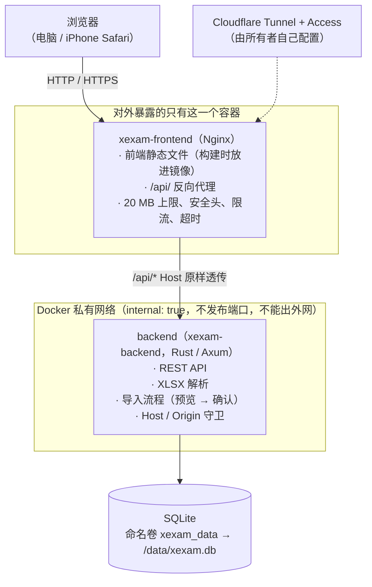
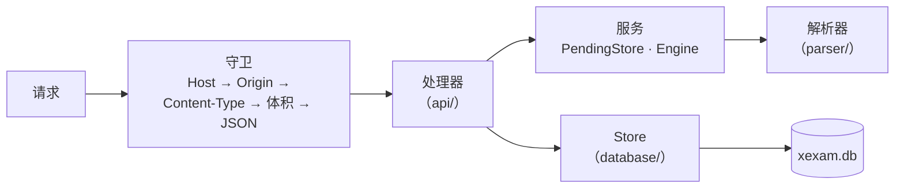
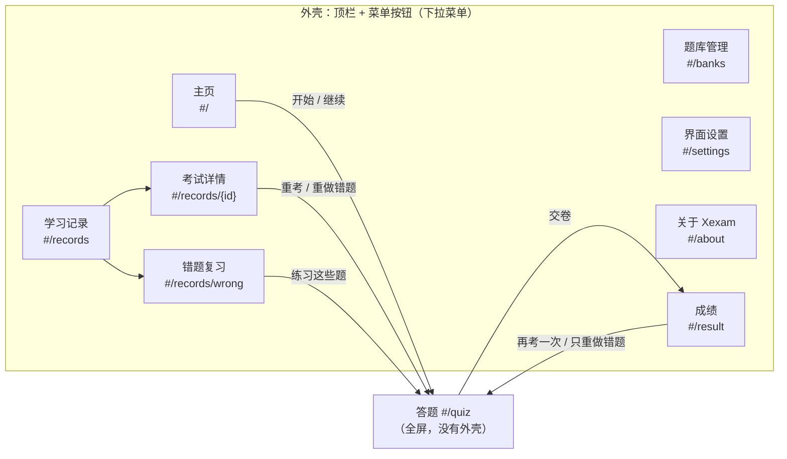
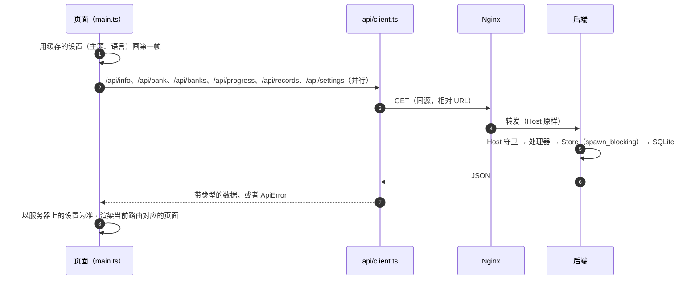
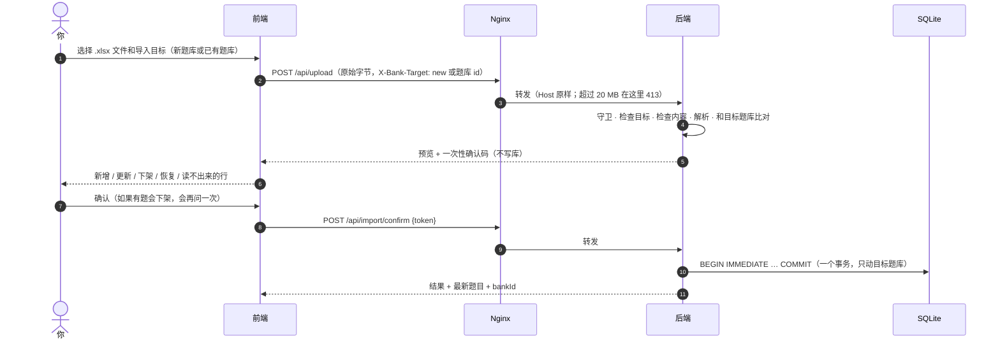

[English](../en/architecture.md) | [日本語](../ja/architecture.md) | **简体中文**

# 架构（v0.5）

> Xexam 是怎么搭起来的：前面是 Nginx，后面是 Rust 后端，数据存在 SQLite 里，前端是不用框架的 TypeScript。
> 从旧的 Python 版切换过来时的背景资料：旧代码的审计见 [architecture-audit.md](history/architecture-audit.md)，决策和默认值见 [migration-plan.md](history/migration-plan.md)。

## 1. 总览



- **只有 Nginx 发布端口**（`XEXAM_BIND`，默认 `127.0.0.1:8765` → 容器内 `8080`）。
- 后端所在的网络是 `internal: true`：没有 `ports`，宿主机和外部都连不到它，它自己也访问不了外网。
- 数据库只有后端能读写。Nginx 容器里没有数据库、没有源码、没有 Node。
- 浏览器和后端之间只通过 REST 通信（见 [api.md](api.md)）。前端不访问数据库，也不做「这份导入能不能做」之类的判断。
- 应用要保存的东西都在数据目录里（Docker 里是 `/data`）：数据库 `xexam.db`（题目、学习记录、设置），以及升级之后出现的 `backups/` 文件夹，里面是 schema 迁移前写下的副本。

## 2. 目录结构

```
frontend/       TypeScript 5.9（strict）+ Vite，原生 DOM，没有框架
  src/main.ts     入口：先用缓存的设置画出第一帧，把路由对应到页面，开始加载数据
  src/router.ts   hash 路由（#/、#/banks、#/records、#/records/<id>、#/records/wrong、#/settings、#/about、#/quiz、#/result）
  src/api/        带类型的 fetch 封装：client（错误转成 ApiError）、bank、import、progress、settings
  src/types/      API 的类型（与 docs/en/openapi.yaml 对应），以及 virtual:changelog 的类型声明
  src/domain/     纯函数：判分和抽题、错题规则、百分比、题目语言、更新日志解析（有单元测试）
  src/i18n/       t() / tn()、catalog/<area>.ts（界面文字，en / zh / ja）、server-messages.ts、errors.ts
  src/state/      共享状态（store）、动作、设置（preferences、settings-cache）、保存下来的考试（session-storage）
  src/components/ shell（顶栏、菜单按钮和下拉菜单）、review（答案回顾卡片）、common
  src/pages/      home、banks、records、settings、about、quiz、result
  src/styles/     main.css（颜色变量、浅色 / 深色、外壳）+ 每个页面区域一个 CSS 文件
  src/utils/      DOM 构建、对话框、提示消息、格式化
  vite.config.ts  开发时的 /api 代理；插件 xexam-changelog（构建时读取三个 README 的更新日志）
backend/        Rust（Axum 0.8 + Tokio + rusqlite），工具链固定 1.99.1
  src/api/        路由、守卫（Host / Origin / Content-Type / 体积）、JSON 格式化、成绩清洗
  src/services/   导入的待确认槽位（PendingStore）、解析引擎接口、导入流程
  src/parser/     .xlsx 解析：ZIP 防护、XML、题目识别、题目 id
  src/database/   schema（v1 原文 + v2 新增部分）、Store、旧 progress.json 迁移、时间戳
    store/          banks、records、settings、migrate（schema v1 → v2，带备份）
  src/security/   Host / Origin 判断、限长读取请求体
  src/config/     环境变量
  tests/          单元、黄金响应、解析差分、id 向量、v0.5（题库、记录、设置、迁移）
nginx/          nginx.conf + Dockerfile（构建前端，构建时带上三个 README → 只带静态产物）
docker/         docker-compose.yml（拉取两个镜像）、docker-compose.build.yml（从源码构建，上下文是仓库根目录）、.env.example
README.md       英语版说明（含更新日志）；README/ 里是 README.ja.md 和 README.zh-CN.md
tests/          baseline/（旧版的黄金响应和测试数据）· integration/（nginx、整栈、progress.json 迁移）
docs/           en/（英文，原文）· ja/ · zh-CN/（含 history/：较早的文档，只有中文）
```

## 3. 数据模型（v0.5）

完整的表结构见 [database.md](database.md)。这里讲背后的思路。

### 题库

- **一个题库就是一份导入的工作簿。** `banks` 表里每个题库一行。上传时，要么导入成一个新题库，要么导入到一个已有的题库（`X-Bank-Target` 请求头，见 [api.md](api.md)）。
- **一次导入只替换目标题库的内容。** 这个题库里有、文件里没有的题会下架；其他题库的题一律不动。
- **legacy 题库。** v0.5 之前的数据会变成一个题库（`legacy_ids = 1`），本文称它为 legacy 题库。它的题目 id 就是解析器算出来的原始 id，没有改动，所以以前的统计、错题本和考试历史都还连得上。不带 `X-Bank-Target` 的上传会进这个题库：旧的客户端和命令行的 `import` 都是这样。
- **按题库区分的 id。** 其他题库的题目一律存在 `sha1("xexam-bank:{bank_id}\n{parser id}")` 的前 12 位十六进制下。所以同一份工作簿可以导入两次，成为两个互不相干的题库，它们的 id 和学习数据不会混在一起。题库 id 永远不会重复使用。
- 每道题的统计（`stats`）以题目 id 为键，所以是通过 id 归属到某个题库的。
- 删除一个题库，会删掉它的题目、它的导入记录和题库本身。它的学习数据只有在明确要求时才删（`withRecords`，确认对话框里一个默认不勾选的选项）：它的题目的统计和每题明细，以及那些从这个题库出过题、但没有从任何现存题库出过题的考试记录。

### 考试记录

- `attempts` 表里每场交过卷的考试一行。从 v0.5 起，它还保存这场考试所用题库的快照（当时的 id 和名称）。数据库保留最近 **500** 场考试；`/api/progress` 仍然返回最近 60 场。
- `attempt_items`（v0.5 新增）里，一场考试的每道题一行：题目 id、所作的答案（就是页面发来的内容，经过清洗；没有值 = 没作答）和是否答对。v0.5 之前保存的考试没有这些行。
- 记录详情（`GET /api/record`）把这些行和题目**现在**存着的样子放在一起，已下架的题也包括在内。如果一道题已经随它的题库一起删除了，会显示一条说明。
- 删除单条记录不会动统计（错题本）。删除全部记录时，可以选择把统计一起清空。

### 设置

- `settings` 表也在同一个 `xexam.db` 里，存主题、界面语言、自动跳到下一题和题目语言。因为放在数据目录里，所以更新容器、清空浏览器缓存、换浏览器、换设备，设置都还在。没有账号：用这个实例的所有人共用一套设置。
- 浏览器在 `localStorage`（`xexam.settings.v1`）里留一份副本，只用来让第一帧就显示对的主题和语言。服务器上的值一读到，就以它为准。
- v0.4 及以前，题目语言只存在浏览器里（`xexam.lang.v1`）。v0.5 第一次打开页面时，如果服务器上还是默认值，就把它搬到服务器上，只搬这一次。

### 留在浏览器里的数据

- 正在进行的考试（`localStorage` 里的 `xexam.session.v1`）：题目 id、作答、标记、当前位置和已用时间，不含题目文字。和 v0.4 一样。
- 菜单开着还是关着只记在内存里，不存进浏览器：换页或刷新后，菜单总是关着的。

## 4. 后端



所有路由（包括 v0.5 新增的）都经过同一个分发函数，所以每个请求的守卫顺序都一样。关键设计（原因见 [audit/rust-stack.md](history/audit/rust-stack.md)）：

| 问题 | 做法 |
|---|---|
| rusqlite 是同步的 | 一个连接放在 `Arc<Mutex<Connection>>` 后面，数据库调用在 `spawn_blocking` 里跑，锁不跨 `.await`。与旧版「一个连接 + RLock」一一对应 |
| 请求体上限 | 自写流式读取：边读边数真实字节，超过 20 MiB 立即 413，**不信任 `Content-Length`**（分块上传也一样） |
| 解析会不会拖死服务 | 解析在阻塞线程里做，有协作式的截止时间（`XEXAM_PARSE_TIMEOUT_SECS`，默认 30 秒；到了解析器自己停下），同时最多 2 个解析；ZIP 条目数、解压后大小、XML 深度 / 节点数 / 每元素属性数、单元格总数和总字节数都有上限；共享字符串只存一份 |
| 导入的原子性 | 预览只放进内存里的**唯一槽位**，不写库；确认时 `BEGIN IMMEDIATE … COMMIT`，失败整体回滚；确认码一次性、128 位随机、常量时间比较，并发确认只有一个能成功 |
| 提交被打断 | 导入提交是独立任务，客户端断开了也会跑完；`docker stop` 最多等 15 秒，后端 8 秒内优雅退出 |
| schema 升级 | 后端打开一个有数据的 schema 1 数据库时，先用 `VACUUM INTO` 在 `xexam.db` 旁边的 `backups/` 里写一份副本，再在一个事务里完成迁移。副本写不出来就不启动。打开已经是最新版本的数据库时什么都不写（见 [database.md](database.md) 第 6 节） |
| 删除数据 | 删除题库、删除记录各自在一个事务里完成。删除题库时，如果有以它为目标、还没确认的上传，也一起丢掉 |
| 日志 | `tracing`，不带颜色；**不记确认码、不记文档内容** |
| 错误 | 统一成 `{"error": "<中文原因>"}`；库异常、文件路径、SQLite 报错只进日志，不进响应。前端会翻译它认识的消息（见第 5 节） |

后端的命令行：

```
xexam-backend [serve] [--data DIR] [--host ADDR] [--port N] [--allow-shutdown] [--no-browser]
xexam-backend healthcheck [--port N]          容器自检（带 Host: 127.0.0.1，所以不受白名单影响）
xexam-backend import <question-bank.xlsx> [--data DIR]  命令行导入到 legacy 题库（旧的 --import 也能用）
xexam-backend migrate-progress [progress.json] [--data DIR]  把更早版本的 progress.json 迁进数据库
```

凡是会打开数据库的命令（`serve`、`import`、`migrate-progress`）都会先做 schema 升级。

## 5. 前端

没有框架，用原生 DOM。共享状态是一个带类型的对象（`src/state/store.ts`）。每次渲染都根据状态重建当前页面；答题页另外有几个小的「刷新函数」，只更新答题卡和进度，不用整页重画。

### 外壳、路由和页面



- **路由**（`src/router.ts`）：用 hash 路由，所以服务器端不需要回退配置，刷新后还停在同一页。切换路由用 `src/state/actions.ts` 里的 `navigate(route)`。不管以什么方式离开答题页，作答都会保存。没有考试时打开 `#/quiz` 会回到主页（或者继续保存着的考试）；没有成绩时打开 `#/result` 会转到学习记录。
- **外壳**（`src/components/shell.ts`）：除了答题页，每一页顶部都有一条窄窄的顶栏：左上角是 Xexam 标志（点它回到主页），右上角是三条横线的菜单按钮。菜单按钮打开一个小的下拉菜单：四个主入口（主页、题库管理、学习记录、界面设置），分隔线下面是「Xexam v0.5.1」，点它打开「关于 Xexam」页。选了一项、点菜单外面或按 Esc，菜单都会关上；用键盘打开菜单时，焦点会移进菜单，按 Esc 关上后回到菜单按钮。菜单关着时不占地方，页面内容在宽屏上居中，最宽 1120 px。答题页是专注的全屏视图，没有外壳。
- **页面**（`src/pages/`）：`home`（开始或继续考试）、`banks`（导入、更新、查看和删除题库，格式说明）、`records`（带筛选的考试列表、考试详情、错题复习）、`settings`、`about`、`quiz`、`result`。页面之间从不互相 import，而是调用 `src/state/actions.ts` 里的函数。只属于某个页面的界面状态（筛选条件、打开着的上传预览）放在这个页面模块自己里面。成绩页、考试详情和错题复习共用的回顾卡片在 `src/components/review.ts`。
- **主页**（`src/pages/home.ts`）：没交卷的考试显示成页面最上面的一条紧凑横幅：「没交卷的考试」、「只保存在这个浏览器里」、题库 · 已答题数 · 用时，以及「继续作答」和「放弃这场」两个按钮。「开始考试」面板的右上角是两个小按钮，决定从哪里出题：「全部」带所选工作表里的题数，「错题本」带其中待巩固的题数（手机上中文界面保留这两个短词，英语和日语界面只显示图标和题数）。所选工作表里没有错题时「错题本」不能选，标题下面用一行字说明原因；选了「错题本」时，这一行说明一道题怎样移出错题本。题库列表上面一行是标题「考哪些题库和工作表」，右边是「全选」和「全部取消」。每个题库是一张卡片，它的工作表是卡片里的紧凑行；勾选题库的复选框就选中或取消它所有的工作表，只选了一部分时，这个复选框显示为「−」，题库那一行写出例如「已选 1/2 个工作表」（收起时也显示）。题库那一行右边的箭头展开或收起它的工作表：最多两个题库时默认展开，多于两个时默认收起；手动展开或收起的状态记在模块里（`openBanks`），重新加载页面后恢复默认。面板里没有单独的滚动框（嵌套滚动在手机上会和页面滚动互相干扰），列表靠收起题库变短。面板最下面的一栏是「开始考试」、当前范围的说明（「当前范围共 12 题」或「当前范围共 12 题，本次随机抽 11 题」），旁边是「题数」和「打乱顺序」两个选项（「打乱顺序」的悬停提示是完整的「打乱题目顺序」）；面板在屏幕上时，这一栏固定在屏幕底部（`position: sticky`），手机上第一行是范围说明和两个选项，第二行是「开始考试」。「题数」小于当前范围时，从整个范围里随机抽题（`src/domain/grading.ts` 的 `pickQuestions`，范围里每道题被抽中的机会相同）；「打乱顺序」只决定这些题按随机顺序还是按题库顺序出。
- **题库管理**（`src/pages/banks.ts`）：布局和主页一样紧凑。「导入 Excel」的标题旁边是「新建题库」/「更新已有题库」两个小按钮（实际是单选按钮，说明文字是它们的悬停提示和无障碍描述），选更新时下面出现「要更新的题库」；接着是一行提示，末尾的链接「查看 Excel 写法」会展开格式说明；再是一行选文件（「选择 Excel 文件」，或者把文件拖到面板的任意位置）。切换导入目标时只更新这几个节点，所以键盘焦点不会跑掉。预览先用小标签显示各项数字（为 0 的不显示），然后是提示和警告，再是确认和取消按钮，最后是每个工作表一行，读不出来的行收在所属工作表下面。「已有的题库」里每个题库占一行：名字、「更新」/「删除」两个小按钮、一行概况，工作表收在一个箭头下面。「导入记录」显示最近 8 次导入，每次一行；格式说明是一个默认收起的 `<details>`。
- **关于**（`src/pages/about.ts`，`#/about`）：「关于 Xexam」页显示版本、服务器的 CPU 架构（来自 `/api/info`）、许可证（MIT），以及「更新内容」：界面语言对应的那份 README 里的更新日志。最新的版本展开，更早的版本折叠起来；服务器正在运行的那个版本带「当前版本」标签。更新日志在构建时从三个 README 生成（见第 7 节），打包成单独的一块 JS，只在打开这一页时才加载。
- **设置**（`src/state/preferences.ts`）：应用主题（`<html data-theme>`）和语言（`<html lang>`）。改了马上生效，然后用 `POST /api/settings` 保存；如果保存失败，就恢复成之前的设置，并显示一条提示。

### 界面语言

- **界面文案**（`src/i18n/catalog/<area>.ts`）：每个区域一个文件（`common`、`home`、`banks`、`records`、`settings`、`quiz`、`result`、`about`）。每个文件里，同一组键都有英文、中文和日文。TypeScript 和 `catalog.test.ts` 保证没有哪种语言缺键。代码用 `t('area.key', params)` 取文字，数量用 `tn(key, n)`。选好的语言在所有地方生效，答题页也一样。
- **服务器消息**（`src/i18n/server-messages.ts`）：后端的错误消息保持中文（它们是经过测试的 API 的一部分）。前端把它认识的消息（整句，以及带值的模式）翻译成英文或日文；中文原样显示，不认识的文字也原样显示。`server-messages.test.ts` 会读后端源码，如果有后端消息没有翻译，测试就失败。
- **错误**（`src/i18n/errors.ts`）：`errorText(e)` 把任何错误变成当前语言的文字。网络错误和「响应不是 JSON」（常见原因是 Cloudflare Access 登录过期）有专门的提示，让你刷新页面、重新登录。

### 其他规则

- **判分在浏览器里**（规格建议放服务端，这里是有意的偏离，理由见 [migration-plan.md](history/migration-plan.md) 的 Q3）。规则抽成纯函数 `src/domain/grading.ts`，有单元测试。服务端收到 `{题目 id, 对错}`，从 v0.5 起还有所作的答案；答案它只存起来，供以后回顾。
- 自动跳到下一题（一个设置，默认关闭）：单选题选好之后，或者热点题最后一个没选的小项选好之后，大约 350 ms 后跳到下一题。多选题永远不跳，最后一题之后不跳，取消选择时也不跳。
- HTML 里没有内联样式：CSP 是 `style-src 'self'`。少数需要计算的尺寸（进度条、分数条）通过 CSSOM 设置，这是 CSP 允许的。
- 构建目标是 `es2020` / `safari15`；iPhone 需要 iOS 15.4 以上。

## 6. 请求流程

### 打开应用



只要其中有一个请求失败，应用就显示一个错误页，上面有重新加载按钮和翻译好的原因。

### 更新题库（上传 → 预览 → 确认）



预览还开着的时候离开「题库管理」页，这个预览会被取消（`POST /api/import/cancel`）。

### 做一场考试

所有题库的题目一次性取到浏览器。主页按所选的工作表和出题方式定出范围；要的题数比范围少时，从范围里随机抽题，再按「打乱顺序」决定出题顺序。在浏览器里答题；每改一次，正在进行的考试都会存进 `localStorage`。交卷时，页面先判分，再发 `POST /api/attempt`：每道题一个 `{id, correct, answer}`，再加上工作表、出题方式和用时。后端在一个事务里更新每道题的统计，保存这场考试（连同题库快照和每道题一行明细），并只保留最近 500 场考试。它返回学习进度；页面接着重新读取记录列表，这样成绩页就能链接到新的这条记录。

### 错误

后端出错时回复 `{"error": "<中文消息>"}`。`api/client.ts` 把它变成 `ApiError`；`errorText()` 把消息交给服务器消息对照表，对照表返回当前界面语言的版本（不认识的就原样返回）。

## 7. 构建和镜像

| 镜像 | 构建 | 运行时内容 |
|---|---|---|
| `xexam-frontend` | `node:24-alpine` 编译前端（连同三个 README 里的更新日志）→ `nginxinc/nginx-unprivileged:1.27-alpine` | nginx.conf + 静态文件；uid 非 root；监听 8080 |
| `xexam-backend` | `rust:1.99.1-slim-bookworm` 在构建机自己的架构上运行，用 zig 交叉编译成静态 musl 二进制 → `alpine:3.21` + tzdata | 一个可执行文件 + `/VERSION`；uid 10001；根文件系统只读 |

「关于」页的更新日志：`frontend/vite.config.ts` 里的插件 `xexam-changelog` 在构建时读取仓库根目录的 `README.md` 和 `README/` 里的 `README.zh-CN.md`、`README.ja.md`，用 `src/domain/changelog.ts` 解析其中以 `### vX.Y` 开头的条目，生成模块 `virtual:changelog`。哪一份 README 里一条都没有，构建就失败。镜像构建也要用到这三个文件：`nginx/Dockerfile` 在 `npm run build` 之前执行 `COPY README.md /` 和 `COPY README/README.ja.md README/README.zh-CN.md /README/`（`vite.config.ts` 从前端目录的上一级读取它们，路径和仓库里一样），所以 `.dockerignore` 把这三个 README（`README.md` 和 `README/`）留在构建上下文里（`docs/` 等仍然排除）。最终镜像里只有 nginx.conf 和生成的静态文件，没有 README 本身。README 仍是更新日志的唯一来源，CI 检查的也是它们。

两个服务都用 `cap_drop: ALL`、`no-new-privileges`、`read_only: true` 和 `tmpfs: /tmp`。后端只能写 `/data`（数据卷）和 `/tmp`。

## 8. 和旧版的对应

| 旧（Python） | 新 |
|---|---|
| `server.py` | `backend/src/api/` + `main.rs` |
| `app/db.py` | `backend/src/database/` |
| `app/xlsx_parser.py` | `backend/src/parser/` |
| `web/app.js` / `style.css` / `index.html` | `frontend/src/` |
| 容器里一个进程 | nginx + backend 两个容器 |
| `docker-compose.yml`（拉取镜像） | `docker/docker-compose.yml`（拉取 `xexam-frontend` 和 `xexam-backend` 两个镜像）；`docker/docker-compose.build.yml`（从源码构建） |

旧的 Python 实现已从仓库移除，但没有丢：Git 标签 `python-v0.2` 指向它的最后一个版本，旧镜像 `ghcr.io/yumin-space/xexam:v0.2.2` 仍可从 GHCR 拉取（私有：先 `docker login ghcr.io`；Docker Hub 上没有它）。回滚见 [migration.md](migration.md)。
