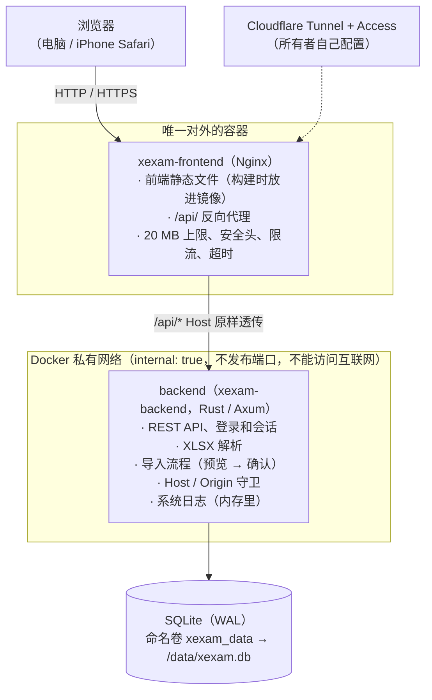
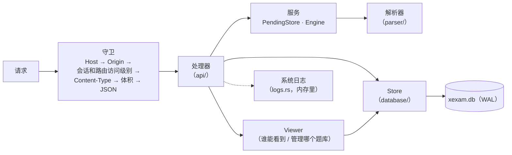
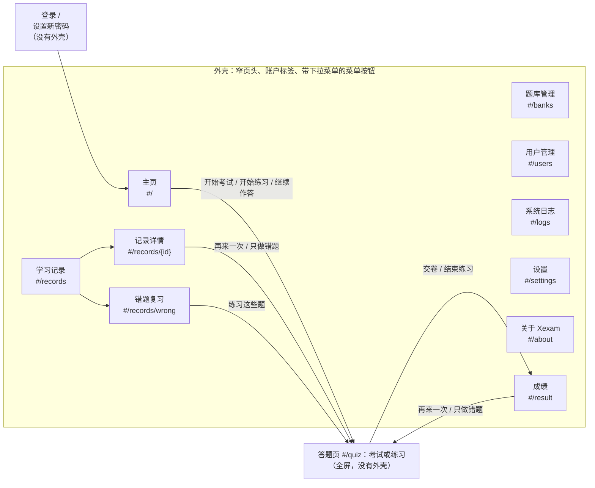
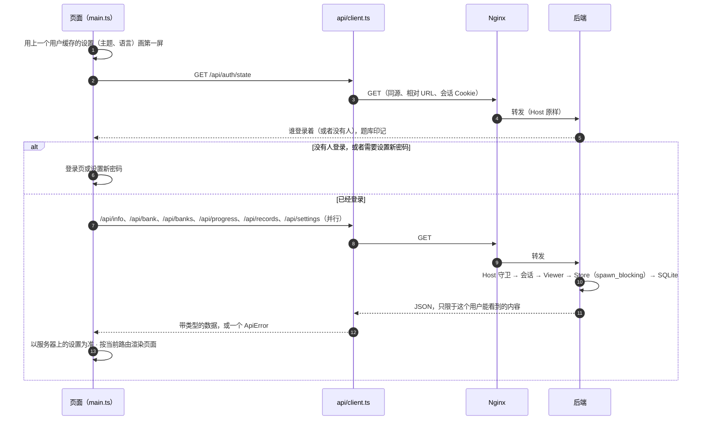
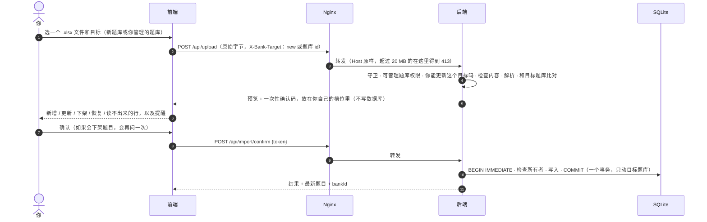

[English](../en/architecture.md) | [日本語](../ja/architecture.md) | **简体中文**

# 架构（v0.7）

> Xexam 是怎么搭起来的：前面是 Nginx，后面是 Rust 后端，用 SQLite 存储，前端是不用框架的 TypeScript。
> 从旧的 Python 版切换过来时的背景资料：对旧代码的审计见 [architecture-audit.md](history/architecture-audit.md)，决定和默认值见 [migration-plan.md](history/migration-plan.md)。

## 1. 总览



- **只有 Nginx 发布端口**（`XEXAM_BIND`，默认 `127.0.0.1:8765` → 容器里的 `8080`）。
- 后端所在的网络是 `internal: true`：没有 `ports`，宿主机和外面都连不到它，它自己也访问不了互联网。
- 只有后端读写数据库。Nginx 容器里没有数据库、没有源代码，也没有 Node。
- 浏览器只通过 REST 和后端通信（见 [api.md](api.md)）。除了 `/api/info`、`/api/auth/state` 和登录本身，每个路由都需要会话。前端不访问数据库，也不做「这次导入能不能做」「这个用户能不能看这个题库」这样的判断：由后端决定，前端只负责显示。
- 程序保存的一切都在数据目录里（Docker 里是 `/data`）：数据库 `xexam.db`（用户、题目、学习记录、设置），后端运行时还有它的 `xexam.db-wal` 和 `xexam.db-shm` 文件，升级后还有 `backups/` 文件夹，里面是 schema 迁移前写的副本。

## 2. 目录结构

```
frontend/       TypeScript 5.9（strict）+ Vite，原生 DOM，不用框架
  vite.config.ts  构建设置、开发用的 /api 代理、xexam-changelog 插件（读取三份 README）
  src/main.ts     入口：用缓存的设置画第一屏、检查登录、把路由映射到页面
  src/router.ts   hash 路由（#/、#/banks、#/users、#/logs、#/records、#/records/<id>、#/records/wrong、#/settings、#/about、#/quiz、#/result）
  src/api/        带类型的 fetch 封装：client（错误变成 ApiError）、auth、bank、import、logs、progress、settings、users
  src/types/      API 类型（和 docs/en/openapi.yaml 对应）、构建时生成的更新日志模块的类型
  src/domain/     带单元测试的纯函数：判分和随机抽题、练习的核对、保存的成绩（notCounted）、
                  题目语言、记录筛选、锁定说明和等待时间、导入提醒、系统日志缓冲、更新日志解析
  src/i18n/       t() / tn()、catalog/<区域>.ts（en / zh / ja 的界面文字）、server-messages.ts、errors.ts
  src/state/      共享状态（store）、动作（加载、登录、导航）、题库权限规则、设置（preferences、
                  settings-cache）、暂存的考试或练习（session-storage）、浏览器存储的键
  src/components/ shell（页头、菜单）、review（答案卡片）、lang-switch（English / 中文 / 日本語）、kind-tag（考试 / 练习）、
                  fields（登录页和用户页的表单字段）、common
  src/pages/      auth（登录、设置新密码）、home、banks、users、logs、forbidden（「没有权限」）、records、settings、about、quiz、result
  src/styles/     main.css（颜色变量、浅色 / 深色、外壳）+ 每个页面区域一个 CSS 文件
  src/utils/      DOM 构建、对话框、提示、格式化
backend/        Rust（Axum 0.8 + Tokio + rusqlite），工具链固定为 1.99.1
  src/main.rs     命令行、启动（数据库、日志、提醒）、带 WAL 检查点的平稳关闭
  src/api/        分发和守卫（Host / Origin / 会话 / Content-Type / 体积）、路由、登录和用户的路由（auth.rs）、
                  带每个路由访问级别的路由表、JSON 格式、成绩清洗
  src/auth/       密码（Argon2id）、会话令牌和 Cookie、已知浏览器 Cookie、登录限制（throttle.rs）
  src/services/   每个用户各自的待确认导入（PendingStore）及共用的内存额度、解析引擎接口、导入流程
  src/parser/     .xlsx 解析：ZIP 防护、XML、题目识别（三列、四列和六列格式）、题目 id
  src/database/   schema（v1 原文 + v2、v3、v4 新增）、日志模式（journal.rs）、Store、旧的 progress.json、时间戳
    store/          题库（谁能看、所有者）、记录、设置、用户（账户、会话）、migrate（v1 → v4、备份、修正）
  src/models/     共用类型：题目、导入目标、Viewer 和 BankScope
  src/logs.rs     系统日志：环形缓冲区、tracing 层、BurstLog
  src/security/   Host / Origin 判断、限长读取请求体、令牌
  src/config/     环境变量、VERSION 文件
  tests/          单元、黄金响应、解析对照（三列、四列和六列）、id 向量，每个版本一个文件
                  （v05_…、v06_…、v065_…、v07_…）
nginx/          nginx.conf + Dockerfile（构建前端，带上三份 README → 只带静态产物）
docker/         docker-compose.yml（拉取两个镜像）、docker-compose.build.yml（构建它们；上下文是仓库根目录）、.env.example
scripts/        release-notes.py（从更新日志生成 Release 说明）、set-release-version.py（RELEASE_VERSION 和 README 徽章）
VERSION         CODE_VERSION（代码的版本）和 RELEASE_VERSION（最后一次发布的版本）
README.md       带更新日志的英语 README；README/ 里是 README.ja.md 和 README.zh-CN.md
tests/          baseline/（旧版的黄金响应和夹具）· integration/（nginx、整栈、progress.json 迁移）
docs/           en/（英语，原文）· ja/ · zh-CN/（带 history/：以前的文档，只有中文）
```

## 3. 数据模型（v0.7）

完整的表说明见 [database.md](database.md)。背后的思路：

### 用户和会话

- **用户**有一个角色：**管理员**或普通用户。普通用户还可以有 **可管理题库** 权限。新的或升级来的数据库一开始有管理员 `admin` / `admin`，第一次登录时必须设置新密码。
- **会话**存在数据库里（只存 Cookie 值的 SHA-256），所以重启不会让任何人退出登录。密码输错后的登录锁定只在内存里（见 [security.md](security.md)）。
- **所有个人的东西都只属于一个用户**：学习记录、错题本（每道题的统计）和设置。每个路由都为登录的用户读写它们；用户 id 始终来自会话，从不来自请求。
- **题库是共用的**，但谁能看到哪个题库按用户决定（见下面几节）。

### 题库

- **一个题库就是一份导入的工作簿。** `banks` 表里每个题库一行。上传要么导入到新题库，要么导入到已有的题库（请求头 `X-Bank-Target`，见 [api.md](api.md)）。
- **一次导入只替换目标题库的内容。** 这个题库里有、文件里没有的题下架；其他题库的题永远不碰。
- **旧题库（legacy）。** v0.5 之前的数据变成一个题库（`legacy_ids = 1`）。它的题目 id 就是解析器算出来的普通 id，没有改动，所以以前的统计、错题本和考试历史都还对应着。不带 `X-Bank-Target` 的上传导入到这个题库：旧的客户端和命令行的 `import`。
- **限定在题库内的 id。** 其他每个题库都用 `sha1("xexam-bank:{bank_id}\n{解析器 id}")` 的前 12 位十六进制数字保存题目。所以同一份工作簿可以导入两次，成为两个独立的题库，它们的 id 和学习数据永远不会混在一起。题库 id 永远不会重复使用。
- **所有者。** 每个题库都有一个所有者：把它作为新题库导入的用户。v0.7 之前的题库，以及没有登录用户时新建的题库（命令行的 `import`），属于第一个管理员。删除一个用户时，他拥有的题库转到删除他的那位管理员名下。
- **三种格式。** 工作簿可以是三列、四列或六列。在六列格式里（A–C 是英语、中文和日语的题目，D–F 是它们的答案和解析），以英语为准：题型、选项、题目的身份和答案都来自 A 列和 D 列，题目里保存每种语言的解析（`lang`、`ja`、`explain`，见 [database.md](database.md) 第 4.7 节）。
- 删除题库会删掉它的题目、导入记录、谁能看到它的设置以及题库本身。只有明确要求时才删除它的学习数据（`withRecords`，确认对话框里一个默认不勾选的复选框）：管理员删除所有用户的，可管理题库的用户只删除自己的。

### 谁能看到和管理哪个题库：Viewer 和 BankScope

每个读取题库数据或写入题库的请求，都会根据登录的用户建立一个 **`Viewer`**，在那一刻从数据库读出来（所以管理员做的修改在下一个请求就生效，不用让任何人退出登录）：

| | `admin` | `can_manage` | `scope`（一个 `BankScope`） |
|---|---|---|---|
| 管理员 | 是 | 是，所有题库 | `All` |
| 设置了 **所有题库** 的普通用户 | 否 | 看权限 | `All` |
| 选了部分题库的普通用户 | 否 | 看权限 | `Only(所选的题库，加上他作为可管理题库的用户时自己拥有的题库)` |

- **读取**：store 的 `*_as` 方法接收 viewer 或它的 `BankScope`。只能看到部分题库的用户，在 `/api/bank` 和 `/api/banks` 里只得到这些题库，在 `/api/progress` 里只得到这些题的统计，记录详情里其他题库的题会像已删除的题一样被略去。在 `/api/banks` 里，除了管理员，每个人看到的 studied 和 records 都只数自己的，也只有管理员能看到题库属于谁。
- **写入**：`Viewer::manages(owner)` 对管理员总是成立，对可管理题库的用户只在他自己的题库上成立。导入到已有题库和删除题库都**在写入的事务里**检查它，所以同时发生的所有者变更（被删除用户的题库转给管理员）不会插到检查和写入之间；被拒绝时什么都不写（403 `MSG_NOT_BANK_OWNER`）。上传路由在解析之前还会再检查一次目标，所以被拒绝的上传不花解析时间。
- **考试**：普通用户交卷时，范围以外的题和已经不存在的题完全一样处理：不计入、不为它们写任何东西，它们的 id 在 `notCounted` 里返回。
- **刷新打开着的页面**：`GET /api/auth/state` 带着一个**题库印记**，是一个不透明的摘要。对管理员和能看到所有题库的用户，它跟随整个题库；对只能看到部分题库的用户，它只跟随这些题库和他的权限，所以既不透露、也不跟随他看不到的题库。页面在每次切换页面和标签页重新可见时比较它，变了就重新读取题库。

### 学习记录：考试和练习

- `attempts` 里每交一场考试或结束一次练习就有一行，带它的所有者（`user_id`）、类型（`exam` 或 `practice`）以及所用题库的快照（当时的 id 和名字）。每个用户保留自己最新的 **500** 条记录；`/api/progress` 返回最新的 60 条。
- `attempt_items` 里一条记录的每道题一行：题目 id、给出的答案（页面发来的样子，清洗之后；没有值 = 未作答）以及对错。v0.5 之前保存的记录没有这些行。
- 练习和考试一样计入错题本。
- 记录详情（`GET /api/record`）把详情行和题目**现在**保存的样子放在一起，包括已下架的题。随题库一起被删除的题，或者属于这个用户已经看不到的题库的题，显示一句说明，而不是题目文字。
- 删除一条记录不改动统计（错题本）。删除全部记录时可以选择一起清空。

### 设置

- `user_settings` 存每个用户的主题、界面语言、答完自动跳到下一题和题目语言。因为它们在数据目录里，所以更新容器、清除浏览器缓存、换别的浏览器和设备之后都还在。
- 浏览器在 `localStorage` 里为每个用户保存一份副本（`xexam.u<id>.settings.v1`），只用来以正确的主题和语言画出第一屏。服务器上的值一读到就以它为准。

### 留在浏览器里的东西

- 进行中的考试或练习（`localStorage` 里的 `xexam.u<id>.session.v1`，那个浏览器上每个用户一份）：题目 id、答案、标记、位置、用时、类型，练习还有哪些题已经核对过。不含题目文字。
- 最后登录的用户的 id（`xexam.lastUser.v1`），用来让他缓存的设置画出第一屏。
- 已知浏览器 Cookie `xexam_device`（见 [security.md](security.md)）和会话 Cookie `xexam_session`，都是 `HttpOnly`。
- 菜单是否打开不保存：它只在内存里，每次切换页面菜单都会关上。

## 4. 后端



所有路由都经过同一个分发函数，所以每个请求的守卫顺序都一样。会话检查紧接在 Host（POST 还有 Origin）检查之后、读取任何请求体之前进行，依据的是一张写明每个路由访问级别的路由表：**公开**、**登录**、**可管理题库**（管理员和可管理题库的用户：上传、确认 / 取消导入、导入记录、删除题库）或**管理员**（用户、系统日志、关闭程序）。不在表里的路径也需要会话。关键的设计决定（早期的考虑见 [audit/rust-stack.md](history/audit/rust-stack.md)）：

| 问题 | 做法 |
|---|---|
| rusqlite 是同步的 | 一个连接放在 `Arc<Mutex<Connection>>` 后面；数据库调用在 `spawn_blocking` 里运行，锁从不跨 `.await` 持有。这和旧版的「一个连接 + RLock」一一对应 |
| 日志模式 | 从 v0.7 起是 WAL 加 `synchronous=FULL`（`database/journal.rs`）；`XEXAM_SQLITE_JOURNAL=delete` 保留以前的回滚日志。SQLite 拒绝的模式记为警告，从不当成错误。启动时记一次实际生效的模式；平稳关闭时执行 `wal_checkpoint(TRUNCATE)`。见 [database.md](database.md) 第 2.1 节 |
| 请求体上限 | 一个手写的流式读取器：边读边数真实的字节数，一超过 20 MiB 就返回 413，**不信任 `Content-Length`**（分块上传也一样） |
| 解析会不会卡住服务？ | 解析在阻塞线程上运行，带一个协作式的截止时间（`XEXAM_PARSE_TIMEOUT_SECS`，默认 30 秒；到时解析器自己停下），同一时间最多 2 个解析；ZIP 条目数、解压后的大小、XML 深度 / 节点数 / 每个元素的属性数、单元格总数和总字节数都有上限；共享字符串只存一份 |
| 待确认的导入 | 预览只保存在内存里，从不写进数据库。**每个上传的用户都有自己的槽位**（按用户 id）：一个可管理题库的用户的上传，永远不会替换、确认或取消别的用户的预览。所有槽位共用一个 **128 MiB** 的内存额度（按解析出的题目估算）：暂存一次上传时，总量超过额度就丢掉别的用户最早的预览，他们确认时会提示预览已过期，和超过 30 分钟一样。最新的上传总会保留 |
| 导入的原子性 | 确认时执行 `BEGIN IMMEDIATE … COMMIT`，失败就整体回滚；所有者检查也在这个事务里；确认码只能用一次，128 位随机，按常量时间比较；同时到达好几个确认时，只有一个能成功 |
| 提交被打断 | 导入的提交是一个单独的任务，即使客户端断开也会完成；`docker stop` 最多等 15 秒，后端在 8 秒内平稳关闭 |
| schema 升级 | 后端打开一个有数据的旧 schema 数据库时，先用 `VACUUM INTO` 往 `xexam.db` 旁边的 `backups/` 写一份副本，再在一个事务里迁移，之后才切换到 WAL。副本写不出来就不启动。打开一个已经是最新的数据库什么都不写（见 [database.md](database.md) 第 6 节） |
| 删除数据 | 删除题库、记录和用户各在一个事务里完成。删除题库时也会丢掉以它为目标的待确认上传 |
| 密码 | Argon2id，在 `spawn_blocking` 里运行，同一时间最多 2 个；登录限制在任何哈希计算之前就给出回答。见 [security.md](security.md) |
| 日志 | `tracing`，不带颜色，用 `XEXAM_LOG` 过滤（默认 `info`）；**密码、会话令牌、Cookie 的值、确认码和题目文字从不记录**。见下文 |
| 错误 | 一律是 `{"error": "<原因，中文>"}`；数据库异常、文件路径和 SQLite 错误只写进日志，从不放进响应。前端翻译它认识的提示（第 5 节） |

### 系统日志

- `main.rs` 安装一个 `tracing` subscriber，只有**一个过滤器**（`XEXAM_LOG`，默认 `info`）和两个输出：stderr，也就是 `docker compose logs backend` 显示的内容；以及 `logs.rs` 的 `BufferLayer`。`main.rs` 在启动和关闭时打印到 stdout 的普通状态行也会加进缓冲区；`reset-password` 打印的新密码不会（这个命令本来就在它自己的进程里运行）。
- 缓冲区是一个**保存最后 2000 行的环**，只在内存里：重启后又是空的，什么都不写进数据库。每一行有一个序号（进程的第一行是 1）、带秒的本地时间、级别、目标（模块）以及带字段的消息；一条消息超过 4000 个字符会截断。
- `GET /api/logs?after=<seq>&boot=<id>`（只有管理员）返回 `after` 之后的行、最新的序号（`last`）、`after` 和保留着的最早一行之间有没有被丢掉的行（`dropped`），以及 `boot`，后端进程的一个随机 id。重启后序号从 1 重新开始，所以发来重启前的 `boot` 的客户端会得到保留着的所有行。
- **BurstLog。** 任何能连到服务器的人不用登录就能引起的日志行，都经过一个 `BurstLog`：被 Host / Origin 检查拒绝的请求、失败的登录，以及没有账户的用户名被锁定。安静了一分钟之后的第一个事件马上记录；之后的事件只计数，最多每分钟汇总成一行，由下一个事件或者每分钟运行一次的服务器定时器写出来，所以即使后面没有任何事件，一阵请求的结尾也会在一分钟左右之内记录下来。被拒绝（429）的登录由登录限制用同样的方式汇总。所以大量这样的请求挤不掉 2000 行里的其他内容。

### 版本

后端在 `/api/info` 里报告它的版本。它按这个顺序读取：`XEXAM_VERSION`（有效时）；`XEXAM_VERSION_FILE` 指定的文件里的 `CODE_VERSION`（镜像里是 `/VERSION`，仓库里 `VERSION` 的一份副本）；编译进程序的版本。同一个文件里的 `RELEASE_VERSION` 在这里被忽略。`CODE_VERSION` 出现两次的文件不提供版本；没有任何 `KEY=VALUE` 行的文件按旧的单行格式读取。

### 命令行

```
xexam-backend [serve] [--data DIR] [--host ADDR] [--port N] [--allow-shutdown] [--no-browser]
xexam-backend healthcheck [--port N]          容器自检（发送 Host: 127.0.0.1，所以白名单不影响它）
xexam-backend import <题库.xlsx> [--data DIR]  命令行导入到旧题库（旧的 --import 也能用）
xexam-backend migrate-progress [progress.json] [--data DIR]  把更早版本的 progress.json 迁移进数据库
xexam-backend reset-password <用户名> [--data DIR]  新的随机密码（只打印一次），下次登录时必须修改
```

每个打开数据库的命令（`serve`、`import`、`migrate-progress`、`reset-password`）都会先执行 schema 升级，并按 `XEXAM_SQLITE_JOURNAL` 请求日志模式。它们可以在服务器运行时运行（Docker 里：`docker compose exec backend xexam-backend …`）。

## 5. 前端

不用框架；原生 DOM。共享状态是一个带类型的对象（`src/state/store.ts`）。每次渲染都根据状态重建当前页面；答题页还有几个小的「刷新器」，不用整页重画就能更新答题卡和进度。

### 外壳、路由和页面



- **登录**（`src/pages/auth.ts`）：启动时程序先请求 `GET /api/auth/state`。没有人登录 → 登录页；账户需要设置新密码 → **设置新密码** 页。两者都替换整个程序（没有外壳，没有路由）。只要还有管理员在用默认密码，登录页的提示里就会写出那个账户。每次切换页面和标签页重新可见时，程序都会再问一次，所以在别处结束的会话，下一次点击就会显示登录页；权限或题库印记变了，也不用退出登录就会生效。
- **路由**（`src/router.ts`）：hash 路由，所以服务端不需要回退规则，刷新也停在同一页。`src/state/actions.ts` 里的 `navigate(route)` 切换路由。以任何方式离开答题页都会保存答案。没有考试或练习时打开 `#/quiz` 回到主页（或继续暂存的那一场）；没有成绩时打开 `#/result` 去学习记录。管理员以外的人打开 `#/users` 回到主页；没有可管理题库权限的人打开 `#/banks`、管理员以外的人打开 `#/logs`，会显示 **没有权限** 页面（`src/pages/forbidden.ts`），带 **返回主页**。
- **外壳**（`src/components/shell.ts`）：除了答题页和登录页，每个页面都有一个窄页头：左上角是 Xexam 标志（链接到主页），右上角是账户标签和三条横线的菜单按钮。菜单依次列出 **主页**、**题库管理**（管理员和可管理题库的用户）、**学习记录**、**用户管理** 和 **系统日志**（管理员）、**设置**，分隔线下面是 **Xexam v0.7**（打开关于页面），最下面是谁登录着（带 **管理员** 或 **可管理题库**）和 **退出登录**。当前页面的那一项高亮显示；记录详情、错题复习和成绩都算学习记录。选好一项、点菜单外面或按 Esc，菜单就会关上；在任何屏幕宽度上都一样。页面内容居中，最宽 1120 px。
- **页面**（`src/pages/`）：`home`（开始或继续考试或练习）、`banks`（导入、更新、查看和删除题库，格式说明）、`users`（账户、角色、题库权限、锁定）、`logs`（系统日志）、`records`（带筛选的记录列表、记录详情、错题复习）、`settings`、`about`、`quiz`、`result`、`auth`、`forbidden`。页面之间从不互相 import；它们调用 `src/state/actions.ts` 里的函数。页面自己的界面状态（筛选条件、打开着的上传预览）放在页面模块里。成绩页、记录详情和错题复习共用的回顾卡片在 `src/components/review.ts` 里。
- **主页**（`src/pages/home.ts`）：没交卷的考试或没做完的练习是最上面的一条紧凑横幅（练习显示 **没做完的练习**；**只保存在这个浏览器里**；题库 · 已答或已核对 · 用时），带 **继续作答** 和 **放弃**。**开始考试或练习** 面板右上角有两个小按钮选择从哪里出题：**全部** 和 **错题本**，各带题数。**考哪些题库和工作表** 标题的右边是 **全选** 和 **全部取消**。每个题库是一张卡片，里面的工作表是紧凑的行，用那一行上的箭头展开或收起。面板在屏幕上时固定在屏幕底部的那一栏里有 **开始考试**、**开始练习**、范围说明，以及两个选项 **题数** 和 **打乱顺序**；手机上范围和两个选项占第一行，两个按钮共用第二行，**开始考试** 是较宽的主按钮。侧边的 **最近一次成绩** 卡片显示最新的一条记录（不论哪一种），带它的标签。还没有被分配任何题库的普通用户，看到的是一句请他联系管理员的说明（可管理题库的用户还会看到去题库管理的链接）。
- **题库管理**（`src/pages/banks.ts`）：管理员看到 **已有的题库**，每个都写着 **<名字> 上传**；可管理题库的用户只看到 **你的题库**（他导入的题库），也只能更新或删除这些。**导入 Excel** 的标题旁边是两个小按钮 **新建题库** / **更新已有题库**，下面是一行提示，带一个展开 **查看 Excel 写法** 的链接，再下面是一行选文件（**选择 Excel 文件**，或者把文件拖到面板的任意位置）。预览先用小标签显示各项数量（为 0 的不显示），然后是说明和提醒（中文或日文答案和英文答案不一致的六列格式的行），接着是确认和取消按钮，最后每个工作表一行，读不出来的行收在它下面。**导入记录** 显示这个用户管理的题库最近的 8 次导入。
- **用户管理**（`src/pages/users.ts`，只有管理员）：每个账户一行，显示角色、状态、登录状态、学习记录条数和题库（**题库：全部，包括以后导入的**、所选的题库，或者还一个都没有，带 **更改** 用来选择），以及操作 **编辑**、**重置密码**、**停用** / **启用**、**解锁**（用户的登录被锁定时，或锁定过后剩余次数比开始时少时显示）和删除。窗口重新可见时，以及页面可见期间每 30 秒，都会重新读取列表，除非有表单或对话框开着。
- **系统日志**（`src/pages/logs.ts`，只有管理员）：页面打开、可见并且没有暂停时，每 1.5 秒读取一次 `GET /api/logs`，同一时间只发一个请求，最多也保留同样的 2000 行（`src/domain/logs.ts`）。新的行加在最下面；列表滚到底时会跟着新行走，往上滚就停止跟随，并显示 **跳到最新**。**暂停** / **继续**、级别筛选（**全部** / **警告** / **错误**）和搜索只改变显示的内容。有行被丢掉的地方会标出来。
- **练习**（`kind = practice` 的答题页，规则在 `src/domain/practice.ts`）：单选题选好选项就马上核对；多选题和热点题有 **核对答案**，选了任何内容之后就能点。核对过的题锁定，显示答对或答错、标好的选项、正确答案、解析和记忆口诀。永远不会自动跳到下一题。**结束练习** 只在还有题没核对时才会先问；没核对的题算未作答。结果以 `"kind": "practice"` 提交；成绩页写着 **练习成绩**，再来一次时开始的也是练习。
- **随机抽题**：`src/domain/grading.ts` 里的 `pickQuestions()`。**题数** 比范围小时，从整个范围里随机抽题，每道题的机会相同。**打乱顺序** 只决定之后按随机顺序还是按题库顺序出题。
- **题目语言**（`src/components/lang-switch.ts`）：答题页、练习页以及每张答案与解析的卡片都有同一个切换按钮，不管界面是什么语言，总是写着 **English** / **中文** / **日本語**，每个按钮带自己的 `lang` 属性。题目没有的语言仍然可以点，会用一条提示说明原因。每张卡片从「题目语言」设置开始，只切换它自己。六列格式的题显示每种语言自己的解析；某种语言没有时，显示另一种语言的（依次是中文、日语、英语）。
- **关于页面**（`src/pages/about.ts`，`#/about`）：版本和服务器的 CPU 架构（来自 `/api/info`）、许可证（MIT）和 **更新内容**：界面语言那一份 README 的更新日志（`README.md`、`README/README.zh-CN.md` 或 `README/README.ja.md`）。最新的版本是展开的，更早的折叠在 **更早的版本** 下面，服务器正在运行的那个版本的条目标着 **当前版本**。更新日志不在运行时读取：`frontend/vite.config.ts` 里的 `xexam-changelog` 插件在构建前端时读取三份 README，用 `src/domain/changelog.ts` 解析其中 `### vX.Y — 日期` 形式的条目，并以模块 `virtual:changelog` 提供。页面只在打开时才把这个模块作为单独的文件加载。它显示段落、带一层嵌套的 `- ` 列表、`**粗体**` 和 `` `代码` ``；指向仓库里文件的链接显示成普通文字。
- **设置**（`src/state/preferences.ts`）：应用主题（`<html data-theme>`）和语言（`<html lang>`）。修改马上生效，然后用 `POST /api/settings` 保存；保存失败时恢复原来的设置并显示提示。设置页还有账户部分（修改自己的密码）。

### 界面语言

- **界面文字目录**（`src/i18n/catalog/<区域>.ts`）：每个区域一个文件（`common`、`home`、`banks`、`records`、`settings`、`quiz`、`result`、`about`、`auth`、`users`、`logs`）。每个文件里都有同样的键，分别是英语、中文和日语。TypeScript 和 `catalog.test.ts` 确保哪种语言都不缺键。代码用 `t('区域.键', 参数)` 取文字，计数用 `tn(key, n)`。选好的语言在所有地方生效，包括答题页和登录页。
- **服务器提示**（`src/i18n/server-messages.ts`）：后端的错误提示保持中文（它们是经过测试的 API 的一部分）。前端把它认识的提示（整句，以及带数值的模式）翻译成英语或日语；中文原样显示，不认识的文字也原样显示。`server-messages.test.ts` 读取后端源码，某条后端提示没有翻译时就会失败。
- **错误**（`src/i18n/errors.ts`）：`errorText(e)` 把任何错误变成当前语言的文字。网络错误和「响应不是 JSON」（常常是 Cloudflare Access 的登录过期了）有自己的提示，请用户刷新页面并重新登录。

### 其他规则

- **判分在浏览器里进行**（规格建议放在服务端；这是有意的偏离，理由见 [migration-plan.md](history/migration-plan.md) 的 Q3）。规则是 `src/domain/grading.ts` 里的纯函数，带单元测试。服务端收到 `{题目 id, 对错}` 和给出的答案，答案只存下来供以后回顾。
- 答完自动跳到下一题（一个设置，默认关闭，只用于考试）：单选题选好之后，或者热点题最后一个没答的小项选好之后，大约 350 ms 后跳到下一题。多选题从不跳，最后一题之后不跳，取消选择时不跳，练习里也不跳。
- HTML 里不用内联样式：CSP 是 `style-src 'self'`。少数需要计算的尺寸（进度条、成绩柱）通过 CSSOM 设置，CSP 允许这样做。
- 构建目标是 `es2020` / `safari15`；iPhone 需要 iOS 15.4 或更新。

## 6. 请求流程

### 加载程序



这些请求只要有一个失败，程序就显示一个带刷新按钮和原因（已翻译）的错误页。之后的任何请求得到 401，都会显示登录页。

### 更新题库（上传 → 预览 → 确认）



预览还开着时离开题库管理页面，会取消这次导入（`POST /api/import/cancel`）。

### 考试或练习

用户能看到的所有题库的题目一次性取到浏览器里。你在浏览器里答题；进行中的考试或练习每次改动后都存进 `localStorage`。交卷（或 **结束练习**）时，页面判分，并发送 `POST /api/attempt`，带每道题的 `{id, correct, answer}`，以及工作表、出题方式、用时和类型。后端在一个事务里略去已经不存在或用户不能看到的题，更新这个用户每道题的统计，保存记录（带题库快照和每道计入的题一行详情），并把这个用户的记录删减到最新的 500 条。它返回学习进度（有题被略去时还有 `notCounted`）；页面随后重新读取记录列表，让成绩页能链接到新的记录。

### 错误

后端用 `{"error": "<中文提示>"}` 回答错误。`api/client.ts` 把它变成一个 `ApiError`；`errorText()` 把提示交给服务器提示表，表按当前界面语言返回它（不认识就原样返回）。

## 7. 构建和镜像

| 镜像 | 构建 | 运行时的内容 |
|---|---|---|
| `xexam-frontend` | `node:24-alpine` 编译前端；三份 README 复制进这个构建阶段，供关于页面的更新日志用 → `nginxinc/nginx-unprivileged:1.27-alpine` | nginx.conf + 静态文件；非 root uid；监听 8080 |
| `xexam-backend` | `rust:1.99.1-slim-bookworm` 在构建机自己的架构上运行，用 zig 交叉编译成静态的 musl 程序 → `alpine:3.21` + tzdata（带一个 UTC 的 `/etc/localtime` 作为后备） | 一个可执行文件 + `/VERSION`（从中读取 `CODE_VERSION`）；uid 10001；根文件系统只读 |

为了关于页面的更新日志，`nginx/Dockerfile` 把 `README.md`、`README/README.ja.md` 和 `README/README.zh-CN.md` 复制到前端源码的上一级文件夹，布局和仓库里一样（`COPY README.md /` 和 `COPY README/README.ja.md README/README.zh-CN.md /README/`），`vite.config.ts` 就从那里读取它们。所以 `.dockerignore` 把这三份 README（`README.md` 和 `README/`）留在构建上下文里（`docs/` 等仍然排除）。最终镜像里只有构建出的静态文件，没有 README。

两个服务都用 `cap_drop: ALL`、`no-new-privileges`、`read_only: true` 和 `tmpfs: /tmp`，并且最多保留三个 10 MB 的容器日志文件。后端只能写 `/data`（数据卷）和 `/tmp`；它以只读方式挂载宿主机的 `/etc/localtime`，所以它的时间跟随宿主机的时区（在 Docker Desktop 上是 Docker 自己的虚拟机的时区，通常是 UTC）。

## 8. 和旧版的对应关系

| 旧版（Python） | 新版 |
|---|---|
| `server.py` | `backend/src/api/` + `main.rs` |
| `app/db.py` | `backend/src/database/` |
| `app/xlsx_parser.py` | `backend/src/parser/` |
| `web/app.js` / `style.css` / `index.html` | `frontend/src/` |
| 一个容器里一个进程 | 两个容器：nginx + 后端 |
| `docker-compose.yml`（拉取镜像） | `docker/docker-compose.yml`（拉取 `xexam-frontend` 和 `xexam-backend` 两个镜像）；`docker/docker-compose.build.yml`（从源码构建） |

旧的 Python 实现已经从仓库里删掉了，但没有丢失：Git 标签 `python-v0.2` 指向它的最后一个版本，旧镜像 `ghcr.io/yumin-space/xexam:v0.2.2` 仍然可以从 GHCR 拉取（私有：先 `docker login ghcr.io`；Docker Hub 上没有它）。回退见 [migration.md](migration.md)。
