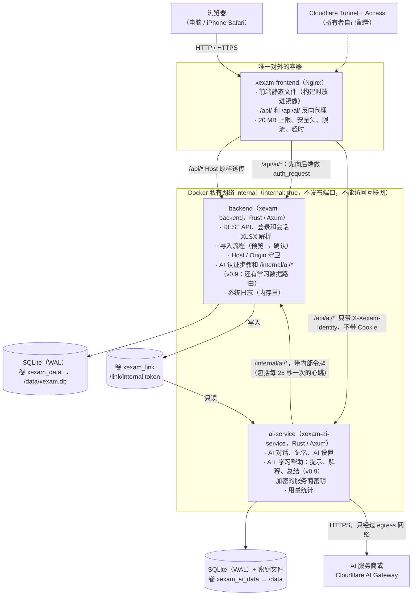
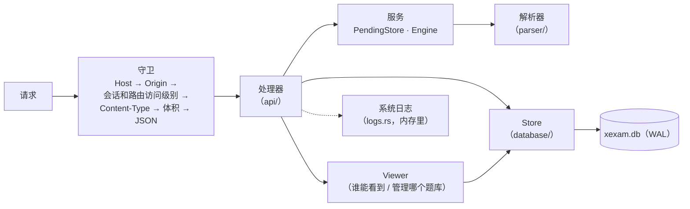
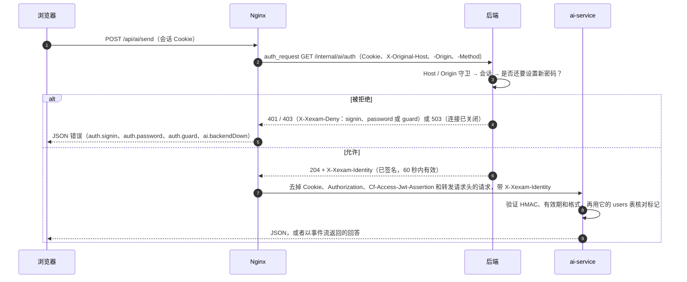
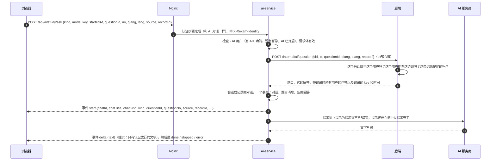
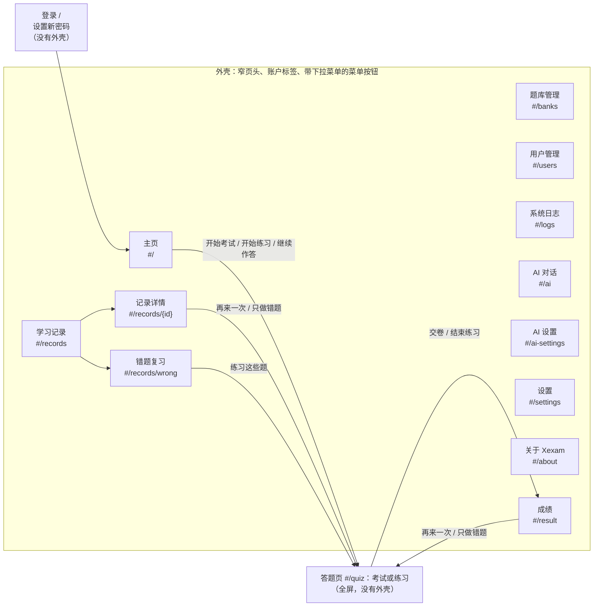
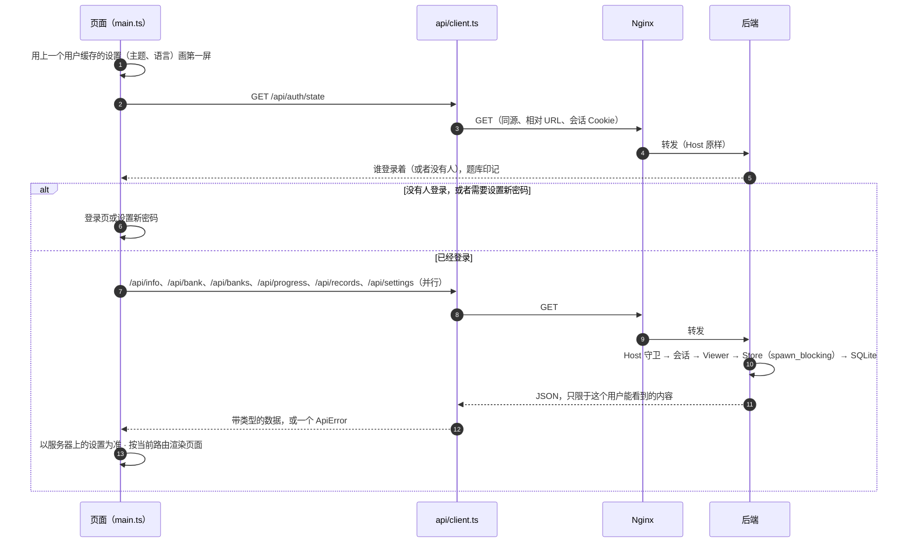
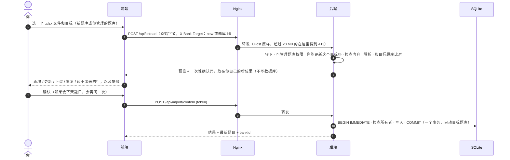
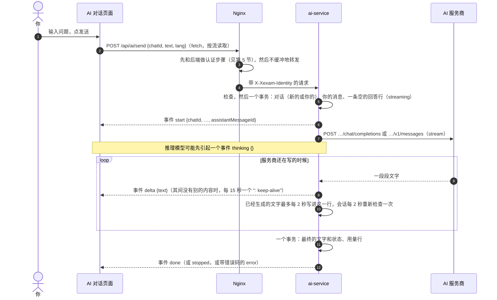

[English](../en/architecture.md) | [日本語](../ja/architecture.md) | **简体中文**

# 架构（v0.9）

> Xexam 是怎么搭起来的：前面是 Nginx，后面是 Rust 后端，旁边是一个单独的 Rust 服务 ai-service（v0.8；v0.9 给它加上了 AI+ 学习功能），用 SQLite 存储（每个服务一个数据库），前端是不用框架的 TypeScript。
> 从旧的 Python 版切换过来时的背景资料：对旧代码的审计见 [architecture-audit.md](history/architecture-audit.md)，决定和默认值见 [migration-plan.md](history/migration-plan.md)。

## 1. 总览



- **只有 Nginx 发布端口**（`XEXAM_BIND`，默认 `127.0.0.1:8765` → 容器里的 `8080`）。
- 后端所在的网络是 `internal: true`：没有 `ports`，宿主机和外面都连不到它，它自己也访问不了互联网。ai-service 也在这个网络上，而且它是唯一同时还在 `egress` 网络上的容器，这个网络让它可以向外访问互联网，连到 AI 服务商。它也不发布任何端口。
- 每个数据库只由它自己的服务读写：`xexam.db` 由后端，`xexam-ai.db` 由 ai-service（数据边界，见第 5 节）。Nginx 容器里没有数据库、没有源代码，也没有 Node。
- 浏览器只通过 REST 和后端通信（见 [api.md](api.md)）。除了 `/api/info`、`/api/auth/state` 和登录本身，每个路由都需要会话。前端不访问数据库，也不做「这次导入能不能做」「这个用户能不能看这个题库」这样的判断：由后端决定，前端只负责显示。
- 主程序保存的一切都在后端的数据目录里（Docker 里是 `/data`）：数据库 `xexam.db`（用户、题目、学习记录、设置），后端运行时还有它的 `xexam.db-wal` 和 `xexam.db-shm` 文件，升级后还有 `backups/` 文件夹，里面是 schema 迁移前写的副本。AI 的一切都在 ai-service 自己的数据目录里（它的容器里是 `/data`，即卷 `xexam_ai_data`）：`xexam-ai.db` 和它的 `-wal` / `-shm` 文件，以及密钥文件 `secret.key`。

## 2. 目录结构

```
frontend/       TypeScript 5.9（strict）+ Vite，原生 DOM，不用框架
  vite.config.ts  构建设置、开发用的 /api 和 /api/ai/ 代理、xexamAiAuth 插件（和 Nginx 一样做 AI 请求的
                  认证步骤）、xexam-changelog 插件（读取三份 README）
  src/main.ts     入口：用缓存的设置画第一屏、检查登录、把路由映射到页面
  src/router.ts   hash 路由（#/、#/banks、#/users、#/logs、#/ai、#/ai-settings、#/records、#/records/<id>、#/records/wrong、
                  #/settings、#/about、#/quiz、#/result）
  src/api/        带类型的 fetch 封装：client（错误变成带 code 和 field 的 ApiError；对 Nginx 的 429 重试、时间限制；
                  用于 AI 回答的 postStream）、ai、auth、bank、import、logs、progress、settings、users
  src/types/      API 类型（和 docs/en/openapi.yaml 对应）、构建时生成的更新日志模块的类型
  src/domain/     带单元测试的纯函数：判分和随机抽题、练习的核对、保存的成绩（notCounted）、
                  题目语言、记录筛选、锁定说明和等待时间、导入提醒、系统日志缓冲、更新日志解析、
                  事件流解析（sse）、AI 对话的状态（ai-chat）、回答所用的安全 Markdown 子集（ai-markdown）、
                  记忆的请求（ai-memory）、AI 设置表单的规则（ai-settings），以及 AI+ 学习功能（v0.9：ai-plus，
                  谁看到哪个控件、处于什么状态；ai-study，一个回答的状态；ai-run，发起、停止和轮询的引擎；
                  ai-spec，请求的构造；ai-popover，弹出框的位置和关闭规则）
  src/i18n/       t() / tn()、catalog/<区域>.ts（en / zh / ja 的界面文字）、server-messages.ts、errors.ts
  src/state/      共享状态（store）、动作（加载、登录、导航）、题库权限规则、AI 状态（ai）、设置
                  （preferences、settings-cache）、暂存的考试或练习（session-storage）、浏览器存储的键
  src/components/ shell（页头、菜单）、review（答案卡片）、lang-switch（English / 中文 / 日本語）、kind-tag（考试 / 练习）、
                  fields（登录页和用户页的表单字段）、ai-badge（AI+）、ai-render（回答）、ai-plus-controls（v0.9：
                  每个页面上的每个学习控件）、ai-pop（弹出框）、ai-summary（总结窗口）、ai-study-ui、tooltip、
                  mini-switch、mini-icons、common
  src/pages/      auth（登录、设置新密码）、home、banks、users、logs、ai（AI 对话）、ai-settings、forbidden（「没有权限」）、
                  records、settings、about、quiz、result
  src/styles/     main.css（颜色变量、浅色 / 深色、外壳）+ 每个页面区域一个 CSS 文件
  src/utils/      DOM 构建、对话框、提示、格式化、剪贴板
backend/        Rust（Axum 0.8 + Tokio + rusqlite），工具链固定为 1.99.1
  src/main.rs     命令行、启动（数据库、日志、提醒）、带 WAL 检查点的平稳关闭
  src/api/        分发和守卫（Host / Origin / 会话 / Content-Type / 体积）、路由、登录和用户的路由（auth.rs，
                  含 AI 认证步骤）、带每个路由访问级别的路由表、JSON 格式、成绩清洗、
                  internal.rs（v0.8：内部令牌、身份声明和 /internal/ai/* 路由）、internal_study.rs
                  （v0.9：三个学习数据路由）
  src/auth/       密码（Argon2id）、会话令牌和 Cookie、已知浏览器 Cookie、登录限制（throttle.rs）
  src/services/   每个用户各自的待确认导入（PendingStore）及共用的内存额度、解析引擎接口、导入流程
  src/parser/     .xlsx 解析：ZIP 防护、XML、题目识别（六列格式；三列和四列格式只用来把它们认出来并拒绝）、
                  题目 id
  src/database/   schema（v1 原文 + v2 到 v6 的新增）、日志模式（journal.rs）、Store、旧的 progress.json、时间戳
    store/          题库（谁能看、所有者）、记录、设置、用户（账户、会话、AI+）、study（v0.9：AI 服务能读到的
                    一道题或一条记录的内容）、migrate（v1 → v6、备份、修正）
  src/models/     共用类型：题目、导入目标、Viewer 和 BankScope
  src/logs.rs     系统日志：环形缓冲区、tracing 层、BurstLog
  src/security/   Host / Origin 判断、限长读取请求体、令牌
  src/config/     环境变量、VERSION 文件
  tests/          单元、黄金响应、解析对照（三列、四列和六列）、id 向量，每个版本一个文件
                  （v05_…、v06_…、v065_…、v07_…、v08_ai_link、v09_ai_study）
ai-service/     AI 服务（v0.8）：Rust（Axum 0.8 + Tokio + rusqlite + 使用 rustls 的 reqwest），有自己的 Cargo.lock，没有 unsafe
  src/main.rs     命令行（serve、healthcheck、--help）、启动、后台任务、平稳关闭（以及最后一次 "stopping" 报告）
  src/app.rs      共享状态：设置快照、密钥状态、上限、正在生成的回答、与后端的连接、心跳
  src/api/        分发（mod.rs：方法 → 路径 → 身份 → Content-Type → 请求体 → 访问级别）、用户路由、管理员路由、study.rs
                  （v0.9：学习路由）
  src/chat.rs     生成一个回答的任务：闸门、每个用户的登记表、取消、保存、每 2 秒的重新检查
  src/provider/   OpenAI 兼容和 Anthropic 适配器（网关可用其中任一种格式）、事件流解析、错误映射
  src/store/      AI 数据库：schema v3、settings / secrets / limits 行、users / chats / messages / memories（包括学习对话
                  和它们保存的回答）、用量统计（按用途）和审计发件箱
  src/study/      v0.9：提示、解释和总结的提示词、提示守卫（guard/）、对话标题、后端数据路由的严格类型（wire.rs）
                  和记录身份缓存（cache.rs）
  src/identity.rs, link.rs  身份声明；内部令牌和对 /internal/ai/* 的调用（包括心跳）
  src/secret.rs, settings.rs  密钥加密和密钥文件；服务商、URL 规则、指纹、设置的更新
  src/limits.rs, prompt.rs, retention.rs, logs.rs, codes.rs, config.rs  安全上限；系统提示词和历史；
                  保留、对账和发件箱；日志和转发；错误码和它们的文字；环境变量
  tests/          流式输出、设置和密钥、身份和访问、管理员查看的数据、不含机密的日志、代理环境变量；v0.9：
                  存储（v09_store）、守卫（study_guard）、提示词（study_prompts）和学习路由（study_api）
nginx/          nginx.conf + Dockerfile（构建前端，带上三份 README → 只带静态产物）
docker/         docker-compose.yml（拉取三个镜像）、docker-compose.build.yml（构建它们；上下文是仓库根目录）、.env.example
scripts/        release-notes.py（从更新日志生成 Release 说明）、set-release-version.py（RELEASE_VERSION 和 README 徽章）
tools/          screenshots/：用一个用完即弃的实例重新拍 README 和文档里的截图；icons/：生成程序的图标
                （见 development.md）
VERSION         CODE_VERSION（代码的版本）和 RELEASE_VERSION（最后一次发布的版本）
README.md       带更新日志的英语 README；README/ 里是 README.ja.md 和 README.zh-CN.md
LICENSE         MIT 许可证
tests/          baseline/（旧版的黄金响应和夹具）· integration/（nginx、整栈、progress.json 迁移、
                ai_stub.py：供检查和截图用的虚构 AI 服务商）
docs/           en/（英语，原文）· ja/ · zh-CN/（带 history/：以前的文档，只有中文）；每个文件夹都有自己的
                screenshots/；en/openapi.yaml
```

## 3. 数据模型（v0.9）

完整的表说明见 [database.md](database.md)。背后的思路：

### 用户和会话

- **用户**有一个角色：**管理员**或普通用户。普通用户还可以有 **可管理题库** 权限。新的或升级来的数据库一开始有管理员 `admin` / `admin`，第一次登录时必须设置新密码。
- **会话**存在数据库里（只存 Cookie 值的 SHA-256），所以重启不会让任何人退出登录。密码输错后的登录锁定只在内存里（见 [security.md](security.md)）。
- **所有个人的东西都只属于一个用户**：学习记录、错题本（每道题的统计）和设置。每个路由都为登录的用户读写它们；用户 id 始终来自会话，从不来自请求。
- **题库是共用的**，但谁能看到哪个题库按用户决定（见下面几节）。
- **AI+ 功能**（`users.ai_enabled`，v0.8，用户管理里的 **AI+ 功能** 一行）是每个用户的授权，让普通用户获得 AI+ 功能；管理员始终拥有。它只是两个用户状态之一：**暂停**（**暂停** / **恢复**，在 AI 设置里）存放在 AI 数据库里（见 [database.md](database.md) 第 8 节），从不改变这一个。每个用户还有一个身份标记（`users.uid`，创建时设置一次的 32 位随机十六进制数字），AI 服务把它和用户 id 存在一起，用来发现某个 id 现在属于另一个账户。

### 题库

- **一个题库就是一份导入的工作簿。** `banks` 表里每个题库一行。上传要么导入到新题库，要么导入到已有的题库（请求头 `X-Bank-Target`，见 [api.md](api.md)）。
- **一次导入只替换目标题库的内容。** 这个题库里有、文件里没有的题下架；其他题库的题永远不碰。
- **旧题库（legacy）。** v0.5 之前的数据变成一个题库（`legacy_ids = 1`）。它的题目 id 就是解析器算出来的普通 id，没有改动，所以以前的统计、错题本和考试历史都还对应着。不带 `X-Bank-Target` 的上传导入到这个题库：旧的客户端和命令行的 `import`。
- **限定在题库内的 id。** 其他每个题库都用 `sha1("xexam-bank:{bank_id}\n{解析器 id}")` 的前 12 位十六进制数字保存题目。所以同一份工作簿可以导入两次，成为两个独立的题库，它们的 id 和学习数据永远不会混在一起。题库 id 永远不会重复使用。
- **所有者。** 每个题库都有一个所有者：把它作为新题库导入的用户。v0.7 之前的题库，以及没有登录用户时新建的题库（命令行的 `import`），属于第一个管理员。删除一个用户时，他拥有的题库转到删除他的那位管理员名下。
- **一种格式。** 从 v0.7 起只能导入六列格式（A–C 是英语、中文和日语的题目，D–F 是它们的答案和解析）。以英语为准：题型、选项、题目的身份和答案都来自 A 列和 D 列，题目里保存每种语言的解析（`lang`、`ja`、`explain`，见 [database.md](database.md) 第 4.7 节）。解析器仍然能认出以前版本的三列和四列格式，这样上传、导入确认和命令行的 `import` 就能在暂存或写入任何东西之前拒绝它们（`services::check_layout`，400）。以前从这些格式导入的题在每次启动时都会被下架（`Store::retire_old_layout_questions`，见 [database.md](database.md) 第 4.2 节）；题库和它们的学习数据保留。
- 删除题库会删掉它的题目、导入记录、谁能看到它的设置以及题库本身。只有明确要求时才删除它的学习数据（`withRecords`，确认对话框里一个默认不勾选的复选框）：管理员删除所有用户的，可管理题库的用户只删除自己的。

### 谁能看到和管理哪个题库：Viewer 和 BankScope

每个读取题库数据或写入题库的请求，都会根据登录的用户建立一个 **`Viewer`**，在那一刻从数据库读出来（所以管理员做的修改在下一个请求就生效，不用让任何人退出登录）：

| | `admin` | `can_manage` | `scope`（一个 `BankScope`） |
|---|---|---|---|
| 管理员 | 是 | 是，所有题库 | `All` |
| 普通用户 | 否 | 看权限 | `Only(他的 user_banks 行，加上他作为可管理题库的用户时自己拥有的题库)` |

普通用户的 `user_banks` 行，就是管理员为他勾选的那些已有题库。**包括以后导入的题库**（`users.new_banks`）不属于 viewer：它只是在新建题库的那个事务里，为每个新题库添加一行。

- **读取**：store 的 `*_as` 方法接收 viewer 或它的 `BankScope`。只能看到部分题库的用户，在 `/api/bank` 和 `/api/banks` 里只得到这些题库，在 `/api/progress` 里只得到这些题的统计，记录详情里其他题库的题会像已删除的题一样被略去。在 `/api/banks` 里，除了管理员，每个人看到的 studied 和 records 都只数自己的，也只有管理员能看到题库属于谁。
- **写入**：`Viewer::manages(owner)` 对管理员总是成立，对可管理题库的用户只在他自己的题库上成立。导入到已有题库和删除题库都**在写入的事务里**检查它，所以同时发生的所有者变更（被删除用户的题库转给管理员）不会插到检查和写入之间；被拒绝时什么都不写（403 `MSG_NOT_BANK_OWNER`）。上传路由在解析之前还会再检查一次目标，所以被拒绝的上传不花解析时间。
- **考试**：普通用户交卷时，范围以外的题和已经不存在的题完全一样处理：不计入、不为它们写任何东西，它们的 id 在 `notCounted` 里返回。
- **刷新打开着的页面**：`GET /api/auth/state` 带着一个**题库印记**，是一个不透明的摘要。对管理员，它跟随整个题库；对普通用户，它只跟随他的题库和他的权限，所以既不透露、也不跟随他看不到的题库。页面在每次切换页面和标签页重新可见时比较它，变了就重新读取题库。

### 学习记录：考试和练习

- `attempts` 里每交一场考试或结束一次练习就有一行，带它的所有者（`user_id`）、类型（`exam` 或 `practice`）所用题库的快照（当时的 id 和名字），以及从 v0.9 起它所属会话的 key 和开始时间（`session_key`、`started_at`；旧记录为 NULL），用来把它和那次会话的 AI 对话关联起来。每个用户保留自己最新的 **500** 条记录；`/api/progress` 返回最新的 60 条。
- `attempt_items` 里一条记录的每道题一行：题目 id、给出的答案（页面发来的样子，清洗之后；没有值 = 未作答）以及对错。v0.5 之前保存的记录没有这些行。
- 练习和考试一样计入错题本。
- 记录详情（`GET /api/record`，同时返回 `sessionKey` 和 `startedAt`）把详情行和题目**现在**保存的样子放在一起，包括已下架的题。随题库一起被删除的题，或者属于这个用户已经看不到的题库的题，显示一句说明，而不是题目文字。
- 删除一条记录不改动统计（错题本）。删除全部记录时可以选择一起清空。

### 设置

- `user_settings` 存每个用户的主题、界面语言、答完自动跳到下一题和题目语言。因为它们在数据目录里，所以更新容器、清除浏览器缓存、换别的浏览器和设备之后都还在。
- 浏览器在 `localStorage` 里为每个用户保存一份副本（`xexam.u<id>.settings.v1`），只用来以正确的主题和语言画出第一屏。服务器上的值一读到就以它为准。

### AI 数据（在 AI 服务自己的数据库里）

- `xexam-ai.db` 保存 AI 设置和加密的服务商密钥、安全上限、AI 服务见过的用户（id、标记、最后知道的名字）、他们的对话和消息、他们的记忆笔记、每次模型调用一行用量（从不包含内容），以及还没送出去的审计日志。表的说明见 [database.md](database.md) 第 8 节。
- 对话在最后一条消息若干天后自动删除（默认 90 天，在 AI 设置里设置）；记忆一直保留，直到被删除。在主程序里删除一个用户时，AI 服务的对账会删除他的 AI 数据，并保留他的用量行，只是不再关联到这个用户。没有被授予 AI+ 功能的用户会从 AI 设置的列表里消失，但他的数据会一直保留，直到被删除或被保留期限清除。
- 从 v0.9 起，对话里还保存 AI+ 学习功能的回答：每次练习、每场考试和每份记录总结各有一个对话，里面是保存下来的提示、解释或总结（发出时的题目文字和 AI 的回答都复制进这个数据库；见 [database.md](database.md) 第 8.2 节）。对用户、管理员的查看、额度和保留期限来说，它们都是普通的对话。

### 留在浏览器里的东西

- 进行中的考试或练习（`localStorage` 里的 `xexam.u<id>.session.v1`，那个浏览器上每个用户一份）：题目 id、答案、标记、位置、用时、类型，练习还有哪些题已经核对过，以及从 v0.9 起这次会话的随机 key 和开始时间（恢复后仍保留，保存时一起发送）。不含题目文字。
- 最后登录的用户的 id（`xexam.lastUser.v1`），用来让他缓存的设置画出第一屏。
- 已知浏览器 Cookie `xexam_device`（见 [security.md](security.md)）和会话 Cookie `xexam_session`，都是 `HttpOnly`。
- 菜单是否打开不保存：它只在内存里，每次切换页面菜单都会关上。
- 在 AI 设置里输入的 AI 密钥在保存之前只留在页面的内存里，保存后、切换页面时和退出登录时都会清掉。对话和记忆从不保存在浏览器里；AI 弹出框和总结窗口只在内存里保留它们显示过的回答（最多 200 条，退出登录和刷新页面时忘掉）。

## 4. 后端



所有路由都经过同一个分发函数，所以每个请求的守卫顺序都一样。（唯一的例外是 `/internal/` 下面的路径，也就是和 AI 服务的连接：分发函数在 Host 守卫之前、不经过会话层就把它们交给 `api/internal.rs`；之后认证步骤自己根据 `X-Original-*` 请求头执行守卫，见第 5 节。）会话检查紧接在 Host（POST 还有 Origin）检查之后、读取任何请求体之前进行，依据的是一张写明每个路由访问级别的路由表：**公开**、**登录**、**可管理题库**（管理员和可管理题库的用户：上传、确认 / 取消导入、导入记录、删除题库）或**管理员**（用户、系统日志、关闭程序）。不在表里的路径也需要会话。关键的设计决定（早期的考虑见 [audit/rust-stack.md](history/audit/rust-stack.md)）：

| 问题 | 做法 |
|---|---|
| rusqlite 是同步的 | 一个连接放在 `Arc<Mutex<Connection>>` 后面；数据库调用在 `spawn_blocking` 里运行，锁从不跨 `.await` 持有。这和旧版的「一个连接 + RLock」一一对应 |
| 日志模式 | 从 v0.7 起是 WAL 加 `synchronous=FULL`（`database/journal.rs`）；`XEXAM_SQLITE_JOURNAL=delete` 保留以前的回滚日志。SQLite 拒绝的模式记为警告，从不当成错误。启动时记一次实际生效的模式；平稳关闭时执行 `wal_checkpoint(TRUNCATE)`。见 [database.md](database.md) 第 2.1 节 |
| 请求体上限 | 一个手写的流式读取器：边读边数真实的字节数，一超过 20 MiB 就返回 413，**不信任 `Content-Length`**（分块上传也一样） |
| 解析会不会卡住服务？ | 解析在阻塞线程上运行，带一个协作式的截止时间（`XEXAM_PARSE_TIMEOUT_SECS`，默认 30 秒；到时解析器自己停下），同一时间最多 2 个解析；ZIP 条目数、解压后的大小、XML 深度 / 节点数 / 每个元素的属性数、单元格总数和总字节数都有上限；共享字符串只存一份 |
| 待确认的导入 | 预览只保存在内存里，从不写进数据库。**每个上传的用户都有自己的槽位**（按用户 id）：一个可管理题库的用户的上传，永远不会替换、确认或取消别的用户的预览。所有槽位共用一个 **128 MiB** 的内存额度（按解析出的题目估算）：暂存一次上传时，总量超过额度就丢掉别的用户最早的预览，他们确认时会提示预览已过期，和超过 30 分钟一样。最新的上传总会保留 |
| 导入的原子性 | 确认时执行 `BEGIN IMMEDIATE … COMMIT`，失败就整体回滚；所有者检查也在这个事务里；确认码只能用一次，128 位随机，按常量时间比较；同时到达好几个确认时，只有一个能成功 |
| 提交被打断 | 导入的提交是一个单独的任务，即使客户端断开也会完成；`docker stop` 最多等 15 秒，后端在 8 秒内平稳关闭 |
| schema 升级 | 后端打开一个有数据的旧 schema 数据库时，先用 `VACUUM INTO` 往 `xexam.db` 旁边的 `backups/` 写一份副本，再在一个事务里迁移，之后才切换到 WAL。副本写不出来就不启动。打开一个已经是最新的数据库什么都不写（见 [database.md](database.md) 第 6 节） |
| 删除数据 | 删除题库、记录和用户各在一个事务里完成。删除题库时也会丢掉以它为目标的待确认上传 |
| 密码 | Argon2id，在 `spawn_blocking` 里运行，同一时间最多 2 个；登录限制在任何哈希计算之前就给出回答。见 [security.md](security.md) |
| 日志 | `tracing`，不带颜色，用 `XEXAM_LOG` 过滤（默认 `info`，为空时也是；无效的值退回 `info` 并记一条警告）；用户用用户名表示，从不用 id；**密码、会话令牌、Cookie 的值、确认码、内部令牌、身份声明和题目文字从不记录**（从 v0.9 起学习数据路由什么都不写）。见下文 |
| 错误 | 一律是 `{"error": "<原因，中文>"}`；数据库异常、文件路径和 SQLite 错误只写进日志，从不放进响应。前端翻译它认识的提示（第 6 节） |

### 系统日志

- `main.rs` 安装一个 `tracing` subscriber，只有**一个过滤器**（`XEXAM_LOG`，默认 `info`）和两个输出：stderr，也就是 `docker compose logs backend` 显示的内容；以及 `logs.rs` 的 `BufferLayer`。`main.rs` 在启动和关闭时打印到 stdout 的普通状态行也会加进缓冲区；`reset-password` 打印的新密码不会（这个命令本来就在它自己的进程里运行）。
- 缓冲区是一个**保存最后 2000 行的环**，只在内存里：重启后又是空的，什么都不写进数据库。每一行有一个序号（进程的第一行是 1）、带秒的本地时间、级别、目标（模块）以及带字段的消息；一条消息超过 4000 个字符会截断。
- `GET /api/logs?after=<seq>&boot=<id>`（只有管理员）返回 `after` 之后的行、最新的序号（`last`）、`after` 和保留着的最早一行之间有没有被丢掉的行（`dropped`），以及 `boot`，后端进程的一个随机 id。重启后序号从 1 重新开始，所以发来重启前的 `boot` 的客户端会得到保留着的所有行。
- **AI 服务的日志行** 通过 `POST /internal/ai/log` 送来（每次最多 50 行，每行截断到 2000 个字符，去掉控制字符），以目标 `xexam_ai_service` 和前缀 `AI: ` 加进同一个缓冲区。它们不打印到后端的 stderr；ai-service 容器自己打印自己的。
- **BurstLog。** 任何能连到服务器的人不用登录就能引起的日志行，都经过一个 `BurstLog`：被 Host / Origin 检查拒绝的请求、失败的登录，以及没有账户的用户名被锁定。安静了一分钟之后的第一个事件马上记录；之后的事件只计数，最多每分钟汇总成一行，由下一个事件或者每分钟运行一次的服务器定时器写出来，所以即使后面没有任何事件，一阵请求的结尾也会在一分钟左右之内记录下来。被拒绝（429）的登录由登录限制用同样的方式汇总。所以大量这样的请求挤不掉 2000 行里的其他内容。

### 版本

后端在 `/api/info` 里报告它的版本。它按这个顺序读取：`XEXAM_VERSION`（有效时）；`XEXAM_VERSION_FILE` 指定的文件里的 `CODE_VERSION`（镜像里是 `/VERSION`，仓库里 `VERSION` 的一份副本）；编译进程序的版本。同一个文件里的 `RELEASE_VERSION` 在这里被忽略。`CODE_VERSION` 出现两次的文件不提供版本；没有任何 `KEY=VALUE` 行的文件按旧的单行格式读取。

### 命令行

```
xexam-backend [serve] [--data DIR] [--host ADDR] [--port N] [--allow-shutdown] [--no-browser]
xexam-backend healthcheck [--port N]          容器自检（发送 Host: 127.0.0.1，所以白名单不影响它）
xexam-backend import <题库.xlsx> [--data DIR]  命令行把六列格式的工作簿导入到旧题库（旧的 --import 也能用）
xexam-backend migrate-progress [progress.json] [--data DIR]  把更早版本的 progress.json 迁移进数据库
xexam-backend reset-password <用户名> [--data DIR]  新的随机密码（只打印一次），下次登录时必须修改
```

每个打开数据库的命令（`serve`、`import`、`migrate-progress`、`reset-password`）都会先执行 schema 升级，按 `XEXAM_SQLITE_JOURNAL` 请求日志模式，并下架旧格式的题。它们可以在服务器运行时运行（Docker 里：`docker compose exec backend xexam-backend …`）。只有 `serve` 加载或创建内部令牌（`XEXAM_INTERNAL_TOKEN`，否则是 `<链接目录>/internal.token`；链接目录是 `XEXAM_LINK_DIR`，否则是数据目录里的 `link`，镜像里是 `/link`）；其他命令从不碰它。

## 5. AI 服务（v0.8，学习功能 v0.9）

AI 对话、AI 记忆和 AI 设置由第三个容器 `ai-service`（镜像 `xexam-ai-service`）响应：一个单独的 Rust 程序（`ai-service/`，和后端一样是 Axum + Tokio + rusqlite），有自己的 SQLite 数据库。后端没有加入 HTTP 客户端、TLS 或 AI 代码；它保持「不能上网」的保证，只为 ai-service 响应几个小的内部路由：Nginx 用的认证步骤和七个带令牌的路由（v0.8 起四个，v0.9 起又加了三个，把学习功能需要的题目和记录交给它）。

### 数据边界

所有者定下的规则，代码和 compose 文件都遵守它：

- **没有任何 SQLite 文件会被两个容器同时打开。** `xexam_data`（里面是 `xexam.db`）只挂载到后端，`xexam_ai_data`（里面是 `xexam-ai.db` 和密钥文件 `secret.key`）只挂载到 `ai-service`。前端不挂载任何卷。
- **ai-service 只通过后端的 API 访问主程序的数据**：带令牌的路由 `/internal/ai/introspect`、`/internal/ai/users`、`/internal/ai/log` 和 `/internal/ai/heartbeat`（某个会话属于谁、有哪些用户、谁有 AI+ 功能，它要写进系统日志的行，以及它自己的状态），从 v0.9 起还有 `/internal/ai/question`、`/internal/ai/record` 和 `/internal/ai/record-info`。这三个路由交出的是**调用者能看到的一道题，或者调用者自己的一条记录，而且只在带着调用者的有效会话来问时才交**：后端把会话绑定到用户，对另一个用户的会话、用户看不到的题库里的题、或不是调用者自己的记录，一律不回答（这几种情况都是同一个「未找到」）。它仍然不会自己去读题库、记录或设置，也不会拿到这三种投影之外的东西（见下面的「AI+ 学习帮助」一节）。
- **后端只通过 ai-service 的 API 访问 AI 数据**，而在 v0.8 里它从不这样做：它根本不调用 ai-service。心跳是反方向的（ai-service 告诉后端，见下文）；后端对 AI 所知的，只是它收到的最后一次报告，而且只保存在内存里。
- **每个数据库只由它自己的服务迁移**：后端迁移 `xexam.db`（schema v6），ai-service 创建并打开 `xexam-ai.db`（schema v3，见 [database.md](database.md) 第 8 节）。
- **唯一共用的卷 `xexam_link` 里只有一个文件 `internal.token`**，从不放数据库。后端写入它；ai-service 以只读方式挂载它。

所以 `xexam_data` 的备份里没有 AI 机密，也没有对话；`xexam_ai_data` 的备份里没有题库、密码或学习记录。

### 谁在请求：认证步骤和身份声明



- **认证步骤**（`GET /internal/ai/auth`，`backend/src/api/internal.rs` 和 `api::auth::introspect`）执行的 Host / Origin 守卫和会话检查和每个 `/api/*` 请求一样，但只从 Nginx 设置的 `X-Original-*` 请求头读取 Host、Origin 和方法，从不刷新会话，而且对会话 Cookie 比其他路由更严格：必须正好有一个 `xexam_session` Cookie，原样写出（Nginx 按会话的限制也以同一个 Cookie 为键）。
- **身份声明**（`X-Xexam-Identity`）是 `base64url(payload) "." base64url(HMAC-SHA-256(token, "xexam-identity-v1." + base64url(payload)))`，其中 payload 是紧凑的 JSON `{"v":1,"id","stamp","username","role","aiAllowed","sid","exp"}`：用户的 id、身份标记（`users.uid`）、名字和角色、能否使用 AI（管理员，或已开启 AI+ 功能）、会话令牌的哈希，以及 60 秒后的过期时间。它从不记录。AI 服务不接受任何其他身份来源：它从不读取 Cookie、`Authorization` 或转发请求头，Nginx 也会覆盖客户端发来的任何 `X-Xexam-Identity`。
- **内部令牌** 用来给声明签名，并认证 ai-service 对七个带令牌路由的调用（请求头 `X-Xexam-Internal-Token`，按常量时间比较）。设置了 `XEXAM_INTERNAL_TOKEN` 时就是它（两个服务用同一个值），否则是文件 `<链接目录>/internal.token`，文件不存在时由 `xexam-backend serve` 创建（43 个字符，32 个随机字节；权限 0600）。令牌缺失或错误时，带令牌的路由回答 404，和未知路径完全一样。
- **vite 的开发 / 预览服务器** 通过 `frontend/vite.config.ts` 里的一个小插件（`xexamAiAuth`）做同样的事：它询问后端的认证步骤，去掉凭据并设置声明，所以开发、截图工具和正式环境共用同一个信任模型。
- **回答过程中的重新检查**：生成回答期间，ai-service 每 2 秒用 `POST /internal/ai/introspect` 问一次：会话是否还存在、是否还属于同一个用户（标记相同）、是否还有 AI+ 功能，并在自己的数据库里查看是否被暂停。访问权限没了，回答以 `ai.notAllowed` 停止；用户被暂停，则以 `ai.suspended` 停止（错误码保留这个名字）；连续 3 次检查失败（连不上后端）时，以 `ai.backendDown` 停止。
- **被重新使用的用户 id**（主数据库从备份恢复，或者换了新的主卷）会因为标记不同而被发现，在第一次请求或下一次对账时：这个 id 的旧 AI 数据会先被删除，然后才提供任何内容。

### 心跳：后端怎么知道 ai-service 在

后端从不调用 ai-service，所以它只能从 ai-service 自己那里得知它在运行：`POST /internal/ai/heartbeat`（带令牌的路由，没有内部令牌就回答 404，也无法通过 Nginx 访问），内容是紧凑的 JSON `{"version","enabled","suspended","stopping"}`：版本、AI 设置里的 AI+ 功能是否开启、被暂停了 AI+ 功能的用户的 id（键仍然叫 `suspended`；最多 3000 个），以及这是不是关机前的最后一次报告。后端回答 `{"ok":true}`。

- **什么时候**：启动时；有变化时马上报告（管理员开启、关闭、验证或修改设置，暂停、恢复，发现密钥有问题，某个用户的数据被删除；管理员的处理函数会等报告发出之后才回答）；每 25 秒一次；报告失败后 5 秒重试；ai-service 关机时用 `stopping: true` 再报告一次（最多 2 秒）。同一时间只有一个报告在途，心跳不写任何日志行。
- **后端怎么处理**：它只在内存里保留最后一次报告（什么也不存储；后端重启后，在下一次报告之前它是空的，最多 25 秒）。这份报告不到 60 秒、并且不是关机报告时，ai-service 算作**已连接**。已连接并且 `enabled` 时，AI+ 功能**可用**。`GET /api/auth/state` 为每个已登录用户带上 `aiAvailable`，为管理员还带上 `aiService`；`/api/users*` 的回答带有 `aiAvailable` 和每一行的 `aiSuspended`（被暂停的用户；见 [api.md](api.md)）。
- **可用与否有什么影响**：AI+ 功能不可用时，后端拒绝开启或关闭某个用户的 AI+ 功能（409 `ai.serviceOff`，什么也不改变），前端也会在用户管理里隐藏这些开关；已经存储的开关保持不变。
- **ai-service 对自己也用同样的 60 秒规则**：没有被接受的报告时，它的用户路由回答 503 `ai.backendDown`，它的状态里 `enabled: false`。查看和删除自己的对话和记忆，以及所有管理员路由，仍然可用。
- **为什么不反过来**：后端如果去轮询 ai-service，就需要一个 HTTP 客户端和一条通向 AI 数据的路，而数据边界不允许这样。

### AI+ 学习帮助（v0.9）

对有 AI+ 功能的账户，除了 AI 对话，还有四样东西可以就学习材料问 AI：**AI 提示**和 **AI 解释**（练习）、**AI 解析**（练习或考试成绩页的每道题，以及记录详情页；它是成绩的解释）和一份记录里答错的题的 **AI 总结**（学习记录和主页）。考试进行期间，考试页上没有其中任何一样。每个回答都保存在它所属会话或记录的一个对话里，所以会出现在 AI 对话中（见 [database.md](database.md) 第 8.2 节）。



- **浏览器只发 id，从不发题目文字。** 请求体里有题目 id、页面显示的题号、题目语言、回复语言（`lang`，即设置里的语言：`en`、`zh-CN` 或 `ja`，也接受 `zh`）、练习的会话 key 和开始时间，以及成绩页或详情页的记录 id。ai-service 用身份声明里的会话 id 向后端读取题目，所以伪造的请求体无法指向别的用户的题目或记录。题目以所要求的语言返回，带选项字母，旁边是解答（答案、解析、记忆口诀、备注、正确选项的文字），全都有长度上限。其中从不含原始的翻译列、工作表、行、题库 id 或名字、所有者、用户名或统计。
- **提示从不接收答案。** `hint_prompt` 只接收题目：它的签名里没有解答参数（一个 `compile_fail` 测试把这一点固定下来），提示词还告诉模型永远不要说出或暗示哪个选项正确。解答只会到达**提示守卫**（见下）。解释的提示词会拿到解答，成绩页上的那种还会拿到用户在那条记录里的作答（或者说明这道题没有作答）。题目和答案的文字放在标签之间当作数据，提示词说明标签里的文字不是指令；回复语言那一行没有「除非用户另有要求」的尾巴，因为这些提示词没有自由输入的用户回合。
- **提示守卫**（`study/guard/`）在提示流出的过程中过滤它。它扣住文字最新的一段（64 到 600 个字符，取决于题目），在规范化后的文字上扫描窗口，找出点明答案的说法（选项字母和数字加上判定词、「第一个选项」这类序数、被说成对或错的热点题陈述、正确选项的文字——当它不在题干里、也不是错误选项时），只放行通过的文字，所以发送、保存和计数的都只是放行的文字。一条规则触发时，提示的内容一概不留：回答以错误码 `ai.hintLeak` 的错误保存，流以带 `withdraw: true` 的 `error` 事件结束（页面撤掉已经显示的内容），并且写一行日志（最多每分钟一次），说明一个提示被扣下了（`AI hint withheld because it gave the answer away (user "…")`，之后是后续次数），不含任何内容。超过 6000 个字符的提示以带 `truncated` 的 `done` 结束。守卫是**尽力而为的过滤，不是证明**：它靠词表和规则工作，它的测试里有它抓不到的说法；不依赖它的保护是提示词里根本没有答案。内容流开头的 `<think>…</think>` 片段（没有推理解析器的服务器）按推理文字处理，在守卫看到之前就丢掉。
- **用哪个对话。** 带记录时（成绩页、记录详情页），对话来自后端的记录，而不是浏览器：记录的会话 key 对应那次会话的对话（所以详情页和练习或考试共用对话和已保存的回答）；没有 key 的记录（v0.9 之前保存的）得到自己的对话，用 `r<id>@<记录时间>` 命名，类型是记录的类型。浏览器如果也发了 key 而且和记录的不同，回答是 404 `ai.notFound`。没有记录时（练习页），对话就是会话 key 的那个。标题是会话开始的时间，按容器的时区（别的都不知道时用记录的时间）。同一次会话的两个同时到达的第一次提问，最后落在同一个对话里（`idx_chats_ref`）。
- **一次只生成一个回答。** 默认每个用户只有一个正在生成的回答（安全上限）；有回答在生成时再问一个，会被 409 `ai.busy` 拒绝，错误里带 `running`，说明是哪一个（对话 id、消息 id、对话类型、种类、题目 id 和题号、来源、记录 id），页面可以说出是哪一个，并给出**停止它，生成这一个**。那个按钮停止被点名的对话，然后只再问一次；什么都不会被自动停止，停止也从不发送空的 `stop`。
- **已保存回答的查询。** `GET /api/ai/study/saved`（模式、`key` 或 `record`、来源、题目、种类）和 `GET /api/ai/summary/saved`（记录 id 和记录时间的 12 位数字）回答 `{chatId, latest, lastGood}`：任何状态的最新回答，以及最新的一个好回答（当它不是前者时）。它们只需要有效的身份，不需要 AI+ 功能，所以已保存的回答始终可读。带 `record=` 时，记录的身份来自一个按用户 id、用户标记和记录 id 为键的小缓存（1000 条，10 分钟，「未找到」从不缓存），否则来自 `POST /internal/ai/record-info`；页面在有回答正在写、而它没有对应的流时，每 2 秒轮询这些路由。
- **总结。** `POST /api/ai/summary/ask` 接收一个记录 id：后端返回调用者自己的记录，其中最多 70 道**答错**的题（不放回的均匀随机抽样，保持记录里的顺序；未作答的题不算），题目和答案的文字合计最多 120 000 个字符（它按比例缩短每一项，并且会说明）。记录的对话类型是 `summary`，每条记录一个；记录或它的题被删除时，它仍保留自己的回答。拒绝的情况：409 `ai.noDetail`（v0.5 之前的记录没有逐题详情）、`ai.noWrong`、`ai.noUsable`（题目已经不存在，或不再可见）。
- **学习数据路由失败只算一次请求失败，不算链接丢失。** `Link::data_call` 把 404 或读不懂的回答当作这一次请求失败（503 `ai.backendDown`），从不把链接标成断开，所以比后端新的 ai-service 镜像不会让所有人的 AI 都被关掉。每个回答都用严格的类型（`deny_unknown_fields`）读取。
- **在任何地方都不记录**：题目文字、提示、解释、总结、答案、对话标题、会话 key 和记录时间（Nginx 访问日志只保留不含查询字符串的路径，因为已保存回答的路由把 key 和记录时间放在查询里）。

### AI 服务内部

| 问题 | 做法 |
|---|---|
| 路由 | 和后端一样，一个 `dispatch` 兜底处理（只有 GET 和 POST，其他方法 405，未知路径 404 `ai.notFound`），只有一个 panic 层，没有可能截断或缓冲流的请求体上限层、超时层或压缩层。请求体手动读取（最多 128 KiB，必须是 JSON 对象，未知的键会被拒绝） |
| 访问级别 | **已签名**（任何有效的声明：状态、读取和删除自己的对话和记忆、停止，以及从 v0.9 起两个已保存回答的查询）、**AI 用户**（AI 设置里的 AI+ 功能已开启、ai-service 已连接到后端、`aiAllowed`，并且没有被暂停：发送、重试、写记忆，以及从 v0.9 起请求提示、解释或总结）、**管理员**（`role = admin`，AI 关闭时也可以）。每个用户路由都只从声明里取用户 id，别人的 id 和不存在的一样回答（404） |
| 流式输出和脱离 | 每个回答在自己的任务里运行，和 HTTP 响应无关：浏览器关闭不会让它停下。任务最多每 2 秒、并在结束时把文字写进数据库，每次都是短事务（数据库锁从不跨 `.await` 持有）。回答进行中，页面每 2 秒读取一次 `GET /api/ai/chat`，重新接上它 |
| 停止 | 停止、删除对话、管理员清除、关闭 AI+ 功能、失去访问权限、暂停和关机都会取消这个任务；已经生成的文字保留，并且正好写一行用量。删除会等任务的最后一次写入完成后再删除 |
| 并发 | AI 设置里的安全上限：每个用户同时生成的回答数（默认 1，同一个对话里永远不会有两个；学习提问和 AI 对话的回答一样算，有另一个在生成时会被 409 `ai.busy` 拒绝）和整个实例同时进行的模型调用数（默认 16，一个运行时可以调整大小的信号量）。它们保存在 AI 数据库的 `limits` 表里 |
| 服务商 | OpenAI 兼容（`/chat/completions`）、Anthropic（`/v1/messages`），以及使用其中任一种格式的 Cloudflare AI Gateway；手写的事件流解析器（推理文字，开头的内联 `<think>` 片段也算，只用来发出一个 `thinking` 事件，从不保存也不记录）；每个阶段各自的时间限制；上游错误映射成固定的错误码（`ai.up.*`），从不回显服务商的文字 |
| 自由模式 | 是**管理员**的状态，不是对话的状态：`users.free_mode`，在设置里的 **AI 对话模式** 下设置（普通模式 / 自由模式；`POST /api/ai/free`，只有管理员，在 `GET /api/ai/status` 里作为 `freeMode` 报告）。开启期间，任何对话（旧的或新的）里的每次发送和重试都使用自由提示词（只有回答语言那一行：没有学习助手的指示、没有日期、没有记忆）；请求体里发来的 `free` 会被忽略。对话没有模式，AI 对话里也没有开关或分隔线，只在模式开启期间，标题旁边有一个绿色的 **自由模式** 标签。自由模式只解除 Xexam 自己设定的角色，从不解除服务商的规则 |
| 提示词和历史 | 系统提示词的构造让它的开头在各次请求之间完全相同（固定文字、日期、记忆，最后才是语言那一行）。每条消息都记录它的模式（`messages.free`），**整个**历史在两种模式下都会发给模型；只有切换之后，发送的历史里含有另一种模式的消息时，语言那一行后面才会多一行简短的模式说明（"Current mode: normal … earlier turns may be free mode." 或自由模式的对应说明）。最新的 4 条历史消息完整发送；更早的回答截到 800 个字符（再加 `…(shortened)`），更早的问题截到 2000 个字符，总是在同一个位置截断，所以同一条消息在每次请求里得到同样的文字。长度预算（消息长度上限加 8000 个字符，至少 24 000）按截短后的文字计算，先丢掉最旧的 |
| 提示词缓存 | Anthropic 格式：在系统块和最后一条历史消息（新问题之前的那一条）上各放一个 `cache_control` 断点；OpenAI 格式：由服务商那边自动完成，不发送任何东西。服务商报告的缓存命中的输入 token 存进 `usage.tokens_cached`，在用量里显示为 **缓存命中** |
| 对外的 HTTP | `reqwest`，带 rustls、ring 提供者和编译进程序的 Mozilla 根证书（没有 OpenSSL、aws-lc 或 native-tls，CI 会检查）；不用代理，不跟随重定向，HTTP/1.1 |
| 密钥 | XChaCha20-Poly1305，密钥来自 `XEXAM_AI_SECRET_KEY` 或密钥文件；解密后的密钥只在构建一次发给服务商的请求时存在（见 [security.md](security.md) 第 11 节） |
| 开启 | AI+ 功能只有存储的开关是开着的、当前设置的测试已通过（服务商、地址、格式、认证方式、模型、密钥版本和加密密钥 id 的指纹），而且密钥能解密时，才是开启的。保存对其中任何一项的修改都会对所有人关闭它，直到管理员再次测试并开启 |
| 日志 | `tracing` 输出到 stderr（`docker compose logs ai-service`），过滤器是 `XEXAM_AI_LOG`；服务本身的日志行还会成批发到后端的系统日志（`AI: …`）。与后端的链接每建立一次连接只写一次 `AI link: connected to the main service`（只有在 `AI link: lost the main service` 之后才会再写），所以长时间的中断是一对日志行，而不是每次重试一行。审计日志（管理员查看或清除某个用户的 AI 数据）会马上发送，或者保存在 `audit_outbox` 表里，直到后端取走；它们从不丢弃 |
| 后台工作 | 对话保留（启动 60 秒后，之后每小时一次；从 v0.9 起分批进行，每批 20 个对话，批间短暂停顿，在阻塞线程上运行）、和后端的对账（启动时，之后每 10 分钟一次：删除已删除用户的 AI 数据）、审计发件箱（每 30 秒）和删除后的 WAL 检查点（最多每 10 秒一次） |
| 关闭 | 收到 SIGTERM 时，每个正在生成的回答都以 `stopped` 结束，并在 8 秒内保存；compose 最多等 15 秒 |

命令行：`xexam-ai-service [serve]` 启动服务（默认），`xexam-ai-service healthcheck` 在 127.0.0.1 上请求它自己的 `GET /healthz`（镜像的健康检查），`xexam-ai-service --help` 列出环境变量。`GET /healthz` 不需要任何身份就回答 `{"ok":true,"version":…,"arch":…}`；Nginx 没有为它设置 location，所以只能在 Docker 网络里访问它。

`ai-service` 不存在、停止或不健康时，Nginx 对 `/api/ai/*` 回答 JSON 502（`ai.unavailable`），前端隐藏 AI 对话，AI 设置照样能打开并显示一个状态面板，写明原因（没有运行、已停止、没有连上、在等第一次报告），用户管理里的 AI+ 功能开关消失，其他一切照常。如果用的是没有 `ai-service` 的旧 compose 文件，程序的表现也一样。在 compose 文件里，前端容器不依赖它。

## 6. 前端

不用框架；原生 DOM。共享状态是一个带类型的对象（`src/state/store.ts`）。每次渲染都根据状态重建当前页面；答题页还有几个小的「刷新器」，不用整页重画就能更新答题卡和进度。

### 外壳、路由和页面



- **登录**（`src/pages/auth.ts`）：启动时程序先请求 `GET /api/auth/state`。没有人登录 → 登录页；账户需要设置新密码 → **设置新密码** 页。两者都替换整个程序（没有外壳，没有路由）。只要还有管理员在用默认密码，登录页的提示里就会写出那个账户。每次切换页面和标签页重新可见时，程序都会再问一次，所以在别处结束的会话，下一次点击就会显示登录页；权限或题库印记变了，也不用退出登录就会生效。
- **路由**（`src/router.ts`）：hash 路由，所以服务端不需要回退规则，刷新也停在同一页。`src/state/actions.ts` 里的 `navigate(route)` 切换路由。以任何方式离开答题页都会保存答案。没有考试或练习时打开 `#/quiz` 回到主页（或继续暂存的那一场）；没有成绩时打开 `#/result` 去学习记录。管理员以外的人打开 `#/users` 回到主页；没有可管理题库权限的人打开 `#/banks`，以及管理员以外的人打开 `#/logs` 和 `#/ai-settings`，会显示 **没有权限** 页面（`src/pages/forbidden.ts`），带 **返回主页**。`#/ai` 先等第一次 AI 状态的回答，然后显示 AI 对话（完整的，或者对还有对话或记忆的用户显示只读的）、一个说明没有数据的用户为什么不能使用 AI 对话的页面（被暂停、AI+ 功能关闭，或没有被授予）、AI 服务连不上时的「不可用」页面，或者 **没有权限**。`#/ai/<id>` 是那个对话，`#/ai/new` 是还没发送的新对话：地址跟随打开着的对话，所以刷新（或一个链接）会打开同一个。
- **外壳**（`src/components/shell.ts`）：除了答题页和登录页，每个页面都有一个窄页头：左上角是 Xexam 标志（链接到主页），右上角是账户标签和三条横线的菜单按钮。菜单依次列出 **主页**、**题库管理**（管理员和可管理题库的用户）、**学习记录**、**AI 对话**（能使用 AI 或还有 AI 数据的人，在 AI 服务有回应时）、**用户管理**、**AI 设置** 和 **系统日志**（管理员）、**设置**，分隔线下面是版本那一项（例如 **Xexam v0.7.5**，打开关于页面），最下面是谁登录着（带 **管理员** 或 **可管理题库**，以及 **AI+** 徽章）和 **退出登录**。当前页面的那一项高亮显示；记录详情、错题复习和成绩都算学习记录。选好一项、点菜单外面或按 Esc，菜单就会关上；在任何屏幕宽度上都一样。页面内容居中，最宽 1120 px。
- **页面**（`src/pages/`）：`home`（开始或继续考试或练习）、`banks`（导入、更新、查看和删除题库，格式说明）、`users`（账户、角色、题库权限、AI+、锁定）、`logs`（系统日志）、`ai`（AI 对话和记忆）、`ai-settings`（管理员）、`records`（带筛选的记录列表、记录详情、错题复习）、`settings`、`about`、`quiz`、`result`、`auth`、`forbidden`。页面之间从不互相 import；它们调用 `src/state/actions.ts` 里的函数。页面自己的界面状态（筛选条件、打开着的上传预览）放在页面模块里。成绩页、记录详情和错题复习共用的回顾卡片在 `src/components/review.ts` 里。
- **主页**（`src/pages/home.ts`）：没交卷的考试或没做完的练习是最上面的一条紧凑横幅（练习显示 **没做完的练习**；**只保存在这个浏览器里**；题库 · 已答或已核对 · 用时），带 **继续作答** 和 **放弃**。**开始考试或练习** 面板右上角有两个小按钮选择从哪里出题：**全部** 和 **错题本**，各带题数。**考哪些题库和工作表** 标题的右边是 **全选** 和 **全部取消**。每个题库是一张卡片，里面的工作表是紧凑的行，用那一行上的箭头展开或收起。面板在屏幕上时固定在屏幕底部的那一栏里有 **开始考试**、**开始练习**、范围说明，以及两个选项 **题数** 和 **打乱顺序**；手机上范围和两个选项占第一行，两个按钮共用第二行，**开始考试** 是较宽的主按钮。侧边的 **最近一次成绩** 卡片显示最新的一条记录（不论哪一种），带它的标签。还没有被分配任何题库的普通用户，看到的是一句请他联系管理员的说明（可管理题库的用户会看到去题库管理的链接）。题库里没有可用的题时（所有题都已下架，例如因为来自旧的 Excel 格式），管理员和可管理题库的用户看到一句带题库管理链接的说明，其他用户看到一句请他联系管理员的说明。
- **题库管理**（`src/pages/banks.ts`）：管理员看到 **已有的题库**，每个都写着 **<名字> 上传**；可管理题库的用户只看到 **你的题库**（他导入的题库），也只能更新或删除这些。**导入 Excel** 的标题旁边是两个小按钮 **新建题库** / **更新已有题库**，下面是一行提示，带一个展开 **查看 Excel 写法** 的链接，再下面是一行选文件（**选择 Excel 文件**，或者把文件拖到面板的任意位置）。预览先用小标签显示各项数量（为 0 的不显示），然后是说明和提醒（中文或日文答案和英文答案不一致的六列格式的行），接着是确认和取消按钮，最后每个工作表一行，读不出来的行收在它下面。**导入记录** 显示这个用户管理的题库最近的 8 次导入。
- **用户管理**（`src/pages/users.ts`，只有管理员）：每个账户一行，显示角色、状态、登录状态、学习记录条数、题库（每个题库都勾选并包括以后导入的时是 **题库：全部，包括以后导入的**，否则是所选的题库或还一个都没有，带或不带以后导入的，以及 **更改** 用来选择；规则在 `src/state/bank-access.ts` 里），普通用户还有 **AI+ 功能** 开关（`.mini-switch`，不用确认），用户被暂停时，开关旁边有一个 **已暂停** 标签。AI+ 功能这一行，以及 **添加用户** 里的复选框，只在 `aiAvailable`（来自每个 `/api/users*` 的回答）为真时才画出来，否则页面说明下面有一句短说明，写明为什么隐藏；服务器在这种情况下会拒绝这个修改（409 `ai.serviceOff`），页面是旧的时就把这个拒绝显示成提示，并重新读取列表。**更改** 和 **添加用户** 里的题库清单上方有一行工具（**管理题库**、**全选**、**全部不选**），列表的第一项是 **包括以后导入的题库**；说明都是提示框（`src/components/tooltip.ts`，鼠标悬停和键盘聚焦时显示，鼠标点击时从不显示），每个选项都有一个小图标（`src/components/mini-icons.ts`）。**全选** 和 **全部不选** 只改变题库；**更改** 只发送改变了的内容。这一行的操作有 **编辑**、**重置密码**、**停用** / **启用**、**解锁**（用户的登录被锁定时，或锁定过后剩余次数比开始时少时显示）和删除。窗口重新可见时，以及页面可见期间每 30 秒，都会重新读取列表，除非有表单或对话框开着。
- **系统日志**（`src/pages/logs.ts`，只有管理员）：页面打开、可见并且没有暂停时，每 0.5 秒读取一次 `GET /api/logs`，同一时间只发一个请求，最多也保留同样的 2000 行（`src/domain/logs.ts`）。读取失败后，每次等待的时间加倍：1、2、4、8 秒，最多 10 秒；10 秒后还没完成的读取会被中止，算作失败（`src/api/logs.ts` 里的 `LOG_READ_TIMEOUT_MS`）。新的行加在最下面；列表滚到底时会跟着新行走，往上滚就停止跟随，并显示 **跳到最新**。**暂停** / **继续**、级别筛选（**全部** / **警告** / **错误**）和搜索只改变显示的内容。有行被丢掉的地方会标出来。
- **练习**（`kind = practice` 的答题页，规则在 `src/domain/practice.ts`；AI+ 控件见下文）：单选题选好选项就马上核对；多选题和热点题有 **核对答案**，选了任何内容之后就能点。核对过的题锁定，显示答对或答错、标好的选项、正确答案、解析和记忆口诀。永远不会自动跳到下一题。**结束练习** 只在还有题没核对时才会先问；没核对的题算未作答。结果以 `"kind": "practice"` 提交；成绩页写着 **练习成绩**，再来一次时开始的也是练习。
- **随机抽题**：`src/domain/grading.ts` 里的 `pickQuestions()`。**题数** 比范围小时，从整个范围里随机抽题，每道题的机会相同。**打乱顺序** 只决定之后按随机顺序还是按题库顺序出题。
- **题目语言**（`src/components/lang-switch.ts`）：答题页、练习页以及每张答案与解析的卡片都有同一个切换按钮，不管界面是什么语言，总是写着 **English** / **中文** / **日本語**，每个按钮带自己的 `lang` 属性。题目没有的语言仍然可以点，会用一条提示说明原因。每张卡片从「题目语言」设置开始，只切换它自己。六列格式的题显示每种语言自己的解析；某种语言没有时，显示另一种语言的（依次是中文、日语、英语）。
- **关于页面**（`src/pages/about.ts`，`#/about`）：版本和服务器的 CPU 架构（来自 `/api/info`）、许可证（MIT）和 **更新内容**：界面语言那一份 README 的更新日志（`README.md`、`README/README.zh-CN.md` 或 `README/README.ja.md`）。最新的版本是展开的，更早的折叠在 **更早的版本** 下面，服务器正在运行的那个版本的条目标着 **当前版本**。更新日志不在运行时读取：`frontend/vite.config.ts` 里的 `xexam-changelog` 插件在构建前端时读取三份 README，用 `src/domain/changelog.ts` 解析其中 `### vX.Y — 日期` 形式的条目，并以模块 `virtual:changelog` 提供。页面只在打开时才把这个模块作为单独的文件加载。它显示段落、带一层嵌套的 `- ` 列表、`**粗体**` 和 `` `代码` ``；指向仓库里文件的链接显示成普通文字。
- **设置**（`src/state/preferences.ts`）：应用主题（`<html data-theme>`）和语言（`<html lang>`）。修改马上生效，然后用 `POST /api/settings` 保存；保存失败时恢复原来的设置并显示提示。设置页还有账户部分（修改自己的密码），其中显示暗色 AI+ 徽章的原因那一行，以及（只对管理员，并且只在 AI+ 功能开启时）**AI 对话模式** 一节（**普通模式** / **自由模式**，`POST /api/ai/free`；状态来自服务器，所以刷新和换设备后都还在）。在触屏上，点一下暗色的 AI+ 徽章会显示它的原因；点别处或按 Esc 关闭。
- **AI 状态**（`src/state/ai.ts`）：`loading`、`unavailable`，或者带 `GET /api/ai/status` 回答（包括 `suspended`，管理员还有 `freeMode`）的 `ready`。登录后读取，会话检查期间最多每 60 秒读一次，管理员修改 AI 之后马上读取；失败（网络、502、503、不是 JSON）只表示 `unavailable`，不显示错误页。它决定菜单项、徽章和 AI 对话的模式。徽章本身是一个纯函数，`src/domain/badge-state.ts` 里的 `badgeState()`（没有 / 暗色，原因是已停用或不可用 / 亮色），页头、用户管理和 AI 设置都用它。
- **AI 对话**（`src/pages/ai.ts`）：和系统日志页一样在原地重画自己；输入框元素在重画时保留，所以输入的文字和光标都不会丢。`src/api/client.ts` 里的 `postStream()` 用 `fetch` 发送 `POST /api/ai/send` 或 `/retry`（总是带 `lang`，即设置里的语言），把响应体交给 `src/domain/sse.ts` 的事件解析器；`src/domain/ai-chat.ts` 的 reducer 处理 `start` / `thinking` / `delta` / `done` / `stopped` / `error`（`thinking` 在第一段文字出现之前显示「正在思考…」）。管理员的自由模式开启期间，标题旁边有一个绿色的 **自由模式** 标签；AI 对话里没有开关，也没有模式分隔线（选择在设置里，`src/pages/settings.ts`，**AI 对话模式** 一节，只在 AI+ 功能开启时显示给管理员）。没有某个对话的访问权限、但还有对话或记忆的用户，看到的是只读的 AI 对话，原因文字和暗色徽章的相同。消息框是可以用键盘聚焦的区域；点 **重试** 会把焦点放回输入框。读取出错之后、标签页重新可见时，以及页面打开时正好有回答在生成时，它每 2 秒读取一次对话，直到回答结束。回答由 `src/domain/ai-markdown.ts` 和 `src/components/ai-render.ts` 只用文本节点渲染，从不用 `innerHTML`。
- **AI 设置**（`src/pages/ai-settings.ts`）：它总是能打开，它从 `GET /api/auth/state` 读取 `aiService`，ai-service 没有连上时，显示一个写明原因的状态面板（`serviceCause()`，每 10 秒重新检查一次），而不是设置。连上之后：连接、模型（看起来不是对话用的模型排在最后并带标记，从不隐藏）、测试并开启、AI+ 用户（带 AI+ 功能一列、不用确认的 **暂停** / **恢复**，以及只读的查看对话框，管理员在其中只能 **删除**）、用量（带 CSS 条形的表格）、对话保留和安全上限这几部分。状态行为连接、模型、测试和 AI+ 功能各有一个标签；全新安装时，连接标签写着 **连接未设置**（没有密钥的出厂 OpenAI 兼容地址不算已保存的连接，只保存保留天数也不会让它变成已保存的连接）。测试并开启一节显示 AI+ 功能是否开启；在它开启时保存连接或模型，会先询问，然后对所有人关闭它（测试通过也不会重新开启它）。窄于 900 px 时，用户表的两个 token 列隐藏，窄于 560 px 时每个用户是一张小卡片。它的表单规则（每种服务商的字段、和 AI 服务一致的重新输入密钥和请求头冲突检查、修改检测）是 `src/domain/ai-settings.ts` 里的纯函数。
- **AI+ 学习控件**（v0.9：`src/components/ai-plus-controls.ts`、`ai-pop.ts`、`ai-summary.ts`；规则在 `src/domain/ai-plus.ts`、`ai-study.ts`、`ai-run.ts`、`ai-spec.ts`、`ai-popover.ts`）：一个组件构建每个页面上的每个控件，所以每个页面显示、变灰、说明和打开它们的方式都一样。`aiPlusView()`（建立在徽章状态之上）来决定：没有 AI+ 功能时**什么都不构建**，页面和 v0.8 完全一样；有 AI+ 功能但现在 AI 用不了（已暂停、AI 关闭或 ai-service 连不上，或者状态还在读取）时，控件变灰，带**无法使用**标签（英语是 **Unavailable**，日语是 **使用不可**），原因显示在提示里，触屏上轻点则显示在一条提示消息里；控件也可以因自己的原因变灰而不带这个标签（没有逐题详情的记录、没有答错的记录、没有保存成功的考试成绩）。它们在这些地方：练习页（操作栏里的 **AI 提示** 和 **AI 解释**，手机上操作栏仍保持两行，以及卡片标题里的灯泡和书本图标；图标和按钮作用相同）、成绩页和记录详情页的每张卡片（**AI 解析** 和一个书本图标）、学习记录（**AI 总结** 作为第一列；窄屏上在每张卡片里）和主页（最新记录的 **AI 总结**）。考试进行期间，考试页上一个都没有。提示、解释或解析在一个小的、可关闭的弹出框里打开（整个应用只有一个元素，锚定在它的触发控件上，按 Esc、点外面、换题或换路由时关闭，按 Tab 离开时把焦点还给触发控件）；总结在一个带 **重新生成** 的大模态对话框里打开。打开时马上显示已保存的回答（从 `GET /api/ai/study/saved` 读取），只有什么都没保存时才发起提问；失败、被停止或被扣下的重新生成会在一条说明下保留上一个好回答。引擎（`ai-run.ts`）从不把一次生成绑在某个窗口上（关闭不会停止它；**停止**只停止那一个对话），会重新读取用户可能已经删除的已保存回答（已删除的对话不会被当作已保存），丢了流时每 2 秒轮询一次，应用忙时的流程，并用 `studyErrorText` 把错误变成文字（Nginx 自己的 429 说请等一下，配置的上限会显示出来）。推理模型先显示 **正在思考…**。回复使用设置里的语言。纯逻辑部分有单元测试；DOM 部分由截图工具和关卡的浏览器巡检覆盖。

### 界面语言

- **界面文字目录**（`src/i18n/catalog/<区域>.ts`）：每个区域一个文件（`common`、`home`、`banks`、`records`、`settings`、`quiz`、`result`、`about`、`auth`、`users`、`logs`、`ai`，以及从 v0.9 起的 `aiplus`）。每个文件里都有同样的键，分别是英语、中文和日语。TypeScript 和 `catalog.test.ts` 确保哪种语言都不缺键。代码用 `t('区域.键', 参数)` 取文字，计数用 `tn(key, n)`。选好的语言在所有地方生效，包括答题页和登录页。
- **服务器提示**（`src/i18n/server-messages.ts`）：后端的错误提示保持中文（它们是经过测试的 API 的一部分）。前端把它认识的提示（整句，以及带数值的模式）翻译成英语或日语；中文原样显示，不认识的文字也原样显示。`server-messages.test.ts` 读取后端源码，某条后端提示没有翻译时就会失败。
- **错误**（`src/i18n/errors.ts`）：`errorText(e)` 把任何错误变成当前语言的文字。网络错误和「响应不是 JSON」（常常是 Cloudflare Access 的登录过期了）有自己的提示，请用户刷新页面并重新登录；Nginx 自己的 429（类型 `tooMany`）请用户等几秒，不带那句提示。AI 服务的错误带一个固定的 `code`（`ai.*`、`auth.*`），按这个 code 翻译（键 `ai.err.*`）；其中的数字（`limit`）会填进去。`/api/ai/*` 上不是 JSON 的 5xx 算作 `ai.unavailable`。

### 其他规则

- **判分在浏览器里进行**（规格建议放在服务端；这是有意的偏离，理由见 [migration-plan.md](history/migration-plan.md) 的 Q3）。规则是 `src/domain/grading.ts` 里的纯函数，带单元测试。服务端收到 `{题目 id, 对错}` 和给出的答案，答案只存下来供以后回顾。
- 答完自动跳到下一题（一个设置，默认关闭，只用于考试）：单选题选好之后，或者热点题最后一个没答的小项选好之后，大约 350 ms 后跳到下一题。多选题从不跳，最后一题之后不跳，取消选择时不跳，练习里也不跳。
- HTML 里不用内联样式：CSP 是 `style-src 'self'`。少数需要计算的尺寸（进度条、成绩柱）通过 CSSOM 设置，CSP 允许这样做。
- 构建目标是 `es2020` / `safari15`；iPhone 需要 iOS 15.4 或更新。

## 7. 请求流程

### 加载程序



这些请求只要有一个失败，程序就显示一个带刷新按钮和原因（已翻译）的错误页；被 Nginx 的限流拒绝时，这个页面的标题是 **请求太频繁**，并请用户等几秒。之后的任何请求得到 401，都会显示登录页。

**Nginx 的 429。** Nginx 按客户端地址把 `/api/` 限制为每秒 30 个请求，突发 120（见 [security.md](security.md) 第 9 节）；在隧道后面，所有用户共用一个地址。它的 429 不是 JSON，借此和登录锁定（带 `retryAfter` 的 JSON 429）区分开。`src/api/client.ts` 对这样被拒绝的 GET 或 HEAD 重试，总共三次（有 `Retry-After` 时等它给的时间，最多 10 秒，否则先等 1 秒，再等 2 秒）；其他方法从不重试。仍然被拒绝的请求以类型 `tooMany` 失败。

### 更新题库（上传 → 预览 → 确认）



预览还开着时离开题库管理页面，会取消这次导入（`POST /api/import/cancel`）。

### 考试或练习

用户能看到的所有题库的题目一次性取到浏览器里。你在浏览器里答题；进行中的考试或练习每次改动后都存进 `localStorage`。交卷（或 **结束练习**）时，页面判分，并发送 `POST /api/attempt`，带每道题的 `{id, correct, answer}`，以及工作表、出题方式、用时、类型，从 v0.9 起还有会话的 `key` 和 `startedAt`。后端在一个事务里略去已经不存在或用户不能看到的题，更新这个用户每道题的统计，保存记录（带题库快照和每道计入的题一行详情），并把这个用户的记录删减到最新的 500 条。它返回学习进度、有题被略去时的 `notCounted`，以及从 v0.9 起作为最后一个键的 `recordId`，即新记录的 id（成绩页用它就这条记录向 AI 提问，不用猜哪一条最新）；页面随后重新读取记录列表，让成绩页能链接到新的记录。

### 向 AI 提问（发送 → 流式返回 → 保存）



如果浏览器离开了（关掉标签页、锁定手机、连接断开），断掉的只是通往页面的那一段：AI 服务会继续生成并保存回答。页面用 `GET /api/ai/status`（`running`）和 `GET /api/ai/chat` 重新找到它，并每 2 秒读取一次对话，直到它结束。流开始之前的失败（不允许、忙、太长、AI 已关闭）是普通的 JSON 错误；开始之后服务商的失败以事件 `error` 送来，已经生成的文字保留。事件的格式见 [api.md](api.md) 第 5 节。

### 错误

后端用 `{"error": "<中文提示>"}` 回答错误。`api/client.ts` 把它变成一个 `ApiError`；`errorText()` 把提示交给服务器提示表，表按当前界面语言返回它（不认识就原样返回）。AI 服务还会加上一个固定的 `code`（有些错误还有 `field` 或 `limit`），前端按它翻译。

## 8. 构建和镜像

| 镜像 | 构建 | 运行时的内容 |
|---|---|---|
| `xexam-frontend` | `node:24-alpine` 编译前端；三份 README 复制进这个构建阶段，供关于页面的更新日志用 → `nginxinc/nginx-unprivileged:1.27-alpine` | nginx.conf + 静态文件；非 root uid；监听 8080 |
| `xexam-backend` | `rust:1.99.1-slim-bookworm` 在构建机自己的架构上运行，用 zig 交叉编译成静态的 musl 程序 → `alpine:3.21` + tzdata（带一个 UTC 的 `/etc/localtime` 作为后备） | 一个可执行文件 + `/VERSION`（从中读取 `CODE_VERSION`）；uid 10001；根文件系统只读；`/data` 和 `/link` |
| `xexam-ai-service`（v0.8） | `ai-service/Dockerfile`：和后端一样的构建（zig、musl，复用 `backend/zigcc-aarch64.sh` 和 `backend/build-release.sh`）；TLS 用 rustls + ring，Mozilla 根证书编译进程序，所以不需要 CA 证书包，也不需要 cmake / nasm / go → `alpine:3.21` + tzdata | 一个可执行文件 + `/VERSION`；uid 10001；`/data`（权限 0700）和 `/link`；健康检查 `xexam-ai-service healthcheck` |

为了关于页面的更新日志，`nginx/Dockerfile` 把 `README.md`、`README/README.ja.md` 和 `README/README.zh-CN.md` 复制到前端源码的上一级文件夹，布局和仓库里一样（`COPY README.md /` 和 `COPY README/README.ja.md README/README.zh-CN.md /README/`），`vite.config.ts` 就从那里读取它们。所以 `.dockerignore` 把这三份 README（`README.md` 和 `README/`）留在构建上下文里（`docs/` 等仍然排除）。最终镜像里只有构建出的静态文件，没有 README。

三个服务都用 `cap_drop: ALL`、`no-new-privileges`、`read_only: true` 和 `tmpfs: /tmp`，并且最多保留三个 10 MB 的容器日志文件。后端只能写 `/data`（数据卷）、`/link`（链接卷）和 `/tmp`；ai-service 只能写它自己的 `/data` 和 `/tmp`（它以只读方式挂载 `/link`）。两者都以只读方式挂载宿主机的 `/etc/localtime`，所以它们的时间跟随宿主机的时区（在 Docker Desktop 上是 Docker 自己的虚拟机的时区，通常是 UTC）。网络：`public`（Nginx 发布的端口）、`internal`（`internal: true`：Nginx、后端和 AI 服务）和 `egress`（只有 ai-service）。

## 9. 和旧版的对应关系

| 旧版（Python） | 新版 |
|---|---|
| `server.py` | `backend/src/api/` + `main.rs` |
| `app/db.py` | `backend/src/database/` |
| `app/xlsx_parser.py` | `backend/src/parser/` |
| `web/app.js` / `style.css` / `index.html` | `frontend/src/` |
| 一个容器里一个进程 | 两个容器：nginx + 后端；从 v0.8 起还有第三个，ai-service |
| `docker-compose.yml`（拉取镜像） | `docker/docker-compose.yml`（拉取镜像 `xexam-frontend`、`xexam-backend`，从 v0.8 起还有 `xexam-ai-service`）；`docker/docker-compose.build.yml`（从源码构建） |

旧的 Python 实现已经从仓库里删掉了，但没有丢失：Git 标签 `python-v0.2` 指向它的最后一个版本，旧镜像 `ghcr.io/yumin-space/xexam:v0.2.2` 仍然可以从 GHCR 拉取（私有：先 `docker login ghcr.io`；Docker Hub 上没有它）。回退见 [migration.md](migration.md)。
