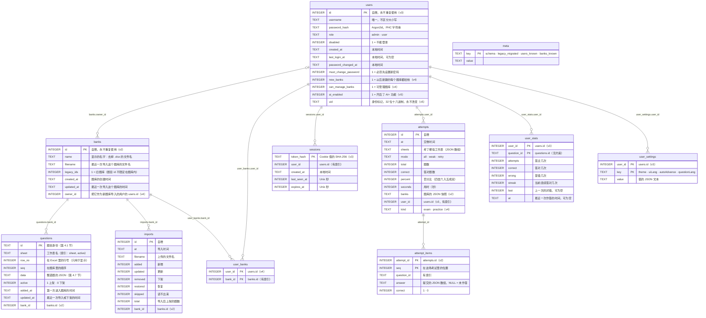
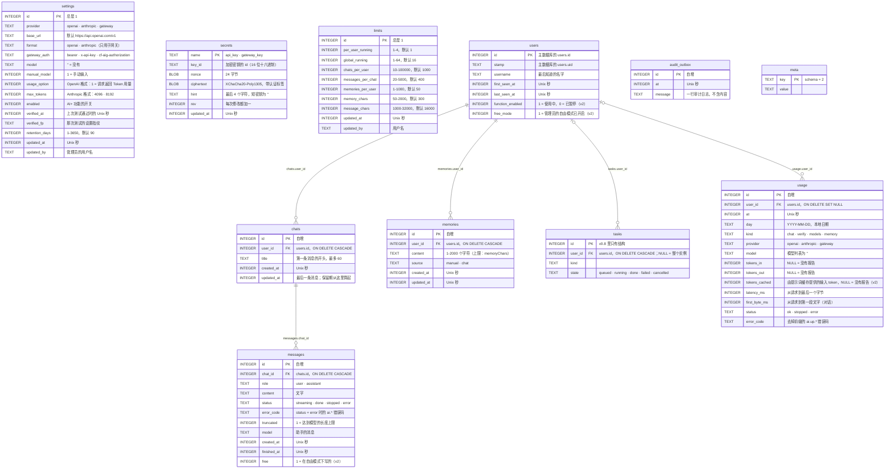

[English](../en/database.md) | [日本語](../ja/database.md) | **简体中文**

# 数据库

> 数据库是 SQLite，**只有一个文件 `xexam.db`**。Rust 后端沿用旧 Python 版的数据库：原来的建表语句（schema v1）**一字不差**地保留，之后的每个 schema 都只是往上加东西（新表和新列；不重建、不改写任何东西）：**schema v2**（v0.5：题库、考试详情、设置）、**schema v3**（v0.6：用户和登录）、**schema v4**（v0.7：按用户设置题库、题库所有者、练习记录）和 **schema v5**（v0.8：每个用户的 AI+ 功能授权和一个身份标记）。新版本第一次启动时，会先写一份备份副本，再自动迁移已有的数据库（第 6 节）。从 v0.7 起，数据库以 **WAL 模式**运行（第 2 节）。
> 从 v0.8 起，ai-service 有**第二个、独立的数据库** `xexam-ai.db`，放在它自己的卷里（第 8 节）。两个服务从不打开对方的数据库。
> 依据：[audit/database.md](history/audit/database.md)；黄金测试：`backend/tests/db_golden.rs`（对着 `tests/baseline/fixtures/sample.db`（由旧的 Python 实现生成）和已提交的快照运行）。迁移和它们的备份在 `backend/tests/v05_banks_records_settings.rs`（v2）、`v06_users_and_sign_in.rs`（v3）、`v065_bank_access_and_practice.rs`（v4）、`v07_bank_access_and_layouts.rs`（v4 的题库权限、预发布版数据库的转换、旧格式题目的下架）、`v07_wal_and_logs.rs`（WAL 模式）和 `v08_ai_link.rs`（v5）里测试；AI 数据库在 `ai-service/tests/` 和 `ai-service/src/store/` 的单元测试里测试。

## 1. 文件在哪里

| 运行方式 | 位置 |
|---|---|
| Docker（推荐） | 命名卷 `xexam_data`，挂载到容器里的 `/data`；文件是 `/data/xexam.db`。更新或删除容器都不会丢 |
| 不用 Docker | 数据目录里的 `xexam.db`（默认 `./data`，或 `XEXAM_DATA`，或 `--data`） |

卷的真实名字是 `<项目名>_<卷名>` = `xexam_data`，`docker volume ls` 能看到。**不要运行 `docker compose down -v`**：`-v` 会把卷和容器一起删掉。

数据库旁边的其他文件：

- **`xexam.db-wal` 和 `xexam.db-shm`** 在后端运行时存在（WAL 模式，第 2 节）。`-wal` 文件里是最近提交的修改，直到 SQLite 把它们复制进 `xexam.db`。后端正常停止时，所有内容都复制进 `xexam.db`，`xexam.db-wal` 被清空；这两个文件可能空着留下，没有害处。它们是数据库的一部分：后端运行时千万不要删，复制时要和 `xexam.db` 一起复制（第 5 节）。
- **`backups/`** 存放 schema 迁移前写的副本（第 6 节），例如 `/data/backups/xexam-schema3-20261111-140501.db`。程序永远不会删除这些文件；不再需要时请自己删掉。

什么存在哪里：

| 位置 | 内容 |
|---|---|
| 卷里的 `xexam.db`（运行时还有 `-wal` / `-shm`） | 题库及其所有者和题目（包括已下架的）、导入记录、用户（只存密码哈希）、他们的会话和每个用户能看到哪些题库、每个用户每道题的答题统计（错题本）、学习记录（考试和练习）和每道题的作答详情，以及设置（主题、界面语言、答完自动跳到下一题、题目语言） |
| 卷里的 `backups/` | 每次 schema 迁移前写的数据库副本（从 `xexam-schema1-…` 到 `xexam-schema4-…`） |
| 只在后端的内存里 | 系统日志、登录锁定和导入预览；重启后都从空的开始 |
| 卷 `xexam_link`（v0.8） | 只有 `internal.token`，后端和 ai-service 共用的令牌；后端写入，ai-service 读取。没有数据库 |
| ai-service 的卷 `xexam_ai_data`（v0.8） | `xexam-ai.db`（AI 设置、加密的服务商密钥、安全上限、对话、记忆、用量统计）和密钥文件 `secret.key`（第 8 节） |
| 浏览器（`localStorage`） | 每个用户各一份：没交卷的考试或没做完的练习（题目 id、答案、标记、已核对的题、用时；不含题目文字），以及一份设置的副本（用来显示第一屏） |

## 2. 连接设置

| 设置 | 值 | 原因 |
|---|---|---|
| `journal_mode` | `WAL`（从 v0.7 起）；设了 `XEXAM_SQLITE_JOURNAL=delete` 时是 `DELETE` | 提交只写 `-wal` 文件，读的一方（例如在服务器旁边启动的命令行工具）不会挡住写的一方。见 2.1 |
| `synchronous` | `FULL` | 每次提交都等数据写到磁盘上（WAL 模式下：对 `-wal` 文件做一次 fsync），所以已经提交的东西停电也不会丢 |
| `foreign_keys` | `ON` | （schema 里其实没有外键；和旧版保持一致） |
| `busy_timeout` | 5000 ms | 别的连接持有锁时，最多等 5 秒 |
| 自动检查点 | SQLite 的默认值（每 1000 页） | 后端运行时让 `-wal` 文件保持小巧 |
| 事务 | `BEGIN IMMEDIATE … COMMIT`，失败时 `ROLLBACK`（`COMMIT` 失败也会回滚） | 要么全部成功，要么什么都不变 |

后端只有**一个连接**，放在一个互斥锁后面。数据库调用在专门的线程上运行（`spawn_blocking`），所以不会阻塞 Tokio 的执行线程，锁也从不跨 `.await` 持有。这和旧版的「一个连接 + RLock」一一对应。

### 2.1 WAL 模式（v0.7）

- **持久的。** 日志模式保存在 `xexam.db` 的文件头里。后端每次打开数据库时都会请求它（服务器和命令行命令都一样），而且只在迁移成功**之后**才请求：如果打开失败，例如迁移前的备份写不出来，旧的数据库文件会原封不动。
- **不用 WAL。** `XEXAM_SQLITE_JOURNAL=delete`（写在 `docker/.env` 里，不用 Docker 时写在环境变量里）保留 v0.6 及更早版本的回滚日志。只在数据目录所在的存储上 WAL 的共享内存文件 `xexam.db-shm` 不可靠时才用它：网络文件系统，或者绑定挂载进 Docker Desktop 的 Windows 文件夹。其他任何值或不设，都表示 WAL。下次不带这个变量启动时，又会切回 WAL。
- **SQLite 拒绝时。** 后端从不因为日志模式而启动失败。如果 SQLite 切换不到 WAL（另一个进程以不允许切换的方式打开着数据库，或者文件系统不支持），日志里会有一条警告，例如 `SQLite did not switch the journal mode to wal; continuing in mode delete`，后端按 SQLite 报告的模式继续运行。
- **启动时的那一行。** 每次启动都记一次实际生效的模式：`SQLite journal mode: wal`，或 `SQLite journal mode: delete (XEXAM_SQLITE_JOURNAL=delete)`。
- **关闭时。** 正常停止时（`docker compose stop`、Ctrl+C），后端执行 `PRAGMA wal_checkpoint(TRUNCATE)`：`xexam.db-wal` 里的所有内容都复制进 `xexam.db`，`-wal` 文件被清空。关闭最后一个连接时可能还会删掉 `-wal` 和 `-shm`，但它们也可能空着留下（例如在 Windows 上），没有害处。日志里写着 `WAL checkpoint at shutdown: everything is in xexam.db, the -wal file is empty`（意思是：关闭时的 WAL 检查点完成，所有内容都在 xexam.db 里，-wal 文件已清空）。如果那一刻还有别的进程打开着数据库（例如一个命令行命令），检查点就完不成；日志里会有一条警告，SQLite 之后再完成它。
- **服务器运行时的命令行命令。** `reset-password`、`import` 和 `migrate-progress` 从另一个进程打开同一个文件。在同一个容器里（`docker compose exec backend …`）或同一台机器上，WAL 模式下这样做也是安全的。
- **更早的版本。** Xexam v0.6 及更早的版本打开数据库时会请求 `DELETE`，所以它们会自己把 WAL 数据库切回去。回退时不需要为日志模式做额外的步骤（第 6.7 节）。

## 3. 表



十三张表，仍然**没有外键约束**：关联由代码维护，每次删除都在同一个事务里删掉属于它的行。图里没有画以前 schema 的两张表：`stats`（v0.5 及更早版本的每道题统计）和 `settings`（v0.5 的设置）。迁移到 v3 时，它们的行被复制给了第一个管理员（`user_stats`、`user_settings`）；它们仍然保留但不再使用，这样回退就仍然是「恢复备份」。

每个 schema 新增了什么：

- **v1**（旧的 Python 版，原样保留）：`meta`、`questions`、`attempts`、`stats`、`imports`。
- **v2**（v0.5）：表 `banks`、`attempt_items` 和 `settings`；列 `questions.bank_id INTEGER`（只有旧程序写的行才是 NULL，见 6.6）、`attempts.banks TEXT NOT NULL DEFAULT '[]'`（一场考试所用题库的 JSON 快照，`[{"id": 1, "name": "…"}]`）和 `imports.bank_id INTEGER`；索引 `idx_questions_bank (bank_id, active)` 和 `idx_attempt_items_question (question_id)`。
- **v3**（v0.6）：表 `users`、`sessions`、`user_stats` 和 `user_settings`；列 `attempts.user_id INTEGER`；索引 `idx_sessions_user` 和 `idx_attempts_user`。
- **v5**（v0.8）：列 `users.ai_enabled INTEGER NOT NULL DEFAULT 0`（每个用户的 **AI+ 功能** 授权：AI+ 功能开启并且可用时，这个用户可以使用 AI 对话；管理员也会保存这个值，但对他们不起作用，他们始终拥有）和 `users.uid TEXT NOT NULL DEFAULT ''`（一个随机的身份标记，32 位小写十六进制数字，在创建账户时设置，永不改变；AI 服务把它和用户 id 存在一起，并删除标记不一致的 AI 数据，见第 8.3 节）。别的都没有：AI 设置、对话和记忆都在 AI 数据库里。
- **v4**（v0.7）：表 `user_banks`；列 `users.new_banks INTEGER NOT NULL DEFAULT 0`、`users.can_manage_banks INTEGER NOT NULL DEFAULT 0`、`banks.owner_id INTEGER` 和 `attempts.kind TEXT NOT NULL DEFAULT 'exam' CHECK (kind IN ('exam', 'practice'))`；索引 `idx_user_banks_bank (bank_id)` 和 `idx_banks_owner (owner_id)`；`meta` 的键 `users_known` 和 `banks_known`（第 6.6 节）。v0.7 的六列工作簿格式不需要新列：各语言的文字放在 `questions.data` 里（第 4.7 节）。v0.7 的预发布版用的是 `users.all_banks` 而不是 `users.new_banks`；这样的数据库在打开时会被转换（第 6.5 节）。

v1 的建表语句原样保存在 `backend/src/database/schema.rs`（`SCHEMA`）里，和旧版 `app/db.py` 里的 `SCHEMA` 完全一样，每次启动时仍然最先执行；后来新增的部分放在它旁边（`MIGRATE_V2_TABLES`、`V2_COLUMNS`、… `MIGRATE_V4_INDEXES`、`V5_COLUMNS`）。所有语句都用 `IF NOT EXISTS` 或者先检查，所以打开一个已经是最新的数据库**什么都不写**（已测试：数据库文件连同它的 `-wal` 文件逐字节不变）。因为 SQLite 记录 `ALTER TABLE … ADD COLUMN` 的方式是把这一列追加到保存着的 `CREATE TABLE` 文本后面，所以 `questions`、`attempts` 和 `imports` 在 `sqlite_master` 里的文本是 v1 的文本加上新增的列（`users` 的则是 v3 的文本加上 v4 和 v5 的列）；新建的数据库和迁移过来的数据库 schema 完全一样（在 `db_golden.rs` 里测试）。

## 4. 决定学习记录命运的细节

### 4.1 题目 id
统计（`user_stats`）和错题本都以题目 id 为键。id 是：

```
sha1( 工作表名 + "\n" + 去空白(题干)[:300] + "|" + 去空白(第一个选项或第一个小项)[:200] )  取前 12 位十六进制
```

- 题干和第一个选项取自题目的**基准文字**：六列格式里的英语题目（A 列），从 v0.7 起只能导入这种格式。以前版本的三列和四列格式用的是日语题目；它们的题都已下架（第 4.2 节），用六列格式的文件更新这样的题库时，每道题都会得到新的 id：它们作为新题加入，没有统计，旧题仍保持下架。
- 「去空白」指的是 Python 的 `\s`（29 个码位，包括 U+001C–U+001F 和全角空格 U+3000）。**先去空白，再截断**，截断按**码位**计。Rust 的 `char::is_whitespace` 只覆盖 25 个，所以后端自己实现了对这 29 个码位的判断。
- **完全不做 Unicode 规范化**（不做 NFKC）。很多真实的题库里有全角 ASCII，规范化会改变每一个 id。
- 同一份工作簿里重复的 id 会依次加上 `-2`、`-3`……，**取决于行的顺序**：如果你把两道一模一样的题调换了位置，学习记录就会跑到另一道题上。这是旧版的行为；保留下来，并在这里写明。
- 改了题干的措辞 = 一道新题（旧题下架，它的记录不会带到新题上）；只改选项、答案、解析或翻译算「更新」，记录不受影响。
- 85 条断言（`tests/baseline/golden/id_vectors.json`）保证 Rust 和 Python 算出的 id 逐字节相同。
- **题库（v0.5）**：**旧题库**里的题（v0.5 之前的所有数据，以及不带 `X-Bank-Target` 的上传）就用上面的 id 保存，所以已有的统计、错题本和历史都还对应着。其他每个题库都用**限定在题库内的 id**：`sha1("xexam-bank:" + bank_id + "\n" + id)`，取前 12 位十六进制。所以同一份工作簿可以导入成两个独立的题库，记录不会混在一起。题库 id 永不重复使用（`AUTOINCREMENT`），所以限定后的 id 也不会。

### 4.2 下架而不是删除
导入时，**目标题库**里在文件中找不到的题会被设成 `active = 0`，它的统计原样保留。以后你把这道题再上传到同一个题库，它会自动恢复上架，错题本里的记录也跟着回来。导入永远不碰其他题库的题。

**旧格式（v0.7）。** 后端每次启动时，以及打开数据库的命令行命令每次运行时，都会在第 6 节的迁移和修正之后，下架每一道不是六列格式的上架题目（它的 `data` 里没有 `"lang": "en"`，第 4.7 节）：`active = 0`，`updated_at` = 现在，`seq` 排在这个题库其他题的后面（保持它们的顺序），和导入时下架一道从文件里消失的题完全一样。题库、导入记录、`user_stats`、`attempts` 和 `attempt_items` 都保留；没有上架题目的题库也保留，这样以后可以用六列格式的文件更新它，或者删除它。它在一个事务里运行，每个题库记一条警告（`retired 12 questions of bank "Kitchen basics": they use the old 3- / 4-column layout; import the six-column version of the workbook`）；没有要下架的题时什么都不写。这样的题永远不会被导入恢复上架，因为三列或四列格式的文件不能导入。

删除题库（`POST /api/banks/delete`）是题目离开数据库的唯一途径。它在一个事务里删除这个题库的题目（上架的和已下架的）、它的 `imports` 行、它的 `user_banks` 行（谁能看到它）以及它的 `banks` 行。带 `withRecords` 时，这些题的学习数据也一起删除：它们的 `user_stats` 和 `attempt_items` 行，以及所有 `banks` 快照里写着这个题库、又没有任何现存题库的 `attempts` 行（连同剩下的详情）。管理员这样删除的是**所有**用户的学习数据；可管理题库的用户删除自己的题库时，只删除**他自己**在这个题库的学习数据，其他用户的记录保留（里面的题显示为已删除）。不带 `withRecords` 时，`user_stats`、`attempts` 和 `attempt_items` 都原样保留。

### 4.3 错题本
每个用户在 `user_stats` 里有自己的错题本。一道题在 `wrong > 0` 且 `streak < 2` 时在错题本里；连续答对 2 次后移出。考试和练习以同样的方式更新它。只能看到部分题库的用户（第 4.8 节）只看到这些题库里的题的统计。

### 4.4 学习记录
每个用户的学习记录是 `attempts` 里带他的 `user_id` 的行；`kind` 表示一条记录是 `exam`（考试）还是 `practice`（练习）（v0.7 之前的每条记录都是考试，也就是这一列的默认值）。每个用户保留自己最新的 **500** 条记录（`RECORD_RETENTION`；v0.5 之前是 60）；每次提交之后，这个用户更早的记录会连同它们的 `attempt_items` 一起删除。`GET /api/progress` 的 `history` 只返回最新的 60 条。

- 从 v0.5 起，每条新记录为每道题保存一行 `attempt_items`（页面发来的答案，以及对错）和 `banks` 快照；更早保存的记录没有详情。
- 只计入还存在、而且用户能看到的题（v0.7）：考试期间所在题库被删除的题，或者属于用户范围以外的题库的题，不写统计、不写详情行，也不算进 `total`、`correct` 和 `percent`。这时 `sheets` 只列出计入的题所在的工作表。一道题都不剩时，什么都不保存。
- 删除一条记录（`POST /api/records/delete`）删掉它和它的详情，但不动统计；删除全部记录时还可以清空这个用户的统计（`withStats`），等于 `POST /api/reset`。

### 4.5 设置
`user_settings` 里每个用户、每个改过的设置一行；`value` 是值的 JSON 文本（`"dark"`、`true`）。没有的行表示默认值（`theme` 是 `system`，`uiLang` 是 `en`，`autoAdvance` 是 false，`questionLang` 是 `ja`）；保存的值无效时忽略它。浏览器保存一份副本，只用来画第一屏；数据库才是准的，所以更新容器、清除浏览器缓存、换别的浏览器之后设置都还在。

### 4.6 时间
本地时间的字符串，格式 `%Y-%m-%d %H:%M`，**不带时区标记**，精确到分钟（`sessions` 表另外还存两个 Unix 时间）。容器里的时区默认是宿主机的（`docker/docker-compose.yml` 以只读方式挂载宿主机的 `/etc/localtime`）；在 `docker/.env` 里设置的 `TZ` 优先于它，例如 `TZ=UTC`；两者都没有时，镜像退回 UTC。在 Docker Desktop（Windows、macOS）上，挂载的是 Docker 自己的虚拟机里的文件（通常是 UTC），所以请设置 `TZ`。镜像里带有时区数据库，所以 `TZ` 可以写任何时区。以后再改时区不会改写已经保存的时间：它们保留写入时的时区。

### 4.7 题目的 JSON（`questions.data`）
`data` 是整道题的 JSON，不含 `id`、`sheet` 和 `row`（它们有自己的列）。主要的键：`kind`（`single`、`multi`、`hotspot`）、`stem`、`options`、`items`、`answer`、`translation`、`zh`（中文文字，按基准题目拆开）、`explanation`、`mnemonic` 和 `note`。四列格式的题还有 `english` 和 `en`（英语文字）。

**六列格式**的题（v0.7）多三个键，而没有 `english` / `en`，因为它的基准文字本身就是英语：

- `"lang": "en"`：基准文字（`stem`、`options`、`items`）的语言。三列和四列格式的题没有 `lang` 键：它们的基准文字是日语。
- `"ja"`：日语题目（C 列），按英语题目拆开，结构和 `zh` 一样。C 列和英语题目对不上时没有这个键（答题页上 **日本語** 按钮就会置灰）。
- `"explain"`：每种语言的解析、记忆口诀和备注，`{"en": {"explanation", "mnemonic", "note"}, "zh": {…}, "ja": {…}}`。答案列里三样都没有的语言不出现。

对于只认识一份解析的客户端，六列格式的题的 `explanation`、`mnemonic` 和 `note`：E 列有中文时是中文，否则是日语（F 列），再否则是英语（D 列）。三列和四列格式的题作为已下架的题留在数据库里，完全保持以前版本的 JSON（没有新的键）；解析器仍然能读这些格式（导入就是靠这一点把它们认出来并拒绝），解析器的黄金测试会逐字节检查它的输出。

### 4.8 谁能看到哪个题库（v0.7）
- **管理员**能看到并管理所有题库。
- **普通用户**正好能看到 `user_banks` 里为他列出的题库（管理员为他勾选的已有题库）。`users.new_banks = 1`（**包括以后导入的题库**）只会添加行：每当新建一个题库（任何人作为新题库导入，或者命令行 `import` 创建旧题库），每个带这个标记的用户都会在同一个事务里得到这个题库的一行。它从不添加已有的题库，取消勾选一个题库也只删掉那一行。新用户一开始没有任何行，标记也是关的。迁移到 v4 时已经存在的每个用户，都得到了每个已有题库的一行和这个标记，所以升级时没有人失去题库。
- **可管理题库的用户**（`users.can_manage_banks = 1`）在拥有这个权限期间，还能看到自己拥有的题库（`banks.owner_id`），也只能更新和删除这些题库。作为新题库导入的题库属于导入它的用户；v0.7 之前的题库，以及没有登录用户时新建的题库（命令行的 `import`），属于第一个管理员。
- 删除用户会删除他的会话、学习记录（含详情）、统计、设置和 `user_banks` 行；他拥有的题库转到删除他的那位管理员名下。他的 AI 对话和记忆在 AI 数据库里：AI 服务会在下一次对账时删除它们（第 8.3 节）。

## 5. 备份和恢复

从 v0.8 起，要备份的是**两个数据卷**：`xexam_data`（这个数据库）和 `xexam_ai_data`（AI 数据库和它的密钥文件，第 8.4 节）。`xexam_link` 不用备份。下面的命令针对 `xexam_data`；AI 卷的做法一样。

**复制数据库之前先停止后端。** WAL 模式下，后端运行时最新的修改可能还在 `xexam.db-wal` 里，所以只复制 `xexam.db` 可能会漏掉它们；正常停止之后，所有内容都在 `xexam.db` 里，旁边即使留着 `-wal` 文件，也是空的。

```bash
docker compose stop

# 备份：把卷打包成当前目录里的 xexam-data.tgz（里面是整个数据库；.gitignore 已忽略它，不要提交）
docker run --rm -v xexam_data:/data -v "$PWD:/backup" alpine tar czf /backup/xexam-data.tgz -C /data .

docker compose start
```

如果不能停止，就把 `xexam.db`、`xexam.db-wal` 和 `xexam.db-shm` 一次性一起复制，然后像下面那样检查副本；只有这三个文件合在一起，才包含所有已经提交的修改。在写入进行中复制的副本仍然可能不一致，所以真正可靠的是停止后的卷的副本。也可以用 SQLite 本身给运行中的数据库做一份一致的副本：`VACUUM INTO`，或者 `sqlite3` 命令行工具里的 `.backup`。

**验证备份**（在副本上做；永远不要在原件上做实验）：

```bash
mkdir work && tar xzf xexam-data.tgz -C work
sqlite3 work/xexam.db "PRAGMA integrity_check"      # 必须输出 ok
```

**恢复。** 放回备份之前，先删掉残留的 `-wal` 和 `-shm` 文件：它们属于你要替换掉的那个数据库，SQLite 不能把它们套用到恢复出来的数据库上。正常停止之后它们是空的或者已经没有了，所以 `rm` 不会删掉任何要紧的东西。

```bash
docker compose stop
docker run --rm -v xexam_data:/data -v "$PWD:/backup" alpine sh -c 'rm -f /data/xexam.db-wal /data/xexam.db-shm && tar xzf /backup/xexam-data.tgz -C /data'
docker compose start
```

`backups/` 里的文件是卷的一部分，所以备份卷时也会备份它们。

**换电脑**：在新电脑上放好新的 `docker-compose.yml`，先运行一次 `docker compose up -d` 建好卷，再按上面的方法恢复备份（两个数据卷都要）。备份文件里有你的整个数据库（包括密码哈希），还有 AI 密钥和解密它们用的密钥，所以请妥善保管，不要提交它们（`.gitignore` 已忽略 `*.tgz`）。

## 6. schema 迁移和回退

`meta.schema` 表示一个数据库是哪个 schema（v0.4 及以前是 `1`，v0.5 是 `2`，v0.6 是 `3`，v0.7 和 v0.7.5 是 `4`，从 v0.8 起是 `5`）。一个版本打开 schema 更旧的数据库时，会一次性把它升级到自己的 schema：

1. **备份。** 如果数据库里有任何数据，就用 SQLite 的 `VACUUM INTO` 往 `xexam.db` 旁边的 `backups/xexam-schema<N>-<YYYYmmdd-HHMMSS>.db` 写一份一致的副本，`<N>` 是这次启动之前文件的 schema（已有的文件永远不会被覆盖，而是依次加上 `-2`、`-3`……）。即使后面有好几步，也总是只写**一份**备份。副本是一个独立的、旧 schema 的文件；当时还在 `-wal` 文件里的修改也包含在内。**副本写不出来时**（磁盘满、没有权限），程序拒绝启动，什么都不改；日志里写明原因。
2. **迁移**，在**一个** `BEGIN IMMEDIATE` 事务里完成：从旧 schema 到当前 schema 的每一步（6.1、6.4、6.5、6.8，以及预发布版 v4 数据库的转换），然后设置 `meta.schema`。
3. **日志模式。** 这之后，后端才把文件切换到 WAL（第 2.1 节）。

日志里会写出副本的名字：`Upgraded the database to schema 5. A copy of the previous version was saved first: /data/backups/xexam-schema4-….db (restore it if you ever go back to an older version).`（意思是：数据库已升级到 schema 5，升级前先保存了旧版本的副本；以后回到旧版本时请恢复它。）全新的数据库也走同样的步骤（没有备份，也没有旧题库），所以新建的和迁移过来的数据库结构相同。

### 6.1 schema v2（v0.5）

v0.5 或更新的版本打开 `meta.schema` 不存在或为 `1` 的数据库时，备份的名字是 `xexam-schema1-<YYYYmmdd-HHMMSS>.db`（一个普通的 schema 1 数据库）。v2 这一步创建 `banks`、`attempt_items`、`settings` 和新的索引，加上三个列；然后，如果有题目，就创建**旧题库**，并把所有东西都挂到它下面：`name` = 最近一次导入的文件名去掉 `.xlsx`（没有导入过就是 `Question bank`），`filename` = 那个文件名，`created_at` = 最早的 `questions.added_at`，`updated_at` = 最近一次导入的时间（没有导入过就是最近一次题目变化的时间）；每道题和每条导入记录都得到它的 `bank_id`，每条考试记录的 `banks` 快照都是这个题库。题目 id、统计、考试记录和导入记录都不变。

### 6.2 回到 v0.4（或更早）

v2 的文件仍然可以被 v0.4 和旧的 Python 版打开：新的列都可以为空或有默认值，`user_version` 仍然是 0。**但是有了不止一个题库之后，就不要再继续用旧版本**：它把整个数据库当成一个题库，所以它的下一次导入会把其他所有题库的题都下架，而且它不认识新的表。它还会把考试记录删减到 60 条。schema v3 及以后的数据库里还有 v0.4 根本不知道的用户。

**要回退，请恢复备份**：停止程序，用 `backups/` 里的 `xexam-schema1-…` 文件替换 `xexam.db`（把它改名为 `xexam.db`，并删掉旁边的 `xexam.db-wal` / `xexam.db-shm`），然后启动旧版本。迁移之后在新版本里做的修改不在那份副本里。

如果旧版本还是往这个文件里写了东西，v0.5 或更新的版本下次启动时，会把它新增的题挂到旧题库下面（6.6）。它保存的考试记录没有详情，题库快照是空的；它删减掉的考试的详情行会作为没用的行留在 `attempt_items` 里（永远不会显示）。

### 6.3 和旧 Python 实现的兼容

直到 v0.4，两个实现用的都是**同一个文件、同一个 schema**。这个往返最初用合成数据演练过（旧 Python 建库 → Rust 读写 → 旧 Python 再读回来；原件的 sha256 前后不变，`PRAGMA integrity_check` 通过）。旧 Python 代码删掉之后，由测试守住剩下的保证：`sample.db`（旧实现写的数据库）迁移到当前 schema 时保留每一个题目 id、统计、考试记录和导入记录，它的备份仍然报告 schema 1、行和原来完全一样，迁移后的文件之后再打开、读取、关闭都逐字节不变；新建数据库的 `sqlite_master` 是旧实现的文本加上后来新增的部分。要真正回退到 Python 版，请恢复 schema 1 的备份（6.2），用旧镜像打开它（`ghcr.io/yumin-space/xexam:v0.2.2`，只在私有的 GHCR 上，所以先 `docker login ghcr.io`）。

### 6.4 schema v3（v0.6）

从 `meta.schema` `2`（备份 `xexam-schema2-<YYYYmmdd-HHMMSS>.db`）开始，或者从 `1` 开始、和 6.1 在同一个事务里。v3 这一步创建 `users`、`sessions`、`user_stats` 和 `user_settings`，并加上 `attempts.user_id`。如果还没有用户，就创建默认管理员 `admin`，密码 `admin`（第一次登录时必须修改），并把已有的数据给它：每条没有用户的考试记录、`stats` 每一行在 `user_stats` 里的副本，以及 `settings` 每一行在 `user_settings` 里的副本。旧的 `stats` 和 `settings` 表保留，不再使用。

### 6.5 schema v4（v0.7）

从 `meta.schema` `3`（备份 `xexam-schema3-<YYYYmmdd-HHMMSS>.db`）开始，或者从 `1` 或 `2` 开始、和前面的步骤在同一个事务里。v4 这一步：

- 创建 `user_banks` 及其索引，加上 `users.new_banks`、`users.can_manage_banks`、`banks.owner_id` 和 `attempts.kind`；
- 给**所有已经存在的用户**每个已有题库的一行 `user_banks`，并设置 `new_banks = 1`，所以每个人仍然能看到所有题库，包括以后导入的；
- 每个人的 `can_manage_banks` 都保持 `0`（管理员本来就能管理题库）；
- 把每个题库都给**第一个管理员**：id 最小的已启用管理员（只有在没有已启用的管理员时，才用已停用的）；
- `attempts.kind` 不需要回填：它的默认值 `exam` 正是所有旧记录的类型；
- 写入 `meta.users_known` 和 `meta.banks_known`（见 6.6）；从 v0.8 起，v5 这一步在同一个事务里紧接着进行（6.8），由它设置 `meta.schema`。

之后，启动继续进行 6.6 的检查、切换到 WAL（第 2.1 节）和下架旧格式的题（第 4.2 节）：v0.6 或更早版本的数据库里只有三列和四列格式的题，所以它们全部被下架。

**预发布版 v4。** v0.7 正式发布之前的构建保存的是 `users.all_banks`（1 = 所有题库，包括以后导入的），而不是 `users.new_banks`。标记为 `4`、却仍然有这一列的数据库在打开时会被转换：先写一份备份 `backups/xexam-schema4-<YYYYmmdd-HHMMSS>.db`，然后在一个事务里（从 v0.8 起和 v5 这一步是同一个事务，只写一份备份）：`all_banks = 1` 的用户得到每个已有题库的一行和 `new_banks = 1`；`all_banks = 0` 的用户保留他的行，`new_banks = 0`；然后删掉 `all_banks` 列，并写入 `meta.banks_known`。`meta.users_known` 保持预发布版写的样子，所以在这期间由更早的版本创建的用户（比那个标记大）会在接下来运行的 6.6 检查里得到所有题库和 `new_banks = 1`，和升级时的用户一样。日志里会写 `Converted the question bank access of a database written by a v0.7 pre-release to the released format and upgraded the database to schema 5. A copy of the previous version was saved first: <path>.`

### 6.6 每次启动时的检查

每次启动时，在可能的迁移之后，后端会（只读地）检查有没有只可能是回退后旧程序留下的行，并各用一个事务修正它们。没有需要修正的东西时，**什么都不写**。旧版本既不知道 `user_banks`，也不知道 `users.new_banks`，在那里每个用户都能看到所有题库。

- **旧版本创建的题库**：`meta.banks_known` 保存这个版本知道的最大题库 id；它由 v4 迁移写入，这个版本每创建一个题库时也会更新（题库 id 永不重复使用）。每个 `new_banks = 1` 的用户都会得到比它大的每个题库的一行，就像这些题库是这个版本创建的一样；然后标记往前移。这项检查最先运行，所以下一项检查创建的题库不会把它们掩盖掉。
- **没有题库的题**（`bank_id` 为 NULL），以及有旧题库时没有题库的导入记录：挂到旧题库下面，需要时创建旧题库。
- **一个用户都没有**：重新创建默认管理员 `admin` / `admin`。**没有用户的考试记录**：给第一个管理员。
- **没有有效所有者的题库**（NULL，或者是已经不存在的用户）：给第一个管理员。
- 属于已经不存在的用户或题库的 **`user_banks` 行**：删除。
- **旧版本创建的用户**：`meta.users_known` 保存这个版本知道的最大用户 id；它由 v4 迁移写入，这个版本每创建一个用户时也会更新（用户 id 永不重复使用）。比它大的用户是回退后由旧版本创建的，没有任何 `user_banks` 行；这样的用户会得到每个已有题库的一行和 `new_banks = 1`，和升级时的用户一样，然后标记往前移。
- 没有标记时（数据库第一次是被一个不写标记的构建打开的），这样的题库和用户分辨不出来，所以只写入标记。
- **没有身份标记的用户**（`uid = ''`，v0.8）：回退之后由 v0.7.5 创建的用户没有标记；它会得到一个。它的 AI+ 是关闭的（列的默认值）。

然后下架旧格式的题（第 4.2 节）。

### 6.7 回到 v0.6

**恢复备份**：停止后端，用 `backups/xexam-schema3-….db` 替换 `xexam.db`（把它改名为 `xexam.db`，并删掉旁边的 `xexam.db-wal` / `xexam.db-shm`），然后启动 v0.6。迁移之后用 v0.7 或更新的版本做的一切都不在那份副本里。具体的命令见 [migration.md](migration.md) 第 2.6 节。

v0.6 也能直接打开 schema 4 的文件：它忽略新的表和列，并把文件切回 `DELETE` 日志模式。这只留作应急用，因为 v0.6 不懂 v0.7 的规则：每个用户又能看到所有题库，只有管理员能导入或删除题库，练习记录看起来和考试一样，它也完全不知道六列格式的题。之后再启动新版本时，6.6 会修好 v0.6 留下的东西：它导入的题库会得到所有者，并给到 `new_banks = 1` 的用户；它创建的用户会得到所有题库和 `new_banks = 1`；它导入的题会被下架（第 4.2 节）。

### 6.8 schema v5（v0.8）

从 `meta.schema` `4` 升级（备份 `xexam-schema4-<YYYYmmdd-HHMMSS>.db`），或者从 `1`、`2` 或 `3` 升级，和前面的步骤在同一个事务里（这时备份以那个更旧的 schema 命名）。v5 这一步新增 `users.ai_enabled` 和 `users.uid`，给每个用户一个随机标记（`lower(hex(randomblob(16)))`，v3 那一步刚创建的默认管理员也一样），并把 `meta.schema` 设为 `5`。每个用户的 AI+ 一开始都是关闭的。日志里会写 `Upgraded the database to schema 5. A copy of the previous version was saved first: …`。

### 6.9 回到 v0.7.5（或 v0.7）

**恢复备份**：停止，用 `backups/xexam-schema4-….db` 替换 `xexam.db`（把它改名为 `xexam.db`，并删掉旁边的 `xexam.db-wal` / `xexam.db-shm`），换回旧的 `docker-compose.yml`，然后启动 v0.7.5。具体的命令见 [migration.md](migration.md) 第 1.4 节。v0.7.5 不使用 AI 卷；可以留着以后升级时用，也可以删掉。

v0.7.5 也能直接打开 schema 5 的文件（它把 schema `5` 当作更新的 v4 读取，并忽略那两列）；它创建的用户没有标记，AI+ 是关闭的，v0.8 下次启动时会给他们一个标记（6.6）。这也只留作应急用。

## 7. 旧的 `progress.json`

更早的版本把成绩保存在 `progress.json` 里。和旧的 Python 版一样，程序**每次启动时**都会检查数据目录里有没有它：如果有，而且数据库里还没有学习记录、以前也没有迁移过，就把它迁移进数据库（迁到第一个管理员的记录里）。`meta` 里的 `legacy_migrated` 标记保证它只迁移一次，已有的学习记录永远不会被覆盖。
所以「启动一次建好数据卷 → 把 `progress.json` 放进卷里 → 重启」这个流程是可行的。格式不对的文件会被忽略；日志里写明原因，并建议手动运行 `xexam-backend migrate-progress`，程序照常启动。
（`tests/integration/migrate_check.py` 用合成数据检查这些情况，分别在 WAL 模式下和设了 `XEXAM_SQLITE_JOURNAL=delete` 时。）

在 Docker 里，用一个临时容器把文件复制进卷（命令在 bash 和 PowerShell 里都能用）：

```bash
docker compose stop
docker run --rm -v xexam_data:/data -v "${PWD}:/src:ro" alpine sh -c "cp /src/progress.json /data/progress.json && chown 10001:10001 /data/progress.json"
docker compose start
```

这里没有用 `docker cp`：它默认以 root 身份写入，而容器里的后端以 uid 10001 运行，可能读不了这个文件。重启之后日志里会写 `Migrated the old study records into the database`（`docker compose logs backend`）。

> ⚠️ 从 v0.1 升级时：数据库的文件名改了，新版本只读取 `xexam.db`。如果数据目录里有别的 `.db` 文件、却没有 `xexam.db`，启动日志会提醒你；把那个文件改名为 `xexam.db` 再启动（旧文件既不会被删除，也不会被读取）。

## 8. AI 数据库（`xexam-ai.db`，v0.8）

ai-service 把 AI 的一切都放在它**自己的** SQLite 数据库里，只有它打开和迁移这个数据库；后端从不读取它，ai-service 也从不打开 `xexam.db`（数据边界，见 [architecture.md](architecture.md) 第 5 节）。

| 运行方式 | 位置 |
|---|---|
| Docker（推荐） | 命名卷 `xexam_ai_data`，挂载到 `ai-service` 容器里的 `/data`（目录权限 0700）：`/data/xexam-ai.db`、运行时它的 `-wal` / `-shm` 文件，以及密钥文件 `/data/secret.key` |
| 不用 Docker | 目录 `XEXAM_AI_DATA`（默认 `./data-ai`） |

### 8.1 连接设置

和主数据库一样：`busy_timeout` 5000 ms、`foreign_keys=ON`（这里的 schema 确实用了外键，见下文）、`synchronous=FULL`、WAL 模式（`XEXAM_AI_SQLITE_JOURNAL=delete` 保留回滚日志，规则和 2.1 一样），另外还有 **`secure_delete=ON`**。一个连接放在互斥锁后面，每次写入都在 `BEGIN IMMEDIATE … COMMIT` 里，锁从不跨 `.await` 持有。启动日志里会写 `AI database: /data/xexam-ai.db (journal: wal)`。

### 8.2 表（schema v2）



- **`settings`**（一行）从不保存机密。**`secrets`** 加密保存 API 密钥和网关密钥（见 [security.md](security.md) 第 11 节）；`key_id` 说明一个值是用哪个加密密钥封存的，`rev` 用于计算指纹。**`limits`**（一行）保存 AI 设置里的安全上限，每一项都有一个检查其范围的 `CHECK`；它们不属于指纹，所以修改它们从不关闭 AI。
- **指纹** 是对服务商、地址、格式和认证方式（网关时）、模型、密钥的版本号和当前加密密钥 id 计算的 SHA-256，从不包含密钥本身。只有 `enabled = 1`、`verified_fp` 等于当前指纹而且密钥能解密时，AI 才算开启。改变指纹的设置修改会在同一个事务里清除 `enabled` 和 `verified_*`。
- **`users`** 只保存 ai-service 见过的用户（他们在主数据库里的 id 和身份标记，以及最后知道的名字）；这个用户第一次对话、写记忆或调用时才写入一行，只是看看不会写入。**`function_enabled`**（v2，默认 1）是每个用户 AI+ 功能的**暂停**：0 表示管理员暂停了这个用户（AI 设置里的 **暂停**），1 表示使用中；没有行的用户是使用中的，管理员永远不会被设为 0。它和 AI+ 功能的授权（主数据库里的 `users.ai_enabled`）是分开的：把功能关掉再打开，不会清除暂停，只有 **恢复** 才会。值为 0 的 id 就是心跳向后端报告的内容（见 [architecture.md](architecture.md) 第 5 节）。**`free_mode`**（v2，默认 0）是管理员的**自由模式**：是用户的状态，不是对话的状态。它在设置里的 **AI 对话模式** 下设置（`POST /api/ai/free`，只有管理员），并且只对管理员读取，所以留在以前的管理员身上的值不起作用。
- **`chats`**、**`messages`** 和 **`memories`** 是用户的内容。对话没有模式：管理员的自由模式开启期间，任何对话（旧的或新的）里的每条消息都以自由模式回答。每条消息都记录它是在哪种模式下写的（**`messages.free`**，v2，默认 0），所以历史可以在模式改变时告诉模型（见 [architecture.md](architecture.md) 第 5 节）。删除一个用户的行会删除他的对话、消息、记忆和任务（`ON DELETE CASCADE`）；他的 **`usage`** 行保留，`user_id` 变成 NULL，所以按模型和按天的合计仍然正确。`memories.content` 最多允许 2000 个字符（记忆上限能设的最大值）；当前的上限由服务检查。
- **`usage`** 每次模型调用一行（对话、测试、模型列表、记忆笔记），带 Token、时间和状态，从不包含任何内容、密钥或地址。**`tokens_cached`**（v2）是服务商从它的提示词缓存里提供的那部分输入 token（AI 设置里用量的 **缓存命中** 一列）；NULL 表示服务商没有报告。它的行一直保留（没有保留期）；它们很小。
- **`tasks`** 是为以后的功能准备的；v0.8 里没有使用它的路由或后台任务（已结束的任务在 30 天后删除）。
- **`audit_outbox`** 保存管理员清除操作的审计日志，直到后端把它们取走放进系统日志（见 [security.md](security.md) 第 11 节）。
- 索引：`idx_chats_user (user_id, updated_at)`、`idx_chats_updated (updated_at)`、`idx_messages_chat (chat_id, id)`、`idx_memories_user (user_id, id)`、`idx_tasks_state (state, run_after)`、`idx_usage_day (day)`、`idx_usage_user (user_id, day)`、`idx_usage_model (model, day)`。
- 时间都是 Unix 秒；只有 `usage.day` 是本地日期（容器时区 `TZ` 下的 `YYYY-MM-DD`），用于统计。

### 8.3 服务怎样使用它

- **打开**：创建表（`IF NOT EXISTS`），用默认值加上 `settings` 和 `limits` 两行，新数据库把 `meta.schema` 设为 `2`。`meta.schema` 为 `1` 的数据库会被升级（见下面的迁移）。更新的 ai-service 写的数据库（`meta.schema` 大于 `2`）会被拒绝：服务记一行日志，不启动，所以旧镜像永远不会打开更新的文件。因崩溃或被强行终止而停在 `streaming` 的回答会被标记为 `error`，错误码 `ai.interrupted`（只在有这样的回答时）。
- **保留**：启动 60 秒后，之后每小时一次，删除最后一条消息早于保留天数的对话（正在生成回答的除外），连同它们的消息。记忆不受保留期影响。
- **和主程序对账**：启动时（每 30 秒重试一次，直到成功）、每 10 分钟，以及管理员打开 **AI+ 用户** 时，服务会问后端它的哪些用户 id 还存在、标记是什么、是否被授予了 AI+ 功能。已经不存在的 id，或者现在标记不同的 id（主数据库恢复后被重新使用的用户 id），会先停止这个用户的回答，再删除它的数据。带着这样的身份的请求到达时，也会马上这样做。
- **删除的内容**：`secure_delete=ON` 时释放的页会被覆盖，每次删除用户内容之后，服务还会执行 `PRAGMA wal_checkpoint(TRUNCATE)`（最多每 10 秒一次），这样旧的页不会留在 `xexam-ai.db-wal` 里。备份和卷快照里仍然有删掉的内容。
- **停止**：正常停止时，正在生成的回答会保存为已停止，然后执行检查点。
- **迁移**：schema v1 是第一个 schema（v0.8 的预发布构建）；**schema v2**（v0.8）新增四个列，别的都没有：`users.function_enabled`（默认 1）、`users.free_mode`（默认 0）、`messages.free`（默认 0）和 `usage.tokens_cached`（NULL），所以不丢数据，也没有任何一行改变含义。同一步新增既用于创建新数据库，也用于升级旧数据库，所以两者最后的表相同。较早的预发布构建写的 schema 2 文件可能缺其中一些列，打开时会补上缺的列（每一列只在不存在时才加；四列都在时什么都不写）。每个 schema 1 的数据库都会先用 `VACUUM INTO` 复制到 AI 数据目录里的 `backups/xexam-ai-schema1-<YYYYMMDD-HHMMSS>.db`（目录权限 0700；时间是容器的本地时间；名字已被占用时加 `-2`、`-3`…… 后缀），然后在一个事务里升级，并用一行日志写出这份副本的名字。如果副本写不出来，服务不启动，也什么都不改。重新打开完整的 schema 2 数据库什么都不写。要回到更老的 ai-service，请恢复这份副本（步骤和 8.4 相同）。

### 8.4 AI 卷的备份和恢复

```bash
docker compose stop

# 备份 AI 卷（AI 数据库和用来解密已保存密钥的密钥文件 secret.key：请妥善保管）
docker run --rm -v xexam_ai_data:/data -v "$PWD:/backup" alpine tar czf /backup/xexam_ai_data.tgz -C /data .

docker compose start
```

恢复方法和主卷一样：停止，删掉 `xexam-ai.db-wal` 和 `xexam-ai.db-shm`，解包，启动（`docker run --rm -v xexam_ai_data:/data -v "$PWD:/backup" alpine sh -c 'rm -f /data/xexam-ai.db-wal /data/xexam-ai.db-shm && tar xzf /backup/xexam_ai_data.tgz -C /data'`）。

- 设置了 `XEXAM_AI_SECRET_KEY` 时不使用密钥文件：请单独备份这个值（它不在卷里）。没有正确的密钥，恢复出来的密钥就无法解密；这时 AI 保持关闭，直到管理员重新输入密钥，其他什么都不会丢。
- 恢复的 AI 卷和另一个时间点的主卷可以搭配使用：已经不存在的用户会在下一次对账时失去他们的 AI 数据，现在属于另一个账户的用户 id 会通过标记认出来。
- `xexam_link` 不用备份：它里面只有 `internal.token`，缺少时后端会重新创建（AI 服务会自己用上新的令牌）。
