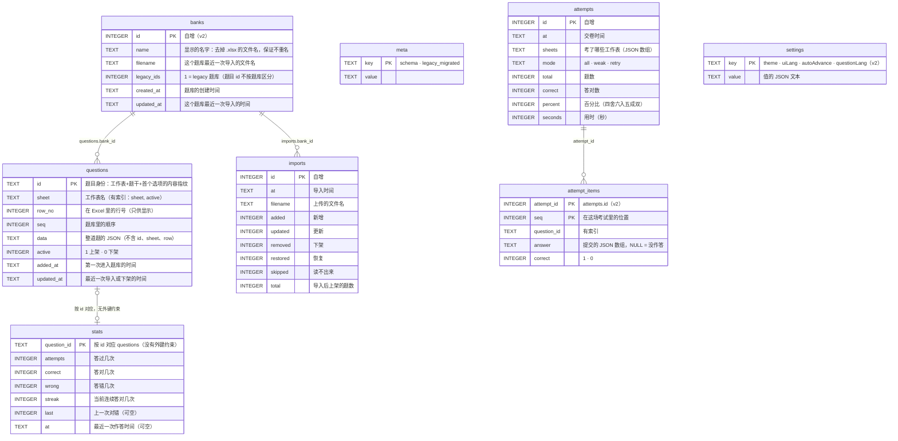

[English](../en/database.md) | [日本語](../ja/database.md) | **简体中文**

# 数据库

> 数据库是 SQLite，**只有一个文件 `xexam.db`**。Rust 后端沿用旧 Python 版的数据库：原来的建表语句（schema v1）**一个字都没改**，v0.5 在它上面加了 **schema v2**，只做增加（新表和新列；不重建、不改写任何东西）。已有的数据库在 v0.5 第一次启动时会先写一份备份，再自动迁移（见第 6 节）。
> 依据：[audit/database.md](history/audit/database.md)；黄金测试：`backend/tests/db_golden.rs`（对着旧 Python 实现建出的 `tests/baseline/fixtures/sample.db` 和已提交的快照）和 `backend/tests/v05_banks_records_settings.rs`（迁移、备份、题库、考试记录、设置）。

## 1. 文件在哪里

| 运行方式 | 位置 |
|---|---|
| Docker（推荐） | 命名卷 `xexam_data`，挂在容器的 `/data`，文件是 `/data/xexam.db`。更新或删除容器都不会丢 |
| 不用 Docker | 数据目录（默认 `./data`，或 `XEXAM_DATA`）下的 `xexam.db` |

卷的真实名字是 `<项目名>_<卷名>` = `xexam_data`，`docker volume ls` 能看到。**不要运行 `docker compose down -v`**，`-v` 会把卷一起删掉。

数据库旁边的子文件夹 `backups/` 用来放 schema 迁移前写的副本（见第 6 节），例如 `/data/backups/xexam-schema1-20261110-140501.db`。程序从来不删这些文件；不再需要时请自己删掉。

## 2. 连接设置

| 设置 | 值 | 为什么 |
|---|---|---|
| `journal_mode` | `DELETE` | 不用 WAL：WAL 要用共享内存文件，Docker Desktop 把 Windows 文件夹挂进容器时不可靠 |
| `synchronous` | `FULL` | 单人使用，速度不是问题，数据安全更重要 |
| `foreign_keys` | `ON` | （schema 里其实没有外键；保持与旧版一致） |
| `busy_timeout` | 5000 ms | 被别的连接锁住时最多等 5 秒 |
| 事务 | `BEGIN IMMEDIATE … COMMIT`，失败 `ROLLBACK`（`COMMIT` 失败也回滚） | 要么全成功，要么什么都不变 |

后端里只有**一个连接**，放在一把互斥锁后面；数据库调用在专门的线程里跑（`spawn_blocking`），不会阻塞 Tokio 的执行线程，锁也不跨 `.await`。这和旧版的「一个连接 + RLock」一一对应。

## 3. 表



Schema v2 给 v1 的表加了三列：`questions.bank_id INTEGER`（只有旧版本程序写入的行才是 NULL，见第 6 节）、`attempts.banks TEXT NOT NULL DEFAULT '[]'`（一场考试抽题用到的题库的 JSON 快照，`[{"id": 1, "name": "…"}]`）和 `imports.bank_id INTEGER`；另外加了索引 `idx_questions_bank (bank_id, active)` 和 `idx_attempt_items_question (question_id)`。仍然没有任何外键约束。

v1 的建表语句逐字保存在 `backend/src/database/schema.rs`（`SCHEMA`），和旧版 `app/db.py` 的 `SCHEMA` 相同，每次启动仍然最先执行；v2 增加的部分就放在它们旁边（`MIGRATE_V2_TABLES`、`V2_COLUMNS`、`MIGRATE_V2_INDEXES`）。所有语句都用 `IF NOT EXISTS`，或者先检查再执行，所以打开一个已经是最新的库时，**文件字节不变**（已测试）。SQLite 记录 `ALTER TABLE … ADD COLUMN` 的方式，是把新列追加到保存的 `CREATE TABLE` 文本末尾，所以 `questions`、`attempts`、`imports` 在 `sqlite_master` 里的文本是 v1 的文本再加上 `, bank_id INTEGER`（或 `, banks TEXT NOT NULL DEFAULT '[]'`）；新建的库和迁移过的库 schema 完全相同（已测试）。

## 4. 这些细节决定了学习记录的命运

### 4.1 题目 id
`stats` 和错题本都以题目 id 为键。id 是：

```
sha1( 工作表名 + "\n" + 去空白(题干)[:300] + "|" + 去空白(首个选项或首个小项)[:200] )  的前 12 位十六进制
```

- 「去空白」是 Python 的 `\s`（29 个码点，包括 U+001C–U+001F、U+3000 全角空格），**先去空白再截断**，按**码点**截断。Rust 的 `char::is_whitespace` 只有 25 个，所以后端自己实现了这 29 个码点的判断。
- **没有任何 Unicode 规范化**（不做 NFKC）。项目所有者的真实题库里大部分题含全角 ASCII，规范化会让所有 id 都变。
- 同一个工作簿里重复的 id 依次加 `-2`、`-3`……，**取决于行的先后**：调换两道完全相同的题的行，学习记录会换到另一题上。这是旧版的行为，新版保留了它，并在这里写明。
- 改了题干的措辞 = 一道新题（旧题下架，旧题的记录不会带到新题上）；只改选项、答案、解析、翻译是「更新」，记录不受影响。
- 85 条断言（`tests/baseline/golden/id_vectors.json`）保证 Rust 与 Python 的 id 逐字节相同。
- **题库（v0.5）**：**legacy 题库**（存放 v0.5 之前的全部数据，以及不带 `X-Bank-Target` 的上传）里的题，存的就是上面这个 id，所以已有的答题统计、错题本和成绩历史都还能对上。其他题库存的是**按题库区分的 id**：`sha1("xexam-bank:" + bank_id + "\n" + id)` 的前 12 位十六进制。所以同一个工作簿可以作为两个独立的题库导入，两边的记录不会混在一起。题库 id 永远不会重复使用（`AUTOINCREMENT`），所以按题库区分的 id 也不会重复。

### 4.2 下架而不是删除
导入时，**目标题库**里有而文件里找不到的题 `active = 0`，`stats` 原样保留。以后再把这道题传回同一个题库，会自动恢复上架，错题本也跟着回来。导入从不改动其他题库的题。

删除题库（`POST /api/banks/delete`）是题目离开数据库的唯一途径：它的题（上架的和下架的）、它的 `imports` 行和它的 `banks` 行在一个事务里删掉。带上 `withRecords` 时，这些题的 `stats` 和 `attempt_items` 行也会删掉；另外，如果某行 `attempts` 的 `banks` 快照里有这个题库、而没有任何仍然存在的题库，这一行（连同它剩下的明细）也会删掉。不带的话，`stats`、`attempts` 和 `attempt_items` 都原样保留。

### 4.3 错题本
一道题 `wrong > 0` 且 `streak < 2` 就在错题本里；连续答对 2 次后移出。

### 4.4 成绩历史
`attempts` 保留最近 **500** 场（`RECORD_RETENTION`；v0.5 之前是 60）；每次交卷后，更早的记录连同它们的 `attempt_items` 一起删掉。`GET /api/progress` 的 `history` 仍然只返回最近 60 场。
从 v0.5 起，每场新的考试还会为每道题存一行 `attempt_items`（页面发来的答案，如果有的话；以及是否答对），并存下 `banks` 快照；之前保存的考试没有明细。删除一场考试（`POST /api/records/delete`）会删掉它和它的明细，但不动 `stats`；删除全部考试时也可以同时清空 `stats`（`withStats`），这就等于 `POST /api/reset`。

### 4.5 设置
`settings` 里每个改过的设置占一行；`value` 是值的 JSON 文本（`"dark"`、`true`）。没有对应的行就用默认值（`theme` `system`、`uiLang` `en`、`autoAdvance` false、`questionLang` `ja`）；存的值无效时会被忽略。浏览器只留一份副本，用来画出第一帧；以数据库为准，所以更新容器、清空浏览器缓存、换一个浏览器，设置都还在。

### 4.6 时间戳
本地时间字符串，格式 `%Y-%m-%d %H:%M`，**没有时区标记**，精确到分钟。容器里的时区由环境变量 `TZ` 决定（默认 `Asia/Tokyo`）。镜像里带了时区库，否则 `TZ` 会静默失效、时间变成 UTC。

## 5. 备份与恢复

先停止程序再操作，数据库更安全。

```bash
docker compose stop

# 备份：把卷打包成当前目录下的 xexam-data.tgz（里面是整个数据库；已被 .gitignore 忽略，不要提交）
docker run --rm -v xexam_data:/data -v "$PWD:/backup" alpine tar czf /backup/xexam-data.tgz -C /data .

docker compose start
```

**验证备份**（在副本上，永远不要对原件做实验）：

```bash
mkdir work && tar xzf xexam-data.tgz -C work
sqlite3 work/xexam.db "PRAGMA integrity_check"      # 必须输出 ok
```

恢复：

```bash
docker compose stop
docker run --rm -v xexam_data:/data -v "$PWD:/backup" alpine tar xzf /backup/xexam-data.tgz -C /data
docker compose start
```

## 6. Schema v2 迁移（v0.5）与回退

### 6.1 v0.5 第一次启动时会发生什么

`meta.schema` 记录数据库用的是哪个 schema（v0.4 及以前是 `1`，从 v0.5 起是 `2`）。v0.5 打开一个 `meta.schema` 不存在或为 `1` 的数据库时：

1. **备份。** 只要数据库里有数据，就先用 SQLite 的 `VACUUM INTO` 写一份一致的副本，放到 `xexam.db` 旁边的 `backups/xexam-schema1-<YYYYmmdd-HHMMSS>.db`（已有的文件绝不覆盖，而是依次加 `-2`、`-3`……）。这份副本是一个普通的 schema 1 数据库。**如果副本写不出来**（磁盘满了、没有权限），程序拒绝启动，什么都不改；日志里会写明原因。
2. **迁移**，在**一个** `BEGIN IMMEDIATE` 事务里完成：建 `banks`、`attempt_items`、`settings` 和新索引，加上那三列；然后，如果库里有题，就建立 **legacy 题库**，把所有东西都归到它下面：`name` = 最近一次导入的文件名去掉 `.xlsx`（没有导入记录时是 `Question bank`），`filename` = 这个文件名，`created_at` = 最早的 `questions.added_at`，`updated_at` = 最近一次导入的时间（没有导入记录时用最近一次题目变动的时间）；每道题和每行导入记录都填上 `bank_id`，每条考试记录都以这个题库作为 `banks` 快照。题目 id、答题统计、考试记录和导入记录都不改。最后 `meta.schema` 变成 `2`。

全新的数据库也走同样的步骤（不做备份，也不建 legacy 题库），所以新库和迁移过的库结构相同。日志会打印备份写到了哪里。

之后每次启动，后端只做一次只读的检查：有没有哪道题没有 `bank_id`。这只会在回退之后、旧版本程序又写过这个文件时出现（见下文）。这样的题，以及没有题库的导入记录，会被归到 legacy 题库下（需要时先建立它）。没有需要修复的东西时，**什么都不写**，文件字节保持不变（已测试）。

### 6.2 回退到 v0.4（或更早）

v0.4 和旧 Python 版仍然能打开 v2 的文件：新列都可以为空或有默认值，`journal_mode` 仍是 `delete`，`user_version` 仍是 0。**但一旦有了不止一个题库，就不要继续用旧版本**：旧版本把整个数据库当成一个题库，下一次导入会把其他所有题库的题都下架，而且它不理会新表。它还会把考试记录删到只剩 60 场。

**要回退，请改为恢复备份**：停止程序，用 `backups/` 里的文件替换 `xexam.db`（把它改名为 `xexam.db`），再启动旧版本。迁移之后在 v0.5 里做的改动不在这份副本里。

如果旧版本还是写过 v2 的文件，v0.5 会在下次启动时把它新增的题归到 legacy 题库下。它保存的考试记录没有明细，题库快照为空；它删掉的考试的明细行会作为无用的行留在 `attempt_items` 里（永远不会显示）。

### 6.3 与旧 Python 实现的兼容性

到 v0.4 为止，两个实现用的是**同一个文件、同一份 schema**。当初用合成数据把这个往返演练过一遍（旧 Python 建库 → Rust 读写 → 旧 Python 回读，原件的 sha256 前后不变，`PRAGMA integrity_check` 通过）。旧 Python 代码移除之后，剩下的保证由测试继续守着：`sample.db`（旧实现写出的库）迁移到 schema v2 后，每个题目 id、每项答题统计、每条考试记录和每次导入都保留；它的备份仍然报告 schema 1，行和原来完全一样；迁移后的文件之后再打开、读取、关闭，一个字节都不变；新建库的 `sqlite_master` 是旧实现的文本加上 v2 增加的部分。要真正回退到 Python 版，先恢复备份（6.2），再用旧镜像（`ghcr.io/yumin-space/xexam:v0.2.2`，只在私有的 GHCR 上，所以要先 `docker login ghcr.io`）打开它。

## 7. 旧的 `progress.json`

更早的版本把成绩放在 `progress.json` 里。与旧的 Python 版一样，**每次启动**都会看数据目录里有没有它：有、而且库里还没有学习记录、也没迁移过，就把它迁移进数据库。库里的 `legacy_migrated` 标记保证只迁一次，已经有学习记录时不会覆盖。
所以「先启动一次建好数据卷 → 把 `progress.json` 放进卷 → 重启」是有效的。格式不对的文件会被忽略，日志里写明原因，并提示可以手动运行 `xexam-backend migrate-progress`，不会让程序起不来。
（`tests/integration/migrate_check.py` 用合成数据检查了这几种情况。）

> ⚠️ 从 v0.1 升级时：数据库文件的名字变了，新版只读 `xexam.db`。如果数据目录里有别的 `.db` 文件而没有 `xexam.db`，启动日志会提醒你；把那个文件改名成 `xexam.db` 再启动即可（旧文件不会被删，也不会被读取）。

## Schema v3（v0.6）

新表：`users`（用户名不区分大小写唯一、Argon2id 的 `password_hash`、`role` admin / user、`disabled`、`created_at`、`last_login_at`、`password_changed_at`、`must_change_password`）、`sessions`（SHA-256 的 `token_hash`、`user_id`、`created_at`、`last_seen_at`、`expires_at`）、`user_stats`（每个用户自己的错题本：`user_id`、`question_id` 和计数）和 `user_settings`（`user_id`、`key`、`value`）；新列 `attempts.user_id`。迁移先写一份副本 `backups/xexam-schema2-<日期时间>.db`，再在一个事务里完成：建立 `admin` / `admin`（必须改密码），并把已有的考试、`stats` 和 `settings` 归给它。原来的 `stats` 和 `settings` 表保留，但不再使用。最多保留 500 场考试的上限按用户分别计算。
