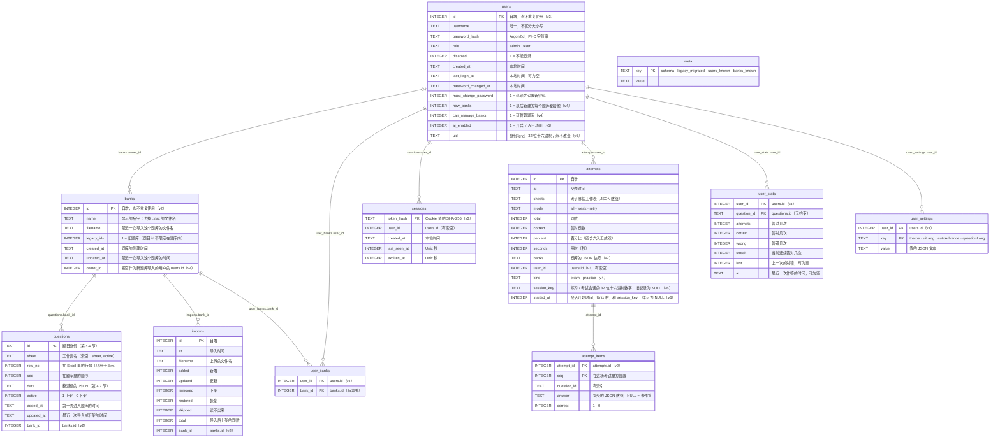
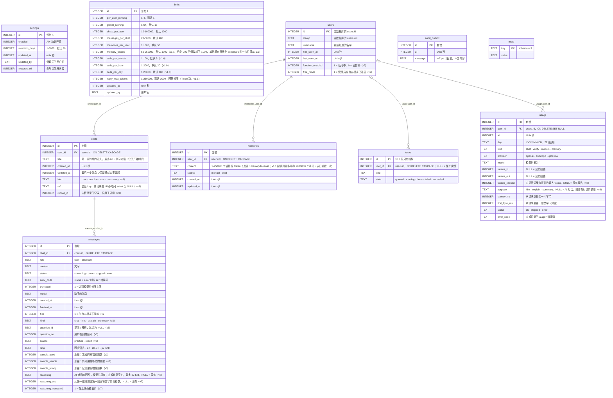
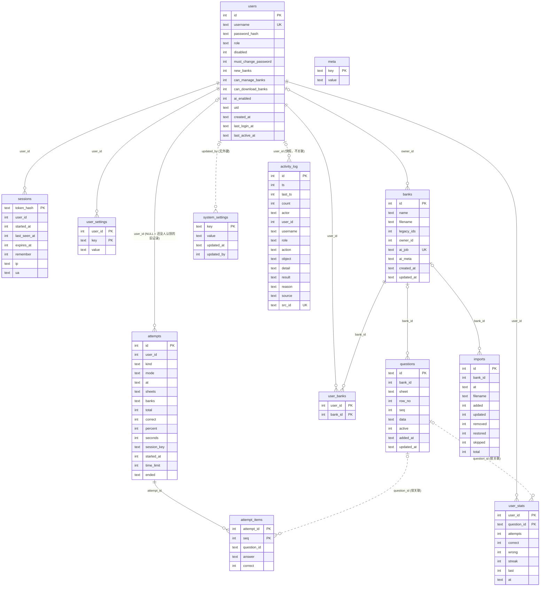
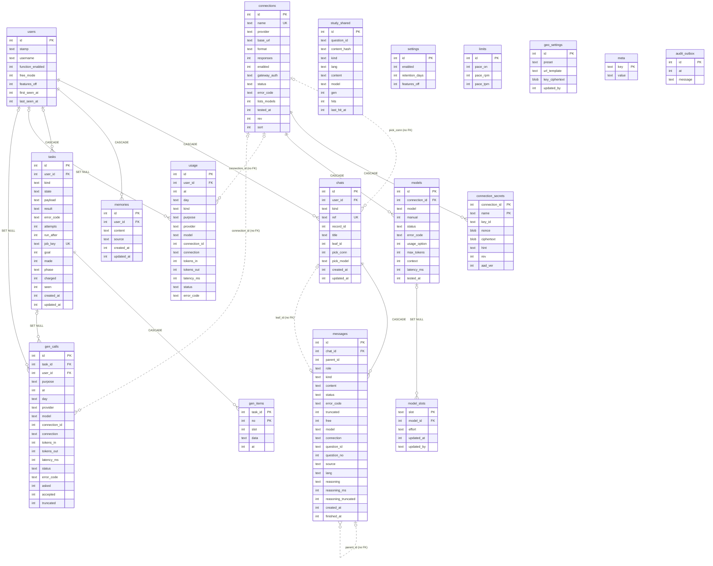

[English](../en/database.md) | [日本語](../ja/database.md) | **简体中文**

# 数据库

> 数据库是 SQLite，**只有一个文件 `xexam.db`**。Rust 后端从旧 Python 版的数据库起步：原来的建表语句（schema v1）一字不差地保留，直到 v10 的每个 schema 都只是往上加东西（新表和新列）：**schema v2**（v0.5：题库、考试详情、设置）、**schema v3**（v0.6：用户和登录）、**schema v4**（v0.7：按用户设置题库、题库所有者、练习记录）、**schema v5**（v0.8：每个用户的 AI+ 功能授权和一个身份标记）和 **schema v6**（v0.9：一条记录是从哪次练习或考试会话保存的，即那次会话的 key 和开始时间）。*v1.6* 起主数据库是 schema **10**（每用户的题库下载权限，第 6.16 节），*v2.0* 起是 schema **11**（数据库整理：九张表带外键重建，旧表删除，第 6.17 节）。新版本第一次启动时，会先写一份备份副本，再自动迁移已有的数据库（第 6 节）。从 v0.7 起，数据库以 **WAL 模式**运行（第 2 节）。
> 从 v0.8 起，ai-service 有**第二个、独立的数据库** `xexam-ai.db`，放在它自己的卷里（第 8 节）；从 v2.0 起它的 schema 是 **10**（v1.9 是 9，v1.4 是 8，v1.3 是 7，v1.1 是 6，v1.0 是 4，v0.9 是 3）。两个服务从不打开对方的数据库。**v1.1 把主数据库升级到 schema v7**（第 6 节）；AI 数据库不影响它。
> 依据：[audit/database.md](history/audit/database.md)；黄金测试：`backend/tests/db_golden.rs`（对着 `tests/baseline/fixtures/sample.db`（由旧的 Python 实现生成）和已提交的快照运行）。迁移和它们的备份在 `backend/tests/v05_banks_records_settings.rs`（v2）、`v06_users_and_sign_in.rs`（v3）、`v065_bank_access_and_practice.rs`（v4）、`v07_bank_access_and_layouts.rs`（v4 的题库权限、预发布版数据库的转换、旧格式题目的下架）、`v07_wal_and_logs.rs`（WAL 模式）、`v08_ai_link.rs`（v5）、`v09_ai_study.rs`（v6，后端的学习路由）和 `v20_db.rs`（v11，整理）里测试；AI 数据库在 `ai-service/tests/`（schema 3 见 `v09_store.rs`，schema 10 见 `v20_schema.rs`）和 `ai-service/src/store/` 的单元测试里测试。

## 1. 文件在哪里

| 运行方式 | 位置 |
|---|---|
| Docker（推荐） | 命名卷 `xexam_backend_data`，挂载到容器里的 `/data`；文件是 `/data/xexam.db`。更新或删除容器都不会丢 |
| 不用 Docker | 数据目录里的 `xexam.db`（默认 `./data`，或 `XEXAM_DATA`，或 `--data`） |

卷的真实名字是 `<项目名>_<卷名>` = `xexam_backend_data`，`docker volume ls` 能看到。**不要运行 `docker compose down -v`**：`-v` 会把卷和容器一起删掉。

数据库旁边的其他文件：

- **`xexam.db-wal` 和 `xexam.db-shm`** 在后端运行时存在（WAL 模式，第 2 节）。`-wal` 文件里是最近提交的修改，直到 SQLite 把它们复制进 `xexam.db`。后端正常停止时，所有内容都复制进 `xexam.db`，`xexam.db-wal` 被清空；这两个文件可能空着留下，没有害处。它们是数据库的一部分：后端运行时千万不要删，复制时要和 `xexam.db` 一起复制（第 5 节）。
- **`backups/`** 存放 schema 迁移前写的副本（第 6 节），例如 `/data/backups/xexam-schema3-20261111-140501.db`。程序永远不会删除这些文件；不再需要时请自己删掉。

什么存在哪里：

| 位置 | 内容 |
|---|---|
| 卷里的 `xexam.db`（运行时还有 `-wal` / `-shm`） | 题库及其所有者和题目（包括已下架的）、导入记录、用户（只存密码哈希）、他们的会话和每个用户能看到哪些题库、每个用户每道题的答题统计（错题本）、学习记录（考试和练习）和每道题的作答详情（从 v0.9 起还有每条记录是从哪次会话保存的，即那次会话的 key 和开始时间），以及设置（主题、界面语言、答完自动跳到下一题、题目语言） |
| 卷里的 `backups/` | 每次 schema 迁移前写的数据库副本（从 `xexam-schema1-…` 到 `xexam-schema5-…`） |
| 只在后端的内存里 | 系统日志、登录锁定和导入预览；重启后都从空的开始 |
| 卷 `xexam_ai_auth`（v0.8） | 只有 `internal.token`，后端和 ai-service 共用的令牌；后端写入，ai-service 读取。没有数据库 |
| ai-service 的卷 `xexam_ai_data`（v0.8） | `xexam-ai.db`（AI 设置、加密的服务商密钥、安全上限、对话、记忆、用量统计；从 v0.9 起，对话里包括每次练习、每场考试和每份记录总结各一个对话，其中有它们保存的题目文字和 AI 的回答）、密钥文件 `secret.key`，以及文件夹 `backups/`，里面是 AI schema 升级前写的副本（第 8 节） |
| 浏览器（`localStorage`） | 每个用户各一份：没交卷的考试或没做完的练习（题目 id、答案、标记、已核对的题、用时；不含题目文字），以及一份设置的副本（用来显示第一屏） |

## 2. 连接设置

| 设置 | 值 | 原因 |
|---|---|---|
| `journal_mode` | `WAL`（从 v0.7 起）；设了 `XEXAM_SQLITE_JOURNAL=delete` 时是 `DELETE` | 提交只写 `-wal` 文件，读的一方（例如在服务器旁边启动的命令行工具）不会挡住写的一方。见 2.1 |
| `synchronous` | `FULL` | 每次提交都等数据写到磁盘上（WAL 模式下：对 `-wal` 文件做一次 fsync），所以已经提交的东西停电也不会丢 |
| `foreign_keys` | `ON` | 从 schema 11 起主数据库声明了外键（第 3 节），并且强制执行：会留下子行的删除会失败，不会留下孤儿。升到 schema 11 的那一步只在它自己的事务期间把外键关掉，之后一定再打开（6.17） |
| `busy_timeout` | 5000 ms | 别的连接持有锁时，最多等 5 秒 |
| 自动检查点 | SQLite 的默认值（每 1000 页） | 后端运行时让 `-wal` 文件保持小巧 |
| 事务 | `BEGIN IMMEDIATE … COMMIT`，失败时 `ROLLBACK`（`COMMIT` 失败也会回滚） | 要么全部成功，要么什么都不变 |

后端只有**一个连接**，放在一个互斥锁后面。数据库调用在专门的线程上运行（`spawn_blocking`），所以不会阻塞 Tokio 的执行线程，锁也从不跨 `.await` 持有。这和旧版的「一个连接 + RLock」一一对应。

### 2.1 WAL 模式（v0.7）

- **持久的。** 日志模式保存在 `xexam.db` 的文件头里。后端每次打开数据库时都会请求它（服务器和命令行命令都一样），而且只在迁移成功**之后**才请求：如果打开失败，例如迁移前的备份写不出来，旧的数据库文件会原封不动。
- **不用 WAL。** `XEXAM_SQLITE_JOURNAL=delete`（写在 `docker/.env` 里，不用 Docker 时写在环境变量里）保留 v0.6 及更早版本的回滚日志。只在数据目录所在的存储上 WAL 的共享内存文件 `xexam.db-shm` 不可靠时才用它：网络文件系统，或者绑定挂载进 Docker Desktop 的 Windows 文件夹。其他任何值或不设，都表示 WAL。下次不带这个变量启动时，又会切回 WAL。
- **SQLite 拒绝时。** 后端从不因为日志模式而启动失败。如果 SQLite 切换不到 WAL（另一个进程以不允许切换的方式打开着数据库，或者文件系统不支持），日志里会有一条警告，例如 `SQLite did not switch the journal mode to wal; continuing in mode delete`，后端按 SQLite 报告的模式继续运行。
- **启动时的那一行。** 每次启动都记一次实际生效的模式：`SQLite journal mode: wal`，或 `SQLite journal mode: delete (XEXAM_SQLITE_JOURNAL=delete)`。
- **关闭时。** 正常停止时（`docker compose stop`、Ctrl+C），后端执行 `PRAGMA wal_checkpoint(TRUNCATE)`：`xexam.db-wal` 里的所有内容都复制进 `xexam.db`，`-wal` 文件被清空。关闭最后一个连接时可能还会删掉 `-wal` 和 `-shm`，但它们也可能空着留下（例如在 Windows 上），没有害处。日志里写着 `WAL checkpoint at shutdown: everything is in xexam.db, the -wal file is empty`（意思是：关闭时的 WAL 检查点完成，所有内容都在 xexam.db 里，-wal 文件已清空）。如果那一刻还有别的进程打开着数据库（例如一个命令行命令），检查点就完不成；日志里会有一条警告，SQLite 之后再完成它。
- **服务器运行时的命令行命令。** `reset-password`、`import` 和 `migrate-progress` 从另一个进程打开同一个文件。在同一个容器里（`docker compose exec backend …`）或同一台机器上，WAL 模式下这样做也是安全的。
- **更早的版本。** Xexam v0.6 及更早的版本打开数据库时会请求 `DELETE`，所以它们会自己把 WAL 数据库切回去。回退时不需要为日志模式做额外的步骤（第 6.7 节）。

## 3. 表



十三张表。从 schema 11（v2.0）起其中九张声明了**外键**，全部明确写成 `ON DELETE NO ACTION`（会留下子行的删除会失败；代码照旧先在同一个事务里删子行）：`sessions.user_id`、`user_stats.user_id`、`user_settings.user_id`、`user_banks.user_id`、`attempts.user_id`（可为空）和 `banks.owner_id`（可为空）→ `users(id)`；`attempt_items.attempt_id` → `attempts(id)`；`questions.bank_id`（可为空）、`imports.bank_id`（可为空）和 `user_banks.bank_id` → `banks(id)`。特意**不加**外键的（建表语句里也有注释）：`attempt_items.question_id` 和 `user_stats.question_id`（记录比被删的题目活得久，v0.5 之前的题库用的是不分题库的 id）、`activity_log.user_id`（日志是审计快照）和 `system_settings.updated_by`（只写不读的审计字段：加了外键，就删不掉曾经改过站点开关的管理员）。旧表 `stats`（v0.5 及更早版本的每道题统计）和 `settings`（v0.5 的设置）从 schema 11 起不再存在；它们的行在 v3 迁移时已经复制给第一个管理员（`user_stats`、`user_settings`）。重建的九张表以带引号的名字存成 `CREATE TABLE "banks" (…)`，这是 SQLite 记录改过名的表的方式。

每个 schema 新增了什么：

- **v1**（旧的 Python 版；它的文本作为历史留在代码里）：`meta`、`questions`、`attempts`、`stats`、`imports`。`stats` 在 schema 11 被删除。
- **v2**（v0.5）：表 `banks`、`attempt_items` 和 `settings`；列 `questions.bank_id INTEGER`（只有旧程序写的行才是 NULL，见 6.6）、`attempts.banks TEXT NOT NULL DEFAULT '[]'`（一场考试所用题库的 JSON 快照，`[{"id": 1, "name": "…"}]`）和 `imports.bank_id INTEGER`；索引 `idx_questions_bank (bank_id, active)` 和 `idx_attempt_items_question (question_id)`。
- **v3**（v0.6）：表 `users`、`sessions`、`user_stats` 和 `user_settings`；列 `attempts.user_id INTEGER`；索引 `idx_sessions_user` 和 `idx_attempts_user`。
- **v5**（v0.8）：列 `users.ai_enabled INTEGER NOT NULL DEFAULT 0`（每个用户的 **AI+ 功能** 授权：AI+ 功能开启并且可用时，这个用户可以使用 AI 对话；管理员也会保存这个值，但对他们不起作用，他们始终拥有）和 `users.uid TEXT NOT NULL DEFAULT ''`（一个随机的身份标记，32 位小写十六进制数字，在创建账户时设置，永不改变；AI 服务把它和用户 id 存在一起，并删除标记不一致的 AI 数据，见第 8.3 节）。别的都没有：AI 设置、对话和记忆都在 AI 数据库里。
- **v4**（v0.7）：表 `user_banks`；列 `users.new_banks INTEGER NOT NULL DEFAULT 0`、`users.can_manage_banks INTEGER NOT NULL DEFAULT 0`、`banks.owner_id INTEGER` 和 `attempts.kind TEXT NOT NULL DEFAULT 'exam' CHECK (kind IN ('exam', 'practice'))`；索引 `idx_user_banks_bank (bank_id)` 和 `idx_banks_owner (owner_id)`；`meta` 的键 `users_known` 和 `banks_known`（第 6.6 节）。v0.7 的六列工作簿格式不需要新列：各语言的文字放在 `questions.data` 里（第 4.7 节）。v0.7 的预发布版用的是 `users.all_banks` 而不是 `users.new_banks`；这样的数据库在打开时会被转换（第 6.5 节）。
- **v6**（v0.9）：列 `attempts.session_key TEXT`（保存这条记录的那次练习或考试会话的随机 key：32 位小写十六进制数字；AI 服务用它给那次会话的对话命名，第 8.2 节）和 `attempts.started_at INTEGER`（那次会话的开始时间，Unix 秒，按浏览器的时钟）。v0.9 之前保存的每条记录，以及浏览器没有发来有效值的那次保存，这两列都是 NULL：两个值各自单独判断，无效的存为 NULL，保存从不因此被拒绝。没有索引，也没有约束。这两列从不用来查找记录（记录始终按 `attempts.id` 找），也不保证 key 唯一：没有任何东西依赖这一点。主数据库里别的都没有变：AI 对话、它们的文字和标题都在 AI 数据库里。
- **v11**（v2.0）：没有新列。九张表带上面的外键重建；新索引 `idx_user_stats_question (question_id)`、`idx_imports_bank (bank_id)` 和唯一的 `idx_users_uid ON users(uid) WHERE uid <> ''`；删除 `stats` 和 `settings`（6.17）。

v1 的建表语句作为历史保存在 `backend/src/database/schema.rs`（`SCHEMA`）里，后来新增的部分放在它旁边（`MIGRATE_V2_TABLES`、`V2_COLUMNS`、……、`MIGRATE_V4_INDEXES`、`V5_COLUMNS`、`V6_COLUMNS`，v2.0 起还有 `V11_REBUILDS`：九张表的定义和它们的索引）。`SCHEMA` 只在文件是新的或比 schema 11 旧时才在启动时执行（所以不会再在每次打开时重新建出 `stats`），然后执行升级的各步。全部用 `IF NOT EXISTS` 或先检查，所以打开一个已经是最新的数据库**什么都不写**（有测试：数据库文件连同它的 `-wal` 文件一字节都不变）。因为 SQLite 记录 `ALTER TABLE … ADD COLUMN` 的方式是把新列追加到已存的 `CREATE TABLE` 文本末尾，所以 `users` 存的文本是 v3 的文本加上后来加的列，而重建的九张表来自 `V11_REBUILDS` 里的常量，列顺序已规整；全新的数据库和升级来的数据库 schema 完全相同（在 `db_golden.rs` 里测试，从每个更老的 schema 升级的情形在 `v20_db.rs` 里测试）。

## 4. 决定学习记录命运的细节

### 4.1 题目 id
统计（`user_stats`）和错题本都以题目 id 为键。id 是：

```
sha1( 工作表名 + "\n" + 去空白(题干)[:300] + "|" + 去空白(第一个选项或第一个小项)[:200] )  取前 12 位十六进制
```

- 题干和第一个选项取自题目的**基准文字**：六列格式里的英语题目（A 列），从 v0.7 起只能导入这种格式。以前版本的三列和四列格式用的是日语题目；它们的题都已下架（第 4.2 节），用六列格式的文件更新这样的题库时，每道题都会得到新的 id：它们作为新题加入，没有统计，旧题仍保持下架。
- 「去空白」指的是 Python 的 `\s`（29 个码位，包括 U+001C–U+001F 和全角空格 U+3000）。**先去空白，再截断**，截断按**码位**计。Rust 的 `char::is_whitespace` 只覆盖 25 个，所以后端自己实现了对这 29 个码位的判断。
- **完全不做 Unicode 规范化**（不做 NFKC）。很多真实的题库里有全角 ASCII，规范化会改变每一个 id。
- 同一份工作簿里重复的 id 会依次加上 `-2`、`-3`……，**取决于行的顺序**：如果你把两道一模一样的题调换了位置，学习记录就会跑到另一道题上。这是旧版的行为；保留下来，并在这里写明。
- 改了题干的措辞 = 一道新题（旧题下架，它的记录不会带到新题上）；只改选项、答案、解析或翻译算「更新」，记录不受影响。
- 85 条断言（`tests/baseline/golden/id_vectors.json`）保证 Rust 和 Python 算出的 id 逐字节相同。
- **题库（v0.5）**：**旧题库**里的题（v0.5 之前的所有数据，以及不带 `X-Bank-Target` 的上传）就用上面的 id 保存，所以已有的统计、错题本和历史都还对应着。其他每个题库都用**限定在题库内的 id**：`sha1("xexam-bank:" + bank_id + "\n" + id)`，取前 12 位十六进制。所以同一份工作簿可以导入成两个独立的题库，记录不会混在一起。题库 id 永不重复使用（`AUTOINCREMENT`），所以限定后的 id 也不会。

### 4.2 下架而不是删除
导入时，**目标题库**里在文件中找不到的题会被设成 `active = 0`，它的统计原样保留。以后你把这道题再上传到同一个题库，它会自动恢复上架，错题本里的记录也跟着回来。导入永远不碰其他题库的题。

**旧格式（v0.7）。** 后端每次启动时，以及打开数据库的命令行命令每次运行时，都会在第 6 节的迁移和修正之后，下架每一道不是六列格式的上架题目（它的 `data` 里没有 `"lang": "en"`，第 4.7 节）：`active = 0`，`updated_at` = 现在，`seq` 排在这个题库其他题的后面（保持它们的顺序），和导入时下架一道从文件里消失的题完全一样。题库、导入记录、`user_stats`、`attempts` 和 `attempt_items` 都保留；没有上架题目的题库也保留，这样以后可以用六列格式的文件更新它，或者删除它。它在一个事务里运行，每个题库记一条警告（`retired 12 questions of bank "Kitchen basics": they use the old 3- / 4-column layout; import the six-column version of the workbook`）；没有要下架的题时什么都不写。这样的题永远不会被导入恢复上架，因为三列或四列格式的文件不能导入。

删除题库（`POST /api/banks/delete`）是题目离开数据库的唯一途径。它在一个事务里删除这个题库的题目（上架的和已下架的）、它的 `imports` 行、它的 `user_banks` 行（谁能看到它）以及它的 `banks` 行。带 `withRecords` 时，这些题的学习数据也一起删除：它们的 `user_stats` 和 `attempt_items` 行，以及所有 `banks` 快照里写着这个题库、又没有任何现存题库的 `attempts` 行（连同剩下的详情）。管理员这样删除的是**所有**用户的学习数据；可管理题库的用户删除自己的题库时，只删除**他自己**在这个题库的学习数据，其他用户的记录保留（里面的题显示为已删除）。不带 `withRecords` 时，`user_stats`、`attempts` 和 `attempt_items` 都原样保留。

### 4.3 错题本
每个用户在 `user_stats` 里有自己的错题本。一道题在 `wrong > 0` 且 `streak < 2` 时在错题本里；连续答对 2 次后移出。考试和练习以同样的方式更新它。只能看到部分题库的用户（第 4.8 节）只看到这些题库里的题的统计。

### 4.4 学习记录
每个用户的学习记录是 `attempts` 里带他的 `user_id` 的行；`kind` 表示一条记录是 `exam`（考试）还是 `practice`（练习）（v0.7 之前的每条记录都是考试，也就是这一列的默认值）。每个用户保留自己最新的 **500** 条记录（`RECORD_RETENTION`；v0.5 之前是 60）；每次提交之后，这个用户更早的记录会连同它们的 `attempt_items` 一起删除。`GET /api/progress` 的 `history` 只返回最新的 60 条。

- 从 v0.5 起，每条新记录为每道题保存一行 `attempt_items`（页面发来的答案，以及对错）和 `banks` 快照；更早保存的记录没有详情。
- 从 v0.9 起，一条记录还保存它是从哪次练习或考试会话保存的，即那次会话的 key 和开始时间（`session_key`、`started_at`；旧记录为 NULL）。`POST /api/attempt` 的回答里带新记录的 id（`recordId`，始终是最后一个键），`GET /api/record` 把这两个值作为 `sessionKey` 和 `startedAt` 返回（列表 `GET /api/records` 没有变）。它们只用来把一条记录和它那次会话的 AI 对话关联起来（第 8.2 节）；别的东西都不读它们。v0.9 的 AI 路由通过后端带令牌的路由读取它们以及记录的题目和答案，从不直接读这个文件（见 [architecture.md](architecture.md) 第 5 节）。
- 只计入还存在、而且用户能看到的题（v0.7）：考试期间所在题库被删除的题，或者属于用户范围以外的题库的题，不写统计、不写详情行，也不算进 `total`、`correct` 和 `percent`。这时 `sheets` 只列出计入的题所在的工作表。一道题都不剩时，什么都不保存。
- 删除一条记录（`POST /api/records/delete`）删掉它和它的详情，但不动统计；删除全部记录时还可以清空这个用户的统计（`withStats`），等于 `POST /api/reset`。

### 4.5 设置
`user_settings` 里每个用户、每个改过的设置一行；`value` 是值的 JSON 文本（`"dark"`、`true`）。没有的行表示默认值（`theme` 是 `system`，`uiLang` 是 `en`，`autoAdvance` 是 false，`questionLang` 是 `ja`）；保存的值无效时忽略它。浏览器保存一份副本，只用来画第一屏；数据库才是准的，所以更新容器、清除浏览器缓存、换别的浏览器之后设置都还在。

### 4.6 时间
本地时间的字符串，格式 `%Y-%m-%d %H:%M`，**不带时区标记**，精确到分钟（`sessions` 表另外还存两个 Unix 时间）。容器里的时区默认是宿主机的（`docker/docker-compose.yml` 以只读方式挂载宿主机的 `/etc/localtime`）；在 `docker/.env` 里设置的 `TZ` 优先于它，例如 `TZ=UTC`；两者都没有时，镜像退回 UTC。在 Docker Desktop（Windows、macOS）上，挂载的是 Docker 自己的虚拟机里的文件（通常是 UTC），所以请设置 `TZ`。镜像里带有时区数据库，所以 `TZ` 可以写任何时区。以后再改时区不会改写已经保存的时间：它们保留写入时的时区。

### 4.7 题目的 JSON（`questions.data`）
`data` 是整道题的 JSON，不含 `id`、`sheet` 和 `row`（它们有自己的列）。主要的键：`kind`（`single`、`multi`、`hotspot`）、`stem`、`options`、`items`、`answer`、`translation`、`zh`（中文文字，按基准题目拆开）、`explanation`、`mnemonic` 和 `note`。四列格式的题还有 `english` 和 `en`（英语文字）。

**六列格式**的题（v0.7）多三个键，而没有 `english` / `en`，因为它的基准文字本身就是英语：

- `"lang": "en"`：基准文字（`stem`、`options`、`items`）的语言。三列和四列格式的题没有 `lang` 键：它们的基准文字是日语。
- `"ja"`：日语题目（C 列），按英语题目拆开，结构和 `zh` 一样。C 列和英语题目对不上时没有这个键（答题页上 **日本語** 按钮就会置灰）。
- `"explain"`：每种语言的解析、记忆口诀和备注，`{"en": {"explanation", "mnemonic", "note"}, "zh": {…}, "ja": {…}}`。答案列里三样都没有的语言不出现。

对于只认识一份解析的客户端，六列格式的题的 `explanation`、`mnemonic` 和 `note`：E 列有中文时是中文，否则是日语（F 列），再否则是英语（D 列）。三列和四列格式的题作为已下架的题留在数据库里，完全保持以前版本的 JSON（没有新的键）；解析器仍然能读这些格式（导入就是靠这一点把它们认出来并拒绝），解析器的黄金测试会逐字节检查它的输出。

### 4.8 谁能看到哪个题库（v0.7）
- **管理员**能看到并管理所有题库。
- **普通用户**正好能看到 `user_banks` 里为他列出的题库（管理员为他勾选的已有题库）。`users.new_banks = 1`（**包括以后导入的题库**）只会添加行：每当新建一个题库（任何人作为新题库导入，或者命令行 `import` 创建旧题库），每个带这个标记的用户都会在同一个事务里得到这个题库的一行。它从不添加已有的题库，取消勾选一个题库也只删掉那一行。新用户一开始没有任何行，标记也是关的。迁移到 v4 时已经存在的每个用户，都得到了每个已有题库的一行和这个标记，所以升级时没有人失去题库。
- **可管理题库的用户**（`users.can_manage_banks = 1`）在拥有这个权限期间，还能看到自己拥有的题库（`banks.owner_id`），也只能更新和删除这些题库。作为新题库导入的题库属于导入它的用户；v0.7 之前的题库，以及没有登录用户时新建的题库（命令行的 `import`），属于第一个管理员。
- 删除用户会删除他的会话、学习记录（含详情）、统计、设置和 `user_banks` 行；他拥有的题库转到删除他的那位管理员名下。他的 AI 对话和记忆在 AI 数据库里：AI 服务会在下一次对账时删除它们（第 8.3 节）。

## 5. 备份和恢复

从 v0.8 起，要备份的是**两个数据卷**：`xexam_backend_data`（这个数据库）和 `xexam_ai_data`（AI 数据库和它的密钥文件，第 8.4 节）。`xexam_ai_auth` 不用备份。下面的命令针对 `xexam_backend_data`；AI 卷的做法一样。

**复制数据库之前先停止后端。** WAL 模式下，后端运行时最新的修改可能还在 `xexam.db-wal` 里，所以只复制 `xexam.db` 可能会漏掉它们；正常停止之后，所有内容都在 `xexam.db` 里，旁边即使留着 `-wal` 文件，也是空的。

```bash
docker compose stop

# 备份：把卷打包成当前目录里的 xexam-data.tgz（里面是整个数据库；.gitignore 已忽略它，不要提交）
docker run --rm -v xexam_backend_data:/data -v "$PWD:/backup" alpine tar czf /backup/xexam-data.tgz -C /data .

docker compose start
```

如果不能停止，就把 `xexam.db`、`xexam.db-wal` 和 `xexam.db-shm` 一次性一起复制，然后像下面那样检查副本；只有这三个文件合在一起，才包含所有已经提交的修改。在写入进行中复制的副本仍然可能不一致，所以真正可靠的是停止后的卷的副本。也可以用 SQLite 本身给运行中的数据库做一份一致的副本：`VACUUM INTO`，或者 `sqlite3` 命令行工具里的 `.backup`。

**验证备份**（在副本上做；永远不要在原件上做实验）：

```bash
mkdir work && tar xzf xexam-data.tgz -C work
sqlite3 work/xexam.db "PRAGMA integrity_check"      # 必须输出 ok
```

**恢复。** 放回备份之前，先删掉残留的 `-wal` 和 `-shm` 文件：它们属于你要替换掉的那个数据库，SQLite 不能把它们套用到恢复出来的数据库上。正常停止之后它们是空的或者已经没有了，所以 `rm` 不会删掉任何要紧的东西。

```bash
docker compose stop
docker run --rm -v xexam_backend_data:/data -v "$PWD:/backup" alpine sh -c 'rm -f /data/xexam.db-wal /data/xexam.db-shm && tar xzf /backup/xexam-data.tgz -C /data'
docker compose start
```

`backups/` 里的文件是卷的一部分，所以备份卷时也会备份它们。

**换电脑**：在新电脑上放好新的 `docker-compose.yml`，先运行一次 `docker compose up -d` 建好卷，再按上面的方法恢复备份（两个数据卷都要）。备份文件里有你的整个数据库（包括密码哈希），还有 AI 密钥和解密它们用的密钥，所以请妥善保管，不要提交它们（`.gitignore` 已忽略 `*.tgz`）。

## 6. schema 迁移和回退

`meta.schema` 表示一个数据库是哪个 schema（v0.4 及以前是 `1`，v0.5 是 `2`，v0.6 是 `3`，v0.7 和 v0.7.5 是 `4`，v0.8 是 `5`，从 v0.9 起是 `6`，v1.1 是 `7`，v1.3 是 `8`，v1.4 是 `9`，v1.6 是 `10`，v2.0 是 `11`）。一个版本打开 schema 更旧的数据库时，会一次性把它升级到自己的 schema：

1. **备份。** 如果数据库里有任何数据，就用 SQLite 的 `VACUUM INTO` 往 `xexam.db` 旁边的 `backups/xexam-schema<N>-<YYYYmmdd-HHMMSS>.db` 写一份一致的副本，`<N>` 是这次启动之前文件的 schema（已有的文件永远不会被覆盖，而是依次加上 `-2`、`-3`……）。即使后面有好几步，也总是只写**一份**备份。副本是一个独立的、旧 schema 的文件；当时还在 `-wal` 文件里的修改也包含在内。`VACUUM INTO` 写的是一个完整的文件，所以升级之前请**留出大约和数据库一样大的可用磁盘空间**（升到 schema 11 还要重建表，要**大约两倍**，6.17）；副本从不清理，而且它会保留你以后删除的东西（记录、题库、用户），所以在这有关系时请自己删掉旧副本。**副本写不出来时**（磁盘满、没有权限），程序拒绝启动，什么都不改；日志里写明原因。
2. **迁移**，在**一个** `BEGIN IMMEDIATE` 事务里完成：从旧 schema 到当前 schema 的每一步（6.1、6.4、6.5、6.8、6.10、6.17，以及预发布版 v4 数据库的转换），然后设置 `meta.schema`。
3. **日志模式。** 这之后，后端才把文件切换到 WAL（第 2.1 节）。

日志里会写出副本的名字：`Upgraded the database to schema 6. A copy of the previous version was saved first: /data/backups/xexam-schema5-….db (restore it if you ever go back to an older version).`（意思是：数据库已升级到 schema 6，升级前先保存了旧版本的副本；以后回到旧版本时请恢复它。）全新的数据库也走同样的步骤（没有备份，也没有旧题库），所以新建的和迁移过来的数据库结构相同。

### 6.1 schema v2（v0.5）

v0.5 或更新的版本打开 `meta.schema` 不存在或为 `1` 的数据库时，备份的名字是 `xexam-schema1-<YYYYmmdd-HHMMSS>.db`（一个普通的 schema 1 数据库）。v2 这一步创建 `banks`、`attempt_items`、`settings` 和新的索引，加上三个列；然后，如果有题目，就创建**旧题库**，并把所有东西都挂到它下面：`name` = 最近一次导入的文件名去掉 `.xlsx`（没有导入过就是 `Question bank`），`filename` = 那个文件名，`created_at` = 最早的 `questions.added_at`，`updated_at` = 最近一次导入的时间（没有导入过就是最近一次题目变化的时间）；每道题和每条导入记录都得到它的 `bank_id`，每条考试记录的 `banks` 快照都是这个题库。题目 id、统计、考试记录和导入记录都不变。

### 6.2 回到 v0.4（或更早）

v2 的文件仍然可以被 v0.4 和旧的 Python 版打开：新的列都可以为空或有默认值，`user_version` 仍然是 0。**但是有了不止一个题库之后，就不要再继续用旧版本**：它把整个数据库当成一个题库，所以它的下一次导入会把其他所有题库的题都下架，而且它不认识新的表。它还会把考试记录删减到 60 条。schema v3 及以后的数据库里还有 v0.4 根本不知道的用户。

**要回退，请恢复备份**：停止程序，用 `backups/` 里的 `xexam-schema1-…` 文件替换 `xexam.db`（把它改名为 `xexam.db`，并删掉旁边的 `xexam.db-wal` / `xexam.db-shm`），然后启动旧版本。迁移之后在新版本里做的修改不在那份副本里。

如果旧版本还是往这个文件里写了东西，v0.5 或更新的版本下次启动时，会把它新增的题挂到旧题库下面（6.6）。它保存的考试记录没有详情，题库快照是空的；它删减掉的考试的详情行会作为没用的行留在 `attempt_items` 里（永远不会显示）。

### 6.3 和旧 Python 实现的兼容

直到 v0.4，两个实现用的都是**同一个文件、同一个 schema**。这个往返最初用合成数据演练过（旧 Python 建库 → Rust 读写 → 旧 Python 读回；原件的 sha256 前后不变，`PRAGMA integrity_check` 通过）。**从 v2.0（schema 11）起这个保证被有意放弃了**：表带外键重建、旧表删除，旧的 Python 版已经打不开当前的文件，全新的数据库也不再是旧实现的文本。测试仍然守住的：`sample.db`（旧实现写出的数据库）迁移到当前 schema 后，每个题目 id、统计、考试记录和导入都原样保留，它的备份仍报告 schema 1、行和原来一模一样，迁移后的文件之后无论怎么打开、读取、关闭都一字节不变，全新数据库的 `sqlite_master` 和迁移来的相同。**回到 Python 版的唯一办法是 schema 1 的备份**：把它恢复回去（6.2），用旧镜像（`ghcr.io/yumin-space/xexam:v0.2.2`，只在私有的 GHCR 上，所以要先 `docker login ghcr.io`）打开。

### 6.4 schema v3（v0.6）

从 `meta.schema` `2`（备份 `xexam-schema2-<YYYYmmdd-HHMMSS>.db`）开始，或者从 `1` 开始、和 6.1 在同一个事务里。v3 这一步创建 `users`、`sessions`、`user_stats` 和 `user_settings`，并加上 `attempts.user_id`。如果还没有用户，就创建默认管理员 `admin`，密码 `admin`（第一次登录时必须修改），并把已有的数据给它：每条没有用户的考试记录、`stats` 每一行在 `user_stats` 里的副本，以及 `settings` 每一行在 `user_settings` 里的副本。旧的 `stats` 和 `settings` 表在这一步保留，不再使用（在 schema 11 删除，6.17）。

### 6.5 schema v4（v0.7）

从 `meta.schema` `3`（备份 `xexam-schema3-<YYYYmmdd-HHMMSS>.db`）开始，或者从 `1` 或 `2` 开始、和前面的步骤在同一个事务里。v4 这一步：

- 创建 `user_banks` 及其索引，加上 `users.new_banks`、`users.can_manage_banks`、`banks.owner_id` 和 `attempts.kind`；
- 给**所有已经存在的用户**每个已有题库的一行 `user_banks`，并设置 `new_banks = 1`，所以每个人仍然能看到所有题库，包括以后导入的；
- 每个人的 `can_manage_banks` 都保持 `0`（管理员本来就能管理题库）；
- 把每个题库都给**第一个管理员**：id 最小的已启用管理员（只有在没有已启用的管理员时，才用已停用的）；
- `attempts.kind` 不需要回填：它的默认值 `exam` 正是所有旧记录的类型；
- 写入 `meta.users_known` 和 `meta.banks_known`（见 6.6）；从 v0.8 起，v5 这一步在同一个事务里紧接着进行（6.8），由它设置 `meta.schema`。

之后，启动继续进行 6.6 的检查、切换到 WAL（第 2.1 节）和下架旧格式的题（第 4.2 节）：v0.6 或更早版本的数据库里只有三列和四列格式的题，所以它们全部被下架。

**预发布版 v4。** v0.7 正式发布之前的构建保存的是 `users.all_banks`（1 = 所有题库，包括以后导入的），而不是 `users.new_banks`。标记为 `4`、却仍然有这一列的数据库在打开时会被转换：先写一份备份 `backups/xexam-schema4-<YYYYmmdd-HHMMSS>.db`，然后在一个事务里（从 v0.8 起和 v5 这一步是同一个事务，只写一份备份）：`all_banks = 1` 的用户得到每个已有题库的一行和 `new_banks = 1`；`all_banks = 0` 的用户保留他的行，`new_banks = 0`；然后删掉 `all_banks` 列，并写入 `meta.banks_known`。`meta.users_known` 保持预发布版写的样子，所以在这期间由更早的版本创建的用户（比那个标记大）会在接下来运行的 6.6 检查里得到所有题库和 `new_banks = 1`，和升级时的用户一样。日志里会写 `Converted the question bank access of a database written by a v0.7 pre-release to the released format and upgraded the database to schema 5. A copy of the previous version was saved first: <path>.`

### 6.6 每次启动时的检查

每次启动时，在可能的迁移之后，后端会（只读地）检查有没有只可能是回退后旧程序留下的行，并各用一个事务修正它们。没有需要修正的东西时，**什么都不写**。旧版本既不知道 `user_banks`，也不知道 `users.new_banks`，在那里每个用户都能看到所有题库。

- **旧版本创建的题库**：`meta.banks_known` 保存这个版本知道的最大题库 id；它由 v4 迁移写入，这个版本每创建一个题库时也会更新（题库 id 永不重复使用）。每个 `new_banks = 1` 的用户都会得到比它大的每个题库的一行，就像这些题库是这个版本创建的一样；然后标记往前移。这项检查最先运行，所以下一项检查创建的题库不会把它们掩盖掉。
- **没有题库的题**（`bank_id` 为 NULL），以及有旧题库时没有题库的导入记录：挂到旧题库下面，需要时创建旧题库。
- **一个用户都没有**：重新创建默认管理员 `admin` / `admin`。**没有用户的考试记录**：给第一个管理员。
- **没有有效所有者的题库**（NULL，或者是已经不存在的用户）：给第一个管理员。
- 属于已经不存在的用户或题库的 **`user_banks` 行**：删除。
- **旧版本创建的用户**：`meta.users_known` 保存这个版本知道的最大用户 id；它由 v4 迁移写入，这个版本每创建一个用户时也会更新（用户 id 永不重复使用）。比它大的用户是回退后由旧版本创建的，没有任何 `user_banks` 行；这样的用户会得到每个已有题库的一行和 `new_banks = 1`，和升级时的用户一样，然后标记往前移。
- 没有标记时（数据库第一次是被一个不写标记的构建打开的），这样的题库和用户分辨不出来，所以只写入标记。
- **没有身份标记的用户**（`uid = ''`，v0.8）：回退之后由 v0.7.5 创建的用户没有标记；它会得到一个。它的 AI+ 是关闭的（列的默认值）。

- **旧版本重新建出的旧表**（schema 11 或更新）：v1.9 的后端每次打开都会执行 v1 的 `SCHEMA`，所以回退之后会重新建出一张空的 `stats` 表。空的 `stats` 或 `settings` 会再次删掉；里面有行的就保留，日志里有 `Warning: the legacy table <t> was re-created by an older version and holds <n> rows; it was kept.`。
- **`users.uid` 上的唯一索引**：如果缺 `idx_users_uid`（因为有重复而跳过了，6.17），并且已经没有重复的标记，就把它建出来。
- 每次启动不做完整的 `foreign_key_check`：强制外键已经防止出现新的孤儿，而记录越多这个检查越费时间。已是最新的文件不会被写入。

然后下架旧格式的题（第 4.2 节）。

### 6.7 回到 v0.6

**恢复备份**：停止后端，用 `backups/xexam-schema3-….db` 替换 `xexam.db`（把它改名为 `xexam.db`，并删掉旁边的 `xexam.db-wal` / `xexam.db-shm`），然后启动 v0.6。迁移之后用 v0.7 或更新的版本做的一切都不在那份副本里。具体的命令见 [migration.md](migration.md) 第 2.6 节。

v0.6 也能直接打开 schema 4 的文件：它忽略新的表和列，并把文件切回 `DELETE` 日志模式。这只留作应急用，因为 v0.6 不懂 v0.7 的规则：每个用户又能看到所有题库，只有管理员能导入或删除题库，练习记录看起来和考试一样，它也完全不知道六列格式的题。之后再启动新版本时，6.6 会修好 v0.6 留下的东西：它导入的题库会得到所有者，并给到 `new_banks = 1` 的用户；它创建的用户会得到所有题库和 `new_banks = 1`；它导入的题会被下架（第 4.2 节）。

### 6.8 schema v5（v0.8）

从 `meta.schema` `4` 升级（备份 `xexam-schema4-<YYYYmmdd-HHMMSS>.db`），或者从 `1`、`2` 或 `3` 升级，和前面的步骤在同一个事务里（这时备份以那个更旧的 schema 命名）。v5 这一步新增 `users.ai_enabled` 和 `users.uid`，给每个用户一个随机标记（`lower(hex(randomblob(16)))`，v3 那一步刚创建的默认管理员也一样），并把 `meta.schema` 设为 `5`。每个用户的 AI+ 一开始都是关闭的。日志里会写 `Upgraded the database to schema 5. A copy of the previous version was saved first: …`。

### 6.9 回到 v0.7.5（或 v0.7）

**恢复备份**：停止，用 `backups/xexam-schema4-….db` 替换 `xexam.db`（把它改名为 `xexam.db`，并删掉旁边的 `xexam.db-wal` / `xexam.db-shm`），换回旧的 `docker-compose.yml`，然后启动 v0.7.5。具体的命令见 [migration.md](migration.md) 第 1.4 节。v0.7.5 不使用 AI 卷；可以留着以后升级时用，也可以删掉。

v0.7.5 也能直接打开 schema 5 的文件（它把 schema `5` 当作更新的 v4 读取，并忽略那两列）；它创建的用户没有标记，AI+ 是关闭的，v0.8 下次启动时会给他们一个标记（6.6）。这也只留作应急用。

### 6.10 schema v6（v0.9）

从 `meta.schema` `5` 升级（备份 `xexam-schema5-<YYYYmmdd-HHMMSS>.db`），或者从更旧的 schema 升级，和前面的步骤在同一个事务里（这时那一份备份以那个更旧的 schema 命名）。v6 这一步新增 `attempts.session_key` 和 `attempts.started_at`，让每条已有的记录这两列都为 NULL，并把 `meta.schema` 设为 `6`。没有任何一行改变含义，也不建索引。日志里会写 `Upgraded the database to schema 6. A copy of the previous version was saved first: …`。在 `v09_ai_study.rs` 里测试，也由 `tests/integration/migrate_check.py` 的情形 J 测试（一份备份 `xexam-schema5-…`，两列存在且为 NULL，重新打开什么都不写）。

### 6.11 回到 v0.8

主数据库回去**不需要恢复**：v0.8 的后端会原样打开 schema 6 的文件（它把更新的 schema 当作当前的，从不读这两列），它保存的记录在这两列里是 NULL，`meta.schema` 仍然是 `6`。以后 v0.9 再次启动时看到的是 schema 6，不会再写备份。恢复 `backups/xexam-schema5-….db` 仍然可行（停止，替换 `xexam.db`，删掉所有 `xexam.db-wal` / `xexam.db-shm`），但这会丢掉升级之后做的一切。

**AI 数据库不一样**：v0.8 的 ai-service 会拒绝 schema 3 的文件（第 8.3 节），所以回到 v0.8 意味着要恢复 AI 备份 `backups/xexam-ai-schema2-….db`，并丢掉升级之后写入的每一条对话、记忆、设置和用量。具体的命令见 [migration.md](migration.md)。

### 6.12 schema v7（v1.1）

主数据库在 v1.1 后端第一次启动时，从 schema 6 **升级到 schema 7**，只升级一次，升级前先写一份副本 `backups/xexam-schema6-<日期时间>.db`。新增四列（`database/schema.rs`，`V7_COLUMNS`）：

- `attempts.time_limit`（INTEGER）：限时考试的时限，单位秒（60 到 36000）。不限时的考试、练习和 v1.1 之前保存的所有记录为 NULL。
- `attempts.ended`（TEXT）：`submit`（手动交卷）或 `timeUp`（倒计时结束，只用于限时考试）。v1.1 保存的每次考试都会设置；练习和旧记录为 NULL。在 `ended` 已设置的记录中，没有答案且 `correct` 为 0 的项目就是 **没有完成的题**：它不算错题，也不进错题本。
- `banks.ai_job`（TEXT）：AI 生成题库的任务键（32 位小写十六进制）。导入的题库为 NULL。
- `banks.ai_meta`（TEXT）：AI 题库的 JSON 信息（来源、作者、题数、时间）。导入的题库为 NULL。

新索引覆盖任务键（每个任务只对应一个题库）以及 v1.1 的范围查询。v1.0 的题库和记录不变。


### 6.13 schema v8（v1.3）

主数据库从 schema 7 升到 **schema 8**，只在 v1.3 后端第一次启动时进行一次，之前先写一份备份副本 `backups/xexam-schema7-<日期-时间>.db`。这一步只增不改。

- `users`：`last_active_at`（TEXT，`YYYY-MM-DD HH:MM:SS`；升级时由 `last_login_at` 填入），以及 `last_login_ip`、`last_login_country`、`last_login_region`、`last_login_city`（TEXT）。后四个只在眼睛打开时的登录才会写入（关闭时保持原样，响应里不显示），由**清除记录**置为 NULL。
- `sessions`：`started_at`（INTEGER，Unix 秒；已有会话为升级时刻）、`remember`（INTEGER，默认 1）、`ip`（TEXT，只在眼睛打开时写入；关闭时不显示）和 `ua`（TEXT，浏览器，最多 256 个字符）。
- `activity_log`（新）：每条活动记录一行：`ts`、`last_ts`、`count`（合并的页面访问和被拒绝的登录）、`actor`（`user`、`anon` 或 `system`）、`user_id`（没有外键：记录比账号活得久）、`username` 和 `role`（当时的快照）、`action`、`object`、`detail`（只含允许的键的小 JSON 对象）、`result`（`ok` 或 `fail`）、`reason`、`ip`、`country`、`region`、`city`（只在登录信息的眼睛打开时写入；眼睛关闭时响应里不显示）、`ua`、`source`（`backend` 或 `ai`）和 `src_id`（AI 服务的事件 id，唯一，所以重复投递会被忽略）。时间、用户、操作和 `src_id` 上有索引。保留期默认 90 天，最多 50 万行，但登录行（`action = 'auth.signin'`）永不删除，也不计入上限（保留期的查询使用 `ts` 上的部分索引 `idx_activity_prune`）。
- `system_settings`（新）：`key`、`value`、`updated_at`、`updated_by`。键：`activity.retention_days`（90）、`activity.user_visits`（0）和 `users.signin_info`（0：为 0 时不再记录新的内容，已存的 IP 和所在地不显示；不删除任何东西）。
- 为重复保存成绩，在 `attempts(user_id, session_key)` 上有索引 `idx_attempts_session`。

日志的第一行是 `system.migrate`。v1.2 后端会照原样打开 schema 8 的文件：新列有默认值，新表被忽略，它的会话在 v1.3 第一次更新时得到开始时间。

### 6.14 回到 v1.2

不用恢复（见上）。恢复 schema 7 的副本是可选的，会丢掉此后写入的内容，会话和活动记录也一并丢掉。

### 6.15 Schema v9（v1.4）

主数据库在 v1.4 后端第一次启动时，先写一份备份副本 `backups/xexam-schema8-<date-time>.db`，然后从 schema 8 升到 **schema 9**，只做一次。这一步只增不改，不回填任何数据。

- `users`：`last_active_ip`、`last_active_country`、`last_active_region`、`last_active_city`（TEXT；最后一次活动的 IP 和所在地，与 `last_active_at` 一起写入，最多每分钟一次，**只在登录信息的眼睛打开时写**；**清除记录**会把它们设为 NULL；眼睛关闭时应答里隐藏）和 `last_active_ua`（TEXT，最后一次活动清理后的 User-Agent，最多 256 个字符；眼睛关闭时也写，并且**不会**被**清除记录**清掉，与活动记录的 `ua` 一样）。所在地各列存两位国家代码或国家名称、地区和城市，任何一项都可能是 NULL。
- `system_settings`：新键 `geo.source`（`cloudflare`，缺失时的默认值，或 `api`），表示记录的所在地从哪里来（见 [usage.md](usage.md) 的 14.2 节）。
- 其他都不变：外部查询每个 IP 的记忆和队列只在内存里。

日志行是 `system.migrate`，带 `{"from": 8, "to": 9}`（从 schema 7 升级时也只写一行）。v1.3 的后端可以原样打开 schema 9 的文件（新列会被忽略）。


### 6.16 Schema v10（v1.6）

主数据库在 v1.6 后端第一次启动时，先写一份备份副本 `backups/xexam-schema9-<date-time>.db`，然后从 schema 9 升到 **schema 10**，只做一次。这一步只增不改，不回填任何数据。

- `users`：`can_download_banks`（INTEGER，默认 0）：用户是否可以下载题库（Excel 或 Word），范围是他能看到的题库。管理员不看这一列，始终可以下载。用户管理的题库对话框里的 **下载题库** 写它；`POST /api/users/create` 和 `/api/users/update` 的 `canDownloadBanks` 读写它。
- 其他都不变。

日志行是 `system.migrate`，带 `{"from": 9, "to": 10}`。v1.5 的后端可以原样打开 schema 10 的文件（新列会被忽略）。

### 6.17 Schema v11（v2.0）

主数据库在 v2.0 后端第一次启动时，先写一份备份副本 `backups/xexam-schema10-<日期时间>.db`，再从 schema 10 升到 **schema 11**，只升一次（从更老的 schema 升级时，只写那个更老 schema 的一份备份，一步升到 11）。列、名字、类型、值都不变，程序里看不出任何变化：这一步是为了完整性。它在服务器开始监听之前运行，在一个 `BEGIN IMMEDIATE` 事务里，`foreign_keys` 在事务之外关掉（一个守卫保证无论如何都会再打开，出错时也一样，如果没能打开就启动失败）。备份写好之前什么都不写。

1. **孤儿**先计数，再按固定规则清理（见下表）。
2. **旧表**：删除 `stats` 和 `settings`（它们的行在 v0.6 已复制给第一个管理员；比 schema 3 更老的文件则是在同一事务稍早的地方复制）；行数写进日志。
3. **`users.uid`**：创建唯一索引 `idx_users_uid ON users(uid) WHERE uid <> ''`（有重复时见下）。
4. **重建九张表**，顺序是 `banks`、`questions`、`imports`、`attempts`、`attempt_items`、`sessions`、`user_stats`、`user_settings`、`user_banks`，每张都按 SQLite 的标准做法：创建带外键的 `new_<表>`，用明确的列清单复制每一行，删掉旧表，改名，恢复 AUTOINCREMENT 计数器（`sqlite_sequence`，这样 id 绝不会被重用：`meta.banks_known` 和记录 id 依赖这一点），再建索引（包括新增的两个）。定义里没有的列会让升级停下来（不会悄悄丢掉任何东西）；每张表的行数在前后比对，不一致也会让升级停下来。
5. 对整个文件执行 **`PRAGMA foreign_key_check`**：只要有一行就停下来。
6. 写一行活动记录 `system.migrate`，内容 `{"from":10,"to":11}`（删了行的话还有 `"orphansRemoved"`），并把 `meta.schema` 设为 `11`。

任何一处停下来，整个事务都回滚：文件仍是 schema 10 和它的全部内容，备份保留，下次启动再试（并写一份新的备份）。日志写 `cannot open database: the upgrade to schema 11 stopped (<原因>). Nothing was changed; the copy <路径> was written.`。成功时写 `Upgraded the database to schema 11. A copy of the previous version was saved first: <路径> (restore it if you ever go back to an older version).`。

**孤儿规则。** 被删掉的行全都在备份里。

| 关系 | 规则 | 日志行 |
|---|---|---|
| `attempts.user_id` 有值，但用户不存在 | 先删这条记录的 `attempt_items`，再删记录 | `Removed <n> orphaned rows of attempts.user_id (copy in the backup).` |
| `attempt_items.attempt_id` 有值，但记录不存在 | 删除 | `Removed <n> orphaned rows of attempt_items.attempt_id (copy in the backup).`（也包括上一行删掉的记录的题目项） |
| `sessions`、`user_stats`、`user_settings`：用户不存在 | 删除 | `Removed <n> orphaned rows of sessions.user_id (copy in the backup).`；`user_stats.user_id`、`user_settings.user_id` 同理 |
| `user_banks`：用户或题库不存在 | 删除（和 6.6 的检查规则相同） | `Removed <n> orphaned rows of user_banks (copy in the backup).` |
| `banks.owner_id` 有值，但用户不存在 | 设为 NULL，再交给第一个管理员（没有管理员时保持 NULL，之后由 6.6 的检查处理） | `Gave <n> banks whose owner no longer exists to the first administrator.` |
| `questions.bank_id`、`imports.bank_id` 有值，但题库不存在 | 设为 NULL，内容保留；6.6 的检查会把它们挂到遗留题库 | `Detached <n> questions from a missing bank; they are kept in the legacy bank.` 和 `Detached <n> import records from a missing bank; they are kept in the legacy bank.` |

允许为空的字段（`attempts.user_id`、`questions.bank_id`、`imports.bank_id`、`banks.owner_id`）保持原样。还有数据的旧表会写 `Removed the unused legacy table <stats|settings> (<n> rows, already copied to the first administrator in v0.6; copy in the backup).`；空的旧表（每个新文件都有这两张）直接删除，不写日志。

**身份标记重复。** 如果两个用户的 `uid` 非空且相同（只可能是手工改过或复制了文件），升级照样成功，但**不会**创建 `idx_users_uid`，不改任何 `uid`（新标记会让 AI 服务丢弃该用户的 AI 数据，8.3），日志写 `Warning: <n> user identity stamps are shared by more than one user; the unique index on users.uid was not created. Fix the duplicates (see database.md) and restart.`。处理办法：停掉后端，复制卷，用 `sqlite3 xexam.db "SELECT uid, group_concat(username) FROM users WHERE uid <> '' GROUP BY uid HAVING COUNT(*) > 1"` 列出来，对每个要换新身份的用户执行 `UPDATE users SET uid = '' WHERE id = <id>;`（标记变了，所以该用户的 AI 数据会被丢弃）。下次启动会给空的 `uid` 生成新的随机标记（6.6），再下一次启动创建索引。

**磁盘和时间。** 请留出**大约两倍数据库大小**的空闲空间（备份加重建的表和它们的日志）。数据库大时第一次启动会更久，大部分花在 `attempt_items` 上，因为每一行都要复制一次；服务器要等这之后才开始监听。

测试在 `backend/tests/v20_db.rs`（每个更老的 schema、孤儿、AUTOINCREMENT 计数、身份标记重复、什么都不改的失败重建、强制执行的外键、对回退的容忍、全新文件）和 `tests/integration/migrate_check.py` 的步骤 O。

### 6.18 回到 v1.9

**主数据库不用恢复**：v1.9 的后端能原样打开 schema 11 的文件（它把更新的 schema 当作当前的）。外键现在会强制执行，而它的删除路径本来就先删子行。它启动时会执行 v1 的 `SCHEMA`，所以会重新建出一张空的 `stats` 表；v2.0 下次启动时再把它删掉（里面有行就保留并给出警告，6.6）。恢复 `backups/xexam-schema10-….db` 也行，但会丢掉之后写入的所有东西；**只有回到比 v1.9 更早的版本才必须这样做**。

**AI 数据库不一样**：v1.9 的 ai-service 拒绝 schema 10，所以回退要恢复 AI 备份 `backups/xexam-ai-schema9-<日期时间>.db`（第 8.4 节，[migration.md](migration.md)），升级之后写入的所有设置、对话、记忆和用量行都会丢。

## 7. 旧的 `progress.json`

更早的版本把成绩保存在 `progress.json` 里。和旧的 Python 版一样，程序**每次启动时**都会检查数据目录里有没有它：如果有，而且数据库里还没有学习记录、以前也没有迁移过，就把它迁移进数据库（迁到第一个管理员的记录里）。`meta` 里的 `legacy_migrated` 标记保证它只迁移一次，已有的学习记录永远不会被覆盖。
所以「启动一次建好数据卷 → 把 `progress.json` 放进卷里 → 重启」这个流程是可行的。格式不对的文件会被忽略；日志里写明原因，并建议手动运行 `xexam-backend migrate-progress`，程序照常启动。
（`tests/integration/migrate_check.py` 用合成数据检查这些情况，分别在 WAL 模式下和设了 `XEXAM_SQLITE_JOURNAL=delete` 时。）

在 Docker 里，用一个临时容器把文件复制进卷（命令在 bash 和 PowerShell 里都能用）：

```bash
docker compose stop
docker run --rm -v xexam_backend_data:/data -v "${PWD}:/src:ro" alpine sh -c "cp /src/progress.json /data/progress.json && chown 10001:10001 /data/progress.json"
docker compose start
```

这里没有用 `docker cp`：它默认以 root 身份写入，而容器里的后端以 uid 10001 运行，可能读不了这个文件。重启之后日志里会写 `Migrated the old study records into the database`（`docker compose logs backend`）。

> ⚠️ 从 v0.1 升级时：数据库的文件名改了，新版本只读取 `xexam.db`。如果数据目录里有别的 `.db` 文件、却没有 `xexam.db`，启动日志会提醒你；把那个文件改名为 `xexam.db` 再启动（旧文件既不会被删除，也不会被读取）。

## 8. AI 数据库（`xexam-ai.db`，v0.8；从 v2.0 起 schema 10）

ai-service 把 AI 的一切都放在它**自己的** SQLite 数据库里，只有它打开和迁移这个数据库；后端从不读取它，ai-service 也从不打开 `xexam.db`（数据边界，见 [architecture.md](architecture.md) 第 5 节）。

| 运行方式 | 位置 |
|---|---|
| Docker（推荐） | 命名卷 `xexam_ai_data`，挂载到 `xexam-ai-service` 容器里的 `/data`（目录权限 0700）：`/data/xexam-ai.db`、运行时它的 `-wal` / `-shm` 文件，以及密钥文件 `/data/secret.key` |
| 不用 Docker | 目录 `XEXAM_AI_DATA`（默认 `./data-ai`） |

### 8.1 连接设置

和主数据库一样：`busy_timeout` 5000 ms、`foreign_keys=ON`（这里的 schema 确实用了外键，见下文）、`synchronous=FULL`、WAL 模式（`XEXAM_AI_SQLITE_JOURNAL=delete` 保留回滚日志，规则和 2.1 一样），另外还有 **`secure_delete=ON`**。一个连接放在互斥锁后面，每次写入都在 `BEGIN IMMEDIATE … COMMIT` 里，锁从不跨 `.await` 持有。启动日志里会写 `AI database: /data/xexam-ai.db (journal: wal)`。

### 8.2 表（schema 10 时的样子）



- **`settings`**（一行）保存 AI+ 功能开关 `enabled`、`retention_days`、`features_off`（全局功能开关位），以及谁在什么时候改的。它从不保存机密，也不保存连接：那些在 `connections` 和 `connection_secrets` 里（见 [security.md](security.md) 第 11 节）；封存的密钥上的 `key_id` 说明它是用哪个加密密钥封存的。**`limits`**（一行）保存 AI 设置里的安全上限，每个都带范围 `CHECK`；改它们从不会把 AI 关掉。
- **在 schema 10（v2.0）退役的**：`settings` 里单连接时代的列、过去用来决定 AI 能否开启的指纹（`verified_at`、`verified_fp`）、表 `secrets`，以及 `limits` 里五个长度列。已经没有任何东西读它们（第 8.2g 节）。
- **`users`** 只保存 ai-service 见过的用户（他们在主数据库里的 id 和身份标记，以及最后知道的名字）；这个用户第一次对话、写记忆或调用时才写入一行，只是看看不会写入。**`function_enabled`**（v2，默认 1）是每个用户 AI+ 功能的**暂停**：0 表示管理员暂停了这个用户（AI 设置里的 **暂停**），1 表示使用中；没有行的用户是使用中的，管理员永远不会被设为 0。它和 AI+ 功能的授权（主数据库里的 `users.ai_enabled`）是分开的：把功能关掉再打开，不会清除暂停，只有 **恢复** 才会。值为 0 的 id 就是心跳向后端报告的内容（见 [architecture.md](architecture.md) 第 5 节）。**`free_mode`**（v2，默认 0）是管理员的**自由模式**：是用户的状态，不是对话的状态。它在设置里的 **AI 对话模式** 下设置（`POST /api/ai/free`，只有管理员），并且只对管理员读取，所以留在以前的管理员身上的值不起作用。
- **`chats`**、**`messages`** 和 **`memories`** 是用户的内容。对话没有模式：管理员的自由模式开启期间，任何对话（旧的或新的）里的每条消息都以自由模式回答。每条消息都记录它是在哪种模式下写的（**`messages.free`**，v2，默认 0），所以历史可以在模式改变时告诉模型（见 [architecture.md](architecture.md) 第 5 节）。删除一个用户的行会删除他的对话、消息、记忆和任务（`ON DELETE CASCADE`）；他的 **`usage`** 行保留，`user_id` 变成 NULL，所以按模型和按天的合计仍然正确。`memories.content` 自 v1.1 起最多允许 2000000 个字符（记忆上限能设的最大值，250000 个 Token）；当前的上限由服务检查。学习消息（见下）以 `free = 0` 写入。
- **`usage`** 每次模型调用一行（对话、测试、模型列表、记忆笔记，从 v0.9 起还有学习回答），带 Token、时间和状态，从不包含任何内容、密钥或地址。**`tokens_cached`**（v2）是服务商从它的提示词缓存里提供的那部分输入 token（AI 设置里用量的 **缓存命中** 一列）；NULL 表示服务商没有报告。**`purpose`**（v3）对学习功能的模型调用是 `hint`、`explain` 或 `summary`，对 AI 对话和没有对话的调用是 NULL；AI 设置里用量的 **按功能** 表按它给对话的行分组（AI 对话、提示、解析、总结；这四行始终都在，零也列出；`GET /api/ai/admin/usage` 把它们作为 `byPurpose` 返回）。它的行一直保留（没有保留期）；它们很小。 **每用户请求上限（v1.0）** 读取这张表，而不是自己的计数器：用户在最近一分钟、最近一小时以及服务器时区 0:00 以来的调用，是该用户的 `chat` 和 `memory` 行（每种状态都计入），加上内存里仍在运行的调用。计数用的是现有的 `idx_usage_user` 索引，没有新增索引或表。
- **`tasks`** 是为以后的功能准备的；v0.8 里没有使用它的路由或后台任务（已结束的任务在 30 天后删除）。
- **`audit_outbox`** 保存管理员清除操作的审计日志，直到后端把它们取走放进系统日志（见 [security.md](security.md) 第 11 节）。
- 索引：`idx_chats_user (user_id, updated_at)`、`idx_chats_updated (updated_at)`、`idx_messages_chat (chat_id, id)`、`idx_memories_user (user_id, id)`、`idx_tasks_state (state, run_after)`、`idx_usage_day (day)`、`idx_usage_user (user_id, day)`、`idx_usage_model (model, day)`，从 v3 起还有三个部分索引：`idx_chats_ref`，在 `(user_id, kind, ref) WHERE ref IS NOT NULL` 上唯一（每次会话或每条记录一个对话，不用扫描就能找到）；`idx_messages_study`，在 `(chat_id, question_id, kind, source, role, id) WHERE question_id IS NOT NULL` 上（一道题已保存的提示或解析）；`idx_messages_streaming`，在 `(status) WHERE status = 'streaming'` 上（启动时的修复）。`tests/v09_store.rs` 用 `EXPLAIN QUERY PLAN` 检查已保存回答的查询、按引用查对话和修复的计数都用到了它们，没有临时排序。
- 时间都是 Unix 秒；只有 `usage.day` 是本地日期（容器时区 `TZ` 下的 `YYYY-MM-DD`），用于统计。

**学习对话和消息（v0.9）。** AI+ 学习功能把它们的回答写进和 AI 对话相同的表，所以遵循同样的规则：用户可以在 AI 对话里读取和删除它们，管理员可以读取和删除它们（只读，有审计），保留期会清除它们。

- **每次会话或每条记录一个对话。** `chats.kind` 对 AI 对话是 `chat`（v0.8 及更早的每个对话，由列的默认值得到），一次练习或一场考试的提示和解析是 `practice` 或 `exam`，一条记录的 AI 总结是 `summary`。`chats.ref` 给它命名：练习或考试的会话 key（32 位小写十六进制数字），或者总结，以及没有会话 key 就保存的记录（v0.9 之前的每条记录）的对话用 `r<recordId>@<记录时间>`（例如 `r42@2026-11-11 21:58`）；`chat` 的 `ref` 为 NULL。`idx_chats_ref` 让 `(user_id, kind, ref)` 唯一，所以同一次会话的两次提问永远不会产生两个对话。`chats.record_id` 是主程序里那条记录的 id，只用于显示，从不当作查找的键（主数据库恢复之后记录 id 可能会再次出现，总结也比它的记录活得久）；它只设置一次，从不覆盖。
- **标题。** 学习对话存下来的标题只是一个时间，`YYYY-MM-DD HH:MM`，按 xexam-ai-service 容器的时区：练习或考试是会话的开始时间（浏览器的时钟，经过校验），不知道开始时间时是记录自己的时间，总结则是记录的时间。页面按界面语言加上后缀（英语是 `-Practice`、`-Exam`、`-AI summary`；中文是 `-练习`、`-考试`、`-AI总结`；日语是 `-練習`、`-試験`、`-AIまとめ`），所以标题不是用某种语言存的。没有会话 key 就保存的记录（v0.8 及更早的每条记录）有它自己的对话，标题是记录的时间，和它所在的练习页的对话分开。
- **消息。** 每次提问加一对消息，一条用户消息和一条助手消息，两者的 `kind` 相同：`hint`、`explain` 或 `summary`（AI 对话是 `chat`）。`question_id`、`question_no`（用户看到的题号）和 `source`（练习页是 `practice`，成绩页和记录详情页是 `result`）只为提示和解析设置；`lang` 是回复语言（`en`、`zh-CN` 或 `ja`）；`sample_used`、`sample_usable` 和 `sample_wrong` 只为总结设置。提示或解析的用户消息保存的是交给模型的那道题（题干、选项、陈述；最多 4000 个字符），**没有**答案、解析，也没有用户的作答；总结的用户消息是一行机器可读的文字（`[AI summary] <记录时间> <类型> <used>/<usable>/<wrong>`），总结里的题目文字只存在于发给服务商的请求里，从不在这个文件里。助手消息保存 AI 的文字。**所以题目文字和 AI 的文字都复制进了这个数据库**：管理员可以读取它们，在用户的题库权限被撤销或记录被删除之后，它们仍然留着，直到保留期或一次删除把这个对话清除。
- **已保存的回答。** 一个（对话、题目、种类、来源）里最新的助手消息就是页面显示的回答。失败、被停止或被扣下的重新生成作为它自己的一条消息保存，页面继续在一条说明下显示最后一个好回答（`GET /api/ai/study/saved` 里的 `lastGood`）。
- **额度会计入它们。** 每次练习、每场考试和每份记录总结都是一个对话，所以学习对话计入 `chats_per_user`（超出之后的新会话被 409 `ai.chatLimit` 拒绝；已经打开的对话照常工作），每次提问加两条消息，所以 `messages_per_chat` 的 400 允许一次会话里提问 200 次：下一次回答 409 `ai.messageLimit`，直到管理员在 **安全上限** 里调高上限。在 AI 对话里删除学习对话会释放额度。

### 8.2a schema v5（v1.1）与增长

AI 数据库在 v1.1 的 ai-service 第一次启动时，从 schema 4 **升级到 schema 6**（下面 schema 5 和 6 的步骤一起完成），只升级一次，升级前先写副本 `backups/xexam-ai-schema4-<日期时间>.db`。新增内容包括：

- 生成和导入任务的记录（`tasks`，类型 `bank_gen`）：`charged` 与 `charged_at`。任务在计入配额的当天计数（生成在开始时，导入在确认时）。
- `gen_calls.purpose`：区分生成调用、导入调用和识别调用。
- `users.features_off`（INTEGER，默认 0）：置位的位表示该用户的某项功能已关闭。六项功能是对话、提示、解析、总结、生成和导入（从 v1.3 起，提示和解析两个位总是相同：它们是同一个开关）。
- 生成与导入的上限（`gen_max_calls` 15、`import_max_calls` 25、`recognize_max_calls` 20（8 到 40）、`gen_call_tokens` 20000、`import_max_mb` 20、`import_max_questions` 50（1 到 50）），与 v1.0 的上限并列。

早期 v1.1 开发版本创建、缺少 `limits.recognize_max_calls` 的架构 5 文件，在打开时会补上这一列（幂等的一步，版本号不变，也不做备份）。

任何地方都不保存文件内容：导入的文件只在处理期间留在内存中，任务结束后文本不再保留。

**增长（主数据库）。** 一个 20 题的 AI 生成题库约 90 KB，能看到它的每个人的题库下载中也有同样大小的内容。每天生成 5 次，每年约 170 MB；20 个用户每人每天生成 3 次，每年约 2 GB。v1.1 不限制保留的 AI 题库数量。`AI_BANKS_AUTO_SHARE`（默认 `true`）决定新的 AI 题库是否像其他题库一样共享；管理员可以在用户管理中把某个用户的该题库移除。

**作者。** AI 题库的名称包含作者用户名的前 8 个字符，提示中显示作者（DR1-13 的特例）。`authorId` 不会离开服务器。


### 8.2b schema v7（v1.3）

AI 数据库从 schema 6 升到 **schema 7**，只在 v1.3 ai-service 第一次启动时进行一次（一个事务，一份副本 `backups/xexam-ai-schema6-<日期-时间>.db`）。

- **`connections`**（新）：`id`、`name`（唯一，1 到 40 个字符）、`provider`（`openai`、`anthropic` 或 `gateway`）、`base_url`、`format`、`responses`（v1.8）、`gateway_auth`、`status`（`ok` 或 `broken`）、`error_code`、`lists_models`、`tested_at`、`rev`（每次保存 +1，是缓存键也是锁）、`sort`，以及创建和更新信息。最多 8 行。
- **`connection_secrets`**（新）：连接的加密 `api_key` 和 `gateway_key`（密钥 id、24 字节 nonce、密文、末几位提示，以及 `aad_ver`；2 把密文绑定到连接，迁移来的行在下次更换前保持 1）。旧的 `secrets` 表已在 schema 10 删除（8.2g）。
- **`models`**（新）：模型池：每个测试过的（连接，模型）一行，带 `status`、`error_code`、`context`、`latency_ms`、`tested_at`、`manual` 和调用设置。**`model_slots`**（新）：六行（`default`、`chat`、`study`、`summary`、`generate`、`import`），各自指向池里的一个模型或为空（空的功能槽位用默认）。
- **`study_shared`**（新）：共享的提示和解析，**不带用户 id**：`question_id`、`content_hash`、`kind`（`hint` 或 `explain`）、`lang`、`content`、`model`、`connection`、Token 数、`gen`（1 + 替换次数）、`hits` 和时间。（`question_id`、`content_hash`、`kind`、`lang`）唯一；最多 5 万行，没人用的在 `study_share_days` 之后删除。
- **`gen_items`**（新）：**正在运行**的出题任务已采纳的题（`task_id`、`no`、`data`），任务结束时删除。被删掉的题保留它的编号。
- `messages`：`reasoning`、`reasoning_ms` 和 `reasoning_truncated`（见下），`parent_id` 和 `connection`（调用时的连接名）；`chats`：`leaf_id`（当前显示的分支）以及 `pick_conn`、`pick_model`（管理员在自由模式对话里选的模型；没有外键：删除连接时清除指向它的选择，启动时清除指向不存在连接的选择）。索引 `idx_messages_parent`。对话按 `parent_id` 成树；显示或发给模型的是从叶子到根的那条路径，`messages_per_chat` 统计每个版本。
- `settings.features_off`（六个全局开关的位掩码；提示和解析两个位总是相同）；`usage` 和 `gen_calls` 增加 `connection_id` 和 `connection`。
- `limits`：`calls_admins_exempt`（1）、`study_share`（1）、`study_share_days`（180）、`gen_max_chunks`（8）、`summary_max_items`（40）、`import_file_questions`（1 到 300；旧的上限为 50 的 `import_max_questions` 已在 schema 10 删除）和 `daily_token_budget`（0 = 关）。

一次性语句填入六个槽位、对话树（`parent_id` = 前一条消息，`leaf_id` = 最后一条）、带密钥的连接 1 和默认槽位、`users.features_off` 里的提示和解析两个位（只关了其中一个的用户，两个都变成开启），以及 [migration.md](migration.md) 的 000.1 节所述的上限。新文件和升级后的文件最终有相同的表。v1.2 的 ai-service 会拒绝 schema 7 的文件；要回退，恢复 schema 6 的副本。

**推理列（v1.3）。** `messages` 每个回答版本一行，它的三个可为 NULL 的列保存 AI 对话回答的思考：`reasoning`（文字；去掉首尾空白；最多 32 KiB = 32 768 字节，保留开头，在字符边界处截断）、`reasoning_ms`（从第一段推理到第一段回答文字、或到结束的毫秒数；没有推理时为 NULL）和 `reasoning_truncated`（`0` / `1`，默认 0；1 = 文字在上限处被截断）。它们属于 schema 7 这一步，所以没有 schema 8，也没有额外的备份：schema 7 在 v1.3 之前没有发布过；从 1 到 6 升级的数据库在同一个事务里得到它们，v1.3 较早构建写的 schema 7 文件在下次启动时得到它们。只有 AI 对话的回答会写入（提示、解析和总结会丢弃推理），它们从不属于发给模型的上下文，并随消息一起删除：删除一个对话、**删除所有对话**、管理员的清除、删除用户和保留期清理，都会连同这一行一起删掉它们（`secure_delete=ON` 会覆盖释放的页）。旧回答是 NULL，不显示这个块。`messages.model` 和 `messages.connection` 仍然为每个回答保存（供管理员和用量统计使用）；只有发给非管理员的响应会省掉它们。

### 8.2c Schema v8（v1.4）

AI 数据库在 v1.4 ai-service 第一次启动时，从 schema 7 升到 **schema 8**，只做一次（一个事务，一份备份副本 `backups/xexam-ai-schema7-<date-time>.db`）。这一步只增不改。

- **`geo_settings`**（新）：最多一行（`id = 1`），是外部所在地查询的设置：`preset`（`ipinfo`、`ipapi`、`ipapico`、`ipwhois`、`ipsb` 或 `custom`，仅用于显示）、`url_template`（含 `{ip}`，也可含 `{key}`）、`key_header_name` 和 `key_header_value`（可选的、用来带密钥的请求头）、字段映射（`map_country`、`map_country_code`、`map_region`、`map_city`、`ok_path`、`ok_value`、`error_path`、`message_path`；点号路径）、**加密后的密钥**（`key_id`、`key_nonce`、`key_ciphertext`、`key_hint`；没有密钥时为 NULL 或空；用主密钥和专用绑定加密，永不返回）以及 `tested_at`、`updated_at`、`updated_by`。只有“测试并保存”通过后才有这一行，所以已保存就是已测试；删除设置会删除这一行。升级后这张表是空的。

新文件和升级后的文件得到相同的表。v1.3 的 ai-service 会拒绝 schema 8 的文件；要回退请恢复 schema 7 的备份副本。

### 8.2d model_slots.effort（v1.6）

AI 数据库的 schema 仍是 **8**。ai-service 启动时给 `model_slots` 加一列可为 NULL 的 `effort`（TEXT）：每个功能的思考强度，保存为 `<一族>:<级别>`（一族是 `anthropic`、`openai`、`google` 或 `responses`，`gemma` 已在 v1.9 移除，见 8.2f 节；级别见 [usage.md](usage.md) 的 17.9 节），NULL = **默认**，什么都不发送。这一步只增不改，不需要备份副本；v1.5 的 ai-service 忽略这一列。修改走 `POST /api/ai/admin/models/effort`，写系统日志事件 `ai.settings.effort`。

### 8.2e OpenAI Responses 格式（v1.8，schema 不变）

`connections` 多一列：`responses INTEGER NOT NULL DEFAULT 0 CHECK (responses IN (0, 1))`。1 表示使用 OpenAI Responses API 的网关连接。它的 `format` 仍是 `openai`，因为 `format` 上的 `CHECK` 只允许 `openai` 和 `anthropic`，而表不会重建。缺这一列时在启动时添加（`ALTER TABLE ... ADD COLUMN`，与 `model_slots.effort` 的方式相同）；**AI schema 仍是 8，所以没有备份副本，也没有新的迁移步骤**。新建的文件和升级后的文件得到相同的表。保存 Responses 连接时写入 `format = 'openai', responses = 1`，其他格式写入 `responses = 0`，`format = 'openai' AND responses = 1` 读作 Responses。v1.7 的 ai-service 按原样打开文件，从不读这一列，所以回退不需要恢复，但 Responses 连接之后会被读成 OpenAI chat completions。

### 8.2f Schema v9（v1.9）

AI 数据库在 v1.9 的 ai-service 第一次启动时，从 schema 8 升级到 **schema 9**，只做一次，并先做一份备份副本 `backups/xexam-ai-schema8-<日期时间>.db`（和之前每一步的机制相同）。主数据库不变。

- **`connections.enabled`**（`INTEGER NOT NULL DEFAULT 1 CHECK (enabled IN (0, 1))`）：连接的启用开关。已有的行一开始都是启用。它和之前的列一样在启动时添加（`pragma_table_info` 里没有时才加）；`status` 的 CHECK 不动，“未启用”由 `enabled` 推出；`connections` 不重建（它有 `CASCADE` 子表）。
- **`limits.pace_on`、`limits.pace_rpm`、`limits.pace_tpm`**：AI 出题和 AI 导入按服务商速率限制匀速发送的设置：`pace_on` 为 0 或 1（默认 1），`pace_rpm` 为 1 到 10 000（默认 13），`pace_tpm` 为 1 000 到 100 000 000（默认 230 000），数值按填写的原样使用。对应限额接口里的键 `paceOn`、`paceRpm`、`paceTpm`。“无限制”开关从不改动它们。
- **重建 `model_slots`**：`slot` 的 `CHECK` 现在允许 `default`、`chat`、`hint`、`explain`、`summary`、`generate`、`import`（七行，`study` 没有了）。升级时把 `study` 行（模型、时间、修改者和思考强度）复制成 `hint` 和 `explain` 两行，再删掉旧表；新建的文件直接建新表，所以两者的 `sqlite_master` 相同。没有任何表引用 `model_slots`，所以重建时 `foreign_keys` 可以保持开启。
- **Gemma 并入 Google**：每次启动时，已保存的思考强度 `gemma:HIGH` 或 `gemma:true` 变成 `google:HIGH`，`gemma:MINIMAL` 或 `gemma:false` 变成 `google:MINIMAL`，其他 `gemma:` 的值清空（NULL）。发出的请求和以前一样。这一步只在存在 `gemma:` 行时才执行。系列现在是 `anthropic`、`openai`、`google` 和 `responses`。
- **全局开关互相独立**：`settings.features_off` 的第 2 位（提示）和第 4 位（解析）不再保持相同，启动时也不会再把它们配成一对；`users.features_off` 仍然成对（只关了其中一个的用户会两个都关）。给用户位配对的步骤不会碰全局位。
- **任务的等待标记**：出题或导入任务在等服务商额度时，`tasks.payload` 里带一个临时的 `rateWait` 标记（不更新 `updated_at`），也就是任务对象里的 `waiting` 字段。
- **回退**：v1.8 的 ai-service 不接受 schema 9（`written by a newer ai-service`）：先停止，按 8.4 恢复 `backups/xexam-ai-schema8-<日期时间>.db`，再运行 v1.8 的镜像。升级之后写入的设置、对话和用量不在副本里，会丢失。

### 8.2g Schema v10（v2.0）

AI 数据库在 v2.0 ai-service 第一次启动时，先写一份备份副本 `backups/xexam-ai-schema9-<日期时间>.db`，再从 schema 9 升到 **schema 10**，只升一次（机制和之前每一步相同；副本写不出来时服务不启动，什么都不改）。这一步只删除已经没有任何代码再读的东西：没有设置、API 回答或行为改变。在**一个事务**里完成：

- **删除表 `secrets`**：schema 7 之前的服务商密钥。从 v1.2 起在用的密钥在 `connection_secrets` 里，升到 schema 7 时旧密钥已复制到连接 1，所以没有东西再读 `secrets`。日志写 `Removed the unused legacy table secrets (<n> rows) and <k> unused columns (copy in the backup).`，只有数量，绝不写值。
- **用 `ALTER TABLE … DROP COLUMN` 删除十六列**（各自只在存在时才删）：`settings` 的十列（`provider`、`base_url`、`format`、`gateway_auth`、`model`、`manual_model`、`usage_option`、`max_tokens`、`verified_at`、`verified_fp`：单连接时代的）、`limits` 的五列（`message_chars`、`memory_chars`、`reply_max_chars`、`gen_call_chars`、`import_max_questions`：按字符计的长度，以及旧的 50 题上限）和 `chats.free`（只有预发布的 schema 2 构建有过）。之后 `settings` 只有 `id`、`enabled`、`retention_days`、`updated_at`、`updated_by` 和 `features_off`。
- **提交前的检查**：`settings` 和 `limits` 必须各自仍然正好一行（否则事务回滚），并执行 `PRAGMA foreign_key_check`，把数量写进日志（不会拦住升级：AI 的外键从 v0.8 起就是强制的）。然后 `meta.schema` 变成 `10`。提交之后，在 WAL 模式下执行一次 `wal_checkpoint(TRUNCATE)`，让 `secrets` 释放出来的页（已被 `secure_delete` 覆盖）也离开 `-wal` 文件。

**为什么安全。** 仍然读这些东西的旧步骤（从 schema 7 之前把旧设置和旧密钥搬进连接 1，schema 5 和 6 的长度换算）都在同一事务的更早处执行，所以来自任何更老 schema 的文件，最后依然有它的连接、密钥和默认模型。全新的数据库用同样的历史步骤再加同样的删除来建，所以新文件和升级来的文件 `sqlite_master` 相同。同一版本里补缺失列的修复会跳过退役的列，所以它们不会被加回来。meta 标记 `import_max_50` 不再写入（实际的上限是 `import_file_questions`）；已有的 meta 行保留。如果用户自己建的触发器或视图用到了被删的列，升级会带着清楚的提示失败并回滚；把它去掉再启动即可。

**有意不做的。** 不加新索引（对 `chats WHERE pick_conn = ?` 的扫描是管理员偶尔才做的操作）；不加新的 `CHECK`，也不重建表（加 `CHECK` 要重建父表或大表）；不改名。留下的不一致列在 9.4。

**回到 v1.9** 需要备份：v1.9 的 ai-service 拒绝 schema 10（`written by a newer ai-service`）。停掉，按 8.4 把 `backups/xexam-ai-schema9-<日期时间>.db` 恢复回去，运行 v1.9 的镜像；升级之后写入的设置、对话和用量会丢。这份副本和所有更早的副本一样，仍然保存着旧密钥的密文（见 [security.md](security.md) 第 11 节）。

### 8.2h Schema v11（v2.1）

AI 数据库在 v2.1 ai-service 第一次启动时，先写一份备份副本 `backups/xexam-ai-schema10-<日期时间>.db`，再从 schema 10 升到 **schema 11**，只升一次（机制与之前每一步相同）。这一步在一个事务里完成，只增加和清除：

- **`connections.effort_family TEXT NOT NULL DEFAULT 'openai'`**：连接的思考强度家族（`anthropic`、`openai`、`google` 或 `responses`，由代码校验）。已有连接按推断填写：提供方为 `anthropic`，或网关且格式为 `anthropic`，得 `anthropic`；Responses 格式得 `responses`；其余看该连接的模型 id（池、`model_slots`、`chats.pick_model`）：`gemini` / `gemma` 的 id 占多数得 `google`，否则 `openai`（没有模型也得 `openai`）。日志每个连接一行，写 id 和推断出的家族，不含名称和地址。
- **`chats.pick_effort TEXT`**：管理员在 AI Chat 里选的强度（NULL = 没选）；只存强度字符串，家族取调用时所走连接的家族。不属于该家族的值会被忽略。
- **清理 `model_slots.effort`**：已存的 `<family>:<level>` 只有在其家族与该槽位实际使用的连接的家族相同时才保留，否则置为 NULL（NULL = 模型的默认强度，该强度会被发送）。然后 `meta.schema` 变为 `11`。
- **转换 `limits.pace_rpm` / `limits.pace_tpm`**：匀速发送不再暗中留 10% 余量，所以仍是旧默认值（15 / 250 000）的行变成 13 / 240 000，其他已存的值变成 `floor(值 * 0.9)`（每分钟至少 1 次请求、1 000 tokens）；实际速度与 v2.0 相同。日志会记录这一步。这两列的默认值现在是 13 / 240 000。

**回退到 v2.0** 需要备份：v2.0 的 ai-service 拒绝 schema 11。停止服务，按 8.4 恢复 `backups/xexam-ai-schema10-<日期时间>.db`，再运行 v2.0 镜像；升级之后写入的设置、对话和用量会丢失。新列本身对 v2.0 无害，但 v2.0 会忽略 `chats.pick_effort`。

### 8.2i v2.2（没有 schema 变化）

AI 数据库仍是 **schema 11**，主数据库也不变。和 v2.1 相比有三点不同：

- **匀速发送默认 13 / 230 000**：`limits.pace_rpm` / `limits.pace_tpm` 的列默认值是 13 和 230 000，旧数值的转换也不再乘 0.9。从 schema 9 或 10 升上来的文件，仍是旧默认值（15 / 250 000）的数值改成 13 / 230 000，其他数值原样保留。v2.1 写的 schema 11 文件，如果数值仍是 v2.1 的默认值（13 / 240 000），会在 v2.2 ai-service 第一次启动时，先做备份副本 `backups/xexam-ai-schema11-<日期时间>.db`，再 **一次性** 改成 13 / 230 000。这一步由 `meta` 里的标记 `pace_default_230k` 记录，不会执行第二次，你自己改过的数值也不会被动。
- **思考强度默认**：`model_slots.effort` 为 NULL 现在表示默认（不发送强度参数）；在 v2.1 里它表示模型的默认强度。不改写任何数据。
- **`chats.pick_effort`** 也可能存着字面量 `default`（任何家族都不发送）。

**回退到 v2.1** 不需要还原：schema 相同。标记 `pace_default_230k` 在那里会被忽略，`chats.pick_effort` 里的 `default` 也像其他对不上的值一样被忽略。

### 8.3 服务怎样使用它

- **打开**：创建表（`IF NOT EXISTS`），用默认值加上 `settings` 和 `limits` 两行，新数据库把 `meta.schema` 设为 `4`。`meta.schema` 为 `1`、`2` 或 `3` 的数据库会被升级（见下面的迁移）。更新的 ai-service 写的数据库（`meta.schema` 大于 `4`）会被拒绝：服务记一行日志，不启动，所以旧镜像永远不会打开更新的文件。因崩溃或被强行终止而停在 `streaming` 的回答会被标记为 `error`，错误码 `ai.interrupted`（只在有这样的回答时；`idx_messages_streaming` 负责找出它们）。
- **保留**：启动 60 秒后，之后每小时一次，删除最后一条消息早于保留天数的对话（正在生成回答的除外），连同它们的消息，学习对话和别的对话一样。清理按**每个事务 20 个对话**删除，每完整的一批之后停 20 毫秒，在阻塞线程上运行，所以一次大的清理（保留期调低了，或者服务停了很久）不会长时间锁住数据库，正在写的回答也能继续保存；一行日志给出总数。用户删除自己的全部对话、管理员的清除和已删除用户的数据的移除，仍然在一个事务里删完。记忆不受保留期影响。
- **和主程序对账**：启动时（每 30 秒重试一次，直到成功）、每 10 分钟，以及管理员打开 **AI+ 用户** 时，服务会问后端它的哪些用户 id 还存在、标记是什么、是否被授予了 AI+ 功能。已经不存在的 id，或者现在标记不同的 id（主数据库恢复后被重新使用的用户 id），会先停止这个用户的回答，再删除它的数据。带着这样的身份的请求到达时，也会马上这样做。
- **删除的内容**：`secure_delete=ON` 时释放的页会被覆盖，每次删除用户内容之后，服务还会执行 `PRAGMA wal_checkpoint(TRUNCATE)`（最多每 10 秒一次），这样旧的页不会留在 `xexam-ai.db-wal` 里。备份和卷快照里仍然有删掉的内容。
- **停止**：正常停止时，正在生成的回答会保存为已停止，然后执行检查点。
- **迁移**：schema v1 是第一个 schema（v0.8 的预发布构建）；**schema v2**（v0.8）新增了四个列：`users.function_enabled`（默认 1）、`users.free_mode`（默认 0）、`messages.free`（默认 0）和 `usage.tokens_cached`（NULL）；**schema v3**（v0.9）新增**十二个列和三个索引**，别的都没有：`chats.kind`（默认 `chat`）、`chats.ref`、`chats.record_id`、`messages.kind`（默认 `chat`）、`messages.question_id`、`messages.question_no`、`messages.source`、`messages.lang`、`messages.sample_used`、`messages.sample_usable`、`messages.sample_wrong` 和 `usage.purpose`（NULL），加上 `idx_chats_ref`、`idx_messages_study` 和 `idx_messages_streaming`。没有任何一行被改写，也没有任何一行改变含义：每个旧的对话和消息都是 `chat`，每个旧的用量行都没有 purpose。同一步新增既用于创建新数据库，也用于升级旧数据库，所以两者最后的表和 `sqlite_master` 都相同。**每个 schema 1、2 或 3 的数据库都会先复制**：用 `VACUUM INTO` 复制到 AI 数据目录里的 `backups/xexam-ai-schema<N>-<YYYYMMDD-HHMMSS>.db`（`<N>` 是它原来的 schema，所以 v0.8 的数据库是 `xexam-ai-schema2-…`；目录权限 0700；时间是容器的本地时间；名字已被占用时加 `-2`、`-3`…… 后缀；空数据库也会复制），然后在一个事务里升级，并用一行日志写出这份副本的名字：`Upgraded the AI database to schema 3. A copy of the previous version was saved first: <path>.`。如果副本写不出来，服务不启动，也什么都不改。较早的预发布构建写的 schema 2 文件缺少一些 v2 的列，会在同一步里补上。重新打开 schema 3 的数据库什么都不写。**请留出大约和 AI 数据库一样大的可用磁盘空间**用于副本；副本从不清理，而且会保留后来被删除的对话和记忆（在这有关系时请自己删除，见 [security.md](security.md) 第 11 节）。**回到 v0.8 需要这份副本**：v0.8 的 ai-service 会拒绝 schema 3（`written by a newer ai-service … restore a backup`）并退出，所以请像 8.4 那样恢复 `xexam-ai-schema2-….db`；升级之后写入的对话、记忆、设置和用量不在其中，会丢失。
- **Schema 4（v1.0）** 新增**四个列**，别的都没有：`limits.calls_per_minute`（默认 5）、`limits.calls_per_hour`（默认 20）、`limits.calls_per_day`（默认 100）和 `limits.reply_max_chars`（默认 1000），每个都带有其范围的 `CHECK`。这一步什么都没有删（`limits.message_chars` 一直不用地留在表里，直到 schema 10 才删掉）。同一事务里执行一次 `UPDATE limits SET memory_chars = 200 WHERE memory_chars = 300`，把记忆长度的旧默认值改成新的默认值；管理员设的其他值保持不变。新数据库和从 1、2 或 3 升级的数据库都执行这一步，之后的启动不会再执行。从 1、2 或 3 升级的数据库，四个新列取默认值，不从旧值推导。**保留 schema 3 数据库的副本**（`backups/xexam-ai-schema3-<日期时间>.db`）：v0.9.1 的 ai-service 会按现有的提示拒绝 schema 4，所以要回退，就得恢复那份副本并运行 v0.9.1 的镜像（第 8.4 节和 [migration.md](migration.md)）。

- **schema 5 到 6（v1.1）**：长度改为 Token 数。新增三列，各有自己的 `CHECK` 范围：`limits.reply_max_tokens`（1 到 250000，默认 3000）、`limits.memory_tokens`（50 到 250000，默认 1000）和 `limits.gen_call_tokens`（1000 到 250000，默认 20000）。`reply_max_chars`、`memory_chars` 和 `gen_call_chars` 在这一步仍留在表里（schema 10 把它们删掉了）。在同一个事务里一次性处理：仍为旧默认值的改为新默认值，其他值乘以 1.5 并限制在范围内。`memories` 表重建一次（保留行和 id），让一条记忆最多可存 2000000 个字符。从 schema 5 升级时，先写副本 `backups/xexam-ai-schema5-<日期时间>.db`。

### 8.4 AI 卷的备份和恢复

```bash
docker compose stop

# 备份 AI 卷（AI 数据库和用来解密已保存密钥的密钥文件 secret.key：请妥善保管）
docker run --rm -v xexam_ai_data:/data -v "$PWD:/backup" alpine tar czf /backup/xexam_ai_data.tgz -C /data .

docker compose start
```

恢复方法和主卷一样：停止，删掉 `xexam-ai.db-wal` 和 `xexam-ai.db-shm`，解包，启动（`docker run --rm -v xexam_ai_data:/data -v "$PWD:/backup" alpine sh -c 'rm -f /data/xexam-ai.db-wal /data/xexam-ai.db-shm && tar xzf /backup/xexam_ai_data.tgz -C /data'`）。AI 卷的文件夹 `backups/`（AI schema 升级的副本）是卷的一部分，也在它的备份里。

- 设置了 `XEXAM_AI_SECRET_KEY` 时不使用密钥文件：请单独备份这个值（它不在卷里）。没有正确的密钥，恢复出来的密钥就无法解密；这时 AI 保持关闭，直到管理员重新输入密钥，其他什么都不会丢。
- 恢复的 AI 卷和另一个时间点的主卷可以搭配使用：已经不存在的用户会在下一次对账时失去他们的 AI 数据，现在属于另一个账户的用户 id 会通过标记认出来。
- `xexam_ai_auth` 不用备份：它里面只有 `internal.token`，缺少时后端会重新创建（AI 服务会自己用上新的令牌）。

## 9. 两个数据库的表结构图（v2.1）

这是一份阅读指南：有哪些表、各自做什么、彼此怎么关联。内容对应主数据库 schema 11 和 AI 数据库 schema 11；表名和列名与实际存储的完全一致。这里的任何内容都不会改动表。

### 9.1 主数据库 `xexam.db`（backend）

| 功能域 | 表 | 备注 |
|---|---|---|
| 题库 | `banks`、`questions`、`imports` | 一个题库 = 一个导入的工作簿；从工作簿里消失的题目是停用（`active = 0`），不是删除 |
| 学习记录和错题本 | `attempts`、`attempt_items`、`user_stats` | `attempts` 就是程序里说的“学习记录”（考试或练习） |
| 用户与权限 | `users`、`sessions`、`user_banks`、`user_settings` | |
| 系统 | `meta`、`system_settings`、`activity_log` | |

从 schema 11 起主数据库声明了外键，全部是 `ON DELETE NO ACTION`，图里画成实线（会留下子行的删除会失败；代码照旧先删子行）。虚线是特意不加外键的关系（见 `attempt_items`、`user_stats`、`system_settings` 和 `activity_log` 的备注）。



| 表 | 用途 | 键和关联 | 备注 |
|---|---|---|---|
| `meta` | 库级键值：`schema`、`banks_known`、`users_known`、`legacy_migrated` | PK `key` | |
| `banks` | 题库，也保存 AI 生成题库的任务 key 和相关信息 | PK `id`；`owner_id` → `users`（可为空） | `ai_job` 是部分唯一索引；`idx_banks_owner` |
| `questions` | 一题一行；整道题（含各语言）是 `data` 里的 JSON | PK `id`（文本）；`bank_id` → `banks`（可为空） | 有按工作表、题库、排布的索引（`idx_questions_sheet` 照旧保留） |
| `imports` | 每次 Excel 导入的结果数量 | PK `id`；`bank_id` → `banks`（可为空） | 从 schema 11 起有 `idx_imports_bank` |
| `attempts` | 学习记录：每次考试或练习一行 | PK `id`；`user_id` → `users`（NULL = 还没人认领的旧记录） | `sheets` 和 `banks` 故意是 JSON 快照；`mode` 没有 `CHECK`（旧记录里可能是任意 JSON） |
| `attempt_items` | 记录里每道题的作答 | PK `(attempt_id, seq)`；`attempt_id` → `attempts`；`question_id` → `questions`（软关联，**没有外键**） | 记录可能比题目活得更久，遗留题库用的是不分题库的 id |
| `user_stats` | 每个用户每道题的作答、答对、答错、连对次数（错题本） | PK `(user_id, question_id)`；`user_id` → `users`；`question_id` 是软关联，**没有外键** | 从 schema 11 起有 `idx_user_stats_question`（删题库时按题目查行） |
| `users` | 账号、角色、权限、AI+ 开关、身份戳 `uid`、最后登录和最后活动（IP、地点、浏览器） | PK `id`；`username` 唯一，不分大小写 | 账号数据和登录遥测混在一起；`uid` 在非空值中唯一（`idx_users_uid`） |
| `sessions` | 登录会话 | PK `token_hash`；`user_id` → `users` | 时间是 unix 秒 |
| `user_banks` | 普通用户能看到哪些题库 | PK `(user_id, bank_id)` | |
| `user_settings` | 每个用户的界面设置（值是 JSON） | PK `(user_id, key)` | |
| `system_settings` | 全站开关（活动日志保留期、访问记录、登录信息、定位来源） | PK `key`；`updated_by` 是用户 id，**没有外键** | 只写不读的审计字段；加了外键，就删不掉曾经改过站点开关的管理员 |
| `activity_log` | 活动历史，包括 ai-service 转来的行 | PK `id`；`src_id` 部分唯一（去重） | `username` 和 `role` 是快照，所以用户删除后日志仍然可读 |

### 9.2 AI 数据库 `xexam-ai.db`（ai-service）

| 功能域 | 表 | 备注 |
|---|---|---|
| AI 设置 | `settings`（单行）、`limits`（单行）、`connections`、`connection_secrets`、`models`、`model_slots`、`geo_settings`（单行） | `model_slots` 有七行：`default`、`chat`、`hint`、`explain`、`summary`、`generate`、`import` |
| 身份 | `users` | 主数据库用户的镜像，加每个用户的 AI 状态 |
| 对话和学习会话 | `chats`、`messages`、`memories` | `chats.kind` 是 `chat`、`practice`、`exam` 或 `summary` |
| 共享的提示和解析 | `study_shared` | 跨用户复用，不带用户 id |
| AI 出题和 AI 导入 | `tasks`、`gen_items`、`gen_calls` | `tasks.kind` 两者都是 `bank_gen`，靠 payload 区分 |
| 计量 | `usage`（对话、提示、解析、总结、校验）、`gen_calls`（出题和导入） | 故意分成两张：每用户的调用上限只读 `usage` |
| 系统 | `meta`、`audit_outbox` | |

实线是声明了的外键；虚线是故意不加外键、由代码维持的关系（消息分支、对话选的连接、用量历史）。



| 表 | 用途 | 键和关联 | 备注 |
|---|---|---|---|
| `meta` | `schema`、`secret_rev`、一次性标记 | PK `key` | |
| `settings` | 单行：AI 总开关 `enabled`、`retention_days`、`features_off`（全局功能开关位） | PK `id = 1` | 从 schema 10 起只剩 `id`、`enabled`、`retention_days`、`updated_at`、`updated_by` 和 `features_off` |
| `limits` | 单行：所有上限（并发、对话和记忆的大小、每用户调用上限、回答长度、出题和导入的上限、共享缓存、每日 token 预算），v1.9 起还有匀速发送的设置 | PK `id = 1`；每列有范围 `CHECK` | 五个已退役的长度列在 schema 10 已删除 |
| `users` | 主数据库用户的镜像（`id` 加 `stamp` = 主库 `uid`），带 `function_enabled`（暂停）、`free_mode` 和 `features_off`（每用户功能位） | PK `id`（由主数据库给） | stamp 不同就是另一个人：AI 数据会被丢弃 |
| `chats` | AI 对话（含管理员选的强度 `pick_effort`），以及每次练习、考试或记录总结的会话 | PK `id`；`user_id` → `users`（CASCADE） | `leaf_id` 和 `pick_conn` 故意没有外键 |
| `messages` | 消息及其分支版本；提示、解析和总结也存在这里 | PK `id`；`chat_id` → `chats`（CASCADE） | 有些列只对某一种 `kind` 有意义 |
| `memories` | 每个用户的记忆 | PK `id`；`user_id` → `users`（CASCADE） | |
| `tasks` | 后台任务：AI 出题和 AI 导入 | PK `id`；`user_id` → `users`（CASCADE） | `job_key` 是部分唯一索引 |
| `gen_items` | 正在进行的任务里已接受的题（断点续跑） | PK `(task_id, no)`；指向 `tasks`（CASCADE） | |
| `gen_calls` | 出题和导入的每次模型调用（token、耗时、结果） | PK `id`；`task_id`、`user_id`（SET NULL） | |
| `usage` | 其他所有模型调用，只有 token、耗时和状态，没有内容 | PK `id`；`user_id`（SET NULL） | |
| `audit_outbox` | 等着发给后端的活动行 | PK `id` | 临时队列 |
| `connections` | AI 连接：地址、格式、网关认证、思考强度家族 `effort_family`、状态，以及启用开关 `enabled` | PK `id`；`name` 唯一，不分大小写 | `format` 只允许 `openai` 和 `anthropic`；OpenAI Responses 是 `openai` 加 `responses = 1` |
| `connection_secrets` | 连接的加密密钥 | PK `(connection_id, name)`；指向 `connections`（CASCADE） | |
| `models` | 模型池：每个测试过的连接和模型一行 | PK `id`；指向 `connections`（CASCADE）；唯一 `(connection_id, model)` | |
| `model_slots` | 每个功能用池里的哪个模型，以及思考强度 | PK `slot`；`model_id` → `models`（SET NULL） | |
| `study_shared` | 提示和解析的共享缓存 | PK `id`；唯一 `(question_id, content_hash, kind, lang)` | `lang` 用 `zh`，而 `messages.lang` 用 `zh-CN` |
| `geo_settings` | 外部 IP 定位接口（单行，测试通过后才写） | PK `id = 1` | |

### 9.3 两个数据库之间的引用

外键无法跨两个文件，所以这些关系靠身份和代码维持：

| AI 数据库 | 主数据库 | 靠什么保持一致 |
|---|---|---|
| `users.id` + `users.stamp` | `users.id` + `users.uid` | stamp 不同就是另一个人：AI 数据会被删除 |
| `chats.ref` | `attempts.session_key`（或 `r<recordId>@<at>`） | 只作查找键 |
| `chats.record_id` | `attempts.id` | 只用于显示，不用来查找（恢复备份后 id 可能被复用） |
| `messages.question_id`、`study_shared.question_id` | `questions.id` | 软关联；`study_shared.content_hash` 防止题目被改过 |
| `tasks.job_key` | `banks.ai_job` | 主数据库的部分唯一索引保证一个任务一个题库 |
| `audit_outbox` | `activity_log`（`source = 'ai'`、`src_id`） | 靠 `src_id` 去重 |

### 9.4 新表和新列的约定

- 时间一律 `*_at INTEGER`（unix 秒，UTC）；布尔一律 `INTEGER NOT NULL DEFAULT x CHECK (col IN (0, 1))`；枚举一律带 `CHECK`。
- 指向本库的 id 一律 `*_id` 并加外键、写明 `ON DELETE`；不加外键时在注释里写理由。
- 新的 `updated_by` 用用户 id；语言代码用 `en`、`zh-CN`、`ja`。
- 主数据库的外键一律明确写成 `ON DELETE NO ACTION`：先删子行才能删父行（不用 `CASCADE`，也不用 `SET NULL`）。AI 数据库按 9.2 所列使用 `CASCADE` 和 `SET NULL`。
- 已有的名字和主数据库较老的文本时间列保持不变。
- **有意保留的不一致**（只做了记录，v2.0 没有改）：主数据库的时间存成文本（`YYYY-MM-DD HH:MM:SS`），AI 数据库存 unix 秒；`updated_by` 在 `system_settings` 里是用户 id，在 AI 数据库里是用户名（TEXT）；`study_shared.lang` 用 `zh`，`messages.lang` 用 `zh-CN`；有些名字是历史遗留（`attempts` 在程序里叫学习记录，`legacy_ids`，`banks.filename`）。
