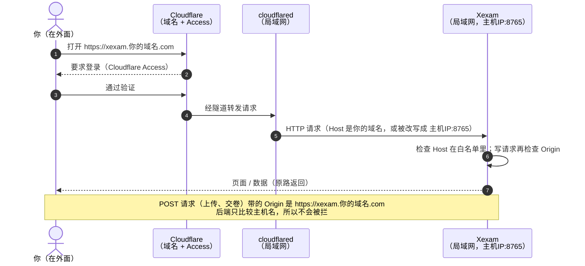

[English](../en/deployment.md) | [日本語](../ja/deployment.md) | **简体中文**

# 部署

> 新架构：`nginx`（唯一对外）+ `backend`（Rust，私有网络，不能上网）+ SQLite（命名卷 `xexam_data`），从 v0.8 起还有 `ai-service`（Rust，私有网络加上向外访问互联网，自己的 SQLite 放在卷 `xexam_ai_data` 里）。结构图见 [architecture.md](architecture.md)，安全边界见 [security.md](security.md)。

## 1. 前提

- 装了 Docker（含 Compose v2）的机器，x86（amd64）或 ARM（arm64）都行。
  - arm64 镜像在 CI 里用 QEMU **构建并启动**验证过（`/api/info` 报 `aarch64` 和正确的版本，Nginx `/healthz` 正常）；**没有在真正的 ARM 硬件上跑过**。
  - 后端和 ai-service 是在 x86 构建机上用 zig 交叉编译出 aarch64 版本的（冷缓存下 CI 各约 5 分钟，不需要在 QEMU 里编 Rust）。
    因为 zig 的链接器不接受 rustc 默认给 aarch64 加的 `--fix-cortex-a53-843419`，aarch64 产物**不带**这个针对 Cortex-A53 核心的勘误规避。
    Oracle Cloud 的 Ampere A1 用 Ampere Altra（据 Wikipedia 是 Arm Neoverse N1 核心），不是 Cortex-A53，所以不受影响；
    如果你要在 Cortex-A53 核心的板子上跑（部分老款开发板），请别用这个镜像，先告诉我。
- 宿主机上有 `/etc/localtime`（常见的 Linux 发行版都有）。没有的话，见第 3.1 节。

## 2. 启动

### 拉取现成的镜像（推荐）

只需要仓库 `docker/` 文件夹里的 [`docker-compose.yml`](../../docker/docker-compose.yml) 这一个文件（下载到单独的文件夹里，例如 `curl -fLO https://raw.githubusercontent.com/Yumin-Space/xexam/main/docker/docker-compose.yml`，然后在那个文件夹里运行命令）。它从 Docker Hub 拉取三个镜像（`docker.io/yuminspace/xexam-backend`、`docker.io/yuminspace/xexam-ai-service` 和 `docker.io/yuminspace/xexam-frontend`），这些镜像是公开的，所以不需要 `docker login`。同样的标签也在 `ghcr.io/yumin-space/` 上，作为私有镜像副本（用它要先 `docker login ghcr.io`，密码填一个有 `read:packages` 权限的经典令牌，即 Tokens (classic)）。

```bash
# 不需要 docker login：镜像在 Docker Hub 上是公开的
docker compose up -d
```

`docker compose up -d` 拉取并启动**三个容器**：`xexam-frontend`（Nginx，唯一对外）、`xexam-backend`（Rust，私有网络，不能上网）和 `ai-service`（Rust，AI 服务，镜像 `xexam-ai-service`：私有网络加上 `egress`，可以向外访问互联网，连到 AI 服务商）。后端一健康，前端就启动；它不等 ai-service，没有 ai-service Xexam 也能用。然后用浏览器打开 <http://localhost:8765>，用 `admin` / `admin` 登录；Xexam 会马上请你设置自己的密码（第 10 节）。打开菜单（右上角三条横线的按钮），选 **Question banks**（中文界面里叫 **题库管理**），导入你的 Excel 文件（六列格式，见 [usage.md](usage.md) 第 12 节）。界面一开始是英语；可以在 **Settings**（中文界面里是 **设置**）里，或者在登录页上换成中文或日语。

### 从源码构建（改代码时用）

```bash
git clone git@github.com:Yumin-Space/xexam.git
cd xexam
docker compose -f docker/docker-compose.build.yml up -d --build
```

第一次构建要几分钟（编译 Rust 和前端），之后会用缓存。克隆下来的仓库里，compose 文件和 `.env` 都在 `docker/` 里；`docker/docker-compose.build.yml` 以仓库根目录为构建上下文。下面的命令要在仓库根目录运行，并加上 `-f docker/docker-compose.build.yml`（例如 `docker compose -f docker/docker-compose.build.yml logs -f`）。

前端镜像需要三份更新日志（`docs/en/changelog.md`、`docs/ja/changelog.md` 和 `docs/zh-CN/changelog.md`）：**关于 Xexam** 页面显示它们，它们是构建进前端的。所以 `nginx/Dockerfile` 把它们复制进它的构建阶段，`.dockerignore` 把 `docs/` 排除在构建上下文之外，只把这三个文件放回来。最终镜像里只有构建出的静态文件。

下面的命令用的是 Compose 的**服务名** `backend`、`ai-service` 和 `frontend`。容器的名字是 `xexam-backend`、`ai-service` 和 `xexam-frontend`；普通的 `docker` 命令（`docker logs`、`docker exec`）要用容器名。`docker/docker-compose.build.yml` 把 `ai-service/Dockerfile` 构建成镜像 `xexam-ai-service:local`。

| 操作 | 命令 |
|---|---|
| 查看状态 | `docker compose ps`（三个容器都应该是 `healthy`） |
| 看日志 | `docker compose logs -f`（只看后端：`docker compose logs -f backend`；只看 ai-service：`docker compose logs -f ai-service`；见第 9 节） |
| 停止 / 再启动 | `docker compose stop` / `docker compose start` |
| 更新到最新版本 | `docker compose pull && docker compose up -d`（源码构建：`git pull && docker compose -f docker/docker-compose.build.yml up -d --build`）。从较早的版本升级时先看第 6 节 |
| 版本和架构 | <http://localhost:8765/api/info>，或者在程序里：菜单里的版本那一项，例如 **Xexam v0.9.1**（关于页面） |

> ⚠️ 不要运行 `docker compose down -v`：`-v` 会删掉两个数据卷：`xexam_data`（题库、账户和所有学习记录）和 `xexam_ai_data`（AI 设置和密钥、对话和记忆）。

**`docker/docker-compose.yml` 和 `docker/docker-compose.build.yml` 用的是同一个项目名（`xexam`）、同样的卷（`xexam_data`、`xexam_ai_data`、`xexam_link`）和同样的容器名**，所以两者不能同时运行；切换前先 `docker compose stop`。数据是两者共用的；见 [migration.md](migration.md)。

## 3. 配置（`.env`）

在 `docker-compose.yml` 旁边建一个 `.env` 文件；克隆的仓库里是 `docker/.env`，在仓库根目录用 `-f docker/...` 运行时 Compose 也会读它（以前克隆的仓库如果在根目录有 `.env`，请把它移到 `docker/`）。它不提交，也不进镜像；模板是 [`.env.example`](../../docker/.env.example)：

| 变量 | 默认 | 作用 |
|---|---|---|
| `XEXAM_BIND` | `127.0.0.1:8765` | 在宿主机上发布的「地址:端口」，给 Nginx 用。必须写成 `IP:端口`。`0.0.0.0:8765` = 局域网能连。⚠️ 只写端口号 = 所有网卡 |
| `XEXAM_ALLOWED_HOSTS` | 空 | 允许用哪些域名 / IP 访问，用逗号、空格或分号分隔 |
| `XEXAM_ALLOWED_ORIGINS` | 空 | 代理把 Host 改写成源站地址时：填公网域名（带 `https://`） |
| `XEXAM_ALLOW_ANY_HOST` | `0` | `1` = 不检查 Host（只在前面已经有身份验证时用） |
| `XEXAM_PARSE_TIMEOUT_SECS` | `30` | 解析一份 Excel 的最长时间 |
| `XEXAM_SQLITE_JOURNAL` | （不设：WAL） | `delete` 让 SQLite 继续用以前的回滚日志，而不是 WAL。只在数据卷放在网络文件系统上，或者是绑定挂载进 Docker Desktop 的 Windows 文件夹时才设置；其他任何值都表示 WAL。见 [database.md](database.md) 第 2.1 节 |
| `XEXAM_COOKIE_SECURE` | （不设） | `1` = 会话 Cookie 总是带 `Secure`。只在浏览器总是通过 HTTPS 访问 Xexam 时设置（例如通过 Cloudflare Tunnel）；不设时，`Secure` 按每个请求决定（第 10 节） |
| `XEXAM_LOG` | （不设：`info`） | 后端的日志过滤，`docker compose logs backend` 和系统日志页面都用它，例如 `debug` 或 `warn`。为空或只有空格 = `info`；不是有效过滤的值也退回 `info`，日志开头会有一条写明问题的警告 |
| `TZ` | （不设：宿主机的时区） | 数据库里时间的时区，以及 AI 用量统计里日期的时区；compose 文件把宿主机的 `/etc/localtime` 挂载进了后端和 ai-service，所以只有想用别的时区时才设置 `TZ`（例如 `UTC`） |
| `XEXAM_AI_SECRET_KEY` | （不设：AI 卷里的一个密钥文件） | 加密 AI 服务商密钥所用的密钥：32 字节，写成 64 个十六进制数字或 base64（`openssl rand -base64 32`）。见第 3.2 节 |
| `XEXAM_INTERNAL_TOKEN` | （不设：链接卷里的一个随机令牌） | 后端和 ai-service 共用的令牌，两者用同一个值：至少 32 个可打印的 ASCII 字符，不能有空格（`openssl rand -hex 32`）。见第 3.3 节 |
| `XEXAM_AI_LOG` | （不设：`info`） | ai-service 的日志过滤，`docker compose logs ai-service` 和它发到系统日志的行都用它；规则和 `XEXAM_LOG` 一样（为空 = `info`，无效的值退回 `info` 并记一条警告） |
| `XEXAM_AI_SQLITE_JOURNAL` | （不设：WAL） | `delete` = AI 数据库用回滚日志，用于和 `XEXAM_SQLITE_JOURNAL` 一样的特殊存储 |

v0.9 没有新增任何变量，compose 文件也没有改动。改了 `.env` 之后运行 `docker compose up -d`（它会按需重新创建容器）。compose 文件总是传递 `XEXAM_ALLOWED_HOSTS`、`XEXAM_ALLOWED_ORIGINS`、`XEXAM_ALLOW_ANY_HOST` 和 `XEXAM_PARSE_TIMEOUT_SECS`（`.env` 里没有设置时用上面的默认值）；`TZ`、`XEXAM_SQLITE_JOURNAL`、`XEXAM_COOKIE_SECURE`、`XEXAM_LOG` 和 `XEXAM_INTERNAL_TOKEN` 传给后端，`TZ`、`XEXAM_AI_SECRET_KEY`、`XEXAM_INTERNAL_TOKEN`、`XEXAM_AI_LOG` 和 `XEXAM_AI_SQLITE_JOURNAL` 传给 ai-service，都只在 `.env` 里设置了时才传递（像 `XEXAM_LOG=` 这样后面什么都没写的一行，会作为空值传递）。Host / Origin 的设置也适用于 AI 路由：Nginx 转发每个 AI 请求之前，后端都会先检查它。`XEXAM_BIND` 由 Compose 自己用来发布端口。`xexam-backend --help` 和 `xexam-ai-service --help` 分别列出各自读取的所有变量。

其余的变量由镜像自己设置，compose 文件不改动它们：

| 镜像 | 变量 |
|---|---|
| `xexam-backend` | `XEXAM_DATA=/data`、`XEXAM_HOST=0.0.0.0`、`XEXAM_PORT=8765`、`XEXAM_VERSION_FILE=/VERSION`、`XEXAM_LINK_DIR=/link`（写入 `internal.token` 的地方；不用 Docker 时默认是数据目录里的 `link`） |
| `ai-service` | `XEXAM_AI_DATA=/data`、`XEXAM_AI_HOST=0.0.0.0`、`XEXAM_AI_PORT=8766`、`XEXAM_AI_BACKEND_URL=http://backend:8765`（只能是普通的 http）、`XEXAM_LINK_DIR=/link`、`XEXAM_VERSION_FILE=/VERSION` |

### 3.1 时区

后端写入不带时区标记的本地时间（[database.md](database.md) 第 4.6 节），ai-service 按本地的日期统计用量。compose 文件用长格式的卷语法，把宿主机的 `/etc/localtime` 以只读方式挂载进后端容器和 ai-service 容器：

```yaml
      - type: bind
        source: /etc/localtime
        target: /etc/localtime
        read_only: true
        bind:
          create_host_path: false
```

所以时间跟随宿主机的时区；`.env` 里的 `TZ` 优先于它。`create_host_path: false` 让 Compose 在没有 `/etc/localtime` 的宿主机上报错停下（「bind source path does not exist」），而不是在那里建一个空文件夹（它挂载不到镜像里的文件上）。**在这样的宿主机上，请从 `docker-compose.yml` 里删掉这六行（后端和 ai-service 里各有一处），并在 `.env` 里设置 `TZ`**（例如 `TZ=UTC`），否则容器起不来。既没有这个挂载、也没有 `TZ` 时，镜像用 UTC。

在 Docker Desktop（Windows、macOS）上，宿主机的 `/etc/localtime` 是 Docker 自己的虚拟机里的文件，不是你电脑上的，而那台虚拟机通常用的是 UTC。挂载本身没问题，但不管你的电脑用什么时区，时间都会是 UTC：请在 `.env` 的 `TZ` 里设置你想用的时区。

AI 对话里 AI+ 学习对话的标题（一次练习或考试的开始时间、一条记录的时间）是 ai-service 按它自己容器的时区写的，所以它们遵循同一个设置。

以后再改时区不会改写已经保存的时间；它们保留写入时的时区。

### 3.2 AI 加密密钥（`XEXAM_AI_SECRET_KEY`）

ai-service 把在 **AI 设置** 里输入的服务商密钥加密保存（见 [security.md](security.md) 第 11 节）。加密它们的密钥来自两个地方之一：

- **不设（默认）**：第一次启动时，ai-service 在它自己的卷 `xexam_ai_data` 里创建密钥文件 `/data/secret.key`（32 个随机字节，权限 0600），并记录 `Created a new AI key file /data/secret.key`；之后每次启动记录 `AI encryption key: /data/secret.key`。这时这个卷的备份里既有加密的密钥，也有解开它们的密钥。
- **`.env` 里的 `XEXAM_AI_SECRET_KEY`**：32 字节，写成 64 个十六进制数字或 base64，例如 `openssl rand -base64 32` 的输出。这时不使用密钥文件，只有 AI 卷的副本也解不开密钥。日志里写 `AI encryption key: from XEXAM_AI_SECRET_KEY`。请把这个值保存在服务器以外的安全地方。

会出什么问题、看起来是什么样（每种情况下 AI 都保持关闭；Xexam 的其他部分照常可用）：

| 情况 | 日志 | 解决办法 |
|---|---|---|
| 设置了 `XEXAM_AI_SECRET_KEY`，但不是十六进制或 base64 的 32 字节 | `XEXAM_AI_SECRET_KEY is not a valid key (expected 32 bytes as 64 hex digits or base64); AI is off` | 改正这个值，然后运行 `docker compose up -d`（从不退回到使用文件） |
| 密钥文件损坏了 | `The AI key file /data/secret.key is not valid; AI is off. Move it out of the AI data volume and restart the ai-service container to create a new one, then enter the AI keys again` | 按这行日志说的做 |
| 密钥被更换或丢失（另一个 `XEXAM_AI_SECRET_KEY`、新的密钥文件、恢复的数据库没带它的密钥） | `The saved AI keys cannot be decrypted: the AI encryption key was changed or lost. AI is off until an administrator enters the keys again` | 在 **AI 设置** 里重新输入密钥，测试，开启 |

从密钥文件换成 `XEXAM_AI_SECRET_KEY`（或者反过来）也算更换了密钥：之后请重新输入 AI 密钥。其他什么都不会丢；对话和记忆不是用它加密的。

### 3.3 内部令牌（`XEXAM_INTERNAL_TOKEN`）

后端和 ai-service 共用一个机密，即**内部令牌**：后端用它给 Nginx 传给 ai-service 的那份简短的「是谁在请求」的声明签名，ai-service 调用后端时用它认证（包括它的状态报告，即心跳；见 [architecture.md](architecture.md) 第 5 节）。

- **不设（默认）**：`/link/internal.token` 不存在时，`xexam-backend serve` 在卷 `xexam_link` 里创建它（32 个随机字节，43 个字符，权限 0600），并记录 `AI link: /link/internal.token`。ai-service 从同一个卷（以只读方式挂载）读取它，并记录 `AI link: connected to the main service`。什么都不用做。
- **`.env` 里的 `XEXAM_INTERNAL_TOKEN`**：至少 32 个可打印的 ASCII 字符，不能有空格，例如 `openssl rand -hex 32` 的输出。compose 文件把这一行传给两个服务，所以它们总是得到同一个值；这时后端不写文件，并记录 `AI link: using XEXAM_INTERNAL_TOKEN`。值前后的空白会被忽略。
- 不符合规则的值会在**两个**服务里关闭这条连接，并记录下面其中一行：`XEXAM_INTERNAL_TOKEN is too short (at least 32 characters); AI link off` 或 `XEXAM_INTERNAL_TOKEN may contain only printable ASCII characters without spaces; AI link off`。改正之前 AI 对话不可用（`ai.backendDown`）。
- 两个服务不一致时（例如不用这个 compose 文件运行时，只给其中一个设置了令牌），ai-service 记录 `AI link: the main service refused the internal token (XEXAM_INTERNAL_TOKEN must be the same for both services)`，没有有效声明就到达它的请求会被拒绝，并记录 `refused a request without a valid identity (requests must come through Nginx; XEXAM_INTERNAL_TOKEN must be the same for both services)`，最多每分钟一次。
- 更换令牌：停止两个服务，清空链接卷（`docker run --rm -v xexam_link:/link alpine rm -f /link/internal.token`）或修改 `XEXAM_INTERNAL_TOKEN`，然后再启动。ai-service 也会在几秒内自己用上新的令牌。

### 3.4 AI 服务商（在程序里设置，不在 `.env` 里）

服务商、它的地址、密钥和模型由管理员在 **AI 设置**（见 [usage.md](usage.md) 第 17 节）里选择，保存在 AI 数据库里。只有 `ai-service` 容器连接它们，经过 `egress` 网络，使用 HTTPS（rustls，内置 Mozilla 根证书；忽略代理变量 `HTTP_PROXY` / `HTTPS_PROXY`，不跟随重定向）。

| AI 设置里的服务商 | 地址 | 请求 | 认证 |
|---|---|---|---|
| **OpenAI 兼容 API**（默认） | 一开始是 `https://api.openai.com/v1`；任何提供 OpenAI chat completions API 的服务器都行，包括本地的（通常以 `/v1` 结尾） | `GET {地址}/models`（模型列表）、`POST {地址}/chat/completions`，带 `"stream": true` | `Authorization: Bearer <API 密钥>`；没有保存密钥时不带这个请求头（本地服务器） |
| **Anthropic** | `https://api.anthropic.com`（末尾的 `/v1` 在保存时去掉） | `GET {地址}/v1/models?limit=1000`、`POST {地址}/v1/messages`，带 `"stream": true` | `x-api-key: <API 密钥>` 和 `anthropic-version: 2023-06-01` |
| **Cloudflare AI Gateway** | 你的网关地址，例如 `https://ai-gateway.example.com/<route>`（`…/openai` 或 `…/anthropic`）；**API 格式** 是 OpenAI 或 Anthropic，按地址的最后一段自动填好 | 和所选格式一样，放在那个地址下面 | **网关 API 密钥** 按 **网关认证方式** 发送：`bearer` → `Authorization: Bearer <密钥>`，`x-api-key` → `x-api-key: <密钥>`，`cf-aig-authorization` → `cf-aig-authorization: Bearer <密钥>`；另外，只在网关需要时，按格式发送 **服务商密钥**（OpenAI 用 `Authorization: Bearer`，Anthropic 用 `x-api-key`） |

- **自带密钥（BYOK）**：网关自己保存了服务商的密钥时，**服务商密钥** 留空。两个密钥都需要时，请选认证方式 `cf-aig-authorization`：用 `bearer`（OpenAI 格式）或 `x-api-key`（Anthropic 格式）时，两个密钥要用同一个请求头，AI 设置会拒绝这种组合。
- **发送什么**：模型、系统提示词（英语：回答要清楚，用用户写的语言回答，再加上日期和用户的记忆笔记）、对话里以前的消息（从最新的开始，默认最多大约 24 000 个字符）和新消息。不设置 temperature 或其他采样参数。OpenAI 格式用 `stream_options.include_usage` 请求返回 Token 数；Anthropic 格式的 `max_tokens` 是 8192。如果服务商在 **测试** 时拒绝了其中任何一项，测试会不带它（或者改用 4096）再试一次，并保留行得通的那种。
- **时间限制**：连接 10 秒，回答的第一个字节 120 秒，最多 120 秒没有任何数据，整个回答 10 分钟（已经生成的文字保留）；模型列表 30 秒；测试每次最多 2 分钟。
- 服务商的**错误** 从不以它自己的文字显示：它们变成固定的错误码（`ai.up.auth`、`ai.up.quota`、`ai.up.rateLimit` 等，见 [api.md](api.md) 第 5 节），由页面翻译。因为设置而失败的测试（密钥、额度、模型、请求被拒绝、回应无法读取）会关闭 AI；临时的失败不会。
- **你自己网络里的服务商**（例如本地的模型服务器）可以用 `http://`；ai-service 容器必须能连到它的地址。除非主机是 `localhost`、`127.0.0.1`、`[::1]` 或不带点的名字，AI 设置都会警告密钥以明文传输。

## 4. 从手机、另一台电脑或互联网打开 Xexam

默认 Xexam 只绑定本机（`127.0.0.1`）：只有运行 Docker 的那台机器自己能打开 <http://localhost:8765>。Xexam 有自己的登录，但能连到这个端口的人就能打开登录页，所以只开放到你需要的程度。

### 从另一台电脑经 SSH 打开（不用改配置）

Xexam 跑在一台你能用 SSH 登录的服务器、NAS 或虚拟机上时，在你自己的电脑上运行：

```bash
ssh -L 8765:127.0.0.1:8765 user@server
```

这个 SSH 连接开着的时候，在你自己的电脑上用浏览器打开 <http://localhost:8765>。服务器上什么都不用改，也不用开放端口。

### 同一个网络里的手机或电脑

**只在你信任的网络里**这样做（例如家里的 Wi-Fi），不要在公共的或和别人共用的网络里开：

1. 查出运行 Docker 的那台机器的局域网 IP（通常是 `192.168.x.x` 或 `10.x.x.x`）：Windows 上运行 `ipconfig`，看「IPv4 地址」那一行；macOS 上运行 `ipconfig getifaddr en0`；Linux 上运行 `hostname -I`（通常是第一个地址）。
2. 在 `.env` 里写两行，用那个地址：

   ```ini
   XEXAM_BIND=0.0.0.0:8765
   XEXAM_ALLOWED_HOSTS=192.168.1.20      # 运行 Docker 的那台机器的局域网 IP
   ```

3. 运行 `docker compose up -d`，然后在手机（iPhone 用 Safari，需要 iOS 15.4 或更新）或另一台电脑的浏览器里打开这个地址加端口 8765（这里是 `http://192.168.1.20:8765`）。

离开这个网络时，请用 Cloudflare Tunnel（见下文）；永远不要在路由器上做端口映射。

### 经 Cloudflare Tunnel 从互联网访问

适用场景：Xexam 跑在你的局域网里，`cloudflared`（Cloudflare 的隧道客户端）在同一个局域网里的某台机器上（不一定是同一台），你想通过自己的域名从外面访问 Xexam，并用 **Cloudflare Access** 保护它。后端本来就不对外，所以隧道只需要指向 **Nginx**（`XEXAM_BIND` 发布的端口）。



要做三件事：

1. **让 cloudflared 连得到 Nginx。** 在同一台机器上就保持默认的绑定，隧道指向 `http://localhost:8765`。在局域网里的另一台机器上，在 `.env` 里设置 `XEXAM_BIND=0.0.0.0:8765`（或者一个具体的局域网 IP，例如 `192.168.1.20:8765`），再加上 `XEXAM_ALLOWED_HOSTS=xexam.你的域名.com`，然后运行 `docker compose up -d`。
2. Zero Trust 控制台里的 **Public Hostname**（Networks → Tunnels → 你的隧道 → Public Hostname）：Subdomain / Domain 填 `xexam` / `你的域名.com`，Service Type 填 `HTTP`（不是 HTTPS），URL 填 `主机IP:8765`（例如 `192.168.1.20:8765`）。
3. **在 Cloudflare Access 里加一条策略**，**只允许你自己**和你邀请的人。没有策略的域名等于对全世界公开。

后端看到的 Host 取决于隧道（`.env`）：

| 隧道怎么做 | 设置 |
|---|---|
| Host 原样转成你的域名 | `XEXAM_ALLOWED_HOSTS=xexam.你的域名.com` |
| 设了 `httpHostHeader`，Host 被改写成 `192.168.1.20:8765` | `XEXAM_ALLOWED_HOSTS=192.168.1.20` + `XEXAM_ALLOWED_ORIGINS=https://xexam.你的域名.com`（浏览器发的 `Origin` 仍是公网域名，所以要单独放行） |
| 不确定 | 先照第一行做。请求被拒绝（403）时，页面会写出它看到的 `Host` / `Origin`，以及它该加进哪个选项；加进去，再运行一次 `docker compose up -d`。同样的原因也写在 `docker compose logs backend` 和 **系统日志** 里 |
| 不想列域名，前面已经有 Access | `XEXAM_ALLOW_ANY_HOST=1`（不再检查 `Host`；写请求的 `Origin` 检查和登录仍然有效） |

Nginx 把浏览器（或隧道）发来的 `Host` **原样**转给后端，并清掉 `X-Forwarded-*`；后端只读真实的 `Host`。

**隧道后面的所有人共用一个限流额度。** Nginx 按客户端地址限制请求数：`/api/` 每秒 30 个请求，突发 120；`/api/upload` 每秒 1 个，突发 5；`/api/ai/` 每秒 30 个，突发 120（见 [security.md](security.md) 第 9 节）。通过隧道时，所有用户都来自 cloudflared 的地址，所以都算在同一个额度里。打开一个页面大约发十个请求，开着的系统日志页每秒两个，远低于这个额度；万一还是达到了，页面会重试它的读取，然后显示 **请求太频繁**（见 [usage.md](usage.md) 第 19 节）。开始生成 AI 回答则改为按会话限制（每分钟 20 个，突发 10，AI 对话的发送和重试，以及从 v0.9 起的 AI 提示、解释和总结一起计数），所以同一个隧道后面的用户不共用这个额度。连续快速地点许多题的 **AI 解析** 可能会达到它；弹出框这时会说请等几秒。

**通过隧道使用 AI 对话和学习帮助。** AI 对话和 AI+ 学习帮助（提示、解释、总结）的回答以 server-sent events 流（`text/event-stream`）送来。Nginx 不缓冲地转发它们，cloudflared 对这种内容类型也不缓冲，服务商没有动静时，ai-service 每 15 秒发一条 keep-alive 注释，远低于 Cloudflare 大约 100 秒的空闲上限；所以在你的网络之外，文字也会一段一段地出现。万一连接还是断了（手机休眠、隧道重新连接），回答仍然会生成并保存，页面能再连到 Xexam 时就会接上它。AI 设置里有一个请求可能很久：**测试** 要等模型的一个回答（每次最多 2 分钟，Nginx 最多等 5 分钟）；Cloudflare 可能在大约 100 秒后用它自己的错误页结束这样的请求。测试在 ai-service 里仍然会完成；刷新 AI 设置就能看到结果。

不要忘记的事：

- ⚠️ **Xexam 自己的登录是这个端口上唯一的锁。** 设了 `XEXAM_BIND=0.0.0.0:…` 或 `XEXAM_ALLOW_ANY_HOST=1` 之后，能连到这个端口的人就能打开登录页并试密码（越来越久的锁定能拖慢这种尝试，但弱密码终究是弱密码）。只让 cloudflared 连得到这个端口：路由器上不要做端口映射。在 Linux 上，主机防火墙（ufw、firewalld）拦不住 Docker 发布的端口；请用 `DOCKER-USER` 链，或者在 `XEXAM_BIND` 里写一个具体的局域网 IP。最稳的是让 cloudflared 和 Xexam 在同一台机器上，保持默认的 `127.0.0.1`。
- 第一次登录时就把默认的 `admin` 密码改掉，并给每个用户设一个他自己的密码。
- 在 Cloudflare Access 后面要登录两次（先 Access，再 Xexam）。Access 的登录过期后，上传或交卷会失败，提示可能是登录已过期：刷新页面、重新登录就行。做到一半的考试或练习存在浏览器里，不会丢。

验证到什么程度（如实说明）：

- 迁移期间，两种 Host 情况（Host 保留 / Host 被改写）下完整的浏览器流程，是在**旧的 Python 版**上，用真实的 Chrome 和一个 HTTPS 反向代理跑通的。那个脚本依赖旧的 Python 代码，已经随它一起删掉了。
- 对**新的技术栈**：`tests/integration/stack_check.py` 用请求头层面的检查验证「经过 Nginx 之后，Host / Origin 守卫仍然有效，`X-Forwarded-*` 不被信任」；`nginx_check.py` 验证 Host 原样透传，并检查限流。
- **没有**用真正的 Cloudflare 测过。第一次上线时，请按上表「不确定」那一行做，并看页面给出的 403 提示。

## 5. 数据

- 位置：命名卷 `xexam_data` → 容器里的 `/data/xexam.db`。更新、重建或删除容器都不会丢。数据库里有题库、账户、学习记录和设置。
- 后端运行时，数据库旁边有 SQLite 的 `xexam.db-wal` 和 `xexam.db-shm`（WAL 模式，从 v0.7 起）。正常停止时，后端把所有内容复制进 `xexam.db`，并清空 `xexam.db-wal`；这两个文件可能空着留在旁边，没有害处。
- 卷里还可能有一个 `/data/backups/` 文件夹，里面是 schema 迁移前写的副本（第 6 节）。程序永远不会删除这些文件。查看它们：`docker run --rm -v xexam_data:/data alpine ls -l /data /data/backups`。
- **AI 服务的数据**（v0.8）在它自己的命名卷 `xexam_ai_data` 里 → `ai-service` 容器里的 `/data`：`xexam-ai.db`（AI 设置、加密的服务商密钥、安全上限、对话、记忆、用量统计；WAL 模式，带它的 `-wal` / `-shm` 文件）和密钥文件 `secret.key`（第 3.2 节）；从 v0.9 起，它的对话里还包括 AI+ 学习功能的练习、考试和记录总结对话，其中有题目文字和 AI 的回答，卷里还会有一个文件夹 `/data/backups/`，放着 AI schema 升级前写的副本（第 6 节）。后端从不挂载它，ai-service 也从不挂载 `xexam_data`。
- **链接卷** `xexam_link` → `/link` 里只有 `internal.token`（第 3.3 节）；后端以读写方式挂载它，ai-service 以只读方式挂载。
- **备份**：先停止 Xexam（`docker compose stop`），打包**两个数据卷**，再启动：命令见 [database.md](database.md) 第 5 节和第 8.4 节。后端运行时只复制 `xexam.db`，可能会漏掉还在 `xexam.db-wal` 里的最新修改；不能停止时，请把 `xexam.db`、`xexam.db-wal` 和 `xexam.db-shm` 一起复制（`xexam-ai.db` 也一样）。备份卷时也会备份 `backups/`。`xexam_ai_data` 的备份里有密钥文件，它能解密已保存的 AI 密钥：请像对待密钥一样妥善保管，或者设置 `XEXAM_AI_SECRET_KEY`，让密钥不在卷里。删除了的对话仍然留在你以前做的备份里。`xexam_link` 不用备份：它为空时后端会写一个新令牌。
- 不用 Docker、直接运行后端（开发时）：见 [development.md](development.md)。

## 6. 升级

每次升级都是 `docker compose pull && docker compose up -d`（注明需要时，先换上新的 `docker-compose.yml`）。新的后端第一次启动时，会先往 `/data/backups/` 写一份副本，再把数据库迁移到它的 schema；副本写不出来（磁盘满、没有权限）时，它报错退出，数据库不变。Docker 会不断重启它，每次启动都再试一次；Nginx 不会启动，因为它要等后端健康。`docker compose logs backend` 里写着原因。也请先自己备份一次卷（第 5 节）：卷以外的副本更保险。

ai-service 对自己的数据库也这样做：v0.9 的 ai-service 第一次启动时，会先往**AI 卷里**的 `/data/backups/` 写一份副本（`xexam-ai-schema<N>-<日期时间>.db`），再把 `xexam-ai.db` 升级到 schema 3；副本写不出来时它不启动（Xexam 的其余部分照常工作；`docker compose logs ai-service` 里写着原因）。**请为每个数据库留出大约和它一样大的可用磁盘空间**（副本是一个完整的文件），并且要知道这些副本从不清理，会保留你以后删除的东西（记录、题库、对话）：在这有关系时请自己删掉旧的。

**从 v0.6 或更早的版本升级，请先准备好六列格式的工作簿。** 从 v0.7 起只能导入六列格式，后端每次启动时都会下架所有从以前版本的三列或四列格式导入的题（题库、学习记录和统计保留）。v0.6 及更早版本的题库全都是这些格式，所以升级之后，要等每个题库都用六列格式的文件更新过，才有题可做（见 [usage.md](usage.md) 第 13.5 节）。

逐步的检查清单、升级后的检查和回退见 [migration.md](migration.md)：

- **从 v0.8**（migration.md 第 0 节）：`docker compose pull && docker compose up -d`，不需要改 compose，也没有新变量。主数据库从 schema 5 升到 6（备份 `xexam-schema5-<日期时间>.db`，在 `xexam_data` 里），AI 数据库从 schema 2 升到 3（备份 `xexam-ai-schema2-<日期时间>.db`，在 `xexam_ai_data` 里）。别的都保持原样；AI+ 学习功能对有 AI+ 功能的账户马上出现，没有什么要设置的。回退：主数据库不需要恢复，AI 数据库需要（见下）。
- **从 v0.7.5 或 v0.7**（migration.md 第 1 节）：**换上新的 `docker-compose.yml`**（服务 `ai-service` 和第三个镜像 `xexam-ai-service`、卷 `xexam_ai_data` 和 `xexam_link`、网络 `egress`）；schema v4 → v6，备份 `xexam-schema4-<日期时间>.db`；AI 数据库是新建的（schema 3）。管理员设置之前 AI 保持关闭。用旧的 compose 文件，除了 AI 以外一切照常：**AI 设置** 这时仍然能打开，并说明 ai-service 没有运行（提示要换上新的 compose 文件），用户管理里的 AI+ 功能开关则被隐藏。
- **从 v0.6**（migration.md 第 2 节）：schema v3 → v6，备份 `xexam-schema3-<日期时间>.db`，WAL 模式，然后下架旧格式的题。也请换上新的 `docker-compose.yml`：它加入了 ai-service，不再设置固定的默认时区（而是跟随宿主机，第 3.1 节），限制容器日志的大小（第 8 节），并在 `.env` 里设置了时传递 `XEXAM_SQLITE_JOURNAL`、`XEXAM_COOKIE_SECURE`、`XEXAM_LOG` 和 AI 的变量。如果你以前的时间是用和宿主机不同的时区写入的，请在 `.env` 里把那个时区设成 `TZ`，这样新的记录会接着用它。不需要新增任何变量。
- **从 v0.5 或 v0.5.1**（migration.md 第 3 节）：schema v2 → v6 一步到位，备份 `xexam-schema2-<日期时间>.db`。登录是新加的：用 `admin` / `admin` 登录，以前的所有数据现在都归它。
- **从 v0.4**（migration.md 第 4 节）：schema v1 → v6 一步到位，备份 `xexam-schema1-<日期时间>.db`。从 v0.5.1 起，镜像来自 Docker Hub（`docker.io/yuminspace/…`，公开，不用登录），不再来自 `ghcr.io`：把你的 `docker-compose.yml` 换成新的那份（或者把里面的两行 `image:` 改成 `docker.io/yuminspace/xexam-backend:latest` 和 `docker.io/yuminspace/xexam-frontend:latest`）。源码构建时，compose 文件现在在 `docker/` 里：把仓库根目录的 `.env` 移到 `docker/.env`。

升级后，`/api/info` 显示 `"version": "0.9.1"`。以后再启动不会再迁移；没有剩下要下架的旧格式题目时，下架这一步也什么都不写。**回退**就是恢复 `backups/` 里的副本，然后运行较早的镜像（从 v0.9 回到 v0.8，只有 AI 数据库需要它的副本：v0.8 的后端会原样打开 schema 6 的主数据库，而 v0.8 的 ai-service 会拒绝 schema 3 的 AI 数据库，恢复时 AI 在升级之后写的一切都会丢失）；除了应急，不要在迁移过的数据库上长时间运行较早的版本。具体的命令见 [migration.md](migration.md)；背景见 [database.md](database.md) 第 6 节。

## 7. 健康检查和停止

- `xexam-frontend`：`GET /healthz`（不经过 Host 白名单）。`xexam-backend`：`xexam-backend healthcheck`（在容器里用 `Host: 127.0.0.1` 请求自己）。`ai-service`：`xexam-ai-service healthcheck`（在 127.0.0.1 上请求它自己的 `GET /healthz`，既不需要后端，也不需要服务商；每 30 秒一次）。后端健康之后 Nginx 和 ai-service 才启动（`depends_on`）；Nginx 不等 ai-service。
- 后端停了或正在重启时，Nginx 不会退出；`/api/` 只是暂时返回一个 JSON 的 502（`后端暂时连不上`），后端回来后自动恢复。这时 AI 请求得到 503 `ai.backendDown`。
- ai-service 不存在、停止或不健康时，`/api/ai/*` 返回 JSON 502 `ai.unavailable`，AI 对话从菜单里消失（用它的地址打开时，只说 AI 暂时无法使用；只有管理员会看到 ai-service 没有连上），用户管理里的 AI+ 功能开关也消失（开启或关闭某个开关会被拒绝，409 `ai.serviceOff`，什么都不改变；已经存储的开关保持不变），**AI 设置** 打开时显示一个写明原因的状态面板。后端怎么知道：ai-service 每 25 秒向它报告一次（心跳，[architecture.md](architecture.md) 第 5 节）；60 秒没有报告，就算 ai-service 没有连上，正常停止时则马上算。这个面板每 10 秒重新检查一次，ai-service 回来之后不久页面就会自动恢复正常（它一启动就会报告）；其他一切一直照常。
- `docker compose stop`：后端在 8 秒内平稳退出（Docker 最多等 15 秒）；导入的事务要么提交完成，要么回滚。然后它执行 WAL 检查点，所以所有内容都在 `xexam.db` 里，`xexam.db-wal` 是空的（日志里写着 `WAL checkpoint at shutdown: everything is in xexam.db, the -wal file is empty`）。崩溃或 `docker kill` 之后 `-wal` 文件会留下；SQLite 在下次启动时套用它，已经提交的东西不会丢。
- 对 ai-service 执行 `docker compose stop`：每个正在生成的回答都以 **已停止** 结束，并在 8 秒内保存，然后它发送最后的「stopping」报告（这样后端马上就显示它已停止）和最后的日志行（各最多 2 秒），并对它的数据库执行检查点。被崩溃打断的回答会在下次启动时标记为中断。

## 8. 资源和镜像

| | |
|---|---|
| `xexam-frontend` | nginx-unprivileged + 静态文件（关于页面的更新日志也在其中）；监听 8080；根文件系统只读 |
| `xexam-backend` | 一个静态链接的可执行文件 + tzdata（UTC 的 `/etc/localtime` 作为后备）+ `/VERSION`；uid 10001；根文件系统只读，只有 `/data`、`/link` 和 `/tmp` 可写 |
| `ai-service` | 一个静态链接的可执行文件 + tzdata + `/VERSION`；uid 10001；根文件系统只读，只有它的 `/data` 和 `/tmp` 可写（`/link` 只读）；在网络内部监听 8766，不发布端口 |
| 网络 | `internal`（后端、ai-service 和 Nginx，不能访问外部网络）、`public`（只有 Nginx）和 `egress`（只有 ai-service：为 AI 服务商向外访问互联网） |
| 容器日志 | 每个容器的日志驱动都是 `json-file`，`max-size: 10m`、`max-file: 3`，所以 Docker 为每个容器最多保留约 30 MB 日志（不加限制时，Docker 会一直保留容器日志） |

## 9. 日志：系统日志页面和 `docker compose logs`

有两个地方可以看后端记录的日志。两者显示同样的行，用同样的 `XEXAM_LOG`（默认 `info`）过滤。ai-service 把日志写进它自己的容器日志（`docker compose logs ai-service`，用 `XEXAM_AI_LOG` 过滤），同时也把它的日志行发给后端，系统日志以前缀 `AI: ` 显示它们（后端的 `docker compose logs backend` 里没有）。

| | **系统日志**（菜单里，只有管理员） | `docker compose logs backend` |
|---|---|---|
| 在哪里 | 程序里的 `#/logs` 页面，打开时每 0.5 秒读取一次（读取失败后间隔更长，最长每 10 秒一次） | 在服务器上 |
| 有多少 | 后端上次启动以来的最后 **2000** 行 | Docker 还保留着的全部：最多 3 个 10 MB 的文件，跨重启保留 |
| 重启之后 | 又是空的（只在内存里，从不写进数据库） | 保留 |
| 另外 | 级别筛选、搜索、**暂停** / **继续**、**跳到最新** | Nginx 的访问日志和错误日志：`docker compose logs frontend`（从 v0.9 起，访问日志里每个请求只显示不含查询字符串的路径） |

Compose 服务叫 `backend`（容器叫 `xexam-backend`），所以页面上的说明写的是：在服务器上、compose 文件所在的文件夹里运行 `docker compose logs backend`，不用 Compose 时运行 `docker logs xexam-backend`。在克隆的仓库里从根目录运行时，加上 `-f docker/docker-compose.yml`（或 `-f docker/docker-compose.build.yml`）。

日志里有什么：启动时的几行（版本、数据目录、日志模式、允许的主机、AI 连接、默认密码的提醒、升级信息，以及因为旧的 Excel 格式而被下架的题）、按用户名记录的登录和账户变更（`user "admin" signed in`、`user "admin" updated user "alex"`；登录时输入的、没有账户的名字从不记录）、被拒绝的上传和写入、警告和错误。它从不包含密码、会话令牌、Cookie 的值、确认码或题目文字。被 Host / Origin 检查拒绝的请求、失败的登录，以及没有账户的用户名被锁定，都先记一次，之后最多每分钟汇总一次，所以没人能不登录就把其他日志挤出这 2000 行。详见 [security.md](security.md) 第 8 节。

ai-service 的日志行：它的启动（`Xexam AI service 0.9.1 listening on 0.0.0.0:8766`、`AI database: /data/xexam-ai.db (journal: wal)`、加密密钥的来源）、连接（`AI link: connected to the main service`，每个连接只写一次；断开时写 `AI link: lost the main service`，所以长时间的中断是一对日志行，而不是每次重试一行）、管理员对 AI 设置和安全上限的每次修改、测试、**AI+ 功能** 开关、管理员的 暂停 和 恢复（日志行仍然写 `AI function turned off for user "sam" by admin "admin"`，以及 `… turned on …`）、AI 数据库的 schema 升级（带它备份副本的名字，`Upgraded the AI database to schema 3. A copy of the previous version was saved first: …`，对每个 schema 1 或 schema 2 的数据库都写；重新打开不写任何东西）、对话保留的总数（`AI retention: deleted N chats older than D days`）、因为泄露了答案而被扣下的提示（`AI hint withheld because it gave the answer away (user "sam")`，每分钟最多一行，之后是 `N more AI hints were withheld since the last report`，从不含任何文字）、后端学习路由的一个读不懂的回答（`AI link: an answer of /internal/ai/question could not be read`，每分钟最多一行）、失败的 AI 调用（`AI call failed for user "sam": ai.up.rateLimit (HTTP 429)`，同一个原因每分钟最多一行）、对话保留、删除已删除用户的数据，以及管理员查看或清除用户 AI 数据的审计日志。它们从不包含密钥、内部令牌、提示词、回答、对话标题、记忆笔记、题目文字、会话 key 或记录时间。心跳不写任何日志行。连不上后端期间，ai-service 最多保留 500 行，之后再发送；不得不丢掉一些时，开头会有一行 `<n> AI log lines were dropped while the main service was unreachable`；审计日志从不丢弃。

## 10. 第一次启动、账户和找回

- 安装或升级之后，打开 Xexam，用 `admin` / `admin` 登录，然后马上设置自己的密码；在那之前，能打开这个页面的人都能用默认密码。只要还有管理员在用它，登录页就会写出那个账户，后端每次启动也会打印一条提醒（`docker compose logs backend`）。
- 在 **用户管理**（菜单里，只有管理员）里添加其他人，并选择每个人能看到哪些题库。有 **可管理题库** 权限的用户可以导入题库，并更新或删除自己的题库。
- **AI** 在安装后是关闭的：在 **AI 设置** 里设置它（第 3.4 节和 [usage.md](usage.md) 第 17 节），然后在 **用户管理** 里为可以使用 AI 对话的用户开启 **AI+ 功能**（这些开关只在 ai-service 已连接、并且 AI 设置里的 AI+ 功能已开启时才出现）。全新安装时，AI 设置的状态行以 **连接未设置** 开头。自由模式只有管理员能选，在 **设置** 的 **AI 对话模式** 里；这里不需要任何设置。
- **忘了密码**：`docker compose exec backend xexam-backend reset-password admin`（不用 Compose 时：`docker exec xexam-backend xexam-backend reset-password admin`）会打印一个新的临时密码，启用这个账户，让它在所有地方退出登录，并在下次登录时要求设置新密码。服务器运行时也能用。
- **密码输错被锁定**：登录锁定在后端的内存里，所以 `reset-password`（另一个进程）解不开它。可以让另一个管理员在用户管理里点 **解锁**，或者重启后端：`docker compose restart backend`。
- 在 Cloudflare Access 后面要登录两次（先 Access，再 Xexam）。在自己的网络里用纯 HTTP 也能用：只有用 `https://` 打开页面时，会话 Cookie 才带 `Secure`。`XEXAM_COOKIE_SECURE=1`（第 3 节）强制总是带 `Secure`；只有浏览器总是通过 HTTPS 访问 Xexam 时才设置它。

## 11. 发布

推送到 `main` 时，[`.github/workflows/ci.yml`](../../.github/workflows/ci.yml) 先做版本、更新日志和文档的检查，再跑五组检查（前端、后端、ai-service、Nginx 和整栈、arm64）。全部通过才把 `xexam-frontend`、`xexam-backend` 和 `xexam-ai-service` 三个镜像（amd64 + arm64）发布到 Docker Hub（`docker.io/yuminspace/`，公开），并作为私有镜像副本发布到 `ghcr.io/yumin-space/`，标签都是 `latest`、`v<CODE_VERSION>` 和 `sha-<提交>`，并建立对应的 GitHub Release（说明里最先列出从 Docker Hub 拉取的命令）。最后记录这次发布：`VERSION` 里的 `RELEASE_VERSION` 和 README 的发布徽章，由机器人提交到 `main`（能快进时也提交到 `dev`）。推送到 `dev` 和向 `main` 提的拉取请求跑同样的检查，从不发布。详见 [development.md](development.md) 第 8 节。

Docker Hub 需要两个仓库机密 `DOCKERHUB_USERNAME` 和 `DOCKERHUB_TOKEN`（一个带 **Read & Write** 权限的访问令牌），另外可以设置仓库变量 `DOCKERHUB_NAMESPACE`（可选）；没有这两个机密，或者 `docker/docker-compose.yml` 里写的不是这个命名空间下的 Docker Hub 镜像，发布这一步会在推送任何东西之前停下。在 ghcr.io 上第一次发布一个新镜像名时（例如 v0.8 的 `xexam-ai-service`），要在 GitHub 的包设置里把本仓库加进 **Manage Actions access**，角色选 **Admin**，否则推送会被拒绝（`permission_denied: write_package`）。Docker Hub 的令牌必须能写入这三个仓库中的每一个。
