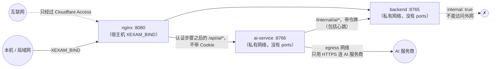

[English](../en/security.md) | [日本語](../ja/security.md) | **简体中文**

# 安全

> 适用范围：一个自己部署、给一小群互相认识的人用的程序；从 v0.6 起有**账户和登录**，有管理员和普通用户，从 v0.7 起还有**可管理题库的用户**。安全靠五件事：**后端不对外**、**Host/Origin 守卫**、**每个路由都要登录**（会话，以及密码输错后逐级加长的锁定）、**由后端检查的权限**（谁能看到和管理哪个题库、哪些记录属于谁），以及从互联网访问时**前面加一层身份验证，例如 Cloudflare Access**。从 v0.8 起，可选的 **AI 服务** 在自己的容器里运行，从不接收任何凭据，服务商的密钥加密保存（§11）。从 v0.9 起，它还为有 AI+ 功能的账户就他们自己的题目和记录给出提示、解释和总结，而这些内容它只能通过后端读取，而且只能带着调用者自己的会话读取（§11）。
> 审计依据：[audit/security.md](history/audit/security.md)。测试：`backend/tests/`（对着已提交的旧版快照运行：172 份黄金响应、解析夹具、id 向量；登录和用户在 `v06_users_and_sign_in.rs`，题库权限、所有权和练习在 `v065_bank_access_and_practice.rs` 和 `v07_bank_access_and_layouts.rs`，系统日志和大量被拒绝的请求在 `v07_wal_and_logs.rs` 和 `v07_log_floods.rs`，AI 连接、认证步骤和内部路由在 `v08_ai_link.rs`，学习数据路由在 `v09_ai_study.rs`）、`ai-service/tests/`（身份和访问、密钥和设置、流式输出、管理员的访问、日志里没有机密、忽略代理变量；从 v0.9 起，学习路由、提示守卫和存储分别在 `study_api.rs`、`study_guard.rs` 和 `v09_store.rs`）以及 `tests/integration/nginx_check.py`（Nginx，包括它的限流和 AI 路由）。迁移期间还用一批 340 个恶意请求的探测，逐项比较了旧版和新版（0 处无法解释的差异；51 处登记为有意的加固）。那套探测已经随旧的 Python 代码一起删掉了。

## 1. 威胁模型

| 谁 | 能做什么 | 我们的防线 |
|---|---|---|
| 同一个网络里的另一台机器 | 直接连这个端口 | 默认只绑定 `127.0.0.1`；要开放必须自己设置 `XEXAM_BIND`。除了 `/api/info`、`/api/auth/state` 和登录本身，每个路由都需要会话（§5），而 `/api/info` 只说版本、CPU 架构和程序能不能被关闭（§7）；密码输错会锁定登录，而且一次比一次久（§6） |
| 猜密码的人 | 对一个账户试很多密码，或者试很多编造的用户名 | 按账户逐级加长的锁定，和编造的名字分开，也和主人以前登录过的浏览器分开；Argon2id，同一时间最多 2 个（§6） |
| 已登录的用户 | 读取或修改别的用户的记录，看没有分配给他的题库，修改不属于他的题库，使用管理员路由 | 用户 id 始终来自会话；每次读取题库都限制在用户的范围内；所有权在写入的事务里检查；管理员路由检查角色（§7） |
| 恶意网页（在你的浏览器里） | 让浏览器向 `localhost:8765` 发写入或删除请求（CSRF） | 会话 Cookie 是 `SameSite=Strict`；写请求检查 `Origin` 的主机名和 `Host` 一样或在白名单里；JSON 接口要求 `Content-Type: application/json`（跨站表单发不出来）。删除只能通过这些 POST 接口，从不通过 GET |
| DNS 重绑定 | 让恶意域名解析到 127.0.0.1，从而读取你的数据 | 检查 `Host` 白名单；GET 请求也检查 |
| 恶意 / 损坏的 .xlsx | 压缩炸弹、XML 实体展开、让服务挂掉的畸形结构 | 见 §3 |
| 代理链上伪造的请求头 | `X-Forwarded-Host` 之类 | 后端**只读真实的 `Host` 头**；Nginx 清掉所有转发头 |
| 任何人都能发的大量请求 | 把系统日志填满，让真正的日志被挤掉；拖住后端 | 被拒绝的请求、失败的登录和编造的名字被锁定，最多每分钟汇总一次（§8）；Nginx 按客户端地址限制请求数（§9） |
| 供应链 | 依赖里的漏洞 | 依赖已锁定（后端和 ai-service 各自的 `Cargo.lock`、`package-lock.json`）；镜像里除了包管理器之外没有多余的内容；见 §10 |
| 被攻破或出错的 ai-service 容器 | 冒充主程序里的用户，读取主数据库，从后端访问互联网 | 它从不接收 Cookie、`Authorization` 请求头或 Cloudflare Access 令牌，只接收后端签名、有效 60 秒的身份声明；它从不挂载主卷；后端没有为它读取题库或记录的路由，也从不调用 ai-service（§11） |
| 有 AI+ 功能的已登录用户 | 就自己看不到的题库里的题，或别人的记录，向 AI 提问（伪造的学习请求） | 浏览器只发 id；ai-service 带着调用者自己的会话向后端询问，后端只对调用者能看到的题和调用者自己的记录作答。不存在、别人的或看不到的内容都得到同一个「未找到」回答，所以无法靠 id 探测（§11） |
| 有 AI+ 功能的已登录用户，或者用他的会话跑的脚本 | 大量调用 AI，推高服务商的账单或服务器负载 | 每个用户的请求上限（每分钟 5 次、每小时 20 次、每天 100 次，管理员也算），每个用户一个正在生成的回答，以及 Nginx 按地址和会话的限制（§9、§11） |
| 会泄露答案的 AI 提示 | 让提示点明正确选项 | 提示的提示词在构造时就不含答案；守卫在提示流出时扣下点明答案的提示。守卫是尽力而为的过滤，不是证明（§11、§12） |
| 已登录的用户 | 读取别的用户的 AI 对话或记忆 | 用户 id 只来自签名的身份；别人的对话和不存在的一样回答（§11） |
| 拿到 AI 卷或数据库副本的人 | 读取 AI 服务商的密钥 | 密钥是加密的（XChaCha20-Poly1305）；单独复制出来的数据库解不开，设置了 `XEXAM_AI_SECRET_KEY` 时密钥根本不在卷里（§11） |

**不在范围内**：主数据库的加密存储（AI 服务商的密钥是加密的，§11）、系统日志以外的审计记录、双因素登录，以及防范管理员（管理员能看到并管理一切，包括以只读方式查看拥有 AI+ 功能的用户的 AI 对话和记忆；每次这样的查看都会记录）。要从互联网访问，前面请保留 Cloudflare Access（或类似的东西）。

## 2. 网络

- 后端**从不发布端口**。`docker/docker-compose.yml` 里 `backend` 没有 `ports:`，它的网络是 `internal: true`；`tests/integration/stack_check.py` 断言从宿主机连不到后端。
- ai-service 也不发布端口。它在同一个私有网络上（这样 Nginx 能连到它，它也能连到后端），还在 `egress` 上，这是唯一能向外访问互联网的网络，其他容器都不加入。
- `XEXAM_BIND` 必须写成 `IP:端口`。只写端口号（如 `8766`）表示绑定所有网卡，这是常见的错误，所以文档里反复提醒。
- 在 Linux 上，主机防火墙（ufw / firewalld）**拦不住** Docker 发布的端口；要限制谁能连，请在 `DOCKER-USER` 链里加规则，或者把 `XEXAM_BIND` 写成具体的局域网 IP。

## 3. 上传（.xlsx）

只有管理员和可管理题库的用户能上传（其他人在读取请求体之前就得到 403）。下面的步骤按顺序执行。任何一步失败都返回 400/413 和一句固定的提示（中文），**什么都不写进数据库**：

1. 请求体大小：流式计数，**20 MiB**，按真实字节数，不信任 `Content-Length`；Nginx 在前面还有一道 `client_max_body_size 20m`（它返回同样提示文字的 JSON）。
2. 目标（`X-Bank-Target`）：在 Host、Origin、会话和大小检查之后、解析文件之前读取。不存在的题库是 404，上传者不能更新的题库是 403；两者都不花解析时间。
3. 按**内容**判断：`PK` 魔数、ZIP 结构，以及有没有工作簿。旧的 `.xls`、空文件和改了扩展名的文件各有自己的提示。
4. ZIP：条目 ≤ 10,000；**重复的条目名拒绝**（避免「检查的是一份、读取的是另一份」）；解压后的总大小有上限；用 `take(limit)` 限制读取，因为声明的大小不可信。
5. XML：**任何 DOCTYPE / 实体声明一律拒绝**，不管扩展名和编码（UTF-16 也拒绝）；深度 ≤ 64，节点 ≤ 100 万（100 × 10,000）。
6. 解析：有一个协作式的截止时间（默认 30 秒）。解析器每处理一批行 / XML 事件就看一次时钟，到时**自己停下**，所以超时之后不会继续占着 CPU 和内存。同一时间最多 2 个解析（`PARSE_CONCURRENCY`）；其余的排队，排队的时间也算进时限。
   另外还有内存上限：很多单元格引用同一个共享字符串时，它只存一份（不深拷贝）；A–D 列的单元格引用的总字节数不超过 64 MiB，E、F 两列（六列格式）另有一个 64 MiB 的额度；一个 XML 元素最多 256 个属性。
   只能导入六列格式（从 v0.7 起）：解析器从工作簿里读出任何一道旧的三列或四列格式的题时，这份工作簿在暂存任何东西之前就以 400 拒绝，确认时还会再检查一次。
7. 预览放进内存里**上传者自己的待确认槽位**，30 分钟后过期。别人既不能确认也不能取消它。所有槽位共用一个 128 MiB 的内存额度：暂存一次上传时，超出额度就丢掉别的用户最早的预览，所以很多可管理题库的用户也不能用预览把内存填满。确认码是 128 位随机数，只能用一次，按常量时间比较；错误的确认码不会消耗槽位里的内容。
8. 确认时在**一个事务**里写入一切，并在其中再次检查上传者能不能更新目标题库；文件里一道可用的题都没有时拒绝导入（防止把题库清空）。

旧版只扫描小写 `.xml` / `.rels` 的 ASCII 字节，所以用 UTF-16 或换个扩展名就能绕过。新版本加固的就是这一点（登记在 [api.md](api.md) 的差异表里）。

## 4. Host 和 Origin

| 检查 | 适用于 | 规则 |
|---|---|---|
| Host | 所有请求，包括 AI 路由（由后端的认证步骤检查，§11） | 必须在白名单里：默认是 `localhost`、`127.0.0.1`、`::1`；`XEXAM_ALLOWED_HOSTS` 可以再加；`XEXAM_ALLOW_ANY_HOST=1` 关掉这项检查 |
| Origin | 写请求 | 没有 → 放行（命令行工具不是跨站请求）；有 → **主机名**必须和 `Host` 的主机名一样，或在 `XEXAM_ALLOWED_ORIGINS` / 白名单里 |

要点：

- **只比较主机名**，不比较协议和端口：通过 HTTPS 域名访问时，Origin 是 `https://example.com`，Host 是 `example.com`，所以不会被误拦。
- 守卫读取真实的 `Host` 头。它**不读** `X-Forwarded-Host` / `Forwarded`，因为那等于把守卫交给了客户端。Nginx 用 `proxy_set_header Host $http_host` 原样转发，并清掉其他转发头。
- 这些检查在会话检查**之前**进行，所以被拒绝的请求永远到不了登录或任何数据。
- 请求被拒绝时，响应会写明你的 Host / Origin 是什么，应该把哪个值加进哪个选项（中文，页面会翻译）。日志里记一行英语：安静了一分钟之后的第一次拒绝单独记一行（`rejected GET /api/bank: Host "evil.example" is not in the allowed list`），之后的最多每分钟汇总一次（`rejected 250 request(s) by the Host / Origin check since the last report; the last one: …`）。
- 只有在**程序前面已经有身份验证**时才用 `XEXAM_ALLOW_ANY_HOST=1`；它不会关掉 Origin 检查，也不会关掉登录。

## 5. 登录和会话

- **密码**：8–128 个字符。用 Argon2id 保存（`argon2` crate 的默认参数，每个哈希一个随机盐），在阻塞任务里计算哈希和验证，同一时间最多 2 个；多出来的请求排队等待。不存在的用户名会对一个假的哈希做验证，所以回答的时间和提示（`用户名或密码不对。`）都不透露某个用户名是否存在；已停用的账户也得到同样的回答。
- **用户名**：1–40 个 ASCII 字母、数字和 `. _ - @`，不区分大小写地唯一。有意只用 ASCII：这样就不会有长得很像的名字。
- **会话**：Cookie `xexam_session` 里是操作系统给出的 32 个随机字节；数据库里只存它们的 SHA-256，所以数据库的副本里没有能用的令牌。有效期 30 天，使用期间最多每小时顺延一次；每个用户最多 20 个（超过时，新的登录会结束最先到期的那些）。**每次登录都创建新的令牌**；从不重复使用客户端发来的令牌。过期的会话在启动时清理，之后最多每小时清理一次。
- **修改密码时轮换会话**：修改自己的密码（在 **设置** 里，或者第一次登录时被要求修改）会结束这个账户的**每一个**会话，包括当前这个，这个浏览器在同一个回答里得到一个新的 `xexam_session` Cookie。所以复制或偷走的 Cookie 会失效，而你在这里仍然保持登录。如果请求进行期间密码在别处被修改或重置了，这次修改会被拒绝。
- **其他会让用户退出登录的修改**：管理员重置密码、停用账户、改角色、删除账户，以及命令行的 `reset-password`。修改用户的题库或可管理题库权限**不会**让他退出登录：后端在每个请求里都会读取权限。
- **Cookie**：`HttpOnly`、`SameSite=Strict`、`Path=/`；只有 `https://` 的 Origin 或设了 `XEXAM_COOKIE_SECURE=1` 时才加 `Secure`，所以在自己的网络里用纯 HTTP 仍然可以。写请求仍然要通过 Origin 检查。
- **已知浏览器**：登录和修改密码时还会设置 `xexam_device`（`HttpOnly`、`SameSite=Strict`、`Path=/api/auth`，400 天）：用户 id 的 HMAC-SHA256，以这个用户当前的密码哈希为密钥。服务器上不为它存任何东西，换了新密码，所有这样的 Cookie 都会失效。它只决定一次尝试计入哪个限制计数（§6）。
- **默认管理员**：没有用户的新数据库或升级来的数据库会得到 `admin` / `admin`，第一次登录时必须修改；在那之前，其他路由都回答 403。只要还有已启用的管理员在用默认密码，登录页就会写出那个账户，后端每次启动也会打印一条提醒。安装或升级之后请马上修改它。
- **管理员的保护**：至少要保留一个启用的管理员（`至少要保留一个启用的管理员。`）；管理员不能在用户管理里修改自己的角色、停用自己的账户、重置它的密码或删除它（`不能对自己的账户做这个操作。`）；自己的密码在 **设置** 里修改。
- **进不去了**：`docker compose exec backend xexam-backend reset-password <用户名>` 设置一个新的随机密码（16 个字符，只在终端上打印一次，从不写进日志），要求下次登录时设置新密码，启用账户并让它退出登录。没有数据库的数据目录它会拒绝。它解不开内存里的登录锁定（它是另一个进程）：请用 **解锁**，或者重启后端。
- **没有任何开关能关掉登录**：没有环境变量、参数或配置文件能做到。

## 6. 登录限制

密码输错会锁定登录，按轮次一次比一次久。状态**只在内存里**。

| 轮次 | 允许失败几次 | 然后锁定多久 |
|---|---|---|
| 1 | 15 分钟内 5 次 | 1 分钟 |
| 2 | 3 次，从上一次锁定结束时算起 | 5 分钟 |
| 3 | 3 次 | 15 分钟 |
| 4 | 3 次 | 30 分钟 |
| 5 | 3 次 | 1 小时 |
| 6 及以后 | 3 次 | 1 天（最长） |

- 每次尝试一开始（在任何哈希计算之前）就先算作一次失败，所以并行的猜测也会被计数；成功时再撤回。锁定期间每次尝试都回答 **429**，带 `retryAfter`（秒）和 `Retry-After` 头，即使密码是对的；这些拒绝不计数，也不延长锁定。
- **回到第 1 轮**：登录成功、管理员点 **解锁** 或重置密码、重启后端，或者 24 小时内既没有锁定也没有失败。
- 在 **设置 → 修改密码** 里**输错当前密码**，和登录计在同样的计数里，所以偷来的会话不能用来猜密码。

**按账户计数。** 登录时先查一下输入的名字（一个很便宜的查询，不做哈希）：

- **有账户的名字**（不管是否启用）计在以**用户 id** 为键的计数里。改名后正在进行的锁定还在（**解锁** 也仍然找得到它），删除的账户的状态被忘掉，之后用上旧名字的新账户从头开始。这些计数放在它们自己的表里，表的大小受账户数量限制，**从不**为了腾地方而清空：大量编造的名字没法把被猜的账户推回第 1 轮。
- **没有账户的名字**有自己的计数，轮次完全一样，所以回答从不透露某个用户名是否存在。不符合用户名规则的名字共用一个计数。这张**未知名字**的表最多存 **10,000** 个名字：回到第 1 轮、最近又没有动静的计数会定期清掉；仍然满的时候，先忘掉进展最少、没有被锁定的名字（只有所有名字都被锁定时才忘掉被锁定的）。忘掉这样的计数不会让任何东西失去保护，因为它后面没有账户。
- **权衡**：在这种大量请求下（每次探测约一万个请求），攻击者可以分辨一个名字有没有账户，因为只有没有账户的名字的状态会被忘掉。我们接受这一点：另一种做法是挤掉真实账户的状态，那就等于让任何人都能重置他正在猜的账户的锁定。

**已知浏览器。** 从带着这个账户有效的 `xexam_device` Cookie 的浏览器发起的尝试，计在这个账户的第二个计数里，轮次相同。所以别处的猜测只会锁住「其他浏览器」的计数，主人仍然可以在以前用过的浏览器上登录；在这样的浏览器里输错密码，锁住的是它自己的计数。通过已知浏览器登录成功，只让那个计数从头开始；不带这个 Cookie 登录成功，两个都从头开始。**解锁** 清除两个。两个计数都被锁定时，账户在所有浏览器上都被锁定，用户管理里也会这样写。

**整体压力。** 所有计数加起来 15 分钟内至少有 100 次失败时，自己最近一次失败不到一分钟的计数也会被拒绝（每个计数每分钟只能猜一次）。自己最近没有失败的计数从不被拒绝，所以大量编造的名字能拖慢猜测，却锁不住一个本身没被猜的账户。压力造成的拒绝和锁定一样是 429，但不会推进任何轮次。

**日志里写什么**（账户用用户名表示，从不写没有账户的、输入的名字）：

- 真实账户的锁定**在开始时记一次**，每次锁定一行：`sign-in of user "alex" from other browsers locked for 300 s (lock 2 in a row) after repeated failed attempts`（或 `from the browsers where it signed in before`）。
- **没有账户的用户名**的锁定会被汇总，因为任何人每编一个名字就能引起一次：安静了一分钟之后的第一次单独记，之后是 `N sign-in lock(s) of usernames without an account started since the last report; the last one: …`。
- **失败的登录**：安静了一分钟之后的第一次单独记一行（`failed sign-in of user "alex"`；密码正确但账户已停用时加上 `(the account is disabled)`；或者 `failed sign-in with a username that has no account`），之后是 `N failed sign-in(s) since the last report`，最多每分钟一次。
- **被拒绝（429）的尝试**：从不逐条记录；安静了一分钟之后的第一次马上报告，其余的由每分钟运行一次的定时器报告：`refused N password check(s) of locked or throttled sign-ins since the last report`。一阵尝试的最后一行在一分钟左右之内出现，即使后面没有再来任何尝试。

## 7. 角色、题库和别人的数据

### 角色和路由的访问级别

后端只有一张路由表；每个路由都写明谁能用它，检查在分发函数里、读取请求体之前进行一次：

| 访问级别 | 路由 |
|---|---|
| 公开 | `GET /api/info`、`GET /api/auth/state`、`POST /api/auth/login` |
| 登录 | 和你自己学习有关的一切：你能看到的题库、你的进度、记录和设置、交卷、自己的密码、退出登录 |
| 可管理题库（管理员和有这个权限的用户） | `POST /api/upload`、`/api/import/confirm`、`/api/import/cancel`、`/api/banks/delete`、`GET /api/imports`。其他人：403 `你没有管理题库的权限，请联系管理员。` |
| 管理员 | `GET /api/users`、`GET /api/logs`、`POST /api/users/*`、`POST /api/shutdown`。其他人：403 `只有管理员可以进行这个操作。` |

AI 路由（`/api/ai/*`）由 ai-service 响应，它有自己的三个级别（任何已登录的用户，从 v0.9 起包括学习功能的两个已保存回答的查询；AI 用户：AI+ 功能已开启、ai-service 已连接，用户是管理员或拥有 AI+ 功能，并且没有被暂停，从 v0.9 起包括请求提示、解释或总结；管理员，用于 `/api/ai/admin/*`）；见 §11 和 [api.md](api.md) 第 5 节。

`GET /api/info` 是公开的，因为登录页和容器的健康检查要用它；它只回答 `version`、`arch` 和 `canShutdown`（从 v0.7.5 起不再回答题目的数量，否则能连到服务器的任何人都能知道题库有多大）。它仍然会读取数据库，所以数据库坏了时健康检查会失败。

不在表里的路径也需要会话。账户需要设置新密码期间，它只能修改密码和退出登录（公开路由仍然可用）；其他一切都回答 403。角色和可管理题库权限随会话从数据库读出，所以管理员做的修改在这个用户的下一个请求就生效。

### 按用户设置题库

- 管理员能看到并管理所有题库。普通用户能看到管理员为他勾选的已有题库；开启 **包括以后导入的题库** 时，还能看到之后导入的每个题库；新用户在选好之前一个都看不到。可管理题库的用户在拥有这个权限期间，还能看到他自己导入的题库。
- 后端为每个请求根据会话（从不根据请求体）建立一个 `Viewer`，并把每次读取都限制在它的范围内：`/api/bank` 和 `/api/banks` 只列出能看到的题库，`/api/progress` 只统计这些题库里的题，记录详情里略去其他题库的题的文字（像已删除的题一样显示），`POST /api/attempt` 把其他题库的题完全当作不存在的题处理（不计入，也不为它写任何东西）。所以编造的或过时的请求不能为用户看不到的题库写统计。
- `/api/banks` **只向管理员显示所有者的名字**。其他用户只在自己拥有的题库上得到 `ownerId`，每个题库的学习数字也只是他自己的，而不是所有人的。

### 所有权（题库的 IDOR 防护）

- 题库属于把它作为新题库导入的用户。可管理题库的用户**只能**更新和删除**自己的**题库；对任何其他题库，回答都是 403 `这个题库不是你上传的，只能更新或删除你自己上传的题库。`。
- 这个检查在确认导入和删除题库的**写入事务里面**进行，而不只是在它之前。所以在检查和写入之间，任何东西都改不了所有者（例如管理员删除了这个用户的账户，题库因此转到那位管理员名下）；被拒绝的写入什么都不写。
- 可管理题库的用户删除自己的题库时勾选 **同时删除你在这个题库的学习记录**，只会删除他自己的记录；其他用户的记录保留。
- 题库 id、记录 id 和用户 id 只以参数的形式传给 SQLite。

### 别的用户的记录

- 学习记录、错题本和设置只为登录的用户读写。别的用户的记录 id，表现得和不存在的 id 完全一样（`GET /api/record`、`POST /api/records/delete`：404），所以没法探测 id。
- 一次上传的待确认导入属于上传它的人（§3）。

### 题库印记

`GET /api/auth/state` 给每个登录的用户一个 `library` 印记，让打开着的页面能发现题库变了。它是一个不透明的 32 位十六进制摘要（SHA-1 的前 16 个字节），而不是构成它的那些计数。对只能看到部分题库的用户，它只由这些题库和他的权限算出，所以既不透露、也不跟随他看不到的题库的大小、题数或更新时间。

### 严格的请求结构和明确的删除

- **每个路由都有同样的守卫**：每个请求都检查 Host；POST 还要检查 Origin、会话、`Content-Type: application/json`、1,000,000 字节的请求体上限，以及「请求体必须是 JSON 对象」。Nginx 对每个 `/api/` 路径都一样处理（方法、限流、超时）。
- **严格的结构。** `id` 必须是整数（布尔值不算），`withRecords`、`withStats`、`newBanks` 和 `canManageBanks` 这样的标记必须是布尔值，`all` 必须正好是 `true`，`banks` 必须是 `"all"` 或现存题库 id 的列表，`kind` 必须是 `exam` 或 `practice`。`GET /api/record` 只接受一个 1–18 位 ASCII 数字的 `id`。其他任何情况都是 400，什么都不改。
- **设置的校验。** 只读取四个已知的键。`theme` 必须是 `system`、`light` 或 `dark`；`uiLang` 是 `en`、`zh` 或 `ja`；`questionLang` 是 `ja`、`zh` 或 `en`；`autoAdvance` 是布尔值。有一个值无效 → 400，什么都不写；未知的键忽略。读回设置时，保存的值无效就忽略它，改用默认值。前端在应用之前还会再检查一次这些值，它们只会进入 `data-theme` 和 `lang` 属性，从不进入 HTML。
- **删除数据是明确的。** 没有任何东西会被 GET 或作为副作用删除。每个删除路由都是带 JSON 请求体的 POST，所以跨站表单发不出来（Content-Type），别的网站上的脚本也会被 Origin 检查拦住。每次删除都是一个事务。在界面上，每次删除都会打开一个确认对话框，写明要删掉什么，并说明无法恢复。随题库一起删除学习数据、随全部记录一起清空错题本，都是单独的复选框，默认不勾选。会下架题目的导入，确认之前会再问一次。没有撤销，也没有回收站：你自己的备份就是回头的路（[database.md](database.md) 第 5 节）。
- **迁移前的备份。** 每次 schema 迁移之前，后端都把数据库复制到数据目录里的 `backups/`。它从不覆盖已有的文件；复制失败时，它拒绝启动，而不是在没有备份的情况下迁移。

## 8. 日志和隐私

- **从不记录的东西**（两个服务都一样）：密码（`reset-password` 打印的那个也不记录）、会话令牌、Cookie 的值、确认码、上传文件的内容和题目文字；从 v0.8 起还有 AI 服务商的密钥和网关密钥、内部令牌、身份声明、请求头的值、API 地址（只记「已修改」）、AI 的消息和回答（提示词）、对话标题、记忆笔记、服务商回应的正文和解析器的错误文字；从 v0.9 起还有学习功能的题目文字、提示、解释和总结，练习和考试的会话 key，以及记录的时间。Nginx 的访问日志只写请求的路径，从不写它的查询字符串，因为已保存回答的查询把 key 和记录时间放在查询里。`ai-service/tests/logs_no_secrets.rs` 为 ai-service 检查这一点。日志里用用户名指代用户（`user "admin" signed in`、`user "admin" updated user "alex" (renamed from "al")`），从不用 id；这些名字来自会话，以及和修改同一个事务。登录时输入的、没有账户的名字从不记录，因为那可能是输错了地方的密码。同样的日志行也写进容器日志，所以 `docker compose logs backend` 里也有用户名（Docker 在重启之间保留它们，最多 3 个 10 MB 的文件）。`backend/tests/v07_wal_and_logs.rs` 里的 `the_log_never_holds_passwords_tokens_cookies_or_question_text` 检查这一点。
- **系统日志**（菜单里，只有管理员）从内存里显示后端启动以来的最后 2000 行日志；什么都不写进数据库，重启后就清空了。`GET /api/logs` 是管理员路由。更早的日志：`docker compose logs backend`（见 [deployment.md](deployment.md) 第 9 节）。AI 服务自己的日志行也显示在那里，带前缀 `AI: `，包括管理员查看或清除用户 AI 数据的审计日志。
- **大量的日志会被汇总。** 有三种日志行，任何能连到服务器的人不用登录就能引起：被 Host / Origin 检查拒绝的请求、失败的登录，以及没有账户的用户名被锁定。每一种在安静了一分钟之后先记一次，之后最多每分钟汇总成一行（服务器的定时器会在一分钟左右之内写出一阵请求的最后一行）；被拒绝的 429 尝试也用同样的方式汇总。**真实账户的锁定逐条记录**，因为一个账户每个锁定时长内最多只能被锁一次。所以没人能不登录就把系统日志里的 2000 行挤掉。
- 关于被拒绝的请求的日志行始终是英语，写明方法、路径（缩短过）和原因；403 的回答正文仍是中文。
- 题库是用户自己的 Excel 文件，**不在仓库里**（`.gitignore` 排除了 `*.xlsx` 等文件；唯一的例外是 `tests/baseline/fixtures/` 里虚构的测试夹具）。
- `backups/` 里的文件是数据库的完整副本，包括密码哈希。它们在同一个数据卷里，备份卷时也会包含它们；请像对待数据库本身一样对待它们。程序永远不会删除它们。
- 浏览器只在 `localStorage` 里按用户存一些小东西：进行中的考试或练习（题目 id、答案、标记、用时；不含题目文字）、一份用来画第一屏的设置副本，以及最后登录的用户的 id。在共用的电脑上，用完请退出登录，并清除网站数据。

## 9. HTTP 层

| 项目 | 设置 |
|---|---|
| 响应头 | 后端的所有响应：`Cache-Control: no-store`、`X-Content-Type-Options: nosniff`。`index.html` 另外有 `X-Frame-Options: DENY`、`Referrer-Policy: no-referrer`、`Permissions-Policy`（摄像头 / 麦克风 / 定位全部关闭）和严格的 CSP。`/assets/`（脚本 / 样式）和 Nginx 自己生成的错误 JSON 只带 `X-Content-Type-Options`（资源还带缓存头），因为 nginx 的 `add_header` 一旦写在某个 location 里，上一级的头就不再继承；这些都不是能被嵌入或执行的页面 |
| CSP | `default-src 'self'; img-src 'self' data:; style-src 'self'; script-src 'self'; base-uri 'none'; form-action 'self'; frame-ancestors 'none'`：没有内联脚本或样式 |
| HSTS | **不设置**：TLS 在 Cloudflare 终止，源站说的是 HTTP |
| CORS | 不发送任何 CORS 头（同源） |
| 方法 | `GET` / `HEAD` / `POST`；其他方法由 Nginx 直接回答 403（`limit_except`），所以到不了后端；后端自己对它们回答 405 + `Allow` |
| 限流 | Nginx，按客户端地址：`/api/` 每秒 30 个请求（突发 120）；`/api/upload` 每秒 1 个请求（突发 5）；`/api/ai/` 每秒 30 个请求（突发 120），开始生成 AI 回答（`/api/ai/send`、`/api/ai/retry`，从 v0.9 起还有 `/api/ai/study/ask` 和 `/api/ai/summary/ask`）另外还按会话限制，每分钟 20 个（突发 10），这四个一起计数；超过 → 由 Nginx 自己回答 429（不是 JSON，和登录锁定不同）。在隧道后面，所有用户都来自隧道的地址，共用这些限额：打开一个页面大约是十个请求，开着的系统日志页每秒读取两次，所以这些数字给几个用户留出了余地，同时仍然能拦住失控的脚本。页面会把被拒绝的读取再试两次，然后显示 **请求太频繁** |
| 超时 | 请求头 15 秒，请求体 30 秒（防慢速攻击）；上游连接 5 秒，读取 90 秒；四个流式的 AI 路由读取 600 秒，不缓冲（AI 服务每 15 秒发一条 keep-alive 注释），AI 测试（`/api/ai/admin/verify`）300 秒；认证步骤 5 秒 |
| 隐藏文件 | `/.xxx` 一律 404；不列目录 |
| 访问日志 | Nginx 的访问日志（`docker compose logs frontend`）用自己的格式，记录请求的路径（`$uri`），从不记录它的查询字符串，所以已保存回答的查询（`GET /api/ai/study/saved`、`GET /api/ai/summary/saved`）里的会话 key 和记录时间不会出现在里面。Nginx 的错误日志在请求失败时（例如后端宕机时）仍然会写出完整的请求行；Nginx 无法对它做脱敏，而这两个值只会在这些失败的情形里出现在其中 |
| `Server` 头 | 后端不发送；Nginx 设了 `server_tokens off` |

## 10. 容器

- 三个容器都以**非 root** 运行（后端和 AI 服务 uid 10001），`cap_drop: ALL`、`no-new-privileges`，根文件系统 `read_only`；只有 `/tmp`（tmpfs）可写，此外是后端的 `/data`（命名卷，`backups/` 也在里面）和 `/link`，以及 AI 服务自己的 `/data`。AI 服务以只读方式挂载 `/link`。宿主机的 `/etc/localtime` 以只读方式挂载。
- **镜像里没有机密**：没有 `.env`、没有数据库、没有密钥文件、没有真实的题库（由 `.dockerignore` 排除）。AI 的密钥文件和内部令牌在运行时创建在卷里。
- 后端镜像和 AI 镜像各自是一个静态链接（musl）的可执行文件加上 tzdata，除了 shell 以外没有任何工具链。
- 容器日志限制在 3 个 10 MB 的文件。
- `docker compose down -v` 会删除两个数据卷。文档明确提醒不要加 `-v`。

## 11. AI 服务（v0.8；学习帮助 v0.9）

AI 对话在自己的容器 `ai-service` 里运行，有自己的数据库，放在自己的卷里。这个设计保留了主程序原有的保证（后端不能上网，也没有对外的客户端；登录 Cookie 从不离开浏览器–Nginx–后端这条路），并把 ai-service 作为一个尽量少被信任的组件加进来。

### 身份：ai-service 容器从不看到任何凭据

- 每个 `/api/ai/*` 请求都先由后端检查（Nginx 用 `auth_request` 请求 `GET /internal/ai/auth`）：和 `/api/*` 一样的 Host / Origin 守卫（§4；GET 和 HEAD 以外的每种方法都检查 Origin）、会话，以及是否还要设置新密码。被拒绝的请求永远到不了 ai-service；Nginx 用 JSON 回答它（`auth.signin` 401、`auth.password` 403、`auth.guard` 403、`ai.backendDown` 503）。
- 然后 Nginx 去掉 `Cookie`、`Authorization`、`Cf-Access-Jwt-Assertion` 和所有转发请求头（`X-Forwarded-*`、`Forwarded`、`X-Real-IP`），只传 `X-Xexam-Identity`，也就是后端的**身份声明**：用户的 id、身份标记、名字、角色、能否使用 AI、会话令牌的哈希，以及 60 秒后的过期时间，用内部令牌做 HMAC-SHA-256 签名。客户端发来的值总会被覆盖。ai-service 验证签名、有效期（最多在 120 秒之后）和确切的格式，不从任何别的地方取身份。
- 所以被攻破的 AI 容器无法冒充主程序里的任何用户：它从不持有会话 Cookie 或 Cloudflare Access 令牌，声明里的令牌哈希也不能当作 Cookie 用。凭内部令牌，它只能调用七个带令牌的路由：其中四个回答某个会话是否仍然有效、有哪些用户以及他们的 AI+ 标志，并接收日志行和它的状态报告（心跳，见下文）；从 v0.9 起另外三个把某个会话所属用户的一道题或一条记录交给它（§11「AI+ 学习帮助」）。它用心跳能做的，只是谎报自己的状态（说它已开启，或者说没有人被暂停）；这只会改变用户管理里的 AI+ 功能开关是否显示和可用，绝不会碰到主程序的任何数据。
- 认证步骤只接受正好一个、原样写出的 `xexam_session` Cookie。第二个、空的、带引号的或大小写不同的都会被拒绝（401），所以 Nginx 对开始生成回答按会话的限制（以这个 Cookie 为键）绕不过去。
- **生成回答期间会重新检查访问权限**：ai-service 每 2 秒问一次后端，会话是否还存在、是否还有 AI+ 功能（`POST /internal/ai/introspect`），并在自己的数据库里读取这个用户的暂停标志。退出登录、修改密码、停用或删除这个用户、关闭 AI+ 功能，都会在大约 2 秒内停止正在生成的回答，管理员的 **暂停** 则会立刻停止它；后端连续三次没有回应时，回答也会停止（失败即关闭）。
- **内部令牌** 至少 32 个可打印的 ASCII 字符（默认是 32 个随机字节，由后端写到卷 `xexam_link` 里的 `<链接目录>/internal.token`，权限 0600，ai-service 以只读方式挂载这个卷）。它按常量时间比较，不出现在任何 `Debug` 输出里，从不记录，也从不发给服务商。令牌错误或缺失时，带令牌的路由回答 404，和未知路径一样。设置了但不符合规则的 `XEXAM_INTERNAL_TOKEN` 会在两个服务里关闭这条连接，并用一行日志说明原因。
- Nginx 从不转发 `/internal/`（从外面访问是 404），`/_ai_auth` 是一个 internal location；只有在 Nginx 解析了 `.` / `..` 段或转义的点、斜杠、反斜杠（`%2e`、`%2f`、`%5c`）之后才变成 `/internal/` 或 `/api/` 的路径，会以 404 拒绝。
- **心跳**（`POST /internal/ai/heartbeat`，ai-service 发给后端，每 25 秒一次）和另外三个一样是带令牌的路由：没有令牌回答 404；请求体是最多 64 KiB 的 JSON 对象，正好四个键（`version`、`enabled`、`suspended`（最多 3000 个正数 id，即被暂停的用户）、`stopping`），别的一律 400，已保存的报告保持不变。它不带机密、不带内容，除了 id 之外没有任何用户数据，后端只在内存里保留最后一份，被接受的报告不写日志行，所以这条路由不能用来灌满系统日志或磁盘。它是唯一告诉后端 ai-service 还活着的东西；60 秒没有报告就表示「没有连上」，而且安全的方向总是关闭：AI+ 功能开关被隐藏并被拒绝，ai-service 自己在后端不接受它的报告时，对 AI 的使用回答 503 `ai.backendDown`。

### 谁能看到什么

- **用户** 只能看到自己的对话和记忆。每个用户路由都从身份声明里取用户 id，对对话、消息和记忆的每次查询都按它筛选，别的用户的对话 id 和不存在的完全一样回答（404 `ai.notFound`）。AI+ 功能关闭时、ai-service 连不上后端时、用户被暂停时，仍然可以读取和删除自己的数据。
- **管理员** 可以在 AI 设置里看到每个用户的用量，打开拥有 AI+ 功能的用户的对话和记忆（只读）并 **删除** 它们，还可以 **暂停** 或 **恢复** 某个用户的 AI+ 功能（管理员除外；不需要确认，被暂停的用户保留自己的数据）。暂停和恢复也会记录（审计日志里仍然写的是 "AI function"）：`AI function turned off for user "sam" by admin "admin"`（以及 `… turned on …`）。每次查看和每次清除都会按用户名写进系统日志，不带任何内容（`user "admin" viewed an AI chat of user "sam" (4 messages)`）。这些日志不会丢失：查看只有在它的日志送到后端之后才会得到回答（否则是 503，不给数据），清除则在删除的同一个事务里把日志写进 AI 数据库，并一直投递，直到后端取走。
- **自由模式**（只有管理员）让管理员不带学习助手的指示、不带记忆地直接和模型对话；唯一添加的文字是回复语言那一行（切换之后，紧接着还有一行简短的模式说明）。它是管理员的状态，在设置里的 **AI 对话模式** 下选择（`POST /api/ai/free`，保存在 `users.free_mode`），不是对话的状态。它在数据方面没有放宽任何东西：这个路由只回答管理员（别人得到 403 `ai.adminOnly`），这个状态只对管理员读取（已经不是管理员的用户留下的值不起作用），发送或重试的请求体里的 `free` 会被忽略，上限、用量行、保留期、管理员的查看和系统日志都和任何对话一样。自由模式下，服务商得到的是输入的消息，没有记忆笔记，也没有日期；它收到的历史里仍然可能含有更早的普通模式的消息，每条消息都记录着它的模式（`messages.free`）。它只解除 Xexam 自己设定的学习助手角色，从不解除服务商的规则。重新生成和重试会在发给服务商的请求里加一条带编号的备注（在 Cloudflare AI Gateway 上还有 `cf-aig-skip-cache: true`）（v0.9.1）；备注不含用户数据，也不保存。
- **用户从不看到容器**：给普通用户看的文字（页面、徽章的提示、错误提示，即使 ai-service 已经停止时也一样）只说 AI 暂时无法使用，或者说管理员暂停了、或没有授予 AI+ 功能。只有管理员会看到 `ai-service` 这个名字，在 AI 设置的连接面板里和 AI 对话的提示里。
- **提示词缓存** 在这里没有带来任何新东西：服务商按它自己的规则在它那一边缓存请求的开头（Anthropic 格式：两个 `cache_control` 断点；OpenAI 格式：自动），ai-service 只在 `usage.tokens_cached` 里保存缓存命中的输入 token 数量，从不保存任何内容。
- **推理从不保存**：推理模型发来它的思考时，ai-service 只用它告诉页面「正在思考」（一个事件）；这段文字从不保存，从不转发给浏览器，也从不记录。页面请求的语言（`lang`）会对照一份固定的清单（`en`、`zh`、`ja`）检查；别的值是 400，不会向服务商发送任何东西。
- **用户会被告知**：AI 对话在每个视图的顶部始终显示一行 **管理员可以查看和删除你的 AI 对话和记忆，也能看到你的 AI 用量。**
- **AI 服务商**（AI 对话）收到用户的消息、对话里以前的消息（默认最多大约 24 000 个字符）、他们的记忆笔记和日期。这就是这个功能的用途；请据此选择服务商。用量行只保存数字（调用次数、Token、延迟、错误码），从不保存内容。

### AI+ 学习帮助（v0.9）

有 AI+ 功能的账户可以请 AI 给出一道题的提示或解释、成绩里一道题的解析，以及一条记录里答错的题的总结。这些功能会读取用户的学习材料，所以检查比 AI 对话更严格。

- **题目和记录来自后端，绑定在调用者的会话上。** 浏览器只发 id：没有题目文字，没有答案，也没有记录的内容。ai-service 带着内部令牌**以及调用者的会话 id 和用户 id**（取自身份声明，从不取自请求体）调用 `POST /internal/ai/question` 或 `/internal/ai/record`。后端检查这个会话是这个用户的有效会话、没有待修改的密码，这个用户有 AI+ 功能（管理员始终有），然后**通过用户自己的题库范围**读取题目（用户看不到的题库里的题，和不存在的题一样），或者**只在是用户自己的记录时**读取记录。不存在的、别人的、看不到的或不匹配的内容（另一种类型的记录、不在那条记录里的题）得到同一个逐字节相同的回答 `{"ok": false, "reason": "notFound"}`，所以无法靠 id 探测任何东西。这些路由什么都不写，也什么都不记录。`/internal/ai/record-info` 只给出用户自己那条记录的身份（它的时间、类型、会话 key 和开始时间），供只读的已保存回答查询使用，不需要 AI+ 功能，所以 AI 关闭时已保存的回答仍然可读。
- **离开后端的是一份有上限的投影。** 所要求语言的题目（题干、选项、陈述），以及它的解答（答案、解析、记忆口诀、备注、正确选项的文字）；文字被截成一定的字符数，末尾加 `…`，一条记录最多给出 70 道答错的题和合计 120 000 个字符的文字。其中从不含原始的翻译列、工作表或行、题库 id 或名字、所有者、用户名或统计。
- **提示从不接收答案。** 三层：提示的提示词只由题目构造（它的函数没有解答参数，由一个 `compile_fail` 测试固定），所以答案不在模型拿到的东西里；**提示守卫**拿到解答，并扣下点明答案的提示（选项字母和数字加判定、序数、对陈述的对错判断、正确选项的文字，以及任何 `<think>` / `<thinking>` 标签，开头的或结尾的都算（混进正文的推理））；还有**持久化规则**：原始文字只存在于守卫里面，只有它放行的文字才会发给浏览器、保存、计数或记录。被扣下的提示以错误码 `ai.hintLeak` 的错误保存，没有文字，页面撤掉它已经显示的内容，日志里最多每分钟一行，不含任何内容。解释和解析则是有意带着答案的。
- **只靠规则检查的提示仍可能漏过**，而且模型自己可能知道答案：守卫是带词表的过滤器，它的测试列出了它抓不到的说法（§12）。它降低的是概率；它不是边界。
- **考试期间没有 AI，靠的是页面，不是安全边界。** 考试进行期间，考试页不构建任何 AI 控件；服务器只接受带记录的考试提问，而记录只有在考试交卷之后才存在。服务器无法知道一道题属于进行中的考试（进行中的考试的题在浏览器里），所以手工构造的 `practice` 请求仍然可能在考试期间要一个提示。这是一条界面规则，由记录检查支持。
- **请求的规则。** 提问路由需要 AI+ 功能（没有暂停、AI 已开启），和 AI 对话的访问完全一样；已保存回答的查询只需要有效的身份，并且只读用户自己的对话。请求体的键按固定的清单检查；不合理的组合（对成绩页要提示、练习页的提问带了记录、考试提问没带记录）是 400。请求体里的会话 key 必须等于记录自己的 key，否则 404。
- **学习回答是对话，所以和 AI 对话一样是用户的内容。** 每个回答都保存在它所属会话或记录的对话里，用户可以在 AI 对话里读取和删除，管理员只能读取（和任何对话一样有审计），保留期会清除它，额度会计入它。题目文字和 AI 的文字**都复制进了 AI 数据库**，在用户的题库权限被撤销之后、题目或题库被删除之后、记录被删除之后（总结保留它的回答），它们仍然留在那里，直到一次删除或保留期清除这个对话。请像对待主数据库一样对待 AI 数据库。
- **AI 服务商会收到**：提示是题目（不含答案），解释或解析是题目、答案、保存的解析，以及成绩页上用户自己的作答，总结是用户最多 70 道答错的题及其作答和解答。这就是这个功能的用途。
- **失败的影响很小。** 回答 404 的数据路由，或者 ai-service 读不懂的回答，只算这一次请求失败（503 `ai.backendDown`）；它从不把链接标成断开，所以比后端新的 ai-service 不会为所有用户关掉 AI。
- **会话 id 对这些路由来说是一种凭据。** 身份声明里带着会话的令牌哈希（`sid`），它不能当作 Cookie 用。一个被攻破、同时又拿着内部令牌的 ai-service，可以用它见过的声明里的 `sid` 和用户 id 去读那个用户能看到的题和他自己的记录，只要那个会话还活着，而不只是声明有效的那 60 秒。它仍然不能登录、不能修改任何东西，也碰不到它没见过声明的用户。

### 加密的服务商密钥

- API 密钥和网关密钥以 **XChaCha20-Poly1305** 加密保存在 AI 数据库里（每次加密用一个随机的 24 字节 nonce，并以密钥的名字作为关联数据，所以一个值不能被挪到另一行）。加密密钥从一个 32 字节的主密钥派生（SHA-256，带它自己的标签）；每个值旁边还存着用同样方式派生的密钥 id。
- **主密钥** 在设置了 `XEXAM_AI_SECRET_KEY` 时就是它（32 字节，写成 64 个十六进制数字或 base64；无效的值会关闭 AI，而且从不退回到文件），否则是 AI 数据卷里的密钥文件 `secret.key`，第一次启动时用操作系统的随机源生成（权限 0600，目录 0700）。任何路由都读不到这个文件，日志里只记它的路径。
- **备份里有什么**：AI 卷的备份里有密钥文件**和**数据库，所以拿到它的人能解密密钥；加密保护的是单独复制出来的数据库文件。要把两者分开，请设置 `XEXAM_AI_SECRET_KEY`（在 `docker/.env` 里，卷以外）。`xexam_data` 的备份里没有任何 AI 机密。
- **密钥丢失或被更换**：已保存的密钥无法再解密时（密钥 id 不同，或解密失败），AI 会被关闭一次，系统日志里会写明，AI 设置会要求重新输入密钥。不会崩溃，也不会显示旧值的任何部分。
- **以后不再显示**：没有任何路由返回密钥、密文、nonce 或密钥 id，只返回是否设置了密钥、它的最后四个字符（只对 12 个字符以上的密钥）以及它是否无法读取。AI 设置里的密钥输入框总是空的。解密后的密钥只在构建一次发给服务商的请求时存在，之后从内存里清除；携带它的请求头标记为敏感。
- **已保存的密钥不重新输入就绝不会发到新的地方**：服务商或地址的源（协议、主机、端口）改变时，每个已保存的密钥都必须在同一个请求里重新输入或删除（否则是 400 `ai.keyReenter`）。从不跟随重定向，所以密钥也不会经由 3xx 到达别的主机。

### 对外的连接

- 只有 ai-service 容器在 `egress` 网络上；后端留在 `internal: true` 的网络上，不能上网。
- TLS 用 rustls，带 ring 提供者和编译进程序的 Mozilla 根证书（不用系统的 CA 证书包，不用 OpenSSL；`aws-lc`、`openssl-sys` 或 `native-tls` 进入依赖树时 CI 会失败）。忽略代理变量（`no_proxy`），所以密钥永远不会发给 Docker 注入的代理；只用 HTTP/1.1；连接 10 秒，第一个字节 120 秒，最多 120 秒没有动静，每个回答 10 分钟。
- **管理员输入的地址**（SSRF）：只有管理员能设置它，而管理员本来就控制着整个实例。允许 `http://`（本地服务器、局域网里的网关、测试用的桩），界面上会警告这时密钥以明文传输。允许私有地址和 Docker 内部地址。这样的请求回答了什么从不显示：只显示模型 id、成功或失败和固定的错误码，从不显示服务商的文字。内部令牌从不发给服务商。剩下的风险是管理员借此探测内部主机，只能得到「能连上 / 连不上 / 状态类别」；这一点是接受的。
- 回应有上限（每个回答 1 000 000 个字符，每个事件 1 MiB，模型列表 4 MiB，错误正文 16 KiB，而且只读取它的类型或错误码）。

### 删除的内容

- AI 数据库以 `secure_delete=ON` 运行（释放的页会被覆盖），每次删除用户内容之后（用户或管理员的删除、对话保留、删除已删除用户的数据）还会执行 `wal_checkpoint(TRUNCATE)`（最多每 10 秒一次），这样旧的页不会留在 `xexam-ai.db-wal` 里。
- 这是 SQLite 层面尽力而为的做法。**备份、`VACUUM INTO` 副本以及文件系统或卷的快照里仍然保留删除了的对话和记忆**；如果在意，请把这些副本也删掉。这包括两个数据库在升级前写的副本（主卷里的 `backups/xexam-schema<N>-…`，AI 卷里的 `backups/xexam-ai-schema<N>-…`）：程序从不清理它们，它们保留着副本写出之后才被删掉的东西。主数据库的副本里有密码哈希，AI 数据库的副本里有对话、记忆、学习回答和加密的密钥。
- 对话（包括学习对话）按 AI 设置里的保留时间自动删除（默认在最后一条消息 90 天后，每小时检查一次，分批进行，每批 20 个对话，批间短暂停顿，所以大规模的清理不会占住数据库）。在主程序里删除一个用户时，ai-service 会在下一次对账时（启动时、每 10 分钟，以及管理员打开 **AI+ 用户** 时）删除他的对话、消息和记忆；他的用量行保留，只是不再关联到这个用户。某个 id 再次出现、属于另一个账户时（主数据库被恢复），会通过它的标记认出来，它的旧 AI 数据会先被删除，然后才提供任何内容。

### 请求和上限

- `/api/ai/*` 只接受 GET 和 POST（其他方法 Nginx 回答 403，ai-service 回答 405）。POST 需要 `Content-Type: application/json`；请求体在 Nginx 最多 256 KiB，在 ai-service 最多 128 KiB，必须是 JSON 对象，未知的键会被拒绝（400）。错误回答从不包含服务商的文字或解析器的提示。
- Nginx：所有 AI 路由按客户端地址每秒 30 个请求，突发 120；开始生成回答（`send`、`retry`、`study/ask`、`summary/ask`）还按会话限制，每分钟 20 个，突发 10。ai-service 再加上 AI 设置里的安全上限（默认每个用户一个正在生成的回答、同时 16 个模型调用，以及对话数、消息数和记忆数），消息长度为 16000 字符（固定的，不是管理员设置）。
- **每用户请求上限（v1.0）。** 每一次用户发起的模型调用都计数：AI 对话的发送和重试、AI 提示、解释、解析和总结、重新生成，以及每条记忆建议。默认值是**每分钟 5 次、每小时 20 次、每天 100 次**；每天的计数从服务器时区（`TZ`）的 0:00 重新开始。**管理员也受限制**，免费模式也计数。管理员的连接测试和模型列表不计数。被拒绝的调用会说明触及了哪个上限，以及什么时候可以再次使用。这些上限用来防止一个账户失控地消耗服务商账单和服务器，它们不是用来防备管理员的界限（管理员可以在 AI 设置里修改），也不替代上面的 Nginx 限制。
- **回答和记忆长度（v1.0 起，v1.1 改为 Token）。** 回答长度（`replyMaxTokens`，默认 3000 个 Token，范围 1 到 250000）原样作为输出上限发给服务商，超过它的回答会被截断并标记为已达到长度上限。记忆长度（`memoryTokens`，默认 1000 个估算的 Token）限制每条保存的记忆。两者都是 AI 设置里的安全上限，不是保密控制。

### AI 题库与文件导入（v1.1）

- **上传的文件是不可信的。** 文件由同一个 ai-service 程序的子进程（`extract` 子命令）读取。子进程以空环境启动，在 tmpfs 上的临时目录中运行，有自己的内存上限，超时或父进程提前返回时会被终止。父进程从不从磁盘读取文件，也不写入磁盘：内容在任务结束前一直留在内存中。
- **格式检查。** zip 容器在打开前先检查其自身的中央目录：条目数过多、目录大小或偏移量超出文件、ZIP64 计数与经典计数不一致都会被拒绝，并且绝不根据声明的大小分配内存。嵌套压缩包从不打开。所有读取都有上限。带有 DOCTYPE 或实体声明的 XML 会被拒绝。关系目标只在包内解析；外部目标从不获取。解压膨胀过大的 PDF 流会被终止。
- **上传路径。** 原始上传（`application/octet-stream`，文件名在 `X-Filename` 中）在读取正文前，要通过与所有 `/api/ai/` 相同的登录验证。Nginx 按地址限制上传频率，20 MB 的正文只在请求结束前保存在临时区域（RAM，tmpfs）中。经隧道转发时，这一限制的一个桶与 Excel 上传共用，这一点已记录在案：每个用户同一时间最多只能有一个上传或导入。
- **每一步都检查权限。** 题库管理权限在开始上传时检查一次，在确认预览时再检查一次；中间失去权限的用户会被拒绝，任务不会创建题库。
- **名称。** 文件名在使用前会被清理：去除不可见字符和双向控制字符，路径分隔符和冒号替换为 `_`，去掉开头的点。它只作为文本显示（从不作为 HTML），并出现在题库名称和提示中，因此能看到该题库的每个人都能看到它。日志行不包含文件名或文件内容，错误应答也从不回显 `X-Filename`。
- **提示注入。** 文件中的文字是数据，不是指令：它被放在提示词的围栏中，每个答案都与其来源文字比对，识别结果只接受一个枚举值和窗口内的整数范围。
- **发送到服务器之外的内容。** 文件的文字会发送到管理员配置的 AI 服务商，AI 导入卡片上的提示也写明了这一点。除此之外不发送其他内容。
- **生成的题目**同样适用这些围栏和检查（防提示注入、去除隐藏的格式字符、生成文本只作为文本显示）。内部创建路由（`/internal/ai/gen/create`）只在这里接受 10 MiB 的正文；其他内部路由仍为 64 KiB，并受内部令牌与幂等的任务键保护。
- **生成的调用大小。** `genCallTokens`（默认 20000 个 Token，范围 1000 到 250000）限制生成或导入任务的一次 AI 调用的文字长度；每个任务还有调用次数上限（`genMaxCalls` 15、`importMaxCalls` 25、`recognizeMaxCalls` 20；范围 8 到 40），对所有人一样，包括管理员。
- **已接受的风险**（见 `docs/zh-CN/deployment.md`）：上传的临时正文在请求期间保存在 RAM 中；上传频率限制在隧道之后是一个桶；导入和生成的题库与 Excel 导入一样，基于同等的信任共享。

## 12. 已知的限制（如实说明）

- **登录锁定在内存里。** 重启会清除它们（这也是文档里写明的、被锁住的管理员的出路），而且它们不在进程之间共享。
- **默认密码。** 在 `admin` / `admin` 被修改之前，能打开这个页面的人都能以管理员身份登录。登录页和启动日志都会提醒你；请马上修改。
- **管理员什么都能做**：看到所有题库、每个用户的登录状态和系统日志，删除任何题库连同所有人的记录。他们不能通过程序读取别的用户的学习记录，但他们手里有数据库。从 v0.8 起，他们可以在 AI 设置里阅读拥有 AI+ 功能的用户的 AI 对话和记忆；每次查看都会记录，用户也会被告知，但同时掌握服务器的管理员可以直接读取 AI 数据库，这一点拦不住。
- **大量请求下账户是否存在**：见 §6 里的权衡。
- **服务端信任 `correct`** 和保存的 `answer`（和旧版一样）：判分在浏览器里进行，所以在自己的分数上作弊只会骗到自己。从 v0.7 起，服务端会检查每道题是否存在、用户能不能看到它。`answer` 只保存下来供回顾，从不用于计分或统计。
- Cloudflare 这条路只**在本地模拟过**：浏览器层面的模拟（真实的 Chrome 加一个 HTTPS 反向代理）是在旧的 Python 版上做的；对新的技术栈只做了请求头层面的检查（经过 Nginx 之后 Host / Origin 守卫仍然有效）。没有用真正的 Cloudflare 测过。
- iPhone Safari 没有在真机上测试过；构建目标是 iOS 15.4+。
- **AI 的内容会离开服务器**：用户在 AI 对话里写的任何内容都会连同他们的记忆笔记一起发给管理员选定的服务商；从 v0.9 起，学习功能发出的题目、答案、解析和答错的题也一样。删除了的对话仍然留在备份和快照里（§11）。
- **提示守卫是尽力而为的。** 它会按自己的规则认得的说法扣下点明答案的提示；对 v0.9 第一个构建的审查发现，有些说法仍然能通过（例如 "Only A fits the requirement"、"所以是A"、"Aです"、"both correct"、"Option two is the right one"）。不要把一个提示当作保证不含答案。
- **考试期间没有 AI，靠的是界面**，不是服务器的规则（§11）。
- **学习对话计入 AI 额度**，而且可能很多；一次练习默认是一个最多 400 条消息的对话（200 次提问）。
- **身份声明 60 秒内有效。** 在 Docker 网络里读到它的人可以在这段时间内把它重放给 AI 服务；它从不记录，只有 Nginx 和 ai-service 容器能看到。生成回答期间，ai-service 也会每 2 秒重新检查一次会话。
- **经过 Cloudflare Tunnel 的流式输出** 只用虚构的服务商通过 Nginx 检查过，没有用真正的 Cloudflare 账户测过；每 15 秒一次的 keep-alive 远低于 Cloudflare 的空闲上限。AI 设置里很慢的 **测试** 仍然可能在大约 100 秒后被 Cloudflare 切断（测试本身会完成）。
- 新镜像的 arm64 版本：CI 在 QEMU 下**构建并启动**过（`/api/info` 报告 `aarch64`），但没有在真正的 ARM 硬件上运行过。aarch64 的后端程序不带针对 Cortex-A53 勘误 #843419 的链接器规避（见 [deployment.md](deployment.md)）。

## 13. 报告漏洞

这是一个个人项目的私有仓库；发现问题请直接联系所有者。
