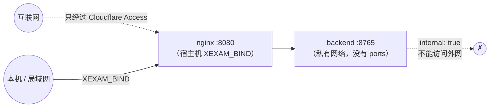

[English](../en/security.md) | [日本語](../ja/security.md) | **简体中文**

# 安全

> 适用范围：一个自己部署、给一小群互相认识的人用的程序；从 v0.6 起有**账户和登录**，有管理员和普通用户，从 v0.7 起还有**可管理题库的用户**。安全靠五件事：**后端不对外**、**Host/Origin 守卫**、**每个路由都要登录**（会话，以及密码输错后逐级加长的锁定）、**由后端检查的权限**（谁能看到和管理哪个题库、哪些记录属于谁），以及从互联网访问时**前面加一层身份验证，例如 Cloudflare Access**。
> 审计依据：[audit/security.md](history/audit/security.md)。测试：`backend/tests/`（对着已提交的旧版快照运行：172 份黄金响应、解析夹具、id 向量；登录和用户在 `v06_users_and_sign_in.rs`，题库权限、所有权和练习在 `v065_bank_access_and_practice.rs`，系统日志和大量被拒绝的请求在 `v07_wal_and_logs.rs` 和 `v07_log_floods.rs`）以及 `tests/integration/nginx_check.py`。迁移期间还用一批 340 个恶意请求的探测，逐项比较了旧版和新版（0 处无法解释的差异；51 处登记为有意的加固）。那套探测已经随旧的 Python 代码一起删掉了。

## 1. 威胁模型

| 谁 | 能做什么 | 我们的防线 |
|---|---|---|
| 同一个网络里的另一台机器 | 直接连这个端口 | 默认只绑定 `127.0.0.1`；要开放必须自己设置 `XEXAM_BIND`。除了 `/api/info`、`/api/auth/state` 和登录本身，每个路由都需要会话（§5）；密码输错会锁定登录，而且一次比一次久（§6） |
| 猜密码的人 | 对一个账户试很多密码，或者试很多编造的用户名 | 按账户逐级加长的锁定，和编造的名字分开，也和主人以前登录过的浏览器分开；Argon2id，同一时间最多 2 个（§6） |
| 已登录的用户 | 读取或修改别的用户的记录，看没有分配给他的题库，修改不属于他的题库，使用管理员路由 | 用户 id 始终来自会话；每次读取题库都限制在用户的范围内；所有权在写入的事务里检查；管理员路由检查角色（§7） |
| 恶意网页（在你的浏览器里） | 让浏览器向 `localhost:8765` 发写入或删除请求（CSRF） | 会话 Cookie 是 `SameSite=Strict`；写请求检查 `Origin` 的主机名和 `Host` 一样或在白名单里；JSON 接口要求 `Content-Type: application/json`（跨站表单发不出来）。删除只能通过这些 POST 接口，从不通过 GET |
| DNS 重绑定 | 让恶意域名解析到 127.0.0.1，从而读取你的数据 | 检查 `Host` 白名单；GET 请求也检查 |
| 恶意 / 损坏的 .xlsx | 压缩炸弹、XML 实体展开、让服务挂掉的畸形结构 | 见 §3 |
| 代理链上伪造的请求头 | `X-Forwarded-Host` 之类 | 后端**只读真实的 `Host` 头**；Nginx 清掉所有转发头 |
| 任何人都能发的大量请求 | 把系统日志填满，让真正的日志被挤掉 | 被拒绝的请求、失败的登录和编造的名字被锁定，最多每分钟汇总一次（§8） |
| 供应链 | 依赖里的漏洞 | 依赖已锁定（`Cargo.lock`、`package-lock.json`）；镜像里除了包管理器之外没有多余的内容；见 §10 |

**不在范围内**：加密存储、系统日志以外的审计记录、双因素登录，以及防范管理员（管理员能看到并管理一切）。要从互联网访问，前面请保留 Cloudflare Access（或类似的东西）。

## 2. 网络

- 后端**从不发布端口**。`docker/docker-compose.yml` 里 `backend` 没有 `ports:`，它的网络是 `internal: true`；`tests/integration/stack_check.py` 断言从宿主机连不到后端。
- `XEXAM_BIND` 必须写成 `IP:端口`。只写端口号（如 `8766`）表示绑定所有网卡，这是常见的错误，所以文档里反复提醒。
- 在 Linux 上，主机防火墙（ufw / firewalld）**拦不住** Docker 发布的端口；要限制谁能连，请在 `DOCKER-USER` 链里加规则，或者把 `XEXAM_BIND` 写成具体的局域网 IP。

## 3. 上传（.xlsx）

只有管理员和可管理题库的用户能上传（其他人在读取请求体之前就得到 403）。下面的步骤按顺序执行。任何一步失败都返回 400/413 和一句固定的提示（中文），**什么都不写进数据库**：

1. 请求体大小：流式计数，**20 MiB**，按真实字节数，不信任 `Content-Length`；Nginx 在前面还有一道 `client_max_body_size 20m`（它返回同样提示文字的 JSON）。
2. 目标（`X-Bank-Target`）：在 Host、Origin、会话和大小检查之后、解析文件之前读取。不存在的题库是 404，上传者不能更新的题库是 403；两者都不花解析时间。
3. 按**内容**判断：`PK` 魔数、ZIP 结构，以及有没有工作簿。旧的 `.xls`、空文件和改了扩展名的文件各有自己的提示。
4. ZIP：条目 ≤ 10,000；**重复的条目名拒绝**（避免「检查的是一份、读取的是另一份」）；解压后的总大小有上限；用 `take(limit)` 限制读取，因为声明的大小不可信。
5. XML：**任何 DOCTYPE / 实体声明一律拒绝**，不管扩展名和编码（UTF-16 也拒绝）；深度 ≤ 64，节点 ≤ 100 万（100 × 10,000）。
6. 解析：有一个协作式的截止时间（默认 30 秒）。解析器每处理一批行 / XML 事件就看一次时钟，到时**自己停下**，所以超时之后不会继续占着 CPU 和内存。同一时间最多 2 个解析（`PARSE_CONCURRENCY`）；其余的排队，排队的时间也算进时限。
   另外还有内存上限：很多单元格引用同一个共享字符串时，它只存一份（不深拷贝）；A–D 列的单元格引用的总字节数不超过 64 MiB，E、F 两列（六列格式）另有一个 64 MiB 的额度；一个 XML 元素最多 256 个属性。
7. 预览放进内存里**上传者自己的待确认槽位**，30 分钟后过期。别人既不能确认也不能取消它。所有槽位共用一个 128 MiB 的内存额度：暂存一次上传时，超出额度就丢掉别的用户最早的预览，所以很多可管理题库的用户也不能用预览把内存填满。确认码是 128 位随机数，只能用一次，按常量时间比较；错误的确认码不会消耗槽位里的内容。
8. 确认时在**一个事务**里写入一切，并在其中再次检查上传者能不能更新目标题库；文件里一道可用的题都没有时拒绝导入（防止把题库清空）。

旧版只扫描小写 `.xml` / `.rels` 的 ASCII 字节，所以用 UTF-16 或换个扩展名就能绕过。新版本加固的就是这一点（登记在 [api.md](api.md) 的差异表里）。

## 4. Host 和 Origin

| 检查 | 适用于 | 规则 |
|---|---|---|
| Host | 所有请求 | 必须在白名单里：默认是 `localhost`、`127.0.0.1`、`::1`；`XEXAM_ALLOWED_HOSTS` 可以再加；`XEXAM_ALLOW_ANY_HOST=1` 关掉这项检查 |
| Origin | 写请求 | 没有 → 放行（命令行工具不是跨站请求）；有 → **主机名**必须和 `Host` 的主机名一样，或在 `XEXAM_ALLOWED_ORIGINS` / 白名单里 |

要点：

- **只比较主机名**，不比较协议和端口：通过 HTTPS 域名访问时，Origin 是 `https://example.com`，Host 是 `example.com`，所以不会被误拦。
- 守卫读取真实的 `Host` 头。它**不读** `X-Forwarded-Host` / `Forwarded`，因为那等于把守卫交给了客户端。Nginx 用 `proxy_set_header Host $http_host` 原样转发，并清掉其他转发头。
- 这些检查在会话检查**之前**进行，所以被拒绝的请求永远到不了登录或任何数据。
- 请求被拒绝时，响应会写明你的 Host / Origin 是什么，应该把哪个值加进哪个选项（中文，页面会翻译）。日志里记一行英语：安静了一分钟之后的第一次拒绝单独记一行（`rejected GET /api/bank: Host "evil.example" is not in the allowed list`），之后的最多每分钟汇总一次（`rejected 250 request(s) by the Host / Origin check since the last report; the last one: …`）。
- 只有在**程序前面已经有身份验证**时才用 `XEXAM_ALLOW_ANY_HOST=1`；它不会关掉 Origin 检查，也不会关掉登录。

## 5. 登录和会话

- **密码**：8–128 个字符。用 Argon2id 保存（`argon2` crate 的默认参数，每个哈希一个随机盐），在阻塞任务里计算哈希和验证，同一时间最多 2 个；多出来的请求排队等待。不存在的用户名会对一个假的哈希做验证，所以回答的时间和提示（`用户名或密码不对。`）都不透露某个用户名是否存在；已停用的账户也得到同样的回答。
- **用户名**：1–40 个 ASCII 字母、数字和 `. _ - @`，不区分大小写地唯一。有意只用 ASCII：这样就不会有长得很像的名字。
- **会话**：Cookie `xexam_session` 里是操作系统给出的 32 个随机字节；数据库里只存它们的 SHA-256，所以数据库的副本里没有能用的令牌。有效期 30 天，使用期间最多每小时顺延一次；每个用户最多 20 个（超过时，新的登录会结束最先到期的那些）。**每次登录都创建新的令牌**；从不重复使用客户端发来的令牌。过期的会话在启动时清理，之后最多每小时清理一次。
- **修改密码时轮换会话**：修改自己的密码（在 **设置** 里，或者第一次登录时被要求修改）会结束这个账户的**每一个**会话，包括当前这个，这个浏览器在同一个回答里得到一个新的 `xexam_session` Cookie。所以复制或偷走的 Cookie 会失效，而你在这里仍然保持登录。如果请求进行期间密码在别处被修改或重置了，这次修改会被拒绝。
- **其他会让用户退出登录的修改**：管理员重置密码、停用账户、改角色、删除账户，以及命令行的 `reset-password`。修改用户的题库或可管理题库权限**不会**让他退出登录：后端在每个请求里都会读取权限。
- **Cookie**：`HttpOnly`、`SameSite=Strict`、`Path=/`；只有 `https://` 的 Origin 或设了 `XEXAM_COOKIE_SECURE=1` 时才加 `Secure`，所以在自己的网络里用纯 HTTP 仍然可以。写请求仍然要通过 Origin 检查。
- **已知浏览器**：登录和修改密码时还会设置 `xexam_device`（`HttpOnly`、`SameSite=Strict`、`Path=/api/auth`，400 天）：用户 id 的 HMAC-SHA256，以这个用户当前的密码哈希为密钥。服务器上不为它存任何东西，换了新密码，所有这样的 Cookie 都会失效。它只决定一次尝试计入哪个限制计数（§6）。
- **默认管理员**：没有用户的新数据库或升级来的数据库会得到 `admin` / `admin`，第一次登录时必须修改；在那之前，其他路由都回答 403。只要还有已启用的管理员在用默认密码，登录页就会写出那个账户，后端每次启动也会打印一条提醒。安装或升级之后请马上修改它。
- **管理员的保护**：至少要保留一个启用的管理员（`至少要保留一个启用的管理员。`）；管理员不能在用户管理里修改自己的角色、停用自己的账户、重置它的密码或删除它（`不能对自己的账户做这个操作。`）；自己的密码在 **设置** 里修改。
- **进不去了**：`docker compose exec backend xexam-backend reset-password <用户名>` 设置一个新的随机密码（16 个字符，只在终端上打印一次，从不写进日志），要求下次登录时设置新密码，启用账户并让它退出登录。没有数据库的数据目录它会拒绝。它解不开内存里的登录锁定（它是另一个进程）：请用 **解锁**，或者重启后端。
- **没有任何开关能关掉登录**：没有环境变量、参数或配置文件能做到。

## 6. 登录限制

密码输错会锁定登录，按轮次一次比一次久。状态**只在内存里**。

| 轮次 | 允许失败几次 | 然后锁定多久 |
|---|---|---|
| 1 | 15 分钟内 5 次 | 1 分钟 |
| 2 | 3 次，从上一次锁定结束时算起 | 5 分钟 |
| 3 | 3 次 | 15 分钟 |
| 4 | 3 次 | 30 分钟 |
| 5 | 3 次 | 1 小时 |
| 6 及以后 | 3 次 | 1 天（最长） |

- 每次尝试一开始（在任何哈希计算之前）就先算作一次失败，所以并行的猜测也会被计数；成功时再撤回。锁定期间每次尝试都回答 **429**，带 `retryAfter`（秒）和 `Retry-After` 头，即使密码是对的；这些拒绝不计数，也不延长锁定。
- **回到第 1 轮**：登录成功、管理员点 **解锁** 或重置密码、重启后端，或者 24 小时内既没有锁定也没有失败。
- 在 **设置 → 修改密码** 里**输错当前密码**，和登录计在同样的计数里，所以偷来的会话不能用来猜密码。

**按账户计数。** 登录时先查一下输入的名字（一个很便宜的查询，不做哈希）：

- **有账户的名字**（不管是否启用）计在以**用户 id** 为键的计数里。改名后正在进行的锁定还在（**解锁** 也仍然找得到它），删除的账户的状态被忘掉，之后用上旧名字的新账户从头开始。这些计数放在它们自己的表里，表的大小受账户数量限制，**从不**为了腾地方而清空：大量编造的名字没法把被猜的账户推回第 1 轮。
- **没有账户的名字**有自己的计数，轮次完全一样，所以回答从不透露某个用户名是否存在。不符合用户名规则的名字共用一个计数。这张**未知名字**的表最多存 **10,000** 个名字：回到第 1 轮、最近又没有动静的计数会定期清掉；仍然满的时候，先忘掉进展最少、没有被锁定的名字（只有所有名字都被锁定时才忘掉被锁定的）。忘掉这样的计数不会让任何东西失去保护，因为它后面没有账户。
- **权衡**：在这种大量请求下（每次探测约一万个请求），攻击者可以分辨一个名字有没有账户，因为只有没有账户的名字的状态会被忘掉。我们接受这一点：另一种做法是挤掉真实账户的状态，那就等于让任何人都能重置他正在猜的账户的锁定。

**已知浏览器。** 从带着这个账户有效的 `xexam_device` Cookie 的浏览器发起的尝试，计在这个账户的第二个计数里，轮次相同。所以别处的猜测只会锁住「其他浏览器」的计数，主人仍然可以在以前用过的浏览器上登录；在这样的浏览器里输错密码，锁住的是它自己的计数。通过已知浏览器登录成功，只让那个计数从头开始；不带这个 Cookie 登录成功，两个都从头开始。**解锁** 清除两个。两个计数都被锁定时，账户在所有浏览器上都被锁定，用户管理里也会这样写。

**整体压力。** 所有计数加起来 15 分钟内至少有 100 次失败时，自己最近一次失败不到一分钟的计数也会被拒绝（每个计数每分钟只能猜一次）。自己最近没有失败的计数从不被拒绝，所以大量编造的名字能拖慢猜测，却锁不住一个本身没被猜的账户。压力造成的拒绝和锁定一样是 429，但不会推进任何轮次。

**日志里写什么**（不写账户的名字，只写 id）：

- 真实账户的锁定**在开始时记一次**，每次锁定一行：`sign-in of user 3 from other browsers locked for 300 s (lock 2 in a row) after repeated failed attempts`（或 `from the browsers where it signed in before`）。
- **没有账户的用户名**的锁定会被汇总，因为任何人每编一个名字就能引起一次：安静了一分钟之后的第一次单独记，之后是 `N sign-in lock(s) of usernames without an account started since the last report; the last one: …`。
- **失败的登录**：安静了一分钟之后的第一次记成 `failed sign-in`，之后是 `N failed sign-in(s) since the last report`，最多每分钟一次。
- **被拒绝（429）的尝试**：从不逐条记录；安静了一分钟之后的第一次马上报告，其余的由每分钟运行一次的定时器报告：`refused N password check(s) of locked or throttled sign-ins since the last report`。一阵尝试的最后一行在一分钟左右之内出现，即使后面没有再来任何尝试。

## 7. 角色、题库和别人的数据

### 角色和路由的访问级别

后端只有一张路由表；每个路由都写明谁能用它，检查在分发函数里、读取请求体之前进行一次：

| 访问级别 | 路由 |
|---|---|
| 公开 | `GET /api/info`、`GET /api/auth/state`、`POST /api/auth/login` |
| 登录 | 和你自己学习有关的一切：你能看到的题库、你的进度、记录和设置、交卷、自己的密码、退出登录 |
| 可管理题库（管理员和有这个权限的用户） | `POST /api/upload`、`/api/import/confirm`、`/api/import/cancel`、`/api/banks/delete`、`GET /api/imports`。其他人：403 `你没有管理题库的权限，请联系管理员。` |
| 管理员 | `GET /api/users`、`GET /api/logs`、`POST /api/users/*`、`POST /api/shutdown`。其他人：403 `只有管理员可以进行这个操作。` |

不在表里的路径也需要会话。账户需要设置新密码期间，它只能修改密码和退出登录（公开路由仍然可用）；其他一切都回答 403。角色和可管理题库权限随会话从数据库读出，所以管理员做的修改在这个用户的下一个请求就生效。

### 按用户设置题库

- 管理员能看到并管理所有题库。普通用户能看到 **所有题库，包括以后导入的**，或者只能看到管理员为他选的题库；新用户在选好之前一个都看不到。可管理题库的用户在拥有这个权限期间，还能看到他自己导入的题库。
- 后端为每个请求根据会话（从不根据请求体）建立一个 `Viewer`，并把每次读取都限制在它的范围内：`/api/bank` 和 `/api/banks` 只列出能看到的题库，`/api/progress` 只统计这些题库里的题，记录详情里略去其他题库的题的文字（像已删除的题一样显示），`POST /api/attempt` 把其他题库的题完全当作不存在的题处理（不计入，也不为它写任何东西）。所以编造的或过时的请求不能为用户看不到的题库写统计。
- `/api/banks` **只向管理员显示所有者的名字**。其他用户只在自己拥有的题库上得到 `ownerId`，每个题库的学习数字也只是他自己的，而不是所有人的。

### 所有权（题库的 IDOR 防护）

- 题库属于把它作为新题库导入的用户。可管理题库的用户**只能**更新和删除**自己的**题库；对任何其他题库，回答都是 403 `这个题库不是你上传的，只能更新或删除你自己上传的题库。`。
- 这个检查在确认导入和删除题库的**写入事务里面**进行，而不只是在它之前。所以在检查和写入之间，任何东西都改不了所有者（例如管理员删除了这个用户的账户，题库因此转到那位管理员名下）；被拒绝的写入什么都不写。
- 可管理题库的用户删除自己的题库时勾选 **同时删除你在这个题库的学习记录**，只会删除他自己的记录；其他用户的记录保留。
- 题库 id、记录 id 和用户 id 只以参数的形式传给 SQLite。

### 别的用户的记录

- 学习记录、错题本和设置只为登录的用户读写。别的用户的记录 id，表现得和不存在的 id 完全一样（`GET /api/record`、`POST /api/records/delete`：404），所以没法探测 id。
- 一次上传的待确认导入属于上传它的人（§3）。

### 题库印记

`GET /api/auth/state` 给每个登录的用户一个 `library` 印记，让打开着的页面能发现题库变了。它是一个不透明的 32 位十六进制摘要（SHA-1 的前 16 个字节），而不是构成它的那些计数。对只能看到部分题库的用户，它只由这些题库和他的权限算出，所以既不透露、也不跟随他看不到的题库的大小、题数或更新时间。

### 严格的请求结构和明确的删除

- **每个路由都有同样的守卫**：每个请求都检查 Host；POST 还要检查 Origin、会话、`Content-Type: application/json`、1,000,000 字节的请求体上限，以及「请求体必须是 JSON 对象」。Nginx 对每个 `/api/` 路径都一样处理（方法、限流、超时）。
- **严格的结构。** `id` 必须是整数（布尔值不算），`withRecords` 和 `withStats` 这样的标记必须是布尔值，`all` 必须正好是 `true`，`banks` 必须是 `"all"` 或现存题库 id 的列表，`kind` 必须是 `exam` 或 `practice`。`GET /api/record` 只接受一个 1–18 位 ASCII 数字的 `id`。其他任何情况都是 400，什么都不改。
- **设置的校验。** 只读取四个已知的键。`theme` 必须是 `system`、`light` 或 `dark`；`uiLang` 是 `en`、`zh` 或 `ja`；`questionLang` 是 `ja`、`zh` 或 `en`；`autoAdvance` 是布尔值。有一个值无效 → 400，什么都不写；未知的键忽略。读回设置时，保存的值无效就忽略它，改用默认值。前端在应用之前还会再检查一次这些值，它们只会进入 `data-theme` 和 `lang` 属性，从不进入 HTML。
- **删除数据是明确的。** 没有任何东西会被 GET 或作为副作用删除。每个删除路由都是带 JSON 请求体的 POST，所以跨站表单发不出来（Content-Type），别的网站上的脚本也会被 Origin 检查拦住。每次删除都是一个事务。在界面上，每次删除都会打开一个确认对话框，写明要删掉什么，并说明无法恢复。随题库一起删除学习数据、随全部记录一起清空错题本，都是单独的复选框，默认不勾选。会下架题目的导入，确认之前会再问一次。没有撤销，也没有回收站：你自己的备份就是回头的路（[database.md](database.md) 第 5 节）。
- **迁移前的备份。** 每次 schema 迁移之前，后端都把数据库复制到数据目录里的 `backups/`。它从不覆盖已有的文件；复制失败时，它拒绝启动，而不是在没有备份的情况下迁移。

## 8. 日志和隐私

- **从不记录的东西**：密码（`reset-password` 打印的那个也不记录）、会话令牌、Cookie 的值、确认码、上传文件的内容和题目文字。日志里用 id 指代用户（`user 3 signed in`），而不是名字。`backend/tests/v07_wal_and_logs.rs` 里的 `the_log_never_holds_passwords_tokens_cookies_or_question_text` 检查这一点。
- **系统日志**（菜单里，只有管理员）从内存里显示后端启动以来的最后 2000 行日志；什么都不写进数据库，重启后就清空了。`GET /api/logs` 是管理员路由。更早的日志：`docker compose logs backend`（见 [deployment.md](deployment.md) 第 9 节）。
- **大量的日志会被汇总。** 有三种日志行，任何能连到服务器的人不用登录就能引起：被 Host / Origin 检查拒绝的请求、失败的登录，以及没有账户的用户名被锁定。每一种在安静了一分钟之后先记一次，之后最多每分钟汇总成一行（服务器的定时器会在一分钟左右之内写出一阵请求的最后一行）；被拒绝的 429 尝试也用同样的方式汇总。**真实账户的锁定逐条记录**，因为一个账户每个锁定时长内最多只能被锁一次。所以没人能不登录就把系统日志里的 2000 行挤掉。
- 关于被拒绝的请求的日志行始终是英语，写明方法、路径（缩短过）和原因；403 的回答正文仍是中文。
- 题库是用户自己的 Excel 文件，**不在仓库里**（`.gitignore` 排除了 `*.xlsx` 等文件；唯一的例外是 `tests/baseline/fixtures/` 里虚构的测试夹具）。
- `backups/` 里的文件是数据库的完整副本，包括密码哈希。它们在同一个数据卷里，备份卷时也会包含它们；请像对待数据库本身一样对待它们。程序永远不会删除它们。
- 浏览器只在 `localStorage` 里按用户存一些小东西：进行中的考试或练习（题目 id、答案、标记、用时；不含题目文字）、一份用来画第一屏的设置副本，以及最后登录的用户的 id。在共用的电脑上，用完请退出登录，并清除网站数据。

## 9. HTTP 层

| 项目 | 设置 |
|---|---|
| 响应头 | 后端的所有响应：`Cache-Control: no-store`、`X-Content-Type-Options: nosniff`。`index.html` 另外有 `X-Frame-Options: DENY`、`Referrer-Policy: no-referrer`、`Permissions-Policy`（摄像头 / 麦克风 / 定位全部关闭）和严格的 CSP。`/assets/`（脚本 / 样式）和 Nginx 自己生成的错误 JSON 只带 `X-Content-Type-Options`（资源还带缓存头），因为 nginx 的 `add_header` 一旦写在某个 location 里，上一级的头就不再继承；这些都不是能被嵌入或执行的页面 |
| CSP | `default-src 'self'; img-src 'self' data:; style-src 'self'; script-src 'self'; base-uri 'none'; form-action 'self'; frame-ancestors 'none'`：没有内联脚本或样式 |
| HSTS | **不设置**：TLS 在 Cloudflare 终止，源站说的是 HTTP |
| CORS | 不发送任何 CORS 头（同源） |
| 方法 | `GET` / `HEAD` / `POST`；其他方法由 Nginx 直接回答 403（`limit_except`），所以到不了后端；后端自己对它们回答 405 + `Allow` |
| 限流 | Nginx：`/api/` 每秒 10 个请求（突发 30）；`/api/upload` 每秒 1 个请求（突发 5）；超过 → 429 |
| 超时 | 请求头 15 秒，请求体 30 秒（防慢速攻击）；上游连接 5 秒，读取 90 秒 |
| 隐藏文件 | `/.xxx` 一律 404；不列目录 |
| `Server` 头 | 后端不发送；Nginx 设了 `server_tokens off` |

## 10. 容器

- 两个容器都以**非 root** 运行（后端 uid 10001），`cap_drop: ALL`、`no-new-privileges`，根文件系统 `read_only`；只有 `/tmp`（tmpfs）和后端的 `/data`（命名卷，`backups/` 也在里面）可写。宿主机的 `/etc/localtime` 以只读方式挂载。
- **镜像里没有机密**：没有 `.env`、没有数据库、没有真实的题库（由 `.dockerignore` 排除）。
- 后端镜像是一个静态链接（musl）的可执行文件加上 tzdata，除了 shell 以外没有任何工具链。
- 容器日志限制在 3 个 10 MB 的文件。
- `docker compose down -v` 会删除数据卷。文档明确提醒不要加 `-v`。

## 11. 已知的限制（如实说明）

- **登录锁定在内存里。** 重启会清除它们（这也是文档里写明的、被锁住的管理员的出路），而且它们不在进程之间共享。
- **默认密码。** 在 `admin` / `admin` 被修改之前，能打开这个页面的人都能以管理员身份登录。登录页和启动日志都会提醒你；请马上修改。
- **管理员什么都能做**：看到所有题库、每个用户的登录状态和系统日志，删除任何题库连同所有人的记录。他们不能通过程序读取别的用户的学习记录，但他们手里有数据库。
- **大量请求下账户是否存在**：见 §6 里的权衡。
- **服务端信任 `correct`** 和保存的 `answer`（和旧版一样）：判分在浏览器里进行，所以在自己的分数上作弊只会骗到自己。从 v0.7 起，服务端会检查每道题是否存在、用户能不能看到它。`answer` 只保存下来供回顾，从不用于计分或统计。
- Cloudflare 这条路只**在本地模拟过**：浏览器层面的模拟（真实的 Chrome 加一个 HTTPS 反向代理）是在旧的 Python 版上做的；对新的技术栈只做了请求头层面的检查（经过 Nginx 之后 Host / Origin 守卫仍然有效）。没有用真正的 Cloudflare 测过。
- iPhone Safari 没有在真机上测试过；构建目标是 iOS 15.4+。
- 新镜像的 arm64 版本：CI 在 QEMU 下**构建并启动**过（`/api/info` 报告 `aarch64`），但没有在真正的 ARM 硬件上运行过。aarch64 的后端程序不带针对 Cortex-A53 勘误 #843419 的链接器规避（见 [deployment.md](deployment.md)）。

## 12. 报告漏洞

这是一个个人项目的私有仓库；发现问题请直接联系所有者。
