[English](../en/usage.md) | [日本語](../ja/usage.md) | **简体中文**

# 使用 Xexam

> 怎样在浏览器里使用 Xexam：考试和练习、学习记录、设置、题库和它们的 Excel 格式、用户和系统日志、练习和成绩里的 AI 帮助、AI 对话和 AI 设置。安装、更新和配置 Xexam 见 [README](../../README/README.zh-CN.md) 和 [deployment.md](deployment.md)。
>
> 截图里用的是两个**虚构的演示题库**「General knowledge」和「Kitchen basics」，不是任何真实考试的内容。两个题库都是六列格式的工作簿，所以每道题、每个答案和每段解析都有英语、中文和日语三种。截图里是中文界面；英语界面和日语界面的截图在 `docs/en/screenshots/` 和 `docs/ja/screenshots/`。

## 目录

- [1. 第一场考试](#1-第一场考试)
- [2. 页面布局](#2-页面布局)
- [3. 主页](#3-主页)
- [4. 答题页](#4-答题页)
- [5. 练习](#5-练习)
- [6. 成绩页](#6-成绩页)
- [7. 学习记录](#7-学习记录)
- [8. 错题本](#8-错题本)
- [9. 设置](#9-设置)
- [10. 关于 Xexam](#10-关于-xexam)
- [11. 题库管理](#11-题库管理)
- [12. Excel 题库格式](#12-excel-题库格式)
- [13. 导入题库](#13-导入题库)
- [14. 用户和登录](#14-用户和登录)
- [15. 系统日志](#15-系统日志)
- [16. AI 对话](#16-ai-对话)
- [17. AI 设置](#17-ai-设置)
- [18. 在 iPhone 上使用](#18-在-iphone-上使用)
- [19. 页面显示「请求太频繁」时](#19-页面显示请求太频繁时)

## 1. 第一场考试

1. 打开菜单（右上角三条横线的按钮），选 **题库管理**（管理员和可管理题库的用户才能看到）。在 **导入 Excel** 里保持选中 **新建题库**，点 **Excel 文件导入**，选好你的工作簿（六列格式，见 [第 12 节](#12-excel-题库格式)）。看完预览后点 **确认新建题库**。
2. 在导入成功的提示里点 **去考试**（或者在菜单里选 **主页**）。**开始考试或练习** 面板里一开始所有工作表都是勾选的：取消不想考的，然后点面板底部那一栏里的 **开始考试**（同一栏里的 **题数** 和 **打乱顺序** 决定出几道题、按什么顺序出）。旁边的 **开始练习** 则用同样的题开始一次 [练习](#5-练习)。
3. 答题，然后点 **交卷**。成绩页显示分数，以及每道答错的题的正确答案和解析（**全部题目（n）** 显示所有题目）。
4. 以后想再看这场考试：打开菜单，选 **学习记录**，再点这场考试的时间。

新题库你自己和管理员都能看到，设置了 **包括以后导入的题库** 的每个用户也能看到。管理员可以在 [用户管理](#14-用户和登录) 里把它分配给其他用户。

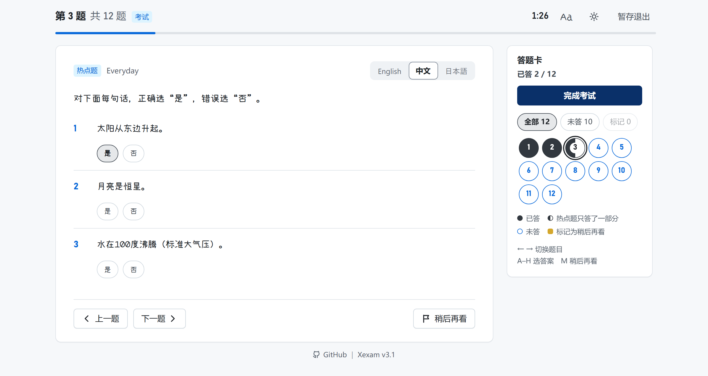

## 2. 页面布局

- 除了考试，每个页面都有一个窄窄的页头：左上角在平板和电脑上是 **Xexam** 的标志图标加文字，在手机上只有文字 **Xexam**（点它回到主页；窄屏手机上文字调得很大时，文字先变小，只在万不得已时才省略）；右上角是月亮／太阳按钮（月亮 = 深色，太阳 = 浅色；按一下切换，保存的选择与设置里的 **外观** 相同）、你的账户、**AI+** 徽章（现在能使用 AI 时是橙色，有 AI+ 功能但现在不能使用时是深色，见 [第 14 节](#14-用户和登录)），以及三条横线的菜单按钮。页头在每个页面都在同一个位置。手机上账户只显示人形图标、徽章和简短的管理员标签（**Admin**），点一下会显示一条提示，写着你的名字、角色和 AI+ 状态。
- 菜单里只显示你的角色能用的页面：
  - **主页**、**学习记录** 和 **设置**：所有人都有；
  - **题库管理**：管理员和可管理题库的用户；
  - **AI 对话**：能使用 AI 的人，以及还有 AI 对话或记忆可以查看的人（见 [第 16 节](#16-ai-对话)）；
  - **用户管理**、**AI 设置** 和 **系统日志**：只有管理员。
- 分隔线下面是版本那一项（例如 **Xexam v0.7.5**），点它打开 [关于页面](#10-关于-xexam)；再下面是你的用户名和角色（**管理员** 或 **普通用户**，再加上 **可管理题库**），以及 **退出登录**。
- 选好一项、点菜单外面或按 Esc 键，菜单就会关上。
- 在宽屏上，页面内容居中显示，最宽 1120 px。
- **在手机上**（最宽 719 px）页头在你向下滚动时隐藏，向上滚动时再出现。练习或考试底部的栏，以及主页上的底部栏，始终留在屏幕上。
- **图标**：只有图标的按钮（例如练习里的箭头、AI 图标和旗子）都有给读屏软件用的名字；在触摸屏上，按住它就能看到它的名字。
- **页脚**：每个页面末尾有一行小字，居中显示 **GitHub | Xexam 1.1**（正在运行的应用的版本）。**GitHub** 打开项目的代码仓库，**Xexam 1.1** 打开它的发布页，都在新标签页里打开。题库的免责声明仍在它上面。在 AI 对话里，这一行在侧边栏（手机上是抽屉）的底部，从不出现在某个对话里面。
- 考试和练习是专注的全屏页面，没有页头。
- 没有权限时打开 **题库管理**、**AI 设置** 或 **系统日志**，会显示 **没有权限** 和 **返回主页**；打开 **用户管理** 时，除了管理员，所有人都会被送回主页。
- 所有会删除东西的操作都会先问你：对话框里写明会删掉什么、删除后无法恢复，确认按钮是实心红色。**删除** 按钮是红色的，或者鼠标指上去时变成红色。

## 3. 主页

还没有可以做的题时，**开始考试或练习** 面板只显示一段简短的说明：

- 管理员，或者还没有题库的可管理题库的用户，会看到 **去题库管理**；
- 还没有被分配题库的用户会看到：「管理员还没有给你分配题库。请联系管理员为你开通，开通后题库就会出现在这里。」
- 题库里没有可用的题时（所有题都已下架，例如因为它们来自旧的 Excel 格式），管理员会被请求用六列格式的文件更新题库；可管理题库的用户会看到：可以用六列格式的 Excel 文件更新自己的题库或导入新题库，其他题库请管理员更新，并带 **去题库管理**；其他用户会被请求联系管理员。

之后，主页上有：

- **没交卷的考试** 或 **没做完的练习**：页面最上面的一张紧凑卡片，显示你用 **暂存退出** 离开的那一场。卡片上是标题和你停下的那一题（例如 **第 6/12 题**），以及 **继续作答** 和 **放弃**；鼠标悬停时的提示里写着题库的名字和 **只保存在这个浏览器里**。其他设备上看不到它。**继续作答** 从停下的地方接着做；**放弃** 把它丢掉。已经暂存了一场时再开始新的，会先问你。
- **开始考试或练习**：
  - 在面板右上角选择从哪里出题：**全部**（所选工作表里的所有题）或 **错题本**（只出还需要巩固的题）。两个按钮都显示题数。所选工作表里没有要复习的错题时，**错题本** 不能选，标题下面有一行字说明原因；选了 **错题本** 时，这一行字说明一道题怎样移出错题本。手机上这两个按钮也留在标题旁边：英语和日语界面只显示图标和题数，中文界面里保留简短的文字。
  - **考哪些题库和工作表**：每个题库是一张卡片，里面一行一个工作表。
    - **全选** 和 **全部取消** 在这一行标题的右边。
    - 题库的复选框会勾选或取消它的全部工作表，也可以只勾选单个工作表。只勾选了一部分时，复选框显示 −，卡片上会写例如 **已选 1/2 个工作表**（收起时也显示）。
    - 题库那一行右边的箭头展开或收起它的工作表。最多两个题库时一开始是展开的，超过两个时一开始是收起的；你的选择会保留到重新加载页面为止。
    - 题库那一行写着错题本里有几道题（例如 **错题 2**）。
  - 面板最下面的一栏：**开始考试**（绿色）和 **开始练习**（橙色）、当前范围（例如 **当前范围共 12 题**，或 **当前范围共 12 题，本次随机抽 11 题**），以及两个选项 **题数** 和 **打乱顺序**。两个按钮用的是同一个范围。两个按钮始终一样宽。这个面板在屏幕上时，这一栏固定在屏幕底部。
  - **题数** 比当前范围里的题少时，从整个范围里随机抽题。**打乱顺序** 只决定这些题按随机顺序出，还是按题库里的顺序出。
- **最近一次成绩**：你最近一次考试或练习的成绩，带 **考试** / **练习** 标签、**查看详情**、**AI 总结**（只有有 **AI+ 功能** 时，[第 7.1 节](#71-ai-总结)）和 **全部学习记录**，按这个顺序。**AI 总结** 按钮和其他 AI 按钮一样是扁平的橙色（手机上是橙色图标按钮）；不能使用时像 **AI 生成题** 一样变灰，并带 **无法使用** 标签。
- **概况**：有几个题库、几个可用工作表、几道可用题目、错题本里有几道题，带 **复习错题**（错题本里有题时），管理员和可管理题库的用户还有 **题库管理**。

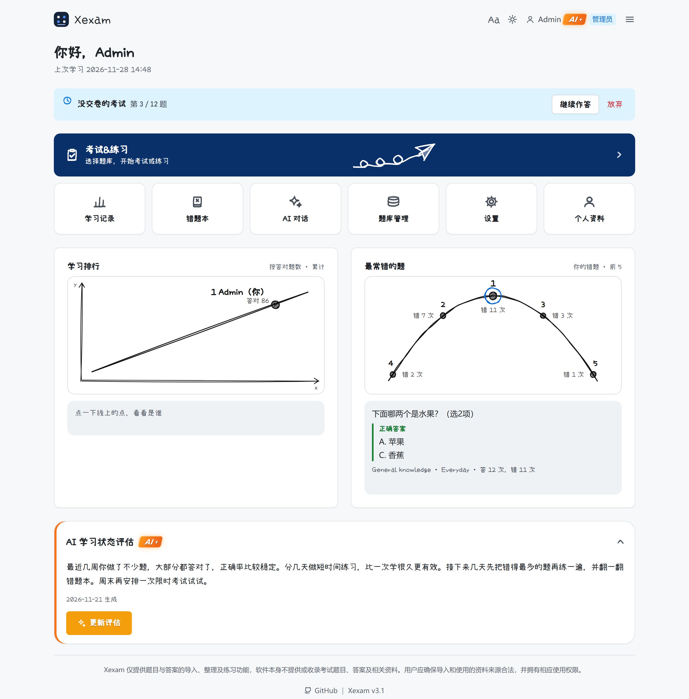

没交卷的考试是最上面的一条横幅；**全部** 和 **错题本** 在 **开始考试或练习** 的右上角；**考哪些题库和工作表** 那一行右边是 **全选** 和 **全部取消**；两个演示题库是两张展开的卡片，里面是各自的工作表；面板最下面一栏是绿色的 **开始考试**、橙色的 **开始练习**、当前范围、**题数** 和 **打乱顺序**；右边是最近一次成绩和概况。

### 3.1 考试时间限制

在 **首页**，题数和乱序选项旁边，勾选限时并输入分钟数（1 到 600）。限时只对 **考试** 有效，练习会忽略它。每次打开首页时，输入框和勾选框都是空的、未勾选的；你输入的数字在停留在本页期间会保留。输入数字会自动勾选，取消勾选则忽略该数字。如果勾选了限时，但数字不是 1 到 600 之间的整数，考试不会开始，输入框会说明原因。

限时考试在页面顶部以更大的粗体显示 **剩余时间**；不限时的考试和所有练习仍显示已用时间。**暂存退出**、关闭页面或刷新页面都会暂停倒计时，回来后从同一秒继续。时间到时，考试会自动交卷，没有作答的题与手动交卷时一样记为 **没有完成的题**。


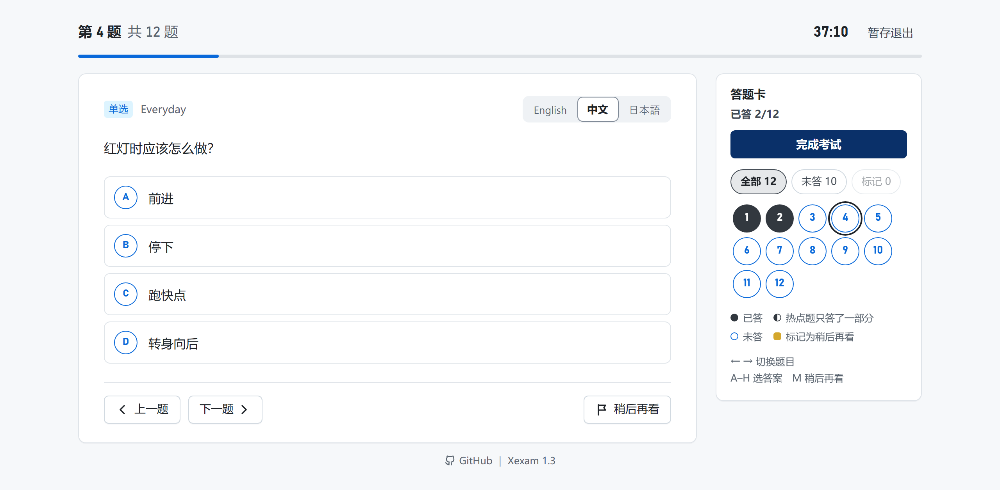

## 4. 答题页

[第 1 节](#1-第一场考试) 的截图就是答题页。

- 顶部：例如 **第 4 题 共 12 题**、已用时间，以及 **暂存退出**：保留你的答案和用时，之后可以在同一个浏览器的主页接着考。
- **窗口较窄或在手机上**（答题卡不在题目旁边时），顶部这一行还会显示 **已完成 3/12** 和绿色的 **完成考试** 按钮（练习里是橙色的 **完成练习** 按钮），都在栏内；这时答题卡里没有自己的结束按钮。最窄的手机上，数字只显示 **3/12**。按钮始终显示文字；这一行太挤时，英文和日文改用简短的标签（**Finish**、終了），不再隐藏文字。
- **时间限制**（只在主页设置了时间限制时，见 [第 3.1 节](#31-考试时间限制)）：顶部显示的不是已用时间，而是剩余时间的倒计时，字号更大、加粗。剩下 30 分钟时会出现提示（时间限制为 30 分钟或更短时不提示）。关闭或刷新页面时倒计时暂停。到 0 时考试自动交卷。
- **答题过程中不显示对错，也不显示分数。**
- **English** / **中文** / **日本語** 切换题目文字。切换只换文字：已选的答案、选项字母、计时和判分都不变。热点题的选项按钮也跟着换。
  - 英语是每道题的基准语言：它一定存在。工作簿里有中文和日语时，才有中文和日语。
  - 某道题没有的语言，或者文字和英语对不上的语言（选项或小项不同），这道题的那个按钮会置灰；点它会说明原因。
  - 你选的语言会作为设置保存下来，交卷后答案和解析也先用这种语言显示。
- **上一题** 和 **下一题** 在题目之间移动（最后一题时，**下一题** 变成 **交卷**）。**稍后再看** 标记一道你想回头再看的题。
- **答题卡**：每道题一个小方块。实心 = 已答，半实心 = 热点题只答了一部分，空心 = 未答，黄色小方块 = 标记为稍后再看。点小方块就跳到那道题。手机上，每次进入考试或练习页，答题卡都是收起的（浏览器不再记住它的状态），点开后才显示。展开时，小方块上方有三个筛选按钮 **全部 n**、**未答 n**、**标记 n**，只显示那一类的题（数字随作答变化）。小方块下面是 **已答 3 / 12 题** 和 **交卷**。
- **手机上的选项**：选项字母在第一行开头，文字折行后回到最左边（占满整行宽度）。练习或考试之后的回顾也一样，字母和标签都在第一行。太阳／月亮按钮在这个页面的顶部这一行里也有。
- **交卷** 前会先确认；没答的题记为 **没有完成的题**：不算错题，不进错题本，结果页和记录里单独列出，总分按全部题目计算。确认框里会列出没答的题和标记的题的题号；**回去继续** 会跳到第一道没答的题（没有没答的题时，跳到第一道标记的题）。
- 判分：单选、多选要正好选中全部正确选项才算对；热点题每个小项都对才算这题对。
- 键盘（电脑）：`←` `→` 上一题 / 下一题，`A`–`H` 选答案（选择题），`M` 稍后再看。
- **考试进行时没有任何 AI 帮助**，对谁都一样：答题页上没有 [第 5.1 节](#51-ai-提示ai-解析和-ai-面板) 里的任何 AI 按钮或图标。考试只在你交卷之后才有 AI，在它的 [成绩页](#61-ai-解析) 和它的学习记录里。

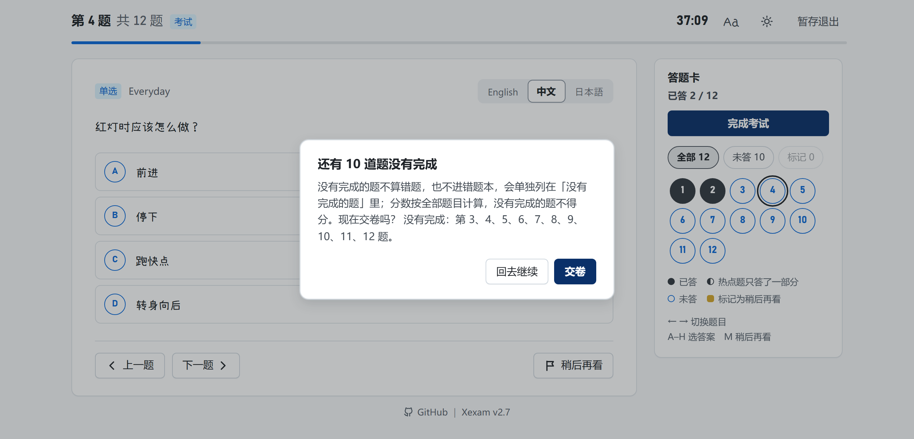

## 5. 练习

练习和考试用同一个页面，但每道题作答后马上核对。在主页上点 **开始练习** 开始，它就在 **开始考试** 旁边，用的是同样的题库、工作表、**题数** 和 **打乱顺序**。

- **第 4 题 共 12 题** 旁边有一个 **练习** 标签。
- **底部的栏** 从左到右依次是：**上一题**（‹）、**核对答案**、**下一题**（›）、**AI 提示** 和 **AI 解析**（只有有 **AI+ 功能** 的用户，见 [第 5.1 节](#51-ai-提示ai-解析和-ai-面板)），以及 **稍后再看**（旗子）。**核对答案** 和 **下一题** 是两个分开的按钮，每道题都在固定的位置；它们不会互相变成对方。
- **在手机上**，箭头、AI 图标和旗子只显示图标，按住就能看到各自的名字；**核对答案** 和 **下一题** 保留文字（在窄屏上缩短为 **核对** 和 **下一题**）。触摸屏上每个按钮都至少 44 px 高。
- **核对答案** 在选了内容且这道题还没核对时可以用；在那之前它在同一个位置变灰。每道题都只用 **核对答案** 核对；单选题选中选项后不会自动核对，核对之前还可以改选。多选题和热点题用 **核对答案** 核对；热点题答一个小项就够，没答的小项算错。
- **下一题** 随时都能去下一题。最后一题上，同一个位置写着 **完成练习**。
- **核对之后**，这道题就锁定了，并显示：
  - **答对了** 或 **答错了**；
  - 和答案与解析里一样标出的选项：正确的选项实心绿色，选错的选项实心橙色；
  - 你的答案和正确答案；
  - 解析和记忆口诀，用的是页面上 **English** / **中文** / **日本語** 切换按钮选中的语言。
- 练习里永远不会自动跳到下一题：用 **下一题** 往下走。
- 答题卡把核对过的题填成绿色（答对）或橙色（答错），并显示例如 **已核对 4 / 12 题，答对 3 题**。
- **完成练习**（宽屏幕上在答题卡下面，窗口较窄或在手机上在顶部这一行，最后一题上也有）只在还有题没核对时才会先问你。没核对的题按未作答（答错）计分，即使已经选了答案。
- **暂存退出** 和考试里一样；之后主页上会显示 **没做完的练习** 和已核对的题数。
- 练完后打开 **练习成绩** 页，在 **学习记录** 里保存成一条 **练习** 记录，并和考试一样计入错题本。

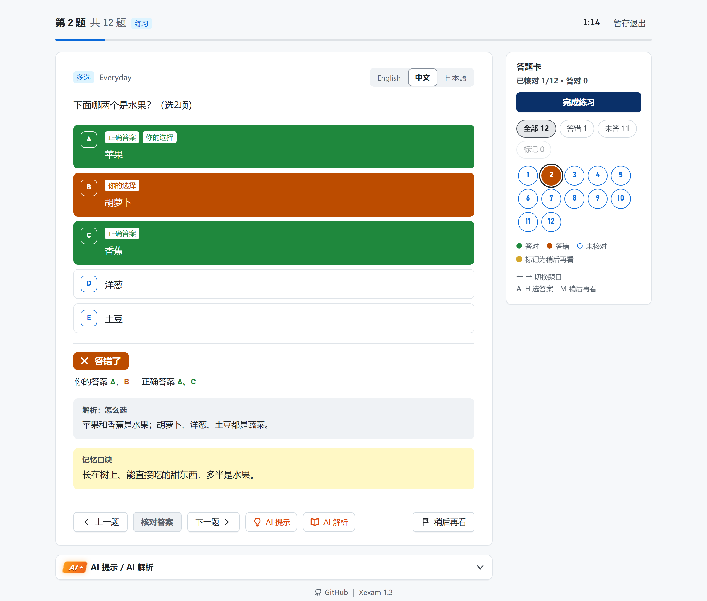

一道多选题点了 **核对答案** 之后：**练习** 标签、判定 **答错了**、选错的选项实心橙色、正确的选项实心绿色，下面是解析和记忆口诀。

### 5.1 AI 提示、AI 解析和 AI+ 面板

有 **AI+ 功能** 的用户可以在练习的任何一道题上向 AI 模型求助。其他所有人看到的页面和上面写的完全一样。考试进行时，考试页面上不显示任何与 AI 有关的内容。

**谁能看到这些控件。** 只有拥有 AI+ 功能的账号：名字旁边有橙色的 **AI+** 徽章的用户，以及在 [AI 设置](#17-ai-设置) 里 AI+ 功能开启时的管理员。有这个功能、但现在不能使用 AI 的用户（管理员暂停了它、AI 设置里的 AI+ 功能已关闭，或 ai-service 没有连接）仍然能看到这些控件，只是变灰了，并标着 **无法使用**。提示框会写明原因（触屏上点一下，会把它显示成一条消息）：**AI 提示：无法使用。AI+ 功能已被管理员暂停。**，或 **… AI 暂时无法使用，请稍后再试或联系管理员。**；Xexam 还在检查时，写的是 **正在检查 AI 是否可用…**。服务器也会拒绝这些请求。如果你练习的时候管理员收回了 AI+ 功能，下一次请求被拒绝时这些控件就会消失。

**它们在哪里。** **AI+ 面板** 位于题目卡片下面、答题卡上面。页面打开时它是收起的。操作栏里的 **AI 提示** 和 **AI 解析** 会以对应的回答打开它（再按同一个按钮不会把它关上）。面板的标题行显示 AI+ 徽章、一行简短的状态文字（**正在回答…**，推理模型还在思考时是 **正在思考…**，**保存于 15:04**，**已停止**；思考的文字本身从不在那里显示）和一个箭头，用来展开和收起面板。它的内容区在面板内部滚动，并且有固定的位置，所以回答开始或结束时页面不会跳动。

**面板的按钮。** 在面板底部，位置固定：**复制**、**重新生成**（回答正在生成时是 **停止**，没有内容可停止时 **停止** 是灰的），以及右边的弱化文字 **AI 对话已记录**（回答保存进对话后出现）。现在不能用的按钮留在原位置，变成灰色。在手机上，这三个按钮是图标，按住就能看到各自的名字。

**保存在 AI 对话里。** 面板里的任何东西都不会打开 AI 对话，所以按它不会离开练习。取而代之的是：回答保存进对话后，面板会显示文字 **AI 对话已记录**。用鼠标指上去，或者在触摸屏上点一下，就会弹出一条提示，写出对话的名字，例如 **已保存在 AI 对话「2026-11-12 14:05-练习」中**。回答和以前一样，都在 AI 对话里（[第 16.1 节](#161-练习考试和总结的对话)）。

**AI 提示** 说明怎样着手做这道题，并列出背后的知识点，**不告诉你答案**：发给模型的请求里有题目和它的选项，从不包含答案，而且模型被要求不要指出、排除或引用任何选项。如果提示还是把答案泄露了，Xexam 会把它隐藏，显示 **这个提示透露了答案，已被隐藏。请重新生成。**，并且不保存它。这个检查是一道保险，能拦住大多数、但不是所有的说法，它也可能把一个无害的提示隐藏起来；按 **重新生成** 再得到一个。

**AI 解析** 回答这道题：先是正确答案（粗体），然后是这道题考查的知识、它为什么对、其他每个选项为什么错。它用的是题库自己的答案和解析，所以它的对错只和题库一样。

**切换题目。** 面板一次只显示一个回答：**AI 解析** 会替换面板里的提示。去另一道题时（**上一题**、**下一题**、答题卡上的小方块或方向键），面板保持原来的展开或收起状态，并显示那道题同一类型的已保存回答。如果还没有，面板会说明这一点，并指向创建它的按钮；换题本身不会请求任何东西。收起面板不会停止正在生成的回答：它会继续生成并保存，状态文字也会照实说明。

**已保存的回答。** 每个回答都会保存。对同一道题再按同一个按钮（或图标），会马上显示已保存的回答，不会再问模型。**重新生成** 写一个新的并改为显示它；新的回答失败、被停止或被隐藏时，上一个仍然留着并说明这一点。一道题的提示和解析是分开保存的。你 **暂存退出**、以后 **继续作答** 时，这次练习保留它保存的回答和它的对话。重新生成总是作为一个新请求发给模型（末尾加一条带编号的备注，哪里都不保存，也不显示），所以会缓存响应的 AI 网关不能把缓存的回答再返回来。

**语言。** 不管题目是什么语言，回答都用 **设置** 里选的语言；发给模型的题目文字是页面当时显示的那种（它的 **English** / **中文** / **日本語** 切换按钮）。保存的回答和你设置里的语言不同时会说明（**这个回答是…的。重新生成即可换成设置里的语言。**）。

**一次一个回答。** 一个回答正在生成时，请求另一个不会开始它。面板会说明哪一个还在进行（**第 3 题的 AI 提示 还在生成。**，或者是一个 AI 总结、AI 对话里的一个回答），并提供 **停止它，生成这一个**（如果它就在这一页上，还有 **查看**）。什么都不会自己停下。默认每个用户同时只能有一个回答（[第 17 节](#17-ai-设置)）。

**限制。** 每个向模型提出的回答都计入 [第 17 节](#17-ai-设置) 里每个用户的 AI 请求上限（每分钟、每小时和每天；指对话、提示、解析和总结）。AI 生成题库和 AI 导入不受这三个上限限制，只受各自的调用次数上限和每天的 AI 题库任务数限制。某个上限用完时，面板会说明是哪一个，以及什么时候可以再次使用 AI，按钮会等到那时。

**在 AI 对话里。** 每次练习有一个对话，`<开始时间>-练习`，按顺序保存它的每个提示和解析（[第 16.1 节](#161-练习考试和总结的对话)）。发给 AI 服务商的内容列在 [第 16 节](#16-ai-对话) 末尾。

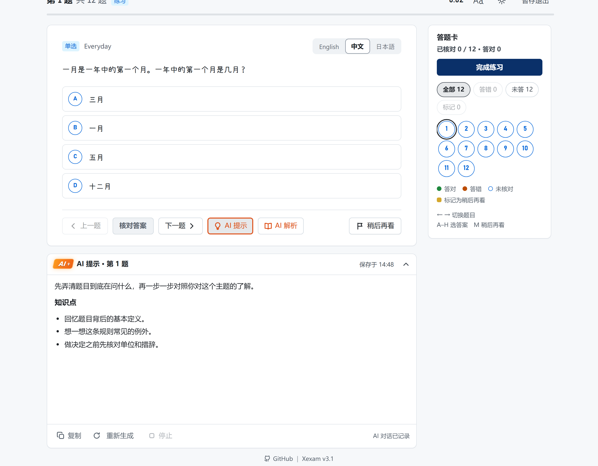

## 6. 成绩页

分数、答对和答错的题数，以及一排小方块，每道题一个（答对的题是绿色的勾）。练习的标题是 **练习成绩**。

**答案与解析** 可以显示 **只看错题（n）** 或 **全部题目（n）**。每道题的卡片上有：

- **答对** 或 **答错**，以及你的选择和正确答案：正确的选项实心绿色，选错的选项实心橙色，各带 **正确答案** / **你的选择** 标签（热点题的判断句是中性的底色，只给它们的选项上色）；
- **你的答案** / **正确答案** 那一行：多选题的答案里，你选的每个字母属于正确答案时是绿色，不属于时是橙色，所以部分答对的答案两种颜色都有；
- 卡片自己的 **English** / **中文** / **日本語** 切换按钮。它一开始是你的题目语言，只改变这一张卡片：题目、选项、解析、记忆口诀和备注。题目没有的语言是灰的；
- 解析和记忆口诀，工作簿里有几种语言就有几种；某种语言没有时，显示另一种语言的；
- 这道题到现在答过几次。

如果答题期间有题目（随题库一起）被删除，会有一句提示：分数和保存的记录只包含其余的题。

按钮：**只重做错题**、**再考一次**（练习后是 **再练一次**）、**在学习记录里查看** 和 **回首页**。重做和再来一次都和这次成绩是同一种：考试还是考试，练习还是练习。

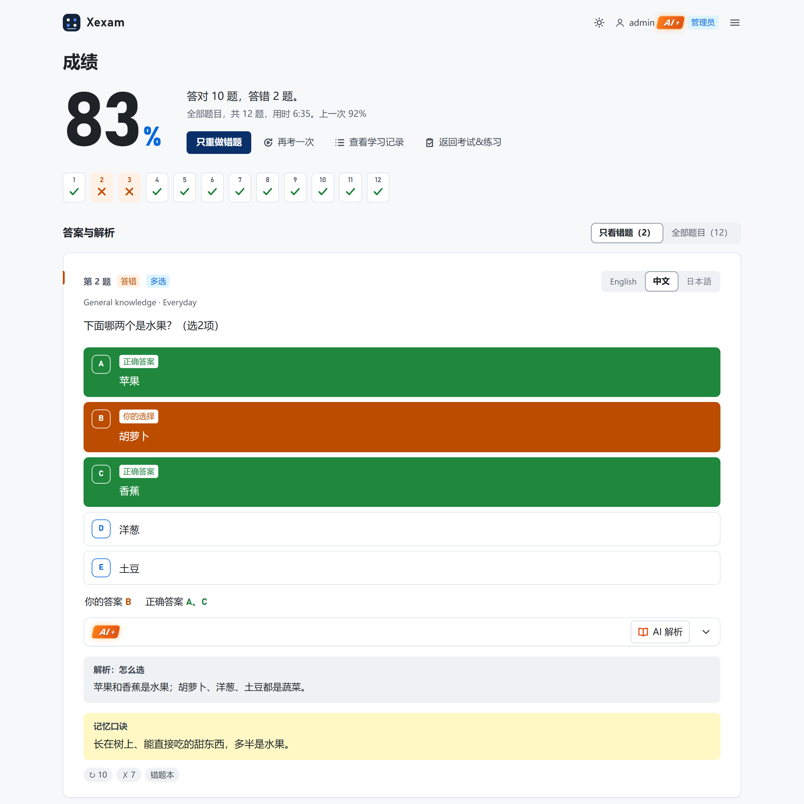

一场答错两题的考试，打开的是 **只看错题**：分数，然后是一道选择题，选错的选项实心橙色、正确的选项实心绿色，卡片自己的 **English** / **中文** / **日本語** 切换按钮，以及解析和记忆口诀。

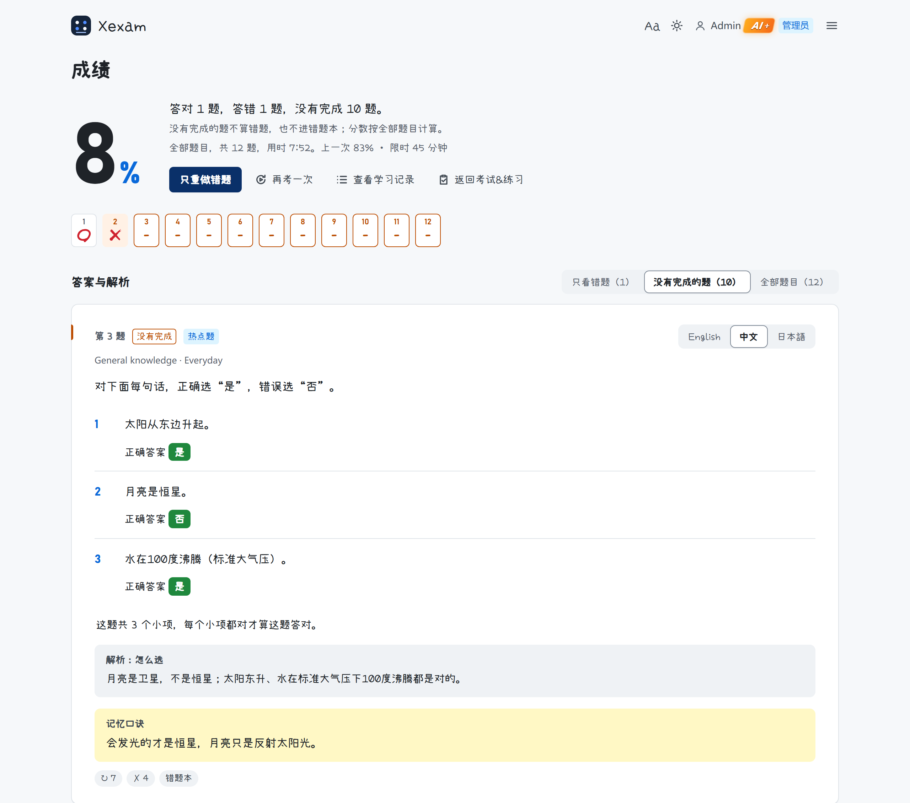

### 6.1 AI 解析

有 **AI+ 功能** 时，练习成绩和考试成绩里的每张题目卡片，在 **你的答案** / **正确答案** 那一行下面都有一个 **AI+ 栏**：AI+ 徽章、状态文字、**AI 解析**（一个按钮）和一个箭头。学习记录详情页上的每道题都有同样的栏（[第 7 节](#7-学习记录)）。考试进行中，答题页上没有这些。

- **一开始是收起的。** **AI 解析** 会打开这张卡片的面板，显示已保存的解析；没有的话就请求模型。箭头只打开或收起面板，不发请求。再按一次 **AI 解析** 会显示已保存的解析，不再请求。同一时间只有一张卡片的面板是打开的：打开另一张卡片的面板，它就移到那里。
- **在手机上**，收起的栏上也一直显示状态文字（它会用省略号缩短，只在最窄的屏幕上隐藏），这样就能分辨出哪张卡片已有解析。
- **它做什么**：模型像练习里的 **AI 解析** 那样讲解这道题（[第 5.1 节](#51-ai-提示ai-解析和-ai-面板)：正确答案、考查的知识、它为什么对、其他选项为什么错）；因为它拿到了你的答案，你答错时它还会简短地说明你大概是被什么带偏了；对没作答的题，它会注明你没有作答。
- **和第 5.1 节一样**：面板、已保存的回答、**重新生成**、**复制**、回复的语言、一次一个回答的规则和变灰的状态，工作方式都一样；**AI 对话已记录**（和它的提示）取代了任何通往 AI 对话的链接。发出的题目文字跟随你提问那一刻卡片自己的语言切换按钮，把卡片切换到另一种语言之后再按 **重新生成** 也是这样。
- **哪个对话**：回答保存在它所属的那次练习或考试的对话里（`<开始时间>-练习` 或 `<开始时间>-考试`），和练习时写下的内容放在一起。以后在记录的详情页上提问，也放进同一个对话。v0.9 之前生成的记录没有这样的对话；在它的详情页上第一次做解析时会开一个，标题是记录的时间（第 16.1 节）。
- **变灰的情况**：没能保存记录的考试成绩（**这次成绩没有保存成功，无法使用 AI 解析。**）。没能保存的练习成绩仍然提供它。

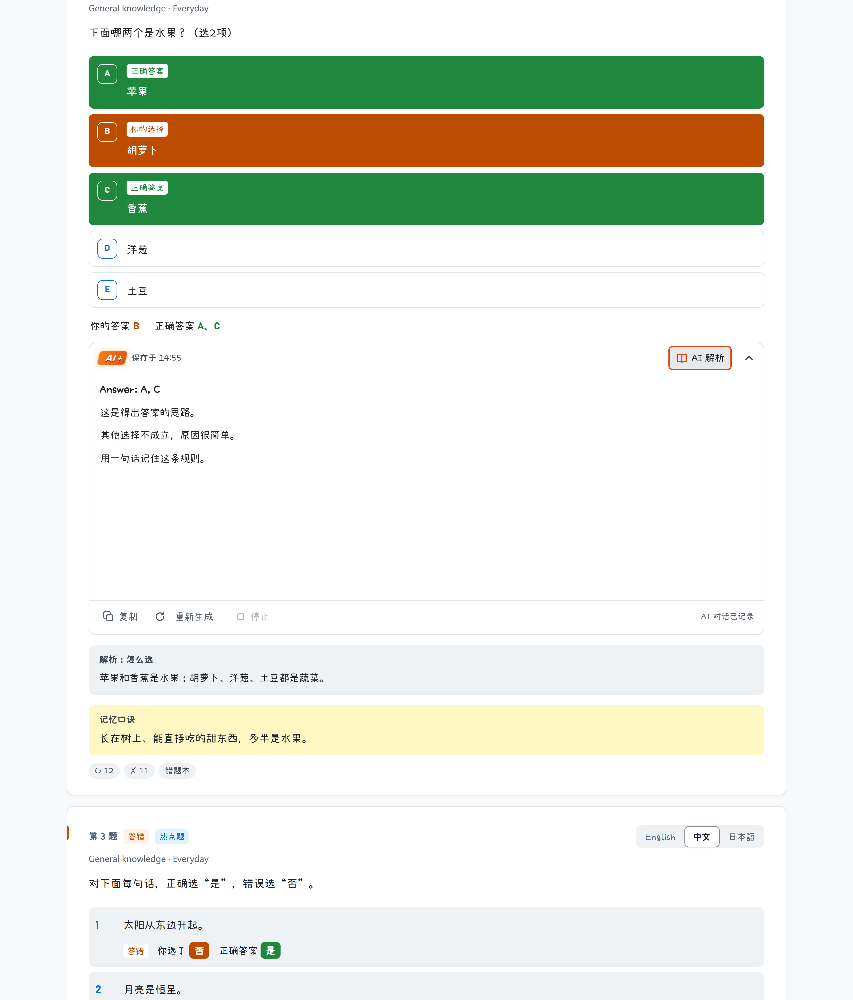

## 7. 学习记录

- **概况**：记录的条数（**记录条数**，按类型筛选时是 **考试场数** 或 **练习次数**）、**平均正确率**、**最高正确率**，以及最近几次成绩的小柱状图。
- **筛选**：**类型**（**全部类型**、**考试**、**练习**）、**题库**、用 **开始日期** 和 **结束日期** 指定的日期范围，以及 **正确率**（**不限**、**60% 以下**、**60%–79%**、**80% 及以上**）。**清除筛选** 把它们全部恢复。
- **记录列表**：每场考试或每次练习一行（手机上是一张卡片），带 **考试** / **练习** 标签，显示时间、题库、答了几题、用时、答对几题和正确率（80% 起是绿色，低于 60% 是橙色）。点时间打开这条记录；**删除** 删掉它。有 **AI+ 功能** 时，表格新增了第一列，每一行有一个 **AI 总结** 按钮（[第 7.1 节](#71-ai-总结)）；AI 被暂停或暂时不能用的用户会看到这些按钮变灰，标着 **无法使用**，表格上方有一行字说明原因。
- **考试详情** / **练习详情**（一条记录）：分数和基本信息（含 **类型**），下面逐题列出你的答案、正确答案、解析和记忆口诀，每张卡片有自己的语言切换按钮。**只看错题（n）** / **全部题目（n）** 在只看错题和看全部题之间切换。**重做错题** 用答错的题重新开始；**重考这一场**（**再练一次**）把同样的题再做一遍，两者都和这条记录是同一种；**删除这条记录** 删掉它。v0.5 之前考的场次只有分数，因为 v0.4 没有保存每道题的作答。已下架的题仍然显示在记录里，带着文字和 **已下架** 标签；只有现在上架的题才会被重做或重考。有 **AI+ 功能** 时，每张题目卡片都有 **AI 解析**（[第 6.1 节](#61-ai-解析)），保存在那次练习或考试的对话里。
- 右上角的 **复习错题** 打开 **错题复习**：列出错题本里每道上架的题，显示你答过几次，以及还要连续答对几次才会移出。可以只看某一个题库；**练习这些题** 用它们开始一次练习。
- 删除：删除一条记录时，每道题的答题统计会保留，所以错题本不会变，为它生成的 AI 对话也会保留（第 16.1 节）。**全部删除** 删掉所有记录（考试和练习）；勾选 **同时清空错题本和每道题的答题统计**，会把这些也一起清空。每次删除都会先确认，删除后无法恢复。
- Xexam 只保留你最近的 500 条记录（考试和练习），更早的记录会自动删除。

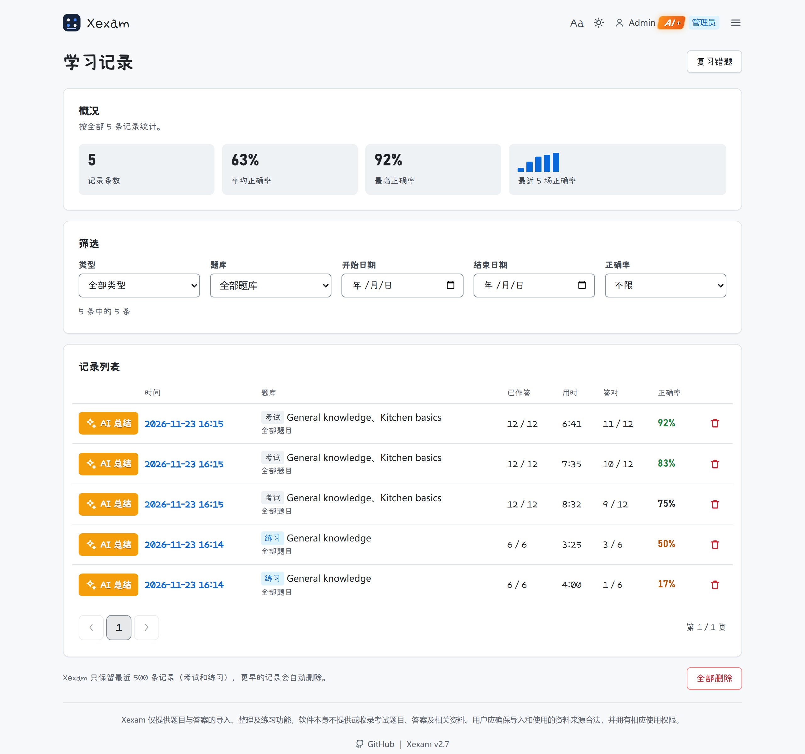

### 7.1 AI 总结

有 **AI+ 功能** 时，**学习记录** 新增了第一列 **AI 总结**，每条记录一个按钮（窗口窄时在记录的卡片里），**主页** 上最近一次成绩里也有同样的按钮，在 **查看详情** 和 **全部学习记录** 之间。两处为同一条记录打开同一个窗口，显示同一份已保存的总结。

- **它做什么**：模型拿到这条记录里你 **答错** 的题（你的答案、正确答案、题目和题库的解析），然后写出：你薄弱的知识点、需要注意什么、以后怎样做这类题，以及对这些知识点详细而简单的总结。它不会逐题讲一遍。
- **哪些题**：只有答错的题。未作答的题不算。记录里答错的题多于设定的数量（默认 40，在 **AI 安全** 里可设 10 到 70）时，随机选出这么多道，每次按 **重新生成** 都重新随机选。标题下面有一行字说明总结基于什么，例如 **基于全部 6 道答错的题。**、**基于 80 道答错的题中随机抽取的 40 道。**，或者有些题已经没有了（它们的题库被删了，或者你失去了访问权限）时：**基于 6 道答错的题中的 5 道（其余的已不可用）。**
- **窗口**：一个覆盖标题下面大部分页面的大窗口。顶部：左边是 **AI 总结**，右边是 **重新生成**（生成过程中是 **停止**）和一个关闭按钮。文字在窗口里滚动，后面的页面保持不动。关闭按钮、**Esc** 或点窗口外面都会关掉它。底部是 **复制**，右边是弱化的文字 **AI 对话已记录**，它和 [第 5.1 节](#51-ai-提示ai-解析和-ai-面板) 中的提示相同，并写出总结所在对话的名字。窗口里的任何东西都不会打开 AI 对话。再按一次 **AI 总结** 会马上显示已保存的总结；**重新生成** 加一个新的并显示它；新的失败时上一个仍然留着。总结用 **设置** 里的语言写。
- **变灰的情况**：没有答错的题的记录（**这次没有答错的题（未作答的题不计入 AI 总结）。**），以及由没有保存逐题详情的旧版本保存的记录（**这条记录由旧版本保存，没有逐题记录，无法总结。**）。如果所有答错的题后来都不见了，提问时会说明这些答错的题已经不可用。AI 被暂停或不能用时，和 [第 5.1 节](#51-ai-提示ai-解析和-ai-面板) 一样的 **无法使用** 状态也适用（在主页上，标记在按钮旁边）。
- **在 AI 对话里**：每条记录有一个对话，`<记录时间>-AI总结`，里面保存它的每一份总结（AI 对话里，总结请求只显示它的标签，例如 **AI 总结 · 80 道答错的题中的 40 道**）。删除这条学习记录会保留这个对话；它遵循普通对话的规则。同一时间只生成一个回答（[第 5.1 节](#51-ai-提示ai-解析和-ai-面板)）。
- **限制**：总结和其他每个回答一样计入每个用户的 AI 请求上限（[第 17 节](#17-ai-设置)）。很长的总结可能达到回答的字数上限，这时它会被截断并说明。

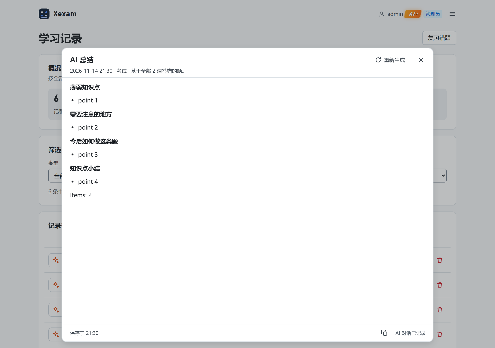

## 8. 错题本

在考试或练习中答错的题进入错题本，之后**连续 2 次答对**（考试或练习都算）就会移出。可以在主页使用（**开始考试或练习** 面板右上角的 **错题本**），也可以在 **学习记录** → **复习错题** → **练习这些题**，或者交卷后直接点 **只重做错题**。已下架的题仍留在你的统计里，但不会出现在复习里；以后再导入它所在的题库、让它恢复上架时，它就回来了。

## 9. 设置

- **账户**：你的 **用户名** 和 **角色**（有这个权限时再加 **可管理题库**，有 AI+ 功能时还有 **AI+** 徽章；徽章是深色时，它下面有一行写着原因），以及 **修改密码**。可管理题库的用户还会看到一句说明，写着这个权限允许做什么。
- **外观**（主题）：**跟随系统**（默认；按设备的浅色或深色设置显示）、**浅色** 或 **深色**。从 v2.3 起，深色主题在每个页面都用新的配色：纯黑页面，深灰色的卡片、输入框、菜单和输入框区域（#212121），稍亮的控件（#303030），白色文字和白色细线；有含义的颜色（考试绿、练习橙、答案颜色、AI+ 橙、危险红）不变。
- **语言**（界面语言）：**English**（默认）、**中文** 或 **日本語**。它决定所有地方的菜单、按钮和提示文字，包括答题页和服务器返回的错误提示。题目文字在答题页上有自己的切换按钮。
- **答题** → **答完自动跳到下一题**（默认关闭，只用于考试）：单选题选好答案后，或者热点题的每个小项都选好后，自动打开下一题。多选题永远不会自动跳转。开启时，答题页顶部会显示 **自动下一题：开**。
- **AI 对话模式**（只有管理员，而且只在 AI+ 功能开启时）：**普通模式** 或 **自由模式**。**普通模式**：AI 按学习助手的设定回答，并使用你的 AI 记忆。**自由模式**：直接和模型对话，不带学习助手的指示和 AI 记忆。这个选择对你所有的 AI 对话生效，不管新旧，从你的下一条消息起；开启时，AI 对话的标题旁边会有绿色的 **自由模式** 标记（见 [第 16 节](#16-ai-对话)）。它保存在服务器上，而不是这个浏览器里，所以刷新和在另一台设备上登录后都还在；在你选 **自由模式** 之前它是关闭的，**恢复默认设置** 也不会改变它。
- **恢复默认设置**：主题、界面语言和答完自动跳到下一题恢复成默认值。题目语言和 AI 对话模式保持不变。

设置属于你的账户，和你上次选的题目语言一起保存在 Xexam 服务器上。所以重启、更新镜像、清除浏览器缓存、换别的浏览器或设备之后，设置都还在；每个用户都有自己的一套。只有没交卷的考试或没做完的练习留在当前浏览器里。「和设置一起保存」只有一个例外：管理员的 **AI 对话模式** 保存在 AI 服务自己的数据库里。

<table>
<tr>
<td width="50%">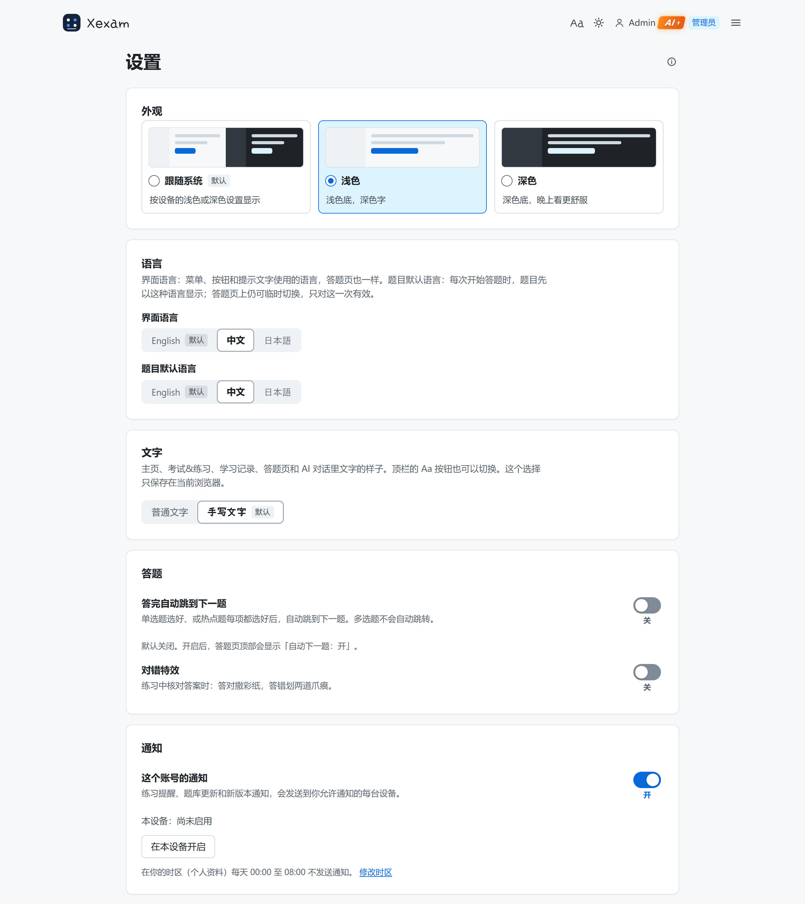</td>
<td width="50%">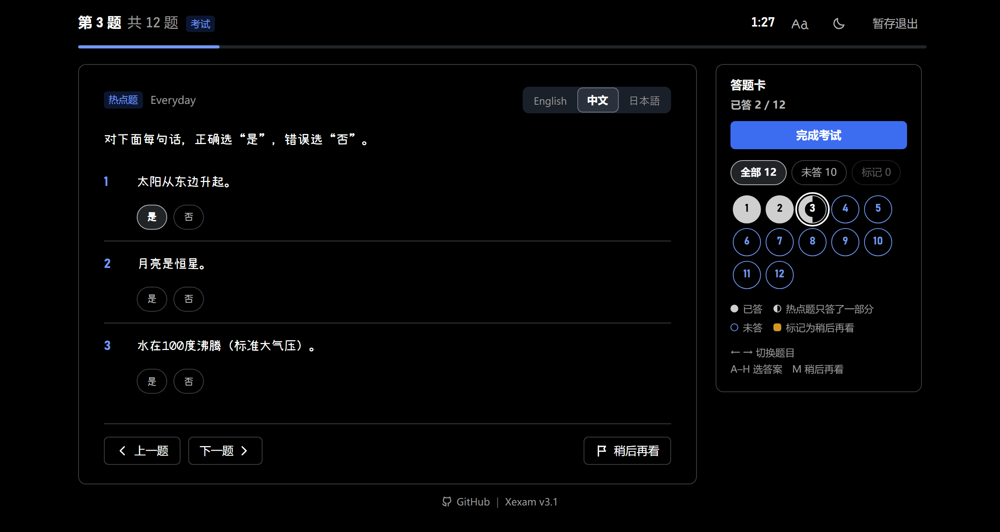</td>
</tr>
<tr>
<td>设置：<b>账户</b>、<b>外观</b>、<b>语言</b>、<b>答题</b>，以及只有管理员能看到的 <b>AI 对话模式</b>（<b>普通模式</b> / <b>自由模式</b>）。</td>
<td><b>深色</b> 主题，这里是答题页。</td>
</tr>
</table>

## 10. 关于 Xexam

菜单里的版本那一项（例如 **Xexam v0.7.5**）会打开 **关于 Xexam**：**版本**、**服务器** 的 CPU 架构、**许可证**，以及 **更新内容**，也就是界面语言那一份 [更新日志](changelog.md)。最新的版本是展开的；更早的版本折叠在 **更早的版本** 下面。

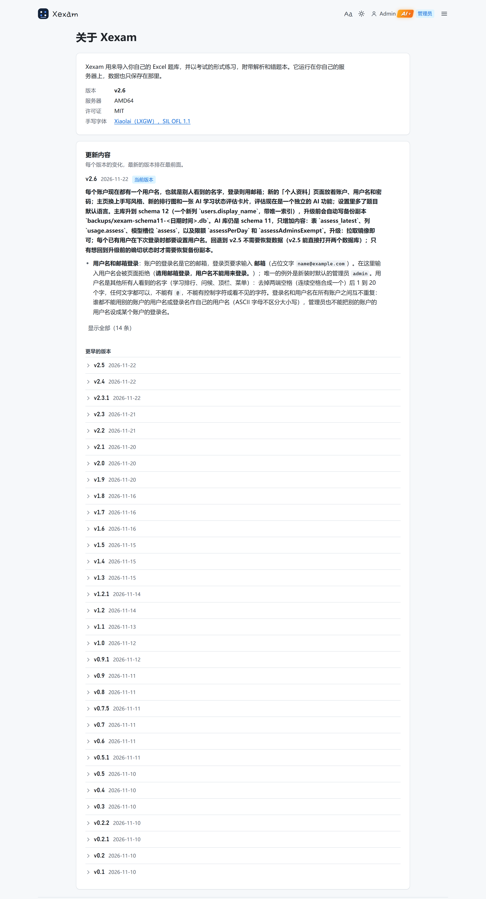

## 11. 题库管理

管理员和可管理题库的用户在这里导入 Excel 工作簿。没有这个权限的用户在菜单里看不到这个页面；直接打开它会显示 **没有权限** 和 **返回主页**。

- **导入 Excel**：选 **新建题库** 或 **更新已有题库**（标题旁边的两个小按钮，悬停提示里有说明；更新时还要在 **要更新的题库** 里选好题库），然后点 **Excel 文件导入**，或者把文件拖到这个面板的任意位置。提示文字请你上传整份六列格式的 Excel，末尾是 **查看 Excel 写法** 链接。
- **题库列表**，每个题库占紧凑的一行：文件、题数（带已下架的题数，例如 **5 题（另有 2 题已下架）**）、工作表数和最近更新时间，带 **更新** 和 **删除**。工作表收在这一行右边的箭头下面。题都因为来自旧的 Excel 格式而全部下架的题库会写明这一点，并说明用六列格式的文件更新后即可重新使用。
  - **管理员** 看到 **已有的题库**，每个题库都写着是谁导入的（**sam 上传**、**你上传的**），可以更新或删除其中任何一个。
  - **可管理题库的用户** 看到 **你的题库**：只有自己导入的题库，可以更新或删除它们。管理员分配给他学习的题库在主页上。
- **下载**（v1.6）：每个题库有一个 **下载** 按钮（在 **更新** 和 **删除** 旁边），打开一个对话框，里面选 **Excel** 或 **Word**，见 [11.1 节](#111-下载题库v16)。
- **导入记录**：每次导入占一行，只显示最近 8 次（管理员看到所有导入，可管理题库的用户看到自己那些题库的导入）。
- **Excel 题库的写法和导入说明** 在你打开之前是收起的，它是 [第 12 节](#12-excel-题库格式) 和 [第 13 节](#13-导入题库) 的简短版。 最后一节 **用外部 AI 制作要导入的 Excel** 有分步说明和带 **复制** 按钮的现成提示词（[第 13.10 节](#1310-用外部-ai-制作-excel-文件)）。

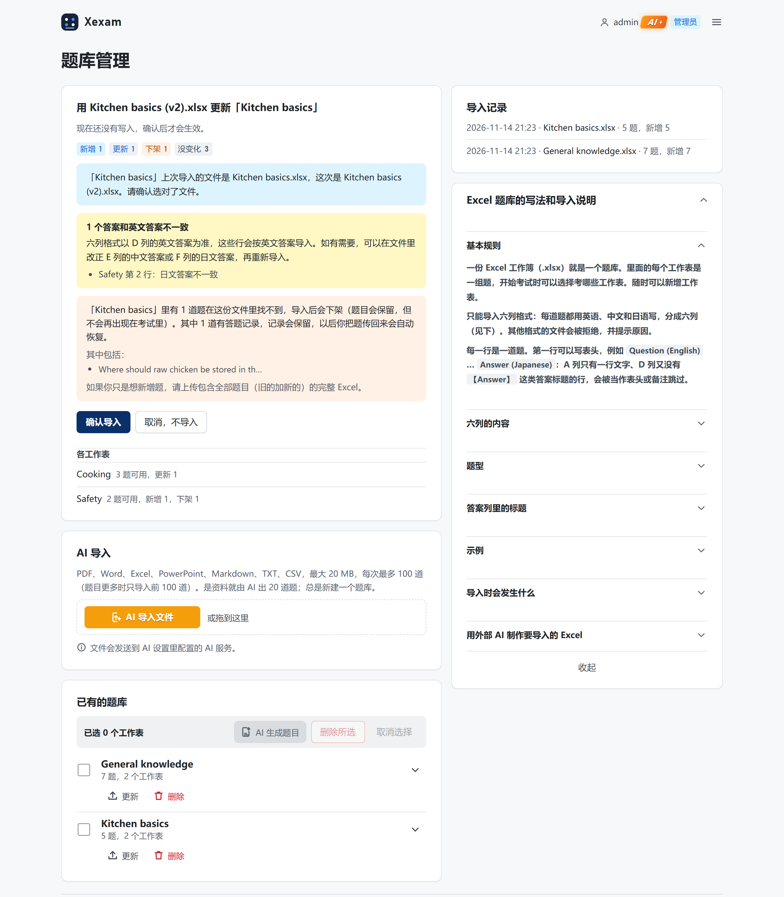

截图是用新版本的文件 `Kitchen basics (v2).xlsx` 更新「Kitchen basics」时的预览，这时还什么都没保存：几个小标签（新增 1、更新 1、下架 1）、将被下架的那道题，以及一条提醒：有一行的日文答案和英文答案不一致（这一行会按英文答案导入）。截图里还有 **已有的题库** 下面的题库列表（「Kitchen basics」是可管理题库的用户 sam 上传的），以及展开的 **Excel 题库的写法和导入说明** 的前两部分：基本规则和六列的内容。

### 11.1 下载题库（v1.6）

**下载** 按钮打开的对话框里有两种格式：

- **语言（v1.9）**：对话框在格式按钮上方有 **中文**、**English**、**日本語** 三个勾选框，默认全选，至少选一个（不会记住）。**Excel** 保持六列的位置不变，未勾选语言的单元格留空，所以不选 English 时这个文件不能再导入（对话框里有提示）；**Word** 只含勾选的语言，顺序始终是英文、中文、日文。三种都选时文件名不变，少选时末尾按这个顺序加语言代码，例如 `Garden_en-zh.docx`。
- **Excel**：六列的导入格式，每个工作表一个 sheet。下载的文件可以原样再导入，得到的题目相同（下载再导入的往返不丢内容）。
- **Word**（.docx）：先是标题；然后是英语，把每个工作表依次排下去；接着是中文，再是日语，每种语言另起一页。使用 Word 内置的标题样式（所以导航窗格和目录可用），每道题标出正确选项，并写出答案、解析、助记和备注。

谁能下载：**管理员**，以及拥有 **下载题库** 权限的用户（管理员在 [用户管理](#14-用户和登录) 的题库对话框里设置，默认关），范围都是他能看到的题库。服务器检查这个权限：没有权限的用户得到 **你没有下载题库的权限，请联系管理员。**。每次下载都会写进系统日志（`bank.download`，带格式、工作表数和题数）。

## 12. Excel 题库格式

一份工作簿（`.xlsx`）就是一个题库。每个工作表是一组题，一行一道题。**只能导入六列格式**：每道题在英语、中文和日语里各有自己的一列，答案和解析也一样。其他任何格式的文件，包括以前版本的三列和四列格式，都会被拒绝，并有一句提示说明原因；里面的东西一样都不会导入。

| 列 | 内容 |
|---|---|
| **A** | **英语**题目，后面是选项或热点题的小项。题型、选项和小项都以这一列为准，题目也按这一列识别 |
| **B** | **中文**题目（可以不写），选项（A、B、C…）或带编号的小项和 A 列相同 |
| **C** | **日语**题目（可以不写），选项或小项和 A 列相同 |
| **D** | **英语**的答案、解析和记忆口诀：`【Answer】B`，再写 `【Explanation】…` 和 `【Memory aid】…`。答案以这一列为准 |
| **E** | **中文**的答案、解析和记忆口诀（可以不写）：`【答案】B`、`【解析】…`、`【记忆口诀】…` |
| **F** | **日语**的答案、解析和记忆口诀（可以不写）：`【正解】B`、`【解説】…`、`【覚え方】…` |

下面是一道完整的单选题（和这里所有的示例一样是虚构的，也和 **题库管理** 页上写法说明里的示例相同）：

| 列 | 单元格 |
|---|---|
| A | Which planet is known as the Red Planet?<br>A. Venus<br>B. Mars<br>C. Jupiter<br>D. Saturn |
| B | 哪颗行星被称为“红色星球”？<br>A. 金星<br>B. 火星<br>C. 木星<br>D. 土星 |
| C | 「赤い惑星」と呼ばれる惑星はどれですか。<br>A. 金星<br>B. 火星<br>C. 木星<br>D. 土星 |
| D | 【Answer】B<br>【Explanation】Iron oxide (rust) in the dust on its surface makes Mars look red.<br>【Memory aid】Mars rusts red. |
| E | 【答案】B<br>【解析】火星表面的尘土含有氧化铁（铁锈），所以看起来是红色的。<br>【记忆口诀】火星生锈红彤彤。 |
| F | 【正解】B<br>【解説】火星の表面の砂には酸化鉄（さび）が含まれているため、赤く見えます。<br>【覚え方】火星はさびて赤い。 |

在单元格里换行：Windows 上按 Alt+Enter，Mac 上按 Control+Option+Return。

### 12.1 行和表头

- 每一行是一道题。第一行可以写表头，例如 `Question (English)` … `Answer (Japanese)`：A 列只有一行文字、D 列又没有 `【Answer】` 这类答案标题的行，会被当作表头或备注跳过。
- Xexam 根据每个工作表的内容识别六列格式：至少要有一行在 C 列写了含假名的日语题目（A 列和 B 列不含假名），并在 E 列或 F 列写了带标题的答案（标题用三种语言中任意一种都可以）。

### 12.2 以英语为准

- 题型、选项、热点题的小项和题目的身份都来自 A 列，答案来自 D 列。A 列没有英语题目或 D 列没有英语答案的行读不出来；预览里会列出这一行和原因。
- 某一行的 B、C、E、F 列可以空着：没有 B 列或 C 列时，这道题的中文或日语是灰的；没有 E 列或 F 列时，卡片会显示其他语言的解析。
- B 列和 C 列必须和 A 列对得上（同样的选项字母、同样的小项个数）。对不上的语言，这道题的那个按钮是灰的。
- E 列或 F 列的答案和 D 列意思不同时，这一行仍按英语答案导入，预览里会提醒，例如 **1 个答案和英文答案不一致**，点 **查看是哪几行** 能看到是哪几行。答案按意思比较：同样的字母，或者热点题每个小项选的是同一个选项（`Yes`、`是` 和 `はい` 算一样）。

### 12.3 题型

- **单选题**：A 列先写题干，再一行一个写选项：`A. 内容`、`B. 内容` …（2 到 8 个选项，A 到 H；也可以写成 `A)`、`A、` 或 `A:`）。答案是一个字母：`【Answer】B`。
- **多选题**：写法相同，答案里有多个字母：`【Answer】C, E` 或 `【Answer】CE`。只有正好选中这几个选项才算答对。
- **热点题**（几句陈述，每句选一个）：A 列第一行写 `HOTSPOT`（建议写上：它明确标出热点题；不写时，末尾带选项的编号小项也能识别），接着写题干，然后一行一个带编号的小项，小项末尾写选项，选项之间用 ` / ` 隔开：`1. Water is wet. Yes / No`。由多个词组成的选项（例如 `Before cooking / After cooking`）前面要用制表符或全角空格（`　`）隔开。答案按小项逐一写出选择，用 `;` 隔开：`【Answer】1 Yes; 2 No`。
- B 列和 C 列用同样的编号写同样的小项；小项末尾写了本语言的选项（`是 / 否`、`はい / いいえ`）时，题目会用这种语言显示选项。每个答案列里的是和否都可以用三种语言中任意一种写：`Yes` / `是` / `はい`，`No` / `否` / `いいえ`。

例如这道热点题（A 列和 D 列；B、C、E、F 列用中文和日语写同样的内容，`是 / 否` 和 `はい / いいえ` 前面是一个全角空格）：

```
HOTSPOT
For each statement, choose Yes or No.
1. The sun rises in the east. Yes / No
2. The moon is a star. Yes / No
```

```
【Answer】1 Yes; 2 No
【Explanation】The sun rises in the east. The moon only reflects sunlight; it is not a star.
```

### 12.4 答案列里的标题

D、E、F 列先写答案，再写解析和记忆口诀，每一部分前面写一个放在 `【…】` 里的标题。这三列都可以用三种语言中任意一种的标题：

- 答案：`【Answer】`、`【答案】`、`【正解】` 或 `【答え】`。
- 解析：`【Explanation】`、`【解析】` 或 `【解説】`。
- 记忆口诀：`【Memory aid】`、`【Mnemonic】`、`【记忆口诀】`、`【口诀】` 或 `【覚え方】`。

英语标题不区分大小写；包含这些词的更长的标题也可以，例如 `【解析·怎么选】`。只写答案的单元格也可以只写字母（`B`），或写一行 `Answer: B`。答案后面括号里的文字，例如 `【Answer】B (see chapter 2)`，不算答案的一部分：它会在答案卡片上显示为 **备注**。

### 12.5 读不出来的题

读不出来的题**不会被猜**：它们会在预览里列出原因（多半是 D 列没有带标题的答案，或者答案字母不在选项里），也不会悄悄判错。

## 13. 导入题库

### 13.1 谁可以导入

- **管理员**：导入新题库，并更新或删除所有题库。
- **可管理题库的用户**（在 [用户管理](#14-用户和登录) 里设置了 **可以管理题库** 的用户）：导入新题库，这些题库就归他所有；只能更新或删除自己导入的题库。管理员和其他用户的题库他都动不了。
- 其他用户看不到 **题库管理** 页面。

### 13.2 新建题库还是更新

一个题库就是一份导入的 Excel 工作簿。在 **题库管理** → **导入 Excel** 里用标题旁边的两个小按钮选择文件导入到哪里：

| 选择 | 会发生什么 |
|---|---|
| **新建题库** | 新建一个题库，以文件名命名（去掉 `.xlsx`；名字已被占用时，加上 ` (2)`、` (3)` ……）。已有的题库不会改动。同一份工作簿可以导入两次，成为两个独立的题库，它们的学习记录不会混在一起 |
| **更新已有题库** | 用这份文件替换你在 **要更新的题库** 里选的那个题库的题目（可管理题库的用户只能选自己的题库）。文件里没有的题**只在这个题库里**下架。题库的名字、所有者和能看到它的用户都不变 |

导入一份不同的工作簿时选 **新建题库**；上传已经导入过的工作簿的新版本时选 **更新已有题库**。每次都要上传**整份**工作簿，不要只传新增的题。

新题库能被这些人看到：导入它的人、管理员，以及设置了 **包括以后导入的题库** 的每个用户。管理员可以在 **用户管理** 里把它分配给其他用户。

### 13.3 先预览，再确认

上传后，Xexam 会读取并检查文件，然后显示预览：用几个小标签显示会 **新增**、**更新**、**恢复上架**、**下架** 多少题，**没变化** 和 **读不出来** 的各有多少题（为 0 的不显示）；每个工作表一行，带它的数字；读不出来的每一行的行号和原因，收在所属工作表那一行的下面（例如 **2 题读不出来**）。**你确认之前什么都不会写入**（点 **确认新建题库** 或 **确认导入**；点 **取消，不导入** 就放弃这次导入）。在下面这些情况下，预览还会提醒你：

- 你用来新建题库的文件，和某个已有题库导入时用的文件同名（它会建议改为更新那个题库）；
- 你用来更新题库的文件，名字和上次导入的不一样；
- 会有题目被下架。它会列出其中一些，并在导入前再问你一次；
- 某一行的中文或日文答案和英文答案不一致（这一行按英文答案导入）。

每个导入的人都有自己的一份预览，在内存里保留 30 分钟。所有打开着的预览共用一个内存额度：好几个大文件同时在预览时，别人最早的那份预览可能会被丢掉。确认一份已经被丢掉或超过 30 分钟的预览时，会提示它已过期：请重新上传文件。

### 13.4 导入规则

这份文件被当成它所导入的那个**题库的完整内容**。其他题库永远不会被改动。

| 情况 | 结果 |
|---|---|
| 文件里有、题库里没有的题 | **新增** |
| 同一道题，但其它内容（其它选项、答案、解析、中文或日语文字）改了 | **更新**（答题记录不受影响） |
| 题库里有、文件里找不到的题 | **下架**：题目和答题记录都保留，但不再出现在考试和练习里 |
| 以前下架、这次又出现的题 | **恢复上架**，它在错题本里的记录也跟着回来 |
| 改了工作表名、英语题目或第一个选项 | 算**一道新题**：旧题下架，新题从没有答题记录开始 |
| 这份文件里一道可用的题都没有 | 拒绝导入（防止把题库清空） |

题目是按工作表名、英语题目（A 列中选项以外的部分）和第一个选项或小项来识别的（空格不影响）。

### 13.5 来自旧 Excel 格式的题库

到 v0.6 为止，Xexam 能导入三列和四列格式的工作簿，那些题按日语文字识别。从 v0.7 起，这两种格式不能再导入，**以前从它们导入的每道题在后端每次启动时都会被下架**。题库、它们的导入记录、学习记录和每道题的答题统计都保留；这些题不再出题，题全部下架的题库会在题库列表里写明这一点。

要重新使用这样的题库，**用它的工作簿的六列格式版本更新它**（**更新已有题库**）。题库的名字、所有者和能看到它的用户都不变。六列格式按英语文字识别题目，所以文件里的每道题都作为新题加入，没有答题记录；旧题仍保持下架，以前的记录里仍然显示它们。也可以把六列格式的文件作为 **新建题库** 导入，再删掉旧的题库。

### 13.6 删除题库

题库那一行的 **删除** 会先请你确认（例如 **删除「Kitchen basics」？**）。这个题库的题目（上架的和已下架的）和它的导入记录都会被删除，所有用户的题库里都不会再有它。下面的复选框默认不勾选：

- **不勾选**：答题记录和考试记录都保留。在这些记录里，这个题库的题显示为已删除。
- 管理员**勾选**（**同时删除这个题库的学习记录**）：这个题库的题的答题记录，以及没有其他现存题库参与的记录，也一起删除。
- 可管理题库的用户**勾选**（**同时删除你在这个题库的学习记录**）：只删除你自己的答题记录和记录；其他用户的学习记录始终保留，里面的题显示为已删除。

删除后无法恢复，只有你自己的备份能找回来（见 [database.md](database.md) 第 5 节）。

### 13.7 复选框与批量操作

题库列表中，每个题库和每个工作表前都有复选框。勾选题库会勾选它的全部工作表；只勾选了部分工作表时，题库显示为半选。勾选任何东西后，列表上方会出现工具栏：

- **删除所选**：在一个对话框中确认后，删除勾选的题库和工作表。对话框会列出将被删除的内容，并询问是否同时删除学习记录（与删除题库时的选择相同）。工作表全部勾选的题库会整体删除。只有在该题库还有其他工作表时，才可以单独删除一个工作表。AI 生成的题库只有一个工作表，会整体删除。
- **AI 生成题目**：用勾选的题库和工作表开始生成 AI 题库（见 [13.9 节](#139-ai-生成题库)）。按钮是纯琥珀色配白字；不能用时（没有可用的勾选、勾选里含 AI+ 题集、已达每日上限等）是普通灰色按钮，下面不写字：点按、悬停或聚焦它，会弹出一个小提示框说明原因（按 Esc 或点别处关闭）。新生成的 AI 题库不会在首页自动勾选。

每个题库行显示粗体的名称、一行计数（例如 **7 道题，2 个工作表**）、一个折叠工作表的箭头；AI 生成的题库带有 AI+ 标识（见 [13.9 节](#139-ai-生成题库)）。手机上，行内的按钮（**更新** 和 **删除**）单独放在名称下方一行，标识也单独一行，长名称会换行。

### 13.8 AI 导入文件

在 **题库管理** 页，**AI 导入** 卡片在 **导入 Excel** 卡片下方，有自己的拖放区。选择文件或拖到那里：PDF、Word（.docx）、Excel（.xlsx）、PowerPoint（.pptx）、Markdown、TXT 或 CSV，最大 20 MB。卡片会说明文件会发送到你在 [AI 设置](#17-ai-设置) 中配置的 AI 服务，并显示其中设定的上限（大小，以及一次默认最多导入 100 道）。只有拥有 AI 导入功能且 AI+ 可用的用户才会看到该卡片；否则卡片会隐藏，或灰显（原因在点按、悬停或聚焦时的提示框里）。按钮与 AI 生成按钮同为纯琥珀色，大小与 **Excel 文件导入** 相同。

拖放区里写着大小上限（v1.6：**最大 20 MB**，即 [17.5 节](#175-ai-题库标签页) 里设置的值）。

ai-service 在内存中读取文件，从不写入磁盘；处理完成后文件即被删除。整个文件只发送一次，作为这个任务每次请求的缓存开头（提示缓存），之后的调用主要从服务商的缓存读取它。第一次调用读取整个文件：判断是题目还是学习资料，以及有多少道题。之后最多 4 个调用同时写题。文件对模型来说太大时，改为分段读取，每次 2 到 3 段，卡片显示进度（例如 **正在识别 3/9 段**）。

确认步骤显示识别结果。文件里是题目时，一个标签显示题数（**文件共 150 道**）；超过上限（默认 100）时，这个标签是红色的，旁边还有第二个红色标签 **只能导入前 100 道**：导入按文件顺序取前 100 道，完成的卡片显示 **导入了前 100 / 150 道**。如果是资料，AI 会从中正好写出 20 道题。点 **导入** 之前要给新题库起名：输入框里预先填好建议名称，输入框为空时按钮保持灰色。名称已存在时会提示 **名字已存在，换一个名字试一下**。确认之前什么都不会保存；放弃或让确认步骤过期都不收费。确认后会占用当天的一次 AI 题库机会（生成和导入共用；管理员不受限制，见 [13.9 节](#139-ai-生成题库)）。AI 导入和 AI 生成一样，不计入每个用户的 AI 请求上限（每分钟、每小时、每天），也不会被它们拒绝。

任务运行时，卡片显示进度和对齐的两行数字，例如 **本轮调用 9 次，** **输入/输出消费: 1.4K/21K Token**，其下是 **缓存写入/读取: 0.9K/12K Token**（第二行只在服务商报告缓存用量时显示）；手机较窄时，调用次数单独占一行。这些数字在完成的卡片上也保留。一道题失败三次（缺失、无法读取或没通过检查）就会被跳过，开启 **无限制** 时也一样，所以任务总会结束：题库里是通过的题，卡片列出被跳过的题，例如 **导入了 48 / 50 道，2 道无法转换**。正在运行、已经转换好一些题的导入，点 **取消导入** 时会问：**保存已完成的 N 道**（保存为 AI 题库）、**全部放弃**，还是 **继续生成**（资料总要写满 20 道，所以那里只是普通取消）。失败的任务会说明原因，且不会创建题库。

### 13.9 AI 生成题库

谁可以用：有 AI+ 功能、出题功能和题库管理权限的用户（管理员始终符合）。有三个入口：题库管理工具栏中的 **AI 生成题目**（用勾选的题库和工作表）、首页的 **AI 生成题**（用勾选的题库和工作表），以及首页错题本模式中的 **AI 生成错题习题**。

- **来源最少题数**：勾选的题库中有 30 道以上的单选或多选题（热点题不计入）；错题模式下，需要 10 道以上的单选或多选错题。
- **AI 题库不能作为来源**：只要勾选的题库和工作表里有 AI 生成的题库，AI 生成就会灰显（两种模式、首页和题库管理都一样），取消勾选后才能用。
- **结果**：一个新题库，只有一个工作表，名为 **AI**，恰好 20 道有效题，每道题都有中文、英文、日文，并附答案和解析：单选 14 道、多选 6 道（从不包含热点题）。不完整的题库不会保存：缺少或无效的题会重新生成（每道题最多试 5 次）；仍然失败时，任务失败，什么都不保存。
- **名称**：由你在开始对话框里输入（首页和题库管理都一样）；会预先填入一个建议名称，例如 `Kitchen basics_sample01_20261113101530`（来源、你用户名的前 8 个字符和开始时间）。
- **配额**：每位用户每天 3 次 AI 题库任务，生成和文件导入合计，按服务器时间 0:00 重置。一次任务计为 1 次，无论需要多少次 AI 调用。完成时计数，或在已发送过调用后取消时计数。失败以及在第一次调用之前取消的任务不计数。管理员不受限制。每个用户的 AI 请求上限（每分钟、每小时、每天）不适用于生成和导入。
- **上限**：生成和导入默认开启 **无限制**（见 [17.5 节](#175-ai-题库标签页)）：没有调用次数上限、没有每次调用的回答长度限制，也没有期限。始终保留两道安全阀：连续 3 次提供方错误则任务失败，并且随时可以取消。关闭 **无限制** 时，一次生成最多 15 次 AI 调用（导入 25 次；在 AI 设置中可设为 8 到 40，对所有人生效，包括管理员），每次调用按 17.5 节的长度，任务限时 30 分钟。失败时会显示原因和各类拒绝的数量，同样的原因会以 ERROR 级别写入系统日志。
- **进度**：首页和题库管理中的进度卡片显示已生成的题数与目标，以及一行数字（调用次数和输入 / 输出 Token）。你可以离开页面；卡片会告诉你任务何时完成或失败，右上角的按钮可以关闭它。完成的题库会立即出现在首页和题库管理中，即使你当时在别的页面或隐藏的标签页里。
- **标识**：AI+ 标识后面的词说明题库的来源：**AI+练题集**（勾选的题库和工作表，首页或题库管理）、**AI+错题集**（错题本模式）或 **AI+导入题集**（AI 导入文件）。它显示在题库行、这些题目的题卡上，以及它们的所有回顾卡片上（结果、记录、错题回顾）。提示会说明由谁、何时生成，并提醒 AI 生成的答案可能有误。
- **回答的格式（v1.6）**：要求回答是题目时，请求带上结构化输出（Anthropic 的 `output_config.format`，OpenAI 兼容的 `response_format`，json_schema）；服务商拒绝时改用普通请求，并按连接记住。每道题在 `answer` 字段里只写一次正确选项的字母，选项的对错标记由程序设置（旧的每个选项一个 `correct` 的写法仍然能读）。每次调用的题数只在回答真的被截断时才减少，所以不会在几个任务之间越缩越小。
- **共享**：AI 题库与其他新题库一样共享：能看到全部来源题库的用户，在拥有“包括以后导入的题库”选项时会获得它。管理员可以在用户管理中，像移除其他题库一样，把某个 AI 题库从某个用户那里移除。


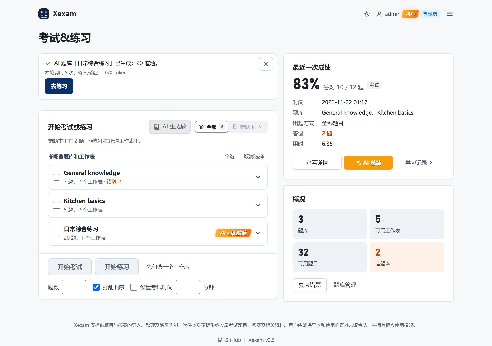

### 13.10 用外部 AI 制作 Excel 文件

这是「题库」页面 Excel 写法说明里的 **用外部 AI 制作要导入的 Excel** 一节。提示词显示在只在框内滚动的方框里，旁边有 **复制** 按钮。提示词（中文）：

1. 打开你平时在 Xexam 之外使用的 AI 聊天。
2. 上传或粘贴你自己的资料：笔记、PDF、题目清单或网页文字。
3. 复制下面的提示词，粘贴到聊天里即可，不需要改动。
4. 让它把结果做成可下载的 .xlsx 文件。如果它做不了文件，就让它给出表格，从 A1 单元格开始粘贴到 Excel，再另存为“Excel 工作簿 (.xlsx)”。
5. 打开文件，抽查几行：选项、答案字母和三种语言。
6. 在这里用“Excel 文件导入”导入，可以新建题库，也可以更新已有题库。

```text
我想把自己的资料做成题库：一个 Excel 文件（.xlsx），之后导入学习软件。只使用我提供的资料（附件或粘贴的内容），不要添加资料里没有的事实。

出哪些题
- 如果我的资料里已经有题目（习题集、试卷、题库），请把每一道都转换过来：资料里有多少道就做多少道，不要增加、删除或合并。保留每道题的内容和正确答案（只翻译成三种语言并放进下面的格式）。资料里没有解析或记忆口诀的，请根据资料写一个简短的。不是选择题的，请改写成选择题，并让正确答案出现在选项中。
- 否则（笔记、书的章节、网页），请你自己根据资料出题：按资料的多少决定题数，让每个重要知识点至少有一道题覆盖，同一个知识点不要重复出题。

文件
- 一个 .xlsx 工作簿，只有一个工作表，工作表名用资料的主题（要短，不能含 : \ / ? * [ ] 这些字符）。
- 如果你不能生成文件，就给我一个同样六列的表格，我会从 A1 单元格开始粘贴到 Excel。
- 只用普通文本单元格：不要合并单元格、图片、公式、多余的工作表、多余的列和批注。

行
- 第 1 行是表头，A 到 F 列正好是这六个：Question (English)、Question (Chinese)、Question (Japanese)、Answer (English)、Answer (Chinese)、Answer (Japanese)。
- 从第 2 行开始，每行一道题。不要把两道题放在一行，也不要把一道题写在两行。每行六个单元格都要填。

A、B、C 列：英语、中文（简体）、日语的题目
- 每个单元格先写题干，再写选项，每个选项一行（单元格内换行）。选项写成 A. 内容、B. 内容、C. 内容……（4 或 5 个选项，最多 8 个，字母按顺序）。
- 同一行的三个单元格是同一道题：选项相同、顺序相同、字母相同。
- 单选题只有一个正确选项；多选题有两个或更多，并在题干里说明要选几个。
- C 列要写自然的日语（含平假名和片假名）。如果我的资料是其他语言，请翻译。

D、E、F 列：英语、中文、日语的答案
- 每个单元格的第 1 行只写标题和答案字母：单选 【Answer】B，多选 【Answer】C, E（字母按字母表顺序，用逗号分隔）。中文用 【答案】，日语用 【正解】。
- 然后另起一行写解析（一两句话）：英语用 【Explanation】，中文用 【解析】，日语用 【解説】。
- 再另起一行写简短的记忆口诀：英语用 【Memory aid】，中文用 【记忆口诀】，日语用 【覚え方】。
- 括号 【 】 要和上面写的完全一致。D、E、F 三列里的字母必须相同。

示例
下面两行示例只用来说明单元格的格式，它们的内容不能写进文件。

示例 1（单选题）：
A 列：
Which planet is known as the Red Planet?
A. Venus
B. Mars
C. Jupiter
D. Saturn

B 列：
哪颗行星被称为“红色星球”？
A. 金星
B. 火星
C. 木星
D. 土星

C 列：
「赤い惑星」と呼ばれる惑星はどれですか。
A. 金星
B. 火星
C. 木星
D. 土星

D 列：
【Answer】B
【Explanation】Iron oxide (rust) in the dust on its surface makes Mars look red.
【Memory aid】Mars rusts red.

E 列：
【答案】B
【解析】火星表面的尘土含有氧化铁（铁锈），所以看起来是红色的。
【记忆口诀】火星生锈红彤彤。

F 列：
【正解】B
【解説】火星の表面の砂には酸化鉄（さび）が含まれているため、赤く見えます。
【覚え方】火星はさびて赤い。

示例 2（多选题）：
A 列：
Which two of the following are fruits?
A. Carrot
B. Potato
C. Apple
D. Onion
E. Banana

B 列：
下面哪两个是水果？
A. 胡萝卜
B. 土豆
C. 苹果
D. 洋葱
E. 香蕉

C 列：
次のうち果物はどれですか。2 つ選んでください。
A. にんじん
B. じゃがいも
C. りんご
D. たまねぎ
E. バナナ

D 列：
【Answer】C, E
【Explanation】Apples and bananas are fruits; the others are vegetables.
【Memory aid】Sweet ones are fruit.

E 列：
【答案】C、E
【解析】苹果和香蕉是水果，其他都是蔬菜。
【记忆口诀】甜的是水果。

F 列：
【正解】C、E
【解説】りんごとバナナは果物で、ほかは野菜です。
【覚え方】甘いのが果物。

只给我文件（或表格），单元格里不要有其他文字。
```

- 外部 AI 的条款和费用由你自己负责。不要发送你无权分享的资料。
- AI 可能出错：学习之前请先核对答案。

## 14. 用户和登录

从 v0.6 起，所有人都要登录才能使用。账户有三种：

- **管理员**：所有功能，包括所有题库、**用户管理**、**AI 设置** 和 **系统日志**，AI+ 功能开启时还能使用 AI 对话。
- 带 **可管理题库** 权限的 **普通用户**：可以导入新的题库，并更新或删除自己导入的题库，但不能改动别人的。
- **普通用户**：用管理员分配给他的题库考试和练习。

每个用户有自己的学习记录、错题本、没交卷的考试和设置。AI 只有一个名字，**AI+ 功能**，和三个控制：[AI 设置](#17-ai-设置) 里的全局开关、用户管理里每个用户的开关，以及 AI 设置里 **AI+ 用户** 下面每个用户的 **暂停** / **恢复**。

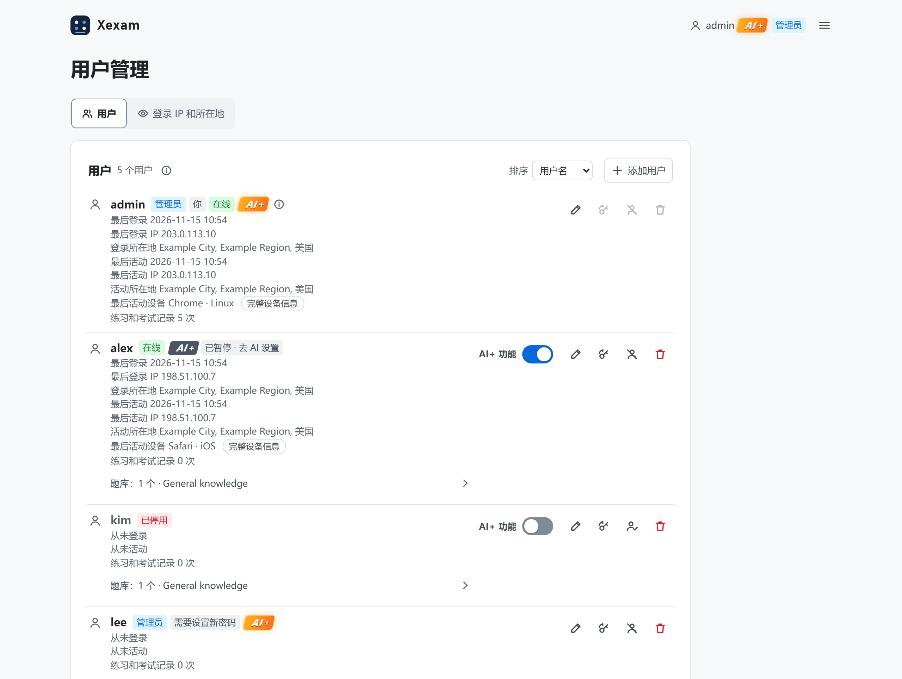

用户管理的**用户**标签页（地址和所在地都是虚构的，另一个标签页上的眼睛是打开的）：admin 和 alex，各自显示**最后登录**、**最后登录 IP**、**登录所在地**、**最后活动**、**最后活动 IP**、**活动所在地**、**最后活动设备**（带**完整设备信息**按钮）和记录行；alex 的 **AI+ 功能**已开启但**已暂停**，所以徽章是暗色。列表更下面是 sam、kim 和 lee。

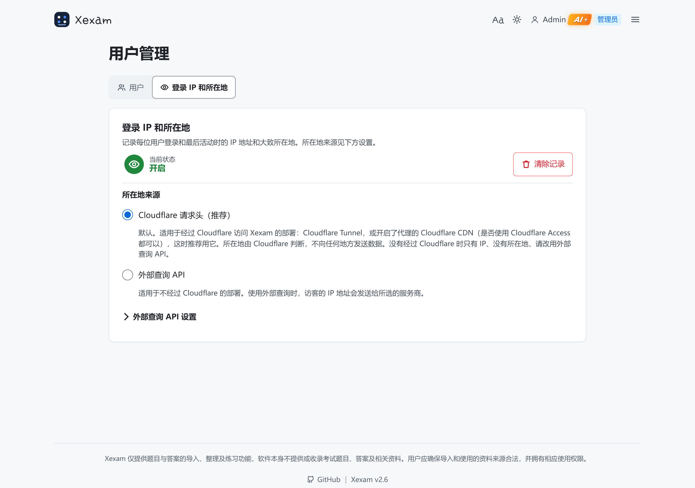

第二个标签页**登录 IP 和所在地**（`#/users?tab=signin`）：状态为**开启**的眼睛、红色的**清除记录**按钮，以及**所在地来源**设置（选中 **Cloudflare 请求头**，下面是**外部查询 API** 的隐私说明和折叠起来的设置）。

- **第一次启动**（新装，或从 v0.5 或更早的版本升级后第一次启动）：用 `admin` / `admin` 登录（登录页上也有提示），接着设置一个新密码（8–128 个字符）。v0.6 之前的学习记录、错题本和设置都归这个管理员。
- **用户管理**（菜单里，只有管理员可用；两个标签页，**用户**和**登录 IP 和所在地**，见下）：**用户**标签页每个用户一行，显示角色、状态（**正常**、**已停用**、**已锁定 · 还剩 …**、**还能试 3 次**、**需要设置新密码**），有权限时再显示 **可管理题库**，还有 **AI+** 徽章，以及创建时间、最后登录时间和学习记录的条数（考试和练习）。操作有 **编辑**、**重置密码**、**停用** / **启用**、**删除**，需要时还有 **解锁**。管理员新建或重置过密码的用户，下次登录时要设置自己的密码。不能停用、降级或删除自己，最后一个启用的管理员也不能被移除。页面开着时列表会自己刷新，所以刚开始的锁定也会显示出来。
- **用户能看到哪些题库** 由两个互不影响的设置决定：为他勾选的已有题库，以及 **包括以后导入的题库**，它让这个用户得到从那以后导入的每个题库（不管是谁导入的，命令行的 `import` 也算）。它从不添加已有的题库。
  - 每个用户那一行写着他有什么：**题库：全部，包括以后导入的**（每个题库都勾选了，并包括以后导入的）、**题库：1 个 · General knowledge**（开启时再加上 **，以后导入的也会加入**）、**题库：还没有选，这个用户看不到任何题库**，或者 **题库：现在没有，以后导入的会自动加入**。可管理题库的用户自己上传的题库列在下面。
  - **更改** 会打开例如 **alex 能看到的题库**。题库列表正上方是一排复选框：**管理题库**（可管理题库的权限）和 **下载题库**（v1.6，下载题库的权限，见 [11.1 节](#111-下载题库v16)，默认关；管理员不需要），**全选** 和 **全部不选** 在这一行的最右端。列表的第一项是 **包括以后导入的题库**，它有自己的图标，并用一条细线和下面隔开；再往下每个题库一个复选框，写着是谁上传的。**全选** 勾选列出的所有题库，都已勾选时则全部取消；**全部不选** 取消所有勾选；两者都不影响 **包括以后导入的题库**。打勾就是开启。页面上没有说明文字：鼠标指向某个选项或用键盘移到它上面时，说明会以提示框显示；**题库** 旁边的小 **i** 按钮解释这个列表。**保存** 会告诉你改了什么：题库，还是只有 **管理题库** 或 **下载题库**。
  - 修改马上生效，这个用户不会被退出登录。管理员始终能看到所有题库。收回某个题库后，这个用户的学习记录仍作为历史保留。可管理题库的用户在拥有这个权限期间，始终能看到自己导入的题库。
- **AI+ 功能**：在题库那一行下面，每个普通用户那一行都有一个 **AI+ 功能** 开关。只有 ai-service 已连接、而且 [AI 设置](#17-ai-设置) 里的 **AI+ 功能** 已开启时它才会出现；否则这些行里没有 AI+ 这一行，**添加用户** 里也没有 AI+ 勾选框，页面开头下面有一句说明原因（AI 设置里这个功能是关闭的，或者 ai-service 没有连接）；开关保持保存时的状态，AI 重新可用时又会出现。它马上生效，不用确认，这个用户也不会被退出登录；只有服务器确认了这次修改之后，页面才会显示新的状态和 **已为 sam 开启 AI+ 功能。**（或 **已为 sam 关闭 AI+ 功能。**）。开启后，只要 AI 设置里的 **AI+ 功能** 开启着、而且没有被暂停，这个用户就能使用 [AI 对话](#16-ai-对话)；关闭后，正在为他生成的回答会在大约 2 秒内停止，他仍然可以查看和删除自己的对话和记忆。管理员没有这个开关：那一行写着 **AI+ 功能开启时，管理员始终可以使用。** 如果页面开着的时候 AI 变得不可用，再点开关会被拒绝，提示 **请先在 AI 设置里开启 AI+ 功能。**（绝不会提示成功），什么都不会改变，列表会重新读取，所以开关会消失。
  - **暂停** 和 **恢复** 是另一个控制，每个用户一个，在 [AI 设置](#17-ai-设置) 的 **AI+ 用户** 下面。被暂停的用户保留这个功能和他的数据，在这里的开关旁边显示 **已暂停** 标记，而且被暂停从不会改变这个开关。
  - **徽章**（在用户名旁边：你自己的在页头，管理员还能在用户管理和 AI 设置里看到）有三种状态：**明亮的橙色** = 这个用户现在可以使用 AI；**深色** = 用户有 AI+ 功能，但现在不能使用 AI，原因是管理员暂停了它，或者 AI 设置里的 AI+ 功能已关闭，或者 ai-service 没有连接（提示框里写着是哪一种：**AI+ 功能已被管理员暂停。**，对普通用户则是 **AI 暂时无法使用，请稍后再试或联系管理员。**；管理员看到的是 **AI+ 功能暂时不可用。**）；**没有徽章** = 没有 AI+ 功能。在触屏上，点一下深色徽章会打开它的提示框，点别处或按 **Esc** 关闭；**设置** → **账户** 里也会把原因写出来。管理员在 AI 可用时有明亮的徽章，否则没有徽章。
- **添加用户**：用户名、初始密码、角色、角色下面单独一行的 **AI+ 功能** 勾选框（仅在 AI 可用时显示），以及和 **更改** 里控件相同的题库列表（一个都不勾，**包括以后导入的题库** 也是关的：选好之前，新用户看不到任何题库）。新账户创建后即为启用状态。角色是管理员时，**管理题库** 和 **AI+ 功能** 勾选框会隐藏，列表是灰的：管理员本来就能看到和管理一切。**编辑** 可以改用户名、角色和 **启用账户**（**管理题库** 在 v0.8 移到了 **更改** 里）。收回可管理题库的权限后，从这个用户下一次切换页面时开始生效。
- **删除用户** 会同时删除他的学习记录（对话框里写明有几条）、错题本和设置。他导入的题库不会被删除，而是转到你的名下，也就是删除这个用户的那位管理员。
- **密码输错**：一个账户在 15 分钟内输错 5 次密码，它的登录就锁 1 分钟；之后每再错 3 次又锁一次，时间依次是 5 分钟、15 分钟、30 分钟、1 小时和 1 天。锁定属于账户，而不是输入的名字，乱猜别的用户名也消耗不掉它。以前用这个账户登录过的浏览器单独计数，所以别处的乱猜锁不住它们。登录成功、**解锁**、管理员重置密码、重启后端，或者 24 小时内没有再输错，都会重新回到 5 次机会。登录页会显示还要等多久。
  - 在 **用户管理** 里，这一行下面的一句简短说明会写明哪些浏览器被锁定、锁到什么时候、已经连续锁了几次。**解锁** 不再询问，马上重新给 5 次机会；用户还有剩余次数时也能点它。
- **修改密码**：**设置** → **账户** → **修改密码**；你在其他浏览器上的登录会被退出。
- **忘了管理员密码**：`docker compose exec backend xexam-backend reset-password admin` 会打印一个新的临时密码，下次登录时必须改掉。Xexam 运行时也能用。想马上解除锁定，就重启后端：`docker compose restart backend`。

<table>
<tr>
<td width="50%">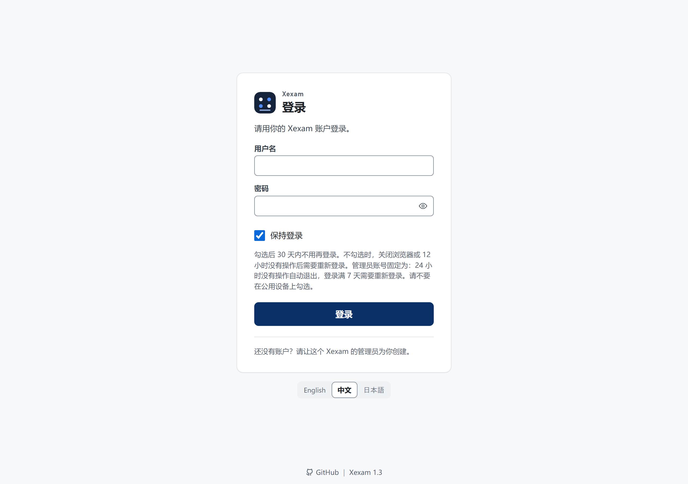</td>
<td width="50%">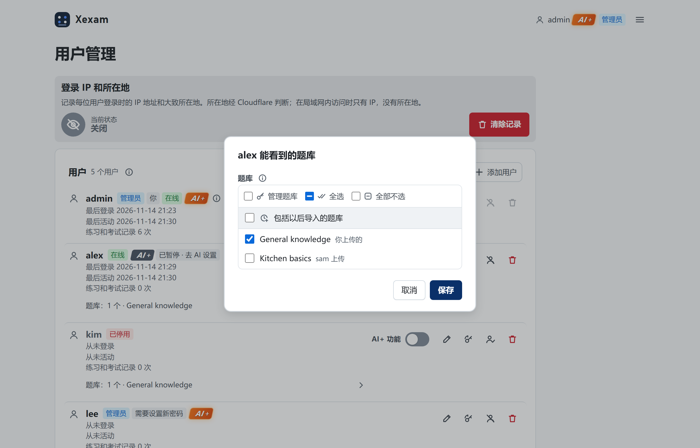</td>
</tr>
<tr>
<td>登录页。</td>
<td><b>alex 能看到的题库</b>：列表上方是 <b>管理题库</b>、<b>下载题库</b>、<b>全选</b> 和 <b>全部不选</b>，第一项是 <b>包括以后导入的题库</b>，下面是写明上传者的题库；这里只勾选了 General knowledge。</td>
</tr>
</table>

### 14.1 保持登录、最后活动和登录 IP（v1.3）

- **登录页**：**保持登录**（默认勾选）让用户在持续使用时 30 天内保持登录。不勾选的话，关闭浏览器或空闲 12 小时后退出。管理员无论勾不勾，空闲 24 小时或满 7 天都会退出，10 分钟前会提醒。会话结束时，登录页会这样说明。
- **用户页**：每个用户的信息一行一项，顺序是：**最后登录**；**最后登录 IP** 和**登录所在地**（**登录 IP 和所在地**标签页上的眼睛打开时才显示；没有时显示**所在地 未知**）；**最后活动**；**最后活动 IP** 和**活动所在地**（眼睛打开、且该用户活动过时才显示）；**最后活动设备**；最后一行是**练习和考试记录**（已保存的练习和考试次数）。日期显示完整年份，格式 `YYYY-MM-DD HH:mm`，按你的时区；没有活动记录时，最后活动相关的几行改为**从未活动**。设备这一行（v1.4）写出该用户最后一次活动所用的浏览器和系统，例如 `Safari · iOS`，与系统日志里的设备同一写法；设备不是地址，所以眼睛关闭时也显示，未知时没有这一行。点击（轻点）这一行旁边的小按钮**完整设备信息**，会在行下展开完整的 User-Agent 文字，再点一次收起。**在线**标出最近 5 分钟内活动的用户；一个选择框可按名称、最后登录或最后活动排序。
- **登录 IP 和所在地**：用户管理有两个标签页，**用户**（列表，默认）和**登录 IP 和所在地**（`#/users?tab=signin`），第二个标签页里有这个标题和一句说明（记录每位用户登录和最后活动时的 IP 地址和大致所在地；所在地来源在同一标签页里设置，见 [14.2](#142-所在地来源cloudflare-或外部查询v14)）。眼睛按钮带有可见文字两行状态：小号灰色的“当前状态”，下面是**开启**（绿色）或**关闭**（灰色）；点眼睛或文字即可切换（睁眼 = 显示，带斜线的眼 = 隐藏，提示文字说明点击后会怎样），默认关闭；这是保存在服务器上的设置，退出登录后不会改变。每次登录以及每位用户最后活动的 IP 和所在地只在眼睛打开时才记录。打开后每个用户会显示上面所说的 IP 和所在地各行（城市、地区、国家，来源提供多少就显示多少；没有时显示**所在地 未知**）。隐藏后不再记录新的 IP 和所在地，也不会发起查询；已保存的记录会保留，打开眼睛即可再次看到（隐藏期间的登录没有记录）。同一行右侧的红色**清除记录**按钮会在确认（“将清除所有已保存的登录 IP 和所在地历史记录，此操作无法撤销。是否清除？”）后清除至今保存的全部内容（用户，包括最后活动的 IP 和所在地、登录会话、活动记录，以及外部查询记住的所在地）；眼睛打开或隐藏时都能用；之后的登录只在眼睛打开时才记录。设置方法见 [deployment.md](deployment.md) 的 3.5 节。

### 14.2 所在地来源：Cloudflare 或外部查询（v1.4）

在**登录 IP 和所在地**标签页眼睛那一行的下面（仅管理员），**所在地来源**决定地址下面的所在地从哪里来：

- **Cloudflare 请求头**（默认；经过 Cloudflare 访问 Xexam 时推荐：Cloudflare Tunnel，或开启了代理的 Cloudflare CDN，是否使用 Cloudflare Access 都可以）：所在地只来自 Cloudflare 添加的请求头（见 [deployment.md](deployment.md) 的 3.5 节）。不向任何地方发送数据。不是每个部署都用 Cloudflare：没有经过 Cloudflare 时只有 IP、没有所在地，请改选外部查询 API。
- **外部查询 API**（默认关闭）：适用于没有部署在 Cloudflare 后面的环境。登录成功后，以及用户最后活动的地址变化时，Xexam 会向位置服务商查询访客 IP。**访客的 IP 地址会发送给所选的服务商**（面板里有一行文字说明）。查询由唯一能访问互联网的容器 `ai-service` 发出，所以 ai-service 必须在运行；AI+ 功能可以是关闭的，也不必设置 AI 服务商。这些查询不计入 AI 请求额度，也不计入 AI 用量。

**只有所选来源决定显示什么。** Cloudflare 模式下所在地只来自 Cloudflare 的请求头；外部 API 模式下只来自服务商的返回结果，Cloudflare 的所在地请求头会被忽略（访客 IP 仍按可信代理的规则取得）。切换来源只影响之后的新记录，已保存的所在地保持原样。

打开**外部查询 API 设置**进行设置：

- **服务商**：下拉框，有 ipinfo.io、ip-api.com、ipapi.co、ipwho.is、ip.sb 和**自定义**。选一个预设会填入查询地址和字段映射（都可以再修改）。ip-api.com 的免费版只支持 http，每分钟 45 次请求；它的预设和 ipwho.is 的预设（https，不需要密钥）都会按页面语言要求地名（`lang=zh-CN`、`ja` 或 `en`），可以在地址里修改。
- **查询地址**：一个模板，`{ip}` 会替换为访客 IP，`{key}` 会替换为可选的密钥，例如 `https://provider.example/{ip}/json?token={key}`。允许使用 `http://`（有些免费版只有 http），此时表单会警告 IP 以明文发送。没有密钥时，值恰好是 `{key}` 的查询参数会被去掉。
- **密钥（可选）**：加密保存在 ai-service 的数据库里，之后不再显示（表单只显示已设置，密钥较长时显示末 4 位），也不会写入日志。以后保存时留空表示保留；**清除密钥**可删除。**通过请求头发送密钥**会把密钥放进请求头而不是地址：填请求头名称（例如 `Authorization`）和内容（例如 `Bearer {key}`）。
- **字段映射**：服务商返回的 JSON 中，国家名称、国家代码、地区和城市所在位置的点号路径（例如 `data.city`；数字表示列表中的第几项）。可选填**成功标志字段**和**成功值**（例如 `status` = `success`），以及**错误标志字段**和**错误信息字段**，这样服务商返回“失败”时会报告为失败，而不是得到一个空的所在地。两位国家代码会按页面语言显示为国家名称。
- **测试**用表单里的设置查询固定的公开示例地址 `8.8.8.8`，不保存任何内容，并显示解析出的国家、地区和城市，或确切的原因：超时（3 秒）、HTTP 状态、返回内容不是 JSON、过大、拒绝了重定向、服务商报告失败，或没有找到国家、地区、城市。**测试并保存**会做同样的测试，通过后才保存设置。只有测试并保存过的设置才能启用外部来源（与 AI 设置相同的规则）；**删除设置**会删除设置和密钥，并改回 Cloudflare。
- ai-service 没有运行时，表单不可用，只能选 Cloudflare；外部来源已开启而 ai-service 未连接时，面板会提示暂时不会查询所在地。

查询规则：

- 只在登录成功后，以及用户最后活动的地址变化时（约每分钟检查一次）才查询，不会每个请求都查。之后的活动记录沿用该 IP 已记住的所在地，不再发起新的查询。每个 IP 的所在地记住 24 小时（失败结果记 15 分钟），记忆容量有上限。
- 内网、回环、链路本地、共享（CGNAT）、文档用、保留和组播地址永远不会发送。
- 眼睛关闭时，不查询也不记录。
- **补查（v1.6）**：把来源切换到**外部查询 API**，或在来源是 API 时保存新的服务商设置之后，后端会把所有存下来的、记录里没有所在地的地址再查一遍（不论多旧：系统日志的行、最后登录和最后活动都算）。每个不同的地址只查一次；实时查询优先于补查，补查每分钟 30 次；服务商回答限流时暂停 15 分钟；每个地址最多试 3 次。已有的所在地从不被覆盖。关掉开关、来源改回 Cloudflare 或**清除记录**时，补查停止。
- **Cloudflare 模式下的 AI 服务日志行（v1.6）**：ai-service 写入系统日志的行现在也带 Cloudflare 的所在地（Nginx 只对可信代理把 `X-Geo-*` 转给 AI 服务）。
- **确认（v1.6）**：**开启 / 关闭**开关现在两个方向都要确认。
- 查询在后台进行，不会拖慢或使登录失败：超时约 3 秒，返回内容有大小上限，拒绝重定向，只接受 JSON。失败时所在地留空，并在运行日志里写一行不含密钥的简短记录。每分钟最多查询 30 次。

## 15. 系统日志

**系统日志**（菜单里，只有管理员可用；其他人打开会看到 **没有权限**）显示后端自上次启动以来记录的日志，最新的在最下面：启动、登录、对用户的修改、被拒绝的请求或上传等。AI 服务的日志也在这里，以 `AI: ` 开头。

- 页面打开时每 2 秒读取一次新内容，并跟着新内容往下滚。往上滚可以看前面的，**跳到最新** 带你回到最下面。读取失败时，它会等更久再试（最长 10 秒），并显示原因；超过 10 秒还没完成的读取会被中断，算作失败。
- **暂停** 暂时不再读取新的日志；**继续** 重新开始读取。
- **级别** 可以显示 **全部**、只显示 **警告**（和错误），或只显示 **错误**；**搜索日志** 按文字筛选。
- 只保留最后 2000 行，而且只在内存里：重启后列表又是空的。更早的日志请在服务器上、compose 文件所在的文件夹里运行 `docker compose logs backend`（不用 Compose 时：`docker logs xexam-backend`）。
- 日志里用用户名指代用户（`user "admin" updated user "alex"`；改名时加上 `(renamed from "…")`）。登录时输入的、没有账户的名字从不记录。日志从不包含密码、会话令牌、Cookie 的值或题目文字。成批出现的被拒绝的请求和失败的登录，每分钟汇总成一行，所以没人能不登录就把其他日志挤出去。
- **AI 的日志**（`AI: …`）：ai-service 的启动和它与后端的连接、AI 设置的修改、测试、开启或关闭 **AI+ 功能**、失败的 AI 调用（同一个原因每分钟最多一行）、对话保留，以及管理员每次查看或删除某个用户的 AI 对话或记忆、暂停或恢复某个用户的 AI+ 功能，例如 `AI: user "admin" cleared one AI chat of user "sam"` 和 `AI: AI function turned off for user "sam" by admin "admin"`（暂停时的日志行）。为用户开启或关闭 **AI+ 功能** 由后端记录：`user "admin" turned AI+ on for user "sam"`。AI 的日志从不包含密钥、消息、回答、对话标题或记忆的内容。后端有一段时间连不上时，ai-service 会在之后补发它保留下来的日志（最多 500 行），并注明丢掉了多少行；关于管理员查看、删除、暂停或恢复的日志从不丢弃。ai-service 每 25 秒发一次的常规报告不写日志，但连接的状态会写：每次连上时写一条 `AI: AI link: connected to the main service`（启动时和每次重新连接后），连接断开时写一条 `AI: AI link: lost the main service`。

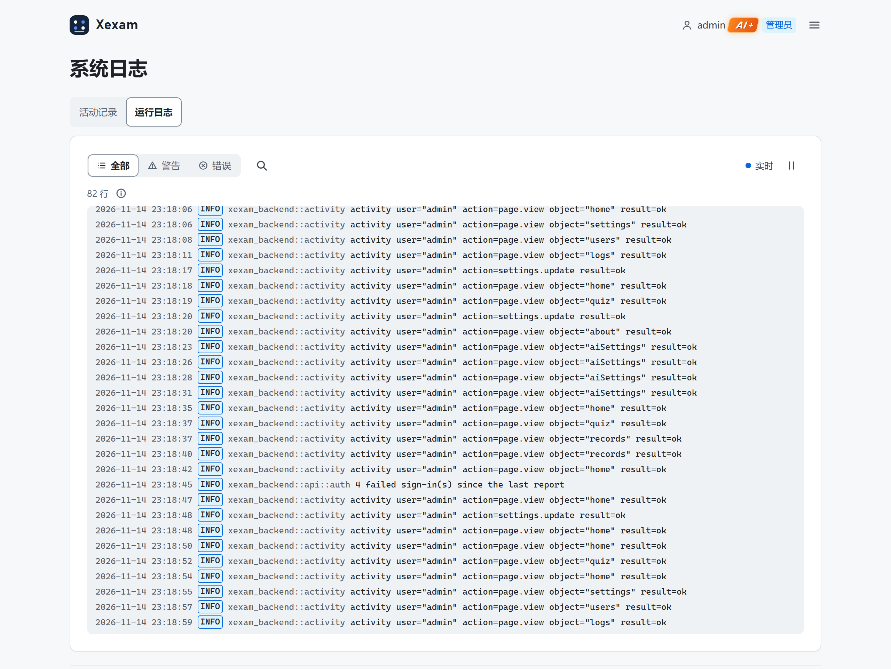

系统日志里是启动时的几行（最后一行是 AI 连接）、admin、sam 和 alex 的登录、AI 服务关于管理员列出模型、保存 AI 设置、测试和开启 AI+ 功能的几行、alex 修改自己的密码、管理员新建 lee 并修改 kim，以及一个编造的用户名被反复猜测直到锁定；上面是 **级别** 筛选、搜索框和 **暂停**，下面是关于更早日志在哪里的说明。

### 15.1 活动记录标签（v1.3）

系统日志页有两个标签。**活动记录**记录谁做了什么：登录和退出、被拒绝的登录、过期的会话、用户和题库管理、设置、AI 设置和管理员操作，以及页面访问。每条记录有时间、用户、操作、对象、结果和地址列：登录信息的眼睛睁开时显示 **IP · 所在地 · 设备**（所在地取简短形式：城市，没有则地区，再没有则国家；完整文字在悬停提示和展开的详情里），关闭时只显示**设备**。手机上地址列会折到操作下面。外部查询模式（14.2 节）下，每条记录的所在地是该 IP 已记住的查询结果。筛选：用户、操作分组和结果。宽屏显示表格，手机显示卡片；**加载更早的**往回翻；列表每 10 秒刷新一次（可用按钮暂停）。设置按钮可设保留天数（90 天，7 到 3650；登录记录永远不会被删除）和是否记录普通用户的页面访问（默认关闭）；管理员的页面访问总是记录。如果记录里只有内网地址，会有提示说显示的是代理地址，并指向 `XEXAM_TRUSTED_PROXIES`。**运行日志**就是上面说的技术日志，现在每 2 秒读取一次。

## 16. AI 对话

**AI 对话**（菜单里，在 **学习记录** 和 **用户管理** 之间）是和 AI 模型的对话。管理员在 [AI 设置](#17-ai-设置) 里设置好 AI 并开启 **AI+ 功能** 之后它才会出现；不是管理员的用户，还要管理员在 [用户管理](#14-用户和登录) 里为他开启 **AI+ 功能**（并且没有暂停它）。AI+ 功能开启时，管理员始终可以使用它。同一个 **AI+ 功能** 也带来学习页面上的 AI 帮助：练习里的 **AI 提示** 和 **AI 解析**（[第 5.1 节](#51-ai-提示ai-解析和-ai-面板)）、成绩页上的 **AI 解析**（[第 6.1 节](#61-ai-解析)）和一条记录的 **AI 总结**（[第 7.1 节](#71-ai-总结)）；它们的回答保存在这里（[第 16.1 节](#161-练习考试和总结的对话)）。AI 在自己的容器 `ai-service` 里运行，用户永远看不到这个名字。用户也永远不知道是哪个 AI 在回答（v1.3）：只有管理员能看到连接和模型；对其他所有人，回答上方那一行只写 **AI** 和时间，AI 对话里是这样，AI 出现的其他所有地方（AI+ 面板、成绩页、AI 总结、AI 生成的题库、AI 导入、消息和提示）也是这样。用户也永远不知道是哪个 AI 在回答（v1.3）：只有管理员能看到连接和模型；对其他所有人，回答上方那一行只写 **AI** 和时间，AI 对话里是这样，AI 出现的其他所有地方（AI+ 面板、成绩页、AI 总结、AI 生成的题库、AI 导入、消息和提示）也是这样。用户也永远不知道是哪个 AI 在回答（v1.3）：只有管理员能看到连接和模型；对其他所有人，回答上方那一行只写 **AI** 和时间，AI 对话里是这样，AI 出现的其他所有地方（AI+ 面板、成绩页、AI 总结、AI 生成的题库、AI 导入、消息和提示）也是这样。连不上 AI 时，菜单里没有 AI 对话，直接打开它会显示 **AI 暂时无法使用，请稍后再试或联系管理员。** 和 **重试**（管理员看到的是 **ai-service 未连接。**）。不能使用 AI、又没有任何对话或记忆的用户，会得到 **AI 对话** 页面和一句简短的说明，写明原因和该怎么做：**管理员已暂停你的 AI+ 功能。如需继续使用，请联系管理员。**、**AI+ 功能暂时不可用，请稍后再试。** 或 **你的账号没有开通 AI+ 功能。管理员可以在用户管理里为你开通。**

- **顶部的说明**：标题下面始终有一行 **管理员可查看、删除你的 AI 对话、记忆和用量。** 它不能关掉，也没有弹窗。从 v2.3 起它的文字更短（手机上是一行），也不再在抽屉里重复出现。管理员能看到什么，见 [第 17 节](#17-ai-设置)；管理员的每次查看和每次删除都会写进系统日志，不带任何内容。
- **布局（v2.3）**：AI 对话像一个聊天应用。**打开 AI 对话会新开一个对话**，任何宽度都一样；地址里指定的对话（`#/ai/<id>`）或还在生成回答的对话会保持打开，AI+ 功能被暂停的用户则以只读方式打开最近的一个对话。平板和电脑（宽度 720 px 及以上）上，侧边栏始终显示在左边，其余部分是对话。手机（窄于 720 px）上页头是一行：左边是 **全部对话** 按钮（两条横线的菜单图标），中间是标题和绿色的 **自由模式** 标签，然后是 **新对话**（+）按钮和用来删除这个对话的 **⋯** 菜单；**全部对话** 按钮会打开下面说的抽屉。**对话** 和 **记忆** 两个标签页没有了：**记忆** 是侧边栏的一行，它的视图会替换对话。
- **固定高度的窗口**：消息在窗口里滚动，输入框始终在底部，所以很长的对话不会把页面撑大；打开一个对话时从最新的消息开始。消息区域可以用 **Tab** 键到达（它有焦点框，名字是 **消息**），并用方向键滚动。
- **地址会记住对话**：打开的对话在地址栏里是 `#/ai/<id>`，还没发送的新对话是 `#/ai/new`，所以刷新，或再次打开同一个地址，都会显示同一个对话；**新对话** 会打开 `#/ai/new`。地址里的对话已被删除或不存在时，AI 对话会回到一个新对话，并显示一条简短的说明。
- **自由模式**（只有管理员）：自由模式不是 AI 对话页面上的开关，而是管理员自己的一种状态，在 **设置** 的 **AI 对话模式** 里选择（[第 9 节](#9-设置)）。开启时，**AI 对话** 标题右边有一个绿色的 **自由模式** 标记；普通模式下什么都不显示，AI 对话页面上没有开关，也没有分隔线。通常每个回答都遵循 Xexam 的学习助手指示，AI 会拿到你的记忆笔记和今天的日期。自由模式下，你发出的每条消息（不管在哪个对话里、新的还是旧的）和每次 **重试**，都会不带这些指示、不带日期、也不带记忆地发给模型：你直接和模型对话，只保留下面的回复语言规则。服务商自己的安全规则始终有效。这个选择从你的下一条消息起生效，保存在服务器上（刷新或换一台设备都能看到），默认是关闭的。每条消息都记录它是在哪种模式下发出的，对话从一种模式变到另一种之后，模型会用一句简短的话得知当前的模式；对话本身没有模式。限制、用量统计、保留、**停止** 和 **重试**、**记住这个**、管理员的查看和系统日志照常；只是自由模式下不使用记忆，而且只有管理员能使用它。
- **回答的语言** 是 **设置** 里选的语言（英语、中文或日语），不管你用什么语言写，除非你在那条消息里要求用另一种语言。用 **记住这个** 生成的记忆笔记也用这种语言写。每条消息使用当时设置的语言，所以切换界面语言会改变下一个回答的语言。
- **侧边栏和抽屉（v2.3）**：一个搜索框、**新对话**、**记忆**，然后是你的对话，最新的在最上面，分成 **今天**、**昨天**、**7 天内** 和 **更早**。每一行显示对话的标题（第一条消息的开头，最多 60 个字符）和最后一条消息的时间（打开的对话在生成回答时，这一行改写成 **正在回答…**，或 **正在思考…**），并有一个带删除命令的 **⋯** 菜单。最下面是 **删除全部对话**（红色边框的按钮）、对话保留多久（例如 **对话在最后一条消息 90 天后自动删除。**）和 GitHub 那一行。手机上侧边栏是从左边滑出的抽屉，宽度取 320 px 和屏幕 82 % 中较小的一个；点一下它背后变暗的页面、按 **Esc**、向左滑、按返回键或选一个项目，它就会关上。发出第一条消息时才会创建对话。还没有消息的新对话会在页面中间显示一句简短的问候。
- **消息**：你的消息按你写的样子显示；回答带简单的格式（粗体、斜体、行内代码、代码块、列表；标题变成粗体的一行，链接显示成普通文字，从不显示成链接）。每条消息上方是 **你** 或 **AI**，以及时间。开了自由模式（**设置** → **AI 对话模式** → **自由模式**）的管理员也能选择模型，所以会看到连接和模型（`连接 · 模型`），代替 **AI**；普通模式下的管理员和其他人，回答上方只显示 **AI** 和时间（v1.4）。服务器从不把模型或连接发给非管理员（v1.3），**AI 设置**里的对话查看始终显示它们。下方是 **复制**（空消息上不显示），你自己的消息下面还有 **记住这个**（见下面的记忆）。
- **写消息**：输入框（**想问什么都可以…**）。空的新对话里，它在问候下面的屏幕正中；发出第一条消息后落到底部，管理员说明始终在最底下。输入框区域没有分隔线，背景和对话一样，下面也没有回答语言的提示行。输入框为空或很短时是一行紧凑的圆角条（管理员在**自由模式**下有大脑按钮，然后是输入区和**发送**，见 16.2）；文字要换行或有换行符时，展开成整宽文本加下面一行控件（左边大脑按钮，右边字数计数和**发送**）。最多长到 8 行（手机上是可见高度的 40 %），再往上在里面滚动；长单词在边缘折行，文字变短后会缩回去。在电脑上 **Enter** 发送，**Shift+Enter** 换行；在触摸屏上 **Enter** 换行。**Ctrl+Enter**（Mac 上是 **Cmd+Enter**）在哪里都是发送。输入法还在组词时（中文或日语输入），什么都不会发送。一条消息最多 16 000 个字符（这是保护服务器的固定上限，不是设置）；接近上限时会出现计数。
- **回答生成时**，它会一段一段地出现，下面显示 **正在回答…**（推理模型在说第一句话之前还在思考时，显示 **正在思考…**；它思考的文字显示在下面的思考块里）；往上滚时会出现 **跳到最新**；它只滚动到最新的消息，从不弹出键盘。你已经可以输入下一个问题，回答结束后就能发送。**发送** 按钮变成 **停止**：**停止** 结束这个回答，保留已经生成的文字，并标记为 **已停止**。（双击 **发送** 只会发送；发送后 0.4 秒内点 **停止** 会被忽略，所以双击不会停掉刚开始的回答。）
- **思考块（v1.3）**：推理模型发来它的思考时，AI 对话会把它显示成回答上方一个灰色的小块。模型还在思考时，这个块是展开的，写着 **思考中…**，文字一边到达一边显示在一个高度有限的框里（约 320 px，最多占屏幕的 40 %），框会自己滚动。回答的第一个字一到（或者回答结束），它就收成一行 **已思考 12 秒 ▸**（模型思考所用的时间，四舍五入，至少 1 秒）。点击、轻点这一行，或按 **Enter** 或 **Space**，可以再次展开或收起（它是一个按钮，读屏软件会报读它是展开还是收起；这一行在手机上至少 44 px 高）。文字按纯文本显示，从不显示成格式或链接。超过 32 KiB 的思考文字只保留开头，并在下面注明。这个块随回答一起保存（重新生成的回答，每个版本各有自己的），打开这个对话的管理员看到的也一样，并随对话一起删除。没有思考的回答，以及 v1.3 之前写的所有回答，都没有这个块。把思考写在回答里的模型也能识别：回答一开头用 `<think>`、`<thinking>` 或 `<thought>` 包起来的一段。**只有 AI 对话会显示它**：**AI 提示**、**AI 解析**、**AI 总结**、AI 生成的题库和 AI 导入都会丢弃它（提示的思考里常常含有答案）。它从不发回给模型（之后的提问、**重新生成** 和 **编辑** 只使用写好的回答），**复制** 也只复制回答。
- **离开页面，回答也会继续**：关掉标签页、刷新、切换应用或锁定手机都不会让它停下。AI 服务会继续生成并保存它；你回来时，对话显示已经生成的文字，并接着往下显示，直到回答结束。
- **出问题时**，回答保留已经有的文字，并在下面写明原因：**回答中断：…** 或 **没有回答：…**（例如 AI 服务商太忙或没有及时回应），或者 **回答达到了模型的长度上限。** AI 的设置有问题时（密钥被拒绝、额度用完、模型不存在），用户看到的是 **AI 现在没有正确设置，请告诉管理员。** 对话的最后一个回答失败或被停止时，它下面的 **重试** 会在原位置重新生成这个回答，用的是现在的模式；焦点回到输入框，你在里面输入的内容保持不变。
- **一次一个回答**：默认每个用户同时只能有一个回答在生成（一个 AI 提示、解析或总结也算）；再发一个会显示 **上一个回答还在生成，请等它结束或按停止。**（在学习功能的窗口里，它是带 **停止它，生成这一个** 的那条说明，[第 5.1 节](#51-ai-提示ai-解析和-ai-面板)）（管理员最多可以允许四个，但同一个对话里永远不会同时有两个）。一个对话最多 400 条消息（之后请 **开始一个新对话**），每个用户最多 1000 个对话（之后请删掉一些旧的）；两者管理员都可以修改。练习、考试和总结的对话（[第 16.1 节](#161-练习考试和总结的对话)）两者都计入。
- **在手机上**，页头是 **布局** 里说的那一行。屏幕键盘不会把页面顶上去：消息列表从底部变短，消息留在原处，输入框始终贴在键盘上方。只有列表会滚动：在对话列表下方的空白处、标题行或顶栏上拖动不会带动任何东西；文字调大时，标题、**自由模式** 标签和账号标识会逐步缩小，而不是互相遮盖。
- **删除**：对话的删除按钮和 **删除全部对话** 都会先问你。删除的对话马上就没了，管理员也看不到了；之前做的备份里仍然有它。
- **只读**：你不能使用 AI 时，只要你还有对话或记忆，就仍然保留 AI 对话，顶部有一行写着原因，用的是深色徽章提示框里的话，后面接着 **你仍然可以查看和删除自己的对话和记忆。**：**AI+ 功能已被管理员暂停。**、**你的账号没有开通 AI+ 功能。**（你没有 AI+ 功能）或 **AI 暂时无法使用，请稍后再试或联系管理员。**（AI 设置里的 AI+ 功能已关闭，或者 ai-service 没有连接）。可以查看和删除，但不能写消息、重试或记住。正在生成的回答会在开关改变后大约 2 秒内停止，而暂停会让它立即停止。

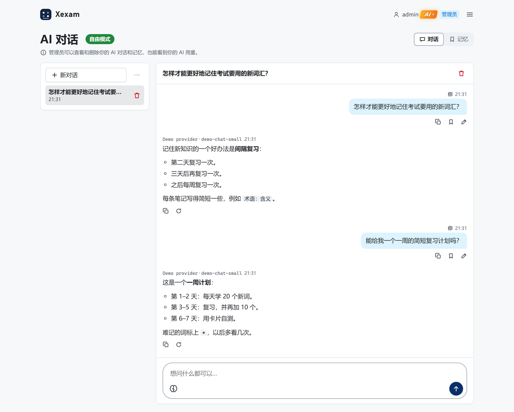

以管理员身份打开的 AI 对话（名字旁边有 **AI+** 徽章，自由模式开启）：标题右边绿色的 **自由模式** 标记，标题下面的说明，带 **新对话**、**记忆**、历史记录，以及最下面的 **删除全部对话** 和保留时间那一行的侧边栏，以及一个向虚构的服务商提了两个问题的对话和它的回答（粗体字、列表、行内代码），每条消息上方是 **你** 或带模型名的 **AI** 和时间，下方有 **复制**，问题下面有 **记住这个**，还有带 **发送** 的输入框。普通模式下不显示这个标记；AI 对话本身没有模式开关（在 **设置** 的 **AI 对话模式** 里选择）。

**记忆** 是关于你的一些简短笔记，AI 在每次对话中都会拿到它们（**AI 会在每次对话中参考这些记忆。**），例如你正在准备的考试。

- 记忆视图（侧边栏的 **记忆** 一行；在你选一个对话之前它会替换对话）列出这些笔记，每条都写着是 **来自对话** 还是 **手动添加**，带 **编辑** 和 **删除**，还有 **删除全部记忆**（红色边框）。**Esc** 取消编辑，并把焦点放回它的 **编辑** 按钮。**新记忆** 输入框和 **添加** 用来添加一条；计数显示已经用了多少字符、最多多少。默认最多可以保存 50 条，每条最多 200 个字符（管理员可以在 [第 17 节](#17-ai-设置) 里修改这两个数字）。
- 你的某条消息下面的 **记住这个** 会请 AI 把这条消息整理成一条简短的笔记。笔记以 **保存到记忆？** 出现在回答下面一个可以编辑的框里：**保存** 留下它，**暂不** 丢掉它。消息以「Remember …」或「Please remember …」开头时（中文是 记住 或 请记住，日语是 覚えておいて，或者以 覚えておいて 结尾），回答结束后会自动提出笔记。不点 **保存** 就什么都不会保存。
- 对话保留不会删除笔记；它们一直保留，直到你（或管理员）删除。

AI 服务商在 AI 对话里收到的内容：你的消息、同一个对话里以前的消息、学习助手的指示（带你设置里的语言）、你的记忆笔记和今天的日期。历史限制在最新的、默认合计约 24 000 个字符以内的那些消息，而且总是用同样的方式缩短：最新的 4 条消息完整保留，更早的回答截到 800 个字符（带「…(shortened)」标记），更早的提问截到 2000 个字符。自由模式下，它只收到这段历史、你的消息和语言规则，另外在对话从一种模式变到另一种之后，还有一句点明当前模式的简短的话。服务商可以把这样的请求的开头保存在它的提示缓存里，让之后的请求更便宜、更快：Anthropic 在指示和你的新问题之前的历史上设置缓存点；OpenAI 格式的服务商在支持时自己缓存。从缓存里提供的 Token 在 AI 设置的用量里显示为 **缓存命中**。AI 对话不会发送你的题库或学习记录里的任何内容，除非你把它贴进消息里。学习功能会自己发送题目，而且只在你按下它们的按钮时发送，每个请求都是独立的（没有记忆笔记、没有以前的消息、没有自由模式）：**AI 提示** 发送题目和它的选项，用页面上显示的语言；**AI 解析** 还会发送题库的答案和它的解析，在成绩页和记录详情页上还会发送你自己的答案；**AI 总结** 对每道答错的题（最多为设定的数量，默认 40 道）发送你的答案、正确答案、题目和题库的解析。除了题目，请求里还带着语言规则和那个功能的指示，没有别的关于你的内容。提示从不包含答案。这些窗口会说明它们基于什么，保存回答的对话列在第 16.1 节。

### 16.1 练习、考试和总结的对话

每个 AI 提示、解析和总结都保存在 **AI 对话** 里，放在一个有自己类型的对话中。它们遵循普通对话的规则：你可以查看、继续和删除它们，管理员可以像查看任何其他对话一样查看和删除它们（[第 17 节](#17-ai-设置)），保留期会删除它们，它们计入每个用户的对话数和每个对话的消息数的上限，它们的用量不带内容地统计。

- **一次练习或一场考试有一个对话**，标题是 **`<开始时间>-练习`** 或 **`<开始时间>-考试`**，例如 `2026-11-11 21:58-练习`。时间是你开始它的时间（浏览器的时钟，按 ai-service 的时区写出，和用量里的日期用的是同一个时区）。练习页上的提示和解析、它的成绩页上的解析，以及记录详情页上的解析，都按顺序放进这一个对话，每条都标明它是什么和它是第几题（**AI 提示 · 第 3 题** 或 **AI 解析 · 第 3 题**）。你暂存退出、以后接着做的练习，会继续写进同一个对话。
- **一条记录有一个总结对话**，标题是 **`<记录时间>-AI总结`**，里面保存这条记录的每一份总结；总结请求只显示一个标签，例如 **AI 总结 · 80 道答错的题中的 70 道**。
- **v0.9 之前生成的记录** 没有开始时间，也没有会话 key。在这样的记录的详情页上第一次做 AI 解析，会为它开一个自己的对话，标题是记录的时间加上 **-练习** 或 **-考试**。这时在列表里，它可能看起来像同一分钟里的第二个对话。
- 时间后面的文字跟随界面语言（英语里是 **-Practice**、**-Exam**、**-AI summary**；中文里是 **-练习**、**-考试**、**-AI总结**；日语里是 **-練習**、**-試験**、**-AIまとめ**）。
- 学习的回答没有 **重试** 和 **记住这个**；**复制** 和别处一样。你可以像在任何对话里那样，在这样的对话里写一个后续问题；它是一条普通的 AI 对话消息，对话里以前的消息是它的历史的一部分。学习窗口里的 **重新生成** 会在同一个对话里加一个新回答并显示它；以前的回答仍留在对话里。
- **打开学习对话**：学习窗口从不替你打开 AI 对话。回答保存后，面板会显示 **AI 对话已记录**，它的提示会写出对话名字；从菜单打开 **AI 对话**，然后自己选那个对话。
- **删除**：删除学习记录会保留它的对话。在 AI 对话里删除一个对话，会删掉它保存的回答：下次你按那道题的按钮时，那道题的窗口会写一个新回答，放进一个新的对话里。**删除全部对话** 和管理员的清空，对每一个对话都一样。

### 16.2 重新生成、编辑和版本（v1.3）

- 回答下面：**复制**、**重新生成**（新版本，之前的保留）以及有多个版本时的 `‹ 2/3 ›`。问题下面：**复制**、**记住这个**、**编辑** 和同样的切换。**编辑**把问题放回输入框，并在提示下说明发送后会开出新分支；**取消**（或 Esc）恢复你原来输入的内容。切换版本不调用 AI，对话只读时也能用。每次重新生成或编辑算一次 AI 请求，每个版本都计入对话的消息数。
- 如果对话在另一个窗口被改过，会出现提示并重新加载对话。
- **管理员**：在**自由模式**下，输入框下面那条栏的左边有一个圆形的大脑按钮（不显示模型名）：点它会打开一个小弹层 **本对话的模型**，里面有两个下拉框，先选 **API**（连接），再选 **模型**（这个连接下的模型）。初始为这个对话记住的选择，否则是默认；标有 **（默认）** 的模型表示“跟随默认”，**恢复默认** 可以回到它。只改 API 不会改变实际发送的内容。选了非默认模型时按钮上有一个小圆点，提示文字是 **模型：<名称>**。如果所选模型的连接已停用，弹层会提示发送会失败，并让你换一个模型。它旁边的 **强度** 按钮打开自己的菜单：第一项 **默认**（不发送强度参数），然后是该连接家族的强度，对话有自己的选择时还有 **跟随 AI 设置（当前：…）**。强度按钮在每个等级下看起来都一样。**在手机上，输入框是一行时**，强度不是按钮，而是大脑弹层里 **API** 和 **模型** 之后的下拉框；输入框展开后，以及在较宽的屏幕上，又是单独的强度按钮。自由模式之外使用对话的默认模型。

## 17. AI 设置

**AI 设置**（菜单里，只有管理员可用；其他人会看到 **只有管理员可以打开 AI 设置。**）是接入、测试、开启和查看 AI 的地方。ai-service 没有运行时，页面也能打开。

**五个标签页。** AI 设置是一个页面，有五个标签页：**连接与模型**（顺序：连接、AI+ 总开关、模型行（每行带自己的功能开关）；下面的第 1 到第 3 项）、**AI+ 用户**（第 4 项）、**AI 用量**（第 5 项）、**AI 题库**（第 17.5 节）和 **AI 安全**（对话保留和安全上限：第 6 和第 7 项）。在手机上，标签页是一排紧凑的图标，带短标签（**连接**、**用户**、**用量**、**题库**、**安全**）。

**连接 ai-service。** 页面先问主服务 ai-service 有没有连接：ai-service 会在启动时、有变化时马上、每 25 秒，以及停止时，向主服务报告自己的状态；超过 60 秒的报告算作没有连接。已连接时，标记下面有一行 **ai-service 已连接（版本 1.0；最后一次报告：15:04）。**，下面的设置会加载出来。没有连接时，页面只显示一个面板 **ai-service 连接状态**，写明原因，还有 **最后一次报告：…**（或 **主服务启动后还没有收到报告。**）、**版本：…**、**本页面每 10 秒自动重新检查。** 和 **重试**；ai-service 一连上，设置就会自己出现。原因有：

| 面板上写的 | 意思 | 怎么办 |
|---|---|---|
| **主服务暂时连不上，请稍后再试。** | 浏览器得不到主服务（后端）的回应 | 检查 `xexam-backend` 是否在运行 |
| **主服务没有内部令牌，ai-service 无法连接。** | 主服务里的 AI 链接是关闭的 | 看主服务的日志，以 `AI link off` 开头的那一行 |
| **ai-service 没有运行，或者连不上。** | 没有任何东西在响应 ai-service | 检查 `ai-service` 容器是否在运行；从 v0.7.5 升级之后，请下载新的 `docker-compose.yml`（它新增了这个容器） |
| **ai-service 已停止，请重新启动 ai-service 容器。** | 它最后一次报告说它正在停止 | 再次启动 `ai-service` 容器 |
| **ai-service 正在运行，但没有连上主服务。** | 它有响应，但它的报告不被接受 | 检查两个服务的 `XEXAM_INTERNAL_TOKEN` 相同（或都不设置），并且 `XEXAM_AI_BACKEND_URL` 指向主服务 |
| **ai-service 正在运行，但主服务启动后还没有收到它的报告。** | 它刚刚启动 | 等一等：它每 25 秒报告一次 |

关于主服务的那条文字只在主服务本身连不上时才出现；ai-service 不在时，从不怪到它头上。

在**连接与模型**标签页顶部，四张卡片显示设置进行到哪一步：**AI+ 总开关**（**已开启**、**已关闭**、**尚未设置**、**已暂停：没有可用的模型**或**已暂停：密钥无法解密**）、**连接**（例如 **2 个连接，全部正常**，或有问题的个数）、**默认模型**（连接和模型；不可用时显示警告）和**功能**（**6 项全部开启**或**已关闭：…**）。全新安装时，在保存连接之前，页面不会向服务商请求模型列表。已保存的密钥无法再解密时（AI 加密密钥被更换或丢失，见 [deployment.md](deployment.md) 第 3.2 节），会有一条提示：请编辑连接、重新输入密钥并测试。接下来是这几部分：

1. **连接**：最多 8 个，每个有**名称**（1 到 40 个字符）、**类型**，以及地址和密钥。**＋ 添加连接**新增一个；对已保存的连接可以**编辑**、**重新测试**和**删除**，还有一行写明哪些功能在使用它。新连接可以使用另一个连接已保存的密钥（**使用已保存的密钥**）。
   - **OpenAI 兼容 API**（默认）：**API 地址**（一开始是 `https://api.openai.com/v1`；OpenAI 兼容地址通常以 `/v1` 结尾，本地服务器的地址也是）和 **API 密钥**。
   - **Anthropic**：**API 地址**（`https://api.anthropic.com`；末尾的 `/v1` 会被去掉，因为 Xexam 自己会加上 `/v1/messages`）和 **API 密钥**。
   - **Cloudflare AI Gateway**：**网关地址**，例如 `https://ai-gateway.example.com/<route>`（`…/openai` 或 `…/anthropic`）；**API 格式**，OpenAI（chat completions）、OpenAI Responses（*v1.8*）或 Anthropic（messages），按地址的最后一段自动填好（OpenAI 或 Anthropic），也可以改；**OpenAI Responses** 只能手动选择；**网关认证方式**：`Authorization: Bearer`、`x-api-key` 或 `cf-aig-authorization`；**网关 API 密钥**；以及 **服务商密钥（仅在网关需要时填写）**，网关自己保存了服务商的密钥时就不需要。
   - 密钥输入框总是空的（输入框旁边的眼睛按钮是 **显示密钥** / **隐藏密钥**，只显示你自己输入的内容）。每个下面写着 **已保存：…1234**（最后四个字符，只对 12 个字符以上的密钥显示）、**已保存**、**未设置** 或 **无法解密，请重新输入**。输入框留空就保留已保存的密钥；**删除这个密钥** 删除它。密钥是 1–400 个可见字符，不能有空格。
   - **已保存的密钥绝不会自己发到新的地址**：把地址改到另一台服务器（另一种协议、另一个主机或端口）时，会先要求你输入新的主机名（**把已保存的密钥用于新地址？**；任何地址都行，明文 http 也行），并写一条活动记录；密钥本身从不显示。新连接用**使用已保存的密钥**时同样如此。同一台服务器上的新路径，例如同一个网关上从 `/openai` 改成 `/anthropic`，会保留密钥。
   - `http://` 地址会显示警告 **这个地址使用 http://，密钥会以明文发送。**（`localhost`、`127.0.0.1` 和不带点的名字不会，例如同一个 Docker 网络里的容器）。
   - 网关认证方式是 `Authorization: Bearer`（OpenAI 或 OpenAI Responses 格式）或 `x-api-key`（Anthropic 格式）时，网关密钥和服务商密钥要用同一个请求头；这时请选 `cf-aig-authorization`，或者删除服务商密钥。
   - **测试并保存**：先用一个简短的请求测试连接，测试通过才保存（**连接成功，发现 12 个模型**）；测试失败就什么都不保存（**连接失败：…，没有保存任何更改**），换新密钥失败时旧密钥继续使用。保存后会立刻从服务商列出模型。
2. **模型**：**默认模型**，以及**对话**、**提示**、**解析**、**总结**、**AI 出题**、**AI 导入**这几个槽位；空槽位（**跟随默认模型**）使用默认模型。每一行有两个选择框：左边选连接（**选择连接…**），右边是这个连接的模型（**选择模型…**，列表来自服务商；**刷新模型列表**重新读取；服务商不提供列表时用**手动输入模型名**）。换连接只会更新右边的模型列表；选中模型后会先测试（**正在测试…**），再切换（**已切换（850 ms）**）或保留原来的（**测试失败：…，仍使用 …**）。改槽位不会把 AI+ 关掉。大概不是对话模型的模型（名字表明是向量嵌入、重排序、安全分类、图像生成、语音、文档解析或仅图像的模型）排在最后，每个带一个小标签（**向量嵌入**、**重排序**、**安全分类**、**图像生成**、**语音**、**文档解析**、**仅图像**）；你输入、选中或保存了其中一个时，会有一条提示（**… 看起来是向量嵌入模型，不是对话模型。AI 对话需要对话模型；测试可以确认它能不能用。**）。没有任何模型被隐藏：每个模型都可以保存。删除连接前会先询问（**删除连接“…”？**）：使用它的功能改用默认模型；它承载默认模型时，要先选一个**新的默认模型**。
   - **思考强度**（v1.6）：每个功能（对话、提示、解析、总结、AI 出题、AI 导入）的服务商和模型选择框上面有一排 **默认**、**Anthropic**、**OpenAI**、**Google** 和 **Responses API**，以及一个级别列表，更改后自动保存。**默认**什么都不发送（用模型自己的默认值）。见 [17.9 节](#179-思考强度v16)。
3. **AI+ 总开关和功能开关**：AI+ 还没开启时，**AI+ 总开关**卡片上有按钮 **测试并开启 AI+**，它测试默认模型，通过后开启 AI+（之后卡片显示 **已开启 · 默认模型 …**）。测试进行时会数秒（**正在测试…（12 秒）**），每次测试都在 90 秒内结束（**测试超过 90 秒没有结果，没有保存任何更改。**）。每一行模型都有自己的功能开关（第 17.10 节）；关闭的功能对所有人（包括管理员）都不可用。只有测试通过后才能开启 AI+。默认模型不可用时只会出现警告，什么都不会被自动切换。
   - 在 Cloudflare Tunnel 后面，Cloudflare 可能在大约 100 秒后切断请求；测试在 90 秒内结束，所以来得及完成。
4. **AI+ 用户**：每个管理员，以及每个有 **AI+ 功能**（用户管理里的开关）的用户，被暂停的也包括在内，列有 **用户**、**徽章**（明亮、深色或没有，见 [第 14 节](#14-用户和登录)；管理员看到的是提示框里管理员版本的文字）、**角色**、**AI+ 功能** 状态、**对话**、**记忆**、**输入 Token**、**输出 Token**、**最近使用** 和 **查看**。窗口窄于 900 px 时，两列 Token 会省掉（它们在 **用量** 里），时间可能折行，这样表格在平板上也放得下；窄于 560 px 时，每个用户是一张小卡片，第一行是名字和 **查看**，之后每个字段一行「列名：值」。（在用户管理里删除的账户，它的 AI 数据会在这个列表加载时删除，此外每 10 分钟也会删一次。）
   - **AI+ 功能** 状态：**使用中** 或 **已暂停**，带一个按钮，**暂停** 或 **恢复**（管理员那一格写着 **管理员始终可以使用 AI。**，没有按钮）。不会要求确认。**暂停** 会让那个用户正在生成的回答立即停止，从那以后他可以查看和删除自己的对话和记忆，但不能写消息、重试或记住（AI 对话的只读那一行写着 **AI+ 功能已被管理员暂停。**）。**恢复** 把这个功能还给他。这个用户仍然在列表里，保留自己的数据，用户管理里的 **AI+ 功能** 开关也不会被动。暂停会一直保持到 **恢复**，即使这个用户的 AI+ 功能被关闭再打开也一样。系统日志会记录两者，例如 `AI: AI function turned off for user "sam" by admin "admin"`（暂停）。在用户管理里关闭了 **AI+ 功能** 的用户会从这个列表里消失；他的对话和记忆保留（他仍然可以查看和删除），直到被删除或对话保留期把对话删掉。
   - **查看** 会打开例如 **sam 的 AI 数据**，标着 **只读**，里面是对话（每条消息都写着是谁写的和时间）和记忆；点一个对话就能看。**删除这个对话**、**删除全部对话** 和 **删除全部记忆** 会先问你（确认按钮写着 **删除**）。删除之后焦点仍留在对话框里。查看窗口里不显示任何关于自由模式或普通模式的内容。每次查看和每次删除都会按用户名写进系统日志，例如 `AI: user "admin" viewed the AI chats and memories of user "sam"`，从不带任何内容。
5. **用量**：**近 12 小时**、**今天**、**最近 7 天**（默认）、**30 天**、**90 天** 或 **365 天** 的：合计（**调用次数**、**输入 Token**、**输出 Token**、**缓存命中**、**错误**），然后是 **按用户**、**按模型**、**按功能** 和 **按时间**（近 12 小时和今天按小时，7 天和 30 天按天，90 天和 365 天按月；**今天** 从 AI 服务时区的 0:00 算起）。**按用户** 有搜索框、可排序的列，每页 10 行（手机上是一张小表格，可以单独左右滑动，名称列固定）。**按功能** 把调用分成 **AI 对话**（包括记忆笔记）、**AI 提示**、**AI 解析**（练习里的，以及成绩页和记录详情页上的）、**AI 总结**、**AI 生成题库**、**AI 导入题库** 和 **其他（模型列表 / 连接测试）**，所以各柱加起来就是合计；旧版本记录的回答算作 **AI 对话**。合计下方一行以成对形式显示缓存数字：**缓存写入/读取: X/Y**。**缓存命中** 是 **输入 Token** 里由服务商从它的提示缓存提供的那一部分（服务商不报告时为 0）。调用包括测试、获取模型列表和记忆笔记。已删除的用户合并成一行 **已删除的用户**。Token 按服务商报告的数字计算；不报告的服务商计为 0。只保存数字，从不保存问了什么、答了什么。日期按 AI 服务的时区（`TZ`）划分。AI 设置里显示的所有时间（**最近使用**、最近一次看到 ai-service 的时间、聊天查看器里的时间，以及用户列表里“恢复时间”“可再次使用”的时间）都是完整的 `YYYY-MM-DD HH:mm`，按你的时区，今天的也一样。
6. **对话保留**：**对话保留天数**，1 到 3650，默认 90。对话，不管是哪种，在最后一条消息后经过这么多天就会删除（每小时检查一次，分小批进行，所以正在生成的回答不会被拖住）；记忆不受影响。练习、考试和总结的对话（[第 16.1 节](#161-练习考试和总结的对话)）也遵循它。
7. **安全上限**（标签页 **AI 安全**）：每个数字都写着范围和默认值，还有 **恢复默认值** 和 **保存**。修改马上生效，而且从不关闭 AI。调低上限不会删除或缩短任何东西：它只拒绝超出上限的新对话、新消息、新笔记和新请求。每次修改都会写进系统日志，例如 `AI limits changed by admin "admin": callsPerHour 20 -> 30`。
   - **每个用户向 AI 服务商发送的请求数**（对普通用户；管理员只有在取消勾选**管理员不受 AI 请求次数限制**（默认已勾选）时才受限，他们的请求仍会记录；不论结果如何，每个请求都计入，自由模式、记忆建议以及每个提示、解析、总结和对话回答都计入；管理员连接里的 **测试** 和模型列表不计入）：

     | 上限 | 默认 | 范围 |
     |---|---|---|
     | **每分钟** | 5 | 1–100 |
     | **每小时** | 20 | 1–2000 |
     | **每天** | 100 | 1–20000 |

     每分钟和每小时是滚动窗口（过去 60 秒和过去 60 分钟）。每天的计数从 **ai-service 时区的 0:00** 重新开始（它的 `TZ` 设置，例如 `TZ=UTC`）。每个值都不能小于前一个：每小时不小于每分钟，每天不小于每小时。某个上限用完时，请求在发送任何东西之前就被拒绝，也不保存任何东西；提示会写出是哪个上限，以及什么时候可以再次使用 AI，例如 **你的 AI 请求额度已用完（每小时 20 次），请联系管理员设置 AI 请求额度上限。约 12 分钟后（14:05）可以再次使用。**；每天的上限则写 **明天 0 点后可以再次使用。** 以这种方式被拒绝的请求不会发送给服务商，也不计数。
   - **回答和记忆的字数**：

     | 上限 | 默认 | 范围 | 含义 |
     |---|---|---|---|
     | **每条回答最多 Token 数** | 3000 | 1–250000 | 最长的回答，按 Token 计。服务器把这个值原样作为 `max_tokens` 发给模型；如果服务商的上限更小，以服务商为准。 |
     | **每条记忆最多 Token 数** | 200 | 50–250000 | 最长的记忆笔记，按估算的 Token 数计（ASCII 字母约 1/4 个 Token，其他字符 3/2 个）。 |

     达到上限的回答会被截断，并显示说明 **回答达到了模型的长度上限。** 很多答错题的 AI 总结最容易被截断；需要的话请调高这个上限，或者为会先思考再回答的模型调高它。已有的记忆和消息从不会被截断。
   - **服务器保护**（这些用来保护服务器，不是用量限制）：

     | 上限 | 默认 | 范围 |
     |---|---|---|
     | **每个用户同时生成的回答数** | 1 | 1–4 |
     | **同时进行的模型调用数（整个服务器）**，包括管理员的测试 | 16 | 1–64 |
     | **每个用户的对话数** | 1000 | 10–100000 |
     | **每个对话的消息数** | 400 | 20–5000 |
     | **每个用户的记忆数** | 30 | 1–1000 |

     用户的一条消息总是限制在 **16 000 个字符**；这是固定的，不是设置。

   练习、考试和总结的对话和任何对话一样使用这些上限：每次练习、每场考试和每条记录的总结各是一个对话，每个提示、解析或总结是两条消息（题目和回答）。在默认的 **每个对话的消息数** 为 400 时，一个练习或考试的对话大约能做 200 次请求，之后窗口会说 **这个对话已经很长了（最多 400 条消息），请开始一个新对话。**；如果你的练习特别长，请调高这个上限。达到 **每个用户的对话数** 时，新的学习对话和新的 AI 对话一样被挡住（窗口会写出你设置的数字）。

<table>
<tr>
<td width="50%">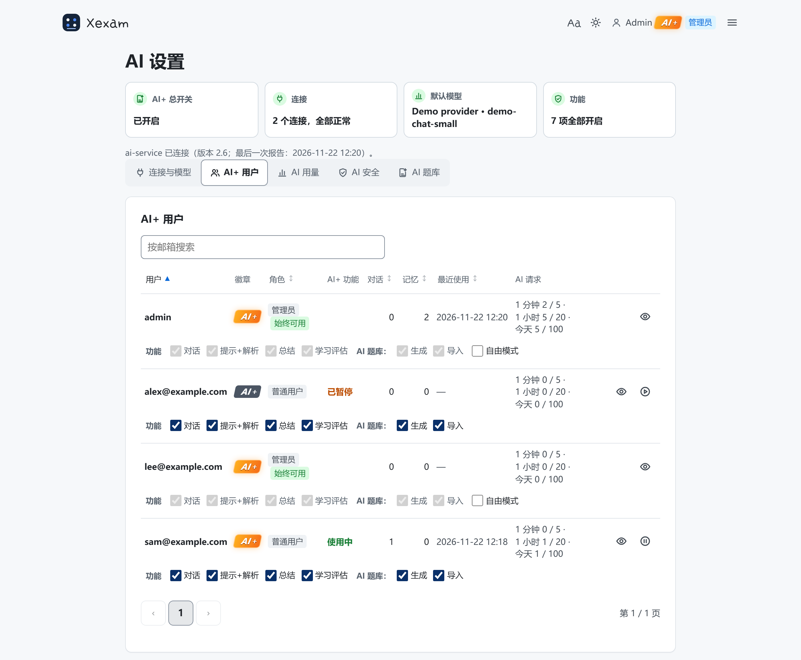</td>
<td width="50%">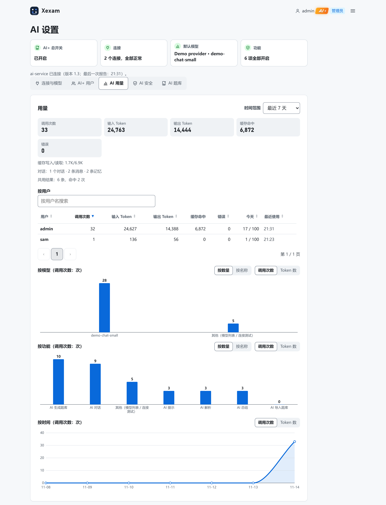</td>
</tr>
<tr>
<td><b>AI+ 用户</b> 标签页：状态标记和四个标签页下面，每个有 AI+ 的用户的徽章、角色、<b>AI+ 功能</b>（<b>始终可用</b>、带暂停的 <b>使用中</b>、带恢复的 <b>已暂停</b>），以及最近 1 分钟、1 小时和今天的 AI 请求与上限。这些图里的数值都来自一个虚构的服务商。</td>
<td><b>AI 用量</b> 标签页：最近 7 天的合计、对话，然后是 <b>按用户</b>（<b>今天</b> 与每天上限）、<b>按模型</b>、<b>按功能</b> 和 <b>按时间</b>。</td>
</tr>
</table>

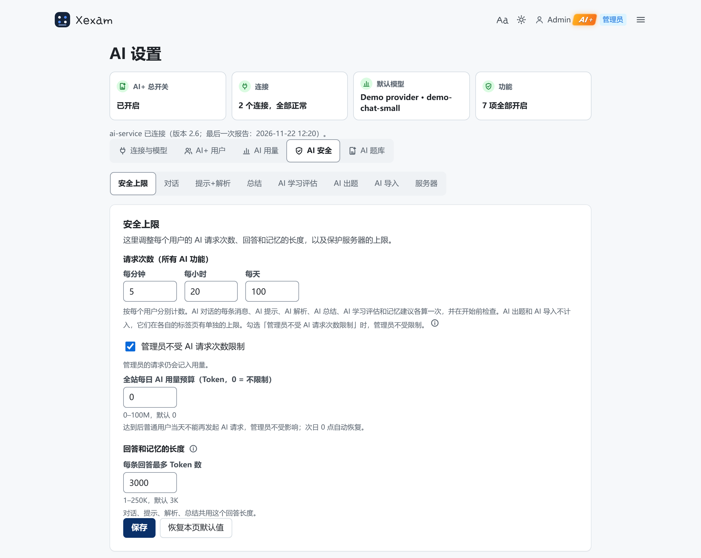

**一步一步设置 AI**：确认 **AI 设置** 里写着 **ai-service 已连接**；在 **连接与模型** 里添加一个连接（**＋ 添加连接**：类型、地址、密钥），按 **测试并保存**；从这个连接的列表里选**默认模型**（选中时会测试）；按 **测试并开启 AI+**；需要的话再设置模型槽位和**功能开关**；然后在 **用户管理** 里为可以使用的用户开启 **AI+ 功能**（上面的步骤做完后，开关才会出现），并在这里的 **AI+ 用户** 下面暂停或恢复某个用户的 **AI+ 功能**。想直接和模型对话的管理员，在 **设置** 的 **AI 对话模式** 里选 **自由模式**。ai-service 在哪里运行、它怎样连到服务商、每个服务商需要什么：见 [deployment.md](deployment.md) 第 3.4 节。

### 17.5 AI 题库标签页

**AI 题库** 标签页用两张卡片设置生成与导入的上限：**AI 生成题目**（额度、题源、每次生成、调用）和 **AI 导入文件**（文件、调用）。后面是 **最近的 AI 题库任务**，像 **AI 用户** 标签页一样分页：搜索框、可排序的列、每页 10 条、最多 200 条。每行显示时间、用户、来源、新题库、状态、题数和调用 / Token（手机上每个任务是一张紧凑的卡片）；点开一个任务会显示详情：类型、来源、方式、已生成 / 目标、调用、Token、缓存 Token、时间、状态 / 原因和生成的题库。修改上限不会关闭 AI，也不会改变已经生成的内容。

| 设置 | 默认值 | 作用 |
|---|---|---|
| 每人每天 AI 题库任务数 | 3 | 生成和文件导入合计；按服务器时间 0:00 重置。开启时管理员不受限制。 |
| 无限制（生成） | 开 | 生成任务没有调用次数上限、没有每次调用的回答长度限制，也没有期限。连续 3 次提供方错误和 **取消** 仍会停止任务。 |
| 每次 AI 出题最多调用次数 | 15 | 关闭无限制时使用（8 到 40）。对所有人生效，包括管理员。 |
| 每次调用最多 Token 数 | 20000 | 一次调用最多能写的 Token 数（1000 到 250000）；每次调用能出的题数由它决定。开启任一无限制开关时灰显。 |
| 无限制（导入） | 开 | 文件导入同样如此，包含识别。 |
| 每次 AI 导入最多调用次数 | 25 | 关闭无限制时使用（8 到 40），包含识别调用。 |
| 每个文件识别最多调用次数 | 20 | 关闭无限制时使用：确认步骤之前读取一个文件最多调用 AI 的次数（8 到 40）。 |
| 导入文件最大大小 | 20 MB | AI 导入卡片的大小上限。 |
| 文件中一次最多导入的题数 | 100 | 从已经包含题目的文件中一次最多导入的题数（1 到 300）。题更多的文件取前面的题。 |

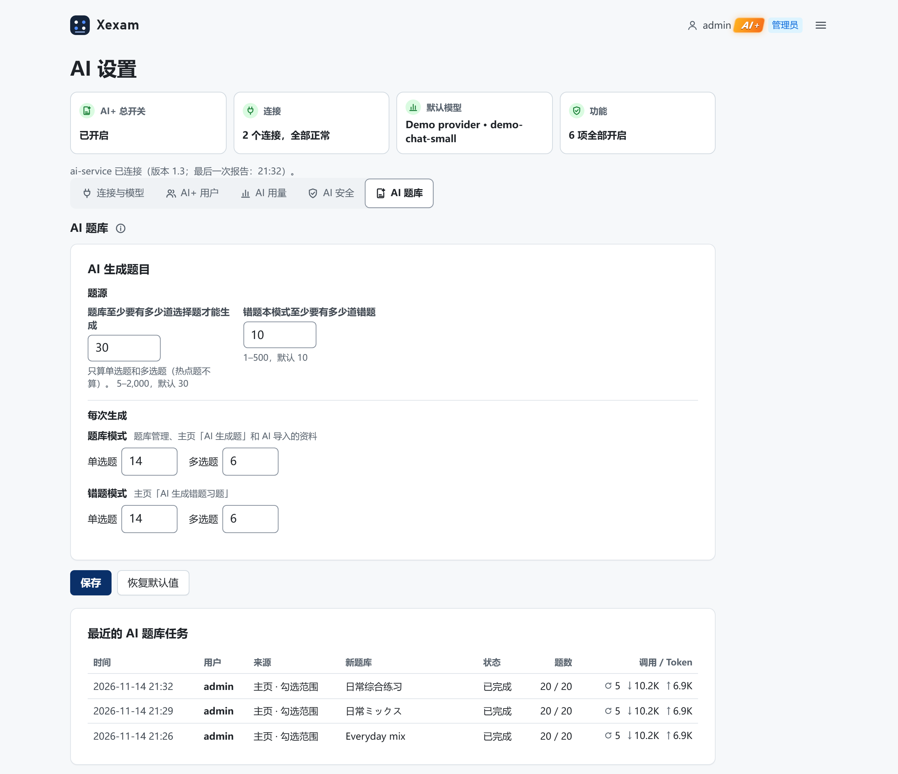

### 17.6 功能权限

在 **AI+ 用户** 中，每个用户一行，有五个复选框：**对话**、**提示+解析**（AI 提示和 AI 解析共用这一个，两项一起开关）、**总结**、**AI 出题** 和 **AI 导入**。未勾选的功能对该用户显示为灰色，并注明 **你没有权限使用这个功能。**。管理员的行中五项全部勾选且锁定，并有一个 **自由模式** 开关（它以前在设置中）。暂停用户的优先级高于所有复选框。

### 17.7 AI 用量图表

**AI 用量** 有三张图：**按模型**、**按功能** 和 **按时间**。标题写明画的是什么，例如 **按模型（调用次数：次）** 或 **按模型（Token：输入 / 输出）**。三张图右上角都有 **调用次数 | Token 数** 切换（默认是 Token 数；v1.6 起选择按用户记在当前浏览器里）：切到 Token 数时，每根柱子是输入与输出 Token 的堆叠，顶部是总数；**按时间** 则在总数折线下画出输入与输出两层堆叠面积，并带小图例，纵轴同样用 K / M / B / T。每根柱子都有数字；**其他（模型列表与连接测试）** 一根柱子让总量相加一致。表格、图表、任务卡片和安全提示里显示的 Token 数一律用简写：1 000 以下是原数字，往上用 K、M、B、T（例如 999、12.3K、4.5M、3.4B、1.2T），最多一位小数；精确数字在悬停 / 长按提示里，屏幕阅读器也会读出。调用次数、错误数、题目数以及顶部的总数保持精确，带千位分隔符。用量的时间范围（12 小时、今天、7 / 30 / 90 / 365 天）会记在当前浏览器里。提示（悬停、点按或方向键）给出精确的调用次数、Token 与错误数。**按时间** 是按天（时间跨度长时按月）的折线，每个点周围有较大的悬停和点按区域。图表里的文字从不倾斜：在手机上，**按功能** 和 **按模型** 是横向条形（名称在左，只有特别长时才用 … 截断，数值在条的末端），**按时间** 的日期简短且横向（MM-DD，按月时为 YYYY-MM），并会自动抽稀，不会重叠。每张图的数字还以文字表格的形式提供给屏幕阅读器。**按模型** 和 **按功能** 两张图在切换旁还有一个小的 **按数量 | 按名称** 控件：**按数量**（默认）把最大的柱子排在最前，**按名称** 先数字开头，再英文（按首字母，不分大小写），最后是中文和日文，**其他** 始终在最后；选择会按图表记在当前浏览器里，**按时间** 始终按日期顺序。

### 17.8 连接、模型和开关（v1.3）

- **连接与模型**标签：四张卡片（AI+ 开关、连接、默认模型、功能）概括状态。**连接**是带密钥的服务商地址，最多 8 个；**测试并保存**先检查，测试失败就什么都不保存（换密钥失败则保留旧密钥）。改已保存密钥的地址时，会要求输入新的主机名（任何地址都行）。**模型**：选**默认模型**（选中时测试），也可以另选对话、提示和解析、总结、出题和导入用的模型；空槽位用默认。改槽位不会把 AI+ 关掉。默认模型不可用时只会出现警告，什么都不会被切换。一次测试最多 90 秒。每个槽位有两个选择框：左边选连接（第一项是**跟随默认模型**），右边是这个连接的模型；换连接只会更新模型列表，选中模型后（测试通过）槽位才切换。
- **功能开关**：除 **默认** 外，每一行模型各有一个（第 17.10 节）。关闭后所有人（包括管理员）都不能使用。每个用户的勾选在 **AI+ 用户** 标签里。
- **AI 安全**标签：请求次数上限和**管理员不受 AI 请求次数限制**的勾选（已勾）、每日 Token 预算（0 = 关）、总结条数、提示和解析的共享（开 / 关、保留天数、**清空共享回答**），以及 AI 出题和导入的上限（出题最多 300 道、导入每个文件最多 300 道、默认 100 道；大来源可以用几份）。
- **AI 用量**标签：按模型，另有共享回答和每日预算。
- **共享的提示和解析**（所有有 AI+ 的人）：别人已经拿到的提示或解析会立刻显示，附一句说明它是共享的，不花任何请求。**重新生成**会再问一次，并替换给所有人用的那份。
- **AI 出题**：卡片上随写随列出已写好的题（点一道可以看选项和解析），任务运行期间，主页和题库管理里会有一个**生成中 8 / 20** 的占位题库。

### 17.9 思考强度：按连接设置（v1.6，v2.1 起改变）

**从 v2.1 起，家族属于连接。** 连接表单里的 **思考强度参数** 有四个家族，各自标出参数：**Anthropic**（`output_config.effort`）、**OpenAI**（`reasoning_effort`）、**Google**（`thinking_level`，以 `extra_body.google.thinking_config.thinking_level` 发送）、**Responses API**（`reasoning.effort`）。在你手动选之前，它跟着格式走（Anthropic、Responses API，其余为 OpenAI；地址含 `generativelanguage`、`google` 或 `gemini` 时为 Google）。一个连接就是一个家族：网关服务多个厂商时，每个厂商加一个连接（地址相同）。连接卡片上显示家族图标和名称。

在 **连接与模型** 页，每个模型行（默认、对话、提示、解析、总结、生成、导入）都有一行 **思考强度**：该行所用连接的家族图标（悬停或长按显示参数）和强度列表。修改立即保存，不需要测试连接，也不会关闭 AI+。

- **默认什么都不发送。** 每个强度列表的第一项都是 **默认（不发送强度参数）**：服务商用自己的默认。从没动过的行也是默认（v2.1 在这里发送模型的默认强度）。选一个强度就发送对应参数；已存的强度不属于该行连接的家族时（例如你改了家族），同样什么都不发送。列表只显示该连接家族的强度。
- 强度（始终用英文显示，与实际发送的一致）：

  | 家族 | 参数 | 强度 |
  |---|---|---|
  | **Anthropic** | `output_config.effort` | low, medium, high, xhigh, max |
  | **OpenAI** | `reasoning_effort` | low, medium, high, xhigh, max |
  | **Google** | `thinking_level` | MINIMAL, LOW, MEDIUM, HIGH, XHIGH |
  | **Responses API** | `reasoning.effort` | none, minimal, low, medium, high, xhigh, max |

- **总开关**：AI+ 关闭时，包括默认行在内的所有模型行都变灰、不能操作：功能开关显示为关，选择器和强度列表被禁用。已存的选择不动，打开 AI+ 后恢复。第一次启用仍走第 2 步的启用框。
- **拒绝不算错误。** 提供方对带该参数的请求返回 HTTP 400 或 422 时，请求会不带参数再发一次，并记住该连接和该模型不支持，直到 ai-service 重启或你改动设置。同一连接的其他模型继续发送。
- **AI Chat**（自由模式下的管理员）：大脑按钮只选 **API** 和 **模型**，强度有旁边单独的按钮（**默认**、该家族的强度、**跟随 AI 设置（当前：…）**）。强度按对话保存。
- 每次修改都会写入活动日志（`ai.settings.effort`：槽位、家族和强度）。
- 思考会用掉输出 token：强度越高，回答可能越长、越慢，很长的思考可能在回答开始前就触到 **每次回答的 token 数**（第 17 节第 7 项）。AI 生成和 AI 导入会为此留出余量（17.5 节）。

### 17.10 连接开关、功能开关、安全子页和匀速发送（v1.9）

- **连接启用开关**：**连接与模型** 里每个连接的那一行都有一个开关。**关闭** 后，连接的所有设置、密钥和模型都保留，但它不再出现在任何选择器里，也不参与路由。指向已停用连接的功能、默认模型或对话保留原来的选择，并以 **这个功能使用的 AI 连接未启用，请联系管理员。** 失败（管理员看到的是另一句，提示在 AI 设置里启用它或换一个模型）；不会自动换成别的连接。状态标签是 **正常启用**（绿色）或 **未启用**（灰色）。列表分成 **已启用的连接（n）** 和 **未启用的连接（n）** 两组，一开始都折叠，在本次浏览器会话里保持你上次的展开状态。停用连接时会先确认（**停用连接「…」？**），并列出正在使用它的功能；启用时不用确认。停用的连接仍然可以 **测试**。切换不会取消正在进行的调用。
- **每个功能一个开关**：单独的功能开关卡片已删除。除 **默认** 外，每一行模型都有自己的开关，标着功能名：**对话**、**提示**、**解析**、**总结**、**出题**、**导入**。关闭后所有人（**包括管理员**）都不能使用（**已关闭：所有人（包括管理员）都不能使用，已选模型保留。**）；这一行的选择器变灰，已选的模型保留。**提示** 和 **解析** 是两行，可以选不同的模型（解析也用于成绩和记录的分析）；升级时两行都沿用原来的学习模型和思考强度。**AI+ 用户** 标签里每位用户的勾选不变（提示和解析仍是一个框），也从不限制管理员。
- **思考强度**：族按钮是 **Anthropic**、**OpenAI**、**Google**、**Responses API** 四个，外加 **默认**。**Gemma** 按钮没有了：在 Google AI Studio 上用 Gemma 4 时，请选 **Google** 的 `HIGH`（思考）或 `MINIMAL`（关闭思考）；已保存的 Gemma 选择在升级时已转换成这两个，发出的请求相同。
- **AI 安全子页**：**AI 安全** 标签页有七个子页：**安全上限**、**对话**、**提示和解析**、**总结**、**AI 出题**、**AI 导入**、**服务器**（手机上是短名称：**上限**、**对话**、**提示解析**、**总结**、**出题**、**导入**、**服务器**）。每个子页放它那个功能的限额；**安全上限** 里是请求上限（每分钟、每小时、每天）和每日 token 预算，**服务器** 里是并发保护和下面的匀速发送。子页写在地址里（`#/ai-settings?tab=safety&sub=<名称>`，所以链接可以直接打开它）；不带子页打开这个标签页时，回到本次浏览器会话里最后用过的子页，否则是 **安全上限**。**保存** 会发送整个表单里所有改动过的值，不管它在哪个子页；**恢复默认** 只重置当前看到的子页（按钮上写明了）。
- **按服务商速率限制匀速发送**（**AI 安全 → 服务器**）：AI 出题和 AI 导入会发出很多次调用，而免费额度每分钟只允许几次。开关 **按以下限额匀速发送 AI 出题和导入请求** 默认开启，**每分钟请求数** 13，**每分钟 tokens（输入 + 输出）** 230 000。请填写 AI 服务商自己的限额（全站共用）：数值按填写的原样使用（v2.1 起没有暗留的余量）。Xexam 在 60 秒滑动窗口里把请求均匀发出（每分钟 13 次即约每 4.6 秒一次），每次调用发出前先估算 tokens，必要时减少同时进行的调用数。只有 AI 出题和 AI 导入会在此限额下排队：它们会等待，不会失败；对话、提示、解析和总结不受此限速。这是对所有连接统一生效的一个设置，不受出题和导入的 **无限制** 开关影响。输入框下面有一行显示节奏（每 60 / 每分钟请求数 秒一次）。如果服务商仍然返回“限速”（HTTP 429），任务会按服务商给出的时间等待后重试（每次调用最多 10 次；不算错误，关闭匀速发送时同样有效）。用完 **当天** 的额度会让任务停止：**AI 服务商今天的额度已用完，任务已停止。请明天再试，或请管理员更换模型。**（不会占用配额）。任务等待 8 秒以上时，卡片上显示 **等待额度…**。对有限制（非无限制）的任务，等待时间计入它的 30 分钟期限。

## 18. 在 iPhone 上使用

- 在 iPhone 的 Safari 里打开服务地址（先按 [deployment.md](deployment.md) 第 4 节做，让手机能连到 Xexam）。需要 **iOS 15.4 或更新**。
- 点分享按钮 → **添加到主屏幕**。之后它像独立应用一样全屏打开，图标是 Xexam 的图标：藏青色方块上有四个点和一条浅蓝色的横条。
- 右上角三条横线的按钮打开和电脑上一样的小菜单。
- 主页上，**全部** 和 **错题本** 留在 **开始考试或练习** 标题旁边（英语和日语界面只显示图标和题数）。屏幕底部那一栏有两行：第一行是当前范围、**题数** 和 **打乱顺序**；第二行是 **开始考试** 和 **开始练习**（一样宽）。
- 考试和练习页上，底部的栏留在屏幕底部：**上一题**、**下一题**，以及 **稍后再看** 的旗子，都用图标表示。练习里，**核对答案** 和 **下一题** 是并排的两个按钮，位置固定；有 AI+ 功能的用户，AI 图标也放在同一个栏上。顶部这一行有 **已完成 x/n** 和绿色的 **完成考试**（或橙色的 **完成练习**）按钮，按钮始终显示文字；题目下方的答题卡里没有结束按钮。
- 学习记录显示成紧凑的卡片；有 **AI+ 功能** 时，每张卡片里有它的 **AI 总结** 按钮。
- 有 **AI+ 功能** 时，AI+ 面板位于题目卡片下面。一开始是收起的；栏上的 **AI 提示** 或 **AI 解析** 会打开它，它的箭头会收起它。面板里的按钮位置固定；回答保存时，面板里的文字会显示 **AI 对话已记录**（点一下会显示对话的名字）。变灰的控件（AI 被暂停或暂时不能用）留在原位置，点一下会显示它为什么不能用。**AI 总结** 打开一个覆盖大部分页面的窗口。
- **AI 对话** 会新开一个对话；历史记录在从左边滑出的抽屉里（**全部对话** 按钮，两条横线的菜单图标）。页头是一行，输入框始终在屏幕底部，贴在键盘上方。
- 按钮和其他触控区域都不小于 44 px；刘海和底部横条的安全区已处理。

下面是 390 px 宽的 iPhone 上的截图：

<table>
<tr>
<td width="25%">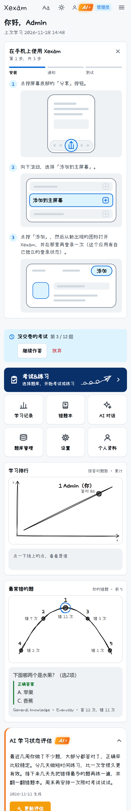</td>
<td width="25%">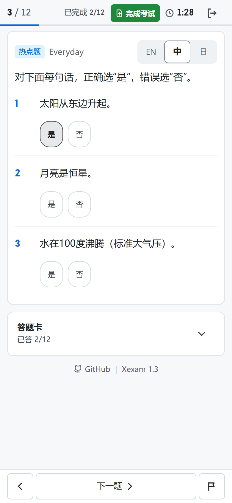</td>
<td width="25%">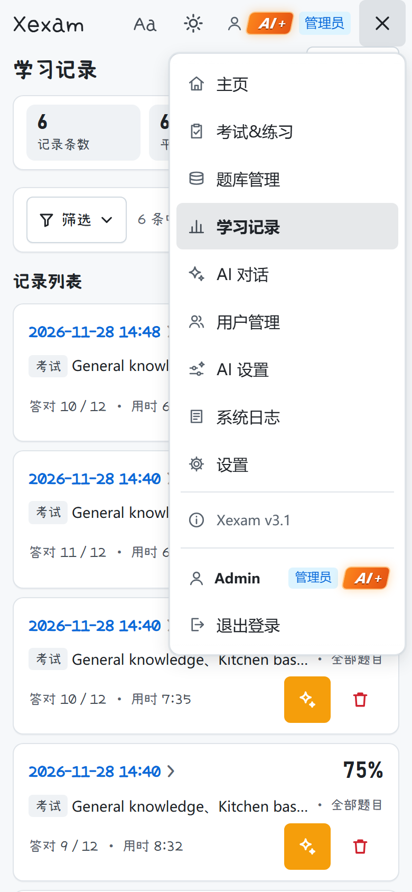</td>
<td width="25%">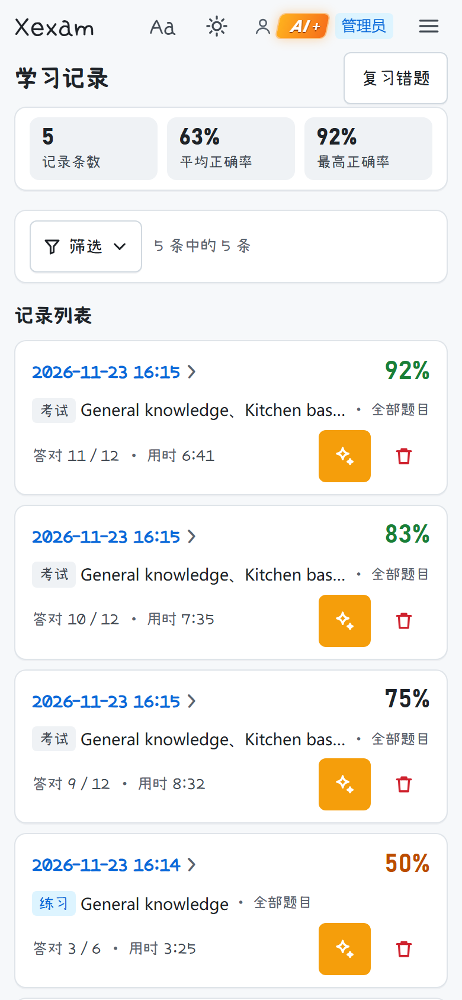</td>
</tr>
<tr>
<td>主页：当前范围、<b>题数</b> 和 <b>打乱顺序</b>，下面是 <b>开始考试</b> 和 <b>开始练习</b>，都在屏幕底部。</td>
<td>考试：<b>上一题</b>、<b>下一题</b> 和 <b>稍后再看</b> 固定在底部。</td>
<td>管理员的菜单，点三条横线的按钮打开。</td>
<td>学习记录：每条记录是一张紧凑的卡片。</td>
</tr>
</table>

<table>
<tr>
<td width="33%">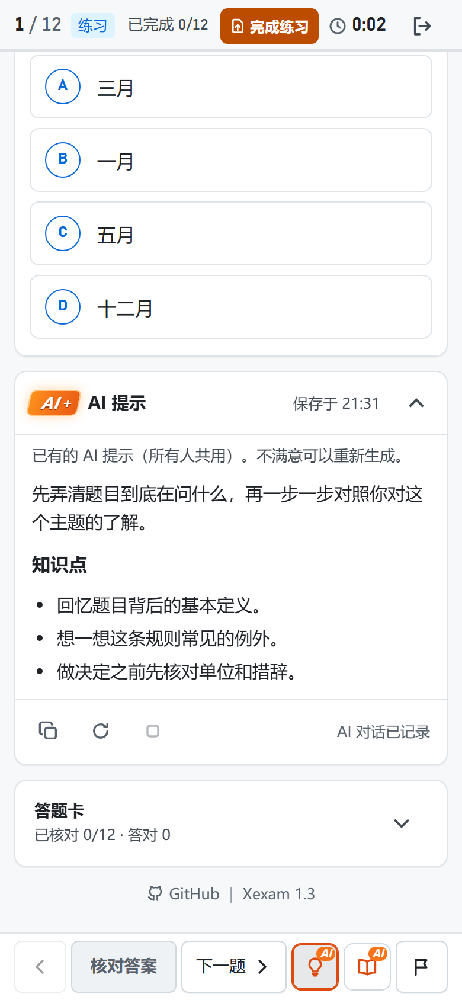</td>
<td width="33%">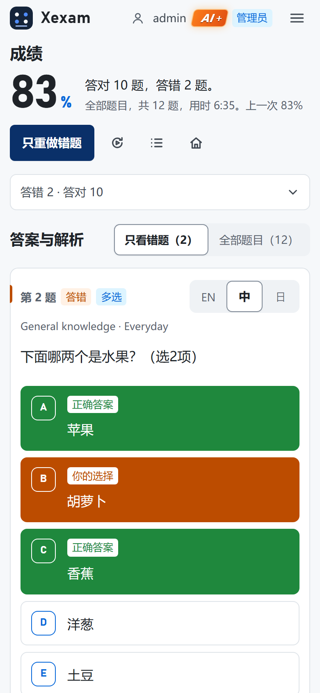</td>
<td width="33%">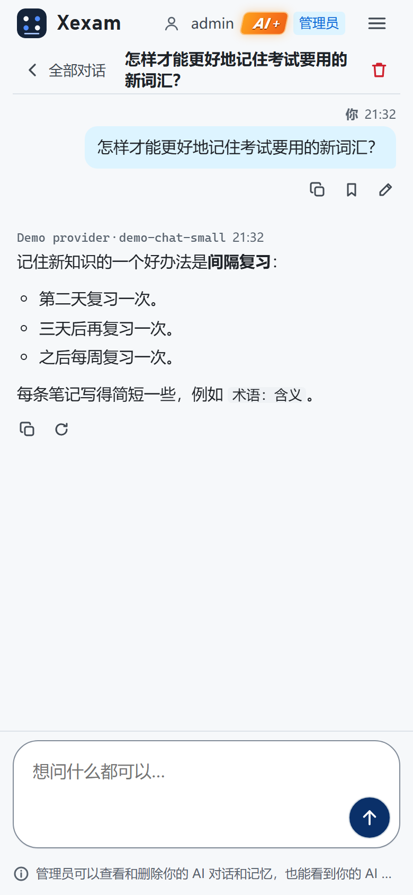</td>
</tr>
<tr>
<td>有 <b>AI+ 功能</b> 的练习：题目下面的 AI+ 面板以 AI 提示打开；操作栏的按钮位置不变。</td>
<td>考试成绩：紧凑的分数、收起的题号条和每张带 AI+ 条的卡片。</td>
<td>AI 对话：占满屏幕高度的一个对话，输入框在底部。</td>
</tr>
</table>

<table>
<tr>
<td width="33%">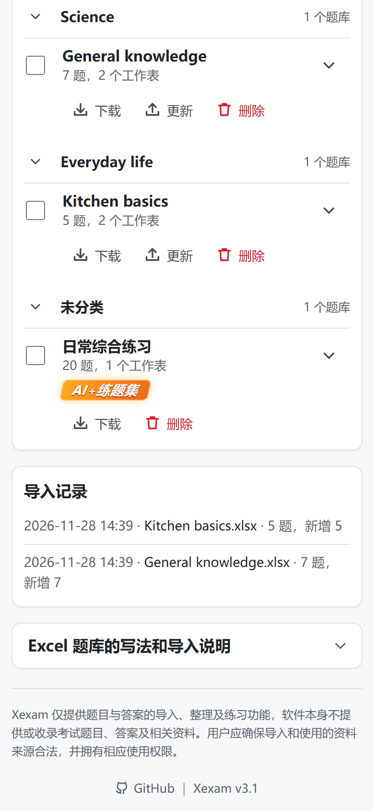</td>
<td>题库管理：每个题库的操作按钮在名称下单独一行，AI 题库的 AI+ 标识也单独一行。</td>
</tr>
</table>

## 19. 页面显示「请求太频繁」时

Xexam 的 Nginx 限制每秒从同一个地址到达后端的请求数（见 [security.md](security.md) 第 9 节）。在 Cloudflare Tunnel 这样的隧道后面，每个用户都来自隧道的地址，所以所有人共用这个额度。达到额度时，页面会自己重试它正在读取的内容（总共三次，每次间隔一两秒）；保存或其他任何修改不会重试。如果请求仍然被拒绝，页面会显示 **请求太频繁**：等几秒，然后刷新页面或再试一次。这和密码输错后的登录锁定不同，那种锁定会写明要等多久。

AI 对话在 Nginx 里有自己的限制：开始生成回答（AI 对话里的 **发送** 和 **重试**，以及 **AI 提示**、**AI 解析**、**AI 总结** 和它们的 **重新生成**）按登录的浏览器限制，突发 10 次之后每分钟 20 次，全部加在一起。被拒绝的开始不会重试；输入框保留你的文字，并提示请求太多，AI 窗口里会写 **短时间内请求太多，请等几秒再试。** 在一个很长的成绩页上一张接一张地打开卡片的 AI 解析时，可能会遇到这种情况；等几秒就好。另外，每个 AI 请求都计入 [第 17 节](#17-ai-设置) 里每个用户的上限（每分钟、每小时和每天）。某个上限用完时，消息会说明是哪一个，以及什么时候可以再使用 AI，并且什么都不会发送。
