[English](../en/usage.md) | [日本語](../ja/usage.md) | **简体中文**

# 使用 Xexam

> 怎样在浏览器里使用 Xexam：考试和练习、学习记录、设置、题库和它们的 Excel 格式、用户和系统日志、AI 对话和 AI 设置。安装、更新和配置 Xexam 见 [README](../../README/README.zh-CN.md) 和 [deployment.md](deployment.md)。
>
> 截图里用的是两个**虚构的演示题库**「General knowledge」和「Kitchen basics」，不是任何真实考试的内容。两个题库都是六列格式的工作簿，所以每道题、每个答案和每段解析都有英语、中文和日语三种。截图里是中文界面；英语界面和日语界面的截图在 `docs/en/screenshots/` 和 `docs/ja/screenshots/`。

## 目录

- [1. 第一场考试](#1-第一场考试)
- [2. 页面布局](#2-页面布局)
- [3. 主页](#3-主页)
- [4. 答题页](#4-答题页)
- [5. 练习](#5-练习)
- [6. 成绩页](#6-成绩页)
- [7. 学习记录](#7-学习记录)
- [8. 错题本](#8-错题本)
- [9. 设置](#9-设置)
- [10. 关于 Xexam](#10-关于-xexam)
- [11. 题库管理](#11-题库管理)
- [12. Excel 题库格式](#12-excel-题库格式)
- [13. 导入题库](#13-导入题库)
- [14. 用户和登录](#14-用户和登录)
- [15. 系统日志](#15-系统日志)
- [16. AI 对话](#16-ai-对话)
- [17. AI 设置](#17-ai-设置)
- [18. 在 iPhone 上使用](#18-在-iphone-上使用)
- [19. 页面显示「请求太频繁」时](#19-页面显示请求太频繁时)

## 1. 第一场考试

1. 打开菜单（右上角三条横线的按钮），选 **题库管理**（管理员和可管理题库的用户才能看到）。在 **导入 Excel** 里保持选中 **新建题库**，点 **选择 Excel 文件**，选好你的工作簿（六列格式，见 [第 12 节](#12-excel-题库格式)）。看完预览后点 **确认新建题库**。
2. 在导入成功的提示里点 **去考试**（或者在菜单里选 **主页**）。**开始考试或练习** 面板里一开始所有工作表都是勾选的：取消不想考的，然后点面板底部那一栏里的 **开始考试**（同一栏里的 **题数** 和 **打乱顺序** 决定出几道题、按什么顺序出）。旁边的 **开始练习** 则用同样的题开始一次 [练习](#5-练习)。
3. 答题，然后点 **交卷**。成绩页显示分数，以及每道答错的题的正确答案和解析（**全部题目（n）** 显示所有题目）。
4. 以后想再看这场考试：打开菜单，选 **学习记录**，再点这场考试的时间。

新题库你自己和管理员都能看到，设置了 **包括以后导入的题库** 的每个用户也能看到。管理员可以在 [用户管理](#14-用户和登录) 里把它分配给其他用户。

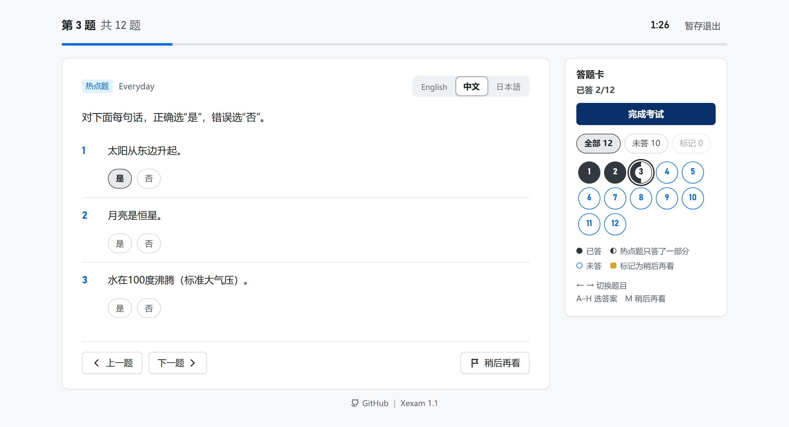

## 2. 页面布局

- 除了考试，每个页面都有一个窄窄的页头：左上角是 Xexam 标志（点它回到主页）；右上角是你的用户名（管理员带 **管理员** 标签，手机上也是）、**AI+** 徽章（现在能使用 AI 时是橙色，有 AI+ 功能但现在不能使用时是深色，见 [第 14 节](#14-用户和登录)），以及三条横线的菜单按钮。
- 菜单里只显示你的角色能用的页面：
  - **主页**、**学习记录** 和 **设置**：所有人都有；
  - **题库管理**：管理员和可管理题库的用户；
  - **AI 对话**：能使用 AI 的人，以及还有 AI 对话或记忆可以查看的人（见 [第 16 节](#16-ai-对话)）；
  - **用户管理**、**AI 设置** 和 **系统日志**：只有管理员。
- 分隔线下面是版本那一项（例如 **Xexam v0.7.5**），点它打开 [关于页面](#10-关于-xexam)；再下面是你的用户名和角色（**管理员** 或 **普通用户**，再加上 **可管理题库**），以及 **退出登录**。
- 选好一项、点菜单外面或按 Esc 键，菜单就会关上。
- 在宽屏上，页面内容居中显示，最宽 1120 px。
- 考试和练习是专注的全屏页面，没有页头。
- 没有权限时打开 **题库管理**、**AI 设置** 或 **系统日志**，会显示 **没有权限** 和 **返回主页**；打开 **用户管理** 时，除了管理员，所有人都会被送回主页。
- 所有会删除东西的操作都会先问你：对话框里写明会删掉什么、删除后无法恢复，确认按钮是实心红色。**删除** 按钮是红色的，或者鼠标指上去时变成红色。

## 3. 主页

还没有可以做的题时，**开始考试或练习** 面板只显示一段简短的说明：

- 管理员，或者还没有题库的可管理题库的用户，会看到 **去题库管理**；
- 还没有被分配题库的用户会看到：「管理员还没有给你分配题库。请联系管理员为你开通，开通后题库就会出现在这里。」
- 题库里没有可用的题时（所有题都已下架，例如因为它们来自旧的 Excel 格式），管理员会被请求用六列格式的文件更新题库；可管理题库的用户会看到：可以用六列格式的 Excel 文件更新自己的题库或导入新题库，其他题库请管理员更新，并带 **去题库管理**；其他用户会被请求联系管理员。

之后，主页上有：

- **没交卷的考试** 或 **没做完的练习**：页面最上面的一条紧凑横幅，显示你用 **暂存退出** 离开的那一场：标题旁写着 **只保存在这个浏览器里**，然后是它的题库、已答（练习里是已核对）的题数和用时。**继续作答** 从停下的地方接着做；**放弃** 把它丢掉。其他设备上看不到它。已经暂存了一场时再开始新的，会先问你。
- **开始考试或练习**：
  - 在面板右上角选择从哪里出题：**全部**（所选工作表里的所有题）或 **错题本**（只出还需要巩固的题）。两个按钮都显示题数。所选工作表里没有要复习的错题时，**错题本** 不能选，标题下面有一行字说明原因；选了 **错题本** 时，这一行字说明一道题怎样移出错题本。手机上这两个按钮也留在标题旁边：英语和日语界面只显示图标和题数，中文界面里保留简短的文字。
  - **考哪些题库和工作表**：每个题库是一张卡片，里面一行一个工作表。
    - **全选** 和 **全部取消** 在这一行标题的右边。
    - 题库的复选框会勾选或取消它的全部工作表，也可以只勾选单个工作表。只勾选了一部分时，复选框显示 −，卡片上会写例如 **已选 1/2 个工作表**（收起时也显示）。
    - 题库那一行右边的箭头展开或收起它的工作表。最多两个题库时一开始是展开的，超过两个时一开始是收起的；你的选择会保留到重新加载页面为止。
    - **错题 2** 这样的小标签表示这个题库或工作表里有几道题在错题本里。
  - 面板最下面的一栏：**开始考试**（绿色）和 **开始练习**（橙色）、当前范围（例如 **当前范围共 12 题**，或 **当前范围共 12 题，本次随机抽 11 题**），以及两个选项 **题数** 和 **打乱顺序**。两个按钮用的是同一个范围。这个面板在屏幕上时，这一栏固定在屏幕底部。
  - **题数** 比当前范围里的题少时，从整个范围里随机抽题。**打乱顺序** 只决定这些题按随机顺序出，还是按题库里的顺序出。
- **最近一次成绩**：你最近一次考试或练习的成绩，带 **考试** / **练习** 标签、**查看详情** 和 **全部学习记录**。
- **概况**：有几个题库、几个可用工作表、几道可用题目、错题本里有几道题，带 **复习错题**（错题本里有题时），管理员和可管理题库的用户还有 **题库管理**。

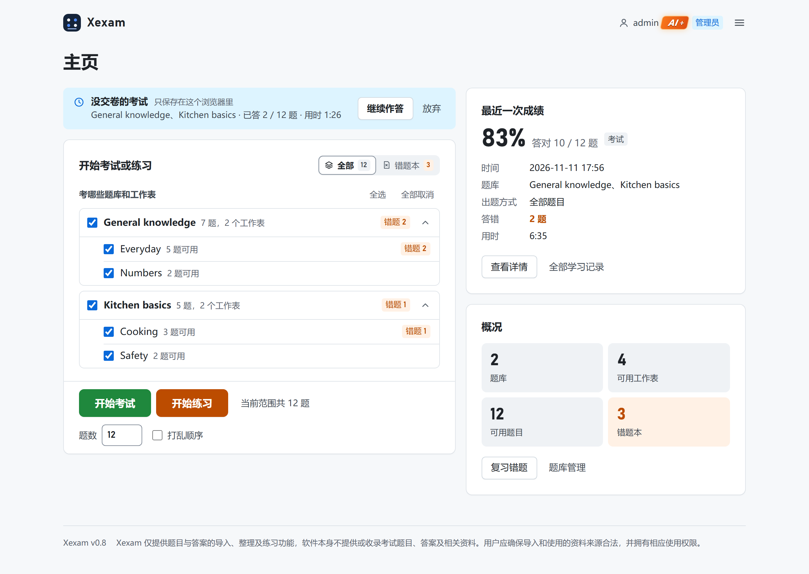

没交卷的考试是最上面的一条横幅；**全部** 和 **错题本** 在 **开始考试或练习** 的右上角；**考哪些题库和工作表** 那一行右边是 **全选** 和 **全部取消**；两个演示题库是两张展开的卡片，里面是各自的工作表；面板最下面一栏是绿色的 **开始考试**、橙色的 **开始练习**、当前范围、**题数** 和 **打乱顺序**；右边是最近一次成绩和概况。

## 4. 答题页

[第 1 节](#1-第一场考试) 的截图就是答题页。

- 顶部：例如 **第 4 题 共 12 题**、已用时间，以及 **暂存退出**：保留你的答案和用时，之后可以在同一个浏览器的主页接着考。
- **答题过程中不显示对错，也不显示分数。**
- **English** / **中文** / **日本語** 切换题目文字。切换只换文字：已选的答案、选项字母、计时和判分都不变。热点题的选项按钮也跟着换。
  - 英语是每道题的基准语言：它一定存在。工作簿里有中文和日语时，才有中文和日语。
  - 某道题没有的语言，或者文字和英语对不上的语言（选项或小项不同），这道题的那个按钮会置灰；点它会说明原因。
  - 你选的语言会作为设置保存下来，交卷后答案和解析也先用这种语言显示。
- **上一题** 和 **下一题** 在题目之间移动（最后一题时，**下一题** 变成 **交卷**）。**稍后再看** 标记一道你想回头再看的题。
- **答题卡**：每道题一个小方块。实心 = 已答，半实心 = 热点题只答了一部分，空心 = 未答，黄色小方块 = 标记为稍后再看。点小方块就跳到那道题。小方块下面是 **已答 3 / 12 题** 和 **交卷**。
- **交卷** 前会先确认；没答的题按答错计分。
- 判分：单选、多选要正好选中全部正确选项才算对；热点题每个小项都对才算这题对。
- 键盘（电脑）：`←` `→` 上一题 / 下一题，`A`–`H` 选答案（选择题），`M` 稍后再看。

## 5. 练习

练习和考试用同一个页面，但每道题作答后马上核对。在主页上点 **开始练习** 开始，它就在 **开始考试** 旁边，用的是同样的题库、工作表、**题数** 和 **打乱顺序**。

- **第 4 题 共 12 题** 旁边有一个 **练习** 标签。
- **怎么核对**：
  - 单选题选好选项就马上核对；
  - 多选题和热点题有 **核对答案** 按钮，选了内容之后才能点。热点题答了一个小项就可以核对，没答的小项算错。
- **核对之后**，这道题就锁定了，并显示：
  - **答对了** 或 **答错了**；
  - 和答案与解析里一样标出的选项：正确的选项实心绿色，选错的选项实心橙色；
  - 你的答案和正确答案；
  - 解析和记忆口诀，用的是页面上 **English** / **中文** / **日本語** 切换按钮选中的语言。
- 练习里永远不会自动跳到下一题：用 **下一题** 往下走。
- 答题卡把核对过的题填成绿色（答对）或橙色（答错），并显示例如 **已核对 4 / 12 题，答对 3 题**。
- **结束练习**（在答题卡下面，最后一题上也有）只在还有题没核对时才会先问你。没核对的题按未作答（答错）计分，即使已经选了答案。
- **暂存退出** 和考试里一样；之后主页上会显示 **没做完的练习** 和已核对的题数。
- 练完后打开 **练习成绩** 页，在 **学习记录** 里保存成一条 **练习** 记录，并和考试一样计入错题本。

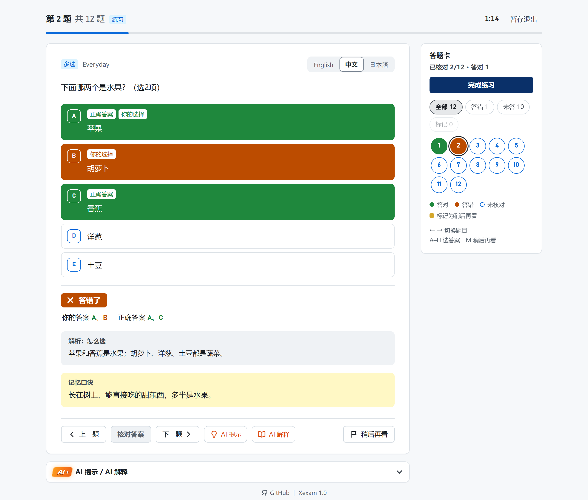

一道多选题点了 **核对答案** 之后：**练习** 标签、判定 **答错了**、选错的选项实心橙色、正确的选项实心绿色，下面是解析和记忆口诀。

## 6. 成绩页

分数、答对和答错的题数，以及一排小方块，每道题一个（答对的题是绿色的勾）。练习的标题是 **练习成绩**。

**答案与解析** 可以显示 **只看错题（n）** 或 **全部题目（n）**。每道题的卡片上有：

- **答对** 或 **答错**，以及你的选择和正确答案：正确的选项实心绿色，选错的选项实心橙色，各带 **正确答案** / **你的选择** 标签（热点题的判断句是中性的底色，只给它们的选项上色）；
- **你的答案** / **正确答案** 那一行：多选题的答案里，你选的每个字母属于正确答案时是绿色，不属于时是橙色，所以部分答对的答案两种颜色都有；
- 卡片自己的 **English** / **中文** / **日本語** 切换按钮。它一开始是你的题目语言，只改变这一张卡片：题目、选项、解析、记忆口诀和备注。题目没有的语言是灰的；
- 解析和记忆口诀，工作簿里有几种语言就有几种；某种语言没有时，显示另一种语言的；
- 这道题到现在答过几次。

如果答题期间有题目（随题库一起）被删除，会有一句提示：分数和保存的记录只包含其余的题。

按钮：**只重做错题**、**再考一次**（练习后是 **再练一次**）、**在学习记录里查看** 和 **回首页**。重做和再来一次都和这次成绩是同一种：考试还是考试，练习还是练习。

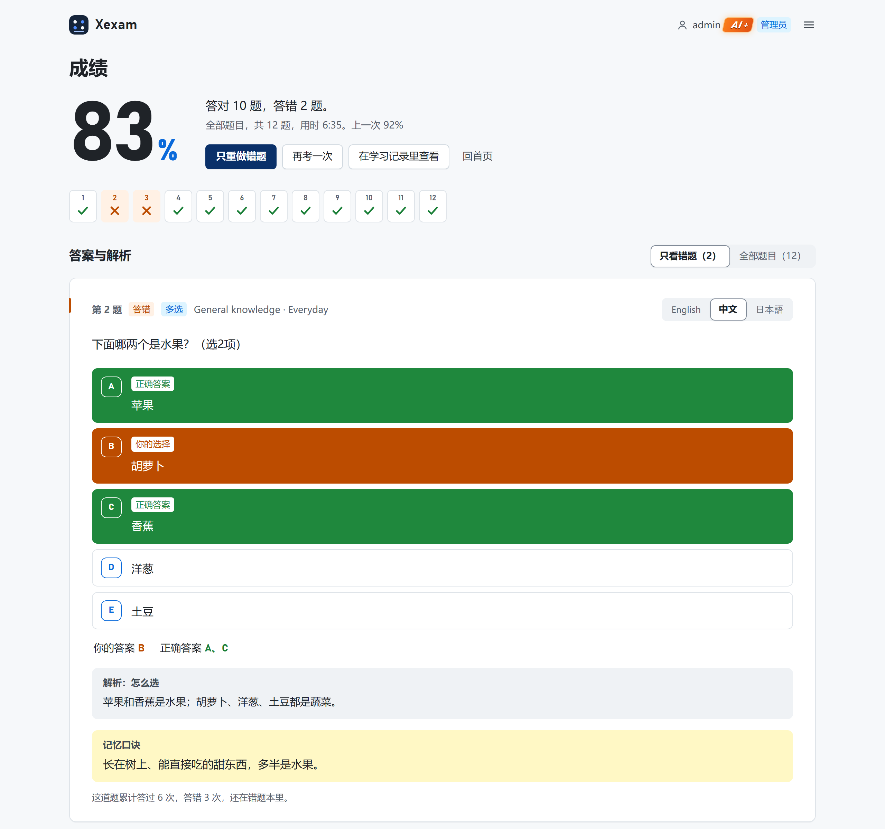

一场答错两题的考试，打开的是 **只看错题**：分数，然后是一道选择题，选错的选项实心橙色、正确的选项实心绿色，卡片自己的 **English** / **中文** / **日本語** 切换按钮，以及解析和记忆口诀。

## 7. 学习记录

- **概况**：记录的条数（**记录条数**，按类型筛选时是 **考试场数** 或 **练习次数**）、**平均正确率**、**最高正确率**，以及最近几次成绩的小柱状图。
- **筛选**：**类型**（**全部类型**、**考试**、**练习**）、**题库**、用 **开始日期** 和 **结束日期** 指定的日期范围，以及 **正确率**（**不限**、**60% 以下**、**60%–79%**、**80% 及以上**）。**清除筛选** 把它们全部恢复。
- **记录列表**：每场考试或每次练习一行（手机上是一张卡片），带 **考试** / **练习** 标签，显示时间、题库、答了几题、用时、答对几题和正确率（80% 起是绿色，低于 60% 是橙色）。点时间打开这条记录；**删除** 删掉它。
- **考试详情** / **练习详情**（一条记录）：分数和基本信息（含 **类型**），下面逐题列出你的答案、正确答案、解析和记忆口诀，每张卡片有自己的语言切换按钮。**只看错题（n）** / **全部题目（n）** 在只看错题和看全部题之间切换。**重做错题** 用答错的题重新开始；**重考这一场**（**再练一次**）把同样的题再做一遍，两者都和这条记录是同一种；**删除这条记录** 删掉它。v0.5 之前考的场次只有分数，因为 v0.4 没有保存每道题的作答。已下架的题仍然显示在记录里，带着文字和 **已下架** 标签；只有现在上架的题才会被重做或重考。
- 右上角的 **复习错题** 打开 **错题复习**：列出错题本里每道上架的题，显示你答过几次，以及还要连续答对几次才会移出。可以只看某一个题库；**练习这些题** 用它们开始一次练习。
- 删除：删除一条记录时，每道题的答题统计会保留，所以错题本不会变。**全部删除** 删掉所有记录（考试和练习）；勾选 **同时清空错题本和每道题的答题统计**，会把这些也一起清空。每次删除都会先确认，删除后无法恢复。
- Xexam 只保留你最近的 500 条记录（考试和练习），更早的记录会自动删除。

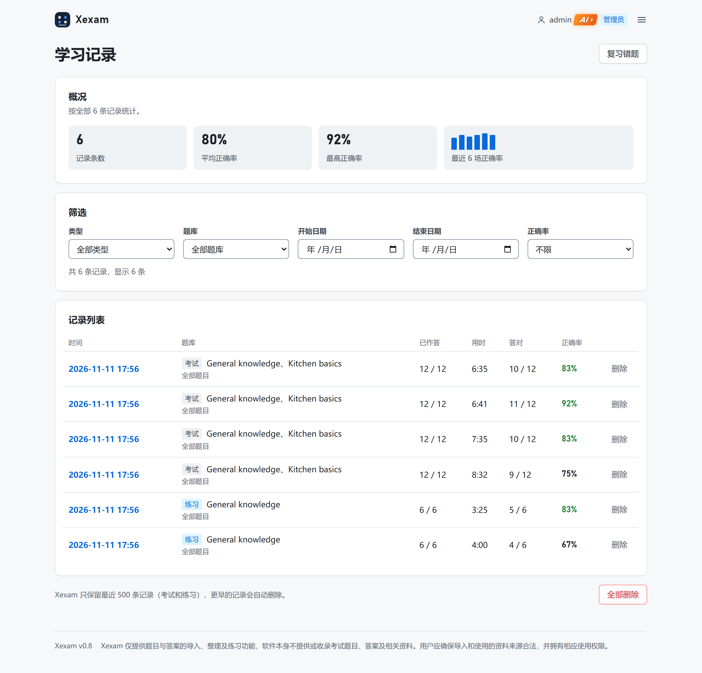

## 8. 错题本

在考试或练习中答错的题进入错题本，之后**连续 2 次答对**（考试或练习都算）就会移出。可以在主页使用（**开始考试或练习** 面板右上角的 **错题本**），也可以在 **学习记录** → **复习错题** → **练习这些题**，或者交卷后直接点 **只重做错题**。已下架的题仍留在你的统计里，但不会出现在复习里；以后再导入它所在的题库、让它恢复上架时，它就回来了。

## 9. 设置

- **账户**：你的 **用户名** 和 **角色**（有这个权限时再加 **可管理题库**，有 AI+ 功能时还有 **AI+** 徽章；徽章是深色时，它下面有一行写着原因），以及 **修改密码**。可管理题库的用户还会看到一句说明，写着这个权限允许做什么。
- **外观**（主题）：**跟随系统**（默认；按设备的浅色或深色设置显示）、**浅色** 或 **深色**。
- **语言**（界面语言）：**English**（默认）、**中文** 或 **日本語**。它决定所有地方的菜单、按钮和提示文字，包括答题页和服务器返回的错误提示。题目文字在答题页上有自己的切换按钮。
- **答题** → **答完自动跳到下一题**（默认关闭，只用于考试）：单选题选好答案后，或者热点题的每个小项都选好后，自动打开下一题。多选题永远不会自动跳转。开启时，答题页顶部会显示 **自动下一题：开**。
- **AI 对话模式**（只有管理员，而且只在 AI+ 功能开启时）：**普通模式** 或 **自由模式**。**普通模式**：AI 按学习助手的设定回答，并使用你的 AI 记忆。**自由模式**：直接和模型对话，不带学习助手的指示和 AI 记忆。这个选择对你所有的 AI 对话生效，不管新旧，从你的下一条消息起；开启时，AI 对话的标题旁边会有绿色的 **自由模式** 标记（见 [第 16 节](#16-ai-对话)）。它保存在服务器上，而不是这个浏览器里，所以刷新和在另一台设备上登录后都还在；在你选 **自由模式** 之前它是关闭的，**恢复默认设置** 也不会改变它。
- **恢复默认设置**：主题、界面语言和答完自动跳到下一题恢复成默认值。题目语言和 AI 对话模式保持不变。

设置属于你的账户，和你上次选的题目语言一起保存在 Xexam 服务器上。所以重启、更新镜像、清除浏览器缓存、换别的浏览器或设备之后，设置都还在；每个用户都有自己的一套。只有没交卷的考试或没做完的练习留在当前浏览器里。「和设置一起保存」只有一个例外：管理员的 **AI 对话模式** 保存在 AI 服务自己的数据库里。

<table>
<tr>
<td width="50%">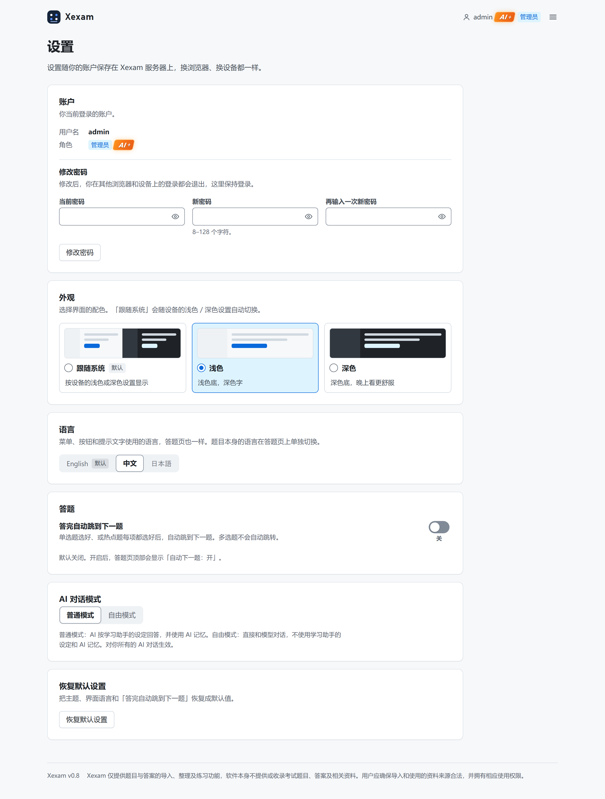</td>
<td width="50%">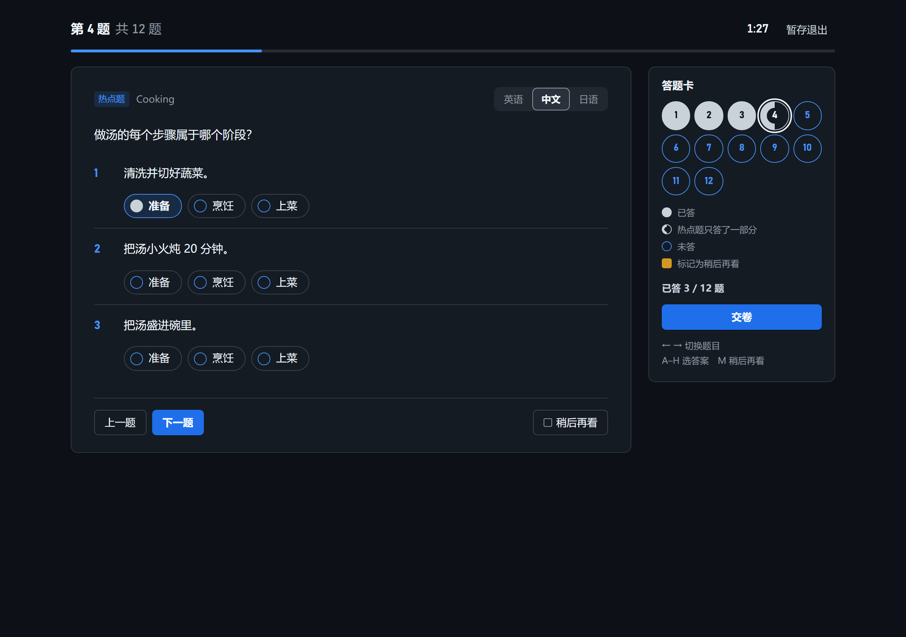</td>
</tr>
<tr>
<td>设置：<b>账户</b>、<b>外观</b>、<b>语言</b>、<b>答题</b>，以及只有管理员能看到的 <b>AI 对话模式</b>（<b>普通模式</b> / <b>自由模式</b>）。</td>
<td><b>深色</b> 主题，这里是答题页。</td>
</tr>
</table>

## 10. 关于 Xexam

菜单里的版本那一项（例如 **Xexam v0.7.5**）会打开 **关于 Xexam**：**版本**、**服务器** 的 CPU 架构、**许可证**，以及 **更新内容**，也就是界面语言那一份 README 的更新日志。最新的版本是展开的；更早的版本折叠在 **更早的版本** 下面。

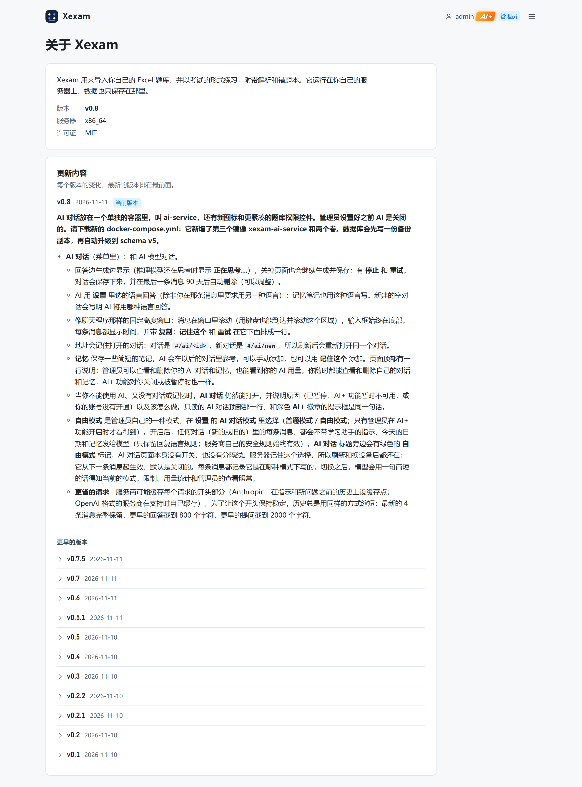

## 11. 题库管理

管理员和可管理题库的用户在这里导入 Excel 工作簿。没有这个权限的用户在菜单里看不到这个页面；直接打开它会显示 **没有权限** 和 **返回主页**。

- **导入 Excel**：选 **新建题库** 或 **更新已有题库**（标题旁边的两个小按钮，悬停提示里有说明；更新时还要在 **要更新的题库** 里选好题库），然后点 **选择 Excel 文件**，或者把文件拖到这个面板的任意位置。提示文字请你上传整份六列格式的 Excel，末尾是 **查看 Excel 写法** 链接。
- **题库列表**，每个题库占紧凑的一行：文件、题数（带已下架的题数，例如 **5 题（另有 2 题已下架）**）、工作表数和最近更新时间，带 **更新** 和 **删除**。工作表收在这一行右边的箭头下面。题都因为来自旧的 Excel 格式而全部下架的题库会写明这一点，并说明用六列格式的文件更新后即可重新使用。
  - **管理员** 看到 **已有的题库**，每个题库都写着是谁导入的（**sam 上传**、**你上传的**），可以更新或删除其中任何一个。
  - **可管理题库的用户** 看到 **你的题库**：只有自己导入的题库，可以更新或删除它们。管理员分配给他学习的题库在主页上。
- **导入记录**：每次导入占一行，只显示最近 8 次（管理员看到所有导入，可管理题库的用户看到自己那些题库的导入）。
- **Excel 题库的写法和导入说明** 在你打开之前是收起的，它是 [第 12 节](#12-excel-题库格式) 和 [第 13 节](#13-导入题库) 的简短版。

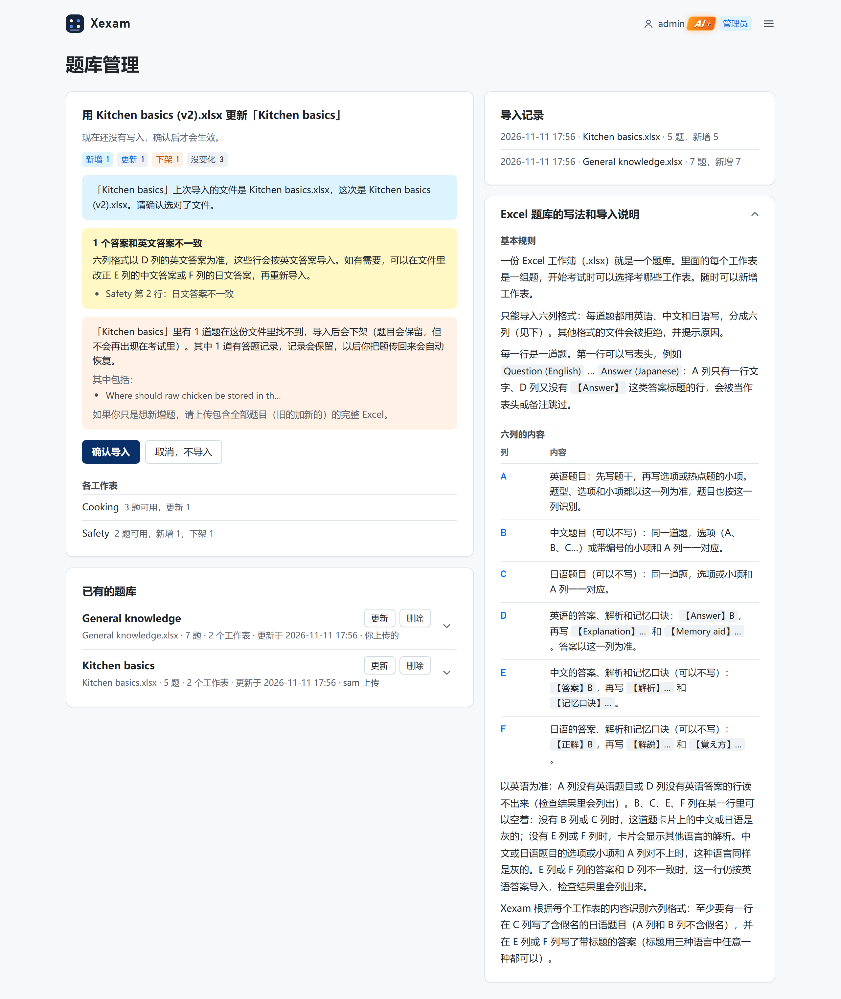

截图是用新版本的文件 `Kitchen basics (v2).xlsx` 更新「Kitchen basics」时的预览，这时还什么都没保存：几个小标签（新增 1、更新 1、下架 1）、将被下架的那道题，以及一条提醒：有一行的日文答案和英文答案不一致（这一行会按英文答案导入）。截图里还有 **已有的题库** 下面的题库列表（「Kitchen basics」是可管理题库的用户 sam 上传的），以及展开的 **Excel 题库的写法和导入说明** 的前两部分：基本规则和六列的内容。

## 12. Excel 题库格式

一份工作簿（`.xlsx`）就是一个题库。每个工作表是一组题，一行一道题。**只能导入六列格式**：每道题在英语、中文和日语里各有自己的一列，答案和解析也一样。其他任何格式的文件，包括以前版本的三列和四列格式，都会被拒绝，并有一句提示说明原因；里面的东西一样都不会导入。

| 列 | 内容 |
|---|---|
| **A** | **英语**题目，后面是选项或热点题的小项。题型、选项和小项都以这一列为准，题目也按这一列识别 |
| **B** | **中文**题目（可以不写），选项（A、B、C…）或带编号的小项和 A 列相同 |
| **C** | **日语**题目（可以不写），选项或小项和 A 列相同 |
| **D** | **英语**的答案、解析和记忆口诀：`【Answer】B`，再写 `【Explanation】…` 和 `【Memory aid】…`。答案以这一列为准 |
| **E** | **中文**的答案、解析和记忆口诀（可以不写）：`【答案】B`、`【解析】…`、`【记忆口诀】…` |
| **F** | **日语**的答案、解析和记忆口诀（可以不写）：`【正解】B`、`【解説】…`、`【覚え方】…` |

下面是一道完整的单选题（和这里所有的示例一样是虚构的，也和 **题库管理** 页上写法说明里的示例相同）：

| 列 | 单元格 |
|---|---|
| A | Which planet is known as the Red Planet?<br>A. Venus<br>B. Mars<br>C. Jupiter<br>D. Saturn |
| B | 哪颗行星被称为“红色星球”？<br>A. 金星<br>B. 火星<br>C. 木星<br>D. 土星 |
| C | 「赤い惑星」と呼ばれる惑星はどれですか。<br>A. 金星<br>B. 火星<br>C. 木星<br>D. 土星 |
| D | 【Answer】B<br>【Explanation】Iron oxide (rust) in the dust on its surface makes Mars look red.<br>【Memory aid】Mars rusts red. |
| E | 【答案】B<br>【解析】火星表面的尘土含有氧化铁（铁锈），所以看起来是红色的。<br>【记忆口诀】火星生锈红彤彤。 |
| F | 【正解】B<br>【解説】火星の表面の砂には酸化鉄（さび）が含まれているため、赤く見えます。<br>【覚え方】火星はさびて赤い。 |

在单元格里换行：Windows 上按 Alt+Enter，Mac 上按 Control+Option+Return。

### 12.1 行和表头

- 每一行是一道题。第一行可以写表头，例如 `Question (English)` … `Answer (Japanese)`：A 列只有一行文字、D 列又没有 `【Answer】` 这类答案标题的行，会被当作表头或备注跳过。
- Xexam 根据每个工作表的内容识别六列格式：至少要有一行在 C 列写了含假名的日语题目（A 列和 B 列不含假名），并在 E 列或 F 列写了带标题的答案（标题用三种语言中任意一种都可以）。

### 12.2 以英语为准

- 题型、选项、热点题的小项和题目的身份都来自 A 列，答案来自 D 列。A 列没有英语题目或 D 列没有英语答案的行读不出来；预览里会列出这一行和原因。
- 某一行的 B、C、E、F 列可以空着：没有 B 列或 C 列时，这道题的中文或日语是灰的；没有 E 列或 F 列时，卡片会显示其他语言的解析。
- B 列和 C 列必须和 A 列对得上（同样的选项字母、同样的小项个数）。对不上的语言，这道题的那个按钮是灰的。
- E 列或 F 列的答案和 D 列意思不同时，这一行仍按英语答案导入，预览里会提醒，例如 **1 个答案和英文答案不一致**，点 **查看是哪几行** 能看到是哪几行。答案按意思比较：同样的字母，或者热点题每个小项选的是同一个选项（`Yes`、`是` 和 `はい` 算一样）。

### 12.3 题型

- **单选题**：A 列先写题干，再一行一个写选项：`A. 内容`、`B. 内容` …（2 到 8 个选项，A 到 H；也可以写成 `A)`、`A、` 或 `A:`）。答案是一个字母：`【Answer】B`。
- **多选题**：写法相同，答案里有多个字母：`【Answer】C, E` 或 `【Answer】CE`。只有正好选中这几个选项才算答对。
- **热点题**（几句陈述，每句选一个）：A 列第一行写 `HOTSPOT`（建议写上：它明确标出热点题；不写时，末尾带选项的编号小项也能识别），接着写题干，然后一行一个带编号的小项，小项末尾写选项，选项之间用 ` / ` 隔开：`1. Water is wet. Yes / No`。由多个词组成的选项（例如 `Before cooking / After cooking`）前面要用制表符或全角空格（`　`）隔开。答案按小项逐一写出选择，用 `;` 隔开：`【Answer】1 Yes; 2 No`。
- B 列和 C 列用同样的编号写同样的小项；小项末尾写了本语言的选项（`是 / 否`、`はい / いいえ`）时，题目会用这种语言显示选项。每个答案列里的是和否都可以用三种语言中任意一种写：`Yes` / `是` / `はい`，`No` / `否` / `いいえ`。

例如这道热点题（A 列和 D 列；B、C、E、F 列用中文和日语写同样的内容，`是 / 否` 和 `はい / いいえ` 前面是一个全角空格）：

```
HOTSPOT
For each statement, choose Yes or No.
1. The sun rises in the east. Yes / No
2. The moon is a star. Yes / No
```

```
【Answer】1 Yes; 2 No
【Explanation】The sun rises in the east. The moon only reflects sunlight; it is not a star.
```

### 12.4 答案列里的标题

D、E、F 列先写答案，再写解析和记忆口诀，每一部分前面写一个放在 `【…】` 里的标题。这三列都可以用三种语言中任意一种的标题：

- 答案：`【Answer】`、`【答案】`、`【正解】` 或 `【答え】`。
- 解析：`【Explanation】`、`【解析】` 或 `【解説】`。
- 记忆口诀：`【Memory aid】`、`【Mnemonic】`、`【记忆口诀】`、`【口诀】` 或 `【覚え方】`。

英语标题不区分大小写；包含这些词的更长的标题也可以，例如 `【解析·怎么选】`。只写答案的单元格也可以只写字母（`B`），或写一行 `Answer: B`。答案后面括号里的文字，例如 `【Answer】B (see chapter 2)`，不算答案的一部分：它会在答案卡片上显示为 **备注**。

### 12.5 读不出来的题

读不出来的题**不会被猜**：它们会在预览里列出原因（多半是 D 列没有带标题的答案，或者答案字母不在选项里），也不会悄悄判错。

## 13. 导入题库

### 13.1 谁可以导入

- **管理员**：导入新题库，并更新或删除所有题库。
- **可管理题库的用户**（在 [用户管理](#14-用户和登录) 里设置了 **可以管理题库** 的用户）：导入新题库，这些题库就归他所有；只能更新或删除自己导入的题库。管理员和其他用户的题库他都动不了。
- 其他用户看不到 **题库管理** 页面。

### 13.2 新建题库还是更新

一个题库就是一份导入的 Excel 工作簿。在 **题库管理** → **导入 Excel** 里用标题旁边的两个小按钮选择文件导入到哪里：

| 选择 | 会发生什么 |
|---|---|
| **新建题库** | 新建一个题库，以文件名命名（去掉 `.xlsx`；名字已被占用时，加上 ` (2)`、` (3)` ……）。已有的题库不会改动。同一份工作簿可以导入两次，成为两个独立的题库，它们的学习记录不会混在一起 |
| **更新已有题库** | 用这份文件替换你在 **要更新的题库** 里选的那个题库的题目（可管理题库的用户只能选自己的题库）。文件里没有的题**只在这个题库里**下架。题库的名字、所有者和能看到它的用户都不变 |

导入一份不同的工作簿时选 **新建题库**；上传已经导入过的工作簿的新版本时选 **更新已有题库**。每次都要上传**整份**工作簿，不要只传新增的题。

新题库能被这些人看到：导入它的人、管理员，以及设置了 **包括以后导入的题库** 的每个用户。管理员可以在 **用户管理** 里把它分配给其他用户。

### 13.3 先预览，再确认

上传后，Xexam 会读取并检查文件，然后显示预览：用几个小标签显示会 **新增**、**更新**、**恢复上架**、**下架** 多少题，**没变化** 和 **读不出来** 的各有多少题（为 0 的不显示）；每个工作表一行，带它的数字；读不出来的每一行的行号和原因，收在所属工作表那一行的下面（例如 **2 题读不出来**）。**你确认之前什么都不会写入**（点 **确认新建题库** 或 **确认导入**；点 **取消，不导入** 就放弃这次导入）。在下面这些情况下，预览还会提醒你：

- 你用来新建题库的文件，和某个已有题库导入时用的文件同名（它会建议改为更新那个题库）；
- 你用来更新题库的文件，名字和上次导入的不一样；
- 会有题目被下架。它会列出其中一些，并在导入前再问你一次；
- 某一行的中文或日文答案和英文答案不一致（这一行按英文答案导入）。

每个导入的人都有自己的一份预览，在内存里保留 30 分钟。所有打开着的预览共用一个内存额度：好几个大文件同时在预览时，别人最早的那份预览可能会被丢掉。确认一份已经被丢掉或超过 30 分钟的预览时，会提示它已过期：请重新上传文件。

### 13.4 导入规则

这份文件被当成它所导入的那个**题库的完整内容**。其他题库永远不会被改动。

| 情况 | 结果 |
|---|---|
| 文件里有、题库里没有的题 | **新增** |
| 同一道题，但其它内容（其它选项、答案、解析、中文或日语文字）改了 | **更新**（答题记录不受影响） |
| 题库里有、文件里找不到的题 | **下架**：题目和答题记录都保留，但不再出现在考试和练习里 |
| 以前下架、这次又出现的题 | **恢复上架**，它在错题本里的记录也跟着回来 |
| 改了工作表名、英语题目或第一个选项 | 算**一道新题**：旧题下架，新题从没有答题记录开始 |
| 这份文件里一道可用的题都没有 | 拒绝导入（防止把题库清空） |

题目是按工作表名、英语题目（A 列中选项以外的部分）和第一个选项或小项来识别的（空格不影响）。

### 13.5 来自旧 Excel 格式的题库

到 v0.6 为止，Xexam 能导入三列和四列格式的工作簿，那些题按日语文字识别。从 v0.7 起，这两种格式不能再导入，**以前从它们导入的每道题在后端每次启动时都会被下架**。题库、它们的导入记录、学习记录和每道题的答题统计都保留；这些题不再出题，题全部下架的题库会在题库列表里写明这一点。

要重新使用这样的题库，**用它的工作簿的六列格式版本更新它**（**更新已有题库**）。题库的名字、所有者和能看到它的用户都不变。六列格式按英语文字识别题目，所以文件里的每道题都作为新题加入，没有答题记录；旧题仍保持下架，以前的记录里仍然显示它们。也可以把六列格式的文件作为 **新建题库** 导入，再删掉旧的题库。

### 13.6 删除题库

题库那一行的 **删除** 会先请你确认（例如 **删除「Kitchen basics」？**）。这个题库的题目（上架的和已下架的）和它的导入记录都会被删除，所有用户的题库里都不会再有它。下面的复选框默认不勾选：

- **不勾选**：答题记录和考试记录都保留。在这些记录里，这个题库的题显示为已删除。
- 管理员**勾选**（**同时删除这个题库的学习记录**）：这个题库的题的答题记录，以及没有其他现存题库参与的记录，也一起删除。
- 可管理题库的用户**勾选**（**同时删除你在这个题库的学习记录**）：只删除你自己的答题记录和记录；其他用户的学习记录始终保留，里面的题显示为已删除。

删除后无法恢复，只有你自己的备份能找回来（见 [database.md](database.md) 第 5 节）。

## 14. 用户和登录

从 v0.6 起，所有人都要登录才能使用。账户有三种：

- **管理员**：所有功能，包括所有题库、**用户管理**、**AI 设置** 和 **系统日志**，AI+ 功能开启时还能使用 AI 对话。
- 带 **可管理题库** 权限的 **普通用户**：可以导入新的题库，并更新或删除自己导入的题库，但不能改动别人的。
- **普通用户**：用管理员分配给他的题库考试和练习。

每个用户有自己的学习记录、错题本、没交卷的考试和设置。AI 只有一个名字，**AI+ 功能**，和三个控制：[AI 设置](#17-ai-设置) 里的全局开关、用户管理里每个用户的开关，以及 AI 设置里 **AI+ 用户** 下面每个用户的 **暂停** / **恢复**。

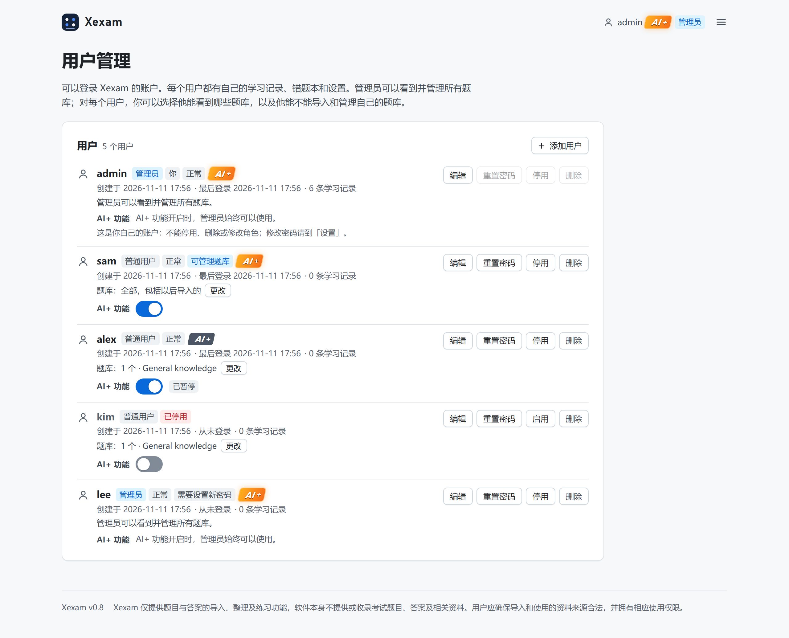

用户管理里有两个管理员（admin 和 lee）、sam（**可管理题库**，所有题库，包括以后导入的，**AI+ 功能** 已开启，带明亮的徽章）、alex（一个题库：General knowledge，**AI+ 功能** 已开启，但已 **暂停**，所以徽章是深色的，开关旁边有 **已暂停** 标记）和 kim（已停用，没有 **AI+ 功能**，没有徽章）；每个普通用户在题库那一行下面都有一个 **AI+ 功能** 开关。

- **第一次启动**（新装，或从 v0.5 或更早的版本升级后第一次启动）：用 `admin` / `admin` 登录（登录页上也有提示），接着设置一个新密码（8–128 个字符）。v0.6 之前的学习记录、错题本和设置都归这个管理员。
- **用户管理**（菜单里，只有管理员可用）：每个用户一行，显示角色、状态（**正常**、**已停用**、**已锁定 · 还剩 …**、**还能试 3 次**、**需要设置新密码**），有权限时再显示 **可管理题库**，还有 **AI+** 徽章，以及创建时间、最后登录时间和学习记录的条数（考试和练习）。操作有 **编辑**、**重置密码**、**停用** / **启用**、**删除**，需要时还有 **解锁**。管理员新建或重置过密码的用户，下次登录时要设置自己的密码。不能停用、降级或删除自己，最后一个启用的管理员也不能被移除。页面开着时列表会自己刷新，所以刚开始的锁定也会显示出来。
- **用户能看到哪些题库** 由两个互不影响的设置决定：为他勾选的已有题库，以及 **包括以后导入的题库**，它让这个用户得到从那以后导入的每个题库（不管是谁导入的，命令行的 `import` 也算）。它从不添加已有的题库。
  - 每个用户那一行写着他有什么：**题库：全部，包括以后导入的**（每个题库都勾选了，并包括以后导入的）、**题库：1 个 · General knowledge**（开启时再加上 **，以后导入的也会加入**）、**题库：还没有选，这个用户看不到任何题库**，或者 **题库：现在没有，以后导入的会自动加入**。可管理题库的用户自己上传的题库列在下面。
  - **更改** 会打开例如 **alex 能看到的题库**。题库列表正上方是一排三个复选框：**管理题库**（可管理题库的权限）、**全选** 和 **全部不选**。列表的第一项是 **包括以后导入的题库**，它有自己的图标，并用一条细线和下面隔开；再往下每个题库一个复选框，写着是谁上传的。**全选** 勾选列出的所有题库，都已勾选时则全部取消；**全部不选** 取消所有勾选；两者都不影响 **包括以后导入的题库**。打勾就是开启。页面上没有说明文字：鼠标指向某个选项或用键盘移到它上面时，说明会以提示框显示；**题库** 旁边的小 **i** 按钮解释这个列表。**保存** 会告诉你改了什么：题库，还是只有 **管理题库**。
  - 修改马上生效，这个用户不会被退出登录。管理员始终能看到所有题库。收回某个题库后，这个用户的学习记录仍作为历史保留。可管理题库的用户在拥有这个权限期间，始终能看到自己导入的题库。
- **AI+ 功能**：在题库那一行下面，每个普通用户那一行都有一个 **AI+ 功能** 开关。只有 ai-service 已连接、而且 [AI 设置](#17-ai-设置) 里的 **AI+ 功能** 已开启时它才会出现；否则这些行里没有 AI+ 这一行，**添加用户** 里也没有 AI+ 勾选框，页面开头下面有一句说明原因（AI 设置里这个功能是关闭的，或者 ai-service 没有连接）；开关保持保存时的状态，AI 重新可用时又会出现。它马上生效，不用确认，这个用户也不会被退出登录；只有服务器确认了这次修改之后，页面才会显示新的状态和 **已为 sam 开启 AI+ 功能。**（或 **已为 sam 关闭 AI+ 功能。**）。开启后，只要 AI 设置里的 **AI+ 功能** 开启着、而且没有被暂停，这个用户就能使用 [AI 对话](#16-ai-对话)；关闭后，正在为他生成的回答会在大约 2 秒内停止，他仍然可以查看和删除自己的对话和记忆。管理员没有这个开关：那一行写着 **AI+ 功能开启时，管理员始终可以使用。** 如果页面开着的时候 AI 变得不可用，再点开关会被拒绝，提示 **请先在 AI 设置里开启 AI+ 功能。**（绝不会提示成功），什么都不会改变，列表会重新读取，所以开关会消失。
  - **暂停** 和 **恢复** 是另一个控制，每个用户一个，在 [AI 设置](#17-ai-设置) 的 **AI+ 用户** 下面。被暂停的用户保留这个功能和他的数据，在这里的开关旁边显示 **已暂停** 标记，而且被暂停从不会改变这个开关。
  - **徽章**（在用户名旁边：你自己的在页头，管理员还能在用户管理和 AI 设置里看到）有三种状态：**明亮的橙色** = 这个用户现在可以使用 AI；**深色** = 用户有 AI+ 功能，但现在不能使用 AI，原因是管理员暂停了它，或者 AI 设置里的 AI+ 功能已关闭，或者 ai-service 没有连接（提示框里写着是哪一种：**AI+ 功能已被管理员暂停。**，对普通用户则是 **AI 暂时无法使用，请稍后再试或联系管理员。**；管理员看到的是 **AI+ 功能暂时不可用。**）；**没有徽章** = 没有 AI+ 功能。在触屏上，点一下深色徽章会打开它的提示框，点别处或按 **Esc** 关闭；**设置** → **账户** 里也会把原因写出来。管理员在 AI 可用时有明亮的徽章，否则没有徽章。
- **添加用户**：用户名、初始密码、角色、角色下面单独一行的 **AI+ 功能** 勾选框（仅在 AI 可用时显示），以及和 **更改** 里控件相同的题库列表（一个都不勾，**包括以后导入的题库** 也是关的：选好之前，新用户看不到任何题库）。新账户创建后即为启用状态。角色是管理员时，**管理题库** 和 **AI+ 功能** 勾选框会隐藏，列表是灰的：管理员本来就能看到和管理一切。**编辑** 可以改用户名、角色和 **启用账户**（**管理题库** 在 v0.8 移到了 **更改** 里）。收回可管理题库的权限后，从这个用户下一次切换页面时开始生效。
- **删除用户** 会同时删除他的学习记录（对话框里写明有几条）、错题本和设置。他导入的题库不会被删除，而是转到你的名下，也就是删除这个用户的那位管理员。
- **密码输错**：一个账户在 15 分钟内输错 5 次密码，它的登录就锁 1 分钟；之后每再错 3 次又锁一次，时间依次是 5 分钟、15 分钟、30 分钟、1 小时和 1 天。锁定属于账户，而不是输入的名字，乱猜别的用户名也消耗不掉它。以前用这个账户登录过的浏览器单独计数，所以别处的乱猜锁不住它们。登录成功、**解锁**、管理员重置密码、重启后端，或者 24 小时内没有再输错，都会重新回到 5 次机会。登录页会显示还要等多久。
  - 在 **用户管理** 里，这一行下面的一句简短说明会写明哪些浏览器被锁定、锁到什么时候、已经连续锁了几次。**解锁** 不再询问，马上重新给 5 次机会；用户还有剩余次数时也能点它。
- **修改密码**：**设置** → **账户** → **修改密码**；你在其他浏览器上的登录会被退出。
- **忘了管理员密码**：`docker compose exec backend xexam-backend reset-password admin` 会打印一个新的临时密码，下次登录时必须改掉。Xexam 运行时也能用。想马上解除锁定，就重启后端：`docker compose restart backend`。

<table>
<tr>
<td width="50%">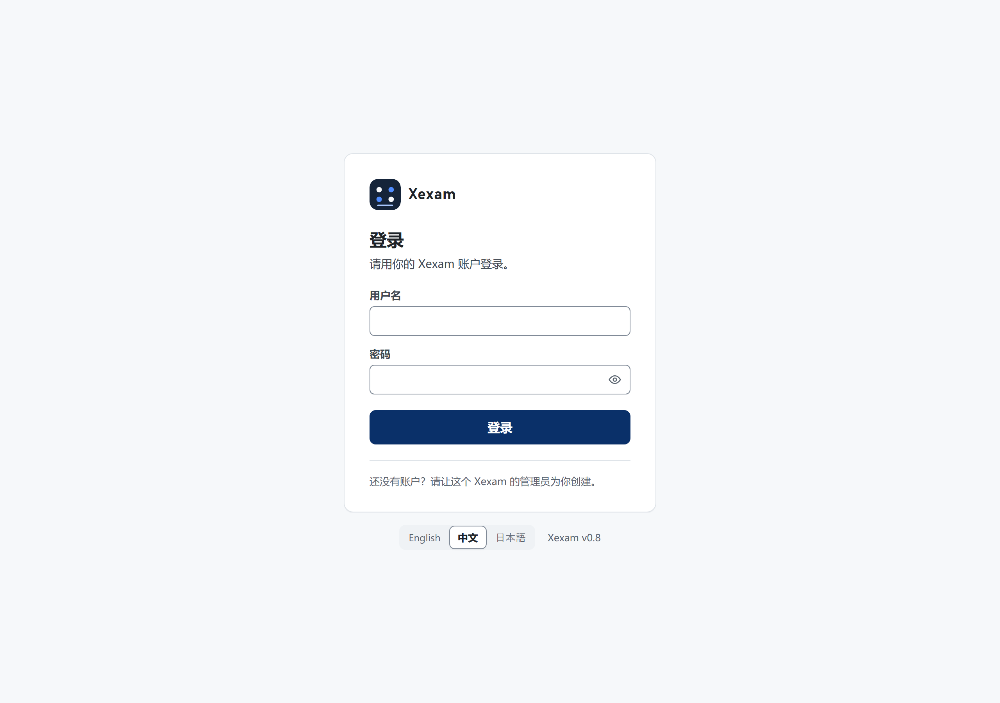</td>
<td width="50%">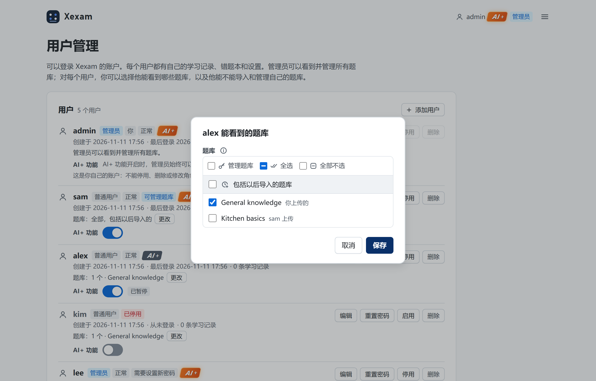</td>
</tr>
<tr>
<td>登录页。</td>
<td><b>alex 能看到的题库</b>：列表上方是 <b>管理题库</b>、<b>全选</b> 和 <b>全部不选</b>，第一项是 <b>包括以后导入的题库</b>，下面是写明上传者的题库；这里只勾选了 General knowledge。</td>
</tr>
</table>

## 15. 系统日志

**系统日志**（菜单里，只有管理员可用；其他人打开会看到 **没有权限**）显示后端自上次启动以来记录的日志，最新的在最下面：启动、登录、对用户的修改、被拒绝的请求或上传等。AI 服务的日志也在这里，以 `AI: ` 开头。

- 页面打开时每 0.5 秒读取一次新内容，并跟着新内容往下滚。往上滚可以看前面的，**跳到最新** 带你回到最下面。读取失败时，它会等更久再试（最长 10 秒），并显示原因；超过 10 秒还没完成的读取会被中断，算作失败。
- **暂停** 暂时不再读取新的日志；**继续** 重新开始读取。
- **级别** 可以显示 **全部**、只显示 **警告**（和错误），或只显示 **错误**；**搜索日志** 按文字筛选。
- 只保留最后 2000 行，而且只在内存里：重启后列表又是空的。更早的日志请在服务器上、compose 文件所在的文件夹里运行 `docker compose logs backend`（不用 Compose 时：`docker logs xexam-backend`）。
- 日志里用用户名指代用户（`user "admin" updated user "alex"`；改名时加上 `(renamed from "…")`）。登录时输入的、没有账户的名字从不记录。日志从不包含密码、会话令牌、Cookie 的值或题目文字。成批出现的被拒绝的请求和失败的登录，每分钟汇总成一行，所以没人能不登录就把其他日志挤出去。
- **AI 的日志**（`AI: …`）：ai-service 的启动和它与后端的连接、AI 设置的修改、测试、开启或关闭 **AI+ 功能**、失败的 AI 调用（同一个原因每分钟最多一行）、对话保留，以及管理员每次查看或删除某个用户的 AI 对话或记忆、暂停或恢复某个用户的 AI+ 功能，例如 `AI: user "admin" cleared one AI chat of user "sam"` 和 `AI: AI function turned off for user "sam" by admin "admin"`（暂停时的日志行）。为用户开启或关闭 **AI+ 功能** 由后端记录：`user "admin" turned AI+ on for user "sam"`。AI 的日志从不包含密钥、消息、回答、对话标题或记忆的内容。后端有一段时间连不上时，ai-service 会在之后补发它保留下来的日志（最多 500 行），并注明丢掉了多少行；关于管理员查看、删除、暂停或恢复的日志从不丢弃。ai-service 每 25 秒发一次的常规报告不写日志，但连接的状态会写：每次连上时写一条 `AI: AI link: connected to the main service`（启动时和每次重新连接后），连接断开时写一条 `AI: AI link: lost the main service`。

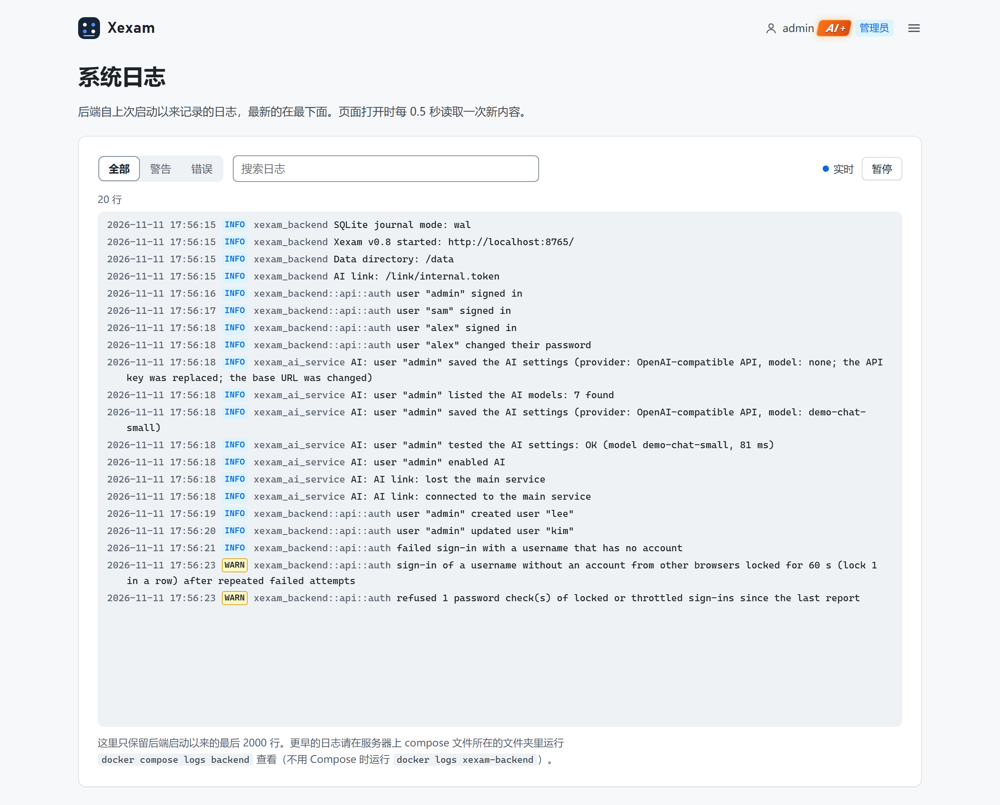

系统日志里是启动时的几行（最后一行是 AI 连接）、admin、sam 和 alex 的登录、AI 服务关于管理员列出模型、保存 AI 设置、测试和开启 AI+ 功能的几行、alex 修改自己的密码、管理员新建 lee 并修改 kim，以及一个编造的用户名被反复猜测直到锁定；上面是 **级别** 筛选、搜索框和 **暂停**，下面是关于更早日志在哪里的说明。

## 16. AI 对话

**AI 对话**（菜单里，在 **学习记录** 和 **用户管理** 之间）是和 AI 模型的对话。管理员在 [AI 设置](#17-ai-设置) 里设置好 AI 并开启 **AI+ 功能** 之后它才会出现；不是管理员的用户，还要管理员在 [用户管理](#14-用户和登录) 里为他开启 **AI+ 功能**（并且没有暂停它）。AI+ 功能开启时，管理员始终可以使用它。AI 在自己的容器 `ai-service` 里运行，用户永远看不到这个名字。连不上 AI 时，菜单里没有 AI 对话，直接打开它会显示 **AI 暂时无法使用，请稍后再试或联系管理员。** 和 **重试**（管理员看到的是 **ai-service 未连接。**）。不能使用 AI、又没有任何对话或记忆的用户，会得到 **AI 对话** 页面和一句简短的说明，写明原因和该怎么做：**管理员已暂停你的 AI+ 功能。如需继续使用，请联系管理员。**、**AI+ 功能暂时不可用，请稍后再试。** 或 **你的账号没有开通 AI+ 功能。管理员可以在用户管理里为你开通。**

- **顶部的说明**：标题下面始终有一行 **管理员可以查看和删除你的 AI 对话和记忆，也能看到你的 AI 用量。** 它不能关掉，也没有弹窗。管理员能看到什么，见 [第 17 节](#17-ai-设置)；管理员的每次查看和每次删除都会写进系统日志，不带任何内容。
- **对话** 和 **记忆** 是标题旁边的两个标签页。宽度在 900 px 以上时，对话列表和打开的对话并排显示；屏幕更窄时一次只显示一个，**全部对话** 带你回到列表。
- **固定高度的窗口**：消息在窗口里滚动，输入框始终在底部，所以很长的对话不会把页面撑大；打开一个对话时从最新的消息开始。消息区域可以用 **Tab** 键到达（它有焦点框，名字是 **消息**），并用方向键滚动。
- **地址会记住对话**：打开的对话在地址栏里是 `#/ai/<id>`，还没发送的新对话是 `#/ai/new`，所以刷新，或再次打开同一个地址，都会显示同一个对话；**新对话** 和 **全部对话** 会回到 `#/ai`。
- **自由模式**（只有管理员）：自由模式不是 AI 对话页面上的开关，而是管理员自己的一种状态，在 **设置** 的 **AI 对话模式** 里选择（[第 9 节](#9-设置)）。开启时，**AI 对话** 标题右边有一个绿色的 **自由模式** 标记；普通模式下什么都不显示，AI 对话页面上没有开关，也没有分隔线。通常每个回答都遵循 Xexam 的学习助手指示，AI 会拿到你的记忆笔记和今天的日期。自由模式下，你发出的每条消息（不管在哪个对话里、新的还是旧的）和每次 **重试**，都会不带这些指示、不带日期、也不带记忆地发给模型：你直接和模型对话，只保留下面的回复语言规则。服务商自己的安全规则始终有效。这个选择从你的下一条消息起生效，保存在服务器上（刷新或换一台设备都能看到），默认是关闭的。每条消息都记录它是在哪种模式下发出的，对话从一种模式变到另一种之后，模型会用一句简短的话得知当前的模式；对话本身没有模式。限制、用量统计、保留、**停止** 和 **重试**、**记住这个**、管理员的查看和系统日志照常；只是自由模式下不使用记忆，而且只有管理员能使用它。
- **回答的语言** 是 **设置** 里选的语言（英语、中文或日语），不管你用什么语言写，除非你在那条消息里要求用另一种语言。用 **记住这个** 生成的记忆笔记也用这种语言写。每条消息使用当时设置的语言，所以切换界面语言会改变下一个回答的语言。
- **对话列表**：**新对话**，然后是你的对话，最新的在最上面，每个都有标题（第一条消息的开头，最多 60 个字符）、最后一条消息的时间（打开的对话在生成回答时，这一行改写成 **正在回答…**，或 **正在思考…**）和一个删除按钮；下面是 **删除全部对话**（红色边框的按钮）和对话保留多久，例如 **对话在最后一条消息 90 天后自动删除。** 发出第一条消息时才会创建对话。还没有消息的新对话会写着 **提一个问题开始对话。AI 会用简体中文回答（设置里选择的语言）。**（带你的语言自己的名字）。
- **消息**：你的消息按你写的样子显示；回答带简单的格式（粗体、斜体、行内代码、代码块、列表；标题变成粗体的一行，链接显示成普通文字，从不显示成链接）。每条消息上方是 **你** 或带模型名的 **AI**，以及时间。下方是 **复制**（空消息上不显示），你自己的消息下面还有 **记住这个**（见下面的记忆）。
- **写消息**：底部的输入框（**想问什么都可以…**）。在电脑上 **Enter** 发送，**Shift+Enter** 换行；在触摸屏上 **Enter** 换行。**Ctrl+Enter**（Mac 上是 **Cmd+Enter**）在哪里都是发送。输入法还在组词时（中文或日语输入），什么都不会发送。一条消息最多 16 000 个字符（管理员可以修改）；接近上限时会出现计数。
- **回答生成时**，它会一段一段地出现，下面显示 **正在回答…**（推理模型在说第一句话之前还在思考时，显示 **正在思考…**；它思考的内容从不显示，也不保存）；往上滚时会出现 **跳到最新**。你已经可以输入下一个问题，回答结束后就能发送。**发送** 按钮变成 **停止**：**停止** 结束这个回答，保留已经生成的文字，并标记为 **已停止**。（双击 **发送** 只会发送；发送后 0.4 秒内点 **停止** 会被忽略，所以双击不会停掉刚开始的回答。）
- **离开页面，回答也会继续**：关掉标签页、刷新、切换应用或锁定手机都不会让它停下。AI 服务会继续生成并保存它；你回来时，对话显示已经生成的文字，并接着往下显示，直到回答结束。
- **出问题时**，回答保留已经有的文字，并在下面写明原因：**回答中断：…** 或 **没有回答：…**（例如 AI 服务商太忙或没有及时回应），或者 **回答达到了模型的长度上限。** AI 的设置有问题时（密钥被拒绝、额度用完、模型不存在），用户看到的是 **AI 现在没有正确设置，请告诉管理员。** 对话的最后一个回答失败或被停止时，它下面的 **重试** 会在原位置重新生成这个回答，用的是现在的模式；焦点回到输入框，你在里面输入的内容保持不变。
- **一次一个回答**：默认每个用户同时只能有一个回答在生成；再发一个会显示 **上一个回答还在生成，请等它结束或按停止。**（管理员最多可以允许四个，但同一个对话里永远不会同时有两个）。一个对话最多 400 条消息（之后请 **开始一个新对话**），每个用户最多 1000 个对话（之后请删掉一些旧的）；两者管理员都可以修改。
- **删除**：对话的删除按钮和 **删除全部对话** 都会先问你。删除的对话马上就没了，管理员也看不到了；之前做的备份里仍然有它。
- **只读**：你不能使用 AI 时，只要你还有对话或记忆，就仍然保留 AI 对话，顶部有一行写着原因，用的是深色徽章提示框里的话，后面接着 **你仍然可以查看和删除自己的对话和记忆。**：**AI+ 功能已被管理员暂停。**、**你的账号没有开通 AI+ 功能。**（你没有 AI+ 功能）或 **AI 暂时无法使用，请稍后再试或联系管理员。**（AI 设置里的 AI+ 功能已关闭，或者 ai-service 没有连接）。可以查看和删除，但不能写消息、重试或记住。正在生成的回答会在开关改变后大约 2 秒内停止，而暂停会让它立即停止。

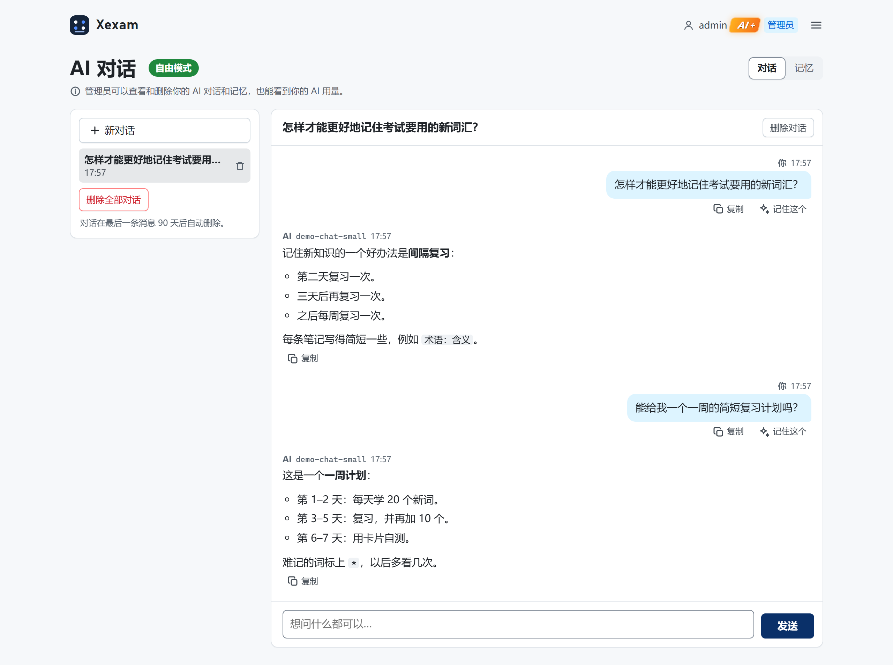

以管理员身份打开的 AI 对话（名字旁边有 **AI+** 徽章，自由模式开启）：标题右边绿色的 **自由模式** 标记，标题下面的说明，带 **新对话**、**删除全部对话** 和保留时间那一行的对话列表，以及一个向虚构的服务商提了两个问题的对话和它的回答（粗体字、列表、行内代码），每条消息上方是 **你** 或带模型名的 **AI** 和时间，下方有 **复制**，问题下面有 **记住这个**，还有带 **发送** 的输入框。普通模式下不显示这个标记；AI 对话本身没有模式开关（在 **设置** 的 **AI 对话模式** 里选择）。

**记忆** 是关于你的一些简短笔记，AI 在每次对话中都会拿到它们（**AI 会在每次对话中参考这些记忆。**），例如你正在准备的考试。

- **记忆** 标签页列出这些笔记，每条都写着是 **来自对话** 还是 **手动添加**，带 **编辑** 和 **删除**，还有 **删除全部记忆**（红色边框）。**Esc** 取消编辑，并把焦点放回它的 **编辑** 按钮。**新记忆** 输入框和 **添加** 用来添加一条；计数显示已经用了多少字符、最多多少。默认最多可以保存 50 条，每条最多 300 个字符。
- 你的某条消息下面的 **记住这个** 会请 AI 把这条消息整理成一条简短的笔记。笔记以 **保存到记忆？** 出现在回答下面一个可以编辑的框里：**保存** 留下它，**暂不** 丢掉它。消息以「Remember …」或「Please remember …」开头时（中文是 记住 或 请记住，日语是 覚えておいて，或者以 覚えておいて 结尾），回答结束后会自动提出笔记。不点 **保存** 就什么都不会保存。
- 对话保留不会删除笔记；它们一直保留，直到你（或管理员）删除。

AI 服务商收到的内容：你的消息、同一个对话里以前的消息、学习助手的指示（带你设置里的语言）、你的记忆笔记和今天的日期。历史限制在最新的、默认合计约 24 000 个字符以内的那些消息，而且总是用同样的方式缩短：最新的 4 条消息完整保留，更早的回答截到 800 个字符（带「…(shortened)」标记），更早的提问截到 2000 个字符。自由模式下，它只收到这段历史、你的消息和语言规则，另外在对话从一种模式变到另一种之后，还有一句点明当前模式的简短的话。服务商可以把这样的请求的开头保存在它的提示缓存里，让之后的请求更便宜、更快：Anthropic 在指示和你的新问题之前的历史上设置缓存点；OpenAI 格式的服务商在支持时自己缓存。从缓存里提供的 Token 在 AI 设置的用量里显示为 **缓存命中**。你的题库或学习记录里的任何内容都不会发送，除非你把它贴进消息里。

## 17. AI 设置

**AI 设置**（菜单里，只有管理员可用；其他人会看到 **只有管理员可以打开 AI 设置。**）是接入、测试、开启和查看 AI 的地方。ai-service 没有运行时，页面也能打开。

**连接 ai-service。** 页面先问主服务 ai-service 有没有连接：ai-service 会在启动时、有变化时马上、每 25 秒，以及停止时，向主服务报告自己的状态；超过 60 秒的报告算作没有连接。已连接时，标记下面有一行 **ai-service 已连接（版本 0.8；最后一次报告：15:04）。**，下面的设置会加载出来。没有连接时，页面只显示一个面板 **ai-service 连接状态**，写明原因，还有 **最后一次报告：…**（或 **主服务启动后还没有收到报告。**）、**版本：…**、**本页面每 10 秒自动重新检查。** 和 **重试**；ai-service 一连上，设置就会自己出现。原因有：

| 面板上写的 | 意思 | 怎么办 |
|---|---|---|
| **主服务暂时连不上，请稍后再试。** | 浏览器得不到主服务（后端）的回应 | 检查 `xexam-backend` 是否在运行 |
| **主服务没有内部令牌，ai-service 无法连接。** | 主服务里的 AI 链接是关闭的 | 看主服务的日志，以 `AI link off` 开头的那一行 |
| **ai-service 没有运行，或者连不上。** | 没有任何东西在响应 ai-service | 检查 `ai-service` 容器是否在运行；从 v0.7.5 升级之后，请下载新的 `docker-compose.yml`（它新增了这个容器） |
| **ai-service 已停止，请重新启动 ai-service 容器。** | 它最后一次报告说它正在停止 | 再次启动 `ai-service` 容器 |
| **ai-service 正在运行，但没有连上主服务。** | 它有响应，但它的报告不被接受 | 检查两个服务的 `XEXAM_INTERNAL_TOKEN` 相同（或都不设置），并且 `XEXAM_AI_BACKEND_URL` 指向主服务 |
| **ai-service 正在运行，但主服务启动后还没有收到它的报告。** | 它刚刚启动 | 等一等：它每 25 秒报告一次 |

关于主服务的那条文字只在主服务本身连不上时才出现；ai-service 不在时，从不怪到它头上。

顶部有四个标记，显示设置进行到哪一步：**连接已保存**（或 **连接未设置**）、**模型已保存**（**模型未设置**）、**测试成功**（**测试失败**、**未测试**）和 **AI+ 功能已开启**（**AI+ 功能已关闭**；这一个显示全局开关的状态）。全新安装时，以及只保存过对话保留天数时，第一个标记是 **连接未设置**，在保存连接之前，页面不会向服务商请求模型列表。已保存的密钥无法再解密时（AI 加密密钥被更换或丢失，见 [deployment.md](deployment.md) 第 3.2 节），会有一条提示：请重新输入密钥，然后测试并开启 AI+ 功能。接下来是这几部分：

1. **连接**：**服务商**，以及它的地址和密钥。
   - **OpenAI 兼容 API**（默认）：**API 地址**（一开始是 `https://api.openai.com/v1`；OpenAI 兼容地址通常以 `/v1` 结尾，本地服务器的地址也是）和 **API 密钥**。
   - **Anthropic**：**API 地址**（`https://api.anthropic.com`；末尾的 `/v1` 会被去掉，因为 Xexam 自己会加上 `/v1/messages`）和 **API 密钥**。
   - **Cloudflare AI Gateway**：**网关地址**，例如 `https://ai-gateway.example.com/<route>`（`…/openai` 或 `…/anthropic`）；**API 格式**，OpenAI（chat completions）或 Anthropic（messages），按地址的最后一段自动填好，也可以改；**网关认证方式**：`Authorization: Bearer`、`x-api-key` 或 `cf-aig-authorization`；**网关 API 密钥**；以及 **服务商密钥（仅在网关需要时填写）**，网关自己保存了服务商的密钥时就不需要。
   - 密钥输入框总是空的（输入框旁边的眼睛按钮是 **显示密钥** / **隐藏密钥**，只显示你自己输入的内容）。每个下面写着 **已保存：…1234**（最后四个字符，只对 12 个字符以上的密钥显示）、**已保存**、**未设置** 或 **无法解密，请重新输入**。输入框留空就保留已保存的密钥；**删除这个密钥** 删除它。密钥是 1–400 个可见字符，不能有空格。
   - **已保存的密钥绝不会自己发到新的地址**：你更换服务商，或者把地址改到另一台服务器（另一种协议、另一个主机或端口）时，每个已保存的密钥都必须重新输入（这时留空则删除它）。同一台服务器上的新路径，例如同一个网关上从 `/openai` 改成 `/anthropic`，会保留密钥。
   - `http://` 地址会显示警告 **这个地址使用 http://，密钥会以明文发送。**（`localhost`、`127.0.0.1` 和不带点的名字不会，例如同一个 Docker 网络里的容器）。
   - 网关认证方式是 `Authorization: Bearer`（OpenAI 格式）或 `x-api-key`（Anthropic 格式）时，网关密钥和服务商密钥要用同一个请求头；这时请选 `cf-aig-authorization`，或者删除服务商密钥。
   - **保存**。AI+ 功能开启着、而且这次修改需要重新测试时，Xexam 会先问你（**保存后，AI+ 功能会对所有人关闭。新设置测试成功后，请重新开启 AI+ 功能。要保存吗？**），然后保存并告诉你（**AI 设置已保存。AI+ 功能已对所有人关闭：请测试新设置，然后重新开启 AI+ 功能。**）。保存之后会自动列出模型。只保存对话保留天数或安全上限，从不会关闭任何东西。
2. **模型**：**当前模型：…**，然后是一个输入框，带有自己的可滚动列表，列出服务商提供的模型（输入文字可以筛选；没有符合的时显示 **没有匹配的模型。**），还有 **刷新列表** 和 **保存模型**。大概不是对话模型的模型（名字表明是向量嵌入、重排序、安全分类、图像生成、语音、文档解析或仅图像的模型）排在最后，每个带一个小标签（**向量嵌入**、**重排序**、**安全分类**、**图像生成**、**语音**、**文档解析**、**仅图像**）；你输入、选中或保存了其中一个时，会有一条提示（**… 看起来是向量嵌入模型，不是对话模型。AI 对话需要对话模型；测试可以确认它能不能用。**）。没有任何模型被隐藏：每个模型都可以保存。服务商不提供模型列表时，请手动输入模型 ID。换成另一个模型保存后，也需要重新测试。连接表单里有没保存的修改时，获取列表和测试都会等着：**请先保存连接设置。**
3. **测试并开启**：**测试** 用已保存的设置发送一个简短的请求（「Test」），方式和对话一样（模型输入框里的模型和已保存的不一样时，按钮显示 **保存模型并测试**，会先保存它）。运行时它会数秒（**正在测试…（12 秒）**），并提示 **较慢的模型可能需要一两分钟。** 然后显示 **测试成功（… 毫秒）。现在可以开启 AI+ 功能。**（功能已开启时：**测试成功（… 毫秒）。**）或 **测试失败：…** 和一条建议（检查密钥；换一个模型或检查地址；这个模型可能太慢或暂时不可用；或者确认 `ai-service` 容器在 `egress` 网络上），以及 **上次测试成功：…**。**测试** 下面那一行总是跟着它旁边的开关，两个方向都一样。来自设置的失败（密钥被拒绝、额度或余额不足、模型或地址不存在、请求被拒绝、回应无法读取）会关闭 AI+ 功能；服务商的临时问题（限流、过载、服务商内部出错、没有及时回应、连接不上）不会：**AI+ 功能保持开启：这看起来是 AI 服务商的临时问题。** 只有当前设置的测试通过后，才能打开 **AI+ 功能** 开关（否则会提示 **请先保存设置并通过测试。**）；测试通过本身绝不会自动开启它。打开后它显示 **AI+ 功能已开启。**（或 **AI+ 功能已关闭。**），主服务马上就会知道，所以 **用户管理** 会显示或隐藏 AI+ 开关。关闭它会马上停止所有正在生成的回答。测试之后和切换开关之后，**AI+ 用户** 列表会重新读取。
   - 服务商较慢时，测试可能要等一会儿：最多 2 分钟；服务商拒绝第一次请求时，还会用调整过的设置再试一次。在 Cloudflare Tunnel 后面，Cloudflare 可能在大约 100 秒后切断请求；测试仍然会完成，刷新页面就能看到结果。
4. **AI+ 用户**：每个管理员，以及每个有 **AI+ 功能**（用户管理里的开关）的用户，被暂停的也包括在内，列有 **用户**、**徽章**（明亮、深色或没有，见 [第 14 节](#14-用户和登录)；管理员看到的是提示框里管理员版本的文字）、**角色**、**AI+ 功能** 状态、**对话**、**记忆**、**输入 Token**、**输出 Token**、**最近使用** 和 **查看**。窗口窄于 900 px 时，两列 Token 会省掉（它们在 **用量** 里），时间可能折行，这样表格在平板上也放得下；窄于 560 px 时，每个用户是一张小卡片，第一行是名字和 **查看**，之后每个字段一行「列名：值」。（在用户管理里删除的账户，它的 AI 数据会在这个列表加载时删除，此外每 10 分钟也会删一次。）
   - **AI+ 功能** 状态：**使用中** 或 **已暂停**，带一个按钮，**暂停** 或 **恢复**（管理员那一格写着 **管理员始终可以使用 AI。**，没有按钮）。不会要求确认。**暂停** 会让那个用户正在生成的回答立即停止，从那以后他可以查看和删除自己的对话和记忆，但不能写消息、重试或记住（AI 对话的只读那一行写着 **AI+ 功能已被管理员暂停。**）。**恢复** 把这个功能还给他。这个用户仍然在列表里，保留自己的数据，用户管理里的 **AI+ 功能** 开关也不会被动。暂停会一直保持到 **恢复**，即使这个用户的 AI+ 功能被关闭再打开也一样。系统日志会记录两者，例如 `AI: AI function turned off for user "sam" by admin "admin"`（暂停）。在用户管理里关闭了 **AI+ 功能** 的用户会从这个列表里消失；他的对话和记忆保留（他仍然可以查看和删除），直到被删除或对话保留期把对话删掉。
   - **查看** 会打开例如 **sam 的 AI 数据**，标着 **只读**，里面是对话（每条消息都写着是谁写的和时间）和记忆；点一个对话就能看。**删除这个对话**、**删除全部对话** 和 **删除全部记忆** 会先问你（确认按钮写着 **删除**）。删除之后焦点仍留在对话框里。查看窗口里不显示任何关于自由模式或普通模式的内容。每次查看和每次删除都会按用户名写进系统日志，例如 `AI: user "admin" viewed the AI chats and memories of user "sam"`，从不带任何内容。
5. **用量**：**最近 7 天**、**30 天**、**90 天** 或 **365 天** 的：合计（**调用次数**、**输入 Token**、**输出 Token**、**缓存命中**、**错误**），然后是 **按用户**、**按模型** 和 **按时间**（7 天和 30 天按天，90 天和 365 天按月）。**缓存命中** 是 **输入 Token** 里由服务商从它的提示缓存提供的那一部分（服务商不报告时为 0）。调用包括测试、获取模型列表（**模型列表** 那一行）和记忆笔记。已删除的用户合并成一行 **已删除的用户**。Token 按服务商报告的数字计算；不报告的服务商计为 0。只保存数字，从不保存问了什么、答了什么。日期按 AI 服务的时区（`TZ`）划分。
6. **对话保留**：**对话保留天数**，1 到 3650，默认 90。对话在最后一条消息后经过这么多天就会删除（每小时检查一次）；记忆不受影响。
7. **安全上限**：**这些上限用来保护服务器，不是用量限制。** 七个数值，每个都写着范围和默认值，还有 **恢复默认值** 和 **保存**。修改马上生效，而且从不关闭 AI。调低上限不会删除或缩短任何东西：它只拒绝超出上限的新对话、新消息或新笔记。每次修改都会写进系统日志，例如 `AI limits changed by admin "admin": chatsPerUser 1000 -> 2000`。

   | 上限 | 默认 | 范围 |
   |---|---|---|
   | **每个用户同时生成的回答数** | 1 | 1–4 |
   | **同时进行的模型调用数（整个服务器）**，包括管理员的测试 | 16 | 1–64 |
   | **每个用户的对话数** | 1000 | 10–100000 |
   | **每个对话的消息数** | 400 | 20–5000 |
   | **每个用户的记忆数** | 50 | 1–1000 |
   | **每条记忆的字符数** | 300 | 50–2000 |
   | **每条消息的字符数** | 16000 | 1000–32000 |

   Token、调用次数和费用都没有限制。

<table>
<tr>
<td width="50%">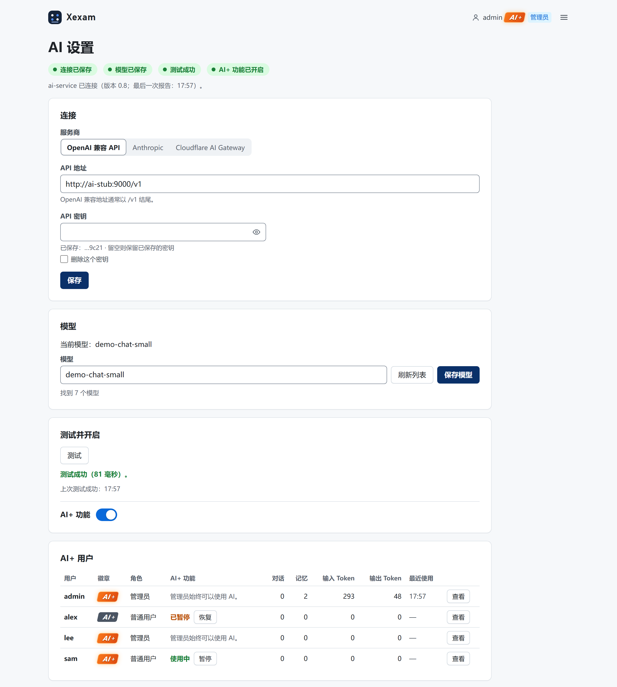</td>
<td width="50%">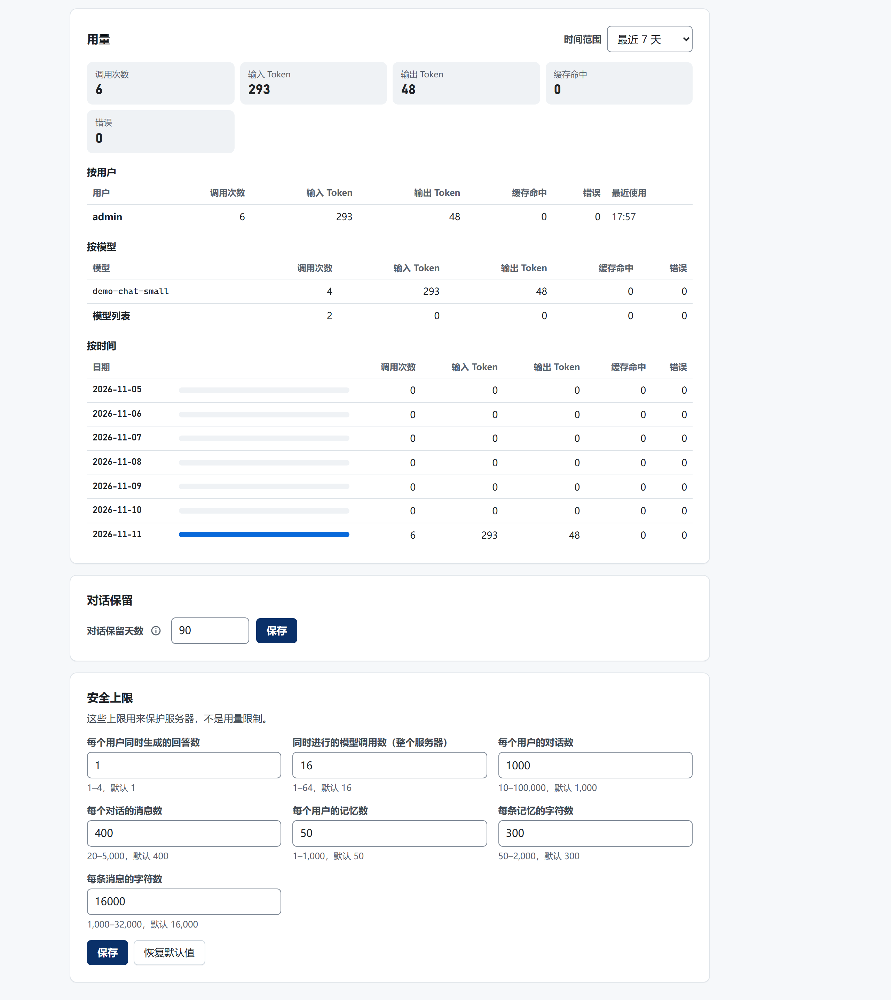</td>
</tr>
<tr>
<td>接入虚构服务商（<code>http://ai-stub:9000/v1</code>；这些图里的一切都是编造的）的 AI 设置：标记和 <b>ai-service 已连接</b> 那一行，密钥只显示为 <b>已保存：…9c21</b>，模型，<b>测试成功</b>，开启着的 <b>AI+ 功能</b>，以及 <b>AI+ 用户</b>（两个管理员，<b>使用中</b> 的 sam 带 <b>暂停</b>，<b>已暂停</b> 的 alex 带 <b>恢复</b>，各自带徽章）。</td>
<td>再往下：<b>用量</b>（这里是 6 次调用，获取模型列表的调用在 <b>模型列表</b> 那一行；虚构的服务商不缓存任何内容，所以 <b>缓存命中</b> 一列是 0），<b>对话保留</b> 和 <b>安全上限</b>。</td>
</tr>
</table>

**一步一步设置 AI**：确认 **AI 设置** 里写着 **ai-service 已连接**；选择服务商，填好地址和密钥，**保存**；从列表里选一个模型（或输入它的 ID），**保存模型**；**测试**；开启 **AI+ 功能**；然后在 **用户管理** 里为可以使用的用户开启 **AI+ 功能**（上面的步骤做完后，开关才会出现），并在这里的 **AI+ 用户** 下面暂停或恢复某个用户的 **AI+ 功能**。想直接和模型对话的管理员，在 **设置** 的 **AI 对话模式** 里选 **自由模式**。ai-service 在哪里运行、它怎样连到服务商、每个服务商需要什么：见 [deployment.md](deployment.md) 第 3.4 节。

## 18. 在 iPhone 上使用

- 在 iPhone 的 Safari 里打开服务地址（先按 [deployment.md](deployment.md) 第 4 节做，让手机能连到 Xexam）。需要 **iOS 15.4 或更新**。
- 点分享按钮 → **添加到主屏幕**。之后它像独立应用一样全屏打开，图标是 Xexam 的图标：藏青色方块上有四个点和一条浅蓝色的横条。
- 右上角三条横线的按钮打开和电脑上一样的小菜单。
- 主页上，**全部** 和 **错题本** 留在 **开始考试或练习** 标题旁边（英语和日语界面只显示图标和题数）。屏幕底部那一栏有两行：第一行是当前范围、**题数** 和 **打乱顺序**；第二行是 **开始考试**（较宽的那个）和 **开始练习**。
- 考试和练习页上，**上一题**、**下一题** 和 **稍后再看** 固定在底部；答题卡在题目下方，**已答 x / n 题** 和 **交卷**（或 **结束练习**）在小方块上面。
- 学习记录显示成紧凑的卡片。
- **AI 对话** 一次只显示对话列表或一个对话（**全部对话** 返回列表）；输入框始终在屏幕底部。
- 按钮和其他触控区域都不小于 44 px；刘海和底部横条的安全区已处理。

下面是 390 px 宽的 iPhone 上的截图：

<table>
<tr>
<td width="25%">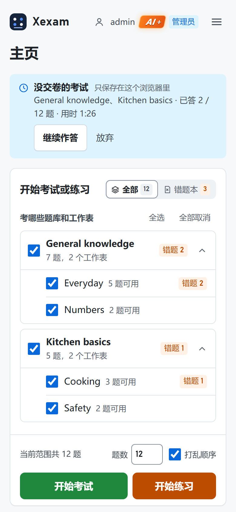</td>
<td width="25%">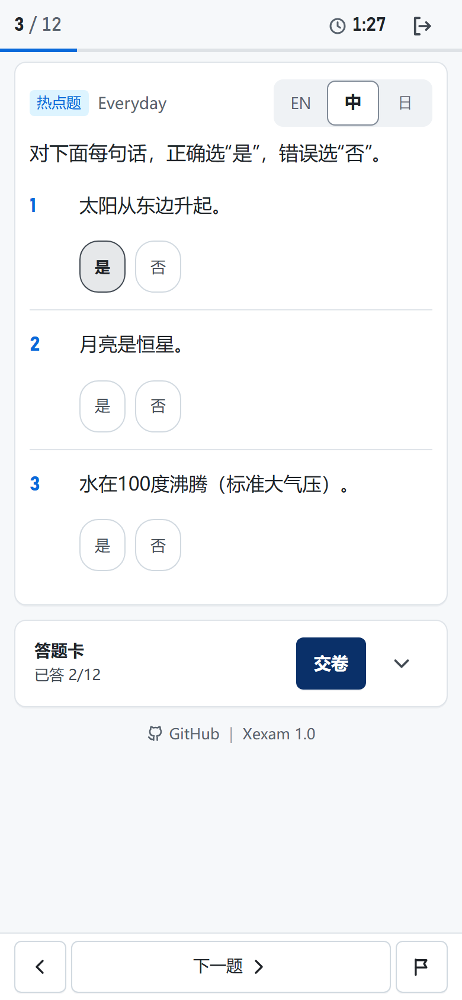</td>
<td width="25%">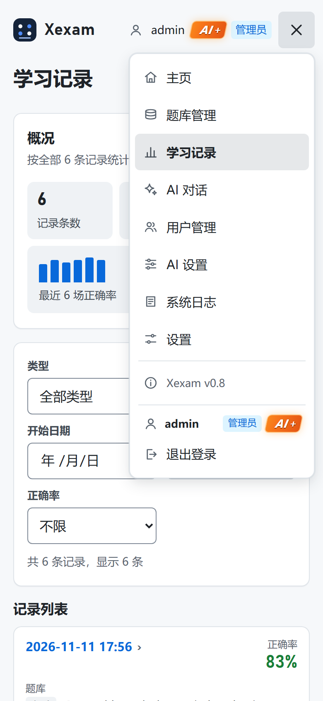</td>
<td width="25%">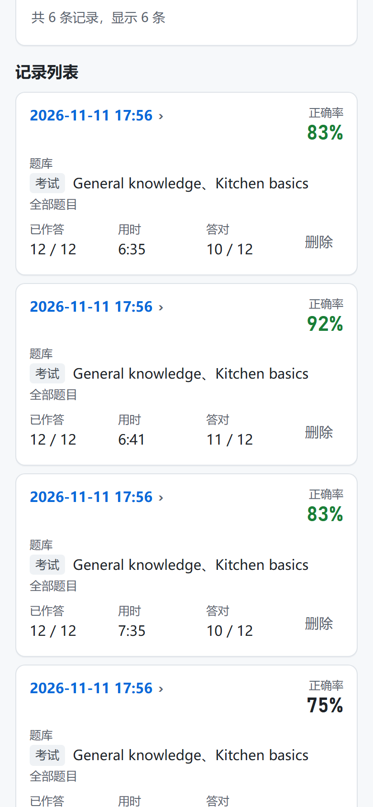</td>
</tr>
<tr>
<td>主页：当前范围、<b>题数</b> 和 <b>打乱顺序</b>，下面是 <b>开始考试</b> 和 <b>开始练习</b>，都在屏幕底部。</td>
<td>考试：<b>上一题</b>、<b>下一题</b> 和 <b>稍后再看</b> 固定在底部。</td>
<td>管理员的菜单，点三条横线的按钮打开。</td>
<td>学习记录：每条记录是一张紧凑的卡片。</td>
</tr>
</table>

## 19. 页面显示「请求太频繁」时

Xexam 的 Nginx 限制每秒从同一个地址到达后端的请求数（见 [security.md](security.md) 第 9 节）。在 Cloudflare Tunnel 这样的隧道后面，每个用户都来自隧道的地址，所以所有人共用这个额度。达到额度时，页面会自己重试它正在读取的内容（总共三次，每次间隔一两秒）；保存或其他任何修改不会重试。如果请求仍然被拒绝，页面会显示 **请求太频繁**：等几秒，然后刷新页面或再试一次。这和密码输错后的登录锁定不同，那种锁定会写明要等多久。

AI 对话在 Nginx 里有自己的限制：开始生成回答（**发送** 和 **重试**）按登录的浏览器限制，突发 10 次之后每分钟 20 次。被拒绝的开始不会重试；输入框保留你的文字，并提示请求太多。
